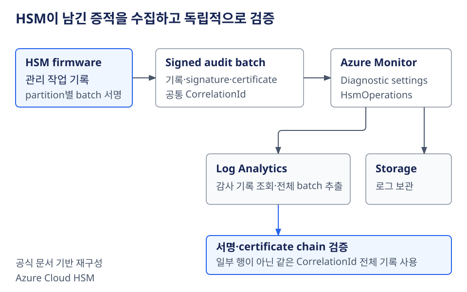
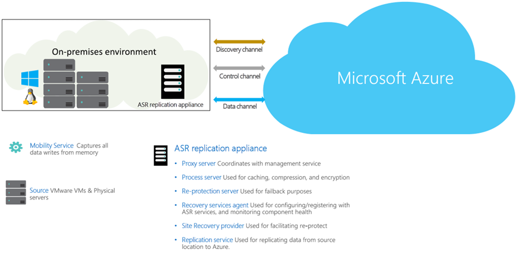

# Azure 일일 업데이트 브리핑 — 2026-10-15

**Azure Cloud HSM hardware audit logging**이 GA로 공개됐습니다.
HSM이 생성·서명한 관리 작업 기록을 수집하고, 감사 증적의 무결성과 출처를
독립적으로 검증할 수 있습니다. **Azure Site Recovery**는
Azure Arc로 관리하는 Windows VMware VM·물리 서버를 기존 Arc 구성과
호환되도록 보호합니다.

**이번 보고서의 업데이트**

- **Infra:** [Cloud HSM — hardware audit logging GA](#cloud-hsm-hardware-audit) ·
  [Site Recovery — Arc-enabled Windows 서버 보호 GA](#site-recovery-arc-windows)

## 주요 업데이트

### Azure Cloud HSM — hardware audit logging GA { #cloud-hsm-hardware-audit }

**서비스가 관측한 요청을 넘어, HSM이 직접 생성·서명한 감사 증적 확보**

Azure Cloud HSM은 암호화 key를 보관하고 암호 연산을 수행하는
single-tenant HSM 서비스입니다. 고객이 HSM 관리 권한을 가지므로,
누가 로그인하고 key를 생성·삭제하거나 백업했는지 추적하는 감사 기록이 중요합니다.
Cloud HSM 서비스가 관측한 요청을 남기는 `HsmServiceOperations`와 달리,
이번 GA의 **`HsmOperations`는 HSM firmware가 생성한 관리 작업 기록**입니다.

기록은 HSM partition별 batch로 모이고, HSM이 partition certificate key로
서명합니다. 사람이 읽을 수 있는 기록뿐 아니라 서명된 binary audit data와
signature·certificate도 제공하므로, 단순한 이벤트 조회에서 나아가
**내려받은 감사 batch의 무결성과 출처를 검증**할 수 있습니다.
이는 로그 보관 자체가 아니라, 보관한 기록을 신뢰할 근거를 확인하는 기능입니다.
[기능 개요](https://learn.microsoft.com/azure/cloud-hsm/tutorial-hsm-operation-audit-logs)

*공식 문서 기반 재구성:
Microsoft Learn [HSM operation audit logs](https://learn.microsoft.com/azure/cloud-hsm/tutorial-hsm-operation-audit-logs).
그림을 선택하면 원본 크기로 볼 수 있습니다.*

**수집부터 검증까지**

1. HSM이 로그인·사용자 관리·key 생성과 삭제·import와 export·백업과 복원 등
   지원되는 관리 작업을 기록합니다. 모든 암호 연산을 포괄하는 로그는 아니며,
   read-only query와 공식 목록에 없는 작업은 기록하지 않습니다.
2. 같은 batch의 기록에는 동일한 `CorrelationId`가 붙습니다.
   이를 통해 관리 작업과 해당 batch의 signature·public certificate 기록을 연결합니다.
3. Azure Monitor diagnostic settings에서 `HsmOperations`를 켜고
   Storage account·Log Analytics workspace로 내보냅니다.
   Log Analytics에서는 **`CloudHsmHardwareOperationAuditLogs`** 테이블을 조회합니다.
4. 검증할 때는 해당 `CorrelationId`의 **전체 기록**을 내려받아
   Microsoft의 audit log utility로 batch signature와 certificate chain을 확인합니다.
   `take`·`limit`로 일부만 추출하면 검증에 필요한 batch가 불완전해질 수 있습니다.

`HsmServiceOperations`를 함께 수집하면 서비스 측 troubleshooting 기록을
보완할 수 있지만, HSM 관리 작업 감사의 주된 근거는 `HsmOperations`입니다.
서명은 변조 여부를 확인하는 수단이지, 저장소 접근 통제를 대신하지 않습니다.
로그에 user ID·session handle·key handle 등 운영 식별자가 포함될 수 있으므로
**destination의 접근 권한을 제한**해야 합니다.

Diagnostic settings는 설정 이전 로그를 소급 수집하지 않습니다.
감사 보존이 필요하다면 필요한 범주와 destination을 먼저 구성해야 합니다.

**공식 자료:**
[GA 발표](https://azure.microsoft.com/updates?id=576377) ·
[Cloud HSM 개요](https://learn.microsoft.com/azure/cloud-hsm/overview) ·
[로그 범주·수집·batch 검증](https://learn.microsoft.com/azure/cloud-hsm/tutorial-hsm-operation-audit-logs)

### Azure Site Recovery — Arc-enabled Windows 서버 보호 GA { #site-recovery-arc-windows }

**Arc의 governance·inventory·monitoring 구성을 유지하면서 Azure DR 보호 추가**

Azure Site Recovery는 원본 서버의 데이터를 Azure에 복제하고,
장애 시 복구 지점으로 Azure VM을 만들어 워크로드를 복구하는 서비스입니다.
Azure Arc는 온프레미스 서버를 Azure의 governance·inventory·monitoring·관리
체계에 연결합니다. 두 서비스는 각각 복구와 관리를 담당하지만,
기존에는 Arc가 설치된 Windows VMware VM·물리 서버에서
Site Recovery 보호를 설정할 때 호환성 문제가 발생할 수 있었습니다.

이번 GA는 **원본 서버의 Arc service를 감지하고, 보호 활성화 과정에서
기존 Arc 구성과의 호환성을 유지**하도록 지원합니다.
Arc 기반 관리를 중단하지 않고 같은 Windows 서버에 DR 보호를 추가하는 것이
핵심 변화입니다. Arc가 복제 엔진을 대신하거나,
Arc 연결만으로 DR이 자동 구성되는 기능은 아닙니다.
[변경 설명](https://learn.microsoft.com/azure/site-recovery/feature-updates-whats-new#azure-site-recovery-support-for-azure-arc-enabled-windows-vmwarephysical-servers)

*출처: Microsoft Learn,
[VMware to Azure disaster recovery architecture — Modernized](https://learn.microsoft.com/azure/site-recovery/vmware-azure-architecture-modernized#architectural-components).
VMware·물리 서버 복제의 공통 구성 요소를 설명하는 공식 원본이며,
Arc 호환성 변경 자체를 그린 그림은 아닙니다. 그림을 선택하면 원본 크기로 볼 수 있습니다.*

**데이터가 복구 지점이 되는 과정**

- **원본 서버:** 각 서버의 Mobility Service가 block-level 변경을 추적합니다.
  이번 추가 지원은 이 원본이 **Arc-enabled Windows VMware VM 또는
  온프레미스 물리 서버**인 경우입니다.
- **Replication appliance:** 온프레미스에서 복제를 조정합니다.
  Process server는 변경 데이터를 받아 caching·compression·encryption을 거쳐
  Azure Storage로 전송합니다.
- **Azure:** cache Storage account에 도착한 복제 데이터를 처리해
  Managed Disk에 반영하고 복구 지점을 만듭니다.
  초기 데이터 복제 후에는 변경분을 복제합니다.
- **Failover:** test failover로 복구를 점검한 뒤, 장애 시 선택한 복구 지점에서
  Azure VM을 생성해 Azure virtual network에 연결합니다.

이번 변경으로 기존 Arc 관리 체계와 Site Recovery를 함께 적용할 수 있는 범위가
명확해졌습니다. 다만 복제 인프라·정책과 Azure 측 복구 자원 구성은 여전히 필요하며,
실제 도입 전에는 원본 OS·disk·network 조건을
[지원 매트릭스](https://learn.microsoft.com/azure/site-recovery/vmware-physical-azure-support-matrix)와 대조해야 합니다.
**물리 서버로의 failback은 지원하지 않습니다.**
VMware VM의 failback과 물리 서버의 복구 경로를 같은 것으로 취급하면 안 됩니다.

별도 문서의 **Hyper-V용 Azure Site Recovery configuration tool Public Preview**와는
지원 범위가 다릅니다. 이번 VMware·물리 Windows 서버 호환성 GA를
그 설정 도구 전체의 GA로 해석하지 않습니다.

**공식 자료:**
[GA 발표](https://azure.microsoft.com/updates?id=576214) ·
[Arc 호환성 변경](https://learn.microsoft.com/azure/site-recovery/feature-updates-whats-new) ·
[VMware 복제·failover 구조](https://learn.microsoft.com/azure/site-recovery/vmware-azure-architecture-modernized) ·
[물리 서버 복제·failback 제한](https://learn.microsoft.com/azure/site-recovery/physical-server-azure-architecture-modernized) ·
[별도 Hyper-V 설정 도구](https://learn.microsoft.com/windows-server/manage/azure-arc/azure-site-recovery-for-windows-server)
