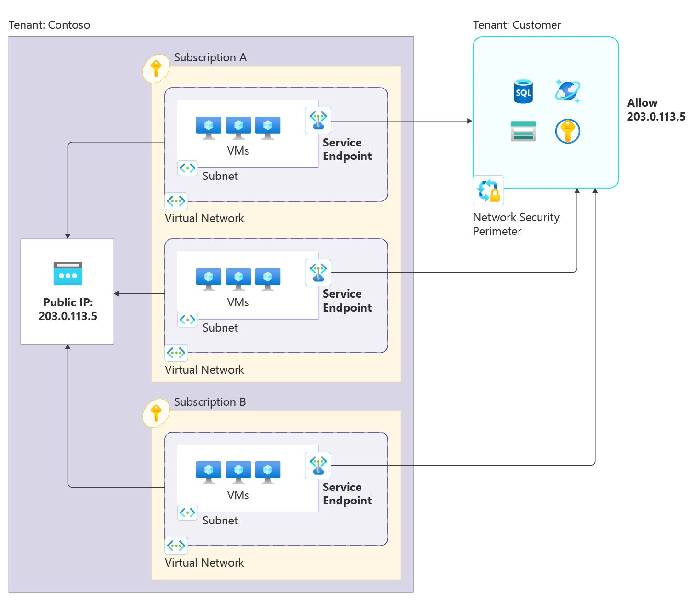
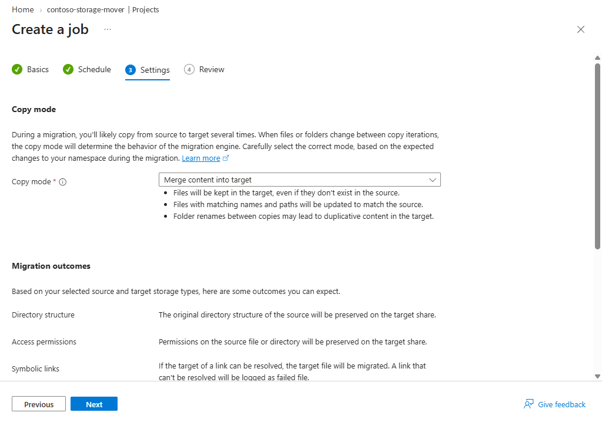
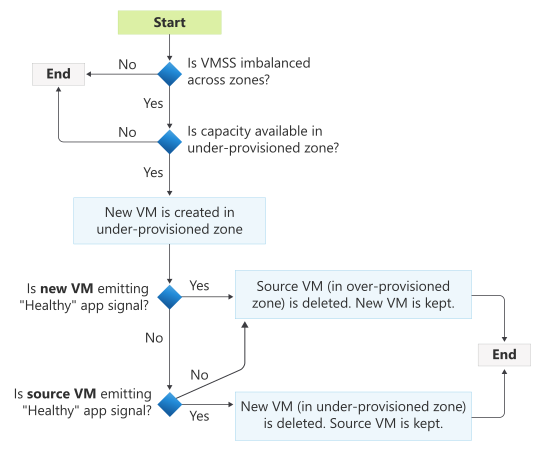

# Azure 일일 업데이트 브리핑 — 2026-10-16

**Standard service endpoint GA**는 여러 VNet·subnet을 공통 network identifier로
묶어 PaaS 접근 규칙을 관리합니다. **Azure Files 간 복사 Public Preview**는
다른 리전·구독의 SMB share로 변경분을 예약 복사하며,
**Virtual Machine Scale Sets의 Automatic zone balance GA**는
VM이 특정 availability zone에 치우쳤을 때 새 VM을 먼저 생성해 재분산합니다.

**이번 보고서의 업데이트**

- **Infra:** [Standard service endpoint — GA](#standard-service-endpoint) ·
  [Azure Files — Storage Mover 기반 복사 Public Preview](#azure-files-copy) ·
  [VM Scale Sets — Automatic zone balance GA](#vmss-auto-zone-balance)

## 주요 업데이트

### Standard service endpoint — GA { #standard-service-endpoint }

**여러 subnet의 PaaS 접근을 공통 network identifier와 network security perimeter로 관리**

Service endpoint는 VNet의 workload가 Azure PaaS 서비스에 접근할 때
네트워크를 기준으로 접근을 제한하는 기능입니다.
기존 basic service endpoint는 subnet별 접근 규칙을 관리해야 하므로
VNet·subnet이 많아질수록 서비스 측 ACL 관리가 복잡해집니다.

이번 GA의 **Standard service endpoint**는 public IP를
**network identifier**로 지정하고, 여러 subnet·VNet이 같은 식별자를 참조하게 합니다.
PaaS 측에서는 **network security perimeter(NSP)**의 IP 기반 inbound rule로
이 식별자를 허용합니다. Subnet이 늘거나 바뀔 때마다 서비스별 ACL을 고치는 대신,
공통 식별자를 기준으로 접근 정책을 관리하는 방식입니다.
[기능 개요](https://learn.microsoft.com/azure/private-link/service-endpoint-standard-overview)

*출처: Microsoft Learn,
[What is a standard service endpoint?](https://learn.microsoft.com/azure/private-link/service-endpoint-standard-overview#how-a-standard-service-endpoint-works).
그림의 IP와 tenant 이름은 공식 예시이며, 식별자 재사용은 같은 tenant·리전 범위입니다.
그림을 선택하면 원본 크기로 볼 수 있습니다.*

**접근이 허용되는 흐름**

1. Public IP 리소스를 network identifier로 만들고 subnet의 service endpoint에 연결합니다.
   이 IP는 **트래픽을 식별하기 위한 값**이지, public IP를 경유시키는 중계 장치가 아닙니다.
2. 같은 tenant·리전의 여러 VNet·구독에서 같은 식별자를 참조할 수 있습니다.
   하나의 subnet에 있는 service endpoint들은 동일한 식별자를 사용해야 합니다.
3. 대상 PaaS 리소스를 NSP에 연결하고 식별자와 일치하는 inbound allow rule을 구성합니다.
   Network identifier가 출발 네트워크를 식별하고, NSP가 접근 허용 여부를 판단합니다.

**Private Link와는 다른 선택지입니다.**
Standard service endpoint는 private endpoint를 만드는 기능이 아니며
PaaS의 public endpoint 노출을 없애지 않습니다.
온프레미스에서 private 경로로 접근하거나 data exfiltration protection이 필요한 경우에는
Private Link와 구분해서 설계해야 합니다.
[연결 방식 비교](https://learn.microsoft.com/azure/private-link/service-endpoint-standard-overview#compare-connectivity-options)

**가용성과 도입 시 주의점**

- 지원 서비스는 **Azure Storage, Azure Key Vault, Azure SQL Database, Azure Cosmos DB**이며,
  공식 문서는 이들 서비스의 network identifier 지원을 모든 Azure 리전에서 GA로 명시합니다.
- **식별자 자체의 cross-region 공유는 지원하지 않습니다.**
  다만 VNet과 PaaS 리소스의 리전이 다른 연결은 Storage·Key Vault·Cosmos DB에서 지원하며,
  SQL Database에서는 지원하지 않습니다.
- **유료 기능**으로 VNet당 시간 단위로 과금됩니다.
  기존 service endpoint에 network identifier를 추가·변경하면 **활성 연결이 reset**되므로
  전환은 maintenance window에 계획하는 편이 안전합니다.

**공식 자료:**
[GA 발표](https://azure.microsoft.com/updates?id=571025) ·
[동작·지원 범위·연결 reset](https://learn.microsoft.com/azure/private-link/service-endpoint-standard-overview) ·
[요금](https://azure.microsoft.com/pricing/details/private-link/)

### Azure Files — Storage Mover 기반 cross-region 복사 Public Preview { #azure-files-copy }

**SMB file share의 변경분을 다른 계정·구독·리전으로 예약 복사**

파일 데이터를 다른 리전으로 옮기거나 보조 사본을 유지하려면
최초 복사뿐 아니라 이후 변경분, 파일 권한과 timestamp, 작업 실패까지 관리해야 합니다.
Azure Storage Mover는 복사 대상과 작업을 Azure 리소스로 정의하고
실행·모니터링을 관리하는 서비스입니다.

이번 Public Preview는 **Azure Files의 SMB share에서 다른 SMB share로 복사**하는
시나리오를 추가합니다. 같은 Microsoft Entra tenant 안에서 storage account·구독·리전이
달라도 되며, 일회성 또는 반복 일정으로 변경분을 복사할 수 있습니다.
복구용 사본 유지, 리전 이전, 여러 share의 데이터 통합에 활용할 수 있지만,
**자동 failover나 RPO를 보장하는 동기 복제 기능은 아닙니다.**
[기능·사용 사례](https://learn.microsoft.com/azure/storage-mover/azure-files-to-azure-files-copy)

*출처: Microsoft Learn,
[Azure Files-to-Azure Files data copy — Create a job definition](https://learn.microsoft.com/azure/storage-mover/azure-files-to-azure-files-copy#create-a-job-definition).
그림은 대상에만 있는 파일을 유지하는 Merge 모드의 예시입니다.
그림을 선택하면 원본 크기로 볼 수 있습니다.*

**복사 작업이 처리되는 방식**

1. Source·target share를 각각 endpoint로 등록하고,
   project 안의 job definition에 복사 모드와 실행 일정을 지정합니다.
2. 각 실행은 **source share snapshot을 생성해 그 시점의 데이터에서 복사**합니다.
   원본 share는 계속 사용할 수 있으며, 실행 종료 시 snapshot을 삭제합니다.
3. **Merge**는 대상에만 있는 파일을 남기고 같은 경로의 파일을 원본에 맞춥니다.
   **Mirror**는 원본에 없는 대상 파일을 삭제하므로 보존 목적에 맞게 모드를 선택해야 합니다.
   복사 모드는 파일 데이터뿐 아니라 ACL·timestamp 같은 metadata에도 적용됩니다.
4. 예약한 변경분 복사의 상태·처리량·실패 파일은 Monitoring·Run history·Logs에서 확인합니다.
   앞선 실행이 끝나지 않았으면 다음 예약 실행이 실패하므로, 복사 시간에 맞게 간격을 조정합니다.

반복 복사 중에는 **target을 read-only로 취급**해야 합니다.
Storage Mover는 양방향 충돌을 해결하지 않으며 대상에서 별도로 수정한 내용은
덮어쓰이거나 사라질 수 있습니다.
복구 지점은 일정의 간격이 아니라 **마지막으로 성공한 실행의 완료 시점**입니다.
Copy error가 남은 실행을 완전하고 일관된 사본으로 간주해서는 안 됩니다.

**프리뷰 범위와 지원 리전**

- **SMB·SSD provisioned v2 share**를 source·target에 사용합니다.
  NFS share와 하위 디렉터리만 선택하는 복사는 지원하지 않습니다.
  구독별 프리뷰 신청·활성화가 필요하며, 현재 이 시나리오는 **Azure portal에서만** 구성합니다.
- **Storage Mover 리소스 배치 — 미주:** East US, East US 2, West Central US, West US 3.
- **Storage Mover 리소스 배치 — 유럽:** North Europe, Sweden Central.

**Korea Central·Korea South는 Storage Mover 리소스 배치 목록에 없습니다.**
이는 복사 대상 file share를 둘 수 있는 리전과 다른 개념입니다.
공식 문서는 임의의 Azure 리전에 보조 share를 두는 사용 사례를 설명하지만,
프리뷰의 실제 사용 가능 리전은 구독 활성화 안내에서 확인해야 합니다.

**공식 자료:**
[Public Preview 발표](https://azure.microsoft.com/updates?id=576542) ·
[복사·snapshot·모드·RPO와 프리뷰 제한](https://learn.microsoft.com/azure/storage-mover/azure-files-to-azure-files-copy) ·
[Storage Mover 개요](https://learn.microsoft.com/azure/storage-mover/service-overview)

### Virtual Machine Scale Sets — Automatic zone balance GA { #vmss-auto-zone-balance }

**VM이 몰린 zone에서 바로 삭제하지 않고, 부족한 zone에 대체 VM을 먼저 생성**

여러 availability zone에 걸쳐 배포한 Virtual Machine Scale Set도
용량 부족이나 scaling 과정에서 특정 zone에 VM이 치우칠 수 있습니다.
배포 시 분산하는 것과, 운영 중 생긴 불균형을 계속 바로잡는 것은 다른 문제입니다.

이번 GA의 **Automatic zone balance**는 zone별 VM 수를 계속 확인하고
불균형이 생기면 백그라운드에서 재분산합니다.
실행 중인 VM을 그대로 옮기는 것이 아니라, 부족한 zone에 VM을 새로 만든 뒤
많은 zone의 VM을 삭제하는 **create-before-delete** 방식입니다.
단일 zone 장애에 노출되는 VM의 편중을 줄이는 기능이며,
**zone 장애 자체를 감지·복구하는 기능은 아닙니다.**
[동작 개요](https://learn.microsoft.com/azure/virtual-machine-scale-sets/auto-zone-balance-overview)

*출처: Microsoft Learn,
[Automatic zone balance — How does it work?](https://learn.microsoft.com/azure/virtual-machine-scale-sets/auto-zone-balance-overview#how-does-automatic-zone-balance-work).
그림을 선택하면 원본 크기로 볼 수 있습니다.*

**재분산과 안전 장치**

1. Zone별 VM 수 차이가 1개를 넘는 불균형을 확인하고,
   VM이 가장 적은 zone에 여유 용량이 있을 때 대체 VM을 생성합니다.
   **한 번에 VM 하나만** 재분산합니다.
2. 새 VM의 application health가 정상으로 확인되면 VM이 많은 zone의 원본을 삭제합니다.
   최대 90분 동안 정상 신호가 없으면 원본의 health도 확인합니다.
   원본이 정상이면 새 VM을 삭제하고, 원본도 비정상이면 원본을 삭제하고 새 VM을 유지합니다.
3. Instance protection 대상은 이동하지 않으며,
   최근 60분 이내의 scale set 변경 작업 등 안전 조건을 확인한 뒤 진행합니다.
4. 재분산 중 Azure Autoscale의 scale-in은 미뤄집니다.
   Scale-out이나 사용자의 capacity 변경이 발생하면 재분산을 취소하고 새 목표 용량을 반영합니다.

**Stateless workload에 적합합니다.**
재분산 과정에서 instance ID·networking·disk는 보존되지 않으며,
새 VM은 scale set model의 최신 SKU로 만들어집니다.
기존 인스턴스의 상태나 개별 SKU를 그대로 유지하는 VM 이동으로 이해하면 안 됩니다.

사용하려면 **최소 두 zone에 걸친 scale set**과
**모든 VM의 zonal 배치**, Application Health Extension 또는 Load Balancer health probe가
필요합니다. Compute API는 **2024-07-01 이상**을 지원합니다.
재분산 동안 VM이 일시적으로 하나 늘어나므로 **구독 quota와 autoscale 용량 여유**도 필요합니다.

기능을 켜면 **Automatic instance repairs도 기본 활성화**되며,
기존 repairs 설정이 있으면 유지합니다.
Zone 재분산만 사용하려면 repairs를 별도로 비활성화하는
[공식 구성 방법](https://learn.microsoft.com/azure/virtual-machine-scale-sets/auto-zone-balance-enable#enable-automatic-zone-balance-without-instance-repairs)을 확인해야 합니다.
용량·quota·안전 조건에 따라 재분산이 지연될 수 있는 best-effort 동작입니다.

**공식 자료:**
[GA 발표](https://azure.microsoft.com/updates?id=576334) ·
[동작·health 분기·안전 장치·제한](https://learn.microsoft.com/azure/virtual-machine-scale-sets/auto-zone-balance-overview) ·
[필수 조건·활성화·repairs 분리](https://learn.microsoft.com/azure/virtual-machine-scale-sets/auto-zone-balance-enable)
