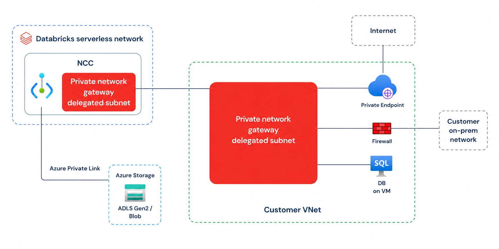
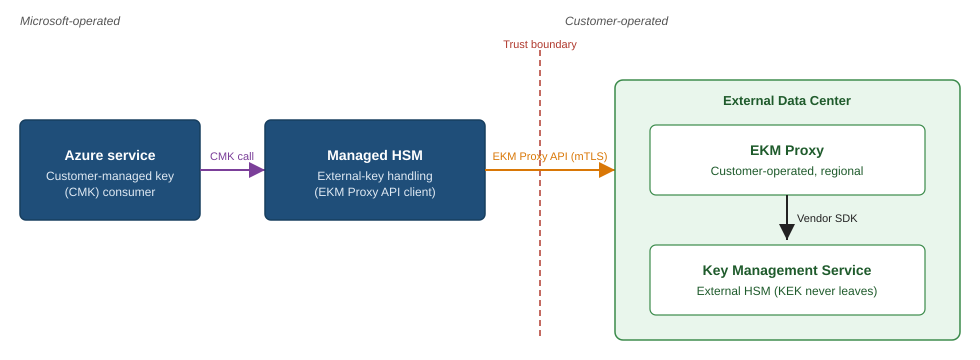

# Azure 일일 업데이트 브리핑 — 2026-10-17

**Azure Databricks Private network gateway**가 Public Preview로 공개됐습니다.
Serverless compute에서 고객 VNet과 연결된 온프레미스 시스템에 접근하고,
고객 방화벽을 통한 outbound 경로를 구성할 수 있습니다.
**Azure Key Vault Managed HSM 외부 키 관리**는 GA로 전환돼,
Microsoft 인프라 밖에 암호화 key를 보관해야 하는 요구를 지원합니다.

**이번 보고서의 업데이트**

- **AI & Apps:** [Databricks — Private network gateway Public Preview](#databricks-private-network-gateway)
- **Infra:** [Managed HSM — 외부 키 관리 GA](#managed-hsm-external-key-management)

## 주요 업데이트

### Azure Databricks — Private network gateway Public Preview { #databricks-private-network-gateway }

**Serverless compute에서 고객 네트워크의 여러 private resource에 접근**

Azure Databricks serverless compute는 Databricks가 관리하는 실행 환경이므로,
고객 VNet에 있는 시스템과 연결하려면 별도의 네트워크 경로가 필요합니다.
기존 Private Link private endpoint rule은 특정 cloud resource에 대한
직접적인 private 연결을 제공하지만, 고객 VNet과 그 너머의 여러 시스템을
하나의 연결로 포괄하는 것과는 다릅니다.

이번 Private network gateway는 고객이 위임한 subnet에 managed gateway를
배치해 이 범위를 넓힙니다. Serverless workload가 VNet의 DB나
ExpressRoute·VPN으로 연결된 온프레미스에 접근하고, 고객 방화벽을 거쳐
외부로 나가도록 구성할 수 있습니다. Private Link를 대체하는 기능이 아니라,
**개별 resource 연결과 고객 네트워크 경유를 함께 사용하는 선택지**입니다.

*출처: Microsoft Learn, [Private network gateway](https://learn.microsoft.com/azure/databricks/security/network/serverless-network-security/private-network-gateway).
공식 원본이며, 그림을 선택하면 원본 크기로 볼 수 있습니다.*

**연결과 경로 선택**

1. 고객 VNet의 subnet을 `Microsoft.Databricks/workspaces`에 위임하면
   Azure Databricks가 gateway를 배치합니다. 목적지까지의 downstream
   routing은 이 subnet에서 접근 가능한 네트워크를 기준으로 합니다.
2. Gateway는 기존 **Network connectivity configuration(NCC)** 안에서
   관리합니다. NCC를 workspace에 연결하면 해당 workspace의 serverless
   제품이 gateway를 사용할 수 있습니다.
3. `SPECIFIC_DESTINATIONS`는 지정한 DNS 목적지만 gateway로 보냅니다.
   `ALL_TRAFFIC`는 더 우선하는 경로를 제외한 outbound를 gateway로 보내며,
   이 모드에서는 사용할 목적지를 egress network policy에도 명시해야 합니다.
4. 경로 우선순위는 **Private endpoint rule → Azure service endpoint →
   gateway → 기본 serverless egress**입니다. 따라서 `ALL_TRAFFIC`도
   모든 연결을 강제로 방화벽에 통과시키는 설정은 아닙니다.

**달라지는 점과 중요한 예외**

여러 private resource마다 별도 endpoint를 구성하는 대신, gateway와
고객 네트워크의 routing을 통해 여러 목적지에 접근할 수 있습니다.
고객 보안 장비를 통한 egress 검사와 식별 가능한 source IP 사용도 지원합니다.
다만 **Blob Storage는 Azure service endpoint 경로를 gateway로 덮어쓸 수 없습니다.**
그림의 Storage 연결처럼 Private Link로 분리하는 경로와 gateway 경로를
구분해서 설계해야 합니다.

Public Preview이며 **Premium plan**이 필요합니다.
Gateway·위임 subnet은 NCC와 같은 리전에 있어야 합니다.
공식 문서는 **2026-12-01 이후 과금 시작**을 예고하므로 도입 시
[과금 공지](https://learn.microsoft.com/azure/databricks/release-notes/whats-coming#private-network-gateway-billing)를
함께 확인해야 합니다.

**공식 자료:**
[프리뷰 발표](https://azure.microsoft.com/updates?id=576556) ·
[구조·경로 우선순위·제한](https://learn.microsoft.com/azure/databricks/security/network/serverless-network-security/private-network-gateway) ·
[구성 절차](https://learn.microsoft.com/azure/databricks/security/network/serverless-network-security/private-network-gateway/configure-private-network-gateway)

### Azure Key Vault Managed HSM — 외부 키 관리 GA { #managed-hsm-external-key-management }

**Azure 서비스의 CMK 연결을 유지하면서 KEK는 Microsoft 인프라 밖에 보관**

Customer-managed key(CMK)를 사용하는 저장 데이터 암호화는 보통
envelope encryption 구조입니다. Azure 서비스가 Data encryption key(DEK)로
데이터를 암호화하고, Key encryption key(KEK)로 DEK를 감싸거나 풉니다.
일반적인 Managed HSM key는 Azure 안의 HSM에 보관되므로, key를 물리적으로
Microsoft 인프라 밖에 두어야 하는 별도의 규제·계약 요구와 구분됩니다.

이번 GA는 **외부 HSM의 KEK를 기존 Managed HSM key interface에 연결**합니다.
Azure 서비스는 기존 Managed HSM key URI를 사용하고, Managed HSM이
고객 운영 EKM Proxy를 통해 외부 HSM에 wrap·unwrap을 위임합니다.
데이터 자체의 암호화 처리를 외부로 옮기는 것이 아니라,
**DEK를 보호하는 KEK의 보관·연산 위치를 분리**하는 기능입니다.

*출처: Microsoft Learn, [Managed HSM external key management architecture](https://learn.microsoft.com/azure/key-vault/managed-hsm/external-key-management-architecture).
공식 원본이며, 그림을 선택하면 원본 크기로 볼 수 있습니다.*

**요청이 처리되는 방식**

1. Managed HSM CMK를 지원하는 Azure 서비스가 key URI로
   `wrapKey` 또는 `unwrapKey`를 요청합니다.
2. Managed HSM이 Microsoft Entra ID와 local RBAC으로 호출을 인증·인가하고,
   외부 key reference에 연결된 EKM Proxy를 찾습니다.
3. Managed HSM이 **mTLS**로 Proxy에 요청하고, Proxy는 외부 HSM의
   vendor별 API로 이를 전달합니다. Proxy와 외부 HSM은 고객 또는 HSM
   공급자가 운영합니다.
4. 외부 HSM이 연산 결과를 반환합니다. Unwrap 결과인 DEK는 Azure 서비스에
   돌아가지만, **외부 KEK 자체는 Microsoft 인프라로 이동하지 않습니다.**
   `GetKey` 같은 metadata 조회는 Managed HSM에서 처리합니다.

**가용성과 운영 경계**

- **모든 Azure public region**에서 제공되며 Azure Government·Azure China는
  범위에 포함되지 않습니다. 대상 Azure 서비스가 Managed HSM CMK를
  지원하는지도 별도로 확인해야 합니다.
- Public internet 연결은 GA 범위지만, **Proxy 연결용 Azure Private Link는
  여전히 Preview**입니다. EKM 전체의 GA와 이 네트워크 옵션의 상태를
  혼동하지 않아야 합니다.
- Managed HSM 서비스의 SLA는 유지되지만, 고객 Proxy·외부 HSM과 그 연결의
  가용성까지 Microsoft가 보장하지는 않습니다. 외부 구성 요소의 장애가
  암호화 데이터 접근에 영향을 줄 수 있습니다.
- 외부 key에는 Managed HSM의 **geo-replication과 backup·restore가
  지원되지 않습니다.** 여러 리전에서 기능을 사용할 수 있다는 것과
  외부 key가 자동으로 리전 간 복제된다는 것은 다릅니다.

물리적 key 보관 요구를 충족하는 선택지가 추가됐지만, 일반 Managed HSM
key보다 보편적으로 더 나은 보안·가용성 구성이라는 뜻은 아닙니다.
외부 왕복 지연과 Proxy·HSM의 고가용성 운영 책임이 추가되므로,
외부 보관 의무가 없는 경우에는 기존 Managed HSM key 사용을 권장합니다.
도입 전에는 [구독 활성화와 시작 절차](https://learn.microsoft.com/azure/key-vault/managed-hsm/external-key-management-overview#get-started)를
확인해야 합니다.

**공식 자료:**
[GA 발표](https://azure.microsoft.com/updates?id=574296) ·
[암호화 모델·지원 범위](https://learn.microsoft.com/azure/key-vault/managed-hsm/external-key-management-overview) ·
[구조·인증·요청 흐름](https://learn.microsoft.com/azure/key-vault/managed-hsm/external-key-management-architecture)
