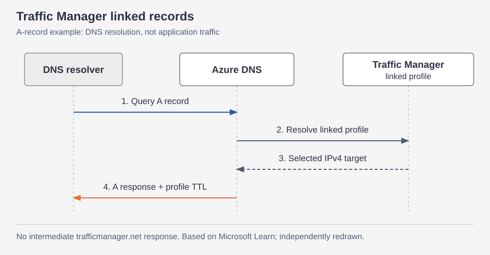
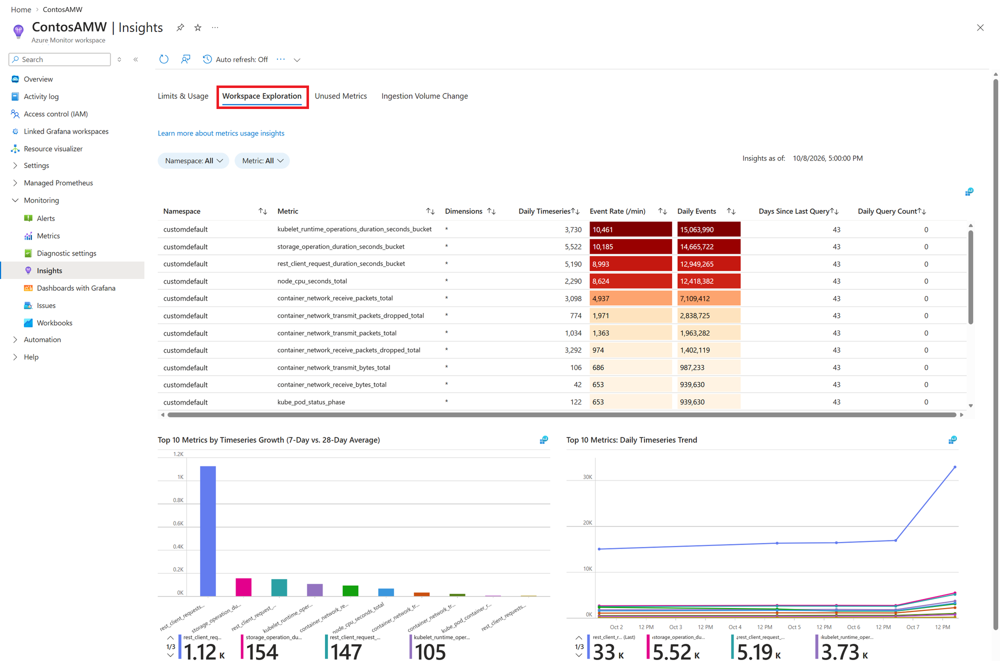

# Azure 일일 업데이트 브리핑 — 2026-10-20

**Azure DNS의 Traffic Manager linked records가 GA**로 제공됩니다.
DNS 응답에서 `trafficmanager.net` 중간 경유를 없애고 DNSSEC와 호환되는
DNS 기반 부하 분산을 구성할 수 있습니다.
**Azure Monitor workspace의 Metrics usage insights도 GA**로 전환돼,
메트릭별 수집량·조회 이력과 사용량 변화를 함께 분석할 수 있습니다.

**이번 보고서의 업데이트**

- **Infra:**
  [Azure DNS — Traffic Manager linked records GA](#dns-traffic-manager-linked-records) ·
  [Azure Monitor workspace — Metrics usage insights GA](#metrics-usage-insights)

## 주요 업데이트

### Azure DNS — Traffic Manager linked records GA { #dns-traffic-manager-linked-records }

**Traffic Manager의 endpoint 선택을 Azure DNS 안에서 처리**

Traffic Manager linked records는 Azure DNS의 record set을 Traffic Manager
profile에 직접 연결하는 기능입니다. Traffic Manager가 endpoint를 선택하는
DNS 기반 부하 분산을 쓰면서, 애플리케이션의 도메인은 Azure DNS에서 관리합니다.
기존 CNAME 구성은 응답으로 `trafficmanager.net` 이름을 전달해
DNS resolver가 그 이름을 추가로 조회해야 했습니다.

이번 GA 기능은 Azure DNS가 profile을 내부적으로 해석하는 **DNS flattening**을
제공합니다. A·AAAA record는 선택된 endpoint의 IP 주소를, CNAME record는
endpoint의 FQDN을 반환하므로 응답에 중간 `trafficmanager.net` 이름을 노출하지 않습니다.
서명되지 않은 중간 DNS 경유를 제거해 **DNSSEC-signed zone에서도
신뢰 체인을 유지**할 수 있다는 점이 중요한 변화입니다.
[기능 개요](https://learn.microsoft.com/azure/dns/dns-traffic-manager-linked-records)

*공식 문서 기반 재구성:
[Traffic Manager Linked Records overview](https://learn.microsoft.com/azure/dns/dns-traffic-manager-linked-records).
A record의 DNS 해석 흐름을 나타내며, 애플리케이션 요청을 중계하는 그림이 아닙니다.
그림을 선택하면 원본 크기로 볼 수 있습니다.*

**연결과 응답이 달라지는 부분**

- **연결 속성:** 기존 alias의 `targetResource` 대신
  `trafficManagementProfile`로 Traffic Manager profile을 지정합니다.
  기존 A·AAAA alias도 integrated 해석을 지원했으므로,
  모든 기존 alias가 CNAME 추가 조회를 요구했던 것은 아닙니다.
- **응답과 TTL:** linked record는 항상 integrated 방식으로 해석합니다.
  TTL은 **Traffic Manager profile의 DNS 설정**을 따르며,
  DNS record set에 지정한 TTL은 사용하지 않습니다.
- **타입 일관성:** A는 IPv4, AAAA는 IPv6, CNAME은 FQDN endpoint가 필요합니다.
  Strictly Typed Profiles가 profile 쪽에서 endpoint 타입을 검증합니다.
- **수명주기 보호:** linked record가 남아 있으면 profile 삭제를 차단합니다.
  profile을 삭제하려면 먼저 연결된 DNS record를 제거해야 합니다.

추가 CNAME 조회를 줄이고, 클라이언트 측에서 공유 도메인인
`trafficmanager.net`을 DNS 해석 목적으로 허용해야 하는 필요도 줄어듭니다.
Zone apex에서도 A·AAAA 응답으로 Traffic Manager를 사용할 수 있습니다.
다만 기존 alias도 zone apex를 지원했으므로 apex 지원 자체가 새로 생긴 것은 아닙니다.

새 연결에는 linked records가 권장되지만, 기존 alias 구성의 강제 전환이나
종료 기한을 발표한 것은 아닙니다.
기존 구성을 옮길 때는 **TTL의 기준이 record set에서 profile로 바뀌는지**와
endpoint 타입을 먼저 확인하는 것이 중요합니다.

**공식 자료:**
[GA 발표](https://azure.microsoft.com/updates?id=573917) ·
[동작·타입·TTL·기존 alias와의 차이](https://learn.microsoft.com/azure/dns/dns-traffic-manager-linked-records)

### Azure Monitor workspace — Metrics usage insights GA { #metrics-usage-insights }

**어떤 메트릭이 수집량을 늘리고, 실제로 조회되는지 함께 분석**

Metrics usage insights는 Azure Monitor workspace의 메트릭 사용량과
비용 최적화 기회를 살펴보는 분석 기능입니다.
전체 수집량만으로는 어느 메트릭에서 time series가 늘었는지,
많이 수집하는 메트릭이 실제 query에 쓰이는지 구분하기 어렵습니다.
이 기능은 time series·event 수집량, 한도 대비 사용률,
메트릭 조회 이력과 수집량 변화를 workbook으로 제공합니다.

이번 발표는 이 **사용량 분석 기능의 GA**입니다.
수집 파이프라인을 새로 만드는 기능이 아니라,
기존 workspace에 들어오는 메트릭을 어떤 기준으로 줄이거나 용량을 계획할지
판단하는 도구입니다.
[기능 개요](https://learn.microsoft.com/azure/azure-monitor/metrics/metrics-usage-insights)

*출처: Microsoft Learn,
[Metrics usage insights — Workspace exploration](https://learn.microsoft.com/azure/azure-monitor/metrics/metrics-usage-insights#workspace-exploration).
공식 예제 화면 원본이며 실제 운영 환경의 측정값이 아닙니다.
그림을 선택하면 원본 크기로 볼 수 있습니다.*

**분석 데이터가 흐르는 방식**

1. Azure Monitor workspace의 diagnostic setting에서
   **Metrics Usage Details**를 Log Analytics workspace로 전송하도록 설정합니다.
2. 사용량 데이터는 Log Analytics의 `AMWMetricsUsageDetails` table에 저장되고,
   query와 workbook이 이를 분석합니다.
   여러 Azure Monitor workspace의 사용량을 하나의 Log Analytics workspace로 모을 수도 있습니다.
3. **Limits & Usage**에서는 time series와 event 수집량을 한도·사용률과 비교합니다.
   그림의 **Workspace Exploration**은 메트릭별 수집량과 조회 이력을 보여줍니다.
4. **Unused Metrics**로 지정 기간 동안 query에 쓰이지 않은 메트릭을 찾고,
   **Ingestion Volume Change**로 두 시점의 수집량 변화를 비교합니다.

미사용 메트릭을 찾았다고 수집이 자동으로 중단되는 것은 아닙니다.
불필요하다고 판단한 데이터는 Prometheus scrape-job 설정 등을 조정해 수집을 줄입니다.
메트릭별 증가량과 query 이력을 함께 보면 무조건 전체 수집 주기를 늘리는 대신,
정리할 대상을 구체적으로 좁힐 수 있습니다.

**데이터 시점과 가용성**

- diagnostic setting을 만든 뒤 분석 데이터가 들어오기까지 **약 24시간**이 필요합니다.
  Workspace Exploration의 메트릭별 데이터는 하루 한 번 계산하며 **전일 기준**입니다.
  실시간 장애 탐지를 대체하는 화면으로 해석하지 않아야 합니다.
- **Azure Monitor workspace가 GA인 모든 public region**에서 지원합니다.
  개별 workspace의 배치 가능 리전은
  [공식 리전 목록](https://learn.microsoft.com/azure/azure-monitor/metrics/azure-monitor-workspace-overview#regional-availability)에서 확인할 수 있습니다.
- 이 기능이 보내는 **사용량 분석 데이터의 Log Analytics 전송·query·저장에는 추가 요금이 없습니다.**
  원래 수집하는 메트릭 전체가 무료라는 의미는 아닙니다.

**공식 자료:**
[GA 발표](https://azure.microsoft.com/updates?id=577165) ·
[분석 동작·활성화·데이터 시점·요금 범위](https://learn.microsoft.com/azure/azure-monitor/metrics/metrics-usage-insights)
