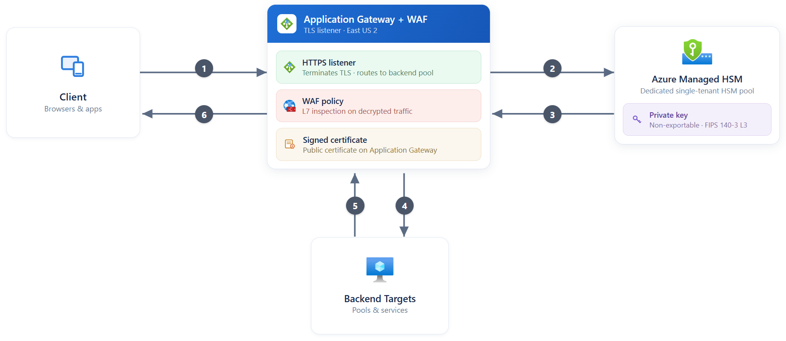
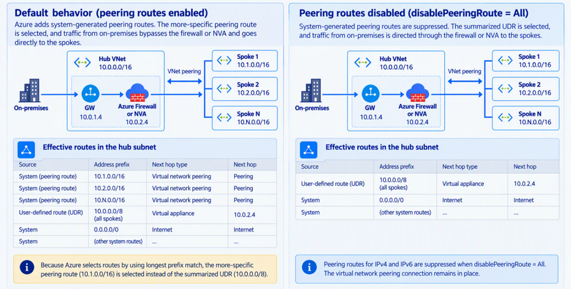

# Azure 일일 업데이트 브리핑 — 2026-10-21

**Application Gateway keyless TLS가 GA**로 공개돼 TLS private key를
Managed HSM 밖으로 내보내지 않고 HTTPS 연결을 처리할 수 있습니다.
**VNet peering 경로 억제는 Public Preview**로, peering을 유지하면서
요약 UDR로 방화벽 검사 경로를 구성하는 선택지를 제공합니다.
Front Door WAF의 service tag 매칭과 Azure Monitor의 고급 메트릭도 GA로 전환됐습니다.

**이번 보고서의 업데이트**

- **Infra:**
  [Application Gateway — keyless TLS GA](#application-gateway-keyless-tls) ·
  [Virtual Network — peering 경로 억제 Public Preview](#disable-peering-routes) ·
  [Front Door Premium WAF — service tag 매칭 GA](#front-door-service-tags) ·
  [Azure Monitor — Advanced platform metrics GA](#advanced-platform-metrics)

## 주요 업데이트

### Application Gateway — keyless TLS GA { #application-gateway-keyless-tls }

**TLS termination은 gateway에서, private key 서명은 Managed HSM 안에서**

HTTPS를 받는 Application Gateway는 TLS 연결을 종료한 뒤 요청을 backend로 전달합니다.
이 과정에서 사용하는 인증서의 private key를 어디에 보관하고 누가 사용할 수 있는지는
TLS 처리 위치와 별도로 결정해야 하는 보안 경계입니다.
Keyless TLS는 인증서의 public 부분만 gateway에 두고,
**private key를 Azure Key Vault Managed HSM 안에 유지하는 방식**입니다.

이번 GA로 Application Gateway가 Managed HSM에 서명을 요청해 TLS handshake를
완료할 수 있습니다. Private key를 gateway로 export하지 않으면서도 TLS termination과
WAF 검사를 gateway에서 수행하므로, key 보관 책임과 애플리케이션 진입점 운영을
분리하려는 구성에 적합합니다.
[기능 개요](https://learn.microsoft.com/azure/application-gateway/keyless-tls-overview)

*출처: Microsoft Learn,
[What is keyless TLS for Azure Application Gateway and Azure Key Vault Managed HSM?](https://learn.microsoft.com/azure/application-gateway/keyless-tls-overview).
원본 그림의 East US 2는 예시 배치이며 지원 리전 목록을 뜻하지 않습니다.
그림을 선택하면 원본 크기로 볼 수 있습니다.*

**요청과 key 사용 흐름**

1. Client가 Application Gateway의 HTTPS listener에 연결합니다.
2. Gateway가 Managed HSM의 non-exportable key로 서명을 요청합니다.
   User-assigned managed identity와 HSM의 RBAC 권한으로 key 접근을 제어합니다.
3. HSM이 서명 결과를 반환하면 TLS handshake를 완료합니다.
   **Private key 자체는 HSM 밖으로 전달되지 않습니다.**
4. WAF를 사용하는 구성에서는 복호화한 요청을 검사한 뒤 backend로 전달합니다.
   응답은 gateway를 거쳐 client의 TLS 연결로 돌아갑니다.
5. Managed HSM diagnostic log에서 서명 작업과 key 사용을 감사할 수 있습니다.

**도입 시 중요한 경계**

- **Application Gateway v2와 Managed HSM**이 필요합니다.
  Listener는 **TLS 1.2 이상**이어야 하며 지원 SSL policy는
  `AppGwSslPolicy20220101`, `AppGwSslPolicy20220101S`, `CustomV2`입니다.
- **AGIC, WebSockets, L4 TCP/TLS proxy, FIPS mode, EC key는 지원하지 않습니다.**
  기존 AKS ingress 구성에 그대로 적용할 수 있다고 가정해서는 안 됩니다.
  HSM의 인증 수준과 Application Gateway의 FIPS mode 지원은 별개입니다.
- HSM 권한 오류나 참조 key 삭제로 listener가 비활성화될 수 있습니다.
  Key 접근 권한·수명주기와 HSM 처리 용량을 함께 검토해야 합니다.

**공식 자료:**
[GA 발표](https://azure.microsoft.com/updates?id=577130) ·
[구조·서명 흐름](https://learn.microsoft.com/azure/application-gateway/keyless-tls-overview) ·
[구성·지원 제한](https://learn.microsoft.com/azure/application-gateway/keyless-tls#limitations)

### Virtual Network — peering 경로 억제 Public Preview { #disable-peering-routes }

**Peering 연결은 유지하고, 자동 peering 경로 대신 의도한 UDR을 선택**

VNet peering을 구성하면 Azure가 상대 VNet 주소로 향하는 system route를 추가합니다.
Hub-and-spoke 네트워크에서 여러 spoke를 하나의 요약 UDR로 묶어 방화벽으로 보내려 해도,
더 구체적인 peering 경로가 longest prefix match로 선택되면 검사 경로를 우회할 수 있습니다.
이를 덮어쓰려고 spoke별 UDR을 계속 추가하면 경로 수와 유지보수 부담이 커집니다.

이번 프리뷰의 **Disable peering route propagation**은 route table에 연결한
subnet에서 자동 peering 경로를 억제합니다. Peering 연결을 삭제하는 것이 아니라
경로 선택에 쓰이는 system route를 제거해, 주소 계획에 맞는 **요약 UDR로
Azure Firewall 또는 NVA를 경유**하도록 구성하는 기능입니다.
[동작·적용 범위](https://learn.microsoft.com/azure/virtual-network/virtual-network-peering-overview#disable-peering-route-propagation-preview)

*출처: Microsoft Learn,
[Azure virtual network peering — Disable peering route propagation](https://learn.microsoft.com/azure/virtual-network/virtual-network-peering-overview#disable-peering-route-propagation-preview).
주소는 공식 문서의 예시이며, 그림을 선택하면 원본 크기로 볼 수 있습니다.*

**그림에서 달라지는 경로 선택**

- **기본 동작:** hub subnet의 route table에 요약 UDR이 있어도 더 구체적인
  spoke별 system peering route가 선택됩니다. 그림 왼쪽의 온프레미스 유입
  트래픽은 이 경로로 spoke에 직접 전달됩니다.
- **경로 억제:** route table의 `disablePeeringRoute`를 `All`로 설정하면
  지원 workload의 **IPv4·IPv6 system peering route**가 억제됩니다.
  그림 오른쪽에서는 요약 UDR이 hub의 Firewall/NVA로 트래픽을 보냅니다.
- **적용 단위:** 해당 route table에 연결한 subnet에 적용하며,
  다른 subnet과 peering 연결 자체는 유지합니다. 기본값 `None`은 자동 경로를 유지합니다.
- **자동화하지 않는 부분:** 대체 UDR이나 검사 경로는 만들어 주지 않습니다.
  필요한 UDR과 next hop의 전달 경로를 먼저 구성하고 effective routes로 확인해야 합니다.

**프리뷰에서 놓치기 쉬운 제한**

Next hop인 **Firewall/NVA는 source workload의 NIC와 같은 VNet**에 있어야 합니다.
따라서 그림의 hub 내부 gateway → firewall 경로와 달리,
spoke workload에서 다른 VNet의 hub firewall을 next hop으로 삼는 구성에
이 프리뷰를 그대로 적용할 수는 없습니다.
Azure BareMetal Infrastructure workload에는 peering 경로 억제가 적용되지 않습니다.

구독에 preview feature를 등록한 뒤 route table에서 설정합니다.
현재 Learn 가이드는 **Azure Virtual Network Manager routing rule collection이
아닌 route table에서 관리**하도록 명시합니다.
[구성·검증 절차](https://learn.microsoft.com/azure/virtual-network/configure-disable-peering-route-propagation)

**공식 자료:**
[프리뷰 발표](https://azure.microsoft.com/updates?id=576242) ·
[경로 선택·프리뷰 제한](https://learn.microsoft.com/azure/virtual-network/virtual-network-peering-overview#disable-peering-route-propagation-preview) ·
[설정과 effective routes 확인](https://learn.microsoft.com/azure/virtual-network/configure-disable-peering-route-propagation)

## 기타 업데이트

- **Front Door Premium WAF — service tag 매칭 GA**:
  Custom rule이 요청의 IP를 Microsoft가 갱신하는 service tag와 비교해
  IP 목록을 직접 유지하지 않고 허용·차단·rate limit할 수 있습니다.
  직접 연결한 서비스 판정에는 `SocketAddr`를 사용하며, service tag는
  **tenant 인증 수단이 아니고 `Allow`는 이후 managed rule 검사를 건너뛰므로**
  허용 범위를 좁혀야 합니다.
  [GA 발표](https://azure.microsoft.com/updates?id=577156) ·
  [매칭 방식·보안 주의점](https://learn.microsoft.com/azure/web-application-firewall/afds/service-tag-match-condition)
- **Azure Monitor — Advanced platform metrics GA**:
  리소스별 opt-in 방식의 **유료** platform metrics로, 현재 지원하는 Azure Storage에서는
  container별 blob 용량·개수를 `ContainerName`으로 나눠 조회할 수 있으며
  기존 Metrics Explorer·API를 사용합니다.
  이번 발표는 portal 활성화와 Azure Government·Azure China 가용성 확대를 포함하며,
  **애플리케이션의 OpenTelemetry·Micrometer custom metric 수집과는 별개**입니다.
  [GA 발표](https://azure.microsoft.com/updates?id=575329) ·
  [기능·과금·지원 provider](https://learn.microsoft.com/azure/azure-monitor/metrics/metrics-advanced-platform) ·
  [Blob Storage container metrics](https://learn.microsoft.com/azure/storage/blobs/blob-storage-advanced-platform-metrics)
