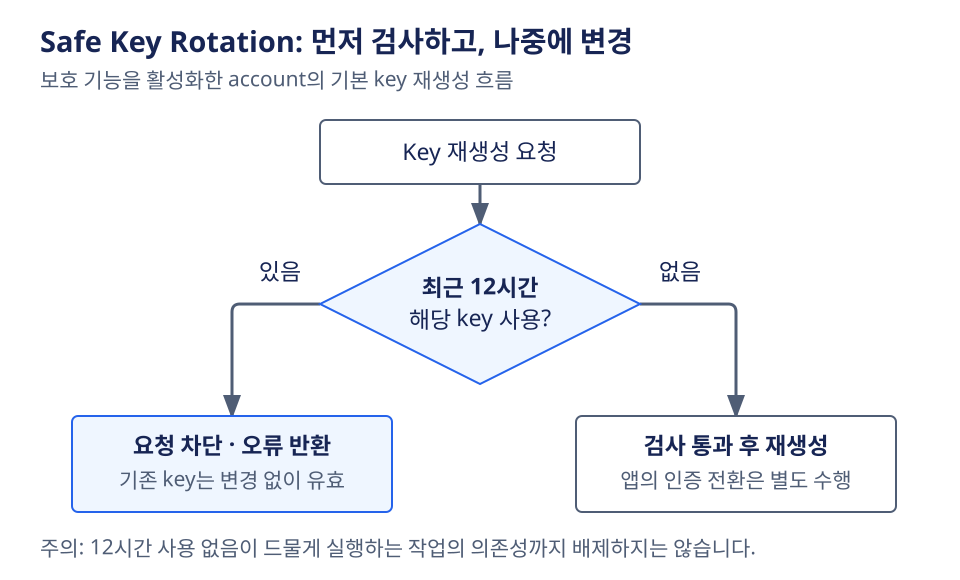
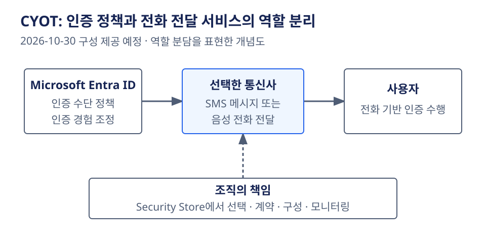

# Azure 일일 업데이트 브리핑 — 2026-10-22

**Azure Cosmos DB Safe Key Rotation이 GA**로 공개됐습니다.
Key의 마지막 사용 이력을 확인하고, 사용 중인 key의 재생성을 차단하는 보호를 적용할 수 있습니다.
**Microsoft Entra CYOT는 10월 30일 구성 제공을 예고**했습니다.
Microsoft 제공 SMS·음성 인증 종료에 앞서 passkeys 전환 또는 외부 통신사 연동을 준비해야 합니다.

**이번 보고서의 업데이트**

- **Infra:** [Microsoft Entra — CYOT 제공 예고·SMS 및 음성 인증 종료 대응](#entra-cyot)
- **Database:** [Azure Cosmos DB — Safe Key Rotation GA](#cosmos-safe-key-rotation)

## 주요 업데이트

### Azure Cosmos DB — Safe Key Rotation GA { #cosmos-safe-key-rotation }

**Key를 바꾸기 전에 사용 이력을 확인하고, 사용 중이면 재생성을 차단**

Azure Cosmos DB의 account key를 재생성하면 기존 key를 사용하는 애플리케이션도
인증 정보를 바꿔야 합니다. 기존 primary·secondary key 교대 방식에서는
애플리케이션을 다른 key로 옮긴 뒤 이전 key를 재생성하지만,
여러 팀이 공유하거나 드물게 실행하는 작업의 key 의존성을 놓칠 수 있습니다.

이번 GA의 Safe Key Rotation은 **각 account key의 마지막 사용 시각을 보여 주고,
key 재생성이나 local authentication 비활성화 전에 사용 이력을 검사**하는 기능입니다.
단순히 key를 자동 교체하는 기능이 아니라, 아직 사용 중인 자격 증명을
없애지 않도록 운영 판단과 변경 전 검사를 보완합니다.
[기능·검사 동작](https://learn.microsoft.com/azure/cosmos-db/how-to-rotate-keys#rotate-keys-by-using-safe-key-rotation)

*공식 문서 기반 재구성:
Microsoft Learn [Rotate keys for Azure Cosmos DB for NoSQL](https://learn.microsoft.com/azure/cosmos-db/how-to-rotate-keys).
Safe Key Rotation을 활성화한 경우의 기본 검사 흐름이며, 그림을 선택하면 원본 크기로 볼 수 있습니다.*

**검사와 교체가 진행되는 방식**

1. Account key별 마지막 사용 이력을 확인해 교체할 key의 의존성을 살핍니다.
2. Safe Key Rotation을 활성화하면 기존 key를 바꾸지 않고 **변경 전 검사**를 적용합니다.
   Key 사용 이력 수집 자체는 이미 수행되며, 활성화는 검사의 강제 적용을 켜는 동작입니다.
3. 재생성할 key가 **최근 12시간 안에 사용됐다면 요청을 오류로 차단**합니다.
   검사가 실패한 상태에서는 key를 재생성하지 않으므로 기존 key는 그대로 유효합니다.
4. 애플리케이션을 다른 key 또는 Microsoft Entra ID로 전환하고,
   해당 key의 사용이 멈춘 뒤 12시간을 기다려 다시 시도할 수 있습니다.

**실질적인 변화:** 애플리케이션 구성을 수동으로 추적하는 데 더해 서비스가 관측한
사용 이력을 보고 변경을 판단할 수 있습니다. Microsoft Entra ID로 옮긴 뒤
local authentication을 끌 때도 남아 있는 key 의존성을 확인하는 데 도움이 됩니다.
다만 **12시간 사용 없음이 월간·연간 배치의 의존성까지 없다는 뜻은 아닙니다.**
드문 실행 주기의 작업은 별도로 확인해야 합니다.

Learn의 적용 절차는 **Azure Cosmos DB for NoSQL account**를 대상으로 하며,
보호 기능은 account에서 활성화해야 합니다. 기존 수동 key 교체 절차는 계속 사용할 수 있고,
key 재생성 자체는 account 크기에 따라 **1분부터 수 시간**이 걸릴 수 있습니다.
이 검사가 애플리케이션의 자격 증명 배포나 전환까지 자동화하지는 않습니다.

**공식 자료:**
[GA 발표](https://azure.microsoft.com/updates?id=576716) ·
[사용 이력·활성화·교체 절차·FAQ](https://learn.microsoft.com/azure/cosmos-db/how-to-rotate-keys)

## 대응이 필요한 업데이트

### Microsoft Entra — CYOT 제공 예고·SMS 및 음성 인증 종료 대응 { #entra-cyot }

**Microsoft가 보내던 SMS·전화를 외부 통신사로 분리하고, 가능한 사용자는 passkeys로 전환**

SMS·음성 인증은 사용자에게 문자나 전화를 전달하는 통신 경로가 필요합니다.
Microsoft Entra ID는 지금까지 이 전달 경로를 기본 제공했지만,
Microsoft 제공 SMS·음성 인증의 종료에 맞춰 인증 수단과 전달 서비스를 다시 선택해야 합니다.
Microsoft는 SMS·음성보다 **passkeys 같은 phishing-resistant 인증**을 우선 권장합니다.

Choose Your Own Telephony Provider(CYOT)는 업무·규제·기술상의 이유로 전화 기반 인증이
필요한 사용자에게 **지원되는 외부 통신사의 SMS·음성 전달을 연결**하는 방식입니다.
Entra ID는 인증 수단 정책과 인증 경험의 조정을 계속 담당하고,
조직은 Microsoft Security Store에서 통신사를 선택해 계약·구성과 운영을 관리합니다.
이번 발표는 **2026-10-30을 목표로 한 GA·구성 제공 예고**이며,
현재 일반 구성 화면이 이미 열렸다는 뜻은 아닙니다.
[현재 제공 단계·역할 분담](https://learn.microsoft.com/entra/identity/authentication/concept-phone-providers)

*공식 문서 기반 재구성:
Microsoft Learn [Choose a telephony provider for SMS and voice authentication](https://learn.microsoft.com/entra/identity/authentication/concept-phone-providers).
역할 분담을 나타낸 개념도이며 구현 API나 상세 인증 프로토콜을 뜻하지 않습니다.
그림을 선택하면 원본 크기로 볼 수 있습니다.*

**무엇을 준비해야 하나**

- **대상 파악:** SMS·음성 인증에 의존하는 사용자를 확인하고,
  전화 기반 인증을 유지해야 하는 구체적인 요구를 구분합니다.
- **우선 전환 경로:** 가능한 사용자는 passkeys 등 phishing-resistant 수단으로 옮깁니다.
  CYOT를 모든 사용자의 기본 전환 경로로 삼는 발표가 아닙니다.
- **통신사 선택:** Private Preview의 초기 참여사는 **Soprano·Telesign**입니다.
  제공 국가·전달 채널·가격·지원·보안·규제 조건을 비교해야 하며,
  이 목록을 최종 GA 참여사 전체로 단정해서는 안 됩니다.
- **운영 책임:** 통신사 계약·구성·모니터링은 조직의 책임입니다.
  10월 30일부터 제공될 구성 경험을 기준으로 pilot을 검증한 뒤 확대합니다.

**공식 전환 일정**

| 시점 | 대상·변화 | 필요한 대응 |
| --- | --- | --- |
| 2026-10-30 예정 | CYOT 구성 경험 제공 시작 | 전화 기반 인증이 필요한 사용자·통신사·구매 조건 준비 |
| 2027-02-01 | Global Administrators·external users를 제외한 사용자의 Microsoft 제공 SMS·음성 인증 종료 | 기한 전 phishing-resistant 수단 또는 통신사 구성으로 전환 |
| 2027-07-01 | Global Administrators·external users의 Microsoft 제공 SMS·음성 인증 종료 | 해당 사용자도 별도 기한 전 전환 완료 |

**Internal guest users는 7월 예외 대상이 아니라 2월 1일 일정에 포함됩니다.**
적용 종료일에 SMS·음성만 MFA 수단으로 남고 통신사도 구성하지 않은 사용자는
계속 로그인하려면 passkey 등록을 완료해야 하는 blocking prompt를 받습니다.
종료 이후의 이 적용은 opt-out할 수 없습니다.
[대상별 일정·로그인 영향](https://learn.microsoft.com/entra/identity/authentication/concept-sms-voice-retirement)

**적용 확인 필요:** Entra ID를 사용한다는 이유만으로 모든 사용자에게 같은 변경이
필요한 것은 아닙니다. SMS·음성 사용 여부와 사용자 유형을 먼저 확인해야 합니다.
통신사 가용성은 Azure 리전 목록이 아니라 **사용자의 국가별 전달 범위와 계약 조건**으로 검토합니다.

**공식 자료:**
[CYOT 발표](https://azure.microsoft.com/updates?id=577273) ·
[통신사·제공 단계](https://learn.microsoft.com/entra/identity/authentication/concept-phone-providers) ·
[종료 일정·전환 안내](https://learn.microsoft.com/entra/identity/authentication/concept-sms-voice-retirement)
