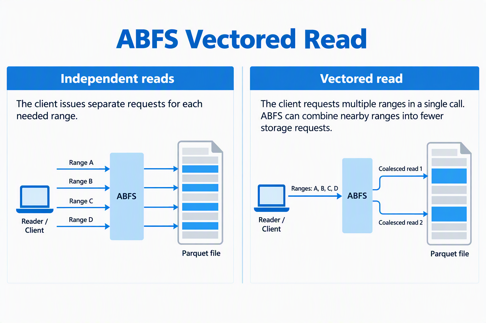

# Azure 일일 업데이트 브리핑 — 2026-10-23

**Azure Data Lake Storage의 ABFS Vectored Read**는 Parquet 파일의 필요한 부분만
읽을 때 가까운 범위를 묶고 비동기로 요청해 네트워크 왕복을 줄이는 GA 기능입니다.
호환 Spark 환경에서는 쿼리나 데이터를 바꾸지 않고 설정으로 적용할 수 있지만,
**Azure Databricks는 현재 지원하지 않습니다.**

**이번 보고서의 업데이트**

- **Infra:** [Azure Data Lake Storage — ABFS Vectored Read GA](#abfs-vectored-read)

## 주요 업데이트

### Azure Data Lake Storage — ABFS Vectored Read GA { #abfs-vectored-read }

**필요한 데이터가 적어도 요청은 많아지는 문제를 client의 읽기 경로에서 개선**

Parquet은 column 단위 저장 형식으로, 분석 쿼리는 필요한 column과 row group만
선택해 읽을 수 있습니다. 다만 선택한 데이터가 파일 곳곳에 흩어져 있으면
작은 읽기 요청이 많아져, 읽는 바이트가 줄어도 네트워크 왕복과 요청 처리 부담은 남습니다.
ABFS(Azure Blob File System)는 Hadoop 기반 애플리케이션의 파일 접근을
ADLS의 REST API 호출로 연결하는 client driver입니다.
[ABFS의 역할](https://learn.microsoft.com/azure/storage/blobs/data-lake-storage-abfs-driver#how-abfs-works)

이번 공지에서 GA로 안내한 **Vectored Read**는 호환 reader가 필요한 여러 byte range를
함께 전달하면, ABFS가 가까운 범위를 합쳐 더 적은 storage 요청으로 읽는 기능입니다.
서로 떨어진 범위를 독립적으로 읽는 대신 I/O를 함께 계획하며, 저장된 파일 형식이나
쿼리를 바꾸지 않고 client의 요청 방식을 최적화합니다.
[기능·동작 설명](https://techcommunity.microsoft.com/blog/analyticsonazure/optimize-selective-analytics-reads-in-azure-data-lake-storage-with-abfs-vectored/4564592)

*출처: Microsoft Azure 공식 블로그,
[Optimize selective analytics reads in Azure Data Lake Storage with ABFS Vectored Read](https://techcommunity.microsoft.com/blog/analyticsonazure/optimize-selective-analytics-reads-in-azure-data-lake-storage-with-abfs-vectored/4564592).
요청 패턴을 설명하는 원본 그림이며 benchmark가 아닙니다.
그림을 선택하면 원본 크기로 볼 수 있습니다.*

**요청이 처리되는 흐름**

1. **Reader:** 필요한 byte range 목록을 함께 전달합니다.
2. **ABFS:** 범위를 검증·정렬하고, 가까운 범위를 적절히 합친 뒤 read buffer에
   맞게 작업을 나눕니다.
3. **Storage 요청:** 읽기 작업을 비동기로 queue에 넣어 실행합니다.
   그림의 네 범위를 두 요청으로 합치는 모습은 예시이며, 실제 묶음은 범위 배치와 설정에 따라 달라집니다.
4. **결과 반환:** 각 range의 buffer로 요청한 데이터를 돌려줍니다.
   묶어서 읽는 과정에서 range 사이의 불필요한 바이트도 전송될 수 있습니다.

Hadoop의 `readVectored()`는 range별 결과를 `CompletableFuture<ByteBuffer>`로
제공합니다. 가까운 범위를 합칠지와 한 번에 읽을 크기는 구현·설정의 영향을 받으므로,
여러 range를 전달했다고 항상 하나의 storage 요청이 되는 것은 아닙니다.
[Hadoop의 Vectored Read API](https://github.com/apache/hadoop/blob/rel/release-3.3.5/hadoop-common-project/hadoop-common/src/site/markdown/filesystem/fsdatainputstream.md)

**효과가 기대되는 작업과 도입 조건**

일부 column·row group만 읽는 **선택적 Parquet 쿼리**가 우선 검토 대상입니다.
전체 파일을 순차적으로 읽는 작업은 이점이 작을 수 있고, Hadoop·ABFS 경로를
거치지 않는 engine에는 적용되지 않습니다. 요청 감소와 추가 바이트 읽기 사이의
trade-off가 있으므로, 대표 쿼리의 실행 시간·storage transaction·읽은 바이트·
리소스 사용량을 같은 데이터와 동시성 조건에서 비교해야 합니다.

- **호환성:** 공식 안내의 최소 조건은 `hadoop-azure`를 포함한
  **Apache Hadoop 3.3.5 이상**, **parquet-hadoop 1.12.3 이상**입니다.
  Spark 버전이나 `abfs://`·`abfss://` URI만으로 지원을 판단하지 말고,
  실제 런타임에 포함된 라이브러리를 확인해야 합니다.
- **활성화:** 호환 Spark 환경에서는 애플리케이션 시작 전에
  `spark.hadoop.parquet.hadoop.vectored.io.enabled=true`를 명시적으로 설정합니다.
  관리형 서비스에서는 해당 서비스가 지원하는 cluster·session 설정 방식을 사용합니다.
- **Azure Databricks:** 공식 상세 글은 현재 포함된 ABFS 버전에 이 기능이 없어
  **지원하지 않는다고 명시**합니다. Photon은 ABFS driver로 데이터를 읽지 않으므로,
  ABFS URI를 사용하더라도 이 최적화가 적용되는 것은 아닙니다.

ADLS에 Parquet을 적재하는 흐름과는 **읽기 단계의 최적화**라는 점을 구분해야 합니다.
[DocumentDB change stream의 Parquet 적재 연구](../../services/azure-documentdb/change-streams/index.md)는
파일 생성·재시도·checkpoint를 다루며, 이 기능은 그렇게 저장한 파일을
호환 분석 engine으로 읽을 때 검토할 수 있는 별도의 선택지입니다.

**공식 자료:**
[GA 공지](https://azure.microsoft.com/updates?id=577618) ·
[동작·호환성·설정·지원 제한](https://techcommunity.microsoft.com/blog/analyticsonazure/optimize-selective-analytics-reads-in-azure-data-lake-storage-with-abfs-vectored/4564592) ·
[ABFS driver 개요](https://learn.microsoft.com/azure/storage/blobs/data-lake-storage-abfs-driver) ·
[Hadoop Vectored Read API](https://github.com/apache/hadoop/blob/rel/release-3.3.5/hadoop-common-project/hadoop-common/src/site/markdown/filesystem/fsdatainputstream.md)
