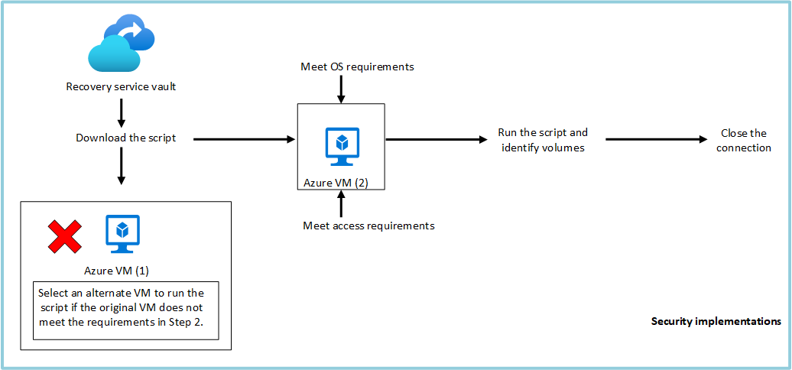

# Azure 일일 업데이트 브리핑 — 2026-10-24

**Azure Backup의 Item-Level Recovery(ILR)** 지원이 Premium SSD v2·Ultra Disk로
확대됐습니다. 이제 이 disk를 사용하는 Azure VM에서도 전체 VM이나 disk를
복원하지 않고 필요한 파일·폴더만 가져올 수 있습니다.
다만 복구용 machine의 OS·네트워크 조건을 충족해야 하며, 대용량 전체 복원의
대체 수단이 아니라 소량의 파일을 선택적으로 복구하는 기능입니다.

**이번 보고서의 업데이트**

- **Infra:** [Azure Backup — Premium SSD v2·Ultra Disk 개별 파일 복구 GA](#backup-ilr)

## 주요 업데이트

### Azure Backup — Premium SSD v2·Ultra Disk 개별 파일 복구 GA { #backup-ilr }

**백업의 복구 지점을 임시 volume으로 연결하고, 필요한 파일만 복사**

VM 백업에서 설정 파일이나 특정 폴더만 필요할 때도, 전체 disk를 먼저 복원하면
복구 범위가 필요 이상으로 커집니다. Azure Backup의 ILR은 백업의
**recovery point(복구 지점)를 호환 machine에 연결해 파일을 탐색·복사**하는 기능입니다.
기존 Standard HDD·Standard SSD·Premium SSD v1에서 사용하던 파일 복구 흐름을
이번 GA로 **Premium SSD v2·Ultra Disk**에도 사용할 수 있게 됐습니다.

두 disk 모두 **512-byte·4-KB logical sector size**를 지원하며, 서로 다른 disk
종류가 섞인 VM의 복구 지점에서도 지원 대상 disk를 연결할 수 있습니다.
새로운 전체 VM 복원 방식이 아니라, 기존 백업에서 **필요한 데이터만 꺼내는
복구 단위의 확대**입니다.
[지원 범위와 이번 변화](https://learn.microsoft.com/azure/backup/whats-new#item-level-recovery-support-for-premium-ssd-v2-and-ultra-disks)

*출처: Microsoft Learn,
[Recover files from Azure virtual machine backup](https://learn.microsoft.com/azure/backup/backup-azure-restore-files-from-vm).
원래 VM이 실행 조건을 충족하지 않으면 다른 호환 machine을 선택하는 흐름입니다.
그림을 선택하면 원본 크기로 볼 수 있습니다.*

**파일을 가져오는 흐름**

1. **복구 지점 선택:** Azure portal·CLI·PowerShell에서 복구 지점을 선택하고
   Windows용 executable 또는 Linux용 script와 실행에 필요한 password를 받습니다.
   생성에는 VM·disk 복원에 필요한 수준의 Azure RBAC 권한이 필요합니다.
2. **호환 machine에서 실행:** 관리자 권한으로 실행하면 machine의 iSCSI initiator가
   복구 지점에 연결합니다. 서비스와 machine 사이의 데이터 흐름은 TLS tunnel로 보호됩니다.
3. **파일 탐색·복사:** 복구 volume은 **read-only**로 연결됩니다.
   Windows에서는 할당된 drive를, Linux에서는 script가 표시한 mount path를 탐색해
   필요한 파일·폴더를 대상 저장소로 복사합니다.
4. **연결 종료:** 복사가 끝나면 **Unmount Disks**로 연결을 해제합니다.
   Script의 유효 시간은 12시간이지만, 작업 후 바로 해제해야 불필요한 연결과
   이후 백업에 영향을 주는 mount 상태를 남기지 않습니다.

이 방식은 파일 몇 개를 되찾기 위해 전체 VM·disk 복원을 거치는 단계를 줄입니다.
다만 **Microsoft는 총 복구 크기 10 GB 이하에 이 기능을 사용하도록 안내**합니다.
큰 데이터셋이나 전체 시스템 복원이 목적이라면 VM·disk 복원 경로를 검토해야 합니다.
[복구 절차·성능 안내·연결 보안](https://learn.microsoft.com/azure/backup/backup-azure-restore-files-from-vm)

**도입 판단에 필요한 조건**

- **보호 구성:** Resource Manager 모델의 Azure VM이 Recovery Services vault로
  보호돼 있어야 합니다. Premium SSD v2·Ultra Disk의 VM 백업에는
  **Enhanced policy**가 필요하며, Standard policy는 두 disk를 보호하지 않습니다.
  [Enhanced policy](https://learn.microsoft.com/azure/backup/backup-azure-vms-enhanced-policy)
- **OS·volume 호환성:** 이번 지원 대상은 Windows와 Ubuntu·RHEL·Debian·Oracle Linux·
  SLES·openSUSE VM입니다. 복구 machine은 원본 파일 시스템과 호환돼야 하며,
  Linux LVM·RAID를 사용하는 경우에는 원래 VM이 아닌 다른 호환 machine에서 실행합니다.
  [실행 machine·OS 조건](https://learn.microsoft.com/azure/backup/backup-azure-restore-files-from-vm#step-2-ensure-the-machine-meets-the-requirements-before-executing-the-script)
- **네트워크:** 복구 machine에서 서비스의 iSCSI 연결을 위한 outbound TCP 3260,
  구성 요소 다운로드·인증을 위한 HTTPS와 DNS 접근이 필요합니다.
  iSCSI를 전달하지 못하는 proxy 경유 환경에서는 연결이 막힐 수 있으므로,
  폐쇄망에서는 복구 경로를 사전에 확인해야 합니다.
  [필요 endpoint·port](https://learn.microsoft.com/azure/backup/backup-azure-restore-files-from-vm#step-4-access-requirements-to-successfully-run-the-script)

Disk 종류의 지원 확대가 모든 volume·보안 구성의 지원을 뜻하지는 않습니다.
Shared disk 등 파일 복구 제외 대상은
[VM 백업 지원표](https://learn.microsoft.com/azure/backup/backup-support-matrix-iaas#support-for-file-level-restore)를
함께 확인해야 합니다.

**공식 자료:**
[GA 공지](https://azure.microsoft.com/updates?id=577963) ·
[새 지원 범위](https://learn.microsoft.com/azure/backup/whats-new#item-level-recovery-support-for-premium-ssd-v2-and-ultra-disks) ·
[파일 복구 동작·제한](https://learn.microsoft.com/azure/backup/backup-azure-restore-files-from-vm) ·
[VM 백업 지원표](https://learn.microsoft.com/azure/backup/backup-support-matrix-iaas)
