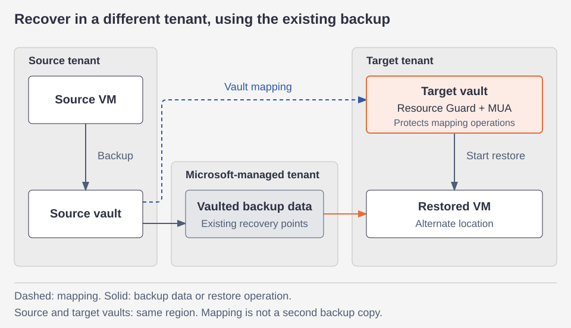

# Azure 일일 업데이트 브리핑 — 2026-10-29

**Azure Backup Cross-Tenant Restore**가 Public Preview로 공개됐습니다.
기존 vaulted backup으로 다른 Microsoft Entra tenant에 복구할 수 있습니다.
**Container Apps는 legacy Log Analytics 로그 경로에서 Azure Monitor로 이전을
권고**하며, Marketplace는 조건에 맞는 private offer의 수락과 구매를 합쳤습니다.

!!! warning "Container Apps 로그 수집 경로 확인"
    Legacy HTTP Data Collector API의 지원은 **2026-09-14에 종료**됐습니다.
    수집이 즉시 중단된 것은 아니지만, 해당 경로를 쓰는 환경은
    [로그와 경고의 이전](#container-apps-logs)을 계획해야 합니다.

**이번 보고서의 업데이트**

- **AI & Apps:** [Container Apps — Azure Monitor 로그 경로로 이전 권고](#container-apps-logs) ·
  [Marketplace private offer — 통합 구매 GA](#marketplace-purchase)
- **Infra:** [Azure Backup — Cross-Tenant Restore Public Preview](#backup-cross-tenant)

## 주요 업데이트

### Azure Backup — Cross-Tenant Restore Public Preview { #backup-cross-tenant }

**동일 tenant 안의 복구를 넘어, 별도 tenant에서 기존 백업으로 복구**

백업 데이터가 남아 있어도 원래 tenant에 접근할 수 없거나 해당 tenant가
침해됐다면, 그 안에서만 복구하는 경로로는 대응이 어려울 수 있습니다.
기존 Cross Subscription Restore는 같은 tenant의 다른 구독으로 복원하는 기능입니다.
이번 Cross-Tenant Restore는 복구 대상의 경계를 **다른 Microsoft Entra tenant**로
넓혀, 독립된 복구 환경을 준비할 수 있게 합니다.

Source vault와 target vault를 미리 mapping하고, target tenant에서 복구 지점을
선택해 복원을 시작합니다. **복구용 백업 사본을 별도로 유지하는 방식이 아니라
기존 vaulted backup을 사용**하며, target vault의 Resource Guard와
Multi-user authorization(MUA)이 mapping 작업을 보호합니다.
[기능 개요](https://learn.microsoft.com/azure/backup/cross-tenant-restore-overview) ·
[기존 VM 복구 방식](https://learn.microsoft.com/azure/backup/backup-azure-arm-restore-vms#restore-options)

*공식 문서 기반 재구성:
[Cross-Tenant Restore 개요](https://learn.microsoft.com/azure/backup/cross-tenant-restore-overview)와
[mapping·복구 절차](https://learn.microsoft.com/azure/backup/tutorial-cross-tenant-restore).
점선은 vault mapping, 실선은 백업·복구 데이터와 복구 작업의 흐름입니다.
그림을 선택하면 원본 크기로 볼 수 있습니다.*

**Mapping과 복구는 이렇게 나뉩니다**

1. **사전 연결:** 두 tenant의 권한을 준비하고 source vault에서 target vault로
   mapping을 만듭니다. Target vault는 Resource Guard로 보호해야 하며,
   source·target vault는 **같은 리전**에 있어야 합니다.
2. **Target에서 조회:** target vault에서 mapped vault와 보호 항목을 열어
   복구 지점을 고릅니다. Mapping 상세를 source 쪽에 노출하지 않는 설계이며,
   조회·복구는 target 쪽 권한으로 수행합니다.
3. **기존 데이터로 복원:** Microsoft가 관리하는 tenant에 저장된 vaulted backup을
   사용해 target tenant의 **alternate location**으로 복구합니다.
   Snapshot-only 복구 지점이나 original location restore는 대상이 아닙니다.
4. **삭제 제약:** mapping이 있는 동안 source·target vault와 source의 보호 항목은
   삭제할 수 없습니다. 복구 시에도 **source vault와 보호 항목이 존재**해야 하므로,
   source가 삭제돼도 무조건 복구된다는 의미는 아닙니다.

별도 tenant에서 복구를 시작할 수 있다는 점이 핵심 변화입니다. 다만 단순히
target tenant를 만들어 두는 것만으로 준비가 끝나지는 않습니다.
Mapping 생성에는 source의 `Backup Contributor`, target의 `CTR Creator`와
Resource Guard 권한이 필요하고, 복구 운영에는 target의 `CTR Contributor`·
`Backup Contributor` 등이 필요합니다.
[역할별 권한과 구성 절차](https://learn.microsoft.com/azure/backup/tutorial-cross-tenant-restore)

**지원 범위와 리전**

- **Recovery Services vault:** Azure VM을 비롯해 Azure Files와 Azure VM 내
  SQL Server·SAP HANA·SAP ASE를 지원하며, **모든 Azure public region**에서 제공합니다.
  Azure VM의 Confidential VM·Azure Disk Encryption(ADE) 암호화 VM·archive-tier
  복구 지점은 지원하지 않습니다.
- **Backup vault:** PostgreSQL Flexible Server·Blob·Cosmos DB·ADLS·AKS의
  지원되는 vaulted backup도 대상입니다. 리전은 **유럽** West Europe·North Europe·
  UK South, **미주** East US·Brazil South, **아시아·태평양** Australia East·
  Australia Southeast입니다. **Backup vault의 이번 지원 목록에는 한국 리전이 없습니다.**

이는 vault 유형별 가용 리전이지, 서로 다른 리전으로 복구하거나 한 워크로드를
multi-region으로 실행한다는 의미는 아닙니다. VM 외 워크로드의 세부 제외 조건은
[지원 표](https://learn.microsoft.com/azure/backup/cross-tenant-restore-overview#supported-workloads-and-limitations)를
확인해야 합니다.

**공식 자료:**
[Public Preview 발표](https://azure.microsoft.com/updates?id=577117) ·
[개념·지원 범위](https://learn.microsoft.com/azure/backup/cross-tenant-restore-overview) ·
[mapping과 복구](https://learn.microsoft.com/azure/backup/tutorial-cross-tenant-restore)

## 대응이 필요한 업데이트

### Container Apps — Azure Monitor 로그 경로로 이전 권고 { #container-apps-logs }

**상태: Announcement · 기반 API 지원 종료: 2026-09-14 · 대상: legacy Log Analytics logging destination**

Container Apps의 logging destination은 애플리케이션의 console log와 플랫폼의
system log를 어디로 보낼지 정하는 환경 설정입니다.
기존 **Log Analytics** 옵션은 HTTP Data Collector API로 custom table에 기록합니다.
이번 공지는 그 옵션을 legacy로 분류하고 **Azure Monitor logging destination으로
전환을 권고**합니다. Log Analytics workspace 자체를 폐기하라는 뜻은 아닙니다.
같은 workspace를 계속 사용할 수 있지만, diagnostic setting에서 목적지를 다시 지정합니다.

HTTP Data Collector API는 지원 종료 이후에도 TLS 요건을 만족하는 client의 수집을
계속 처리하지만 **critical security fix만 제공**합니다.
이번 공지에는 Container Apps 기존 로그 수집의 강제 중단일이나 별도 이전 마감일이
제시되지 않았습니다.
[발표](https://azure.microsoft.com/updates?id=577689) ·
[이전 가이드](https://learn.microsoft.com/azure/container-apps/migrate-logs-azure-monitor?pivots=azure-portal)

**로그를 보내는 경로와 조회 schema가 함께 바뀝니다**

| 로그 | 기존 custom table | 전환 후 resource-specific table |
|---|---|---|
| Console | `ContainerAppConsoleLogs_CL` | `ContainerAppConsoleLogs` |
| System | `ContainerAppSystemLogs_CL` | `ContainerAppSystemLogs` |

- **의존성 확인:** 위 `_CL` table을 참조하는 query·alert·workbook·dashboard·
  workspace function을 찾습니다. `Log_s` → `Log`, `ContainerAppName_s` →
  `ContainerAppName`처럼 column도 바뀌므로 table 이름만 치환해서는 충분하지 않습니다.
- **수집 경로 전환:** logging destination을 Azure Monitor로 바꾸고,
  **즉시 diagnostic setting으로 console·system log를 workspace에 연결**합니다.
  Destination만 바꾸면 workspace로 로그가 전달되지 않습니다.
- **모니터링 공백 관리:** diagnostic setting 활성화에는 최대 90분이 걸릴 수 있습니다.
  새 console log의 도착과 새 alert의 동작을 확인한 뒤 기존 alert를 해제합니다.
  기존 `_CL` table에는 새 데이터가 들어오지 않으며, 과거 데이터는 기존 보존 기간까지 남습니다.

`stdout`·`stderr`와 플랫폼 logging을 쓰는 앱은 보통 코드 변경이 필요하지 않습니다.
반면 앱이 HTTP Data Collector API를 **직접 호출**한다면
[Logs ingestion API 이전](https://learn.microsoft.com/azure/azure-monitor/logs/custom-logs-migrate?tabs=cli)도
별도로 진행해야 합니다. 두 경로를 함께 쓰면 두 가지 이전이 모두 필요합니다.
**Express environment에는 Azure Monitor logging destination을 사용할 수 없어
이번 이전 절차가 적용되지 않습니다.**

적용 여부는 실제 logging destination과 query 의존성으로 확인해야 합니다.
Application Insights 기반 경고를 사용한다는 이유만으로 이 변경의 영향 대상으로
단정할 수는 없습니다.

**공식 자료:**
[이전 권고 발표](https://azure.microsoft.com/updates?id=577689) ·
[경로·schema 전환과 검증](https://learn.microsoft.com/azure/container-apps/migrate-logs-azure-monitor?pivots=azure-portal) ·
[기반 API 지원 종료와 직접 수집 이전](https://learn.microsoft.com/azure/azure-monitor/logs/custom-logs-migrate?tabs=cli)

## 기타 업데이트

- **Microsoft Marketplace private offer — GA:**
  조건에 맞는 신규 SaaS·Professional Services private offer는 수락 후 제품별로
  구매하던 절차 대신 **포함된 제품의 수락·구매를 한 번에 제출**할 수 있습니다.
  모든 offer·갱신에 적용되는 것은 아니며, 제출 후에는 제품별 구매 결과를 확인해야 합니다.
  [발표](https://azure.microsoft.com/updates?id=576547) ·
  [대상 offer와 single-click purchase](https://learn.microsoft.com/marketplace/private-offers-single-click-purchase)
