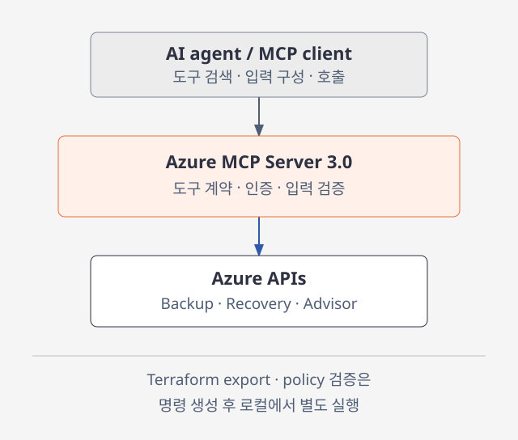
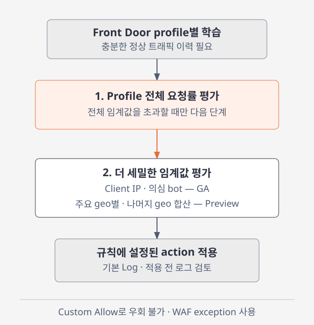
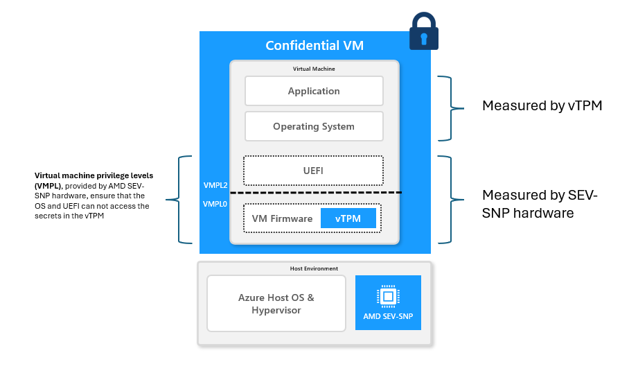

# Azure 일일 업데이트 브리핑 — 2026-10-30

**Azure MCP Server 3.0 GA**는 Terraform·백업·복구·비용 분석을 에이전트의 도구로
연결하며, 기존 통합의 호출·응답 호환성을 점검해야 합니다.
**Front Door Premium WAF**에는 정상 트래픽을 학습하는 HTTP DDoS ruleset이
GA됐습니다. **Confidential VM 마이그레이션**은 127 GB를 초과하는 OS disk에도
confidential encryption을 적용할 수 있게 됐습니다.

**이번 보고서의 업데이트**

- **AI & Apps:** [Azure MCP Server 3.0 — 운영 도구 확장·호환성 변경](#azure-mcp-3)
- **Infra:** [Front Door WAF — HTTP DDoS ruleset GA·geo rules Preview](#http-ddos) ·
  [Confidential VM — 대용량 OS disk 암호화 GA](#confidential-vm-losde)

## 주요 업데이트

### Azure MCP Server 3.0 — 운영 도구 확장 GA·호환성 변경 { #azure-mcp-3 }

Azure MCP Server는 AI 에이전트와 개발 도구가 Azure 기능을 검색하고 호출하도록
연결하는 MCP 구현체입니다. 에이전트가 모든 Azure API를 직접 구현하는 대신,
서버가 제공하는 도구의 입력·응답 계약을 통해 리소스 조회와 작업을 수행합니다.
실제 접근 범위는 사용자의 자격 증명 또는 Managed identity와 Azure RBAC로 제한됩니다.

3.0은 기존 리소스 조회에서 더 나아가 **Terraform 구성 검토, 백업 보호 상태,
복구 준비도와 비용 권고 분석**을 같은 에이전트 흐름에 연결합니다.
2.0에서 도입된 self-hosted remote 실행을 새로 추가한 발표는 아니며,
이번 Azure Updates 공지는 이미 공개된 3.0 stable release의 기능과
breaking change를 안내합니다.

*공식 문서 기반 재구성:
[Azure MCP Server 개요](https://learn.microsoft.com/azure/developer/azure-mcp-server/overview) ·
[Terraform 도구](https://learn.microsoft.com/azure/developer/azure-mcp-server/tools/azure-terraform).
그림을 선택하면 확대할 수 있습니다.*

**도구가 연결하는 작업**

- **Terraform:** AzureRM·AzAPI provider 문서와 Azure Verified Modules를 찾고,
  기존 리소스의 `aztfexport` 명령 및 workspace·plan의 `conftest` 검증 명령을
  생성합니다. 명령 생성과 로컬 실행은 별개이며, 도구 호출만으로 export·검증이
  끝났다고 판단하면 안 됩니다.
- **Backup·Resilience Management:** vault·정책·보호 항목·복구 지점과
  recovery plan·readiness check·drill을 다룹니다. 조회와 failover 같은 변경 작업을
  구분해 승인 범위를 정해야 합니다.
- **Advisor·Optimization:** 권고와 사용률을 살펴보고 VM·VM Scale Set 대안을
  비교합니다. Advisor의 recommendation apply는 실제 리소스 변경이 아니라
  IaC 변경 준비를 위한 규칙을 반환합니다.
- **통합 계약:** 알 수 없는 입력 매개변수는 오류로 처리하고,
  structured output은 명시적으로 활성화할 때만 제공합니다.
  서버의 GA가 연결 대상 Azure 서비스 전체의 GA를 뜻하지는 않습니다.

이 변화는 운영 데이터를 모아 설명하는 데서 끝나지 않고, **변경안을 IaC로 준비하고
검증하는 흐름**을 구성하는 데 유용합니다. 다만 자연어 요청은 권한 통제나
변경 승인을 대신하지 않습니다.

**기존 통합은 업그레이드 전에 확인**

- **호출·응답:** 제거된 매개변수와 저장된 호출을 정리하고 tool discovery를
  갱신합니다. Advisor의 `properties`, Monitor log·AI Search query의 `results`
  같은 응답 구조 변경에 맞춰 parser·test fixture를 점검합니다.
- **Database 도구:** MySQL·PostgreSQL query의 SQL-verb 필터가 제거됐고,
  도구는 non-read-only·destructive로 분류됩니다. 기존 읽기 전용이라는 가정에
  의존하지 말고 database 권한과 tool allowlist를 검토합니다.
- **새 리소스 기본값:** Storage account는 Shared Key 인증,
  Event Hubs namespace는 local authentication, Recovery Services vault는
  public networking을 기본적으로 비활성화합니다. NFS file share에는
  `RootSquash`와 encryption in transit을 적용합니다.
  **업그레이드만으로 기존 리소스를 재설정하지는 않습니다.**

공식 종료 기한이 있는 변경은 아니지만, **2.0 또는 3.0 Preview 통합을 갱신하기 전**
호환성 시험이 필요합니다. 관련 버전 사용 여부 확인 필요.
연결·인증 배경은 [MCP backend 호스팅 가이드](../../services/azure-architecture/mcp-configuration/hosting-reference/index.md)에서
확인할 수 있습니다.

**공식 자료:**
[GA 발표](https://azure.microsoft.com/updates?id=578662) ·
[3.0 기능·업그레이드 안내](https://devblogs.microsoft.com/azure-sdk/azure-mcp-server-3-0-stable-release/) ·
[제품 개요](https://learn.microsoft.com/azure/developer/azure-mcp-server/overview) ·
[Terraform 도구 동작](https://learn.microsoft.com/azure/developer/azure-mcp-server/tools/azure-terraform)

### Front Door Premium WAF — HTTP DDoS ruleset GA·geo rules Preview { #http-ddos }

HTTP-layer DDoS는 대량 요청으로 애플리케이션의 처리 여력을 소모하는 공격입니다.
고정된 IP 차단이나 rate limit만 사용하면 정상적인 수요 증가와 공격을 구별하기
어렵고, 여러 IP에 분산된 botnet에 맞춰 임계값을 계속 조정해야 합니다.

HTTP DDoS ruleset은 **Front Door profile별 정상 트래픽을 학습하고,
전체 요청 급증과 더 세밀한 임계값을 함께 평가**하는 적응형 layer 7 방어입니다.
이번 GA에는 client IP의 비정상 요청률과 Microsoft Threat Intelligence가
식별한 의심 bot을 다루는 두 규칙이 포함됩니다.
국가·지역별 분산 공격을 다루는 두 geo rule은 **별도 Preview**입니다.

*공식 문서 기반 재구성:
[HTTP DDoS ruleset의 two-stage 동작](https://learn.microsoft.com/azure/web-application-firewall/afds/http-ddos-ruleset).
그림을 선택하면 확대할 수 있습니다.*

**학습과 방어가 적용되는 순서**

1. WAF policy에 `Microsoft_HTTPDDoSRuleSet_1.0`을 연결합니다.
   같은 policy를 여러 profile에 연결해도 **각 profile의 임계값은 따로** 계산합니다.
2. Profile 전체 요청률이 학습한 임계값을 넘을 때만 client·geo 임계값을
   적용합니다. 일부 client의 요청 증가만으로 곧바로 방어하는 구조는 아닙니다.
3. **GA 규칙 `500100`·`500110`**은 각각 client별 고빈도 요청과 의심 bot을
   다룹니다. 해당 규칙의 임계값을 초과한 IP에는 penalty box 기간 동안
   설정된 action을 적용하고, 기간이 끝나면 다시 평가합니다.
4. **Preview 규칙 `500310`·`500320`**은 주요 유입 국가·지역을 개별 평가하고,
   나머지 국가·지역은 합산해 평가합니다. IP별로는 임계값을 넘지 않는
   분산 공격을 보완하지만, 일치 시 해당 지역의 정상 사용자에게도 영향을 줄 수 있습니다.

고정 rate limit을 운영자가 일일이 조정하는 대신 정상적인 profile·client 패턴을
기준으로 방어할 수 있습니다. Geo rules는 이 방식을 IP에서 국가·지역 집계로
확장하는 것이며, 특정 Azure 배포 리전의 지원 확대를 뜻하지 않습니다.

**활성화와 예외에서 주의할 점**

- **Front Door Premium 전용**입니다. 규칙은 기본 **Log action·medium sensitivity**로
  켜지므로, 연결만으로 차단이 시작된다고 생각하면 안 됩니다.
  정상 트래픽과 급증 구간의 로그를 확인한 뒤 action을 정합니다.
- 최근 7일 중 최소 50% 동안 트래픽을 받은 profile은 통상 **24~36시간** 안에
  학습·탐지를 시작합니다. 이력이 부족하면 신뢰할 baseline이 쌓일 때까지
  탐지·완화하지 않습니다.
- HTTP DDoS ruleset은 custom rule보다 먼저 평가됩니다.
  **Custom rule의 Allow로 우회할 수 없으며**, health probe·부하 시험처럼
  신뢰할 요청은 WAF exception으로 특정 rule 또는 ruleset에서 좁게 제외합니다.

**공식 자료:**
[GA 발표](https://azure.microsoft.com/updates?id=578681) ·
[학습·규칙별 상태·exception·모니터링](https://learn.microsoft.com/azure/web-application-firewall/afds/http-ddos-ruleset)

### Confidential VM — 대용량 OS disk 암호화 GA { #confidential-vm-losde }

Confidential VM은 워크로드와 host·hypervisor 사이에 하드웨어 기반 격리 경계를
둡니다. 여기에 confidential OS disk encryption을 선택하면 부팅에 필요한
주요 disk partition을 보호하고, 암호화 key를 해당 VM의 vTPM에 결합합니다.
민감한 기존 시스템을 옮길 때는 메모리 격리뿐 아니라 큰 OS image를
이 보호 방식으로 유지할 수 있는지도 중요합니다.

**Large OS Disk Encryption(LOSDE)**은 Azure Migrate를 통한 마이그레이션에서
**127 GB를 초과하는 OS disk**의 confidential encryption을 지원합니다.
기존 대용량 system image의 크기 때문에 암호화된 Confidential VM으로 옮기기
어려웠던 제약을 줄이는 변화입니다. 아래 설명은 **마이그레이션 경로의 지원**이며,
모든 VM 생성 방식의 disk 제한이 해제됐다는 의미는 아닙니다.

*출처: Microsoft Learn,
[Virtual TPMs in Azure confidential VMs](https://learn.microsoft.com/azure/confidential-computing/virtual-tpms-in-azure-confidential-vm).
AMD SEV-SNP 기반 vTPM 격리의 공식 그림이며, LOSDE migration 절차 자체를
나타낸 그림은 아닙니다. 선택하면 원본 크기로 볼 수 있습니다.*

**Disk 보호와 부팅의 연결**

- Azure Migrate에서 대상 security type과 confidential OS disk encryption을
  선택합니다. 암호화는 migration의 hydration 과정에서 수행되므로 초기 생성
  시간이 늘어날 수 있습니다.
- Disk key는 VM의 vTPM에 결합돼 보호된 disk 내용을 해당 VM에서만 접근하도록
  합니다. 그림의 vTPM은 host가 아니라 Confidential VM의 보호된 영역에 있습니다.
- Platform attestation과 secure key release가 부팅 보호를 연결합니다.
  OS encryption을 선택하면 대상 VM의 Secure Boot가 기본 활성화됩니다.

**대용량 경로에서는 CMK가 필수**

Azure Migrate 문서는 **127 GB 초과 OS disk에는 customer-managed key(CMK)만**
지원한다고 명시합니다. 일반 Confidential VM에서 PMK·CMK를 선택할 수 있다는
설명을 대용량 migration에 그대로 적용하면 안 됩니다.
Data disk의 confidential encryption은 이 경로에서 지원하지 않습니다.

Migration 지원 OS는 **Windows Server 2019·2022, Ubuntu 20.04·22.04·24.04 LTS,
RHEL·Rocky Linux 9.4·9.5·9.6**입니다. Confidential VM의 일반 OS 목록과
Azure Migrate의 지원 목록은 구분해야 합니다. 대상 리전에서 필요한
Confidential VM hardware·size를 사용할 수 있는지도 배치 전에 확인합니다.

**공식 자료:**
[GA 발표](https://azure.microsoft.com/updates?id=578850) ·
[LOSDE 기능 설명](https://techcommunity.microsoft.com/blog/microsoft-security-blog/large-os-disk-encryption-is-now-generally-available-for-azure-confidential-vm-mi/4564613) ·
[Azure Migrate 지원 OS·대용량 CMK 조건](https://learn.microsoft.com/azure/migrate/migrate-to-trusted-launch-virtual-machines-with-azure-migrate?view=migrate) ·
[vTPM 구조](https://learn.microsoft.com/azure/confidential-computing/virtual-tpms-in-azure-confidential-vm)
