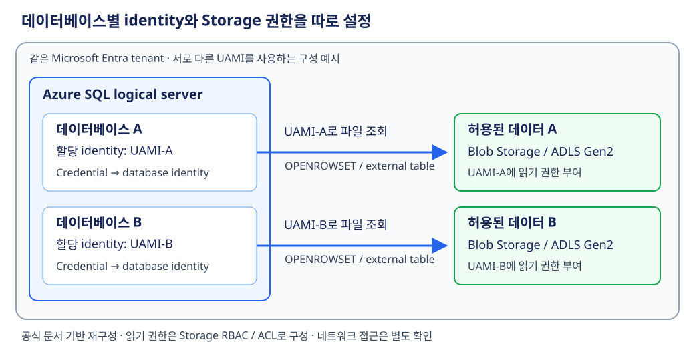

# Azure 일일 업데이트 브리핑 — 2026-10-31

**Azure SQL Database의 database-level Managed identity가 Public Preview로
공개됐습니다.** Blob Storage·ADLS Gen2의 파일을 조회할 때 logical server의
공유 identity 대신 데이터베이스별 identity를 선택할 수 있습니다.
다른 tenant의 Storage도 Federated identity credential(FIC)로 연결해
SAS token 없이 조회할 수 있습니다.

**이번 보고서의 업데이트**

- **Database:** [Azure SQL Database — 데이터베이스별 외부 Storage 인증 Public Preview](#sql-database-managed-identity)

## 주요 업데이트

### Azure SQL Database — 데이터베이스별 외부 Storage 인증 Public Preview { #sql-database-managed-identity }

**외부 파일을 읽는 권한을 logical server 전체가 아닌 개별 데이터베이스에 부여**

Azure SQL Database의 data virtualization은 Blob Storage·ADLS Gen2의
CSV·Parquet 같은 파일을 원래 위치에 둔 채 T-SQL로 읽는 기능입니다.
`OPENROWSET`으로 파일을 탐색하거나 external table로 반복 조회하고,
데이터베이스 안의 테이블과 join할 수 있습니다.
기존의 Managed identity 인증은 logical server의 identity를 사용하므로,
같은 서버의 데이터베이스들이 Storage 접근 권한을 공유했습니다.

이번 기능은 개별 데이터베이스에 **User-assigned managed identity(UAMI)**를
할당하고, database-scoped credential에서 그 identity를 선택하게 합니다.
데이터베이스마다 다른 UAMI와 필요한 Storage 권한을 설정하면 외부 데이터
접근 범위를 분리할 수 있습니다. 또한 **FIC를 통한 cross-tenant 인증**이
추가돼, server-level Managed identity로는 지원하지 않던 다른 tenant의
Storage 조회를 SAS token 없이 구성할 수 있습니다.
([기능 개요·기존 방식과 비교](https://learn.microsoft.com/azure/azure-sql/database/database-level-managed-identity?view=azuresql))

*공식 문서 기반 재구성:
[database-level Managed identity의 권한 범위와 credential 선택](https://learn.microsoft.com/azure/azure-sql/database/database-level-managed-identity?view=azuresql).
같은 tenant에서 서로 다른 UAMI와 Storage 권한을 설정한 예시이며,
그림을 선택하면 원본 크기로 볼 수 있습니다.*

**쿼리에서 identity가 선택되는 흐름**

1. 데이터베이스에 UAMI를 할당하고, 해당 identity에 대상 Storage의
   `Storage Blob Data Reader` 권한을 부여합니다. ADLS Gen2에서는
   directory별 ACL로 더 세밀하게 접근 범위를 정할 수 있습니다.
2. 사용자 데이터베이스에
   `IDENTITY = 'DATABASE MANAGED IDENTITY'`인 database-scoped credential을
   만듭니다. `SECRET`과 database master key는 필요하지 않습니다.
3. External data source에 파일 위치와 credential을 연결합니다.
   엔진은 쿼리 실행 시 데이터베이스에 할당된 identity를 사용해 인증합니다.
4. `OPENROWSET`의 `DATA_SOURCE` 또는 external table을 통해 파일을
   읽습니다. 파일을 데이터베이스에 적재하는 방식으로 바뀌는 것은 아닙니다.

**다른 tenant의 Storage는 application을 통해 연결**

데이터베이스 쪽 tenant에 multitenant application을 등록하고,
그 application이 데이터베이스의 UAMI를 신뢰하도록 FIC를 설정합니다.
Storage 쪽 tenant의 관리자가 application에 consent하면 해당 tenant에
service principal이 만들어지며, **Storage 읽기 권한은 이 service principal에
부여**합니다.

데이터베이스에는 application의 client ID를 **Federated Client ID**로
설정하고, credential은
`IDENTITY = 'DATABASE FEDERATED CLIENT IDENTITY'`를 사용합니다.
같은 tenant의 UAMI에 권한을 주는 경로와 cross-tenant의 service principal에
권한을 주는 경로를 구분해야 합니다.
([Cross-tenant 구성](https://learn.microsoft.com/azure/azure-sql/database/database-level-managed-identity?view=azuresql#use-a-federated-client-identity-across-tenants))

**도입 시 구분할 범위**

- **가용성:** Azure SQL Database의 모든 service tier·Azure 리전에서
  지원하는 Public Preview입니다. 특정 리전에 한정된 발표는 아닙니다.
  Azure SQL Managed Instance·SQL Server·Azure Synapse Analytics에는
  이 credential identity를 적용할 수 없습니다.
- **인증 방향:** 데이터베이스에서 Storage로 나가는 인증만 바뀝니다.
  사용자·애플리케이션의 데이터베이스 로그인은 바뀌지 않으며,
  `sp_invoke_external_rest_endpoint`는 이번 preview 범위에 없습니다.
- **권한 분리:** 데이터베이스당 UAMI는 하나입니다. 기존 server-level
  credential과 함께 사용할 수 있으므로, 기존 credential을 사용하는 쿼리는
  여전히 서버 identity를 사용합니다. 새 identity를 할당하는 것만으로
  모든 외부 데이터 접근이 자동 분리되는 것은 아닙니다.
- **기존 암호화·복구 구성:** Database-level customer-managed key를
  사용한다면 같은 identity·Federated Client ID 설정을 공유합니다.
  변경할 identity에 암호화 key 접근 권한을 먼저 부여해야 합니다.
  Geo-secondary에도 primary와 같은 UAMI·Storage 권한을 설정하고,
  cross-tenant이면 같은 Federated Client ID를 구성해야 failover 후에도
  조회를 이어갈 수 있습니다.
- **접근 확인:** Credential 생성 성공은 실제 Storage 접근 성공을
  보장하지 않습니다. Storage 권한과 network access를 확인하고
  실제 파일 조회로 점검합니다. Data virtualization 쿼리에는
  database compatibility level **130 이상**이 필요합니다.

**공식 자료:**
[Public Preview 발표](https://azure.microsoft.com/updates?id=577491) ·
[Identity 선택·지원 범위·제한·failover](https://learn.microsoft.com/azure/azure-sql/database/database-level-managed-identity?view=azuresql) ·
[Data virtualization의 조회 방식·지원 조건](https://learn.microsoft.com/azure/azure-sql/database/data-virtualization-overview?view=azuresql)
