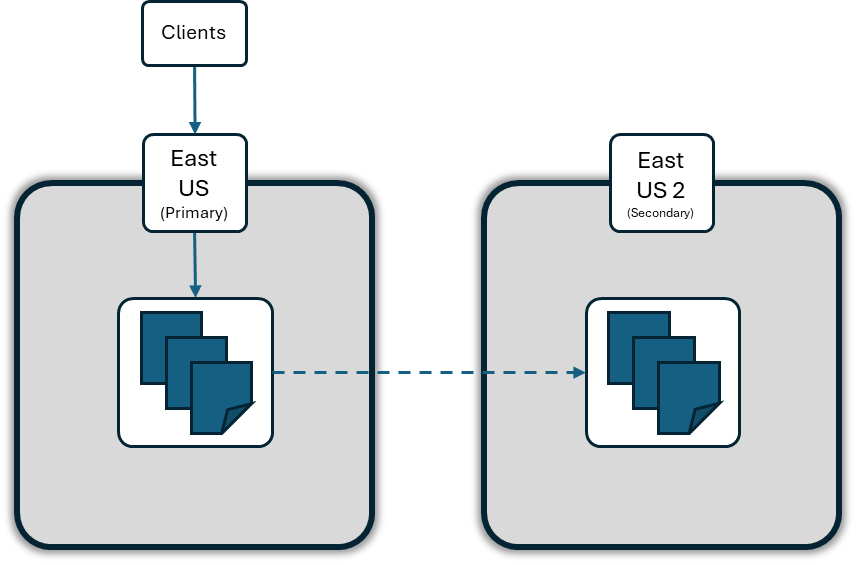
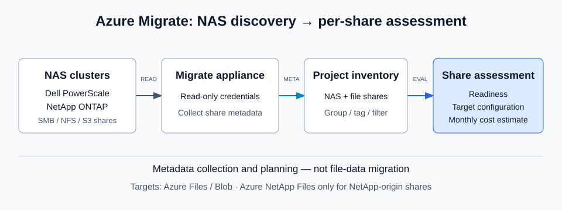
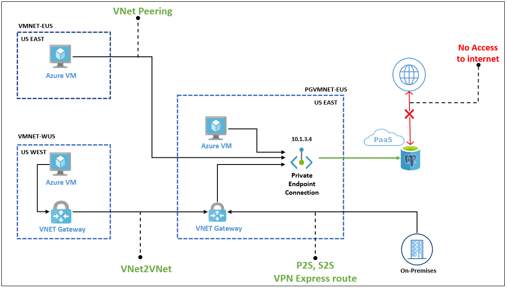
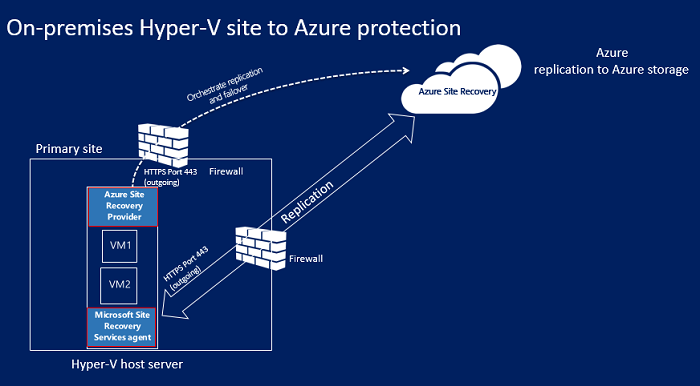
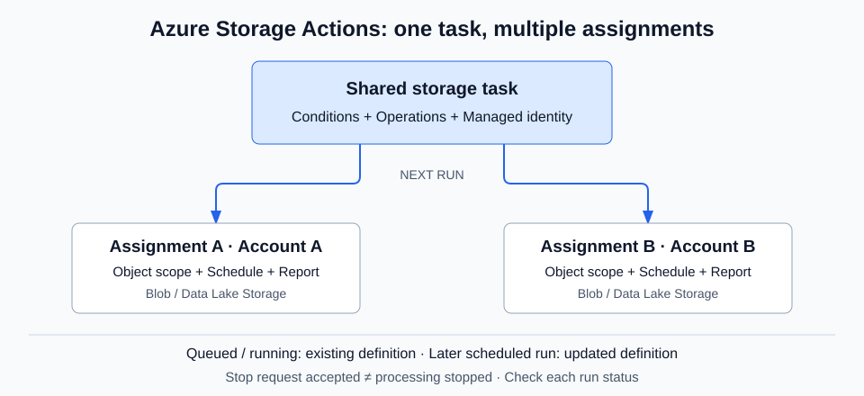

# Azure 일일 업데이트 브리핑 — 2026-11-03

**Service Bus Premium**은 partitioned namespace에서도 메시지와 상태를 다른
리전에 복제합니다. **Azure Migrate**는 NAS를 share 단위로 조사·평가하고,
**PostgreSQL Flexible Server**는 기존 VNet integration을 Private Link 연결
방식으로 전환합니다. **Azure Local의 Site Recovery GA**와
**Storage Actions의 작업 변경·중단 제어**도 함께 소개합니다.

**Azure Fluid Relay 사용자는 2027-02-02 종료 전에 이전을 완료해야 합니다.**

**이번 보고서의 업데이트**

- **AI & Apps:** [Service Bus Premium — partitioned namespace Geo-Replication](#service-bus-partitioned-geo-replication) ·
  [Azure Fluid Relay — 서비스 종료](#fluid-relay-retirement)
- **Infra:** [Azure Migrate — NAS discovery·assessment](#migrate-nas) ·
  [Azure Site Recovery — Azure Local 보호](#site-recovery-azure-local) ·
  [Azure Storage Actions — 작업 갱신·중단·문자열 비교](#storage-actions-controls) ·
  [Microsoft Defender for IoT — OT Security 종료](#defender-iot-ot-retirement)
- **Database:** [PostgreSQL Flexible Server — VNet에서 Private Link로 전환](#postgresql-network-migration) ·
  [Azure SQL Database — portal에서 restart](#sql-database-restart)

## 주요 업데이트

### Service Bus Premium — partitioned namespace의 Geo-Replication GA { #service-bus-partitioned-geo-replication }

**리전 안의 처리량 확장과 리전 간 메시지 복제를 함께 구성**

Service Bus는 queue·topic으로 애플리케이션 사이의 메시지를 전달하는 서비스입니다.
Premium namespace의 partitioning은 메시징 entity를 여러 broker·store에 분산해,
처리량이 단일 broker의 성능에 묶이지 않도록 합니다.
Geo-Replication은 장애에 대비해 entity 설정뿐 아니라 **메시지·처리 상태도
secondary region에 복제**하는 기능입니다.

이번 GA는 이 두 기능을 **partitioned Premium namespace에서 함께 사용하는 지원**입니다.
기존 partitioned namespace에 Geo-Replication을 추가하거나 새 namespace에서 함께
구성할 수 있습니다. Geo-Replication 전체가 새로 등장한 발표가 아니며,
metadata만 복제하는 **Geo-Disaster Recovery**와도 다릅니다.
[이번 지원 확대](https://azure.microsoft.com/updates?id=579021)

*출처: Microsoft Learn [Geo-Replication 개요](https://learn.microsoft.com/azure/service-bus-messaging/service-bus-geo-replication).
공식 원본의 East US·East US 2는 구성 예시이며, partition 배치도나 전체 지원 리전 목록은 아닙니다.
그림을 선택하면 원본 크기로 볼 수 있습니다.*

**메시지 처리와 장애 전환**

- **Primary:** producer·consumer는 하나의 namespace hostname으로 현재 primary에
  연결합니다. Secondary에는 직접 읽기·쓰기를 하지 않습니다.
- **복제 대상:** queue·topic·subscription·filter와 namespace 설정,
  메시지 데이터·메시지 상태 변경을 함께 복제합니다.
- **Synchronous:** active secondary까지 commit한 뒤 client에 응답합니다.
  리전 간 왕복이 응답 지연에 영향을 줍니다.
- **Asynchronous:** primary commit 뒤 응답하고 이후 복제합니다.
  설정한 최대 replication lag에 도달하면 publisher 요청이 throttling됩니다.
- **Promotion:** 사용자가 secondary를 새 primary로 승격합니다.
  Planned promotion은 복제가 따라잡도록 기다리며 그동안 메시지·consumer 작업을
  제한합니다. Forced promotion은 미복제 데이터 손실과 중복 수신 가능성이 있습니다.

**도입 판단:** partitioning을 사용하는 메시징 계층에서도 리전 장애에 대비해
메시지와 처리 상태를 보존할 수 있습니다. 다만 자동 failover나 active-active
처리 기능은 아니며, **현재 secondary는 하나만 지원**합니다.
각 replica의 Messaging Unit과 리전 간 복제 데이터에 비용이 발생합니다.

**가용성:** Premium partitioning은 **Qatar Central·Austria East를 제외한
리전**에서 지원합니다. 기존 non-partitioned namespace를 나중에 partitioned로
바꾸거나 partition 수를 변경할 수는 없습니다. Geo-Disaster Recovery와
Geo-Replication을 같은 namespace에 동시에 적용할 수 없습니다.

**공식 자료:**
[GA 발표](https://azure.microsoft.com/updates?id=579021) ·
[복제 모드·promotion·비용](https://learn.microsoft.com/azure/service-bus-messaging/service-bus-geo-replication) ·
[Partitioning 지원·제약](https://learn.microsoft.com/azure/service-bus-messaging/enable-partitions-premium)

### Azure Migrate — NAS discovery·assessment Public Preview { #migrate-nas }

**NAS의 SMB·NFS·S3 share를 Azure 이전 계획에 포함**

NAS 이전을 계획하려면 각 share의 프로토콜·용량·성능 요구와 대상 서비스의
적합성을 먼저 알아야 합니다. 서버와 애플리케이션만 조사하고 NAS는 별도
spreadsheet로 관리하면, 데이터가 놓일 위치와 비용을 함께 비교하기 어렵습니다.
Azure Migrate는 이제 **Dell PowerScale/Isilon과 NetApp ONTAP/FAS의 share**를
발견하고 기존 프로젝트의 inventory에 포함합니다.

이번 Public Preview는 appliance가 NAS cluster의 metadata를 수집한 뒤,
**share마다 readiness·대상 구성·월 비용을 평가**하는 기능입니다.
파일 데이터를 옮기는 실행 기능이 아니라, 무엇을 어디로 이전할지 판단하는
discovery·assessment 단계입니다.
[기능 발표](https://azure.microsoft.com/updates?id=577975)

*공식 문서 기반 재구성:
[NAS discovery](https://learn.microsoft.com/azure/migrate/add-server-credentials?view=migrate#provide-credentials-and-a-discovery-source-for-nas-file-shares) ·
[File share assessment](https://learn.microsoft.com/azure/migrate/create-file-share-assessment?view=migrate).
그림을 선택하면 원본 크기로 볼 수 있습니다.*

**조사에서 평가까지**

1. 기존 Azure Migrate appliance에 NAS cluster의 discovery source와
   **cluster-level read-only 권한**을 가진 계정을 등록합니다.
   Appliance는 share·system metadata를 수집하며 NAS에 쓰지 않습니다.
2. NAS cluster와 SMB·NFS·S3 share가 inventory에 나타나면
   서버·애플리케이션과 같은 프로젝트에서 group·tag·filter로 범위를 정합니다.
3. Share 단위로 대상 리전과 sizing 조건을 선택합니다.
   용량 기준의 **As-is** 또는 성능 데이터를 사용하는 **Performance-based**로 평가합니다.
4. Azure Files·Blob Storage를 비교하고, **NetApp-origin share에 한해
   Azure NetApp Files도 평가**합니다. Dell PowerScale share에는
   Azure NetApp Files 추천이 제공되지 않습니다.

**평가 결과의 한계:** deep discovery 성능 측정값이 없으면 정해진 공식으로
성능을 추정할 수 있습니다. Performance-based 결과라는 이유만으로 실측값이라고
해석하면 안 됩니다. Blob 추천은 용량·접근 빈도 기반이며 IOPS·throughput
검증은 아닙니다. On-premises TCO도 기본 가정값을 조정해 사용하는 추정치입니다.

대상 리전의 SKU·가격에 따라 같은 share의 추천이 달라집니다.
평가는 특정 시점의 snapshot이므로 원본 구성이나 수집 데이터가 바뀌면
다시 계산해야 합니다.

**공식 자료:**
[프리뷰 발표](https://azure.microsoft.com/updates?id=577975) ·
[지원 NAS·권한·discovery source](https://learn.microsoft.com/azure/migrate/add-server-credentials?view=migrate) ·
[평가 동작·대상별 제한](https://learn.microsoft.com/azure/migrate/create-file-share-assessment?view=migrate)

### PostgreSQL Flexible Server — VNet integration에서 Private Link로 전환 GA { #postgresql-network-migration }

**기존 서버·백업은 유지하고 사설 연결 방식을 바꾸는 경로**

VNet integration은 PostgreSQL 서버를 고객 VNet의 delegated subnet에 배치합니다.
Private Link는 소비자 VNet의 private endpoint IP를 통해 서비스에 연결하는
다른 네트워크 모델입니다. 여러 VNet이나 온프레미스에서 DB에 접근하는 설계를
바꾸려면, 서버가 어느 모델을 사용하는지 먼저 구분해야 합니다.

이번 GA는 **기존 VNet-integrated server를 private endpoint-capable 구성으로
전환**하는 기능입니다. 서버가 delegated subnet에서 나오고, 전환 후 private
endpoint를 추가해 연결합니다. VNet integration을 그대로 둔 채 private
endpoint만 붙이는 기능은 아닙니다.
[전환 발표](https://azure.microsoft.com/updates?id=574541)

*출처: Microsoft Learn [Private Link 연결 시나리오](https://learn.microsoft.com/azure/postgresql/network/concepts-networking-private-link#use-cases-for-private-link-with-azure-database-for-postgresql).
전환 후 사용할 연결 구조를 설명하는 공식 원본이며, 전환 과정 자체의 그림은 아닙니다.
그림의 IP·리전 이름은 공식 문서의 예시입니다.
그림을 선택하면 원본 크기로 볼 수 있습니다.*

**전환할 때 달라지는 동작**

- **비가역 변경:** 전환한 서버를 다시 VNet integration으로 되돌릴 수 없습니다.
- **연결 중단:** 작업은 일반적으로 최대 20분 걸리며, 그중 서버 접근이
  최대 10분 중단될 수 있습니다. 기존 연결이 종료되고 신규 연결이 거절됩니다.
- **접근 복원:** 완료 후 public access는 기본적으로 꺼져 있습니다.
  Private endpoint를 추가하거나, public access를 명시적으로 켜고 firewall rule을
  구성하기 전까지 접근할 수 없습니다. Private endpoint 연결의 DNS도 맞춰야 합니다.
- **백업 유지:** 전환 전에 만든 백업과 geo-redundant backup은 남습니다.
- **Logical replication:** subscriber가 publisher의 새 private endpoint에
  도달하도록 네트워크 경로를 다시 확인해야 합니다.

**IaC 사용 시 주의:** Terraform의 `delegated_subnet_id`를 남기면 서버 교체를
계획할 수 있습니다. 전환 후 네트워크 모델과 `public_network_access_enabled`를
맞추고, apply 전에 plan에 서버 교체나 의도하지 않은 public access 활성화가
없는지 확인합니다.

**공식 자료:**
[GA 발표](https://azure.microsoft.com/updates?id=574541) ·
[전환 영향·연결 복원·Terraform 주의사항](https://learn.microsoft.com/azure/postgresql/network/how-to-migrate-vnet-private-endpoint-capable-server?tabs=portal-migrate) ·
[Private Link·DNS 연결 구조](https://learn.microsoft.com/azure/postgresql/network/concepts-networking-private-link)

### Azure Site Recovery — Azure Local VM 보호 GA { #site-recovery-azure-local }

**Azure Local에서 준비하고, Azure에서 복구·검증하는 DR 경로**

Azure Local에서 VM을 실행하더라도 site 장애에 대비한 별도의 복구 위치가
필요합니다. Site Recovery는 원본 VM의 disk를 Azure로 복제하고, 장애 시 그
복제 상태로 Azure VM을 실행합니다. Host나 cluster의 redundancy만으로
site 전체 손실을 해결하는 것은 아닙니다.

이번 GA는 **Azure Local의 Windows·Linux VM을 보호하는 통합 경험**입니다.
Azure Local 리소스의 portal wizard에서 vault·Hyper-V site·복제 정책을 준비하고
cluster node별 agent 설치·등록을 진행합니다. Preview에서 필요했던
**WDAC enforce mode를 audit mode로 낮추는 설치 우회가 제거**됐으며,
proxy 설정도 준비 wizard에 통합됐습니다.
[GA 변경 설명](https://techcommunity.microsoft.com/blog/azurestackblog/azure-site-recovery-for-azure-local-is-now-generally-available/4529925)

*출처: Microsoft Learn [Hyper-V to Azure architecture — without VMM](https://learn.microsoft.com/azure/site-recovery/hyper-v-azure-architecture#architectural-components---hyper-v-without-vmm).
Azure Local 통합이 사용하는 Hyper-V 복제의 기본 구조이며, portal wizard의 화면은 아닙니다.
그림을 선택하면 원본 크기로 볼 수 있습니다.*

**보호와 복구 흐름**

1. Azure Local portal에서 infrastructure를 준비하고 보호할 VM의 replication을
   활성화합니다. 준비 이후 복제·failover 작업은 Recovery Services vault에서 수행합니다.
2. VM의 VHD 데이터를 Azure Storage로 복제합니다.
   Provider는 Site Recovery와 복제를 조정하고, agent는 데이터 전송을 담당합니다.
3. **Test failover**는 격리된 Azure network에 VM을 만들어 복구 계획을
   검증하며 production replication을 중단하지 않습니다.
4. Planned·unplanned failover로 Azure에서 VM을 실행합니다.
   복구되는 것은 복제된 disk 상태이며, **VM의 in-memory 상태는 유지되지 않습니다.**
5. 원본 환경이 복구되면 re-protect·failback을 진행하고,
   reverse replication으로 Azure에 대한 지속 보호를 다시 설정합니다.

**가용성:** 공지는 모든 Azure Local 지원 리전에서 제공한다고 명시합니다.
Windows·Linux Gen 1·Gen 2 VM을 지원하지만 **Trusted Launch VM 지원은
향후 계획**입니다. Azure로 replication traffic을 보내는 인터넷 연결 또는
구성된 proxy가 필요하며, 완전한 air-gapped DR 기능은 아닙니다.

**공식 자료:**
[GA 발표](https://azure.microsoft.com/updates?id=579111) ·
[Wizard·WDAC·proxy 변경](https://techcommunity.microsoft.com/blog/azurestackblog/azure-site-recovery-for-azure-local-is-now-generally-available/4529925) ·
[Azure Local 보호·복구·제약](https://learn.microsoft.com/azure/azure-local/manage/azure-site-recovery?view=azloc-2610) ·
[Hyper-V 복제 구조](https://learn.microsoft.com/azure/site-recovery/hyper-v-azure-architecture)

### Azure Storage Actions — 작업 갱신·중단·case-sensitive 비교 GA { #storage-actions-controls }

**여러 계정이 공유하는 데이터 관리 규칙을 바꾸고 실행을 제어**

Storage Actions는 Blob Storage·Data Lake Storage의 object에 조건을 적용해
계층 이동·삭제·metadata 관리 같은 작업을 실행하는 managed platform입니다.
**Storage task**가 조건·operation을 정의하고, **assignment**가 대상 계정·object
범위·실행 일정·보고서 위치를 정합니다. 하나의 task를 여러 계정이 공유할 수
있으므로 규칙을 바꿀 때 각 실행에 언제 반영되는지가 중요합니다.

이번 GA는 **task 변경의 자동 전파, 실행 중단 요청, 대소문자를 구분하는
문자열 operator**를 추가합니다. Assignment를 일일이 다시 만들지 않고
공유 규칙을 바꾸되, 이미 시작된 작업까지 새 규칙으로 바뀌는 것은 아닙니다.
[변경 발표](https://azure.microsoft.com/updates?id=578628)

*공식 문서 기반 재구성:
[Task 구성](https://learn.microsoft.com/azure/storage-actions/overview) ·
[Assignment·정의 변경](https://learn.microsoft.com/azure/storage-actions/storage-tasks/storage-task-assignment).
그림을 선택하면 원본 크기로 볼 수 있습니다.*

**새 제어가 적용되는 범위**

- **자동 갱신:** 변경한 조건·operation은 기존 assignment의 다음 scheduled run에
  적용됩니다. 이미 queued 상태이거나 실행 중인 run은 이전 정의를 사용합니다.
- **중단 요청:** 개별 assignment 또는 task에 연결된 모든 assignment의
  실행 중인 run을 대상으로 요청할 수 있습니다.
  **비동기 요청의 접수는 중단 완료가 아닙니다.** 각 run의 상태를 별도로 확인합니다.
- **Case-sensitive 비교:** `equals_cs`, `contains_cs`, `startsWith_cs`,
  `endsWith_cs`, `matches_cs`를 사용합니다. 기존 operator의
  case-insensitive 동작은 유지됩니다.

예를 들어 `endsWith(Name, '.CSV')`는 `.CSV`·`.csv`를 모두 선택하지만,
`endsWith_cs(Name, '.CSV')`는 `.CSV`만 선택합니다.
새 operation을 추가했다면 각 대상 계정에서 task의 Managed identity 권한도
맞는지 확인해야 합니다.

**가용성:** 미주·유럽·아시아·태평양·중동·아프리카의 여러 public cloud
리전에서 GA이며 **Korea Central·Korea South도 포함**됩니다.
전체 목록은 [공식 지원 리전](https://learn.microsoft.com/azure/storage-actions/overview#supported-regions)을 참고합니다.
Assignment 실행·object scan·operation에 과금되므로 규칙 변경 전에
대상 범위를 확인하는 것이 중요합니다.

데이터 보존 설계의 배경은
[음성 기록의 Blob 수명주기 관리](../../services/microsoft-foundry/voice-data-management/azure-storage/index.md#storage-lifecycle)도
참고할 수 있습니다. Storage Actions와 Blob lifecycle policy는 서로 다른 기능입니다.

**공식 자료:**
[GA 발표](https://azure.microsoft.com/updates?id=578628) ·
[기능·지원 리전·과금](https://learn.microsoft.com/azure/storage-actions/overview) ·
[Task 갱신](https://learn.microsoft.com/azure/storage-actions/storage-tasks/storage-task-assignment) ·
[중단 요청](https://learn.microsoft.com/azure/storage-actions/storage-tasks/storage-task-assignment-create#stop-an-in-progress-run) ·
[문자열 operator](https://learn.microsoft.com/azure/storage-actions/storage-tasks/storage-task-conditions#supported-operators)

## 대응이 필요한 업데이트

### Azure Fluid Relay — 2027-02-02 서비스 종료 { #fluid-relay-retirement }

**대상: Azure Fluid Relay에 의존하는 실시간 협업 애플리케이션**

Azure Fluid Relay는 Fluid Framework 애플리케이션의 실시간 협업을 위한
서비스입니다. **서비스는 2027-02-02 종료**되며, 2027-02-01까지 기존
서비스를 사용하면서 전환할 수 있습니다. Fluid Framework 자체는
open-source framework로 계속 제공됩니다.
[종료 공지](https://azure.microsoft.com/updates?id=570498)

- **필요한 대응:** 의존하는 애플리케이션·문서를 식별하고 종료 전에
  Microsoft가 안내한 [self-hosted Fluid service](https://github.com/microsoft/FluidFramework/tree/main/tools/selfhost)로 전환합니다.
- **운영 책임 변화:** self-hosted 서비스의 hosting·운영·인프라 비용은 사용자가
  책임집니다. 공식 저장소도 reference deployment임을 밝히므로, production의
  identity·HA·백업·용량·client 호환성을 별도로 검토해야 합니다.
- **적용 여부:** Azure Fluid Relay 사용 여부 확인 필요. 서비스 종료를
  Fluid Framework 전체 종료로 해석하지 않습니다.

**공식 자료:**
[종료일·전환 대상](https://azure.microsoft.com/updates?id=570498) ·
[서비스 배경](https://learn.microsoft.com/azure/azure-fluid-relay/resources/faq) ·
[공식 대체 구성·이전 안내](https://github.com/microsoft/FluidFramework/tree/main/tools/selfhost)

### Microsoft Defender for IoT — OT Security 2029년 10월 종료 예정 { #defender-iot-ot-retirement }

**종료 대상은 OT Security이며 Enterprise IoT 전체가 아닙니다**

공지는 **2029년 10월** OT Security 종료를 예고합니다.
일 단위 종료일은 명시하지 않습니다. 지금 즉시 기존 deployment를 중지하라는
공지가 아니라, 전환 기간 안에 대체 OT security solution으로 이전하라는 안내입니다.

- **전환 기간:** routine security update·bug fix는 제공하지만,
  새로운 OT-specific 기능 투자는 진행하지 않습니다.
- **필요한 대응:** sensor·integration·license·계약과 보안 요구를 확인하고
  대체 solution의 구매·시험·데이터 export·sensor 철거를 포함해 이전을 계획합니다.
- **범위 구분:** Defender for Endpoint의 Enterprise IoT capability는 영향을
  받지 않습니다. Device discovery·vulnerability assessment도 계속 제공됩니다.
- **적용 여부:** OT Security 사용 여부 확인 필요. 대체 제품의 license·deployment가
  자동으로 제공되는 것은 아닙니다.

**공식 자료:**
[종료 범위·일정·대응](https://azure.microsoft.com/updates?id=576255) ·
[OT와 Enterprise IoT의 차이](https://learn.microsoft.com/defender-for-iot/enterprise-iot)

## 기타 업데이트

- **Azure SQL Database — portal restart GA:**
  Single database·Hyperscale·elastic pool을 portal에서 restart·failover할 수
  있습니다. 일시적으로 연결이 끊기며 pool restart는 그 안의 모든 DB에
  적용됩니다. DB·pool별 failover 호출은 15분에 한 번으로 제한됩니다.
  [발표](https://azure.microsoft.com/updates?id=577992) ·
  [Restart 동작·주의사항](https://learn.microsoft.com/azure/azure-sql/database/restart-database?view=azuresql)
