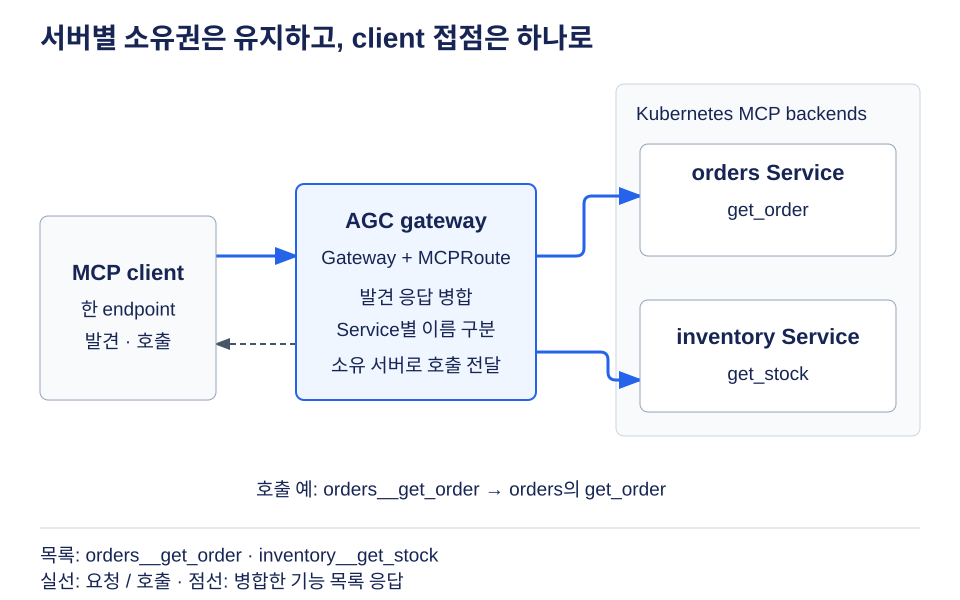
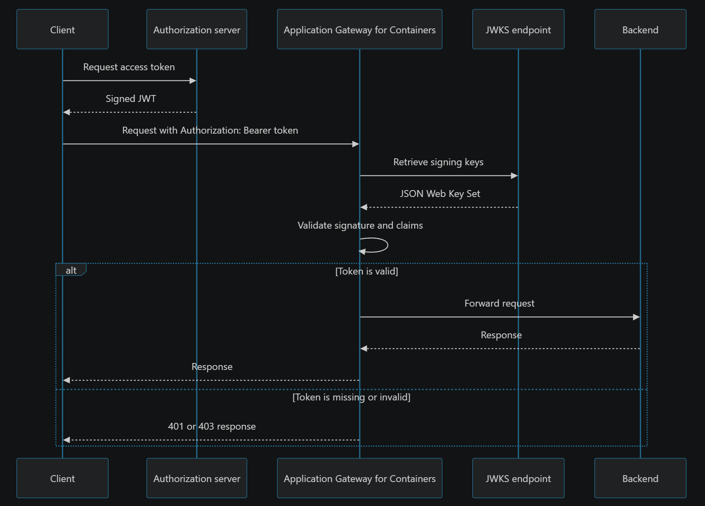
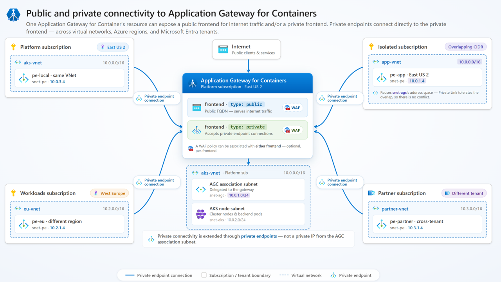
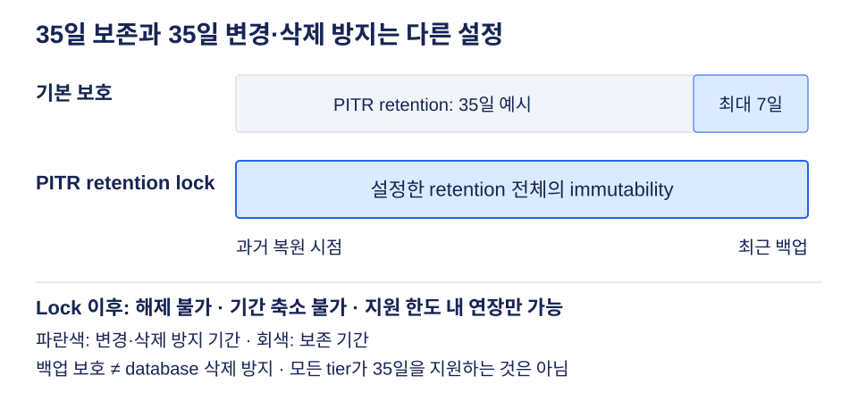
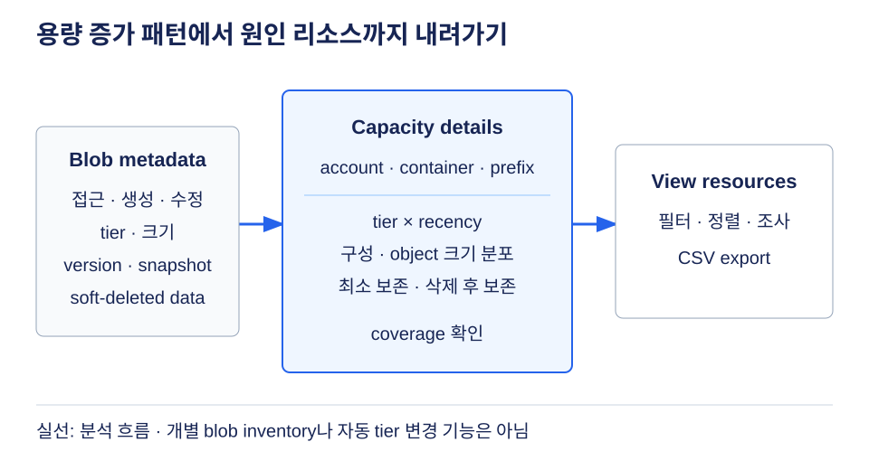

# Azure 일일 업데이트 브리핑 — 2026-11-04

**Application Gateway for Containers**에 MCP 서버 집계, JWT validation,
private ingress가 Public Preview로 추가됐습니다. Kubernetes의 여러 MCP 서버를
하나의 endpoint로 연결하고, 인증과 private 접속 경로를 gateway에서 구성할 수 있습니다.
**Azure SQL**은 PITR 백업의 immutability를 설정한 보존 기간 전체로 잠그는 기능을,
**Storage Discovery**는 데이터의 접근 시점·tier·version까지 분석하는 기능을 공개했습니다.

**이번 보고서의 업데이트**

- **AI & Apps:** [Application Gateway for Containers — MCP gateway](#agc-mcp)
- **Infra:** [Application Gateway for Containers — JWT validation](#agc-jwt) ·
  [Application Gateway for Containers — private ingress](#agc-private) ·
  [Storage Discovery — advanced capacity insights](#storage-capacity) ·
  [Site Recovery — VMSS Flex 복구 개선](#asr-vmss-flex)
- **Database:** [Azure SQL — PITR 백업 immutability 확장](#sql-pitr-lock)

## 주요 업데이트

### Application Gateway for Containers — MCP gateway Public Preview { #agc-mcp }

**독립적인 MCP 서버의 tool·resource·prompt를 하나의 endpoint로 집계**

MCP(Model Context Protocol)는 AI client가 외부 시스템의 도구와 데이터를
발견하고 호출하는 공통 프로토콜입니다. 서버가 늘어나면 client마다 여러 주소를
등록하고, 서버별로 TLS·인증·접근 경로를 관리해야 합니다.
일반 `HTTPRoute`는 MCP의 HTTP 요청을 전달할 수 있지만, 여러 서버의 기능 목록을
합치거나 호출할 기능의 소유 서버를 판단하는 것은 별도의 역할입니다.

이번 **`MCPRoute`**는 Application Gateway for Containers가 제공하는 MCP 전용
custom resource입니다. 단일 서버로 전달하거나 여러 Kubernetes Service의 MCP
기능을 집계해, client에는 안정적인 hostname·path와 하나의 목록을 제공합니다.
MCP 서버 자체나 업무 tool을 만들어 주는 기능은 아닙니다.

*공식 문서 기반 재구성:
[MCP gateway의 routing·aggregation](https://learn.microsoft.com/azure/application-gateway/for-containers/mcp-gateway#multi-server-aggregation).
그림을 선택하면 원본 크기로 볼 수 있습니다.*

**발견과 호출을 구분해서 처리합니다**

1. `Gateway`의 listener에 `MCPRoute`를 연결하고, 하나 이상의 backend Service를 지정합니다.
2. `tools/list`·`resources/list`·`prompts/list` 요청은 각 backend에 전달한 뒤 응답을 합칩니다.
3. 이름 충돌을 피하려고 capability 이름에 Service 이름을 붙입니다.
   예를 들어 `orders`의 `get_order` tool은 `orders__get_order`로 노출됩니다.
4. Client가 이 tool을 호출하면 gateway는 Service 접두어를 제거하고,
   실제 `get_order`를 소유한 backend로 전달합니다.

별도의 집계 애플리케이션을 만들지 않고도 팀별 MCP 서버를 한 접점으로 제공할 수 있습니다.
반면 **Service 이름이 client에 보이는 API 이름의 일부가 되므로** 안정적으로 관리해야 합니다.
메모리 안에 session state를 두는 서버에는 session affinity를 설정할 수 있지만
**best effort**이며, 원래 Pod가 사라졌을 때 상태 복구를 보장하지 않습니다.

`MCPRoute`는 upstream Gateway API의 표준 route가 아니라
**`alb.networking.azure.io/v1alpha1` Preview API**입니다.
HTTPS·backend TLS·health check를 구성하고, 인증은
[JWT validation](#agc-jwt)과 결합할 수 있습니다.
Gateway가 token을 검증해도 tool별 scope·권한·데이터 소유권 검사는 backend의 책임입니다.

관련 배경: [Azure MCP 구성과 서비스 선택 기준](../../services/azure-architecture/mcp-configuration/index.md).

**공식 자료:**
[프리뷰 발표](https://azure.microsoft.com/updates?id=576388) ·
[구조·집계·session 동작](https://learn.microsoft.com/azure/application-gateway/for-containers/mcp-gateway)

### Application Gateway for Containers — JWT validation Public Preview { #agc-jwt }

**Backend에 도달하기 전에 token을 검증하되, 업무 권한 판단은 분리**

JWT는 issuer가 서명한 access token으로, 호출자의 신원과 token의 사용 대상을
전달합니다. 여러 backend가 같은 API 진입점을 공유하면 각 앱에
서명·issuer·만료 검사를 반복해서 구현하는 대신 gateway에서 공통 검증을 수행할 수 있습니다.
이번 **`AuthPolicy`**는 이 검증을 Application Gateway for Containers의
HTTP·gRPC·MCP route에 적용하는 기능입니다.

Microsoft Entra ID 또는 신뢰할 수 있는 HTTPS JWKS(JSON Web Key Set) endpoint를
제공하는 identity provider와 연결합니다. Gateway는 token을 발급하거나
대화형 로그인을 수행하지 않으며, backend의 역할·scope·리소스별 인가를 대체하지 않습니다.

*출처: Microsoft Learn,
[JWT validation — 요청 흐름](https://learn.microsoft.com/azure/application-gateway/for-containers/jwt-validation#how-jwt-validation-works).
공식 원본이며, 그림을 선택하면 원본 크기로 볼 수 있습니다.*

**정책과 요청 처리**

- **검증:** Gateway가 JWKS signing key를 가져와 캐시하고, token의 서명·issuer·
  lifetime을 확인합니다. Audience 검사는 정책에 `audiences`를 구성했을 때 수행합니다.
- **차단:** Token 누락과 대부분의 검증 실패는 `401 Unauthorized`,
  허용하지 않은 audience는 `403 Forbidden`으로 거부하며 backend에 전달하지 않습니다.
- **상속:** `ApplicationLoadBalancer` → `Gateway` → route 순으로 적용됩니다.
  더 구체적인 정책이 상위 정책을 **대체**하며, 조건들을 합치는 방식이 아닙니다.
- **WAF 결합:** 일반 보호 요청은 WAF 검사 → JWT 검증 → backend 전달 순서입니다.
  선택적으로 제공하는 OAuth Protected Resource Metadata endpoint는 인증 전에 조회할 수 있고,
  해당 metadata 요청은 WAF 평가보다 먼저 처리됩니다.

공통 인증 검사를 gateway에 모으면서 route마다 issuer·audience를 달리할 수 있습니다.
다만 metadata에 scope를 게시하는 것과 그 scope를 실제로 강제하는 것은 다릅니다.
잘못된 정책은 **fail closed**로 처리하지만, route의 명시적 `jwt: {}`는
상속된 인증에서 빠지는 설정이므로 의도한 공개 route에만 사용해야 합니다.

**지원 조건:** Gateway API에서만 지원하며 Ingress API에는 적용되지 않습니다.
JWKS hostname은 gateway의 Data plane에서 해석·접속 가능해야 하고,
HTTPS 인증서도 신뢰할 수 있어야 합니다.
Private ingress를 사용한다고 identity provider의 접속 조건까지 자동 해결되지는 않습니다.

**공식 자료:**
[프리뷰 발표](https://azure.microsoft.com/updates?id=576382) ·
[검증·상속·WAF 순서·제한](https://learn.microsoft.com/azure/application-gateway/for-containers/jwt-validation)

### Application Gateway for Containers — private ingress Public Preview { #agc-private }

**Public IP 없이, 승인된 Private Link endpoint로 Kubernetes의 L7 진입점에 접속**

내부 API와 cluster 간 서비스는 L7 routing·TLS·health probing이 필요해도
인터넷에 frontend를 노출할 필요는 없습니다. Public frontend에 WAF나 인증을
추가하는 방식은 요청을 제한하지만 public IP 자체는 남깁니다.
이번 private ingress는 **frontend의 public IP를 제거**하고,
승인된 Azure Private Link private endpoint를 통해서만 접속하게 합니다.

Private endpoint는 client 쪽 subnet에 생성합니다.
다른 VNet·구독·Microsoft Entra tenant·리전에서도 연결할 수 있어,
공유 gateway에 접근하기 위해 VNet peering이나 동일한 주소 공간을 요구하지 않습니다.
이는 다른 리전에서 gateway에 접속하는 기능이지,
하나의 애플리케이션을 여러 리전에 자동 배포하거나 failover하는 기능은 아닙니다.

*출처: Microsoft Learn,
[Private ingress — 연결 구조](https://learn.microsoft.com/azure/application-gateway/for-containers/private-ingress#how-it-works).
그림 속 주소는 공식 예시이며, 그림을 선택하면 원본 크기로 볼 수 있습니다.*

**접속 경로가 바뀌는 부분**

- Gateway API의 **`azure-alb-internal`** class로 private frontend를 구성합니다.
  Ingress API도 해당 class annotation을 지원합니다.
- Private endpoint connection을 생성하고 승인합니다.
  Cross-subscription·cross-tenant 연결은 gateway 리소스 소유자의 수동 승인이 필요합니다.
- Client는 frontend FQDN을 자신의 private endpoint IP로 해석해 접속합니다.
  AGC association subnet의 private IP에 직접 접속하는 구조가 아닙니다.
- 하나의 AGC 리소스에 public·private frontend를 함께 두고,
  routing rule과 선택적인 WAF 정책을 분리할 수 있습니다.

내부 서비스와 cross-cluster 통신을 private 경로에 두면서 기존 L7 기능을 유지합니다.
Firewall/NVA를 앞단에 두는 구성에서는 **SNAT로 원래 client IP가 보이지 않을 수 있으므로**
IP 기반 로그·접근 정책이 필요한지 함께 검토해야 합니다.

**도입 조건:** Association 리소스는 **2026-04-23 이후 생성된 것**이어야 하며,
**REST API 2026-03-01 이상·ALB Controller v1.13 이상**을 사용합니다.
기존 association에 그대로 활성화할 수 있다고 가정하지 않습니다.

**공식 자료:**
[프리뷰 발표](https://azure.microsoft.com/updates?id=576393) ·
[Private Link 구조·지원 조건](https://learn.microsoft.com/azure/application-gateway/for-containers/private-ingress) ·
[Gateway API 구성](https://learn.microsoft.com/azure/application-gateway/for-containers/how-to-private-ingress-gateway-api)

### Azure SQL Database·Managed Instance — PITR 백업 immutability 확장 Public Preview { #sql-pitr-lock }

**백업 보존 기간과 변경·삭제 방지 기간을 맞추는 영구 lock**

PITR(Point-in-time restore)는 자동 백업을 이용해 데이터베이스를 과거 시점으로
복원하는 기능입니다. **Retention은 백업을 얼마나 오래 남길지**,
**immutability는 남은 백업을 얼마나 오래 변경·삭제하지 못하게 할지**를 정합니다.
기존 기본 보호는 최근 최대 7일이므로, PITR retention을 35일로 설정하는 것만으로
35일 전체가 immutable해지는 것은 아니었습니다.

이번 기능은 immutability를 **설정한 PITR retention 전체에 맞춰 잠급니다**.
지원되는 구성에서 35일 retention과 lock을 함께 설정하면,
기본 7일을 넘어 그 보존 기간에 걸쳐 백업을 보호할 수 있습니다.
별도 storage account나 Storage immutability policy를 직접 관리하는 방식이 아니라
Azure SQL의 managed backup 서비스에 통합된 설정입니다.

*공식 문서 기반 재구성:
[기본 보호와 PITR retention lock의 차이](https://learn.microsoft.com/azure/azure-sql/automatic-backup-immutability?view=azuresql#compare-the-protection-options).
35일은 지원 구성의 예시이며, 그림을 선택하면 원본 크기로 볼 수 있습니다.*

- Database의 short-term retention policy에서 보존 기간과 lock을 설정합니다.
- **한 번 잠그면 해제하거나 retention을 줄일 수 없습니다.** 지원 한도 안에서 늘리는 것만 가능합니다.
- Lock은 백업을 보호하지만 database 삭제를 막는 resource deletion lock은 아닙니다.
  Database 삭제 후에도 남은 백업은 해당 기간의 보호를 유지합니다.
- Retention을 늘려도 이미 만료된 백업이 다시 생기거나 과거 복원 이력이 즉시 늘지는 않습니다.
  LTR(Long-term retention) 설정과도 별개입니다.

**적용 범위:** SQL Database의 **Hyperscale은 지원하지 않습니다**.
SQL Managed Instance는 **Always-up-to-date 또는 SQL Server 2025 update policy**에서
지원하며 SQL Server 2022 update policy는 제외됩니다.
서비스 tier의 PITR 한도는 그대로이므로 모든 database에 35일을 적용할 수 있다고 가정하지 않습니다.
MI에서 database 관리 작업이 매우 많은 환경에는 일부 백업에 보호가 적용되지 않을 수 있다는
[공식 제한](https://learn.microsoft.com/azure/azure-sql/automatic-backup-immutability?view=azuresql#limitations)도 있습니다.

장기 복구 이력의 보호가 필요한 경우 유용하지만,
**임시 테스트 설정이 아니라 되돌릴 수 없는 보존 정책 결정**입니다.
Retention과 backup storage 비용을 검토한 뒤 활성화해야 합니다.

**공식 자료:**
[프리뷰 발표](https://azure.microsoft.com/updates?id=579305) ·
[동작·영구 lock·지원 제한](https://learn.microsoft.com/azure/azure-sql/automatic-backup-immutability?view=azuresql)

### Azure Storage Discovery — advanced capacity insights Public Preview { #storage-capacity }

**총용량에서 한 단계 더 내려가, 데이터의 나이·tier·version별 사용량을 분석**

Storage 용량이 늘었다는 사실만으로는 어떤 데이터를 옮기거나 정리해야 할지 알기 어렵습니다.
최근에 읽지 않은 Hot tier 데이터, 오래된 version·snapshot,
작은 object가 많은 workload는 같은 총용량이라도 운영 판단이 달라집니다.
Storage Discovery의 기존 Capacity overview가 전체 규모를 보여줬다면,
이번 **Capacity details**는 접근 시점·tier·object 크기·보존 상태를 함께 분석합니다.

차트에서 나타난 패턴을 storage account·container·설정한 prefix까지 내려가
확인할 수 있습니다. 개별 blob의 inventory를 제공하거나,
분석 결과에 따라 데이터를 자동 삭제·이동하는 기능은 아닙니다.

*공식 문서 기반 재구성:
[Capacity details의 분석과 drill-down](https://learn.microsoft.com/azure/storage-discovery/analyze-blob-capacity-details).
차트 수치나 특정 환경을 가정하지 않은 개념도입니다.*

**한 가지 패턴을 여러 관점으로 좁힙니다**

- **Size by tier and recency:** 생성·마지막 접근·수정 시점을 tier와 교차해
  오래된 Hot 데이터나 자주 접근하는 낮은 tier 데이터를 찾습니다.
- **Storage composition·Size-bucket distribution:** Live data와 version·snapshot·
  soft-deleted data를 구분하고, object 개수와 용량의 크기 구간을 비교합니다.
- **Minimum retention·Soft-deleted retention:** Tier의 최소 보존 기간 안에 있어
  조기 삭제 비용이 발생할 수 있는 데이터와, 삭제 후에도 보존 중인 용량을 확인합니다.
- **View resources:** 차트 뒤의 account·container·prefix를 필터링·정렬하고
  CSV로 내보내 조사 대상을 좁힙니다.

이제 별도 분석 pipeline 없이 용량 증가의 유형과 원인 리소스를 함께 살펴볼 수 있습니다.
공식 발표는 **Storage Discovery Standard plan에 추가 비용 없이 포함**한다고 설명합니다.
Storage Discovery 자체나 데이터 보존·tier 변경에 따른 비용까지 무료가 되는 뜻은 아닙니다.

**가용성과 해석 조건**

- **미주·유럽·아시아·태평양 등 여러 지역에서 프리뷰**를 제공합니다.
  East US·West US 계열, Canada Central, West Europe·Germany West Central,
  Japan East·West, Australia East 등이
  [공식 지원 목록](https://learn.microsoft.com/azure/storage-discovery/analyze-blob-capacity-details)에 포함됩니다.
- **Korea Central·Korea South도 지원 목록에 있습니다.**
  리전 내 coverage는 부분적일 수 있으며, 초기 데이터는 활성화 후 최대 48시간이 필요합니다.
- 마지막 접근 시점 분석에는 storage account의 **last access time tracking**이 필요합니다.
  프리뷰 container 분석은 account별 용량 상위 100개까지이므로,
  coverage 메시지를 확인하고 account 전체 합계와 구분해야 합니다.

**공식 자료:**
[프리뷰 발표](https://azure.microsoft.com/updates?id=578655) ·
[기능 상세·지원 범위](https://learn.microsoft.com/azure/storage-discovery/analyze-blob-capacity-details) ·
[공식 Storage 블로그](https://techcommunity.microsoft.com/blog/azurestorageblog/azure-storage-discovery-now-offers-advanced-capacity-insights/4563651)

## 기타 업데이트

- **Azure Site Recovery — VMSS Flex 복구 개선 GA**:
  Flexible orchestration VM의 target scale set·zone·fault domain 설정과
  failover → reprotect → failback 흐름을 개선했습니다.
  보호는 VM별로 설정하며, target scale set은 미리 만들어야 합니다.
  Autoscale로 추가된 VM은 자동 보호되지 않고 Uniform orchestration은 지원하지 않습니다.
  [발표](https://azure.microsoft.com/updates?id=578926) ·
  [구성·복구·제한](https://learn.microsoft.com/azure/site-recovery/azure-to-azure-how-to-enable-replication-vmss-flex)
