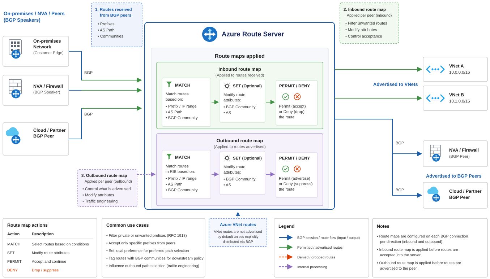
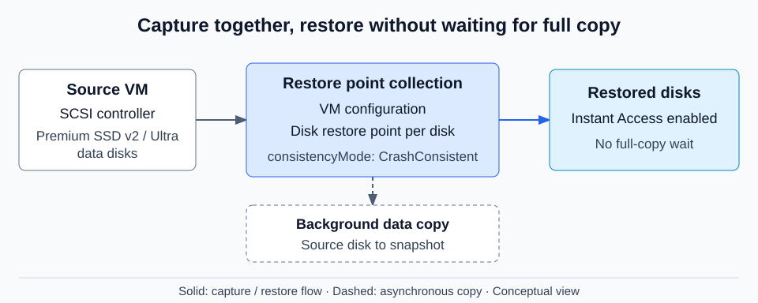
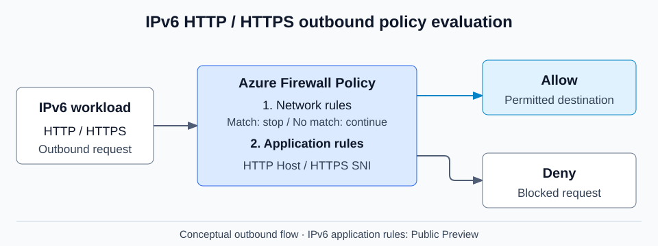

# Azure 일일 업데이트 브리핑 — 2026-11-05

**Azure Route Server route maps가 GA**로 전환돼 hybrid 연결의 경로 광고를
세밀하게 제어할 수 있습니다. **Premium SSD v2·Ultra Disk의 multi-disk
crash-consistent 복구 지점**과 **Azure Firewall IPv6 application rules**는
Public Preview로 제공됩니다. Application Insights 조회 API key의 종료 기한은
**2027-03-31로 연장**됐지만, Microsoft Entra 인증으로 전환해야 합니다.

**이번 보고서의 업데이트**

- **Infra:** [Route Server — route maps GA](#route-maps) ·
  [VM restore points — Premium SSD v2·Ultra Disk Public Preview](#vm-restore-points) ·
  [Azure Firewall — IPv6 application rules Public Preview](#firewall-ipv6) ·
  [Application Insights — 조회 API key 종료 기한 연장](#application-insights-api-keys)
- **Database:** [PostgreSQL — REST API 2026-10-01 GA](#postgresql-api)

## 주요 업데이트

### Azure Route Server — route maps GA { #route-maps }

**패킷을 검사하는 대신, BGP로 주고받는 경로를 선택·수정**

Azure Route Server는 NVA(Network Virtual Appliance), ExpressRoute·VPN gateway와
Azure의 routing infrastructure 사이에서 경로를 교환합니다.
여러 연결이 같은 목적지로 향할 때는 어떤 경로를 전달하고 어느 경로를
선호하게 할지 제어할 필요가 있습니다.
Route maps는 Route Server가 받거나 광고하는 경로에 조건과 동작을 적용하는 기능입니다.
이번 GA로 Azure public cloud에서 이 경로 정책을 정식 기능으로 사용할 수 있습니다.

*출처: Microsoft Learn,
[About route maps for Azure Route Server](https://learn.microsoft.com/azure/route-server/route-maps-about).
그림의 MATCH·SET·PERMIT/DENY는 경로 조건 평가·속성 수정·허용 또는 제외를 나타냅니다.
하단의 일반적인 BGP 사례와 구분해, 실제 route map의 수정 대상은
prefix·AS path·BGP community를 기준으로 확인해야 합니다.
그림을 선택하면 원본 크기로 볼 수 있습니다.*

**경로가 처리되는 방식**

- **적용 위치:** NVA와의 BGP peering, 같은 VNet의 ExpressRoute·VPN gateway 연결,
  요건을 충족하는 peered spoke VNet 연결에 적용합니다.
- **Inbound·outbound:** 들어오는 경로는 학습할 때, 나가는 경로는 광고할 때
  처리합니다. 연결별로 각 방향에 route map 하나를 연결할 수 있습니다.
- **조건과 동작:** prefix·AS path·BGP community를 비교해 경로를 제외하거나,
  prefix를 요약하고 AS path·community를 수정합니다.
- **평가 순서:** 규칙을 순서대로 평가하며 일치한 뒤 계속할지 종료할지 정합니다.
  **어떤 규칙에도 일치하지 않는 경로는 그대로 허용**하므로 deny-by-default 정책이 아닙니다.

이를 통해 온프레미스·NVA에서 전달되는 경로 수를 요약하고, 불필요한 광고를
제외하거나 BGP 속성으로 경로 선호도를 조정할 수 있습니다.
다만 **outbound route map은 광고만 바꾸며 Route Server 자신의 best-path
선택에는 영향을 주지 않습니다.** 경로 선택이 먼저 수행되기 때문입니다.

**도입 시 확인할 점:** route maps에는 추가 요금이 발생합니다.
Route Server에 처음 만들 때는 최대 30분의 내부 upgrade가 필요할 수 있으며,
연결된 VPN gateway에 P2S 구성이 있으면 route map 생성이 실패합니다.

**공식 자료:**
[GA 발표](https://azure.microsoft.com/updates?id=578966) ·
[개념·규칙·제한](https://learn.microsoft.com/azure/route-server/route-maps-about)

### VM restore points — Premium SSD v2·Ultra Disk multi-disk crash consistency Public Preview { #vm-restore-points }

**VM agent 없이 여러 disk의 write order를 보존하는 복구 지점**

VM restore point는 VM 구성과 연결된 managed disk의 특정 시점 snapshot을
함께 보관하는 복구 단위입니다. Application-consistent 방식은 Windows VSS나
Linux pre/post script로 애플리케이션 데이터를 정리한 뒤 snapshot을 만듭니다.
Crash-consistent 방식은 이런 애플리케이션 정리 없이, 전원 장애 직후와 같은
상태를 여러 disk의 write order가 일관된 형태로 캡처합니다.

이번 프리뷰는 기존 Standard HDD·Standard SSD·Premium SSD 지원을
**SCSI controller를 사용하는 VM의 Premium SSD v2·Ultra data disk**로 넓힙니다.
애플리케이션 정합성 보장과 같은 의미는 아니며, 복구 후 애플리케이션의
crash recovery가 필요한 상태일 수 있습니다.

*공식 문서 기반 재구성:
[VM restore points 개요](https://learn.microsoft.com/azure/virtual-machines/virtual-machines-create-restore-points)와
[지원 범위](https://learn.microsoft.com/azure/virtual-machines/concepts-restore-points).
그림을 선택하면 원본 크기로 볼 수 있습니다.*

**캡처와 복원**

1. VM을 대상으로 restore point collection을 만들고,
   복구 지점 생성 요청의 `consistencyMode`를 `CrashConsistent`로 지정합니다.
2. VM 구성과 disk별 restore point가 함께 만들어집니다.
   생성 후에는 source disk에서 snapshot으로 background data copy가 진행됩니다.
3. **Instant Access**를 collection에서 활성화하면 이 프리뷰에서도
   background copy 완료를 기다리지 않고 disk 복원을 시작할 수 있습니다.
   Instant Access에는 API `2025-04-01` 이상이 필요합니다.

고성능 data disk에서도 agent-less 복구 지점을 사용할 수 있고,
Instant Access를 함께 사용하면 전체 복사 완료를 기다리는 단계를 줄일 수 있습니다.
복구 시간 단축은 가능한 효과이지 특정 RTO를 보장한다는 뜻은 아닙니다.

**가용성과 중요한 제한**

- 프리뷰는 **South Central US·West US 3·East US 2를 제외한 모든 public region**에서
  제공됩니다. 실제 VM·disk 배포 가능 범위는 별도로 확인해야 합니다.
- **NVMe controller와 Azure Boost hardware는 multi-disk crash consistency를
  지원하지 않습니다.** SCSI VM도 미국 리전에서 Boost hardware에 배치될 수 있습니다.
- Boost 배치로 실패한 기존 VM은 공식 지침에 따라 VM에 `LegacyVMNVA` tag를 적용하고
  stop·redeploy해야 합니다. **Tag만 붙여서는 기존 배치가 바뀌지 않으며 중단 시간을
  계획해야 합니다.**

**공식 자료:**
[프리뷰 발표](https://azure.microsoft.com/updates?id=579162) ·
[복구 지점·Instant Access 동작](https://learn.microsoft.com/azure/virtual-machines/virtual-machines-create-restore-points) ·
[프리뷰 리전·Boost 배치 제한](https://learn.microsoft.com/azure/virtual-machines/concepts-restore-points)

### Azure Firewall — IPv6 application rules Public Preview { #firewall-ipv6 }

**IPv6 HTTP·HTTPS outbound에도 애플리케이션 수준 허용·차단 정책 적용**

Azure Firewall의 network rules는 IP 주소·protocol·port를 기준으로 통신을 제어합니다.
Application rules는 HTTP·HTTPS의 애플리케이션 정보를 사용해 접근할 대상을
구분하는 규칙입니다. HTTP는 Host header, 일반 HTTPS는 SNI를 기준으로
규칙을 평가합니다.

이번 변경은 IPv6 Public Preview에 **application rules의 layer 7 필터링**을
추가합니다. IPv4·IPv6를 함께 사용하는 dual-stack 환경에서도 IPv6 HTTP·HTTPS
outbound에 애플리케이션 수준 정책을 적용할 수 있습니다.

*공식 문서 기반 재구성:
[IPv6 지원 범위](https://learn.microsoft.com/azure/firewall/deploy-dual-stack-firewall)와
[rule processing](https://learn.microsoft.com/azure/firewall/rule-processing).
그림을 선택하면 원본 크기로 볼 수 있습니다.*

**정책 적용과 범위**

- **Network rules가 먼저:** network rule에 일치하면 평가가 종료되므로,
  넓은 허용 규칙이 뒤의 application rule 평가를 건너뛰게 하지 않는지 확인합니다.
- **Application rules:** 앞선 network rule에 일치하지 않는 HTTP·HTTPS 요청을
  애플리케이션 정보와 규칙 우선순위로 평가해 허용하거나 차단합니다.
- **Dual-stack 구성:** IPv6 VNet 주소 공간·subnet prefix·public IP를 추가합니다.
  IPv6-only Firewall은 지원하지 않습니다.

**IPv6 지원이 IPv4와 모든 보안 기능에서 동등해진 것은 아닙니다.**
IPv6에는 DNAT, threat intelligence, IDPS, Explicit Proxy, IP Groups 기반
시나리오가 아직 지원되지 않으며, classic Firewall과 vHub Firewall도 대상이 아닙니다.
또한 dual-stack으로 전환한 Firewall을 IPv4-only로 되돌리는 기능은 현재 지원하지 않습니다.
기존 IPv4-only 기능은 dual-stack에서도 IPv4에 계속 적용됩니다.

**공식 자료:**
[프리뷰 발표](https://azure.microsoft.com/updates?id=579507) ·
[dual-stack 구성·IPv6 제한](https://learn.microsoft.com/azure/firewall/deploy-dual-stack-firewall) ·
[HTTP·HTTPS 규칙 평가](https://learn.microsoft.com/azure/firewall/rule-processing)

## 대응이 필요한 업데이트

### Application Insights — 조회 API key Retirement 기한 연장 { #application-insights-api-keys }

**종료일: 2027-03-31 · 대상: Application Insights 데이터를 조회하는 API key**

기존 종료 공지의 기한이 **2027-03-31로 연장**됐습니다.
Application Insights 조회를 계속하려면 API key 대신 **Microsoft Entra ID 인증**으로
전환해야 합니다. 이번 공지는 조회 API key에 관한 것이며, telemetry 전송 설정
전체가 같은 날짜에 종료된다는 뜻은 아닙니다.

- **확인 대상:** Application Insights query API를 호출하는 스크립트·도구의
  API key 사용 여부를 확인합니다. **API key 사용 여부 확인 필요**이며,
  Application Insights를 쓴다는 이유만으로 영향을 단정할 수 없습니다.
- **전환:** Microsoft Entra client app 등록, API 권한과 대상 Application Insights
  리소스 접근 권한을 설정하고, 발급받은 token으로 query 요청을 인증합니다.
- **완료 확인:** 기존 조회가 같은 범위의 데이터를 읽는지, 필요한 권한으로
  동작하는지 검증한 뒤 종료일 전에 API key 의존성을 제거합니다.

**공식 자료:**
[종료 기한 연장 공지](https://azure.microsoft.com/updates?id=transition-to-azure-ad-to-query-data-from-azure-monitor-application-insights-by-31-march-2026) ·
[Microsoft Entra 기반 조회 인증](https://learn.microsoft.com/azure/azure-monitor/app/azure-ad-authentication#query-application-insights-by-using-microsoft-entra-authentication)

## 기타 업데이트

- **Azure Database for PostgreSQL — REST API `2026-10-01` GA**:
  Stable API로 maintenance 조회·재예약·즉시 적용, major version upgrade precheck,
  immutable backup 생성, cross-tenant CMK·FIPS 설정, network mode migration과
  PostgreSQL version enumeration 제약 제거를 제공해 서버 관리 자동화 범위를 넓힙니다.
  [발표](https://azure.microsoft.com/updates?id=579300) ·
  [버전별 변경 사항](https://learn.microsoft.com/azure/postgresql/release-notes/release-notes-api)
