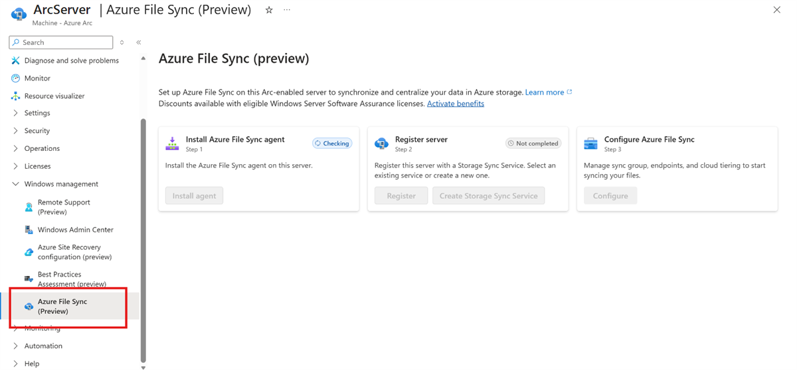

# Azure 일일 업데이트 브리핑 — 2026-11-10

**Static Web Apps managed Functions API의 .NET 8·9 지원 종료일은
2026-11-10입니다.** 해당 버전을 사용한다면 .NET 10 isolated worker로
전환해야 합니다.

**Azure File Sync**는 Arc-enabled Windows Server에서 agent 설치·서버 등록·
동기화 구성을 한 화면으로 연결하는 **Public Preview**를 제공합니다.
기존 파일 서버의 접근 방식을 유지하면서 Azure Files와 연결하는 배포 과정이
간소화됩니다.

**이번 보고서의 업데이트**

- **AI & Apps:** [Static Web Apps — .NET 8·9 지원 종료](#static-web-apps-dotnet)
- **Infra:** [Azure File Sync — Arc 서버 통합 배포 Public Preview](#file-sync-arc)

## 주요 업데이트

### Azure File Sync — Arc 서버 통합 배포 Public Preview { #file-sync-arc }

Azure File Sync는 Windows 파일 서버의 데이터를 Azure Files에 동기화하면서,
사용자와 애플리케이션이 기존 로컬 서버로 파일에 접근할 수 있게 하는 서비스입니다.
Azure file share에는 전체 데이터를 두고, 선택적으로 **cloud tiering**을 켜
자주 사용하는 파일 위주로 로컬 디스크를 사용할 수 있습니다.
기존 배포 절차에는 agent 설치, Storage Sync Service에 서버 등록,
sync group과 endpoint 구성이 각각 필요했습니다.

이번 프리뷰는 이 단계를 **Azure Arc의 서버별 Azure File Sync 화면**으로
모읍니다. Arc로 연결한 Windows Server에서 설치부터 동기화 설정까지 순서대로
진행할 수 있으며, **Azure File Sync 서비스 자체의 신규 출시나 GA 전환이 아니라
Arc 서버의 통합 배포 경험이 추가된 것**입니다.

*출처: Microsoft Learn,
[Deploy Azure File Sync — Arc 서버의 설치·등록 프리뷰](https://learn.microsoft.com/azure/storage/file-sync/file-sync-deployment-guide#install-and-register-from-the-azure-file-sync-page-on-an-arc-enabled-server-preview).
공식 원본 화면이며, 그림을 선택하면 원본 크기로 볼 수 있습니다.*

**화면의 세 단계와 실제 동기화**

1. **Install agent:** Arc 서버의 **Windows management → Azure File Sync
   (Preview)**에서 Azure File Sync Agent for Windows extension을 설치합니다.
2. **Register server:** 설치한 서버를 기존 Storage Sync Service에 등록합니다.
   새 서비스가 필요하면 같은 화면에서 생성할 수 있습니다.
3. **Configure:** sync group, endpoint, cloud tiering 설정으로 이어집니다.
   Sync group은 Azure file share를 가리키는 **cloud endpoint**와
   Windows Server의 로컬 경로인 **server endpoint**를 연결합니다.
4. **파일 동기화:** 같은 sync group의 endpoint 사이에 데이터를 동기화합니다.
   Cloud tiering을 켜면 전체 파일 목록은 로컬에서 계속 보이고,
   로컬에 없는 파일 내용은 접근할 때 Azure에서 가져옵니다.

운영상 달라지는 부분은 기존 동기화 엔진의 교체가 아니라 **Arc 서버에서
온보딩 단계를 이어서 수행할 수 있다는 점**입니다. Extension 설치만으로 파일
동기화가 시작되지는 않으며, 서버 등록과 endpoint 구성을 마쳐야 합니다.

**적용 범위:** Arc extension은 **Windows 전용**이며 Linux Arc 서버는 지원하지
않습니다. Azure 측 동기화 대상은 storage account의 **SMB classic file share**이고,
Storage Sync Service와 file share는 같은 리전에 구성합니다.
서비스의 리전 가용성은
[공식 가용성 안내](https://learn.microsoft.com/azure/storage/file-sync/file-sync-planning#azure-file-sync-region-availability)를
따릅니다. 이번 공지는 통합 화면의 별도 리전 목록이나 신규 리전 확대를 제시하지 않습니다.

**공식 자료:**
[Public Preview 발표](https://azure.microsoft.com/updates?id=579854) ·
[서비스 동작·cloud tiering](https://learn.microsoft.com/azure/storage/file-sync/file-sync-introduction) ·
[Arc 설치·등록·구성](https://learn.microsoft.com/azure/storage/file-sync/file-sync-deployment-guide#install-and-register-from-the-azure-file-sync-page-on-an-arc-enabled-server-preview) ·
[Sync group·지원 조건](https://learn.microsoft.com/azure/storage/file-sync/file-sync-planning)

## 대응 필요 항목

### Static Web Apps — .NET 8·9 지원 종료, .NET 10 전환 { #static-web-apps-dotnet }

**공식 기한: 2026-11-10 · 대상: .NET 8·9 기반 managed Functions API**

Static Web Apps는 정적 프런트엔드와 함께 Azure Functions 기반 API를 제공할 수
있습니다. 이번 종료 대상은 정적 웹 파일 자체가 아니라 **managed Functions
API의 .NET 8·9 runtime 지원**입니다.
앱이 즉시 중단되는 것은 아니지만, 지원 종료 후에는 해당 runtime의 보안 업데이트와
지원이 제공되지 않으므로 실행이 계속된다는 이유로 업그레이드를 미뤄서는 안 됩니다.

전환 대상인 **.NET 10은 isolated worker model만 지원**합니다.
이미 isolated worker를 쓰는 API는 runtime·프로젝트를 갱신하고,
in-process API는 실행 모델 전환도 함께 수행해야 합니다.

- **In-process API:** 공식
  [isolated worker 전환 절차](https://learn.microsoft.com/azure/azure-functions/migrate-dotnet-to-isolated-model?tabs=net10)에
  따라 프로젝트·패키지·시작 코드·함수 코드를 변경합니다.
- **두 모델 공통:** API 프로젝트의 `TargetFramework`를 `net10.0`으로 맞추고,
  필요한 SDK·worker 패키지를 갱신한 뒤 로컬 빌드와 API 테스트를 수행합니다.
- **Runtime 명시:** `staticwebapp.config.json`의 `platform.apiRuntime`을
  `dotnet-isolated:10.0`으로 설정합니다. 프로젝트의 target과 이 설정이 일치해야 합니다.
- **재배포:** Static Web App을 다시 배포해 managed API를 .NET 10으로 빌드·게시합니다.
  별도로 연결한 **bring-your-own Function App**은 배포 수명주기가 다르므로
  해당 Function App을 따로 업그레이드·배포해야 합니다.

공지에는 **2026년 11월 중 기본 .NET runtime도 .NET 10으로 변경**한다고
명시돼 있습니다. 기본값 변경을 프로젝트 마이그레이션의 대체 수단으로 여기지 말고
runtime을 명시적으로 설정해야 합니다. **관련 버전 사용 여부 확인 필요**:
실제 영향은 각 앱의 API 프로젝트와 배포 설정을 기준으로 판단합니다.

**공식 자료:**
[Retirement 발표·필요 조치](https://azure.microsoft.com/updates?id=575106) ·
[Static Web Apps 지원 runtime·설정](https://learn.microsoft.com/azure/static-web-apps/languages-runtimes) ·
[Functions 언어 지원 종료 정책](https://learn.microsoft.com/azure/azure-functions/language-support-policy)
