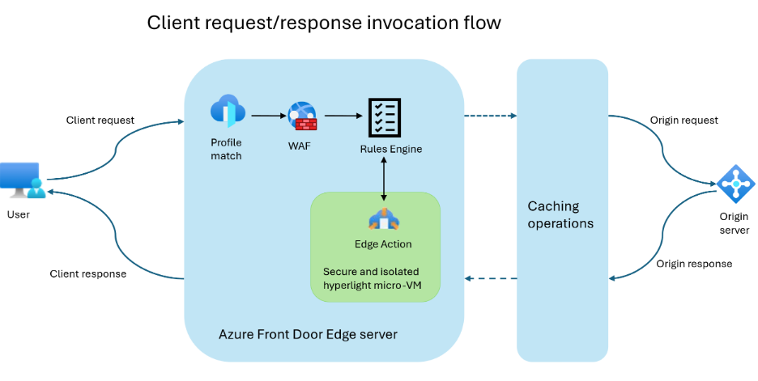
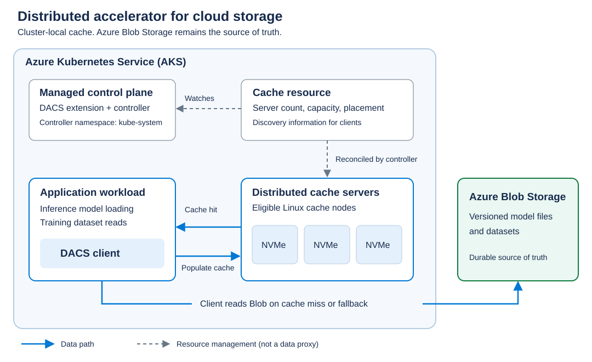
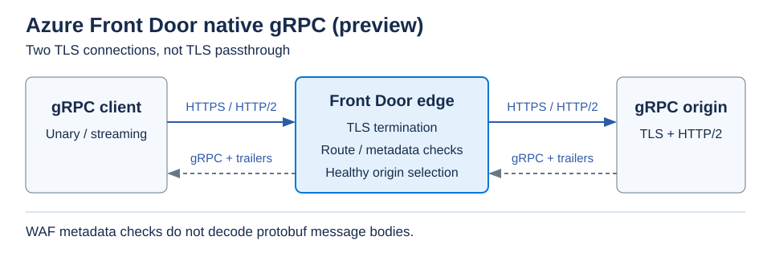
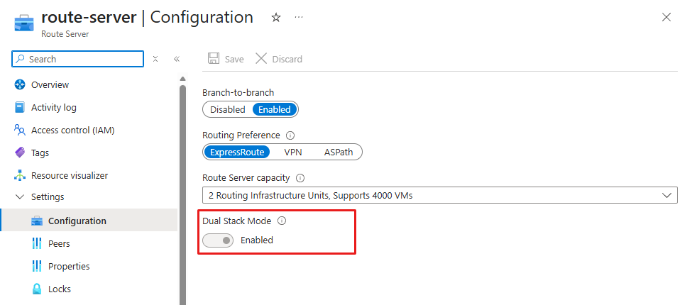

# Azure 일일 업데이트 브리핑 — 2026-11-11

**Front Door edge actions가 GA**로 전환돼 요청·응답을 edge의 JavaScript로
처리할 수 있습니다. **DACS Public Preview**는 AKS 노드의 NVMe를 분산 캐시로
묶어 모델 파일의 반복 다운로드를 줄입니다. Front Door에는 **native gRPC**,
Route Server에는 **IPv4/IPv6 dual-stack** 프리뷰가 추가됐으며,
Azure Functions는 **.NET 11을 정식 지원**합니다.

**이번 보고서의 업데이트**

- **AI & Apps:** [Front Door — edge actions GA](#front-door-edge-actions) ·
  [AKS — DACS 분산 모델 캐시](#dacs) ·
  [Azure Functions — .NET 11 GA](#functions-dotnet-11)
- **Infra:** [Front Door — native gRPC](#front-door-grpc) ·
  [Route Server — IPv4/IPv6 dual-stack](#route-server-dual-stack)

## 주요 업데이트

### Azure Front Door edge actions — GA { #front-door-edge-actions }

Front Door는 사용자 가까운 edge에서 요청을 받아 cache 또는 origin으로
전달하는 서비스입니다. 요청별 분기나 header 조정이 필요할 때 기존
rules engine의 조건·동작만으로 표현하기 어려운 로직은 별도 구현이 필요했습니다.
Edge actions는 이 처리 지점에 **사용자 JavaScript를 실행하는 기능**으로,
A/B 분기, 동적 origin 선택, URL 변경, JWT 검증 등을 edge에서 수행합니다.
이번 발표는 이 serverless edge 실행 기능의 **GA 전환**입니다.

*출처: Microsoft Learn,
[Edge actions — High-level flow](https://learn.microsoft.com/azure/frontdoor/edge-actions#high-level-flow-with-edge-actions).
공식 원본이며, 그림을 선택하면 원본 크기로 볼 수 있습니다.*

**요청·응답에 코드를 적용하는 흐름**

1. 요청이 Front Door profile에 매칭되고, WAF가 연결돼 있으면 먼저 평가됩니다.
2. Rules engine이 조건에 맞는 **Client Request** Edge Action을 호출합니다.
   코드는 edge server의 격리된 **Hyperlight micro-VM**에서 실행됩니다.
3. 변경된 요청 속성을 바탕으로 cache·origin 처리가 이어집니다.
   Edge Action 생성만으로 실행되지는 않으며 **rule set과 route 연결**이 필요합니다.
4. 응답 방향에서는 origin·cache·Front Door 자체 응답에
   **Client Response** Edge Action을 적용해 사용자에게 보내기 전 속성을 변경합니다.

이제 가벼운 분기 로직을 origin 애플리케이션과 분리해 배포할 수 있습니다.
기본 코드 버전 외에 특정 header에만 시험 버전을 적용하는 **execution filter**도
제공하므로, 변경을 일부 요청으로 먼저 검증할 수 있습니다.
단, 요청 단계의 코드가 WAF보다 먼저 실행되는 구조는 아닙니다.

**실행 조건:** Front Door **Standard·Premium**, JavaScript를 지원합니다.
코드는 최대 **16 KB**, 실행 시간은 **10 ms**이며, 시간을 초과하면 코드 실행을
중단하고 Edge Action 처리 없이 계속 진행합니다.
따라서 JWT 검증 같은 접근 제어를 구현한다면 이 동작까지 보안 설계에 반영해야 합니다.
호출 수와 호출당 **1 ms를 넘는 실행 시간**에 따른 과금 항목도 확인해야 합니다.

**공식 자료:**
[GA 발표](https://azure.microsoft.com/updates?id=579310) ·
[실행 구조·제약·버전·과금](https://learn.microsoft.com/azure/frontdoor/edge-actions)

### AKS의 Distributed accelerator for cloud storage — Public Preview { #dacs }

추론 Pod가 새로 시작할 때는 요청 처리 전에 모델 파일부터 읽어야 합니다.
각 노드가 Blob Storage의 같은 모델을 매번 다운로드하면 GPU 확장·노드 교체 때도
데이터 준비가 반복됩니다. **Distributed accelerator for cloud storage(DACS)**는
AKS 안의 Linux 노드에 있는 **local NVMe를 분산 read-through cache로 묶는 기능**입니다.
이번 Public Preview로 이미 캐시한 모델 chunk를 다른 노드에서도 재사용할 수 있습니다.
같은 데이터 구간을 반복해서 읽는 학습 작업에도 적용할 수 있지만,
checkpoint를 영구 저장하는 기능은 아닙니다.

*출처: Microsoft Learn,
[DACS — How it works](https://learn.microsoft.com/azure/storage/container-storage/distributed-accelerator-for-cloud-storage-overview#how-distributed-accelerator-for-cloud-storage-works).
공식 원본 SVG이며, 그림을 선택하면 원본 크기로 볼 수 있습니다.*

**모델 데이터를 읽는 경로**

1. Workload의 client가 discovery 정보와 **consistent hashing**으로
   요청한 chunk를 담당하는 cache server를 찾습니다.
2. **Cache hit**이면 해당 server의 NVMe에서 읽습니다.
3. **Cache miss**이면 client가 Blob Storage에서 읽고 cache를 비동기로 채웁니다.
   채우기가 끝나기 전의 다음 요청도 miss일 수 있습니다.
4. Cache가 불가용하면 Blob Storage로 fallback합니다.
   **Blob Storage가 원본이자 영구 저장소**이며, cache node가 사라지면
   그 node의 chunk는 Blob에서 다시 가져옵니다.
5. Managed extension의 controller는 `Cache` 리소스에 따라 server Pod를
   관리합니다. **Controller가 데이터 요청을 중계하지는 않습니다.**

Pod 재시작·GPU scale-out 때 cluster에 남아 있는 warm cache를 활용하는 것이
핵심입니다. Cold cache의 동시 다운로드를 조정하는 기능은 아직 없으므로
사전 **prefetch**와 데이터 재사용률이 효과를 좌우합니다.
모든 모델 로딩이 일정 비율로 빨라지는 성능 보장은 아닙니다.

**연결과 지원 범위**

- **애플리케이션 연결:** BlobFuse2, native Python client,
  Run:ai Model Streamer를 사용합니다. DACS 자체는 PV·StorageClass나 범용 공유
  파일 시스템이 아닙니다.
- **Cluster:** AKS **1.35 이상**, local NVMe가 있는 Linux cache node가 필요하고
  최대 **100 node** 규모를 지원합니다. 관리형 설치는 Azure Container Storage를
  통해 별도 DACS extension을 활성화하는 방식입니다.
- **디스크 보호:** 준비용 DaemonSet이 대상 NVMe를 **format·mount**하므로
  cache 전용 디스크가 있는 node만 지정해야 합니다.
- **가용성·비용:** 모든 Azure public cloud region이 대상입니다.
  실제 배치는 필요한 VM의 리전별 가용성도 확인해야 합니다.
  DACS 소프트웨어 요금은 없지만 VM·Blob·network 비용은 발생하며,
  프리뷰에는 SLA가 없고 production 사용은 권장되지 않습니다.

모델 배포 자체와 데이터 로딩 계층은 별개입니다.
[AKS·KAITO 모델 서빙](../../services/azure-kubernetes-service/kaito-open-source-model/index.md)을
검토할 때도 캐시 연동은 별도로 설계해야 하며, DACS가 자동 연결되는 것은 아닙니다.

**공식 자료:**
[Public Preview 발표](https://azure.microsoft.com/updates?id=578454) ·
[캐시 구조·동작·제한](https://learn.microsoft.com/azure/storage/container-storage/distributed-accelerator-for-cloud-storage-overview) ·
[관리형 설치·AKS 버전·가용성](https://learn.microsoft.com/azure/storage/container-storage/distributed-accelerator-for-cloud-storage-quickstart)

### Azure Front Door native gRPC — Public Preview { #front-door-grpc }

gRPC는 서비스에 정의된 method를 원격으로 호출하는 방식이며,
native gRPC는 HTTP/2 위에서 메시지와 상태를 주고받습니다.
일반 HTTP 요청을 전달할 수 있다는 사실만으로 양방향 streaming이나
gRPC 상태 전달까지 지원되는 것은 아닙니다.
이번 프리뷰는 **Front Door Standard·Premium을 통해 native gRPC를 전달**하고,
service·method별 routing과 정상 origin 간 부하 분산을 적용하는 기능입니다.
Unary뿐 아니라 client·server·bidirectional streaming을 지원합니다.

*Microsoft Learn
[gRPC — How it works](https://learn.microsoft.com/azure/frontdoor/grpc#how-grpc-works-with-azure-front-door)
기반 재구성입니다. Edge에서 TLS를 종료하고 origin에 새 연결을 만드는 구조이며,
하나의 TLS 연결이 그대로 관통하는 그림이 아닙니다.
그림을 선택하면 원본 크기로 볼 수 있습니다.*

**호출이 전달되는 방식**

- **연결:** Client → Front Door와 Front Door → origin 모두
  **HTTPS·HTTP/2**를 사용합니다. Edge에서 client TLS를 종료한 뒤
  별도의 origin 연결로 전달합니다.
- **Routing:** `/package.Service/Method` 경로로 method를 선택합니다.
  Route뿐 아니라 연결된 origin group의 **모든 origin에 gRPC를 활성화**해야 합니다.
- **Health probe:** 표준 `grpc.health.v1.Health/Check` RPC로 정상 origin을
  판정할 수 있습니다. 별도 HTTP·HTTPS health endpoint를 사용하는 방법도 있습니다.
- **응답·관측:** 메시지와 함께 gRPC trailer를 반환합니다.
  **HTTP 200만으로 성공을 판단하지 않고 gRPC status도 확인**해야 합니다.

이제 gRPC 서비스에도 Front Door의 글로벌 진입점과 health 기반 routing을
사용할 수 있습니다. 다만 이번 프리뷰에서 **cache는 비활성화**되고,
**gRPC origin의 Private Link는 지원하지 않습니다.**
WAF는 URI·header·client IP 같은 metadata를 검사하지만
**protobuf 본문을 해석해 검사하지 않으므로** 메시지 검증은 애플리케이션 등에서
별도로 수행해야 합니다.

**가용성:** Standard·Premium 고객에게 별도 프리뷰 등록 없이 제공됩니다.
HTTP redirect는 gRPC에 유효하지 않으므로 route와 rule set의 forwarding을
HTTPS로 유지해야 합니다.

**공식 자료:**
[Public Preview 발표](https://azure.microsoft.com/updates?id=579383) ·
[연결 구조·routing·지원 조건](https://learn.microsoft.com/azure/frontdoor/grpc)

### Azure Route Server IPv4/IPv6 dual-stack — Public Preview { #route-server-dual-stack }

Route Server는 NVA와 gateway 등에서 전달되는 경로를 교환하는 서비스입니다.
이번 프리뷰는 기존 IPv4 연결을 유지하면서 **IPv6 경로도 함께 교환**할 수 있게
합니다. 단순히 IPv6 주소를 추가하는 데 그치지 않고, dual-stack 환경의
ExpressRoute·VPN gateway 연결과 hub·spoke NVA 연결에 route map을 적용하는
범위로 이어집니다. Route map은 **경로 광고를 다루며 패킷을 검사하는 기능은 아닙니다.**

*출처: Microsoft Learn,
[Enable IPv4/IPv6 dual-stack mode](https://learn.microsoft.com/azure/route-server/enable-route-server-dual-stack).
공식 설정 화면이며, 그림을 선택하면 원본 크기로 볼 수 있습니다.
그림의 다른 설정값을 필수 권장값으로 의미하지는 않습니다.*

**기존 Route Server의 전환**

1. Dual-stack VNet의 `RouteServerSubnet`에 VNet 범위 내 **IPv6 /64 prefix**를
   추가합니다.
2. Route Server의 **Dual Stack Mode**를 활성화합니다.
   Preview access가 활성화된 구독과 지원 리전이 필요합니다.
3. Hub 주소 공간을 변경했다면 동기화가 풀린 **spoke VNet peering을 resync**합니다.
4. Provisioning·connectivity가 `Succeeded`인지 확인한 뒤,
   연결별 IPv4·IPv6 경로를 점검합니다.
   **경로 학습 성공과 실제 패킷 전달 성공은 별도로 검증**해야 합니다.

**활성화는 되돌릴 수 없습니다.** IPv4-only로 돌아가려면 Route Server를
삭제하고 다시 만들어야 하므로 기존 routing 의존성을 먼저 검토해야 합니다.
기존 IPv4-only 연결 자체가 IPv6 경로를 교환해야 전환이 완료되는 것은 아닙니다.

**지원 리전**

- **미주:** Central US, West Central US, Brazil South와
  East US 2 EUAP·Central US EUAP.
- **유럽:** UK South.
- **아시아·태평양:** East Asia, Australia Central, **Korea Central**,
  Central India, Malaysia West. Korea South는 지원 목록에 없습니다.

이 목록은 dual-stack 프리뷰의 범위이며 Route Server 전체의 가용 리전 목록과는
다릅니다. 여러 리전에서 각각 구성할 수 있다는 의미이지 하나의 Route Server가
자동으로 multi-region routing을 구성한다는 뜻은 아닙니다.

**공식 자료:**
[Public Preview 발표](https://azure.microsoft.com/updates?id=579746) ·
[전환·리전·주의사항](https://learn.microsoft.com/azure/route-server/enable-route-server-dual-stack) ·
[Dual-stack route map 적용](https://learn.microsoft.com/azure/route-server/route-maps-dual-stack-portal)

## 기타 업데이트

### Azure Functions .NET 11 지원 — GA { #functions-dotnet-11 }

**Azure Functions — GA:** Functions 4.x의 **isolated worker model**에서
.NET 11 앱을 실행할 수 있으며, 현재 C#만 지원하고
`Azure.Functions.Sdk` **1.0.1 이상**과 명시적인
`Microsoft.Azure.Functions.Worker` 참조가 필요하므로
in-process 앱은 실행 모델 전환을, Linux Consumption 앱은
**Flex Consumption으로의 이전**을 함께 검토해야 합니다.
[GA 발표](https://azure.microsoft.com/updates?id=578773) ·
[.NET 11 구성·지원 조건](https://learn.microsoft.com/azure/azure-functions/dotnet-isolated-process-guide#net-11)
