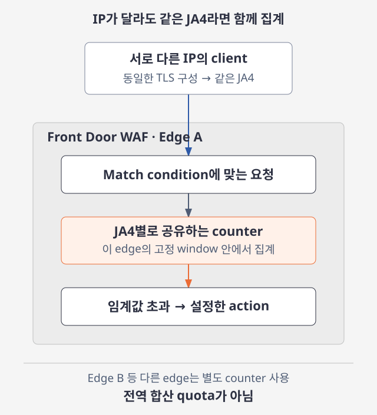

# Azure 일일 업데이트 브리핑 — 2026-11-12

**Front Door Premium WAF의 rate limit grouping**이 Public Preview로 공개됐습니다.
IP마다 따로 세던 요청을 **JA4 fingerprint·ASN·국가/지역별로 묶어** 제한할 수 있어,
주소를 바꾸며 임계값을 피하는 분산 트래픽에 대응합니다.
단, 집계는 **각 edge location 안에서만** 이뤄지며 전역 합산 제한은 아닙니다.

**이번 보고서의 업데이트**

- **Infra:** [Front Door Premium WAF — rate limit grouping Public Preview](#front-door-rate-limit-grouping)

## 주요 업데이트

### Front Door Premium WAF — rate limit grouping Public Preview { #front-door-rate-limit-grouping }

Rate limiting은 일정 시간 동안 들어오는 요청 수를 제한해 과도한 트래픽으로부터
애플리케이션을 보호하는 WAF custom rule입니다. 기존 기본 방식은 Front Door와
TCP 연결을 맺은 **socket IP address마다 별도 counter**를 사용합니다.
따라서 여러 IP에 요청을 나누면 각 IP는 임계값 아래에 머물면서도 전체 부하는
커질 수 있습니다.

이번 프리뷰는 IP 대신 **클라이언트들이 공유하는 속성으로 counter를 묶는 선택지**를
추가합니다. 예를 들어 TLS 연결 협상 방식에서 얻는 **JA4 fingerprint**가 같다면,
서로 다른 IP에서 온 요청도 같은 임계값을 사용합니다.
알려진 fingerprint 값을 미리 나열해 차단하는 방식과 달리, JA4로 grouping한
rate limit은 처음 보는 fingerprint에도 각각 임계값을 적용합니다.
([집계 방식](https://learn.microsoft.com/azure/web-application-firewall/afds/waf-front-door-rate-limit#group-rate-limit-traffic-preview) ·
[JA4 동작](https://learn.microsoft.com/azure/web-application-firewall/afds/client-fingerprint-match-condition#rate-limit-every-fingerprint-preview))

*공식 문서 기반 재구성:
[Front Door rate limiting의 grouping·edge별 집계](https://learn.microsoft.com/azure/web-application-firewall/afds/waf-front-door-rate-limit).
JA4 grouping을 예로 든 개념도이며, 그림을 선택하면 확대할 수 있습니다.*

**요청을 묶고 제한하는 흐름**

1. URI 경로 등 **match condition**으로 제한할 요청을 고릅니다.
   로그인 경로처럼 특정 자원만 대상으로 삼을 수도 있습니다.
2. 규칙마다 **grouping 변수 하나**를 선택합니다. 같은 요청을 IP별·JA4별로
   각각 제한하려면 별도 규칙을 만듭니다.
3. 각 edge location이 그룹별 요청을 **1분 또는 5분의 고정 window** 안에서 셉니다.
   다른 edge location의 counter와 합산하지 않습니다.
4. 해당 edge에서 그룹이 임계값을 초과하면 남은 window 동안 일치하는 요청에
   설정한 action을 적용합니다. `Block` 외에 JavaScript challenge 같은
   대응을 선택할 수 있습니다.

**Grouping별 활용**

- **JA4 fingerprint:** 같은 TLS client 구성을 쓰면서 IP를 바꾸는 트래픽을
  묶습니다. Fingerprint는 사용자 식별자가 아니며 여러 정상 사용자도 공유합니다.
- **AS number(ASN):** 같은 네트워크에 속한 요청을 묶습니다.
  Hosting·cloud provider의 IP 범위 목록을 직접 유지하지 않고 요청량을 제한할 수 있습니다.
- **Country/region:** 같은 국가·지역의 요청을 묶습니다.
  이 국가·지역은 Azure 배포 리전이 아니라 **socket IP에서 판별한 요청 출처**입니다.
- **None:** 규칙에 일치하는 모든 요청을 한 counter로 셉니다.
  특정 로그인 경로의 요청량을 제한하는 용도로 사용할 수 있습니다.

핵심 변화는 **개별 IP의 요청량만 제한하던 방식에 분산 트래픽의 공통 속성별 제한을
더하는 것**입니다. 다만 `None`을 포함한 모든 grouping은 edge별로 동작합니다.
예를 들어 국가별 임계값이 분당 1,000이고 같은 국가의 요청이 세 edge로 나뉘면,
전체에서는 분당 약 3,000까지 허용될 수 있습니다.
**애플리케이션 전체의 엄격한 전역 quota로 사용하면 안 됩니다.**
([Edge별 집계와 공식 예시](https://learn.microsoft.com/azure/web-application-firewall/afds/waf-front-door-rate-limit#counts-are-kept-per-edge-location))

**지원 조건과 정상 트래픽 보호**

- 새 grouping은 **Front Door Premium 전용 Public Preview**입니다.
  기존 socket IP별 rate limiting은 GA이며, grouping을 지정하지 않은 기존 규칙의
  동작은 바뀌지 않습니다.
- 공식 지침은 **최소 일주일의 정상 트래픽을 edge별로 측정**해 임계값을 정하고,
  새 규칙은 우선 `Log` action으로 검토한 뒤 차단·challenge를 적용하도록 안내합니다.
  같은 그룹의 정상 사용자도 함께 제한될 수 있으므로 기존 IP별 규칙도 병행합니다.
- 앞단에 다른 proxy·CDN이 있으면 socket IP·국가·ASN·JA4가 최종 사용자가
  아니라 그 proxy를 나타낼 수 있습니다. 낮은 임계값에서는 edge 내부 server 간
  counter 반영 지연으로 초과 요청 일부가 통과할 수 있습니다.

Grouping은 Azure portal이나 ARM·Bicep·REST API의 `groupBy`로 설정할 수 있습니다.
구성 전에는 [집계 범위와 운영상 주의사항](https://learn.microsoft.com/azure/web-application-firewall/afds/waf-front-door-rate-limit#considerations-for-grouped-rate-limits)을
확인하는 것이 중요합니다.

**공식 자료:**
[Public Preview 발표](https://azure.microsoft.com/updates?id=580155) ·
[Rate limiting·grouping·제한](https://learn.microsoft.com/azure/web-application-firewall/afds/waf-front-door-rate-limit) ·
[Client fingerprint의 의미와 주의사항](https://learn.microsoft.com/azure/web-application-firewall/afds/client-fingerprint-match-condition)
