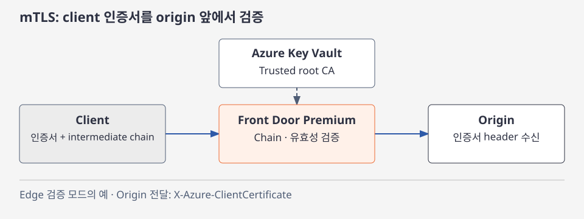
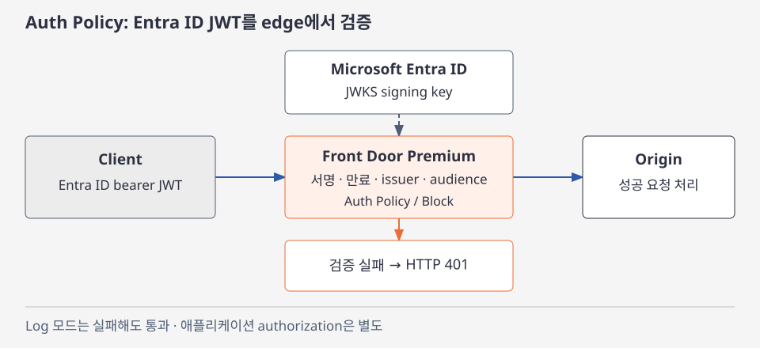
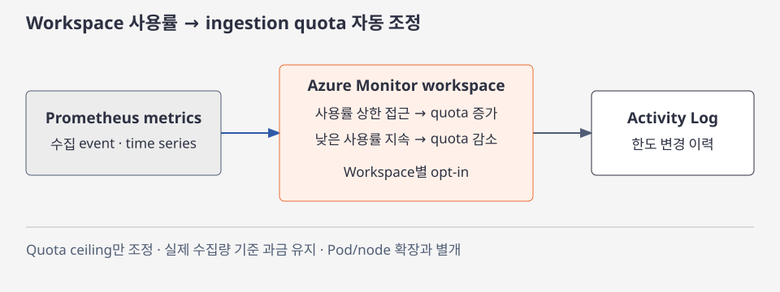
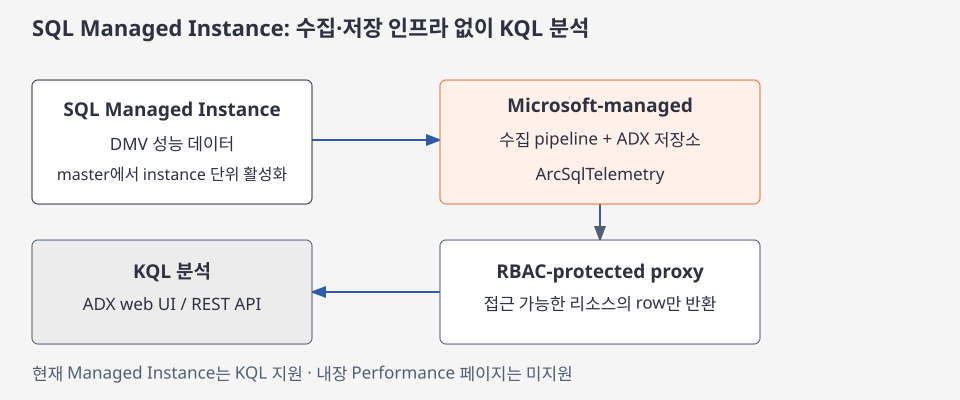

# Azure 일일 업데이트 브리핑 — 2026-11-13

**Front Door Premium의 mTLS가 GA**로 전환되고, **Microsoft Entra ID JWT를
edge에서 검증하는 Auth Policy**가 Public Preview로 추가됐습니다.
Azure Monitor workspace는 사용량에 따라 **수집 quota를 자동 조정**합니다.
SQL Managed Instance에는 별도 수집·저장 인프라 없이 **성능 telemetry를 KQL로
조회하는 관리형 모니터링**이 공개됐습니다.

**이번 보고서의 업데이트**

- **Infra:** [Front Door Premium — mTLS GA](#front-door-mtls) ·
  [Front Door Premium — JWT Auth Policy Public Preview](#front-door-jwt) ·
  [Azure Monitor workspace — 수집 quota 자동 확장 Public Preview](#monitor-ingestion-autoscale)
- **Database:** [SQL Managed Instance — 관리형 성능 모니터링 Public Preview](#sql-mi-performance)

## 주요 업데이트

### Front Door Premium — mTLS GA { #front-door-mtls }

일반 HTTPS에서 client는 서버 인증서를 확인하지만, 서버가 client 인증서까지
요구하는 것은 아닙니다. **Mutual TLS(mTLS)**는 X.509 client 인증서로 호출자를
확인하는 방식으로, B2B API나 IoT 장치처럼 인증서를 배포·관리하는 통신에
사용합니다. Front Door Premium은 이 검증을 **origin에 도달하기 전 edge**에서
수행할 수 있습니다.

이번 발표는 mTLS의 GA 전환과 함께 **trusted root CA만 등록하는 구성**을
제공합니다. Root와 intermediate CA를 모두 Front Door 쪽에 등록하지 않아도
되지만, 이 방식에서는 client가 TLS handshake 중 **자신의 인증서와 필요한
intermediate 인증서 전체**를 보내야 합니다.
([GA 발표](https://azure.microsoft.com/updates?id=577678) ·
[Trusted CA와 인증서 chain](https://learn.microsoft.com/azure/frontdoor/mutual-tls#trusted-ca-configuration-and-client-certificate-chains))

*공식 문서 기반 재구성:
[Front Door mTLS의 chain 검증·인증서 전달](https://learn.microsoft.com/azure/frontdoor/mutual-tls).
Edge에서 검증하는 모드의 예이며, 그림을 선택하면 확대할 수 있습니다.*

**인증서 검증과 origin 전달**

1. Trusted root CA를 Azure Key Vault에 저장하고 Front Door custom domain에
   연결합니다. Client가 보내는 intermediate chain과 root CA를 대조합니다.
2. Edge 검증 모드에서는 인증서의 유효 기간·무결성·chain과 client
   authentication 용도의 Extended Key Usage(EKU)를 확인합니다.
3. 필요한 경우 허용 SAN/CN 목록을 추가합니다. 인증서 폐기 확인은 OCSP를
   사용하며 기본적으로 활성화됩니다.
4. Origin에 전달하는 client 인증서는 **`X-Azure-ClientCertificate` header**에
   담깁니다. TLS 연결을 그대로 origin까지 통과시키는 방식으로 이해하면 안 됩니다.

**인증서 필수 여부와 검증 위치의 선택**

- **Require and validate:** 인증서가 필수이며 edge에서 검증합니다.
- **Require without validation:** 인증서는 필수지만 검증은 origin이 담당합니다.
- **Validate when presented:** 인증서를 보낸 client만 edge에서 검증합니다.
  인증서 없는 요청도 origin으로 전달됩니다.
- **Passthrough to origin:** Front Door가 인증서를 요구하거나 검증하지 않으며
  origin이 검증을 담당합니다.

GA는 모든 모드를 강한 client 인증으로 만드는 변화가 아닙니다.
**인증서를 필수로 요구하고 edge에서 검증할지**를 목적에 맞게 선택해야 합니다.
Root-only 등록은 CA 구성 부담을 줄이지만 client의 chain 전달 책임은 유지합니다.

**도입 시 중요한 조건**

- **Premium 전용**이며 mTLS를 켠 endpoint와 custom domain을 사용합니다.
  같은 endpoint에 mTLS 활성·비활성 domain을 섞을 수 없습니다.
- mTLS를 켜면 route와 rules engine override의 **caching을 활성화할 수 없습니다**.
- 기존 domain을 옮기거나 mTLS를 끄는 과정에는 downtime이 발생할 수 있어,
  공식 문서는 새 endpoint·domain에서 활성화하도록 안내합니다.
- Origin 직접 접근을 제한해 edge 검증 우회를 막아야 합니다.
  CA 자동 rotation은 지원하지 않으며, CA 두 개를 연결해 rollover할 수 있습니다.

**공식 자료:**
[GA 발표](https://azure.microsoft.com/updates?id=577678) ·
[검증 모드·CA 구성·운영상 제한](https://learn.microsoft.com/azure/frontdoor/mutual-tls)

### Front Door Premium — JWT Auth Policy Public Preview { #front-door-jwt }

API 호출자는 identity provider에서 받은 **JSON Web Token(JWT)**을 요청에
실어 자신을 증명합니다. API나 gateway가 token의 서명·발급자·수신 대상·
만료를 확인하지 않으면, token이 있다는 사실만으로는 유효한 호출인지
판단할 수 없습니다.

이번 Auth Policy는 **Microsoft Entra ID가 발급한 bearer token의 검증을
Front Door edge에 배치**합니다. API마다 검증을 수행하기 전에, 잘못되거나
없는 token을 origin 앞에서 걸러낼 수 있습니다. 기존 token을 검증하는
기능이지 로그인 화면·token 발급이나 애플리케이션 고유의 **authorization**을
대신하는 기능은 아닙니다.
([Public Preview 발표](https://azure.microsoft.com/updates?id=577673) ·
[Auth Policy 개요](https://learn.microsoft.com/azure/frontdoor/authentication-policy))

*공식 문서 기반 재구성:
[JWT 검증 순서와 policy action](https://learn.microsoft.com/azure/frontdoor/authentication-policy#how-token-validation-works).
그림은 Block 모드이며, Log 모드는 검증 실패 요청도 통과시킵니다.*

**Edge에서 token을 처리하는 순서**

1. 요청에 적용할 policy를 정합니다. 연결 범위의 우선순위는
   **Route > Domain > Profile**입니다.
2. 설정한 **`Authorization` 또는 `Proxy-Authorization` header**에서
   `Bearer` token을 읽습니다.
3. Token의 `kid`에 맞는 signing key를 Entra ID JWKS endpoint에서 가져옵니다.
   Front Door는 key를 cache하고 갱신합니다.
4. **서명·만료·issuer·audience**를 policy와 대조합니다.
5. 성공하면 origin에 전달합니다. 실패하면 **Block은 HTTP 401로 거부**하고,
   **Log는 결과를 기록하되 요청을 통과**시킵니다.

핵심 변화는 **client token의 공통 검증을 edge에 모으는 것**입니다.
어떤 데이터·업무에 접근할 수 있는지는 여전히 애플리케이션에서 판단해야 하며,
origin 직접 접근을 차단하지 않으면 Front Door 정책을 우회할 수 있습니다.

**Client 인증과 origin 인증의 분리**

검증한 token을 origin에 전달하는 설정은 기본적으로 켜져 있습니다.
Origin이 token을 필요로 하지 않으면 해당 header를 제거하도록 설정할 수 있습니다.
Front Door가 Managed identity로 origin에 인증하는 경우에는 origin용 token이
`Authorization`을 사용하므로, **client token은 `Proxy-Authorization`으로
분리**합니다.
([Token 전달·origin 인증 조합](https://learn.microsoft.com/azure/frontdoor/authentication-policy#combine-client-validation-with-origin-authentication))

**지원 범위:** Front Door **Premium 전용 Public Preview**이며
**Entra ID 발급 token만** 지원합니다. Cross-cloud token은 지원하지 않습니다.
프리뷰에는 SLA가 없으며 공식 문서는 production workload에 권장하지 않습니다.

**공식 자료:**
[Public Preview 발표](https://azure.microsoft.com/updates?id=577673) ·
[동작·정책 범위·지원 제한](https://learn.microsoft.com/azure/frontdoor/authentication-policy)

### Azure Monitor workspace — 수집 quota 자동 확장 Public Preview { #monitor-ingestion-autoscale }

Azure Monitor workspace는 Prometheus metrics를 수집·저장하는 리소스입니다.
**분당 수집 event 수와 active time series 수**에 각각 한도가 있어,
워크로드나 metric label 조합이 늘어 한도를 넘으면 throttling과 metric
누락이 발생할 수 있습니다. 고정 한도를 운영할 때는 사용률을 감시하고,
필요하면 한도 증액을 별도로 요청해야 했습니다.

이번 프리뷰는 workspace마다 **실제 사용량에 따라 ingestion quota ceiling을
올리거나 내리는 opt-in 설정**을 추가합니다. AKS의 Pod·node를 늘리는
autoscaler가 아니라, **모니터링 데이터가 들어오는 한도 자체를 조정**하는
기능입니다.
([Public Preview 발표](https://azure.microsoft.com/updates?id=578207) ·
[수집 한도와 autoscale](https://learn.microsoft.com/azure/azure-monitor/metrics/azure-monitor-workspace-monitor-ingest-limits))

*공식 문서 기반 재구성:
[사용률 기반 quota 조정·Activity Log](https://learn.microsoft.com/azure/azure-monitor/metrics/azure-monitor-workspace-monitor-ingest-limits#autoscale-ingestion-limits-in-azure-monitor-workspace-preview).
그림은 quota 관리 흐름이며 metric 전송 경로나 AKS 규모를 바꾸는 그림이 아닙니다.*

**Quota 조정과 변경 이력**

- Workspace별로 autoscale을 켭니다. 기본 수집 한도는 **분당 event 100만 개·
  active time series 100만 개**입니다.
- 수집 사용률이 상한 threshold에 접근하면 quota를 올려 throttling 위험을
  줄입니다. 사용률이 낮은 상태가 지속되면 사용하지 않는 여유 한도를 회수합니다.
- 변경 시점과 증감 방향은 **Activity Log**에 기록됩니다.
  변경 event에 대한 alert도 구성할 수 있습니다.
- Autoscale을 끄면 한도는 고정되고 다시 수동으로 관리합니다.

수집량 증가 때마다 증액 요청을 관리하는 일을 줄이는 변화입니다.
다만 **무손실 수집을 보장하거나 수집 비용을 절감하는 기능은 아닙니다**.
Quota ceiling만 조정하며 과금은 실제 수집량 기준으로 유지됩니다.
높은 cardinality의 불필요한 metric을 줄이고 사용률을 관찰하는 일은 여전히 필요합니다.

현재 설정은 ARM API의 **`2026-09-03-preview`**와
`properties.limits.enableAutoScale`을 사용합니다.
수동 증액 API의 최대 요청 범위를 autoscale의 보장 상한으로 해석하지 말고,
[공식 autoscale 설정과 사용률 모니터링](https://learn.microsoft.com/azure/azure-monitor/metrics/azure-monitor-workspace-monitor-ingest-limits#turn-on-autoscale-for-your-workspace)을
확인해 적용합니다.

Managed Prometheus로 수집한 지표를 활용하는 예는
[KEDA Prometheus 요청률 기반 확장 실습](../../services/azure-kubernetes-service/hpa-keda-autoscaling/prometheus-rps/index.md)에서
볼 수 있습니다. 이번 기능은 그 지표의 **수집 quota 관리**와 관련되며,
KEDA의 확장 판단·query 지연을 바꾸는 발표는 아닙니다.

**공식 자료:**
[Public Preview 발표](https://azure.microsoft.com/updates?id=578207) ·
[수집 quota·설정·과금·이력](https://learn.microsoft.com/azure/azure-monitor/metrics/azure-monitor-workspace-monitor-ingest-limits)

### SQL Managed Instance — 관리형 성능 모니터링 Public Preview { #sql-mi-performance }

SQL 성능 문제는 CPU 사용률뿐 아니라 wait·active session·storage I/O를
함께 봐야 원인을 좁힐 수 있습니다. 여러 instance에서 이 정보를 모으려면
DMV(dynamic management view) 수집 script, telemetry pipeline과 저장소를
직접 운영하는 부담이 있습니다.

이번 프리뷰는 **Azure SQL Managed Instance의 성능 telemetry 수집·저장을
Microsoft가 관리**하고, 같은 데이터를 KQL로 분석하게 합니다.
고객이 별도 watcher·agent·Azure Data Explorer cluster를 배포할 필요가 없으며,
기능 활성화에는 추가 비용이 없습니다.
([Public Preview 발표](https://azure.microsoft.com/updates?id=574158) ·
[수집 활성화](https://learn.microsoft.com/fabric/database/hub/add-sql))

*공식 문서 기반 재구성:
[SQL telemetry의 수집·저장·KQL 조회](https://learn.microsoft.com/fabric/database/hub/microsoft-sql-query-performance-monitoring-telemetry).
내장 dashboard의 지원 범위와 별개인 Managed Instance의 KQL 분석 경로입니다.*

**수집부터 분석까지**

1. Instance의 **`master` database**에서
   `MS_EnablePerformanceMonitoringPreview` extended property를 `true`로
   설정합니다. 설정은 instance 전체에 적용되므로 user database마다 실행하지 않습니다.
2. 성능 데이터를 DMV에서 수집해 **Microsoft-managed pipeline과
   Azure Data Explorer 저장소**로 보냅니다.
3. 사용자는 RBAC로 보호된 proxy endpoint의 **`ArcSqlTelemetry` database**를
   Azure Data Explorer web UI 또는 REST API에서 KQL로 조회합니다.
4. Endpoint는 호출자가 접근할 수 있는 리소스의 row만 반환합니다.
   구독의 **Reader 이상 역할**과 `Microsoft.Sql` Resource provider 등록이 필요합니다.

**Managed Instance에서 볼 수 있는 데이터**

- **CPU utilization·wait statistics:** 사용량과 대기 원인을 비교합니다.
- **Common·detailed performance counters:** 처리량과 engine 동작을 봅니다.
- **Storage I/O·active sessions:** I/O 변화와 실행 중 session을 분석합니다.

Managed Instance의 프리뷰는 위 **여섯 telemetry table**을 지원합니다.
별도 memory utilization·database properties·client connections·availability
group table은 Managed Instance에서 제공되지 않습니다.
Query text·plan·개별 query 통계는 이 telemetry에 포함되지 않으므로
**Query Store**로 확인합니다.
([Managed Instance table 범위](https://learn.microsoft.com/fabric/database/hub/microsoft-sql-query-performance-monitoring-telemetry#tables) ·
[제한](https://learn.microsoft.com/fabric/database/hub/microsoft-sql-query-performance-monitoring-telemetry#limitations))

!!! note "KQL 조회와 내장 Performance 페이지의 구분"
    발표는 resource별·estate 전체 dashboard를 소개하지만,
    현재 Learn의 활성화 문서와 telemetry 문서는 **Database Hub의 Performance
    페이지가 Managed Instance를 아직 지원하지 않는다**고 명시합니다.
    Managed Instance 도입에서는 **KQL 조회 지원**과 내장 dashboard 가용성을
    구분해야 합니다.
    [현재 지원 범위](https://learn.microsoft.com/fabric/database/hub/add-sql)

**지원 리전과 데이터 위치**

- **미주:** Brazil South, Canada Central·East, Central US, East US·2,
  North Central US, South Central US, West Central US, West US·2·3.
- **아시아·태평양:** Australia East, Central India, Japan East,
  **Korea Central**, Southeast Asia. Korea South는 지원 목록에 없습니다.
- **유럽·중동·아프리카:** France Central, North Europe, Norway East,
  South Africa North, Sweden Central, Switzerland North, UAE North,
  UK South·West, West Europe.

Government·sovereign·air-gapped cloud는 프리뷰에서 지원하지 않습니다.
데이터는 모니터링 대상 SQL 리소스의 **geography 밖에 저장(at rest)하지 않습니다**.
이는 proxy endpoint의 주소와 실제 데이터 저장 위치를 구분해야 한다는 뜻입니다.
([리전·데이터 처리](https://learn.microsoft.com/fabric/database/hub/add-sql#regional-availability-and-data-handling))

핵심 변화는 **성능 관측을 위해 수집·저장 인프라부터 구축하던 부담을 줄이는 것**입니다.
기존 세부 진단을 모두 대체하는 것은 아니며, 필요한 table과 query-level 분석
범위를 구분해 활용합니다.

**공식 자료:**
[Public Preview 발표](https://azure.microsoft.com/updates?id=574158) ·
[활성화·리전·데이터 위치](https://learn.microsoft.com/fabric/database/hub/add-sql) ·
[KQL 접근·schema·제한](https://learn.microsoft.com/fabric/database/hub/microsoft-sql-query-performance-monitoring-telemetry) ·
[기능 배경](https://techcommunity.microsoft.com/blog/azuresqlblog/public-preview-performance-monitoring-for-azure-sql-in-database-hub/4560498)
