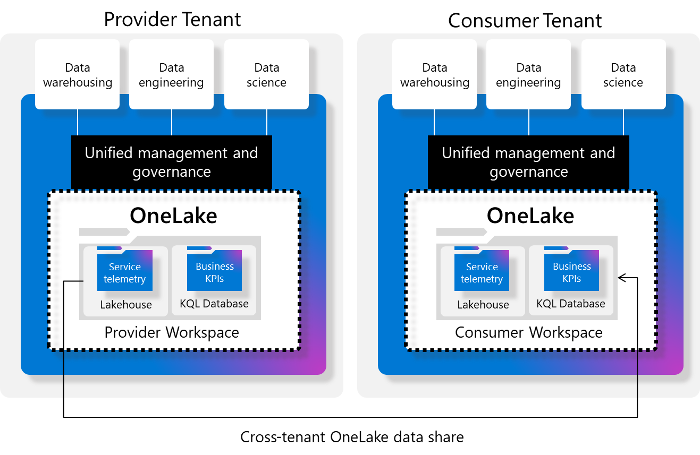

# Azure 일일 업데이트 브리핑 — 2026-11-14

**Azure Data Share가 2029-11-12에 종료됩니다.**
기존 공유는 유지보수 모드로 제공되지만 **새 Data Share account는 생성할 수 없습니다.**
전환 시에는 데이터를 복사해 받는 snapshot과 원본을 읽는 실시간 공유를 구분해야 합니다.
Fabric은 전환 선택지이지만 공유 관계와 자동화가 자동으로 이전되지는 않습니다.
[종료·신규 account 제한](https://learn.microsoft.com/azure/data-share/retirement)

**이번 보고서의 업데이트**

- **AI & Apps:** [Azure Data Share — 서비스 종료와 공유 방식별 전환](#data-share-retirement)

## 대응이 필요한 업데이트

### Azure Data Share — Retirement, 2029-11-12 종료 { #data-share-retirement }

Azure Data Share는 조직 밖의 파트너에게 데이터를 전달하고, 초대·수신 동의·
갱신 주기·접근 철회를 관리하는 서비스입니다.
Snapshot-based sharing은 데이터를 수신자 저장소로 복사하며, 지원되는 원본에서는
주기적으로 갱신할 수 있습니다. In-place sharing은 Azure Data Explorer의
원본을 복사하지 않고 읽도록 연결합니다.

이번 발표는 특정 API나 SKU가 아니라 **서비스 전체의 종료**입니다.
공급자·수신자뿐 아니라 snapshot 일정과 REST API 등을 사용하는 애플리케이션도
전환 대상에 포함됩니다. 종료 전에 공유 관계마다 대안을 선택하고 양쪽의
인증·데이터 전달·운영 흐름을 함께 검증해야 합니다.
[기존 공유 모델](https://learn.microsoft.com/azure/data-share/overview#how-it-works) ·
[종료 범위·전환 지침](https://learn.microsoft.com/azure/data-share/retirement)

**Fabric 전환에서 달라지는 데이터 접근**

대표 대안인 **Fabric external data sharing**은 수신자에게 별도 snapshot을
배달하는 대신, 공급자의 OneLake 데이터를 가리키는 read-only shortcut을
수신자 Lakehouse에 만듭니다. 아래 그림은 이 대안의 구조이며,
기존 Azure Data Share의 구조나 자동 migration 경로를 나타내는 그림이 아닙니다.

*출처: Microsoft Learn,
[External data sharing in Microsoft Fabric](https://learn.microsoft.com/fabric/governance/external-data-sharing-overview).
공식 원본이며, 그림을 선택하면 원본 크기로 볼 수 있습니다.*

- **공유 준비:** 양쪽 tenant의 Fabric 관리자가 external data sharing을
  허용하고, 공급자는 지원되는 Fabric item의 table·file을 공유합니다.
- **초대와 연결:** 수신자가 초대를 수락하고 Lakehouse를 선택하면 원본을
  가리키는 shortcut이 생성됩니다. 수신자를 공급자 tenant의 guest로
  등록하는 방식은 아닙니다.
- **읽기 동작:** 수신자의 Fabric workload가 shortcut을 통해 현재 원본을
  read-only로 읽습니다. 독립된 시점별 복사본이 필요한 요구와는 다릅니다.
- **권한과 데이터 위치:** 공급자 tenant의 governance가 수신자에게 그대로
  이전되지 않습니다. 수신자 쪽 접근 통제도 설계해야 하며,
  소비 시 데이터가 지역 경계를 넘을 수 있습니다.

따라서 기존 snapshot을 Fabric shortcut으로 바꾸는 것은 이름만 바꾸는 전환이
아닙니다. **독립 복사본·보존 시점·갱신 주기를 유지할지, 원본의 현재 상태를
읽도록 바꿀지**를 먼저 결정해야 합니다.
[Shortcut 동작·보안 경계](https://learn.microsoft.com/fabric/governance/external-data-sharing-overview)

**공유 방식별 대안**

- **OneLake 데이터의 실시간 읽기:** Fabric external data sharing을 검토합니다.
  원본을 먼저 Fabric에서 사용할 수 있도록 준비해야 합니다.
- **수신자 저장소로의 복사:** Azure Data Factory 또는 Fabric Data Factory
  pipeline을 검토합니다. 기존 초대·구독 계약을 그대로 대체하지 않으므로
  스키마·일정·권한·실패 복구를 별도로 설계합니다.
- **다른 tenant의 identity로 연결:** Cross-tenant delegated shortcut은
  공급자 tenant의 조직 계정 또는 service principal로 인증하는 방식입니다.
- **Fabric item 전체 공유:** IQ Share는 Public Preview 대안입니다.
  지원되는 Lakehouse·Warehouse item 전체를 공유하며, 선택한 table·folder를
  공유하는 external data sharing과 적용 단위가 다릅니다.

이 대안들은 서로 교환 가능한 일대일 대체재가 아닙니다.
[시나리오별 전환 선택지](https://learn.microsoft.com/azure/data-share/retirement#transition-options-by-scenario)

**종료 전 필요한 대응**

1. **사용 여부 확인:** Data Share account와 share·subscription·dataset mapping,
   snapshot 일정, 연동 API, 공급자·수신자 담당자를 식별합니다.
2. **공유 관계별 전환 검증:** 대안을 정한 뒤 접근 권한·private connectivity·
   데이터 완전성·갱신 동작·모니터링·복구를 양쪽에서 시험합니다.
   기존 Managed identity와 네트워크 구성이 그대로 승계된다고 가정하지 않습니다.
3. **2029-11-12 전에 전환 완료:** 최종 snapshot과 필요한 감사·실행 이력을
   보존하고 전환합니다. **대체 경로 검증 전에 기존 운영 리소스를 삭제하거나
   비활성화하지 않습니다.** 이미 수신자 저장소에 복사된 데이터가 서비스 종료만으로
   삭제되는 것은 아니며, 보존·삭제 책임은 해당 저장소 소유자에게 있습니다.

**공식 자료:**
[Azure Updates 종료 발표](https://azure.microsoft.com/updates?id=578818) ·
[종료 일정·영향·전환 계획](https://learn.microsoft.com/azure/data-share/retirement) ·
[Fabric external data sharing 구조·제한](https://learn.microsoft.com/fabric/governance/external-data-sharing-overview)
