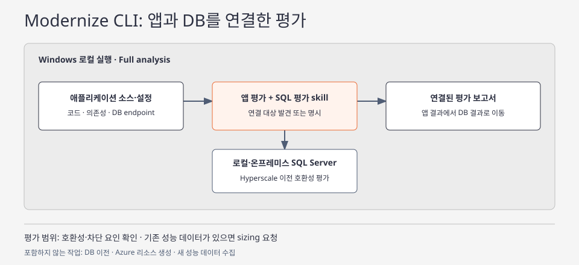
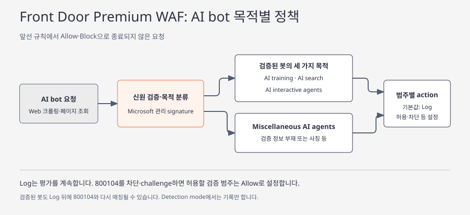
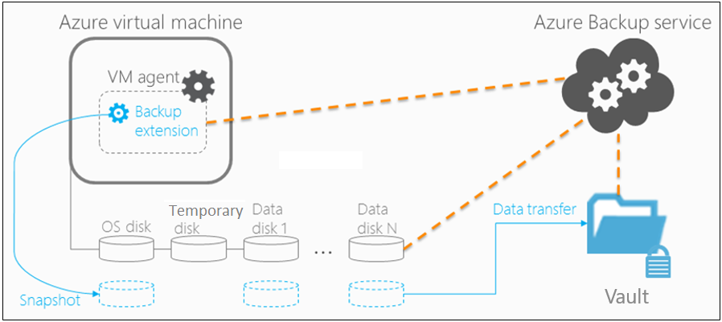

# Azure 일일 업데이트 브리핑 — 2026-11-19

**Modernize CLI**가 애플리케이션과 SQL Server의 이전 준비도를 함께 평가합니다.
**Front Door Premium WAF**는 AI bot을 학습·검색·실시간 에이전트 등으로 나눠
접근을 제어하고, **Azure Backup**은 다른 구독의 vault로 VM을 보호하는 기능을
GA로 제공합니다. Databricks의 새 Azure Government 환경도 Beta로 공개됐습니다.

**이번 보고서의 업데이트**

- **AI & Apps:** [Modernize CLI — 앱·DB 통합 평가 Public Preview](#modernize-cli) ·
  [Azure Databricks — 새 Government 환경 Beta](#databricks-government)
- **Infra:** [Front Door Premium WAF — AI bot ruleset Public Preview](#ai-bot-ruleset) ·
  [Azure Backup — 구독 간 VM 백업 GA](#cross-subscription-backup)

## 주요 업데이트

### Modernize CLI — 앱·SQL Server 통합 평가 Public Preview { #modernize-cli }

애플리케이션을 Azure로 옮길 때는 코드·프레임워크뿐 아니라 연결된 DB의
호환성도 함께 살펴야 합니다. Modernize CLI는 GitHub Copilot modernization agent의
CLI로, 소스와 의존성을 평가하고 검토 가능한 계획을 만든 뒤 변경·검증으로 이어지는
**Assess → Plan → Execute** 흐름을 제공합니다.

이번 발표는 이 흐름에 **SQL Server 이전 준비도 평가를 연결**합니다.
앱과 DB를 각각 조사한 결과를 사람이 따로 맞추는 대신, 앱 설정에서 SQL Server
연결 대상을 발견하고 DB 전문 skill을 호출해 연결된 평가 결과를 얻습니다.
다만 현재 SQL Server 기능의 범위는 **Azure SQL Database Hyperscale로의 이전 평가**이며,
DB 이전 자체를 자동 수행하는 기능은 아닙니다.
[평가 범위](https://learn.microsoft.com/azure/developer/github-copilot-app-modernization/modernization-agent/assess-sql-server)

*공식 문서 기반 재구성:
[Modernization agent 개요](https://learn.microsoft.com/azure/developer/github-copilot-app-modernization/modernization-agent/overview)와
[SQL Server 평가](https://learn.microsoft.com/azure/developer/github-copilot-app-modernization/modernization-agent/assess-sql-server).
그림을 선택하면 확대할 수 있습니다.*

**평가의 입력과 결과**

1. **Full analysis**로 앱 코드·설정·의존성을 분석합니다. 기본값인
   **Issue only**로는 추가 DB 평가 skill을 실행하지 않습니다.
2. 지원되는 앱 설정에서 SQL Server endpoint를 찾거나, 평가할 instance를 명시합니다.
   앱 코드를 실행해 동적으로 연결 대상을 추론하지는 않습니다.
3. 로컬·온프레미스 SQL Server의 Hyperscale 호환성·차단 요인과 변경 필요 사항을
   평가합니다. 앱 평가 보고서에서 DB 상세 보고서로 이동할 수 있습니다.
4. 같은 instance에서 **이미 수집한 성능 데이터**가 있으면 sizing 권고를 요청할 수
   있습니다. 이 과정에서 새 성능 데이터를 수집하지는 않습니다.

핵심 변화는 **코드 변경과 데이터 계층의 이전 판단을 하나의 워크로드 맥락에서
검토**할 수 있다는 점입니다. SQL Managed Instance나 SQL Server on Azure VM을
대안으로 고르려면 해당 대상에 맞는 추가 검토가 필요하며,
준비도 보고서만으로 실제 이전·production 검증이 끝난 것은 아닙니다.

**실행 조건:** SQL Server 평가는 원본 DB에 접근 가능한 **Windows 로컬**에서
실행해야 합니다. PowerShell 7, Azure CLI 2.75.0 이상과 `datamigration` extension
등의 준비가 필요합니다. 일반 Modernize CLI의 Linux·macOS 지원이나 cloud agent 위임을
이 DB 평가에 그대로 적용할 수 없습니다. 평가 과정은 Azure 리소스를 생성하거나 DB를
이전하지 않습니다.

**공식 자료:**
[Public Preview 발표](https://azure.microsoft.com/updates?id=579943) ·
[앱·DB 통합 평가의 배경](https://techcommunity.microsoft.com/blog/microsoftdatamigration/modernize-applications-and-databases-together-with-the-modernize-cli/4574244) ·
[SQL Server 평가·제한](https://learn.microsoft.com/azure/developer/github-copilot-app-modernization/modernization-agent/assess-sql-server)

### Front Door Premium WAF — AI bot ruleset Public Preview { #ai-bot-ruleset }

AI bot의 웹 접근은 모델 학습용 수집, 검색 색인 생성, 사용자의 질문에 따른
실시간 페이지 조회처럼 목적이 다릅니다. 사이트 운영자는 검색 노출은 유지하면서
학습용 수집은 제한하고 싶을 수 있지만, `robots.txt`는 bot의 자발적인 준수에
의존하고 `User-Agent`만으로는 사칭을 구분하기 어렵습니다.

새 **AI bot ruleset**은 Front Door Premium WAF가 AI bot의 신원을 검증하고
목적별 action을 edge에서 적용하도록 합니다. 단순히 모든 bot을 같은 방식으로
막는 대신 학습·검색·사용자 요청에 따른 접근을 구분합니다.
Microsoft가 signature를 관리하므로 signature 갱신을 위해 ruleset 버전을
매번 바꿀 필요도 없습니다.
[기능·동작](https://learn.microsoft.com/azure/web-application-firewall/afds/ai-bot-ruleset)

*공식 문서 기반 재구성:
[AI bot ruleset의 검증·분류·평가 순서](https://learn.microsoft.com/azure/web-application-firewall/afds/ai-bot-ruleset).
그림을 선택하면 확대할 수 있습니다.*

**네 가지 규칙과 정책 적용**

- **AI training — 800101:** 모델 학습·미세 조정을 위해 공개 콘텐츠를 수집하는
  검증된 crawler입니다.
- **AI search — 800102:** AI 검색·답변·요약을 위한 색인을 만드는 검증된
  crawler입니다. 차단하면 해당 검색 경험에서 콘텐츠 노출이 줄 수 있습니다.
- **AI interactive agents — 800103:** 사용자의 요청에 따라 실시간으로
  페이지를 조회하거나 작업하는 검증된 agent입니다.
- **Miscellaneous AI agents — 800104:** 검증 정보가 없거나 신원 검증에
  실패한 AI bot 등을 다룹니다. **미검증이 곧 악성이라는 뜻은 아닙니다.**

모든 규칙은 **Log**로 시작합니다. WAF 로그·insights에서 트래픽을 살펴본 뒤
범주별로 Allow, Block, Log, Redirect, JS challenge, CAPTCHA를 선택합니다.
실제 action 적용에는 Prevention mode가 필요하며 Detection mode에서는 기록만 합니다.

!!! warning "미확인 봇 차단과 검증된 봇 허용의 조합"
    **Log는 규칙 평가를 종료하지 않습니다.** 검증된 봇도 Log 뒤에 800104와 다시
    매칭될 수 있습니다. 800104를 Block·JS challenge·CAPTCHA로 설정한다면,
    계속 허용할 검증 범주는 Log가 아니라 **Allow**로 설정해야 합니다.
    앞선 custom rule이나 Bot Manager 규칙에서 Allow·Block으로 종료된 요청은
    AI bot ruleset까지 도달하지 않는다는 점도 함께 확인해야 합니다.

특정 AI 사업자만 예외로 둘 때는 `AIProvider`를 사용하는 **범위가 좁은 exception**을
검토할 수 있습니다. 모든 managed rules를 우회하는 custom Allow 규칙과 달리,
지정한 AI bot 규칙만 건너뛰고 다른 보안 검사를 유지하는 방식입니다.
지원 대상은 **Front Door Premium profile과 Premium WAF policy**이며,
Application Gateway WAF의 새 기능으로 혼동하지 않아야 합니다.

**공식 자료:**
[Public Preview 발표](https://azure.microsoft.com/updates?id=581604) ·
[규칙·action·평가 순서·exception](https://learn.microsoft.com/azure/web-application-firewall/afds/ai-bot-ruleset)

### Azure Backup — 구독 간 VM 백업 GA { #cross-subscription-backup }

Recovery Services vault는 Azure VM의 복구 지점과 백업 정책을 관리하는 자원입니다.
여러 구독에 VM을 나눠 운영하면서 각 구독에 vault를 따로 유지하면,
중앙 백업 담당자가 관리해야 할 자원도 늘어납니다.

이번 GA는 **VM과 다른 구독에 있는 Recovery Services vault로 백업을 구성**할 수
있게 합니다. 워크로드 구독의 VM은 그대로 두고 전용 백업 구독에서 보호를
관리하는 배치가 가능해집니다. 단, VM과 vault는 **같은 tenant·같은 리전**이어야 합니다.
이미 만든 복구 지점을 다른 구독으로 복원하는 기능과는 별개의 변화입니다.
[GA 발표](https://azure.microsoft.com/updates?id=581048) ·
[지원 조건](https://learn.microsoft.com/azure/backup/backup-support-matrix-iaas#supported-backup-actions)

*출처: Microsoft Learn,
[Azure VM Backup 아키텍처](https://learn.microsoft.com/azure/backup/backup-architecture#architecture-built-in-azure-vm-backup).
일반적인 extension 기반 백업 흐름이며 구독 경계는 표시하지 않습니다.
이번 변경은 VM과 vault를 서로 다른 구독에 둘 수 있다는 점입니다.
그림을 선택하면 원본 크기로 볼 수 있습니다.*

**중앙 vault로 보호하는 방식**

- **보호 구성:** vault에서 백업 정책과 보호할 VM을 선택합니다.
  다른 구독의 VM도 같은 tenant·리전 조건을 만족해야 합니다.
- **백업 흐름:** 그림처럼 snapshot을 만들고 백업 데이터를 vault로 전송합니다.
  구독 간 배치와 별개로 기존 백업 방식의 지원 조건을 확인해야 합니다.
- **운영 변화:** 여러 워크로드 구독의 VM 보호를 백업 전용 구독의 vault로 모아
  관리할 수 있습니다. 여러 리전의 VM을 한 리전의 vault에 모두 백업하는 기능은 아닙니다.
- **기존 보호 이력:** vault 사이에서 이미 백업한 데이터를 이동하는 기능은
  지원하지 않습니다. 기존 VM의 vault를 바꾸려면 별도 전환 검토가 필요합니다.

**가용성·제한:** 공식 지원표는 **모든 Azure 리전**에서 제공한다고 명시합니다.
구독 간 백업은 **Confidential VM(ADE로 암호화한 CVM 포함)을 지원하지 않습니다.**
여러 구독의 중앙 관리가 목적이라도 이 조건을 확인한 뒤 보호 대상을 정해야 합니다.

**공식 자료:**
[GA 발표](https://azure.microsoft.com/updates?id=581048) ·
[백업 구성](https://learn.microsoft.com/azure/backup/backup-azure-arm-vms-prepare#apply-a-backup-policy) ·
[구독·리전·VM 제한](https://learn.microsoft.com/azure/backup/backup-support-matrix-iaas#supported-backup-actions)

## 기타 업데이트

- **Azure Databricks — 새 Azure Government 환경 — Beta:**
  Unity Catalog, serverless Databricks SQL과 사용량·감사·비용용 system tables를
  갖춘 새 환경입니다. US Gov Virginia·US Gov Arizona에서 제공하며 Private Link가
  필수이고 **비production 용도만 허용하며 CUI·기타 규제 데이터를 처리하면 안 됩니다.**
  기존 환경과 분리돼 기존 workspace를 자동 이전하지 않으며, Databricks workspace를
  생성한 이력이 없는 Azure Government 구독으로 등록해야 합니다.
  [발표](https://azure.microsoft.com/updates?id=581645) ·
  [Beta 가입·보안·데이터 위치](https://learn.microsoft.com/azure/databricks/security/privacy/gov-cloud)
