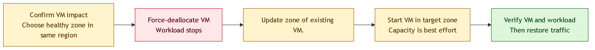
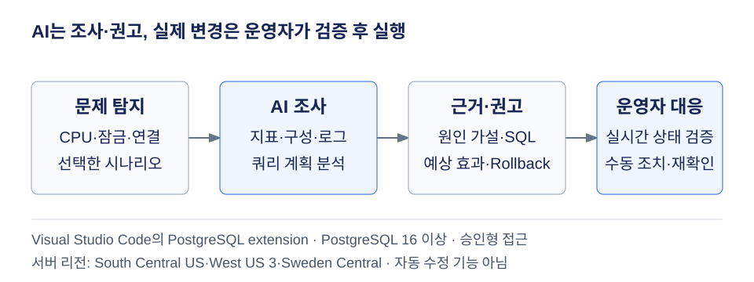
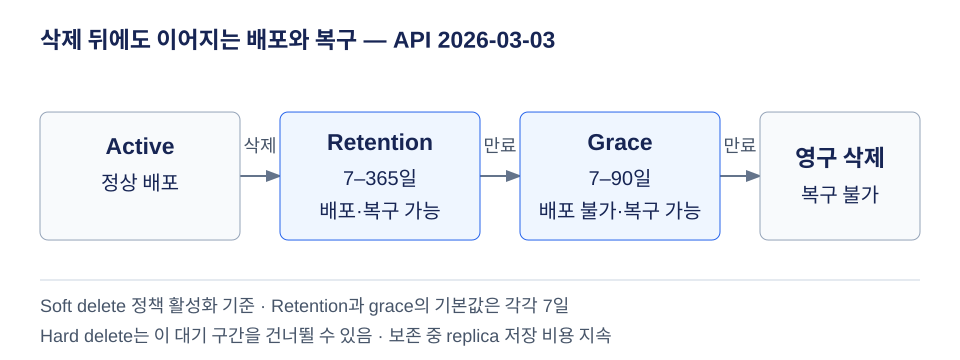
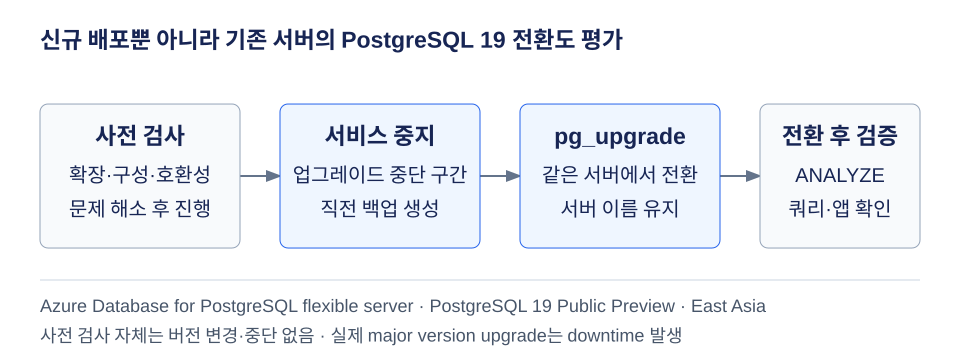

# Azure 일일 업데이트 브리핑 — 2026-11-20

**Zone resilience for Azure VMs**는 기존 VM 리소스와 ZRS disk를 유지하면서
같은 리전의 다른 availability zone에서 복구하는 기능입니다.
**PostgreSQL Database Agent**는 성능 문제의 근거와 대응안을 AI로 정리하며,
실제 변경은 운영자가 수행합니다. **Compute Gallery soft delete가 GA**됐고,
**PostgreSQL 19**는 East Asia에서 신규 배포와 업그레이드를 시험할 수 있게 됐습니다.

**이번 보고서의 업데이트**

- **AI & Apps:** [Microsoft Marketplace — Multiparty private offers 국가 확대](#marketplace-offers)
- **Infra:** [Azure VMs — Zone resilience Public Preview](#vm-zone-resilience) ·
  [Azure Compute Gallery — Soft delete GA](#gallery-soft-delete)
- **Database:** [PostgreSQL — Database Agent Public Preview 발표](#postgresql-database-agent) ·
  [Azure Database for PostgreSQL — PostgreSQL 19 Public Preview](#postgresql-19)

## 주요 업데이트

### Azure VMs — Zone resilience Public Preview { #vm-zone-resilience }

**새 VM을 만들지 않고 기존 VM의 zone 배치를 변경하는 복구 경로**

ZRS managed disk는 데이터를 availability zone 사이에 동기 복제하지만,
장애가 난 zone의 VM까지 다른 zone에서 다시 시작해 주지는 않습니다.
Zone resilience는 이 간극을 메우는 **사용자 시작형 복구 기능**입니다.
지원되는 VM의 zone 배치를 바꾸고 기존 OS·data disk를 재사용하므로,
복구용 VM을 새로 생성하는 방식과 구분됩니다.
VM의 resource ID·VM ID와 NIC·IP 구성 등 지원되는 설정도 유지합니다.

  

*출처: Microsoft Learn,
[Zone resilience for Azure VMs — How zone failover works](https://learn.microsoft.com/azure/virtual-machines/zone-resilience#how-zone-failover-works).
가로로 스크롤하거나 그림을 선택해 원본 크기로 볼 수 있습니다.*

- **사전 준비:** source zone이 정상일 때 기능을 켭니다. 기존 VM은 활성화할 때도
  deallocate가 필요하므로 중단을 계획해야 합니다.
- **복구 시작:** 영향과 대상 zone을 확인한 뒤 VM을 force-deallocate하고 zone 배치를
  변경합니다. 메모리·실행 중 요청·runtime state는 보존하지 않습니다.
- **다시 시작:** 같은 리전의 대상 zone에서 기존 ZRS disk로 시작합니다.
  해당 zone이 VM 크기를 지원하고 실제 여유 용량이 있어야 합니다.
- **서비스 재개:** disk·network·애플리케이션과 데이터 정합성을 검증한 다음
  트래픽을 복구합니다. 자동 failover나 트래픽 전환 기능은 아닙니다.

**Near-zero RPO의 범위는 지원되는 ZRS disk에 기록이 완료된 데이터**입니다.
무중단 서비스나 메모리 상태 보존을 뜻하지 않으며, 리전 전체 장애에 대한 DR도
대신하지 않습니다.

평가 대상은 OS disk와 **모든 data disk가 Premium SSD ZRS 또는 Standard SSD ZRS인
standalone zonal VM**입니다. VM scale sets·Spot VM·Azure Site Recovery·
on-demand capacity reservation 등은 지원하지 않습니다.
가용성은 선택 리전의 [ZRS disk 지원 범위](https://learn.microsoft.com/azure/virtual-machines/disks-redundancy#zone-redundant-storage-for-managed-disks)와
대상 zone의 VM 용량을 함께 확인해야 합니다.
**이번 프리뷰는 nonproduction VM의 평가·시험 용도이며 production에 사용하지 않습니다.**

**공식 자료:**
[프리뷰 발표](https://azure.microsoft.com/updates?id=581254) ·
[복구 동작·요구사항·제한](https://learn.microsoft.com/azure/virtual-machines/zone-resilience)

### Azure Database for PostgreSQL — Database Agent Public Preview 발표 { #postgresql-database-agent }

**성능 이상 탐지부터 근거 수집·대응안 설명까지 연결하는 AI 조사**

Database Agent는 PostgreSQL의 상태·성능 문제를 탐지하고, 관련 지표·구성·
워크로드 신호·query plan·로그를 모아 원인 가설과 대응안을 설명하는 기능입니다.
운영자가 각 진단 자료를 직접 연결하던 과정에 AI 조사를 더하며,
Visual Studio Code의 PostgreSQL extension에서 결과를 검토합니다.
일반적인 질문 응답을 넘어 선택한 서버·시나리오를 모니터링하지만,
**제안된 SQL이나 서버 설정을 자동으로 적용하는 기능은 아닙니다.**

Azure Updates는 **Public Preview**로 발표했지만,
[Learn이 명시한 실제 접근 조건](https://learn.microsoft.com/fabric/database/hub/database-agents?pivots=postgresql)은
**참여 신청과 승인이 필요한 limited preview**입니다.
발표 상태만 보고 모든 서버에서 바로 사용할 수 있다고 판단하지 않아야 합니다.

  

*공식 문서 기반 재구성:
[Database Agents 개요](https://learn.microsoft.com/fabric/database/hub/database-agents?pivots=postgresql)와
[Visual Studio Code 검토·대응 흐름](https://learn.microsoft.com/fabric/database/hub/database-agents-vs-code).
작은 화면에서는 가로로 스크롤하고, 그림을 선택하면 크게 볼 수 있습니다.*

- **탐지:** 연결 고갈, dead tuple bloat, 높은 CPU, idle-in-transaction,
  lock contention, query plan regression, sort spill·메모리 압박을 조사합니다.
- **분석:** PostgreSQL 조사는 LLM을 사용합니다. 발견 당시의 근거와 원인 설명,
  Recommended change·Rollback SQL·Expected outcome을 제공합니다.
- **대응:** 운영자는 현재 서버에서도 문제가 계속되는지, 권고가 맞는지 확인하고
  승인된 절차로 직접 변경합니다. 이후 지표와 query plan을 다시 확인합니다.
- **추적:** 조사 상태와 처리 이력을 남깁니다.
  `Mark manually applied`는 수행 기록이지 복구 성공의 자동 보증이 아닙니다.

**지원 조건과 데이터 위치**

- **서버:** 실행 중인 PostgreSQL **16 이상**의 flexible server와 PostgreSQL extension
  **1.32.0 이상**이 필요합니다. 서버 접근 권한과 DB 연결 권한을 준비해야 합니다.
- **미주:** South Central US·West US 3의 서버를 지원하며 AI 처리는 **US Data Zone**에서 수행합니다.
- **유럽:** Sweden Central의 서버를 지원하며 AI 처리는 **EU Data Zone**에서 수행합니다.
- **한국 리전은 현재 지원 목록에 없습니다.** PostgreSQL의 Fabric Database Hub
  접근과 Azure HorizonDB 지원은 아직 예정 사항입니다.

**공식 자료:**
[프리뷰 발표](https://azure.microsoft.com/updates?id=579579) ·
[기능·접근 조건·리전](https://learn.microsoft.com/fabric/database/hub/database-agents?pivots=postgresql) ·
[VS Code의 검토·수동 대응](https://learn.microsoft.com/fabric/database/hub/database-agents-vs-code)

### Azure Compute Gallery — Soft delete GA { #gallery-soft-delete }

**이미지 삭제 후 복구 가능 기간과 배포 가능 기간을 분리**

Compute Gallery의 image version은 VM과 scale set 배포에 사용하는 이미지입니다.
실수로 삭제하면 이후 배포나 scale-out이 영향을 받을 수 있으므로,
즉시 영구 삭제하는 대신 복구할 시간을 확보하는 것이 soft delete의 역할입니다.
이번 GA는 **7–365일 retention과 그 뒤 7–90일 grace period**를 제공합니다.
API `2026-03-03`에서는 retention 동안 soft-deleted 이미지로도 배포할 수 있어,
복구 기회와 배포 연속성을 함께 확보합니다.

  

*공식 문서 기반 재구성:
[Soft delete in Azure Compute Gallery](https://learn.microsoft.com/azure/virtual-machines/soft-delete-gallery).
작은 화면에서는 가로로 스크롤하고, 그림을 선택하면 크게 볼 수 있습니다.*

- **Retention:** 이미지 복구와 VM·scale set 생성, 기존 scale set의 scale-out이 가능합니다.
- **Grace:** 복구는 가능하지만 해당 이미지로 새 배포나 scale-out을 할 수 없습니다.
- **영구 삭제:** grace가 끝나면 복구할 수 없습니다. 별도의 hard delete로
  대기 기간을 건너뛰는 것도 가능하므로 삭제 불가능한 보존 기능은 아닙니다.
- **API 차이:** soft delete 자체는 `2024-03-03`부터 제공됩니다.
  기간 사용자 지정과 retention 중 이미지 사용에는 **`2026-03-03`**이 필요하며,
  이전 API에서는 soft-deleted 이미지로 배포할 수 없습니다.

Private·Direct Shared·Community gallery를 지원합니다.
Gallery·image definition·image version의 리전이 다르면 활성화·이미지 복구에
제약이 있습니다. **기능 자체는 무료지만 retention·grace 동안 보존되는 모든
replica의 저장 비용은 계속 발생**합니다.

**공식 GA 지원 리전**

- **미주:** Brazil South, Canada Central, Central US EUAP, East US 2 EUAP,
  North Central US, South Central US, West US 3.
- **유럽:** France South, Germany West Central, North Europe, Norway East,
  Sweden Central, UK South, UK West.
- **아시아·태평양:** Australia Central 2, Australia East, East Asia, Japan East,
  Jio India West, **Korea South**, Taiwan North, West India.
- **중동·아프리카:** Qatar Central, South Africa West.

**Korea South는 지원하지만 Korea Central은 이 기능의 GA 목록에 없습니다.**
Compute Gallery 서비스 전체의 리전 범위와 혼동하지 않아야 합니다.

**공식 자료:**
[GA 발표](https://azure.microsoft.com/updates?id=581907) ·
[수명주기·API 차이·지원 리전·비용](https://learn.microsoft.com/azure/virtual-machines/soft-delete-gallery)

### Azure Database for PostgreSQL — PostgreSQL 19 Public Preview { #postgresql-19 }

**관리형 환경에서 새 engine과 기존 서버의 전환 경로를 함께 평가**

PostgreSQL major version 변경은 새 SQL 기능뿐 아니라 유지관리·query planner·
확장 호환성을 함께 검토하는 작업입니다.
이번 프리뷰로 flexible server에서 **PostgreSQL 19 서버를 새로 만들거나,
적격 기존 서버를 in-place major version upgrade하는 경로**를 시험할 수 있습니다.
기존 in-place upgrade 방식에 PostgreSQL 19가 대상 버전으로 추가된 것이며,
새로운 무중단 업그레이드 방식이 생긴 것은 아닙니다.
새 배포와 실제 워크로드의 호환성을 GA 전에 검증하는 데 의미가 있습니다.

  

*공식 문서 기반 재구성:
[Major version upgrades](https://learn.microsoft.com/azure/postgresql/configure-maintain/concepts-major-version-upgrade).
작은 화면에서는 가로로 스크롤하고, 그림을 선택하면 크게 볼 수 있습니다.*

- **새 engine의 유지관리:** PostgreSQL 19의 `REPACK`은 테이블을 재구성하며,
  `CONCURRENTLY` 옵션은 작업 중 읽기·쓰기를 허용합니다.
  Autovacuum은 index vacuum에 parallel worker를 사용하고 처리 우선순위를 정할 수 있습니다.
  [Microsoft의 기능 설명](https://techcommunity.microsoft.com/blog/adforpostgresql/postgresql-19-on-day-one-new-capabilities-a-managed-path-forward/4572732) ·
  [PostgreSQL 공식 발표](https://www.postgresql.org/about/news/postgresql-19-released-3449/)
- **업그레이드 전:** Upgrade Validation Checks로 확장·구성 등 차단 조건을 확인합니다.
  사전 검사 자체는 버전을 변경하거나 서버를 중단하지 않습니다.
- **실제 전환:** 서비스 중지와 직전 백업 후 `pg_upgrade`로 전환합니다.
  서버 이름은 유지하지만 **downtime이 발생**하며, 완료 후 `ANALYZE`로 통계를
  갱신하고 애플리케이션을 확인합니다.

**가용성은 East Asia로 한정**되므로 PostgreSQL 19 신규 서버와 업그레이드 평가도
이 리전에서 수행합니다. **Korea Central·Korea South에서는 아직 제공되지 않습니다.**
모든 확장이 지원되는 것은 아니므로
[PostgreSQL 19 확장 목록](https://learn.microsoft.com/azure/postgresql/extensions/concepts-extensions-by-engine?pivots=postgresql-19)과
원본·대상 버전의 업그레이드 조건을 확인해야 합니다.

**공식 자료:**
[프리뷰 발표](https://azure.microsoft.com/updates?id=574587) ·
[지원 버전·프리뷰 제한](https://learn.microsoft.com/azure/postgresql/configure-maintain/concepts-supported-versions) ·
[전환 동작·호환성 검사](https://learn.microsoft.com/azure/postgresql/configure-maintain/concepts-major-version-upgrade)

## 기타 업데이트

### Microsoft Marketplace — Multiparty private offers 국가 확대 { #marketplace-offers }

**Announcing:** 소프트웨어 회사와 채널 파트너가 함께 거래하는 multiparty private offers의
고객 판매 지원 국가에 **Malaysia·Saudi Arabia**가 추가됐습니다.
Marketplace 거래 시장의 확대이며 Azure workload 실행 리전 확대는 아닙니다.
[발표](https://azure.microsoft.com/updates?id=580700) ·
[공식 국가 확대 안내](https://learn.microsoft.com/partner-center/announcements/2026-november#multiparty-private-offers-expand-to-malaysia-and-saudi-arabia)
