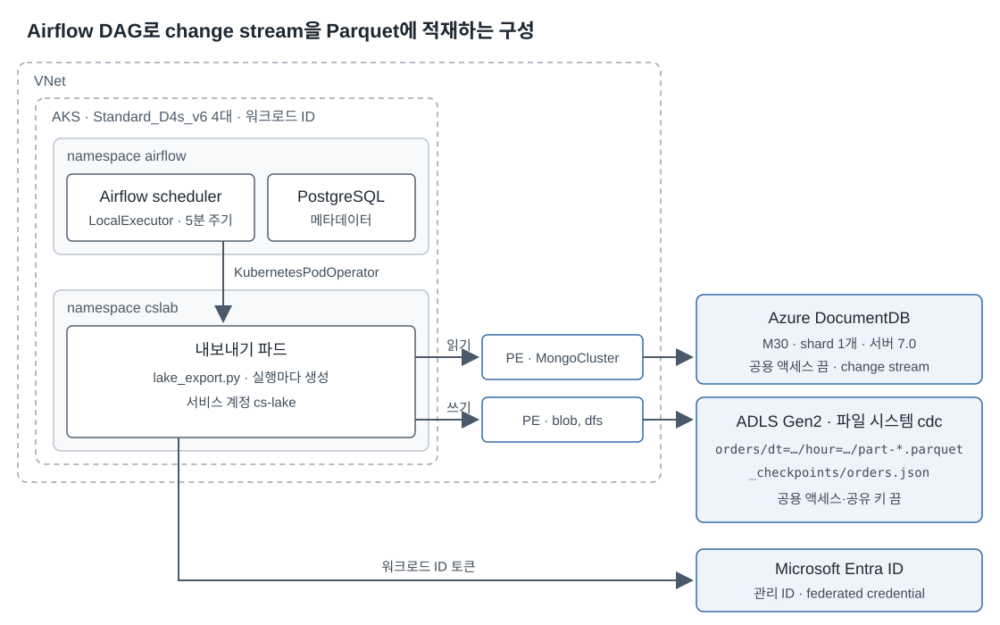

# Airflow on AKS에서 change stream 백로그 따라잡기

[상위 문서](../index.md)의 sample을 새 Azure 환경에 다시 배포해 Airflow를 멈춘
동안 쌓인 change stream 이벤트를 따라잡았습니다. 이 글의 결론은 다음과 같습니다.

- 같은 resume token 체인은 **writer 하나가 직렬로** 읽습니다.
- checkpoint, lock, 출력 파일은 파드의 로컬 디스크가 아니라 ADLS Gen2에 둡니다.
- 처리량을 늘릴 때는 같은 stream에 reader를 더 붙이지 않고 collection, tenant처럼
  checkpoint가 독립된 stream을 늘립니다.
- 예상 추격 시간이 남은 change stream 보존 여유에 가까워지면 Airflow를 더 키우기보다
  상시 수집기와 Event Hubs 또는 원시 ADLS landing zone을 앞단에 둡니다.

## 선택한 구성



Airflow의 `KubernetesPodOperator`가 stream마다 export 파드를 하나 만듭니다.
파드는 ADLS Gen2 checkpoint의 resume token에서 시작해 현재 열려 있는 10분 구간
직전까지 읽습니다. 한 번의 DAG run이 scheduler 구간 하나만 처리하는 것이 아니라,
checkpoint 뒤에 닫힌 구간이 여러 개면 한 번에 차례대로 처리합니다.

정확성을 지키는 경계는 다음 세 겹입니다.

1. DAG의 `max_active_runs=1`이 정상적인 run 중첩을 막습니다.
2. ADLS lock 파일의 lease가 같은 `STREAM_ID`를 가진 writer를 하나로 제한합니다.
3. 각 Parquet 경로를 checkpoint에 조건부로 기록하고 파일 lease를 잡은 뒤
   ETag가 그대로인지 확인합니다. 늦게 살아난 이전 파드는 checkpoint 확인이나
   lease가 붙은 업로드에서 멈춥니다.

파일 이름과 청크 경계는 이벤트 구간, 압축 전 row 크기, 청크 시작 직전 resume
token으로 정합니다. 재시도 시각이나 파드 이름을 쓰지 않으므로 같은 이벤트를 다시
읽어도 같은 파일을 덮어씁니다. checkpoint는 파일 업로드가 끝난 뒤에만 앞으로
옮깁니다.

## scheduler catch-up과 데이터 catch-up을 분리한다

Airflow의 `catchup`은 실행하지 않은 **scheduler data interval**을 Dag Run으로
만들지 결정합니다. change stream의 데이터 위치를 복구하는 기능은 아닙니다. 이
sample은 `catchup=False`이고, 데이터 catch-up은 export 파드가 외부 checkpoint부터
읽어 수행합니다.

2026-10-15 재검증에서는 pause 상태에서 수동 run을 queue한 뒤 DAG를 unpause하자
Airflow가 최신 scheduled run을 먼저 만들었습니다. `max_active_runs=1` 때문에
scheduled run이 백로그 230,000건을 모두 처리한 다음 수동 run이 시작해 0건으로
끝났습니다. 운영 절차는 다음처럼 잡습니다.

- DAG를 다시 켤 때 먼저 `dags list-runs`로 queued/running run을 확인합니다.
- unpause 직후 생성된 scheduled run이 있으면 별도 수동 run을 겹쳐 만들지 않습니다.
- scheduler run을 여러 개 만드는 대신 한 export run이 checkpoint부터 닫힌 구간을
  연속 처리하게 합니다.

## 따라잡을 수 있는지 먼저 계산한다

다음 값을 계속 측정합니다.

- `B`: checkpoint 뒤에 남은 이벤트 수
- `lambda`: 현재 change event 유입률(events/s)
- `mu`: export lane 하나의 처리율(events/s)
- `H`: 가장 오래된 미처리 이벤트가 사라지기까지 남은 시간

source가 남은 event 수를 직접 주지 않으면 `B`는 최근 `lambda`와 가장 오래된
미처리 이벤트 나이로 추정하고, 실제 drain 중 checkpoint 증가량으로 계속 보정합니다.

유입이 계속되는 동안의 예상 추격 시간은 다음과 같습니다.

```text
T = B / (mu - lambda), 단 mu > lambda
```

`mu <= lambda`이면 파드를 오래 실행해도 백로그가 줄지 않습니다. `T`에 장애 복구
여유를 더한 값이 `H`보다 작아야 direct change stream 구성을 유지할 수 있습니다.

Azure DocumentDB의 일반 change stream은 활성 400 MB change log 안의 이벤트를
재개합니다. 공식 문서는 historical change stream과 PITR 로그를 함께 쓰면 최대
35일 또는 클러스터 초기화 시점 중 이른 쪽까지 복구할 수 있다고 설명합니다.
historical checkpoint 처리는 자원을 더 쓰므로 저부하 시간대 실행과 추가 스토리지도
권장합니다. 실제 적용 전에는 사용하는 tier에서 historical resume가 켜져 있는지와
가장 오래된 checkpoint를 직접 확인합니다.

### 2026-10-15 값에 대입

이 시험은 유입을 끝낸 뒤 따라잡았으므로 실제 drain 동안 `lambda=0`입니다.

| 값 | 측정값 |
| --- | ---: |
| 백로그 `B` | 230,000 events |
| 생성 중 유입률 | 957.8 events/s |
| export 처리율 `mu` | 15,082.0 events/s |
| export 내부 처리 시간 | 15.25초 |
| 파드 예약·기동·정리를 포함한 DAG run | 22.12초 |
| 처리율/생성률 | 15.75배 |

같은 957.8 events/s 유입이 drain 중에도 계속됐다고 가정하면 순 추격률은 약
14,124 events/s이고 계산상 `T`는 약 16.3초입니다. 이 값은 **같은 문서 크기와
단일 shard 시험 환경에서 얻은 용량 기준**이지 서비스 보장값이 아닙니다.

## 수평 확장의 경계

같은 checkpoint를 여러 파드가 나눠 갱신하게 하지 않습니다. resume token은 한
stream의 위치이고, 파일과 checkpoint를 원자적으로 함께 commit하는 트랜잭션은
없습니다. reader를 추가하면 앞선 파드가 늦게 파일을 덮거나 뒤 token이 먼저
checkpoint에 저장되는 경쟁을 다시 만들어 냅니다.

대신 다음 단위마다 `STREAM_ID`, checkpoint, lock, 출력 prefix를 분리합니다.

- 서로 다른 source collection
- application이 이미 분리한 tenant 또는 업무 partition
- 순서 보장이 서로 필요 없는 독립 event stream

Airflow pool로 DocumentDB에 동시에 붙는 stream 수를 제한하고, 각 stream DAG에는
`max_active_runs=1`을 둡니다. AKS cluster autoscaler는 자원 부족으로 schedule되지
않는 파드가 있을 때 node pool을 늘립니다. 따라서 **독립 export 파드 여러 개**를
받을 node 용량은 늘릴 수 있지만, 단일 stream 파드의 처리 코드를 병렬화하지는
않습니다.

운영 AKS에서는 system node pool과 user node pool을 분리합니다. Airflow scheduler,
metadata database 연결, DNS 같은 control path가 대량 export의 CPU·메모리 사용과
경쟁하지 않게 하고, export 파드에는 실제 청크 한도에 맞춘 request와 limit을
지정합니다.

## 경보와 대응

| 신호 | 경고 조건 예시 | 대응 |
| --- | --- | --- |
| checkpoint 갱신 나이 | 정상 DAG 주기의 2배 초과 | scheduler, queued run, pod 생성 실패 확인 |
| 가장 오래된 미처리 이벤트 나이 | 계속 증가 | `lambda`, `mu`, 실패율을 함께 확인 |
| 처리율 여유 `mu / lambda` | 2 미만 | 독립 stream 수와 pod 자원 재측정 |
| 예상 추격 시간 `T` | 보존 여유 `H`의 25% 초과 | 장애 복구 여유를 포함해 buffer 전환 준비 |
| 보존 위험 | `T + 복구 여유 >= H` 또는 `mu <= lambda` | direct drain 중단, 상시 수집 buffer 사용 |
| pod start 지연 | 평소보다 지속 증가 | node 여유, image pull, cluster autoscaler 확인 |
| lease·ETag 충돌 | 정상 재시도 범위를 넘어 반복 | 같은 `STREAM_ID`를 쓰는 중복 DAG/배포 확인 |
| `ExceededTimeLimit` | historical `getMore`에서 반복 | 짧은 `maxAwaitTimeMS` 제거 후 재검증 |

25%와 2배 기준은 서비스 제한이 아니라 조기 대응을 위한 시작값입니다. 실제
문서 크기, shard 수, sink 속도와 장애 복구 목표로 다시 정합니다.

## 실제 구독 재검증 결과

2026-10-15에 East US 2에 M30 단일 shard, HA 비활성 Azure DocumentDB와
`Standard_D4s_v6` 4노드 AKS, Basic ACR, private ADLS Gen2를 새로 만들었습니다.
Airflow 3.2.2와 chart 1.22.0을 설치하고 checkpoint를 먼저 만든 뒤 DAG를 pause한
상태에서 문서 100,000개를 초당 약 1,000개 operation으로 썼습니다. 마지막 이벤트의
10분 구간이 닫힌 뒤 DAG를 다시 켰습니다.

| 검증 항목 | 결과 |
| --- | ---: |
| 생성 문서 | 100,000 |
| 기대 / 저장 이벤트 | 230,000 / 230,000 |
| 누락 / 예상 외 / 중복 | 0 / 0 / 0 |
| 문서별 순서 역전 | 0 |
| export 처리 시간 / 처리율 | 15.25초 / 15,082.0 events/s |
| 전체 DAG run 시간 | 22.12초 |
| Parquet 파일 | 5개, 합계 161,777,356 bytes |
| 구간을 섞은 파일 / 한도를 넘은 파일 | 0 / 0 |
| 파드가 읽을 때의 지연 p50 / p99 | 620.489초 / 726.453초 |
| 파일 저장 지연 p99 | 729.3초 |

지연에는 백로그를 일부러 닫힌 10분 구간까지 기다린 시간이 포함됩니다. 파일은
압축 전 80 MB row 한도로 잘랐고 가장 큰 실제 Parquet 파일은 약 46 MB였습니다.

검증 뒤 `azd down --force --purge`로 실험 resource group을 삭제했고 존재 여부가
`false`로 바뀐 것까지 확인했습니다. 실제 구독, tenant, resource 이름, endpoint와
credential은 결과에 남기지 않았습니다.

## 언제 buffer를 앞에 둘 것인가

다음 중 하나면 direct Airflow drain을 주 경로로 두지 않습니다.

- 예상 유입률이 단일 lane 처리율과 같거나 더 큼
- 장애와 재시도를 포함한 추격 시간이 change stream 보존 여유에 근접함
- Airflow 유지 보수 중에도 change stream 수집을 계속해야 함
- 한 stream의 변환을 여러 worker가 독립적으로 병렬 처리해야 함

이때는 작은 상시 capture deployment가 change stream을 한 번 읽어 Event Hubs 또는
append-only ADLS raw 영역에 먼저 보존합니다. Airflow는 buffer의 partition을
병렬 처리하고 재처리합니다. source resume token을 책임지는 capture lane과 무거운
변환을 분리하면 Airflow 중단 시간이 DocumentDB history 보존 시간에 직접 묶이지
않습니다. 이 2단계 구성은 이번 배포에서 만들거나 성능을 재지 않았습니다.

## 적용 범위

이번 수치는 단일 shard, HA 비활성 POC입니다. 다음 항목은 별도 검증이 필요합니다.

- HA failover 중 cursor 재생성과 checkpoint resume
- 다중 shard preview의 순서와 처리량
- 유입을 계속한 상태에서 장시간 순 추격률
- 운영용 외부 Airflow metadata database와 scheduler 이중화
- 독립 stream 수가 늘 때 DocumentDB와 ADLS의 합산 부하

재현 명령과 기존 대규모·장애 시나리오는 sample
[README](https://github.com/hellices/devguidesample/blob/main/docs/services/azure-documentdb/change-streams/samples/python-aks/README.md)와
[측정 상세](../measurements/index.md)에 있습니다.
