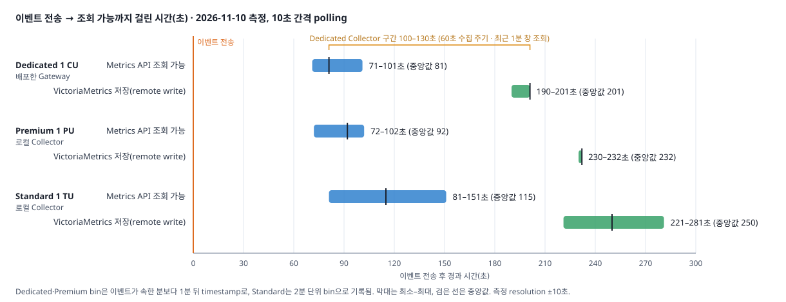
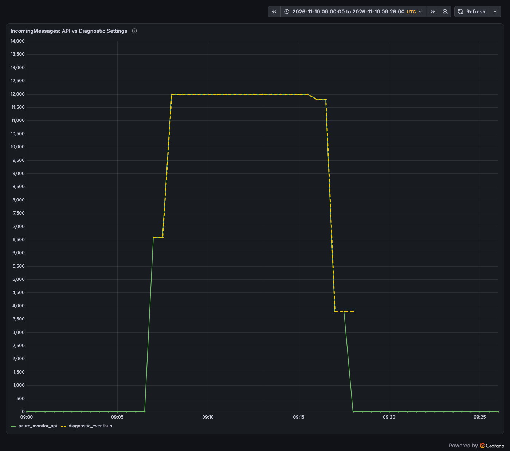
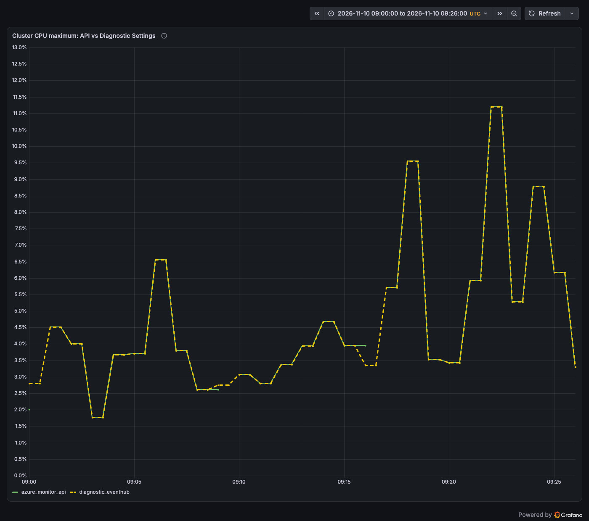
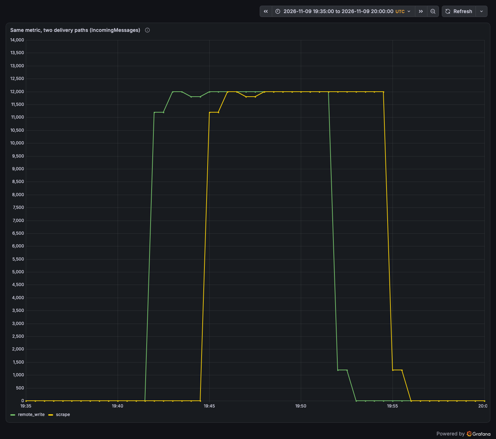

# Event Hubs 지표 수집 방식 비교 — OpenTelemetry Collector·VictoriaMetrics

## 핵심 흐름: 수집 방식 5가지와 실측 결과 { #message }

Event Hubs의 CPU·memory·요청·처리량 지표는 Azure Monitor가 1분 단위로 자동 수집하므로,
외부 VictoriaMetrics로 모을 때 정할 것은 그 지표를 꺼내 오는 방식입니다. 이 topic은 다섯
방식을 비교하고, ②·④를 하나의 OpenTelemetry Collector로 Event Hubs Dedicated cluster(1 CU)
환경에 배포해 같은 구간의 Azure Monitor 조회값과 대조했습니다. ③은 이전 Premium 1 PU
환경에서 ②와 바꿔 실행해 확인했습니다.

아래는 Dedicated cluster 안 namespace에 producer 200 events/s(1 KiB) 부하를 10분 준
구간(2026-11-10 09:00–09:26 UTC)을 이 구성으로 수집해 agent가 만든 Grafana 대시보드입니다.
분당 12,000건을 받는 동안 cluster `CPU`의 Role 최댓값은 11% 이하, `AvailableMemory`는
41–45%로 1 CU의 여유가 컸습니다.

같은 26분 구간을 Azure Monitor에서 직접 조회한 값과 비교하면, 원본 timestamp를 유지하는
remote write 경로는 ②의 4개 지표 모두, ④는 실제로 수신된 지표의 합계가 일치했습니다. ④에는
`ThrottledRequests`가 오지 않아 throttle 합계는 ④로 확인할 수 없습니다. ②는 receiver가 놓친 분
bin을 다시 채우지 않았습니다([분 bin 누락](lab/index.md#gaps)).

| 지표 | Azure Monitor 직접 조회 | ② Metrics API → remote write | ④ Diagnostic Settings → remote write |
|---|---:|---:|---:|
| `IncomingMessages` | 118,200 | 118,200 (26/26분 일치) | 118,200 (값이 있는 11분) |
| `OutgoingMessages` | 118,200 | 118,200 (26/26분 일치) | 118,200 (값이 있는 17분) |
| `IncomingRequests` | 1,528 | 1,528 (26/26분 일치) | 1,528 (26분) |
| `ThrottledRequests` | 0 | 0 (24/26분, 2분 누락) | 수신 안 됨 |

Grafana로 보는 것이 목적이라면 플랫폼 지표를 VictoriaMetrics로 옮기지 않아도 됩니다.
Azure Managed Grafana의 Azure Monitor 데이터 소스로 ①을 바로 조회하고, Azure Monitor 지표에
없는 consumer lag 같은 리소스 로그만 Collector의 `azureeventhubreceiver`로 VictoriaMetrics에
저장하는 [분리 구성](#direct-query)에서는 분 bin 누락이 없었고 Grafana 값이 Azure Monitor 직접
조회와 매 조회 같았습니다.

## 방식별 주요 차이: 지표 범위·dimension·지연·운영 { #metrics }

외부 TSDB로 지표를 모을 때는 ② Metrics API pull 하나로 충분하고, ④ Diagnostic Settings의
지표 스트림(`AllMetrics`)은 필요하지 않습니다. 대시보드만 필요하면 TSDB로 모으지 않고 ①을
Grafana에서 직접 조회하는 [분리 구성](#direct-query)이 더 단순합니다. ④가 보내는 지표는 모두 ②로도 받을 수 있으며,
④는 3–4분 더 늦고 dimension을 합쳐 보내며 값이 있는 분만 보냅니다. 두 번째 Dedicated
환경에서는 namespace 설정이 만든 뒤 약 2시간이 지나서야 레코드를 보냈고, 그 뒤에도
`IncomingMessages`가 오지 않았습니다. Diagnostic Settings가 필요한 경우는 Metrics API에 없는
[리소스 로그](#events)를 받을 때뿐이므로, sample은 지표 스트림을 기본으로 끄고
(`EVENTHUBS_DIAGNOSTIC_METRICS=Disabled`) 리소스 로그만 Diagnostic Settings로 받습니다. 아래
④의 실측값은 비교를 위해 지표 스트림을 켠 환경의 결과입니다. 다섯 방식 모두 원본은 Azure
Monitor의 같은 1분 집계이므로, 차이는 꺼내는 방식에서 생깁니다.

| 방식 | 지표 범위·dimension | 지연(실측) | 운영·권한 | 맞는 용도 |
|---|---|---|---|---|
| ① Azure Monitor 직접 조회 | 모든 지표, dimension 분할 | 약 1분 20초(Metrics API 조회 가능 71–101초) | 추가 구성 없음. Grafana에서는 Azure Monitor 데이터 소스와 대상 리소스의 Monitoring Reader | portal 확인, Azure Monitor 경보, Grafana 대시보드([분리 구성](#direct-query)) |
| ② Metrics API — `azuremonitorreceiver` | 모든 지표, dimension 분할 | 약 3분 20초(이벤트 → VictoriaMetrics 190–201초) | Collector 운영, 대상 namespace·cluster의 Monitoring Reader. 늦게 게시된 분 bin은 다시 읽지 않아 누락 가능. 다수 리소스는 batch API(구독 범위 권한)로 호출 수 절감 | 외부 TSDB의 기본 경로 |
| ③ Metrics API — `azure-metrics-exporter` | 모든 지표, dimension 분할 | 측정 안 함(②와 같은 Metrics API 조회에 scrape 주기 추가) | exporter 컨테이너 추가, ②와 같은 권한·호출 제약 | Prometheus exporter 중심 환경 |
| ④ Diagnostic Settings → Event Hub | 지표표와 다른 일부 지표, dimension 합산, 값이 있는 분만 | ②보다 3–4분 더 늦음, 설정 후 13분–약 2시간 동안 비어 있음 | telemetry Event Hub(같은 리전)와 receiver checkpoint | 지표 수집에는 불필요. 이미 다른 용도로 지표를 Event Hub에 내보내고 있을 때만 재사용 |
| ⑤ Diagnostic Settings → Log Analytics·Storage | ④와 같음 | ④와 비슷 | workspace·storage 비용 | KQL 분석, 장기 보관 |

- **CPU·memory·성공·throttle과 dimension별 분석이 필요하면 ②**를 씁니다. 이 지표는
  Diagnostic Settings로 오지 않거나 dimension이 합쳐져 옵니다([지표 차이](#receivers)).
- **Dedicated는 namespace와 cluster를 함께 수집합니다.** cluster 안 namespace에는
  `NamespaceCpuUsage`·`NamespaceMemoryUsage`가 없고, CPU·memory는
  `Microsoft.EventHub/clusters`의 `CPU`·`AvailableMemory`(Role별)로만 나옵니다. Learn은
  `CPU` 최댓값이 70%에 가까워지면 CU 확장을 검토하라고 안내합니다.
- **②는 분 bin을 한 번만 읽습니다.** 그 조회 시점에 Azure Monitor에 없던 bin은 다시 채워지지
  않습니다. 83분 동안 namespace 지표는 0–4개(최대 5%), cluster 지표는 1–9개(최대 11%)가
  빠졌습니다. 정확한 구간 합계가 필요하면 Azure Monitor에서 그 구간을 직접 조회합니다. ④가 이
  분을 채운 경우도 있었지만, 이것만으로 지연이 길고 시작 시점을 알 수 없는 두 번째 경로를 둘
  이유는 되지 않습니다.
- **Prometheus exporter 중심으로 운영하면 ③**이 같은 데이터를 줍니다. 이전 Premium 환경에서
  ②를 끄고 ③으로 전환해 Premium 지표 9개 × 집계 3개, 27개 series를 받았습니다.
- **④·⑤는 경보나 용량 판단의 기준으로 삼지 않습니다.** 0값 구간이 비고 지연이 길며,
  설정 직후 수십 분 동안 비어 있을 수 있습니다.

## 분리 구성: Azure Monitor 직접 조회 + 리소스 로그 수집 { #direct-query }

플랫폼 지표를 Grafana에서 보는 것이 목적이면 ② Collector 경로 대신 Azure Managed Grafana의
Azure Monitor 데이터 소스로 Azure Monitor를 직접 조회하고, Collector의 데이터 수집에는 Azure
Monitor 지표에 없는 신호를 받는 `azureeventhubreceiver`만 남기는 구성이 더 단순하고 정확합니다.
Collector 자체 지표(`prometheus/self`)는 그대로 수집합니다. consumer
lag(`ApplicationMetricsLogs`의 `ConsumerLag`)와 data plane 접근(`RuntimeAuditLogs`)은
Diagnostic Settings가 telemetry Event Hub로 보내는 리소스 로그를 이 receiver가 지표로 바꿔
VictoriaMetrics에 저장합니다. 플랫폼 지표의 사본을 만들지 않으므로 receiver가 분 bin을 놓칠
일이 없고, `azuremonitorreceiver`와 checkpoint lag exporter를 운영하지 않습니다. sample에서는
`PLATFORM_METRICS=AzureMonitor`로 이 구성을 배포합니다.

아래는 Premium 1 PU namespace에 같은 200 events/s 부하를 10분 준 구간(2026-11-11
10:57–11:24 UTC)을 이 구성으로 Azure Managed Grafana에서 본 대시보드입니다. 위 두 행은
Azure Monitor 데이터 소스, 아래 두 행은 VictoriaMetrics 데이터 소스입니다.

| 항목 | ② Collector 경로(기본 구성) | 분리 구성(`PLATFORM_METRICS=AzureMonitor`) |
|---|---|---|
| 플랫폼 지표 경로 | Metrics API → Collector → remote write → VictoriaMetrics → Grafana | Grafana Azure Monitor 데이터 소스 → Metrics API |
| 분 bin 누락 | receiver가 놓친 분은 다시 채우지 않음(83분 중 지표별 최대 11%) | 없음. 조회할 때마다 Azure Monitor의 현재 값을 읽음 |
| 이벤트 → 대시보드 | 190–201초(Dedicated, 배포한 Gateway) | Metrics API와 같음. Premium 실측 61–170초, 87회 조회 모두 API 값과 같음 |
| consumer lag | checkpoint lag exporter(마지막 enqueue − checkpoint, 15초) | `ConsumerLag` 리소스 로그(마지막 enqueue − receiver에 전달한 sequence, 1–2분 늦게 도착) |
| VictoriaMetrics 저장 | 플랫폼 지표 + checkpoint lag + 로그 지표 + Collector 자체 지표 | 리소스 로그 지표 + Collector 자체 지표 |
| 권한 | Gateway identity의 Monitoring Reader | Managed Grafana identity의 Monitoring Reader(namespace·cluster 범위), Gateway identity의 telemetry hub Data Receiver |
| 보존 | VMSingle 보존 기간(sample 7일) | Azure Monitor 플랫폼 지표 93일 |
| lag와 같은 식으로 계산 | PromQL 한 식으로 가능 | 데이터 소스가 달라 Grafana Expressions 등으로 따로 결합 |
| 지원 tier | 모든 tier | `ConsumerLag`·`RuntimeAuditLogs`는 Premium·Dedicated만 |

같은 26분 구간에서 Grafana 패널 합계는 `az monitor metrics list` 직접 조회와 4개 지표
모두 같았고(`IncomingMessages`·`OutgoingMessages` 124,000, `IncomingRequests` 1,142,
`ThrottledRequests` 0, 27개 분 bin), Gateway Grafana와 Managed Grafana에서 23개 query가 모두
통과했습니다. 별도 측정용 hub로 잰 지연에서도 Metrics API와 Managed Grafana의 값은 87회
조회마다 같았습니다. VictoriaMetrics에는 리소스 로그 지표(`diagnostic_logs`) 19개와 Collector
자체 지표 62개 series만 있었습니다. `ConsumerLag` 정점은 partition별 10,500–10,700건으로
이전 Premium 환경의 checkpoint lag 정점(10,700–11,040건)과 비슷했고, 레코드가 Collector에
도착하기까지 `ApplicationMetricsLogs`는 69–118초, `RuntimeAuditLogs`는 92–141초가
걸렸습니다.

- **Azure Monitor 쿼리 하나에 리소스 하나를 지정합니다.** Grafana는 리소스가 하나면 그
  리소스의 metrics endpoint를, 여럿이면 구독 범위 endpoint를 호출하므로, 리소스 범위
  Monitoring Reader로 충분하려면 패널마다 리소스를 하나씩 둡니다. portal에서 workspace를
  만들 때는 구독 범위 Monitoring Reader가 기본으로 선택되지만 Bicep 배포는 역할을 만들지
  않으므로, sample은 namespace와 cluster에 역할을 할당합니다.
- **Premium `NamespaceCpuUsage`·`NamespaceMemoryUsage`는 `Replica`로 나눠 조회할 수
  없습니다.** Metrics API가 `include hidden dimensions: Replica`로 거부해 Maximum·Average로
  봅니다. Dedicated cluster의 `CPU`·`AvailableMemory`는 `Role`로 나눠 조회됩니다.
- **패널을 새로 고칠 때마다 Metrics API를 호출합니다.** Learn은 metrics API를 많이 쓰면
  throttling이나 성능 문제가 생길 수 있다고 안내하므로, 대시보드·사용자·리소스가 많으면
  새로 고침 주기를 늘리거나 ② 경로로 한 번만 모읍니다.
- **`ConsumerLag`는 checkpoint lag가 아닙니다.** AMQP에서는 receiver에 마지막으로 전달한
  sequence 기준이라 전달됐지만 아직 처리하지 않은 event와 재시작하면 다시 처리할 양은 보이지
  않습니다. Learn은 따라잡아 받을 것이 없는 receiver는 레코드를 만들지 않고, receiver가
  멈추거나 link가 닫히면 기록도 멈춘다고 설명합니다. 이 실측에서는 consumer가 연결된 동안
  따라잡은 뒤에도 partition마다 1분 간격으로 0 레코드가 왔지만, 어느 쪽이든 레코드가 없다고
  lag가 0인 것은 아니므로 멈춘 consumer를 이 신호만으로 알 수는 없습니다. Collector
  v0.165.0의 `azure_encoding`은 consumer group을 attribute로 남기지 않아 group이 여럿이면
  값이 섞입니다. 재처리량, consumer 정지, group별 lag가 필요하면 checkpoint lag exporter를
  함께 둡니다([추가](#events)).
- **93일보다 오래 보관하거나 lag와 플랫폼 지표를 한 PromQL로 경보해야 하면 ② 경로가
  맞습니다.** 분리 구성의 경보는 Azure Monitor 경보나 Grafana alert에서 데이터 소스별로
  만듭니다.

절차와 측정 방법은 [실습의 분리 구성](lab/index.md#direct-query)에 있습니다.

## 지연 시간: Azure Monitor + OpenTelemetry Collector { #latency }

Azure Monitor를 원본으로 하는 방식은 초 단위 신호가 아닙니다. Dedicated cluster 안 namespace로
이벤트를 보낸 뒤 Azure Monitor Metrics API에서 보이기까지 약 1분 20초, 배포한 Gateway의
OpenTelemetry Collector를 거쳐 VictoriaMetrics에 저장되기까지 약 3분 20초가 걸렸습니다.
같은 receiver 설정으로 잰 Premium·Standard도 3–5분 범위였습니다.

| 구간 | Dedicated 1 CU (배포한 Gateway, 14회) | Premium 1 PU (로컬 Collector, 15회) | Standard 1 TU (로컬 Collector, 20회) |
|---|---|---|---|
| 이벤트 → Metrics API 조회 가능 | 71–101초 (중앙값 81) | 72–102초 (중앙값 92) | 81–151초 (중앙값 115) |
| Metrics API → VictoriaMetrics(Collector 구간) | 100–130초 | 130–160초 (중앙값 140) | 120–150초 (중앙값 130) |
| 이벤트 → VictoriaMetrics 저장 | 190–201초 (중앙값 201) | 230–232초 | 221–281초 (중앙값 250) |
| bin timestamp | 이벤트를 보낸 분보다 1분 뒤 | 이벤트를 보낸 분보다 1분 뒤 | 2분 단위 |

- **Collector 구간이 수집 주기(60초)보다 깁니다.** receiver는 60초마다 `timespan=PT1M`으로
  조회하며, 이 조회는 1–2분 전에 끝난 분 bin 하나만 돌려줍니다. 그래서 bin이 Azure Monitor에
  나타난 뒤에도 다음 조회까지 기다리고, Dedicated에서는 Metrics API 지연이 71–101초로 달라도
  VictoriaMetrics 도착은 매분 같은 초에 맞춰져 전체 지연이 201초로 같았습니다. 저장된 값은
  모두 Azure Monitor의 최종값과 같았습니다.
- **대시보드의 마지막 sample 경과 시간은 bin timestamp 기준입니다.** 시나리오 뒤 probe에서 ②
  remote write는 157–158초, ④ Diagnostic Settings 경로는 337–398초로 ②보다 3–4분 더
  늦었습니다.
- **용량·추세·분 단위 경보에는 충분하지만 초 단위 감지에는 맞지 않습니다.** 빠른 감지가 필요하면
  Event Hubs·client에서 직접 얻는 신호를 함께 씁니다. checkpoint 기반 lag는 같은 실습에서
  마지막 sample 경과 시간이 약 33초였습니다([추가](#events)).

측정 방법과 원본 값은 [실습의 지연 측정](lab/index.md#latency)에 있습니다.

## Azure Monitor와 Diagnostic Settings의 지표 차이 { #receivers }

Azure Monitor(Metrics explorer·Metrics API)는 Learn 지표표의 namespace 지표와 cluster 지표
20개를 모두 조회할 수 있고 dimension이 정의된 지표는 dimension별로 나눠 볼 수 있지만,
Diagnostic Settings는 일부 지표만 dimension을 합쳐 내보냅니다. 실제 스트림은 지표표의 DS Export 값과도 달랐으므로 두 기준을 함께 적었습니다.
실측은 Dedicated 환경(2026-11-10 08:21–09:44 UTC)에서 namespace와 cluster의 Diagnostic
Settings를 같은 telemetry Event Hub로 보내 받은 지표입니다.

namespace 지표표는 38개이지만 cluster 안 namespace의 지표 정의는 `NamespaceCpuUsage`와
`NamespaceMemoryUsage`가 빠진 36개였습니다.

| 지표(REST API 이름) | Azure Monitor dimension | Diagnostic Settings: DS Export(Learn) → 실측 |
|---|---|---|
| `SuccessfulRequests`, `ThrottledRequests`, `ServerErrors`, `UserErrors`, `QuotaExceededErrors` | `EntityName`, `OperationResult` | **Azure Monitor에서만.** No → 없음. 성공 수는 레거시 `SUCCREQ`로만 도착 |
| `CaptureBacklog`, `CapturedBytes`, `CapturedMessages`, `ReplicationLagCount` | `EntityName` | **Azure Monitor에서만.** No → 없음(Capture·geo-replication 미사용) |
| `NamespaceCpuUsage`, `NamespaceMemoryUsage` | `Replica` | **Premium 전용.** cluster 안 namespace에는 지표 자체가 없음. Premium 실측은 No → 도착, replica를 합친 값이라 API maximum과 다름 |
| `ActiveConnections`, `ConnectionsOpened`, `ConnectionsClosed`, `Size` | `ActiveConnections`는 없음, 나머지는 `EntityName` | **문서와 달리 도착.** No → 도착. dimension 없음 |
| `IncomingRequests`, `IncomingMessages`, `OutgoingMessages`, `IncomingBytes`, `OutgoingBytes` | `EntityName` | **양쪽, DS는 dimension 없음.** Yes → 도착. 값이 있는 분만 전달, 합계는 Azure Monitor와 일치 |
| `INREQS`, `SUCCREQ`, `INMSGS`, `OUTMSGS`, `EHINMSGS`, `EHOUTMSGS`, `EHINBYTES`, `EHOUTBYTES`, `EHINMBS`, `EHOUTMBS` | 없음(지표표에 Deprecated로 표시) | **양쪽(레거시 namespace 지표).** Yes → 도착 |
| `FAILREQ`, `INTERR`, `MISCERR`, `SVRBSY` | 없음(Deprecated) | **DS 대상, 실측 없음.** Yes → 없음(오류가 없어 0값만 있던 것으로 추정) |
| `EHABL`, `EHAMBS`, `EHAMSGS`, `ReplicationLagDuration` | `ReplicationLagDuration`만 `EntityName` | **DS 대상, 실측 없음.** Yes → 없음(Capture·geo-replication 미사용) |

`Microsoft.EventHub/clusters` 지표 20개의 차이입니다.

| 지표(REST API 이름) | Azure Monitor dimension | Diagnostic Settings: DS Export(Learn) → 실측 |
|---|---|---|
| `CPU`, `AvailableMemory` | `Role` | **문서와 달리 도착.** No → 도착. Role을 합친 값이며 maximum은 API의 Role 최댓값과 같음 |
| `ClusterUtilization`(preview) | 없음 | **문서와 달리 도착.** No → 도착. 실측 내내 0 |
| `ActiveConnections`, `ConnectionsOpened`, `ConnectionsClosed` | 없음 | **문서와 달리 도착.** No → 도착 |
| `IncomingRequests`, `IncomingMessages`, `OutgoingMessages`, `IncomingBytes`, `OutgoingBytes` | 없음 | **양쪽.** Yes → 도착 |
| `SuccessfulRequests`, `ThrottledRequests`, `ServerErrors`, `UserErrors`, `QuotaExceededErrors` | `OperationResult` | **Azure Monitor에서만.** No → 없음 |
| `Size` | `Role` | **Azure Monitor에서만.** No → 없음 |
| `CaptureBacklog`, `CapturedBytes`, `CapturedMessages` | 없음 | **Azure Monitor에서만.** No → 없음(Capture 미사용) |

- **dimension이 사라집니다.** 같은 09:06의 cluster CPU가 Metrics API에서 Backend 6.56%·Gateway
  3.32%였고, Diagnostic Settings는 maximum 6.56%·average 1.02%였습니다. maximum은 Role 최댓값과
  같지만 average는 Role과 instance를 합친 값입니다.
- **값이 있는 분만 옵니다.** 합계는 같지만 `IncomingMessages`는 26분 중 11분만 도착했습니다.
  Learn은 0값만 내보내는 동안 export 간격을 늘린다고 설명합니다.
- **②가 놓친 분을 ④가 채울 수 있습니다.** cluster CPU의 Metrics API 경로가 비어 있던
  09:09·09:16에도 Diagnostic Settings 값은 도착했습니다.
- **지표 이름은 지표표가 아니라 받은 데이터로 확인합니다.** 레거시 이름이 함께 오고 일부
  지표는 오지 않으므로 대시보드는 probe 결과로 만듭니다.

## VictoriaMetrics 전달 경로: remote write와 scrape { #delivery }

같은 Collector 출력을 remote write와 Prometheus scrape 두 경로로 VictoriaMetrics에 보내면
저장되는 timestamp가 다릅니다. remote write는 Azure Monitor 분 bin의 timestamp를 그대로
쓰고, scrape는 Collector가 들고 있는 마지막 값을 scrape 시각으로 다시 기록합니다.

| 항목 | remote write | scrape |
|---|---|---|
| timestamp | 원본 분 bin | scrape 시각 |
| Metrics API 지표 series당 분당 sample | 0.99(namespace), 0.89(cluster, 누락 bin 반영) | 2.00 (30초 scrape) |
| 26분 합계의 Azure Monitor 대비 | 1.0배 | 1.98–2.0배 |
| 마지막 sample 경과 시간 | 157–158초(실제 원본 지연) | 41–72초(원본 지연을 가림) |

구간 합계와 지연 경보는 remote write 경로로 계산합니다. scrape 경로는 같은 분 값을 여러 번
저장하므로 합계가 부풀고, 최신 sample이 실제보다 새로워 보입니다.

## 추가: 내부 event(message) 모니터링 — consumer lag·runtime log·분산 추적 { #events }

여기부터는 지표 수집에 더해 볼 수 있는 추가 내용입니다. 플랫폼 지표는 namespace가
받은·내보낸 양만 보여 주므로, consumer가 처리하지 못하고 쌓인 양이나 개별 메시지의 흐름이
필요하면 별도 신호를 더합니다. 이 topic은 checkpoint 기반 consumer lag와 리소스 로그 두
범주를 실측했고([실습의 lag 시나리오](lab/index.md#lag),
[리소스 로그 지표화](lab/index.md#resource-logs)), 분산 추적은 선택지로 정리합니다.

| 신호 | 내용 | 조건·주의 |
|---|---|---|
| checkpoint 기반 lag (이 topic) | partition 마지막 enqueue sequence − consumer group checkpoint sequence | 재시작하면 다시 처리할 양. 15초마다 Event Hubs를 직접 조회해 플랫폼 지표보다 빠름(마지막 sample 경과 약 33초) |
| `ApplicationMetricsLogs`의 `ConsumerLag` (이 topic) | Diagnostic Settings 로그. partition·consumer group별 lag와 연결·처리량 runtime 지표. Collector Contrib가 지표로 바꿔 VictoriaMetrics에 저장 | Premium·Dedicated만 지원. AMQP는 receiver에 마지막으로 전달된 sequence와의 차이이며, 받을 것이 없으면 레코드가 없음(0이 아님). Kafka는 commit offset 기준으로 1분마다 평가. 실측 도착 지연 약 100초로 checkpoint lag보다 1–2분 늦음 |
| `RuntimeAuditLogs` (이 topic) | publish·consume 같은 data plane 접근을 client별로 1분 집계한 감사 로그. operation·인증 방식·network별 분당 횟수로 저장 | Premium·Dedicated만 지원 |
| 분산 추적 | 이벤트 속성의 W3C Trace Context 형식 `Diagnostic-Id`로 producer와 consumer 처리를 연결 | 추적 backend와 양쪽 instrumentation 필요. backlog 크기는 보여 주지 않음 |

## 실습 { #lab }

[Event Hubs OpenTelemetry·VictoriaMetrics 관측 실습](lab/index.md)에 이 비교를 재현한
배포 구성, Collector 설정, lag 시나리오, agent 대시보드 검증, 지연·누락 측정 방법, 배포 중 만난
오류와 정리 과정을 실제 실행 결과와 함께 정리했습니다. 실행 코드는
[`eventhubs-otel-victoriametrics-lab`](https://github.com/hellices/devguidesample/tree/main/docs/services/azure-event-hubs/opentelemetry-victoriametrics-monitoring/samples/eventhubs-otel-victoriametrics-lab)
sample에 있습니다. Dedicated cluster는 만든 뒤 4시간
동안 삭제할 수 없어 최소 4시간의 CU 비용과 AKS·VM 비용이 발생합니다. `EVENTHUBS_SKU=Premium`
으로 Premium 1 PU 구성도 배포할 수 있습니다. `MANAGED_GRAFANA=Enabled`를 선택하면 같은
대시보드를 managed private endpoint로 VictoriaMetrics에 연결한 Azure Managed Grafana에서도
볼 수 있습니다([실습](lab/index.md#managed-grafana)). 여기에 `PLATFORM_METRICS=AzureMonitor`를 더하면
[분리 구성](#direct-query)으로 배포합니다([실습](lab/index.md#direct-query)).

## 공식 참고 자료

- [Monitor Azure Event Hubs](https://learn.microsoft.com/azure/event-hubs/monitor-event-hubs)
- [Azure Event Hubs monitoring data reference](https://learn.microsoft.com/azure/event-hubs/monitor-event-hubs-reference)
- [Azure Event Hubs Dedicated tier overview](https://learn.microsoft.com/azure/event-hubs/event-hubs-dedicated-overview)
- [Diagnostic settings in Azure Monitor](https://learn.microsoft.com/azure/azure-monitor/platform/diagnostic-settings)
- [Azure Monitor Metrics overview](https://learn.microsoft.com/azure/azure-monitor/metrics/data-platform-metrics)
- [Log data ingestion time in Azure Monitor](https://learn.microsoft.com/azure/azure-monitor/logs/data-ingestion-time)
- [How to migrate from the metrics API to the getBatch API](https://learn.microsoft.com/azure/azure-monitor/metrics/migrate-to-batch-api)
- [Monitor Azure Functions and Event Hubs](https://learn.microsoft.com/azure/architecture/serverless/event-hubs-functions/observability)
- [Use Azure Managed Grafana (Azure Monitor)](https://learn.microsoft.com/azure/azure-monitor/visualize/visualize-use-managed-grafana-how-to)
- [Grant Azure Monitor access to Azure Managed Grafana](https://learn.microsoft.com/azure/managed-grafana/how-to-permissions)
- [How to manage data sources in Azure Managed Grafana](https://learn.microsoft.com/azure/managed-grafana/how-to-data-source-plugins-managed-identity)
- [Configure the Azure Monitor data source (Grafana documentation source)](https://github.com/grafana/grafana/blob/main/docs/sources/datasources/azure-monitor/configure/index.md)
- [Grafana Azure Monitor metrics query backend v12.3.0](https://github.com/grafana/grafana/blob/v12.3.0/pkg/tsdb/azuremonitor/metrics/azuremonitor-datasource.go)
- [OpenTelemetry Collector Contrib azuremonitorreceiver v0.165.0](https://github.com/open-telemetry/opentelemetry-collector-contrib/tree/v0.165.0/receiver/azuremonitorreceiver)
- [OpenTelemetry Collector Contrib azureeventhubreceiver v0.165.0](https://github.com/open-telemetry/opentelemetry-collector-contrib/tree/v0.165.0/receiver/azureeventhubreceiver)
- [OpenTelemetry Collector Contrib prometheusremotewriteexporter v0.165.0](https://github.com/open-telemetry/opentelemetry-collector-contrib/tree/v0.165.0/exporter/prometheusremotewriteexporter)
- [webdevops azure-metrics-exporter](https://github.com/webdevops/azure-metrics-exporter)
