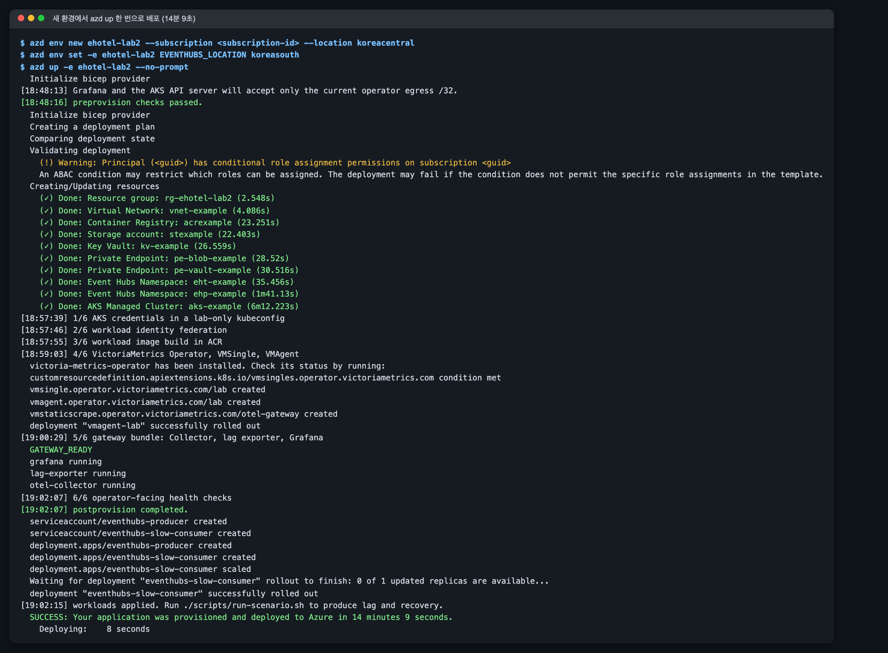
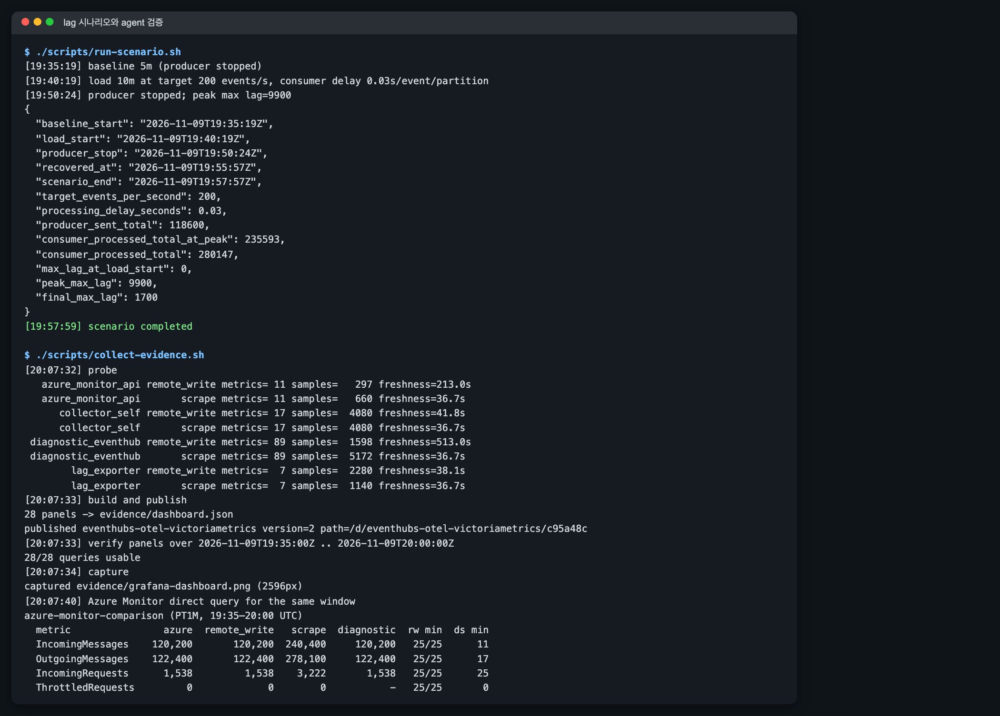
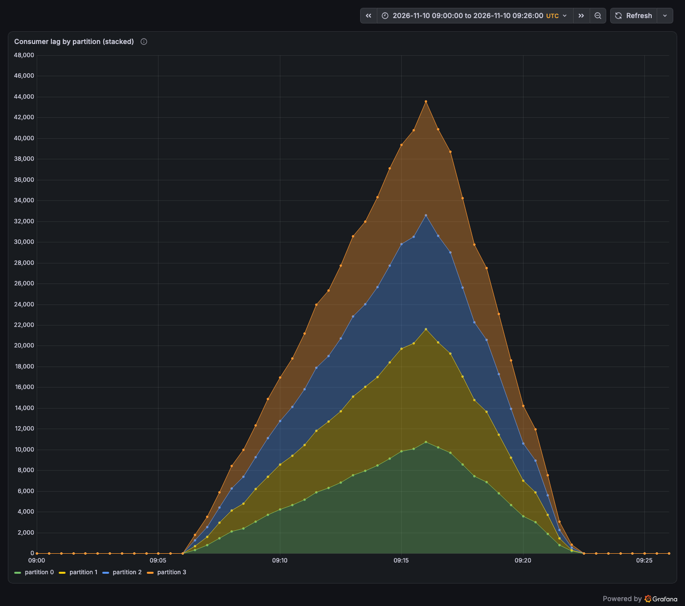
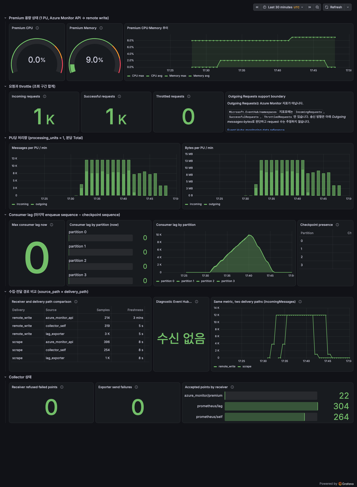
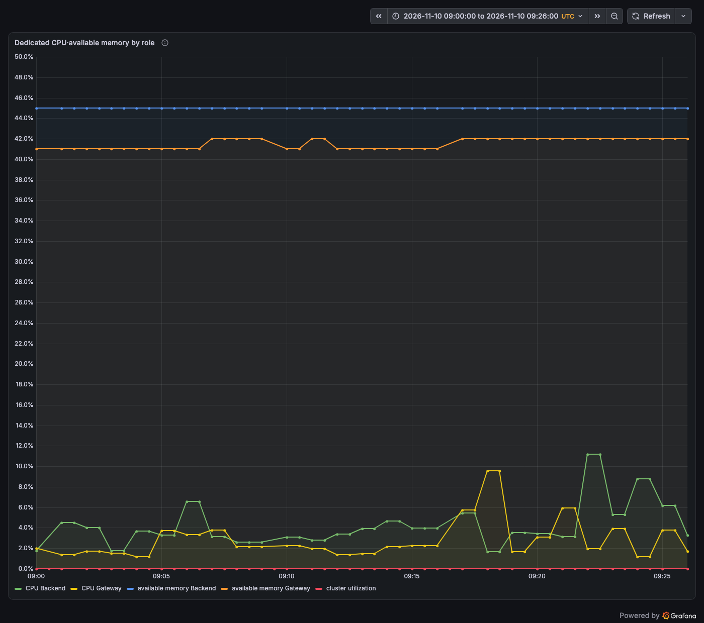
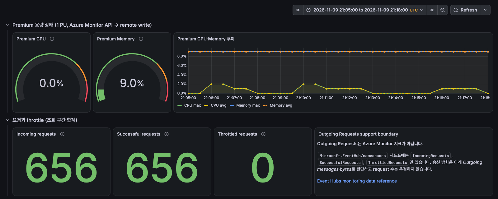
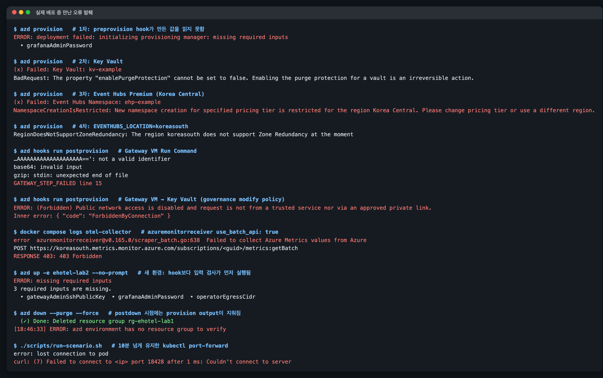
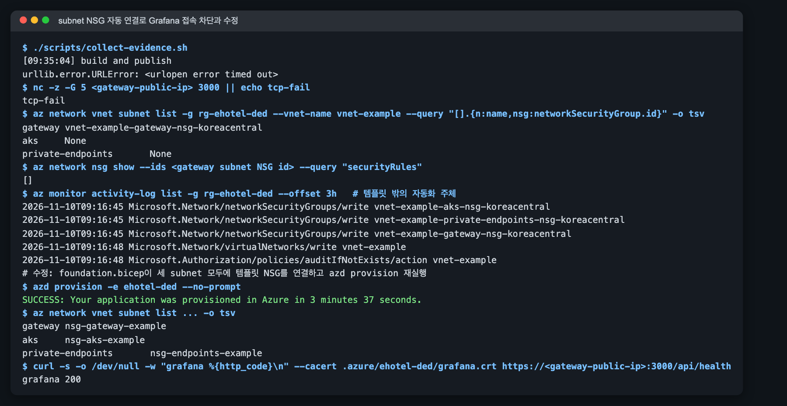
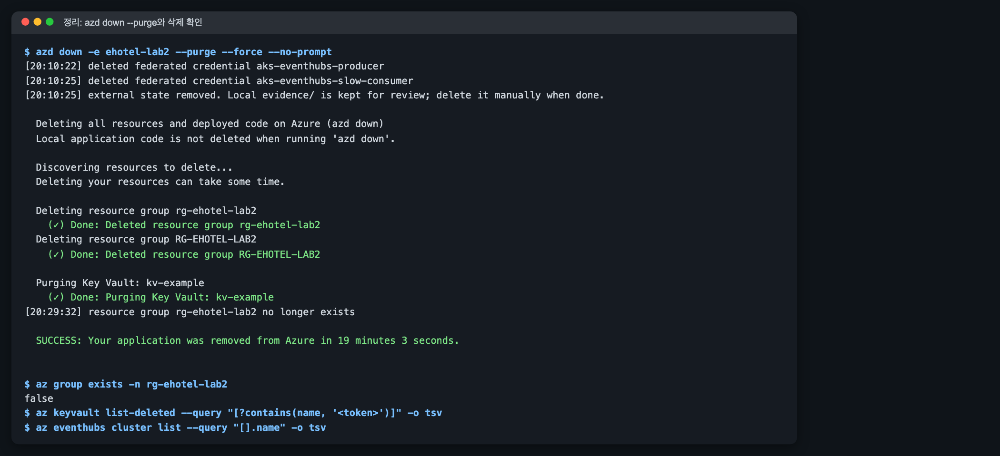

# Event Hubs OpenTelemetry·VictoriaMetrics 관측 실습

이 실습은 [Event Hubs 지표 수집 방식 비교 topic](../index.md)의 구성을
[`eventhubs-otel-victoriametrics-lab`](https://github.com/hellices/devguidesample/tree/main/docs/services/azure-event-hubs/opentelemetry-victoriametrics-monitoring/samples/eventhubs-otel-victoriametrics-lab)
sample로 재현합니다. 아래 결과와 화면은 실제 구독에서 실행한 기록이며, 구독 ID·resource
이름의 고유 suffix·IP는 가상 값으로 바꿨습니다.

기준 실행은 2026-11-10 UTC의 Dedicated 환경(`ehotel-ded`)입니다. Event Hubs Dedicated
cluster(1 CU)와 그 안의 namespace를 `azd up` 한 번으로 배포했고, 시나리오·대시보드·지연·
분 bin 누락 수치는 모두 이 환경 결과입니다. 그 전날 Premium 1 PU 환경 세 개
(`ehotel-lab1`–`ehotel-lab3`)에서 원래 브랜치의 배포 오류를 고치고 재현성, HTTPS 접속,
재배포를 확인했으며, fallback 전환과 VMSingle 보존 확인은 첫 Premium 환경에서
실행했습니다.

## 실습 결과물: 배포·시나리오·대시보드·정리 증거

| 단계 | 명령 | 확인한 결과 |
|---|---|---|
| 배포 | `azd up -e ehotel-ded` | Dedicated cluster 1 CU 포함 provision, hook 6단계, workload 적용까지 13분 34초, exit 0 |
| 재배포 | `azd provision -e ehotel-ded` 2회 | cluster Diagnostic Settings·subnet NSG 추가를 같은 환경에 적용(5분 30초, 3분 37초) |
| 구성 요소 | `kubectl`, VM Run Command | cluster `Dedicated` 1 CU, namespace `clusterArmId` 연결, VMSingle·VMAgent·VMStaticScrape `operational`, Gateway 컨테이너 3개 running |
| lag 시나리오 | `./scripts/run-scenario.sh` | partition별 peak 10,800–10,980건, producer 중지 5분 33초 뒤 회복 |
| agent 검증 | `./scripts/collect-evidence.sh` | 29개 query 모두 통과. Azure Monitor와 API remote write 4개 지표 × 26분 대조, 저장된 분은 모두 일치하고 receiver 누락 2분 보고, Diagnostic Settings 합계 일치 |
| 지연·누락 | 측정용 hub `lat`, 10초 polling | 이벤트 → VictoriaMetrics 190–201초, 83분 동안 지표별 분 bin 누락 0–9개 |
| fallback | `GATEWAY_ONLY=true azd hooks run postprovision` | fallback exporter가 Premium 지표 27개 series를 두 경로로 저장(Premium 첫 환경) |
| 보존 | VMSingle Pod 재생성 | 같은 구간 `IncomingMessages` 합계 120,000 유지(Premium 첫 환경) |
| 정리 | `azd down --purge --force` | Premium 세 환경 resource group 삭제 확인. Dedicated 환경은 cluster 생성 4시간 뒤 정리([정리](#cleanup)) |

## 수집 구조: 4개 source × 2개 전달 경로 { #architecture }

Collector는 receiver 4개를 source로 두고, source마다 scrape용과 remote write용 pipeline
두 개를 만듭니다. 두 pipeline은 같은 receiver instance를 공유하므로 두 전달 경로의 차이가
서로 다른 Azure API 호출의 차이가 되지 않습니다.


```yaml
# gateway/render_collector.py가 만드는 pipeline 일부
metrics/azure_monitor_api-scrape:
  receivers: [azure_monitor/premium]
  processors: [memory_limiter, resource/source_azure_monitor_api, resource/delivery_scrape, batch]
  exporters: [prometheus]
metrics/azure_monitor_api-remote_write:
  receivers: [azure_monitor/premium]
  processors: [memory_limiter, resource/source_azure_monitor_api, resource/delivery_remote_write, batch]
  exporters: [prometheusremotewrite]
```

Dedicated에서는 cluster 지표를 읽는 `azure_monitor/dedicated` receiver가
`source_path="azure_monitor_dedicated"`로 같은 형태의 두 pipeline을 더합니다. namespace
receiver 이름은 `azure_monitor/premium`을 그대로 쓰며, tag로 cluster 안 namespace를 찾습니다.

두 exporter는 `resource_constant_labels.included: [source_path, delivery_path,
azure.resource.id]`로 이 resource attribute만 label로 올립니다. `azure.resource.id`는
Diagnostic Settings 레코드에만 있으며, namespace와 cluster가 같은 telemetry hub로 보내는
같은 이름의 지표(`incomingmessages_total` 등)를 서로 다른 series로 나눕니다. v0.165.0에서
deprecated된 `resource_to_telemetry_conversion` 대신 이 설정을 사용해 불필요한 resource
attribute가 label로 퍼지지 않게 했습니다.

## 사전 조건: 도구·권한·리전

- Azure CLI, Azure Developer CLI, `kubectl`, `kubelogin`, Helm, Python 3.10 이상,
  Node.js 20 이상, OpenSSL, `ssh-keygen`이 필요합니다. 이미지는 `az acr build`로
  만들므로 로컬 Docker는 필요하지 않습니다.
- 로그인한 주체는 구독에 resource group과 역할 할당을 만들 수 있어야 합니다. 템플릿은
  다음 역할을 할당합니다.

| 주체 | 역할 | 범위 |
|---|---|---|
| Gateway VM identity | Monitoring Reader | workload namespace, Dedicated cluster(만든 cluster 또는 `EXISTING_DEDICATED_CLUSTER_RESOURCE_ID`의 기존 cluster) |
| Gateway VM identity | Azure Event Hubs Data Receiver | workload hub, telemetry hub |
| Gateway VM identity | Storage Blob Data Reader / Contributor | `workload-checkpoints` / `collector-checkpoints` container |
| Gateway VM identity | Key Vault Secrets User, AcrPull | Key Vault, ACR |
| producer / consumer identity | Azure Event Hubs Data Sender / Receiver | workload hub |
| consumer identity | Storage Blob Data Contributor | `workload-checkpoints` container |
| AKS cluster identity | Network Contributor | AKS subnet (internal load balancer 고정 IP) |
| 배포자 | Azure Kubernetes Service RBAC Cluster Admin | AKS cluster |

AKS internal load balancer에 대해 Learn은 VNet 범위 Network Contributor 또는 subnet
`join`·`read` 권한을 요구합니다. 이 실습은 Network Contributor를 AKS subnet 범위로만
할당했고 고정 IP의 internal load balancer가 정상 생성됐습니다.

이후 명령은 모두 sample 디렉터리에서 실행합니다. `azd`는 이 디렉터리의 `azure.yaml`을
읽고, `./scripts/...` 경로도 이 디렉터리를 기준으로 합니다.

```bash
git clone https://github.com/hellices/devguidesample.git
cd devguidesample/docs/services/azure-event-hubs/opentelemetry-victoriametrics-monitoring/samples/eventhubs-otel-victoriametrics-lab
```

## 비용·리전: Dedicated 4시간 최소 과금과 `EVENTHUBS_LOCATION` { #cost }

Event Hubs Dedicated cluster(1 CU), AKS(Standard_D4as_v5 노드 1개), Gateway VM
(Standard_D2as_v5), Standard namespace, private endpoint 2개, Public IP 비용이 발생합니다.
Dedicated cluster는 CU 단위로 과금되며 만든 뒤 최소 4시간 동안 삭제할 수 없고 그만큼
과금되므로, 시나리오와 측정을 이 4시간 안에 마치고 바로 정리합니다. 비용을 줄이려면
`azd env set EVENTHUBS_SKU Premium`으로 cluster 대신 Premium 1 PU namespace를 만듭니다.

기본 리전은 Korea Central이고, Event Hubs만 `EVENTHUBS_LOCATION`으로 다른 리전에 둘 수
있습니다. 이 실습은 Event Hubs를 Korea South에 두었습니다. 구독에서 cluster를 만들 수
있는 리전은 `az eventhubs cluster available-region`으로 확인합니다. Premium으로 배포할
때는 이 구독의 Korea Central, Japan East, Southeast Asia에서 Premium namespace 신규
생성이 `NamespaceCreationIsRestricted`로 거부되고 Korea South에서는 성공했습니다.

```bash
azd env new ehotel-ded --subscription <subscription-id> --location koreacentral
azd env set EVENTHUBS_LOCATION koreasouth
# azd env set EVENTHUBS_SKU Premium   # cluster 대신 Premium 1 PU
```

`EVENTHUBS_LOCATION`은 cluster와 workload namespace, telemetry Standard namespace를 함께
옮깁니다.
Diagnostic Settings의 sink Event Hub는 원본 리소스와 같은 리전이어야 하기 때문입니다.
Korea South에는 availability zone이 없으므로 템플릿은 `zoneRedundant`를 지정하지
않습니다. availability zone이 있는 리전에서는 새 namespace에 zone redundancy가 자동으로
적용됩니다. zone-redundant Dedicated cluster는 3 CU 이상이 필요하고 ARM template로는 만들
수 없어 지원 요청이 필요하므로, 이 실습의 1 CU cluster는 zone redundancy 없이 만듭니다.

## 배포: `azd up` 단계와 실행 결과

`azd up`은 provision과 deploy를 이어서 실행합니다. azure.yaml에 `services`가 없으므로
deploy 단계는 `postdeploy` hook만 실행합니다.

| hook | 하는 일 |
|---|---|
| `preprovision` | 활성 구독 확인, provider 등록 확인, operator egress `/32`, 배포자 object ID, Grafana 비밀번호와 VM용 SSH 공개키 생성 |
| provision | VNet(gateway·aks·private-endpoints subnet과 subnet별 NSG), ACR, private endpoint 뒤의 Storage·Key Vault, Dedicated cluster와 그 안의 workload namespace, telemetry namespace, namespace·cluster Diagnostic Settings, AKS, Gateway VM, 역할 할당 |
| `postprovision` | ① lab 전용 kubeconfig ② producer·consumer federated credential ③ ACR build와 digest 고정 ④ VictoriaMetrics Operator·VMSingle·VMAgent·VMStaticScrape ⑤ Run Command로 Gateway 번들 적용과 Grafana TLS 인증서 생성, 공개 인증서 회수 ⑥ 고정한 인증서로 operator 경로 Grafana HTTPS health |
| `postdeploy` | Workload Identity service account와 producer(0 replica)·slow consumer(1 replica) |



화면은 Dedicated 기본값으로 새 환경 `-e ehotel-ded`에 `azd up` 한 번으로 배포한
결과입니다. azd 진행 화면은 cluster를 따로 표시하지 않지만, cluster는 08:10:00에
`Active`로 만들어졌고 22초 뒤 workload namespace가 그 cluster 안에 만들어졌습니다. Gateway
VM에는 inbound SSH를 열지 않으며, 설정 파일과 Compose 번들은 VM Run Command로
전달합니다.

## 구성 요소 상태: VictoriaMetrics·workload·Gateway

배포 직후 각 계층이 실제로 동작하는지 확인합니다.

```bash
az resource list -g <resource-group> --query "[?contains(type,'EventHub')]" -o table
az eventhubs namespace show -g <resource-group> -n <workload-namespace> --query "{sku:sku.name,cluster:clusterArmId}"
export KUBECONFIG=.azure/<env-name>/kubeconfig
kubectl get vmsingle,vmagent,vmstaticscrape -n eventhubs-observability
kubectl get pods -n eventhubs-observability
az vm run-command invoke -g <resource-group> -n <gateway-vm> --command-id RunShellScript \
  --scripts "cd /opt/eventhubs-observability && docker compose ps"
curl -s --cacert .azure/<env-name>/grafana.crt https://<gateway-public-ip>:3000/api/health
```


템플릿은 workload namespace의 `clusterArmId`(Cluster ARM ID of the Namespace)에 cluster
ID를 지정합니다. 이렇게 만든 namespace는 ARM에서 sku가 `Standard`로 표시되므로, 템플릿도
cluster 안 namespace에는 `Standard` sku를 지정하며 `Microsoft.EventHub` 2024-01-01 API로
배포에 성공했습니다.

## lag 상승·회복 시나리오 { #lag }

`run-scenario.sh`는 baseline 5분, 부하 10분, 회복 대기를 실행하고 UTC 경계를
`evidence/<env>/scenario.json`에 기록합니다. producer는 1 KiB event를 초당 200개 보내고,
slow consumer는 partition마다 event당 30 ms를 쉬며 20 event마다 checkpoint합니다.
최대 lag가 정점의 20% 이하로 내려가지 않으면 실패로 끝납니다.

```bash
./scripts/run-scenario.sh
./scripts/collect-evidence.sh
```



lag exporter는 partition의 마지막 enqueue sequence에서 consumer가 마지막으로 저장한
checkpoint sequence를 뺀 값을 15초마다 계산합니다. Event Hubs는 checkpoint를 consumer
group과 partition 단위로 저장하므로 같은 consumer group의 Blob checkpoint만 읽고,
checkpoint가 없는 partition은 lag 값을 만들지 않고 존재 여부만 표시합니다.



| 단계 | UTC | 관측 |
|---|---|---|
| baseline | 09:00:43 | producer 중지, 모든 partition lag 0 |
| 부하 | 09:05:43–09:15:52 | producer 목표 200 events/s, 1 KiB. Azure Monitor 기준 수신 12,000 msg/min, 처리 7,200–8,100 msg/min |
| lag 정점 | 09:16:00 | partition별 최대 10,800–10,980건, 합계 43,560건. 이 실행의 스크립트는 부하 끝에 한 번 읽어 최대 lag 10,280을 기록 |
| 회복 | 09:21:25 | 최대 lag가 정점의 20% 이하로 감소(producer 중지 후 5분 33초), 09:22:15에 0 |

Azure Monitor `IncomingMessages`는 09:00–09:26에 118,200건이었습니다. lag 해상도는
consumer의 checkpoint 주기(20 event)와 exporter 조회 주기(15초)에 묶이며, checkpoint blob
수정 시각을 시간 단위 lag로 해석하지 않습니다. lag exporter는 실제 시각으로 기록되지만
Azure Monitor의 `IncomingMessages` 분 bin은 09:07–09:17에 값이 나타나 producer 실제 구간보다
약 1분 늦은 timestamp로 기록됐습니다([지연 측정](#latency)에서 같은 현상을 확인).

producer 로그의 `sent_total`(116,400)은 10초 간격 로그의 마지막 값이므로 전송량은
Azure Monitor `IncomingMessages`를 기준으로 봅니다. 같은 Dedicated 환경의 첫 시나리오
(08:21–08:44)도 최대 lag 10,320건, 회복 5분 32초로 비슷했고, 이전 Premium 1 PU 환경에서도
partition별 peak 10,700–11,040건, 회복 5분 33초–6분이었습니다. 이 부하에서는 lag가 consumer
처리 속도로 정해지므로 tier에 따른 차이가 거의 없습니다. 리뷰 뒤 `peak_max_lag`를 부하 구간
최댓값(`max_over_time`)으로 읽도록 고친 스크립트로 같은 환경에서 다시 실행(10:28–10:51)했을 때는
`peak_max_lag` 11,120, producer 중지 5분 52초 뒤 회복이었습니다.

시나리오는 10분 넘게 VMSingle을 조회하므로 `kubectl port-forward`가 `lost connection
to pod`로 끊길 수 있습니다. `vm-query.sh start`는 `/health` 응답이 없으면 port-forward를
다시 열고, `run-scenario.sh`는 조회할 때마다 이를 호출합니다.

## agent 대시보드 workflow와 Azure Monitor 대조

`collect-evidence.sh`는 시나리오 구간을 분 경계에 맞춘 절대 시간으로 다음을 실행합니다.

1. `agent/probe.py`: VictoriaMetrics의 metric inventory를 `evidence/<env>/probe.json`에 기록
2. `agent/build_dashboard.py`와 `publish_dashboard.py`: probe 결과로 대시보드를 만들어
   Grafana API로 게시
3. `agent/verify_panels.py`: 모든 panel query를 `/api/ds/query`로 실행하고 오류·0행·
   NaN이 있는 필수 panel이 있으면 exit 1
4. `agent/capture.mjs`: Playwright로 로그인해 kiosk 모드 전체 화면을 캡처
5. 같은 구간의 Azure Monitor PT1M 값을 `az monitor metrics list`로 조회하고
   `agent/compare_azure_monitor.py`가 remote write sample과 분 단위로 비교. 요청한 4개
   지표의 `[from, to)` 모든 분이 Azure Monitor에 있고 remote write에 저장된 분이 모두 같은
   값이어야 완료로 판정합니다. remote write에 없는 분은 그 뒤 5분 안에 저장된 bin이 있으면
   receiver가 놓친 [분 bin 누락](#gaps)으로 보고하고, 뒤 bin도 없으면 아직 도착하지 않은
   것으로 보고 실패

agent는 대시보드를 만들기 전에 실제 저장된 metric을 조회하고, 만든 뒤에는 query와
화면을 모두 확인합니다.

- **probe**: metric 이름, label key, `source_path × delivery_path` 조합별 series·sample
  수와 freshness를 조회합니다. 식별자가 담긴 label 값은 저장하지 않습니다.
- **build**: 질문 → 지표 → MetricsQL → 시각화 표에 따라 panel을 만듭니다. 합계는 stat,
  정상 범위는 gauge, 비교는 table·bar gauge, 추이만 time series로 씁니다. `EVENTHUBS_SKU`가
  Dedicated이면 용량 행을 cluster `CPU`·`AvailableMemory`·`ClusterUtilization`으로 만들고
  처리량을 CU당 값으로 나누며, API와 Diagnostic Settings 비교도 cluster CPU로 그립니다.
- **verify**: `Exporter send failures`가 0행이어서, 첫 실패 때 생기는 counter의 특성을
  반영하도록 고쳤습니다. Dedicated 실행에서 29개 query가 모두 통과했습니다.
- **look**: 첫 캡처에서는 time series의 모든 선이 같은 색이고, 과거 구간의 "now" lag가 0으로
  보이며, checkpoint 표의 partition 열까지 경고색이 칠해져 있었습니다. series별 palette,
  구간 peak lag, 공통 눈금 bar gauge, 열 단위 색상, 겹치는 비교 선의 점선 구분으로 고쳤습니다.



같은 26분 구간의 Azure Monitor 직접 조회와 비교한 결과입니다.

| 지표 | Azure Monitor | API → remote write | API → scrape | Diagnostic Settings → remote write |
|---|---:|---:|---:|---:|
| `IncomingMessages` | 118,200 | 118,200 (26/26분 일치) | 236,400 | 118,200 (값이 있는 11분) |
| `OutgoingMessages` | 118,200 | 118,200 (26/26분 일치) | 233,600 | 118,200 (값이 있는 17분) |
| `IncomingRequests` | 1,528 | 1,528 (26/26분 일치) | 3,050 | 1,528 (26분) |
| `ThrottledRequests` | 0 | 0 (24/26분, 09:08·09:25 누락) | 0 | 없음 |

scrape 합계가 두 배 안팎인 이유와 대시보드 규칙은 [topic의 전달 경로](../index.md#delivery)에
정리했습니다. source·delivery별 분당 sample 수는 다음과 같았습니다.

| source | remote write | scrape |
|---|---|---|
| Metrics API namespace 지표 | 0.99 | 2.00 (30초 scrape) |
| Metrics API cluster 지표 | 0.89 (분 bin 누락 반영) | 2.00 |
| lag exporter | 4.00 (Collector 15초 수집) | 2.00 |
| Diagnostic Settings | 0.77 (값이 있는 분만) | 1.50 |



분당 12,000건을 받는 동안 cluster `CPU`의 Role 최댓값은 2–11%였고, 정점은 부하 중이 아니라
consumer가 밀린 이벤트를 따라잡던 09:18–09:24에 나왔습니다. `AvailableMemory`는 부하와
상관없이 Backend 45%, Gateway 41–42%였고, preview 지표 `ClusterUtilization`은 내내 0이었습니다.

다음 두 항목은 이전 Premium 환경에서 찾아 고친 대시보드 문제입니다. 캡처 당시 대시보드의
Incoming requests stat은 1,533으로 Azure Monitor의 1,538과 달랐습니다. Azure
Monitor 표본은 분 bin 시작 시각을 timestamp로 쓰는데, stat이 Grafana 구간 끝에서
`[$__range]`로 조회해 `(from, to]` 창이 되었고 첫 분 bin이 빠지고 끝 bin이 들어갔습니다.
`offset 1s`로 `[from, to)` 창에 맞췄고, 로컬 VictoriaMetrics v1.155.0에 같은 형태의 표본을
넣어 두 식의 결과가 각각 `(from, to]`와 `[from, to)` 합계와 같음을 확인했습니다. 수정 후 세
번째 환경(21:05–21:18 UTC)에서는 stat이 656건으로 Azure Monitor 656건과 같았습니다. 캡처의
DS Event Hub series stat(178)도 두 전달 경로의 복제본을 함께 센 값이어서 remote write 경로
하나만 세도록 고쳤습니다.



Premium 첫 환경에서는 Diagnostic Settings를 만든 뒤 약 55분 동안, 세 번째 환경에서는 약
45분 동안 telemetry Event Hub 수신이 0건이었고, 두 번째 환경에서는 약 20분 안에
도착했습니다. Dedicated 환경에서는 namespace 설정 후 약 15분, cluster 설정 후 약 13분 안에
도착했습니다. Premium의 두 환경 모두 관리 그룹 정책으로
telemetry namespace의 local 인증이 꺼져 있었으므로 이것이 원인은 아닙니다. Learn은
diagnostic setting을 만든 뒤 데이터가 흐르기까지 최대 90분이 걸릴 수 있다고
설명하며, 네 환경의 관측은 모두 이 범위 안입니다. Diagnostic Settings 경로를 비교하려면
배포 직후가 아니라 설정 후 충분한 시간이 지난 뒤 시나리오를 실행합니다. 대시보드는 이
경로를 선택 panel로 두어, 데이터가 없을 때도 다른 검증은 계속 진행합니다.

## Metrics API 수집 설정: 지표 목록·dimension·권한 { #receiver-settings }

`azure_monitor/premium` receiver는 workload namespace에서 대시보드에 필요한 9개
지표(`NamespaceCpuUsage`, `NamespaceMemoryUsage`, `IncomingRequests`, `SuccessfulRequests`,
`ThrottledRequests`, `IncomingMessages`, `OutgoingMessages`, `IncomingBytes`,
`OutgoingBytes`)만 수집합니다. cluster 안 namespace에는 앞의 두 지표가 없으며, receiver는
지표 정의에 있는 7개만 조회했습니다. `azure_monitor/dedicated` receiver는 cluster에서 `CPU`·
`AvailableMemory`(Maximum, `Role`), `ClusterUtilization`(Average), `IncomingMessages`·
`OutgoingMessages`·`IncomingBytes`·`OutgoingBytes`(Total)를 수집합니다. 다른 지표는
`metrics` 목록에 더하면 같은 경로로 수집됩니다.

- **0값과 데이터 없음.** `ThrottledRequests`를 기본값대로 `EntityName`·`OperationResult`로
  분할 조회하면 throttle이 없는 동안 time series 자체가 오지 않았습니다.
  `dimensions.overrides`로 이 지표만 분할하지 않게 하자 명시적인 0이 저장됐고, 대시보드는
  "throttle 없음"과 "데이터 없음"을 구분합니다.
- **권한 범위.** namespace·cluster 범위 `Monitoring Reader`만으로 리소스 목록 조회와 ARM
  metrics API는 동작했지만, `use_batch_api: true`의 `metrics:getBatch` 호출은 403이었습니다. Learn은
  batch API에 조회 대상 구독의 Monitoring Reader가 필요하다고 설명합니다. namespace 하나만
  수집하므로 batch API를 끄고 최소 권한을 유지했습니다.
- **조회 창.** v0.165.0 receiver는 `collection_interval`(60초)마다 `timespan`과 `interval`을
  time grain과 같은 `PT1M`으로 지정해 조회하고, 이미 내보낸 timestamp보다 새 bin만
  내보냅니다(`scraper.go`). [지연 측정](#latency)에서 VictoriaMetrics에 저장된 값은 모두
  Azure Monitor의 최종값과 같았습니다.

### 분 bin 누락 { #gaps }

같은 조회 방식 때문에 receiver가 한 번 놓친 분 bin은 다시 채워지지 않습니다. 같은
매개변수(`timespan=PT1M`, `interval=PT1M`)로 Metrics API를 직접 호출하면 매번 1–2분 전에
끝난 분 bin 하나만 돌아왔습니다(09:42:10 호출 → 09:40 bin). 그 조회 시점에 Azure Monitor에
아직 값이 없던 bin은 다음 조회 창에서 벗어나고, receiver는 이미 지난 timestamp를 내보내지
않습니다.

08:21–09:44 UTC 83분 동안 Azure Monitor의 분 bin과 remote write에 저장된 bin을 지표별로
비교했습니다. Gateway를 다시 배포한 09:00 전후 bin은 제외했고, dimension 분할로 0값이
series로 오지 않는 `IncomingMessages`·`OutgoingMessages`는 값이 있는 bin만 셌습니다.

| 리소스 | 지표 | Azure Monitor bin | 누락 |
|---|---|---:|---|
| namespace | `IncomingMessages`, `OutgoingMessages` | 23, 34 | 0 |
| namespace | `IncomingRequests`, `SuccessfulRequests` | 각 83 | 각 1 (09:31) |
| namespace | `ThrottledRequests`(분할 없이 별도 조회) | 83 | 4 (09:08, 09:25, 09:31, 09:37) |
| cluster | `CPU`, `AvailableMemory`(Backend) | 각 82 | 각 5 (09:09, 09:16, 09:31, 09:35, 09:37) |
| cluster | `ClusterUtilization` | 82 | 9 |
| cluster | `IncomingMessages` | 26 | 1 (09:16) |

- **gauge는 영향이 작습니다.** 대시보드의 CPU·memory gauge는 최근 10분 안의 마지막 값을
  보므로 한두 분이 비어도 값이 남습니다.
- **합계는 작게 나올 수 있습니다.** 값이 있는 분이 빠지면 구간 합계가 그만큼 줄어듭니다. 시나리오
  26분의 `IncomingMessages`·`OutgoingMessages`·`IncomingRequests`는 누락이 없었지만, 정확한
  합계는 Azure Monitor 직접 조회나 Diagnostic Settings 경로로 확인합니다. Diagnostic Settings
  경로는 cluster CPU의 Metrics API 경로가 비어 있던 09:09·09:16에도 값을 받았습니다.
- **evidence는 누락을 숨기지 않습니다.** `collect-evidence.sh`는 누락한 분을
  `remote_write_gaps`에 남기고 경고를 출력합니다.

## 지연 측정: Azure Monitor + OpenTelemetry Collector { #latency }

Dedicated 환경에서는 배포한 Gateway의 Collector와 AKS의 VMSingle을 그대로 거치는 경로를
2026-11-10 08:24–08:51 UTC에 측정했습니다. workload namespace에 측정용 hub `lat`(partition
1개)를 따로 만들고 측정자에게 그 namespace의 Azure Event Hubs Data Sender 역할을 준 뒤,
시나리오 트래픽과 섞이지 않도록 `EntityName eq 'lat'`로 걸러 비교했습니다. VMSingle은
`kubectl port-forward`로 조회했습니다.

그 전에 Premium 1 PU와 Standard 1 TU namespace(Korea South)를 따로 만들고, 로컬에서 실행한
otelcol-contrib 0.165.0과 VictoriaMetrics v1.155.0으로 같은 측정을 07:03–07:38 UTC에
했습니다. 로컬 Collector 설정은 이 sample의 `azure_monitor/premium`과 같고
(`collection_interval: 60s`, `initial_delay: 5s`, `use_batch_api: false`, dimension 분할,
`batch` 5초, remote write queue), 인증만 Managed Identity 대신 `azure_auth`의
`use_default: true`(Azure CLI 로그인)를 썼습니다.

1. 매 분 5초에 그 분마다 다른 개수(100, 110, 120, …)의 이벤트를 보내고 전송 완료 시각을
   기록합니다.
2. 10초마다 Azure Monitor Metrics API(`IncomingMessages`, `PT1M`, `Total`)와 VictoriaMetrics
   `/api/v1/export`를 조회해 각 bin 값을 기록합니다.
3. 두 저장소의 bin 합계가 누적 전송 수에 처음 도달한 시각에서 전송 시각을 빼 지연으로 봅니다.
   bin timestamp가 이벤트 시각과 어긋나도 합계로 비교하므로 영향을 받지 않습니다.

| 항목 | Dedicated 1 CU (배포한 Gateway) | Premium 1 PU (로컬) | Standard 1 TU (로컬) |
|---|---|---|---|
| 전송 | 15분, 2,550건 | 15분, 2,550건 | 20분, 3,900건 |
| 이벤트 → Metrics API 조회 가능 | 71–101초 (중앙값 81) | 72–102초 (중앙값 92) | 81–151초 (중앙값 115) |
| Metrics API → VictoriaMetrics | 100–130초 (14회) | 130–160초 (중앙값 140) | 120–150초 (중앙값 130) |
| 이벤트 → VictoriaMetrics 저장 | 190–201초 (14회, 중앙값 201) | 230–232초 (중앙값 232) | 221–281초 (중앙값 250) |
| VictoriaMetrics 도착 시점의 bin 경과 시간 | 146초(일부 206초) | 177초 | 166초 |
| 저장 값 | 15개 bin 모두 Azure Monitor 최종값과 같음, 합계 2,550 | 15개 bin 모두 같음, 합계 2,550 | 10개 bin 모두 같음, 합계 3,900 |
| bin timestamp | 이벤트를 보낸 분보다 1분 뒤(08:25:05 전송 → 08:26 bin) | 1분 뒤(07:15:05 전송 → 07:16 bin) | 2분 단위(07:03:05·07:04:05 전송 → 07:05 bin) |

Dedicated 측정 중 08:28:05–08:29:15에 port-forward가 끊겨 VMSingle 조회가 70초 비었습니다.
08:25:05 전송분은 공백 직후 조회에서 처음 보여 261초로 잡혔으므로 VictoriaMetrics 관련 값에서
뺐습니다. 나머지 14회 중 13회는 201초였고, 10초 늦게(08:24:15) 보낸 첫 회만 190초였습니다.
Metrics API 지연은 71–101초로 달랐지만 VictoriaMetrics 도착은 매분 26초 무렵으로 같아,
전체 지연은 Azure Monitor가 아니라 Collector 조회 주기의 위상으로 정해졌습니다. 같은 Dedicated 환경의 cluster `CPU` bin도 VictoriaMetrics 도착 시점 경과 시간이
146–206초로 namespace 지표와 같았습니다.

bin이 1분 뒤 timestamp로 기록되는 현상은 [lag 시나리오](#lag)에서 Azure Monitor 값이
producer 실제 구간보다 늦게 나타난 것과 같습니다. 시나리오 뒤 probe에서 Metrics API remote
write의 마지막 sample 경과 시간은 157–158초로, 도착 시점 bin 경과 시간(146초)과 다음 조회까지의
대기를 더한 범위입니다. Premium·Standard는 로컬 실행이라 Gateway VM의 네트워크 경로와 차이가
있을 수 있고, 10초 간격 조회라 모든 측정값에는 ±10초 오차가 있습니다.

## fallback exporter 전환

`azuremonitorreceiver`가 실패하는 환경을 대비해 `webdevops/azure-metrics-exporter`
26.10.0을 Compose `fallback` profile로 둡니다. 18:16–18:20 UTC에 API receiver를 끄고
fallback으로 전환했습니다(2026-11-09 Premium 첫 환경).

```bash
ENABLE_API_RECEIVER=false ENABLE_FALLBACK_EXPORTER=true GATEWAY_ONLY=true azd hooks run postprovision
# 2–3분 뒤
./scripts/vm-query.sh start
curl -s "http://127.0.0.1:$(./scripts/vm-query.sh port)/api/v1/query" \
  --data-urlencode 'query=count by (delivery_path) (azurerm_resource_metric{source_path="fallback_exporter"})'
GATEWAY_ONLY=true azd hooks run postprovision   # 기본 receiver로 복구
```

`./scripts/vm-query.sh start`는 azd 환경마다 다른 로컬 포트(18428–18927, `VM_LOCAL_PORT`로
지정 가능)로 VMSingle을 연결하고, `port`는 그 번호를 출력합니다. fallback
exporter는 같은 Managed Identity로 Premium namespace 지표 9개 × 집계 3개, 27개
series를 scrape와 remote write 양쪽에 저장했습니다. ARM `$filter`는 tag 조건을
함께 쓸 수 없어 같은 resource group의 telemetry namespace까지 조회되므로, Collector의
`metric_relabel_configs`로 Premium namespace만 남깁니다. fallback series는 이름과
label 형태(`azurerm_resource_metric{metric,aggregation}`)가 달라 대시보드 query를
그대로 쓰지 않습니다.

## VMSingle 재시작과 데이터 보존 { #retention }

VMSingle은 10 GiB `managed-csi-premium` PVC와 7일 보존으로 실행합니다. Premium 첫 환경에서
Pod를 지우고 다시 조회했을 때 17:46–18:12 구간 `IncomingMessages` 합계는 120,000으로
같았습니다.

`kubectl delete pod`는 이전 Pod가 끝나기 전에 새 Pod를 띄우므로, 같은 노드에서 이전
프로세스가 `flock.lock`을 놓을 때까지 새 Pod가 `cannot acquire lock on file`로 세 번
재시작한 뒤 정상화됐습니다. 데이터에는 영향이 없었습니다.

## Premium PU와 Dedicated CU 수집 profile { #sku }

Premium과 Dedicated는 수집 구조가 같아도 용량 지표가 있는 리소스와 의미가 다릅니다.
`EVENTHUBS_SKU`가 `Dedicated`(기본값)이면 템플릿이 1 CU cluster와 그 안의 namespace를
만들고, Collector는 namespace 지표와 cluster 지표를 따로 수집합니다. `Premium`이면 1 PU
namespace를 만들며, 이때 `EXISTING_DEDICATED_CLUSTER_RESOURCE_ID`로 기존 cluster를 함께 수집할
수 있습니다. 이 경우 템플릿이 그 cluster에 Gateway identity의 Monitoring Reader를 할당합니다.

| 항목 | Premium namespace | Dedicated cluster |
|---|---|---|
| 용량 단위 | PU(Processing Unit) | CU(Capacity Unit) |
| CPU | namespace의 `NamespaceCpuUsage`, `Replica` | cluster의 `CPU`, `Role`(Backend·Gateway), Maximum |
| memory | namespace의 `NamespaceMemoryUsage`(사용률) | cluster의 `AvailableMemory`(가용률, 낮을수록 위험) |
| 종합 사용률 | 없음 | `ClusterUtilization`(preview, 실측 0) |
| namespace 지표 | 38개 | cluster 안 namespace는 CPU·memory가 빠진 36개 |
| 삭제·과금 | 즉시 삭제 가능 | 생성 후 4시간 동안 삭제 불가, 최소 4시간 과금 |
| 이 실습 | 2026-11-09 1 PU 세 환경에서 runtime 검증 | 2026-11-10 1 CU에서 runtime 검증 |

대시보드는 처리량을 `$pu` 변수로 나눠 PU 또는 CU당 값으로 보여 주며, Dedicated에서는 가용
메모리 gauge의 threshold 방향을 반대로 둡니다. Learn은 Dedicated cluster의 `CPU`를 Max
aggregation과 `Role` 필터로 보고 70%에 가까워지면 확장을 검토하라고 안내하므로, CPU gauge도
70%·85%에서 색이 바뀝니다.

## 배포 중 오류와 수정 { #errors }

원래 브랜치의 구성으로 실제 구독에 배포하며 만난 오류입니다. 모두 sample에 반영했고,
같은 실수를 막는 계약 테스트를 `tests/`에 추가했습니다.



| 증상 | 원인 | 수정 |
|---|---|---|
| `missing required inputs: grafanaAdminPassword` | hook helper가 `azd env get-value`의 "key not found" 문구(stdout)를 값으로 오인해 비밀번호를 만들지 않음 | 종료 코드로 값 존재를 판정 |
| `enablePurgeProtection cannot be set to false` | Key Vault는 purge protection 속성에 `false`를 받지 않음 | 속성을 생략 |
| `NamespaceCreationIsRestricted` | 구독·리전별 Premium 신규 생성 제한 | `eventHubsLocation` 매개변수와 `EVENTHUBS_LOCATION` |
| `RegionDoesNotSupportZoneRedundancy` | Korea South에 availability zone 없음 | `zoneRedundant` 생략, AZ 리전은 자동 적용 |
| `not a valid identifier`, `base64: invalid input` | Run Command가 이름 없는 매개변수를 `=`에서 나눠 base64 padding이 깨짐. macOS bsdtar의 `-z` 출력은 블록 크기까지 0으로 채워짐 | `BUNDLE_B64=<값>` 이름 지정, `tar | gzip`으로 압축 |
| Key Vault `ForbiddenByConnection` | 관리 그룹 `modify` 정책이 Key Vault·Storage public network access를 끔 | Key Vault·Blob private endpoint와 private DNS zone, public access 명시적 비활성화 |
| `metrics:getBatch` 403 | batch API는 조회 대상 구독의 Monitoring Reader 필요 | ARM metrics API 사용(`use_batch_api: false`), namespace 범위 권한 유지 |
| `ThrottledRequests` series 없음 | dimension 분할 조회에서 throttle이 없으면 time series가 오지 않음 | 이 지표만 `dimensions.overrides`로 분할 해제 |
| 대시보드 쿼리 전체 0행 | 시나리오 UTC 문자열을 naive datetime으로 변환해 로컬 시간대(+9h)로 해석 | `timezone.utc` 지정 |
| 새 환경 `azd up`이 3초 만에 `missing required inputs` | `azd up`은 preprovision hook보다 먼저 필수 Bicep 입력을 검사함. 매개변수 파일의 `${VAR=}` 빈 기본값도 누락으로 판단 | hook이 채우는 세 매개변수에 Bicep 기본값 `''` 지정. 이 기본값과 `@minLength`는 함께 쓸 수 없고(BCP333) ARM preflight도 빈 값을 통과시키므로, preprovision hook이 빈 CIDR·비밀번호·SSH 키를 쓰기 전에 실패 |
| `azd up -e <env>`의 hook 값이 기본 환경에 기록될 위험 | hook 안의 `azd env set`이 `-e` 없이 기본 환경을 사용 | `azd_env` helper로 `AZURE_ENV_NAME`을 항상 지정 |
| `postdown`의 `no resource group to verify` | `azd down`이 hook 실행 전에 provision output을 지움 | `predown`이 대상 resource group을 기록하고 `postdown`이 읽음 |
| 시나리오 중 `curl: (7) Failed to connect … 18428` | 장시간 `kubectl port-forward`의 `lost connection to pod` | `/health`가 실패하면 port-forward를 다시 열고 조회마다 확인 |

Dedicated 기본값으로 바꾼 뒤 실제 배포에서 만난 문제입니다.



| 증상 | 원인 | 수정 |
|---|---|---|
| 배포 1시간 뒤 Grafana 게시가 `urlopen error timed out` | 템플릿 밖의 자동화 주체가 NSG 없는 subnet 세 개에 규칙 없는 NSG를 만들어 연결함. inbound는 subnet NSG를 먼저 평가하고 subnet·NIC NSG가 모두 허용해야 통과하므로 subnet NSG의 기본 `DenyAllInbound`가 3000을 막음 | foundation이 gateway·aks·private-endpoints subnet에 템플릿 NSG를 직접 연결. gateway subnet NSG는 NIC와 같은 operator `/32`만 3000 허용, 나머지 둘은 기본 규칙만 사용. `azd provision` 재실행 후 `grafana 200` |
| cluster Diagnostic Settings를 켜자 namespace와 cluster 레코드가 같은 series로 섞임 | Diagnostic Settings 레코드의 리소스는 `azure.resource.id` resource attribute에만 있는데 exporter가 이 attribute를 label로 올리지 않음 | `azure.resource.id`를 두 exporter의 label에 포함하고, 대시보드와 Azure Monitor 대조는 `azure_resource_id`로 namespace·cluster 레코드를 나눔 |
| cluster 안 namespace의 CPU·memory panel이 빈 값 | cluster 안 namespace에는 `NamespaceCpuUsage`·`NamespaceMemoryUsage`가 없음(Metrics API `Failed to find metric configuration`) | `EVENTHUBS_SKU`로 대시보드 tier를 정해 Dedicated에서는 cluster `CPU`·`AvailableMemory` 행과 CU당 처리량을 만듦 |
| `metadata_Role`로 만든 Role별 그래프가 빈 값 | cluster 지표의 dimension label은 `metadata_role`(소문자)로 저장됨. namespace의 `metadata_EntityName`과 표기가 다름 | 실제 probe 결과대로 `metadata_role` 사용 |
| `collect-evidence.sh`가 receiver가 놓친 분 때문에 계속 실패 | receiver가 한 번 놓친 분 bin은 다시 오지 않는데 대조가 "아직 도착하지 않음"으로 판정 | 뒤에 저장된 bin이 있는 누락은 `remote_write_gaps`로 보고하고 저장된 값만 엄격히 대조 |

원래 브랜치에 없던 다음 항목도 보강했습니다.

- AKS BYO subnet의 internal load balancer를 위한 cluster identity의 Network
  Contributor, 배포자의 AKS RBAC Cluster Admin 역할
- checkpoint 역할을 storage account 범위에서 container 범위로 축소하고,
  `azureeventhubreceiver`의 Blob checkpoint 쓰기 권한 추가
- 같은 resource group의 telemetry namespace를 수집하지 않도록 Premium namespace tag 필터
- Collector 자체 telemetry(`collector_self`)와 lag exporter의 Python runtime 지표 제거
- `predown`의 federated credential 정리와 `postdown`의 resource group 삭제 확인

PR 리뷰에서 지적된 다음 항목도 고쳤습니다.

| 지적 | 수정 |
|---|---|
| Grafana 관리자 자격 증명이 공개 IP의 HTTP로 전송됨 | Gateway가 public IP용 self-signed 인증서를 만들어 Grafana를 HTTPS로만 제공. postprovision은 공개 인증서만 회수해 `.azure/<env>/grafana.crt`에 두고, `curl --cacert`와 Python `ssl`은 이 인증서로만 접속하고, Playwright는 loopback proxy에만 접속하며 proxy가 이 인증서 신뢰와 leaf SHA-256 지문 비교로 Grafana TLS를 검증 |
| 요청 합계 stat이 첫 분 bin을 빼고 끝 bin을 포함 | `[$__range] offset 1s`로 Azure Monitor 조회와 같은 `[from, to)` 창 사용 |
| 재배포 때 `kubectl apply`가 실행 중인 consumer를 0으로 되돌림 | apply 전 `spec.replicas`를 기억했다가 복원(최소 1) |
| evidence 수집이 마지막 분 bin 도착 전에 시작됨 | 창 종료 후 기본 540초 대기, 분 단위 대조가 완전하지 않으면 실패로 보고 |
| 시나리오가 오류로 끝나면 producer가 계속 전송 | 시작 시 producer를 멈추고, 완료 전 종료하면 trap이 0 replica로 되돌림 |
| consumer 수신 task가 실패해도 Pod가 Running으로 남음 | 수신 task와 종료 신호 중 먼저 끝나는 쪽을 기다리고 실패를 전파해 Kubernetes가 재시작 |
| Dedicated profile이 같은 resource group의 다른 cluster까지 수집하고 Premium 지표와 섞임 | `source_path="azure_monitor_dedicated"`로 분리하고 지정한 resource ID만 남기는 filter 추가. otelcol-contrib 0.165.0 `validate`로 구성 확인 |
| `VM_LOCAL_PORT`를 바꾸면 probe와 대조가 다른 포트를 조회 | 같은 포트를 두 단계에 전달 |
| 모든 환경이 같은 기본 포트를 써 다른 환경의 port-forward를 재사용할 수 있음 | 환경 이름으로 기본 포트를 정하고, 이 환경이 연 port-forward가 아니면 사용하지 않음 |
| 완료 판정이 반환된 분끼리만 비교 | 요청한 4개 지표와 창의 모든 분이 있어야 완료로 판정하는 비교 모듈과 단위 테스트 |
| gauge·그래프의 `min`·`max`가 `custom`에 기록됨 | Grafana 표준 field option으로 이동 |
| `vm-query.sh stop`이 port-forward를 끄지 못함 | `kube` 함수를 background로 실행해 subshell PID가 기록됐음. `kubectl`을 직접 background로 실행해 그 PID를 기록 |
| producer payload가 설정값보다 13바이트 큼 | 빈 `padding` 필드를 포함해 크기를 계산해 정확히 `PAYLOAD_BYTES`로 맞춤 |
| lag 수집이 실패해도 마지막 lag 값이 남아 정상처럼 보임 | 실패하면 lag gauge를 지우고, 대시보드 `Lag collection` stat이 구간 중 한 번이라도 실패하면 Failed로 표시 |
| evidence 폴더를 환경끼리 공유해 다른 환경의 시나리오 구간을 쓸 수 있음 | `evidence/<env>/`로 분리 |
| 브라우저 캡처의 인증서 고정이 예외 허용(SPKI flag)이라 다른 유효 인증서나 다른 origin redirect를 막지 못함 | Chromium은 loopback HTTP 프록시에만 접속하고, 프록시가 고정 인증서만 신뢰하는 Node TLS로 Grafana에 연결. 다른 origin 요청과 redirect는 차단. 로컬 Grafana OSS 13.3.0 HTTPS에서 로그인·캡처 성공, 다른 인증서로는 자격 증명 입력 전 실패 |
| Python 클라이언트가 redirect를 따라가며 Authorization을 넘길 수 있음 | redirect를 오류로 처리 |
| 만료된 Grafana 인증서 재사용, `.pub` 누락, VMAgent Deployment 생성 전 rollout 대기 | 만료 하루 전 재발급 후 Grafana 재시작(인증서 파일 감시는 기본 비활성), 공개키 복구, 생성 대기 후 rollout |
| cleanup이 resource group의 모든 federated credential을 삭제 | 실습이 만든 두 credential 이름만 삭제 |
| port-forward 종료를 기다리지 않고, 재사용된 PID를 종료할 수 있음 | 명령줄로 소유권을 확인한 뒤 종료를 기다리고, 필요하면 SIGKILL |
| 시나리오 결과의 `recovered_at`이 문자열 `"null"` | Python으로 직렬화해 JSON `null` 사용 |
| 계약 테스트의 false-green(문자열 존재만 확인) | azure.yaml 파싱, 행 시작 output 선언, 역할 할당 GUID 집합 일치, NSG 규칙 집합, 두 pipeline의 processor 동일성, fallback 연결, 명령 줄 이음·command substitution 안의 kubectl, 읽기 전용 사전 확인 검증 |
| `Receiver refused·failed points`가 두 counter 중 하나만 있으면 `No data` | 두 metric 이름을 정규식 selector 하나로 합산하고 수락 counter가 있을 때만 0으로 표시. 로컬 VictoriaMetrics v1.155.0에서 이전 식은 빈 결과, 새 식은 실제 값 확인 |
| 경로 비교 표가 구간 중간에 멈춘 경로를 구분하지 못함 | `tlast_over_time` 기반 `Last sample age` 열 추가 |
| remote write 대조가 분 단위로 절삭해 몇 초 어긋난 sample도 일치로 판정 | 분 경계에 정확히 찍힌 sample만 대조하고, 어긋난 sample이 있으면 미완료. scrape 값은 total이 아니라 `scrape_repeated_sample_sum`으로 표기 |
| Dedicated resource ID 검사가 부분 문자열이라 cluster 이름 없는 ID도 통과 | `/subscriptions/…/resourceGroups/…/providers/Microsoft.EventHub/clusters/<name>` 전체 segment를 검사 |
| service principal 배포에서 `az ad sp show`가 Graph 권한을 요구 | 로그인 주체의 ARM access token `oid` claim에서 object ID를 읽음 |
| cleanup이 `az` 조회 실패를 "삭제할 것 없음"으로 처리 | 각 조회의 종료 상태를 확인해 실패하면 cleanup도 실패 |
| `producer_stop`이 producer Pod 종료 전에 기록됨 | Pod 삭제를 확인한 뒤 기록하고, 남아 있으면 실패 |
| lag exporter·consumer가 checkpoint store의 Storage session을 닫지 않음 | `async with`에 checkpoint store를 포함 |
| `VM_LOCAL_PORT`를 바꾸면 이전 포트의 port-forward가 남음 | 기록된 포트로 소유권을 확인해 종료하고, 다른 포트로 시작하기 전에 이전 forward를 정리 |
| Python venv나 `node_modules` 설치가 중간에 실패해도 다음 실행이 설치된 것으로 간주 | 설치가 끝난 뒤에만 `requirements.txt`·`package-lock.json` 사본을 stamp로 남기고, stamp가 다르면 다시 설치. 설치 실패는 즉시 오류 |
| `final_max_lag`를 관찰 꼬리 2분 전에 측정해 `scenario_end`·최종 처리 수와 시점이 다름 | 세 값을 관찰 꼬리 뒤 같은 시점에 기록 |
| Grafana 인증서 SAN을 부분 문자열로 비교(`1.2.3.4`가 `1.2.3.40`에 일치) | SAN 항목을 나눠 `IP Address:<ip>`와 정확히 비교. 실제 OpenSSL 3 출력으로 확인 |
| fallback exporter가 namespace 이름 없이 resource group의 모든 namespace를 수용 | fallback에는 `PREMIUM_NAMESPACE_NAME`을 필수로 하고 escape한 이름과 정확히 일치하는 것만 유지 |
| 저장된 PID가 다른 프로세스로 재사용되거나 포트 번호가 부분 일치(`234`와 `1234`)해도 소유로 판단 | 시작 시각(`ps -o lstart`)을 함께 기록해 비교하고, `<port>:8428`을 독립 인자로 비교 |
| 조회 실패를 cleanup 성공·"아직 존재"로 해석 | `vm-query.sh stop`과 `postdown`의 `az group exists` 실패를 즉시 오류로 처리 |
| lag series가 없을 때(-1) 상승 검사 통과, PU 0·음수, 무한대 처리 지연, 빈 partition의 역전 checkpoint | 유효한 측정값과 양의 peak를 요구, PU는 양의 정수만 허용, 유한한 지연만 허용, 빈 partition에서도 역전 표시 |
| 캡처가 404·500 응답 페이지를 저장하고 probe의 시각이 조회마다 다름 | 응답 상태가 성공이 아니면 캡처 실패, probe의 모든 조회를 같은 snapshot 시각으로 평가 |
| 계약 테스트가 이름·문자열 존재만 확인 | output 이름→Bicep 식, 매개변수 파일 전체 매핑, 지원하지 않는 역할 정의 형식 거부, NSG 복수형 속성 거부, 대조 stub의 정확한 selector, 모든 Azure selector의 matcher, bootstrap 실제 실행(인증서 갱신 시에만 Grafana 재시작) 검증 |
| 고정 인증서를 CA로만 신뢰해 그 인증서가 서명한 다른 인증서도 통과(bootstrap 인증서는 `CA:TRUE`) | 캡처 프록시가 서버 leaf 인증서의 SHA-256 지문까지 비교. 로컬 Grafana OSS 13.3.0에서 고정 인증서가 서명한 다른 인증서를 쓰면 이전 코드는 로그인·캡처했고, 수정 후에는 자격 증명 입력 전에 실패 |
| 없는 대시보드도 Grafana가 HTTP 200 오류 화면으로 응답해 캡처됨 | 같은 세션으로 `/api/dashboards/uid/<uid>`를 먼저 조회해 404이거나 panel이 없으면 실패. 같은 Grafana에서 없는 uid는 404로 중단되고 PNG를 만들지 않음 |
| 인증서는 있는데 key가 없거나 다른 key이면 bootstrap이 실패 | key 존재와 인증서·key 공개키 일치를 함께 확인해 어긋나면 둘을 재발급 |
| federated credential 정리가 resource group의 모든 identity를 훑음 | producer·consumer client ID로 찾은 두 identity의 해당 credential만 삭제 |
| port-forward가 bind에 실패한 사이 다른 listener가 health에 응답하면 성공으로 판단, 조회 실패를 빈 결과로 해석 | 준비 확인마다 이 환경의 forward가 살아 있는지 함께 확인, `max_lag`·Pod 목록 조회 실패를 즉시 오류로 처리 |
| Azure Monitor 대조가 export 끝 1초를 빼고 합계를 다른 query로 계산 | export를 ms 단위 `[start, end)`로 직접 걸러 분별 대조와 합계를 같은 sample에서 계산 |
| Key Vault `enabledForTemplateDeployment: true` | 템플릿이 Key Vault 참조를 쓰지 않으므로 `false` |
| Gateway 번들을 기존 디렉터리에 덮어써 새 번들에서 빠진 파일이 남음, fallback exporter가 종료돼도 준비 완료 | 임시 디렉터리에 풀어 검증한 뒤 `secrets`·`tls`만 남기고 교체, fallback에서는 exporter 컨테이너 running까지 확인 |
| 복구 대기 query가 무기한 멈추거나 제한 시간 뒤 관측을 복구로 기록, postdown이 기록된 resource group 대신 현재 환경값을 확인 | query마다 남은 시간 이내의 timeout, 제한 시간 안의 관측만 복구로 기록, predown 기록을 우선하고 다르면 실패 |
| `DS Event Hub series` stat이 두 전달 경로의 복제본을 함께 셈 | remote write 경로 하나만 셈 |
| panel 검증이 "Both" query의 range 실행을 빠뜨리거나 JSON이 아닌 응답에서 중단 | 두 flag를 그대로 전달하고, 형식 오류도 `error`로 기록 |
| 복구 판정이 수집이 멈춘 뒤 남은 마지막 lag 값을 현재 값으로 사용할 수 있음 | 최근 120초 안의 sample만 쓰는 query(`time() - timestamp(...) < 120`)로 바꾸고, 최종 lag도 유효한 값이어야 완료. 로컬 VictoriaMetrics v1.155.0에서 오래된 series만 있으면 빈 결과, 새 series가 있으면 그 값만 반환함을 확인 |
| postdown이 현재 환경의 subscription으로 기록된 resource group을 조회, 빈 client ID로 identity 조회 | predown이 subscription도 기록하고 다르면 실패, client ID가 없는 identity는 건너뜀 |
| 캡처 health 요청에 timeout이 없고 없는 `viewPanel`도 통과, Gateway readiness `curl`에 timeout 없음 | 15초 timeout, panel tree에서 `viewPanel` id 확인, `curl --max-time` 지정 |
| lag가 큰 partition의 series가 사라지면 나머지 partition만으로 회복 판정 | 최근 120초 lag series 수가 `eventhubs_checkpoint_present` partition 수와 같을 때만 최댓값 사용. 실제 VictoriaMetrics에서 두 수가 다르면 빈 결과임을 확인 |
| 부하 구간에 producer rollout 대기가 포함되고, peak lag가 부하 끝 한 번의 조회 값 | rollout 완료 뒤 `load_start` 기록, producer 중지 뒤 `max_over_time`으로 부하 구간 최댓값을 읽음 |
| `APP_DIR`가 `/`나 다른 애플리케이션 디렉터리여도 내용을 지움 | 두 단계 이상의 절대 경로만 허용하고, 비어 있지 않으면 bundle marker·`compose.yaml`·`tls`·`secrets`가 있어야 교체 |
| 기본 배포도 fallback exporter 이미지를 pull | `COMPOSE_PROFILE=fallback`일 때만 fallback profile로 pull |
| Run Command에 `HOME`이 없어 Azure CLI가 bundle 디렉터리에 `None/.cache`를 만듦 | bootstrap에서 `HOME`을 `/root`로 지정. 실제 VM에서 `None` 디렉터리가 더 생기지 않음을 확인 |
| predown 기록이 없어도 현재 환경 값으로 resource group 삭제를 확인 | postdown은 predown이 남긴 resource group·subscription 기록을 필수로 요구 |
| 대시보드 높이가 6번 안에 안정되지 않아도 캡처 | 높이가 같아질 때까지 최대 12번 확인하고, 안정되지 않으면 캡처하지 않고 실패 |
| Premium에서 기존 cluster를 지정해도 Gateway에 그 cluster 조회 권한이 없음 | `modules/cluster-reader.bicep`이 지정한 cluster에 Monitoring Reader를 할당. 실제 cluster에 같은 module을 배포해 idempotent하게 성공함을 확인 |
| 누락 판정이 window 뒤의 분 경계가 아닌 sample로도 gap을 확정 | 분 경계에 찍힌 bin만 뒤 bin으로 인정 |
| 숨긴(`hide`) panel target도 검증해 필수 panel 실패로 판정 | Grafana처럼 숨긴 target은 실행하지 않음 |
| bundle 복사가 중간에 실패하면 기존 bundle이 지워진 채 남음 | 기존 항목을 같은 파일시스템의 백업 디렉터리로 옮긴 뒤 복사하고, 실패하면 되돌림 |
| 전체 postprovision이 중간에 실패해도 `GATEWAY_ONLY` 실행이 통과 | 마지막 health check까지 성공한 전체 실행만 완료 stamp를 남기고, `GATEWAY_ONLY`는 stamp를 요구 |
| 이전 predown 기록이 남아 다른 대상을 검증할 수 있음, `az group exists` 출력 형식에 의존 | predown이 매번 기록을 지우고 두 값 또는 "대상 없음"만 기록, 조회는 `-o tsv`와 `true`/`false` 확인 |
| 마지막 sequence를 알 수 없는 partition을 빈 partition(lag 0)으로 처리 | 알 수 없는 lag로 처리해 lag series를 남기지 않음 |

## 정리: `azd down --purge`와 resource group 삭제 확인 { #cleanup }

Dedicated cluster는 만든 뒤 4시간 동안 삭제할 수 없으므로, cluster의 `createdAt`에서 4시간이
지난 뒤 실행합니다.

```bash
az eventhubs cluster show -g <resource-group> -n <cluster> --query createdAt -o tsv
azd down --purge --force
az group exists -n <resource-group>          # false
```

`predown`은 port-forward와 federated credential, lab kubeconfig를 지우고 대상 resource
group 이름을 기록합니다. `postdown`은 그 resource group이 사라질 때까지 확인한 뒤
끝납니다.



| 환경 | 결과 |
|---|---|
| 첫 환경 `ehotel-lab1` | resource group 삭제와 Key Vault purge 완료(17분 45초). 이때 `postdown`은 provision output이 지워져 실패했고, 위 수정 후 다음 환경에서 다시 확인 |
| 두 번째 환경 `ehotel-lab2` | `predown`·삭제·purge·`postdown` 모두 성공(19분 3초) |
| 세 번째 환경 `ehotel-lab3` | `predown`·삭제·purge·`postdown` 모두 성공(9분 42초) |
| 구독 전체 | 세 resource group 없음, soft-delete 상태 Key Vault 없음, Event Hubs Dedicated cluster 없음 |

## 공식 참고 자료

- [Azure Event Hubs monitoring data reference](https://learn.microsoft.com/azure/event-hubs/monitor-event-hubs-reference)
- [Azure Event Hubs Premium overview](https://learn.microsoft.com/azure/event-hubs/event-hubs-premium-overview)
- [Azure Event Hubs Dedicated tier overview](https://learn.microsoft.com/azure/event-hubs/event-hubs-dedicated-overview)
- [Create a Dedicated Azure Event Hubs cluster using Azure portal](https://learn.microsoft.com/azure/event-hubs/event-hubs-dedicated-cluster-create-portal)
- [Microsoft.EventHub namespaces 2024-01-01 (Bicep reference)](https://learn.microsoft.com/azure/templates/microsoft.eventhub/2024-01-01/namespaces)
- [Microsoft.EventHub clusters 2024-01-01 (Bicep reference)](https://learn.microsoft.com/azure/templates/microsoft.eventhub/2024-01-01/clusters)
- [Partition load balancing for event processing](https://learn.microsoft.com/azure/event-hubs/event-processor-balance-partition-load)
- [Azure Monitor Metrics overview](https://learn.microsoft.com/azure/azure-monitor/metrics/data-platform-metrics)
- [Log data ingestion time in Azure Monitor](https://learn.microsoft.com/azure/azure-monitor/logs/data-ingestion-time)
- [Diagnostic settings in Azure Monitor](https://learn.microsoft.com/azure/azure-monitor/platform/diagnostic-settings)
- [How to migrate from the metrics API to the getBatch API](https://learn.microsoft.com/azure/azure-monitor/metrics/migrate-to-batch-api)
- [Reliability in Azure Event Hubs](https://learn.microsoft.com/azure/reliability/reliability-event-hubs)
- [Azure Key Vault recovery management with soft delete and purge protection](https://learn.microsoft.com/azure/key-vault/general/key-vault-recovery)
- [How network security groups filter network traffic](https://learn.microsoft.com/azure/virtual-network/network-security-group-how-it-works)
- [Use an internal load balancer with Azure Kubernetes Service (AKS)](https://learn.microsoft.com/azure/aks/internal-lb)
- [Use Microsoft Entra ID authorization for the Kubernetes API in AKS](https://learn.microsoft.com/azure/aks/manage-azure-rbac)
- [Deploy and configure Microsoft Entra Workload ID on an AKS cluster](https://learn.microsoft.com/azure/aks/workload-identity-deploy-cluster)
- [Customize your Azure Developer CLI workflows using command and event hooks](https://learn.microsoft.com/azure/developer/azure-developer-cli/azd-extensibility)
- [Work with Azure Developer CLI environment variables](https://learn.microsoft.com/azure/developer/azure-developer-cli/manage-environment-variables)
- [Access token claims reference](https://learn.microsoft.com/entra/identity-platform/access-token-claims-reference)
- [OpenTelemetry Collector Contrib azuremonitorreceiver v0.165.0](https://github.com/open-telemetry/opentelemetry-collector-contrib/tree/v0.165.0/receiver/azuremonitorreceiver)
- [OpenTelemetry Collector Contrib azureeventhubreceiver v0.165.0](https://github.com/open-telemetry/opentelemetry-collector-contrib/tree/v0.165.0/receiver/azureeventhubreceiver)
- [OpenTelemetry Collector Contrib prometheusremotewriteexporter v0.165.0](https://github.com/open-telemetry/opentelemetry-collector-contrib/tree/v0.165.0/exporter/prometheusremotewriteexporter)
- [VictoriaMetrics Operator VMSingle](https://docs.victoriametrics.com/operator/resources/vmsingle/)
- [VictoriaMetrics Operator VMStaticScrape](https://docs.victoriametrics.com/operator/resources/vmstaticscrape/)
