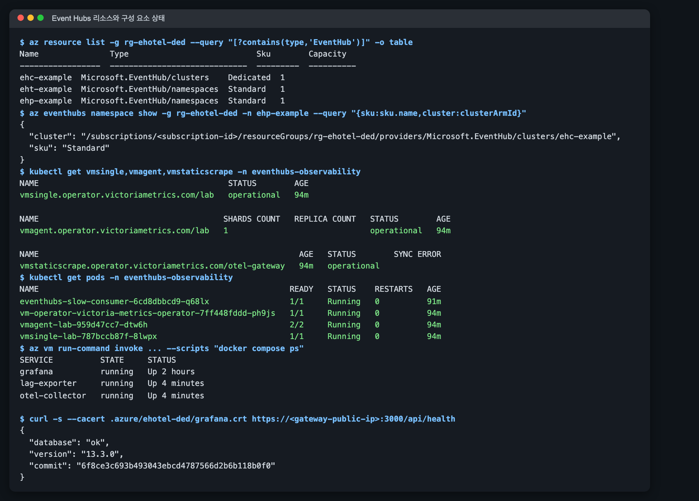

# Event Hubs OpenTelemetry·VictoriaMetrics 관측 실습

이 실습은 [Event Hubs 지표·consumer lag 수집 topic](../index.md)의 구성을
[`eventhubs-otel-victoriametrics-lab`](https://github.com/hellices/devguidesample/tree/main/docs/services/azure-event-hubs/opentelemetry-victoriametrics-monitoring/samples/eventhubs-otel-victoriametrics-lab)
sample로 재현합니다. 아래 결과와 화면은 2026-11-09 UTC에 실제 구독에서 실행한
기록이며, 구독 ID·resource 이름의 고유 suffix·IP는 가상 값으로 바꿨습니다.

실행 환경은 세 개입니다. 첫 환경(`ehotel-lab1`)에서 원래 브랜치를 배포하며 오류를
고쳤고, 수정이 끝난 sample을 새 환경(`ehotel-lab2`)에 `azd up` 한 번으로 다시 배포해
재현성을 확인했습니다. PR 리뷰 수정 후에는 세 번째 환경(`ehotel-lab3`)에서 HTTPS 접속,
재배포, 시나리오 중단, evidence 대기를 다시 확인했습니다. 시나리오·대시보드 수치는 두
번째 환경 결과이고, fallback 전환과 VMSingle 보존 확인은 첫 환경에서 실행했습니다.

## 실습 결과물: 배포·시나리오·대시보드·정리 증거

| 단계 | 명령 | 확인한 결과 |
|---|---|---|
| 배포 | `azd up -e ehotel-lab2` | 새 환경에서 provision, hook 6단계, workload 적용까지 14분 9초, exit 0 |
| 구성 요소 | `kubectl`, VM Run Command | VMSingle·VMAgent·VMStaticScrape `operational`, Gateway 컨테이너 3개 running |
| lag 시나리오 | `./scripts/run-scenario.sh` | partition별 peak 10,700–10,880건, producer 중지 5분 33초 뒤 회복 |
| agent 검증 | `./scripts/collect-evidence.sh` | 28개 query 모두 통과. Azure Monitor와 API remote write 4개 지표 × 25분 일치, Diagnostic Settings 합계 일치 |
| fallback | `GATEWAY_ONLY=true azd hooks run postprovision` | fallback exporter가 Premium 지표 27개 series를 두 경로로 저장(첫 환경) |
| 보존 | VMSingle Pod 재생성 | 같은 구간 `IncomingMessages` 합계 120,000 유지(첫 환경) |
| 리뷰 수정 확인 | 세 번째 환경 `azd up`, `azd deploy` 2회, 시나리오 중단 | 13분 42초 배포, 고정 인증서 HTTPS만 허용, 재배포 중 consumer Pod 유지, 중단 시 producer 0, 대시보드 요청 합계 656 = Azure Monitor 656 |
| 정리 | `azd down --purge --force` | 세 환경 모두 resource group 삭제 확인, Dedicated cluster 없음 |

## 사전 조건: 도구·권한·리전

- Azure CLI, Azure Developer CLI, `kubectl`, `kubelogin`, Helm, Python 3.10 이상,
  Node.js 20 이상, OpenSSL, `ssh-keygen`이 필요합니다. 이미지는 `az acr build`로
  만들므로 로컬 Docker는 필요하지 않습니다.
- 로그인한 주체는 구독에 resource group과 역할 할당을 만들 수 있어야 합니다. 템플릿은
  다음 역할을 할당합니다.

| 주체 | 역할 | 범위 |
|---|---|---|
| Gateway VM identity | Monitoring Reader | Premium namespace |
| Gateway VM identity | Azure Event Hubs Data Receiver | workload hub, telemetry hub |
| Gateway VM identity | Storage Blob Data Reader / Contributor | `workload-checkpoints` / `collector-checkpoints` container |
| Gateway VM identity | Key Vault Secrets User, AcrPull | Key Vault, ACR |
| producer / consumer identity | Azure Event Hubs Data Sender / Receiver | workload hub |
| consumer identity | Storage Blob Data Contributor | `workload-checkpoints` container |
| AKS cluster identity | Network Contributor | AKS subnet (internal load balancer 고정 IP) |
| 배포자 | Azure Kubernetes Service RBAC Cluster Admin | AKS cluster |

AKS internal load balancer에 대해 Learn은 VNet 범위 Network Contributor 또는 subnet
`join`·`read` 권한을 요구합니다. 이 실습은 Network Contributor를 AKS subnet 범위로만
할당했고 고정 IP의 internal load balancer가 정상 생성됐습니다.

## 비용·리전: Premium 신규 생성 제한과 `EVENTHUBS_LOCATION`

Event Hubs Premium, AKS(Standard_D4as_v5 노드 1개), Gateway VM(Standard_D2as_v5),
Standard namespace, private endpoint 2개, Public IP 비용이 발생합니다. 실습이 끝나면
바로 정리합니다.

기본 리전은 Korea Central입니다. 이 실습의 구독에서는 Korea Central, Japan East,
Southeast Asia에서 Premium namespace 신규 생성이 `NamespaceCreationIsRestricted`로
거부되고 Korea South에서는 성공했습니다. 이런 구독에서는 Event Hubs만 다른 리전에
둡니다.

```bash
azd env new ehotel-lab --subscription <subscription-id> --location koreacentral
azd env set EVENTHUBS_LOCATION koreasouth
```

`EVENTHUBS_LOCATION`은 Premium과 telemetry Standard namespace를 함께 옮깁니다.
Diagnostic Settings의 sink Event Hub는 원본 리소스와 같은 리전이어야 하기 때문입니다.
Korea South에는 availability zone이 없으므로 템플릿은 `zoneRedundant`를 지정하지
않습니다. availability zone이 있는 리전에서는 새 namespace에 zone redundancy가 자동으로
적용됩니다.

## 배포: `azd up` 단계와 실행 결과

`azd up`은 provision과 deploy를 이어서 실행합니다. azure.yaml에 `services`가 없으므로
deploy 단계는 `postdeploy` hook만 실행합니다.

| hook | 하는 일 |
|---|---|
| `preprovision` | 활성 구독 확인, provider 등록 확인, operator egress `/32`, 배포자 object ID, Grafana 비밀번호와 VM용 SSH 공개키 생성 |
| provision | VNet(gateway·aks·private-endpoints subnet), ACR, private endpoint 뒤의 Storage·Key Vault, Event Hubs 2개와 Diagnostic Settings, AKS, Gateway VM, 역할 할당 |
| `postprovision` | ① lab 전용 kubeconfig ② producer·consumer federated credential ③ ACR build와 digest 고정 ④ VictoriaMetrics Operator·VMSingle·VMAgent·VMStaticScrape ⑤ Run Command로 Gateway 번들 적용과 Grafana TLS 인증서 생성, 공개 인증서 회수 ⑥ 고정한 인증서로 operator 경로 Grafana HTTPS health |
| `postdeploy` | Workload Identity service account와 producer(0 replica)·slow consumer(1 replica) |


화면은 [배포 중 오류](#errors)를 모두 고친 뒤 새 환경에서 `azd up` 한 번으로 배포한
결과입니다. 기본 환경이 아닌 `-e ehotel-lab2`로 실행해 hook이 지정한 환경에만 값을
쓰는지도 함께 확인했습니다. Gateway VM에는 inbound SSH를 열지 않으며, 설정 파일과
Compose 번들은 VM Run Command로 전달합니다.

## 구성 요소 상태: VictoriaMetrics·workload·Gateway

배포 직후 각 계층이 실제로 동작하는지 확인합니다.

```bash
export KUBECONFIG=.azure/<env-name>/kubeconfig
kubectl get vmsingle,vmagent,vmstaticscrape -n eventhubs-observability
kubectl get pods -n eventhubs-observability
az vm run-command invoke -g <resource-group> -n <gateway-vm> --command-id RunShellScript \
  --scripts "cd /opt/eventhubs-observability && docker compose ps"
curl -s --cacert .azure/<env-name>/grafana.crt https://<gateway-public-ip>:3000/api/health
```



## lag 상승·회복 시나리오

`run-scenario.sh`는 baseline 5분, 부하 10분, 회복 대기를 실행하고 UTC 경계를
`evidence/<env>/scenario.json`에 기록합니다. producer는 1 KiB event를 초당 200개 보내고,
slow consumer는 partition마다 event당 30 ms를 쉬며 20 event마다 checkpoint합니다.
최대 lag가 정점의 20% 이하로 내려가지 않으면 실패로 끝납니다.

```bash
./scripts/run-scenario.sh
./scripts/collect-evidence.sh
```


| 항목 | 값 |
|---|---|
| 부하 구간 | 19:40:19–19:50:24 UTC |
| Azure Monitor `IncomingMessages` (19:35–20:00) | 120,200 |
| partition별 peak lag (대시보드, 구간 최대) | 10,700–10,880 |
| `run-scenario.sh`가 producer 중지 순간 읽은 최대 lag | 9,900 |
| 정점의 20% 이하 도달 | 19:55:57 UTC (producer 중지 후 5분 33초) |

producer 로그의 `sent_total`(118,600)은 10초 간격 로그의 마지막 값이므로 전송량은
Azure Monitor `IncomingMessages`를 기준으로 봅니다. 기록한 실행의 event body는 리뷰에서
찾은 크기 계산 문제로 설정값 1,024바이트보다 13바이트 큰 1,037바이트였고, 지금 sample은
정확히 `PAYLOAD_BYTES`로 보냅니다. 첫 환경의 같은 시나리오에서도
peak 10,860–11,040건, 회복 6분으로 비슷했습니다.

시나리오는 10분 넘게 VMSingle을 조회하므로 `kubectl port-forward`가 `lost connection
to pod`로 끊길 수 있습니다. `vm-query.sh start`는 `/health` 응답이 없으면 port-forward를
다시 열고, `run-scenario.sh`는 조회할 때마다 이를 호출합니다.

## agent 대시보드 workflow와 Azure Monitor 대조

`collect-evidence.sh`는 시나리오 구간을 분 경계에 맞춘 절대 시간으로 다음을 실행합니다.

1. `agent/probe.py`: VictoriaMetrics의 metric inventory를 `evidence/<env>/probe.json`에 기록
2. `agent/build_dashboard.py`와 `publish_dashboard.py`: probe 결과로 대시보드를 만들어
   Grafana API로 게시
3. `agent/verify_panels.py`: 모든 panel query를 `/api/ds/query`로 실행하고 오류·0행·
   NaN이 있는 필수 panel이 있으면 exit 1
4. `agent/capture.mjs`: Playwright로 로그인해 kiosk 모드 전체 화면을 캡처
5. 같은 구간의 Azure Monitor PT1M 값을 `az monitor metrics list`로 조회하고
   `agent/compare_azure_monitor.py`가 remote write sample과 분 단위로 비교. 요청한 4개
   지표의 `[from, to)` 모든 분이 Azure Monitor에 있고 remote write 값과 같아야 완료로
   판정하며, 아니면 불완전한 evidence로 실패

비교 결과 API 경로의 remote write는 `IncomingMessages`, `OutgoingMessages`,
`IncomingRequests`, `ThrottledRequests` 모두 25분이 일치했고, scrape 합계는 2.0–2.3배였습니다.
Diagnostic Settings 경로는 값이 있는 분만 도착했지만 합계는 Azure Monitor와 같았습니다.
원인과 대시보드 규칙은 [topic의 전달 경로 비교](../index.md#delivery)와
[수집 경로 비교](../index.md#receivers)에 정리했습니다.

첫 환경에서는 Diagnostic Settings를 만든 뒤 약 55분 동안, 세 번째 환경에서는 약 45분
동안 telemetry Event Hub 수신이 0건이었고, 두 번째 환경에서는 약 20분 안에 도착했습니다. 두 환경 모두 관리 그룹 정책으로
telemetry namespace의 local 인증이 꺼져 있었으므로 이것이 원인은 아닙니다. Learn은
diagnostic setting을 만든 뒤 데이터가 흐르기까지 최대 90분이 걸릴 수 있다고
설명하며, 세 환경의 관측은 모두 이 범위 안입니다. Diagnostic Settings 경로를 비교하려면
배포 직후가 아니라 설정 후 충분한 시간이 지난 뒤 시나리오를 실행합니다. 대시보드는 이
경로를 선택 panel로 두어, 데이터가 없을 때도 다른 검증은 계속 진행합니다.

## fallback exporter 전환

`azuremonitorreceiver`가 실패하는 환경을 대비해 `webdevops/azure-metrics-exporter`
26.10.0을 Compose `fallback` profile로 둡니다. 18:16–18:20 UTC에 API receiver를 끄고
fallback으로 전환했습니다(첫 환경).

```bash
ENABLE_API_RECEIVER=false ENABLE_FALLBACK_EXPORTER=true GATEWAY_ONLY=true azd hooks run postprovision
# 2–3분 뒤
./scripts/vm-query.sh start
curl -s "http://127.0.0.1:$(./scripts/vm-query.sh port)/api/v1/query" \
  --data-urlencode 'query=count by (delivery_path) (azurerm_resource_metric{source_path="fallback_exporter"})'
GATEWAY_ONLY=true azd hooks run postprovision   # 기본 receiver로 복구
```

`./scripts/vm-query.sh start`는 azd 환경마다 다른 로컬 포트(18428–18927, `VM_LOCAL_PORT`로
지정 가능)로 VMSingle을 연결하고, `port`는 그 번호를 출력합니다. fallback
exporter는 같은 Managed Identity로 Premium namespace 지표 9개 × 집계 3개, 27개
series를 scrape와 remote write 양쪽에 저장했습니다. ARM `$filter`는 tag 조건을
함께 쓸 수 없어 같은 resource group의 telemetry namespace까지 조회되므로, Collector의
`metric_relabel_configs`로 Premium namespace만 남깁니다. fallback series는 이름과
label 형태(`azurerm_resource_metric{metric,aggregation}`)가 달라 대시보드 query를
그대로 쓰지 않습니다.

## VMSingle 재시작과 데이터 보존 { #retention }

VMSingle은 10 GiB `managed-csi-premium` PVC와 7일 보존으로 실행합니다. 첫 환경에서
Pod를 지우고 다시 조회했을 때 17:46–18:12 구간 `IncomingMessages` 합계는 120,000으로
같았습니다.

`kubectl delete pod`는 이전 Pod가 끝나기 전에 새 Pod를 띄우므로, 같은 노드에서 이전
프로세스가 `flock.lock`을 놓을 때까지 새 Pod가 `cannot acquire lock on file`로 세 번
재시작한 뒤 정상화됐습니다. 데이터에는 영향이 없었습니다.

## 배포 중 오류와 수정 { #errors }

원래 브랜치의 구성으로 실제 구독에 배포하며 만난 오류입니다. 모두 sample에 반영했고,
같은 실수를 막는 계약 테스트를 `tests/`에 추가했습니다.


| 증상 | 원인 | 수정 |
|---|---|---|
| `missing required inputs: grafanaAdminPassword` | hook helper가 `azd env get-value`의 "key not found" 문구(stdout)를 값으로 오인해 비밀번호를 만들지 않음 | 종료 코드로 값 존재를 판정 |
| `enablePurgeProtection cannot be set to false` | Key Vault는 purge protection 속성에 `false`를 받지 않음 | 속성을 생략 |
| `NamespaceCreationIsRestricted` | 구독·리전별 Premium 신규 생성 제한 | `eventHubsLocation` 매개변수와 `EVENTHUBS_LOCATION` |
| `RegionDoesNotSupportZoneRedundancy` | Korea South에 availability zone 없음 | `zoneRedundant` 생략, AZ 리전은 자동 적용 |
| `not a valid identifier`, `base64: invalid input` | Run Command가 이름 없는 매개변수를 `=`에서 나눠 base64 padding이 깨짐. macOS bsdtar의 `-z` 출력은 블록 크기까지 0으로 채워짐 | `BUNDLE_B64=<값>` 이름 지정, `tar | gzip`으로 압축 |
| Key Vault `ForbiddenByConnection` | 관리 그룹 `modify` 정책이 Key Vault·Storage public network access를 끔 | Key Vault·Blob private endpoint와 private DNS zone, public access 명시적 비활성화 |
| `metrics:getBatch` 403 | batch API는 조회 대상 구독의 Monitoring Reader 필요 | ARM metrics API 사용(`use_batch_api: false`), namespace 범위 권한 유지 |
| `ThrottledRequests` series 없음 | dimension 분할 조회에서 throttle이 없으면 time series가 오지 않음 | 이 지표만 `dimensions.overrides`로 분할 해제 |
| 대시보드 쿼리 전체 0행 | 시나리오 UTC 문자열을 naive datetime으로 변환해 로컬 시간대(+9h)로 해석 | `timezone.utc` 지정 |
| 새 환경 `azd up`이 3초 만에 `missing required inputs` | `azd up`은 preprovision hook보다 먼저 필수 Bicep 입력을 검사함. 매개변수 파일의 `${VAR=}` 빈 기본값도 누락으로 판단 | hook이 채우는 세 매개변수에 Bicep 기본값 `''` 지정. hook 없이 배포하면 빈 CIDR·SSH 키가 ARM 검증에서 실패 |
| `azd up -e <env>`의 hook 값이 기본 환경에 기록될 위험 | hook 안의 `azd env set`이 `-e` 없이 기본 환경을 사용 | `azd_env` helper로 `AZURE_ENV_NAME`을 항상 지정 |
| `postdown`의 `no resource group to verify` | `azd down`이 hook 실행 전에 provision output을 지움 | `predown`이 대상 resource group을 기록하고 `postdown`이 읽음 |
| 시나리오 중 `curl: (7) Failed to connect … 18428` | 장시간 `kubectl port-forward`의 `lost connection to pod` | `/health`가 실패하면 port-forward를 다시 열고 조회마다 확인 |

원래 브랜치에 없던 다음 항목도 보강했습니다.

- AKS BYO subnet의 internal load balancer를 위한 cluster identity의 Network
  Contributor, 배포자의 AKS RBAC Cluster Admin 역할
- checkpoint 역할을 storage account 범위에서 container 범위로 축소하고,
  `azureeventhubreceiver`의 Blob checkpoint 쓰기 권한 추가
- 같은 resource group의 telemetry namespace를 수집하지 않도록 Premium namespace tag 필터
- Collector 자체 telemetry(`collector_self`)와 lag exporter의 Python runtime 지표 제거
- `predown`의 federated credential 정리와 `postdown`의 resource group 삭제 확인

PR 리뷰에서 지적된 다음 항목도 고쳤습니다.

| 지적 | 수정 |
|---|---|
| Grafana 관리자 자격 증명이 공개 IP의 HTTP로 전송됨 | Gateway가 public IP용 self-signed 인증서를 만들어 Grafana를 HTTPS로만 제공. postprovision은 공개 인증서만 회수해 `.azure/<env>/grafana.crt`에 두고, `curl --cacert`·Python `ssl`·Playwright(사전 TLS 확인과 SPKI 고정)가 이 인증서로만 접속 |
| 요청 합계 stat이 첫 분 bin을 빼고 끝 bin을 포함 | `[$__range] offset 1s`로 Azure Monitor 조회와 같은 `[from, to)` 창 사용 |
| 재배포 때 `kubectl apply`가 실행 중인 consumer를 0으로 되돌림 | apply 전 `spec.replicas`를 기억했다가 복원(최소 1) |
| evidence 수집이 마지막 분 bin 도착 전에 시작됨 | 창 종료 후 기본 540초 대기, 분 단위 대조가 완전하지 않으면 실패로 보고 |
| 시나리오가 오류로 끝나면 producer가 계속 전송 | 시작 시 producer를 멈추고, 완료 전 종료하면 trap이 0 replica로 되돌림 |
| consumer 수신 task가 실패해도 Pod가 Running으로 남음 | 수신 task와 종료 신호 중 먼저 끝나는 쪽을 기다리고 실패를 전파해 Kubernetes가 재시작 |
| Dedicated profile이 같은 resource group의 다른 cluster까지 수집하고 Premium 지표와 섞임 | `source_path="azure_monitor_dedicated"`로 분리하고 지정한 resource ID만 남기는 filter 추가. otelcol-contrib 0.165.0 `validate`로 구성 확인 |
| `VM_LOCAL_PORT`를 바꾸면 probe와 대조가 다른 포트를 조회 | 같은 포트를 두 단계에 전달 |
| 모든 환경이 같은 기본 포트를 써 다른 환경의 port-forward를 재사용할 수 있음 | 환경 이름으로 기본 포트를 정하고, 이 환경이 연 port-forward가 아니면 사용하지 않음 |
| 완료 판정이 반환된 분끼리만 비교 | 요청한 4개 지표와 창의 모든 분이 있어야 완료로 판정하는 비교 모듈과 단위 테스트 |
| gauge·그래프의 `min`·`max`가 `custom`에 기록됨 | Grafana 표준 field option으로 이동 |
| `vm-query.sh stop`이 port-forward를 끄지 못함 | `kube` 함수를 background로 실행해 subshell PID가 기록됐음. `kubectl`을 직접 background로 실행해 그 PID를 기록 |
| producer payload가 설정값보다 13바이트 큼 | 빈 `padding` 필드를 포함해 크기를 계산해 정확히 `PAYLOAD_BYTES`로 맞춤 |
| lag 수집이 실패해도 마지막 lag 값이 남아 정상처럼 보임 | 실패하면 lag gauge를 지우고, 대시보드 `Lag collection` stat이 구간 중 한 번이라도 실패하면 Failed로 표시 |
| evidence 폴더를 환경끼리 공유해 다른 환경의 시나리오 구간을 쓸 수 있음 | `evidence/<env>/`로 분리 |

## 정리: `azd down --purge`와 resource group 삭제 확인

```bash
azd down --purge --force
az group exists -n <resource-group>          # false
```

`predown`은 port-forward와 federated credential, lab kubeconfig를 지우고 대상 resource
group 이름을 기록합니다. `postdown`은 그 resource group이 사라질 때까지 확인한 뒤
끝납니다.


| 환경 | 결과 |
|---|---|
| 첫 환경 | resource group 삭제와 Key Vault purge 완료(17분 45초). 이때 `postdown`은 provision output이 지워져 실패했고, 위 수정 후 새 환경에서 다시 확인 |
| 새 환경 | `predown`·삭제·purge·`postdown` 모두 성공(19분 3초) |
| 구독 전체 | 두 resource group 없음, soft-delete 상태 Key Vault 없음, Event Hubs Dedicated cluster 없음 |

## 공식 참고 자료

- [Azure Event Hubs monitoring data reference](https://learn.microsoft.com/azure/event-hubs/monitor-event-hubs-reference)
- [Diagnostic settings in Azure Monitor](https://learn.microsoft.com/azure/azure-monitor/platform/diagnostic-settings)
- [How to migrate from the metrics API to the getBatch API](https://learn.microsoft.com/azure/azure-monitor/metrics/migrate-to-batch-api)
- [Reliability in Azure Event Hubs](https://learn.microsoft.com/azure/reliability/reliability-event-hubs)
- [Azure Key Vault recovery management with soft delete and purge protection](https://learn.microsoft.com/azure/key-vault/general/key-vault-recovery)
- [Use an internal load balancer with Azure Kubernetes Service (AKS)](https://learn.microsoft.com/azure/aks/internal-lb)
- [Use Microsoft Entra ID authorization for the Kubernetes API in AKS](https://learn.microsoft.com/azure/aks/manage-azure-rbac)
- [Deploy and configure Microsoft Entra Workload ID on an AKS cluster](https://learn.microsoft.com/azure/aks/workload-identity-deploy-cluster)
- [Customize your Azure Developer CLI workflows using command and event hooks](https://learn.microsoft.com/azure/developer/azure-developer-cli/azd-extensibility)
- [Work with Azure Developer CLI environment variables](https://learn.microsoft.com/azure/developer/azure-developer-cli/manage-environment-variables)
- [OpenTelemetry Collector Contrib azuremonitorreceiver v0.165.0](https://github.com/open-telemetry/opentelemetry-collector-contrib/tree/v0.165.0/receiver/azuremonitorreceiver)
- [VictoriaMetrics Operator VMSingle](https://docs.victoriametrics.com/operator/resources/vmsingle/)
