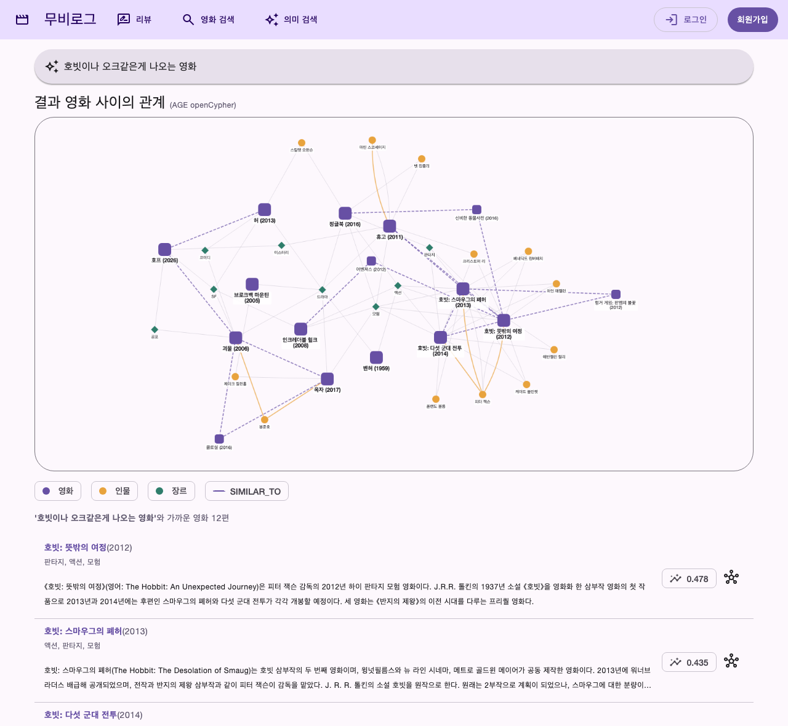
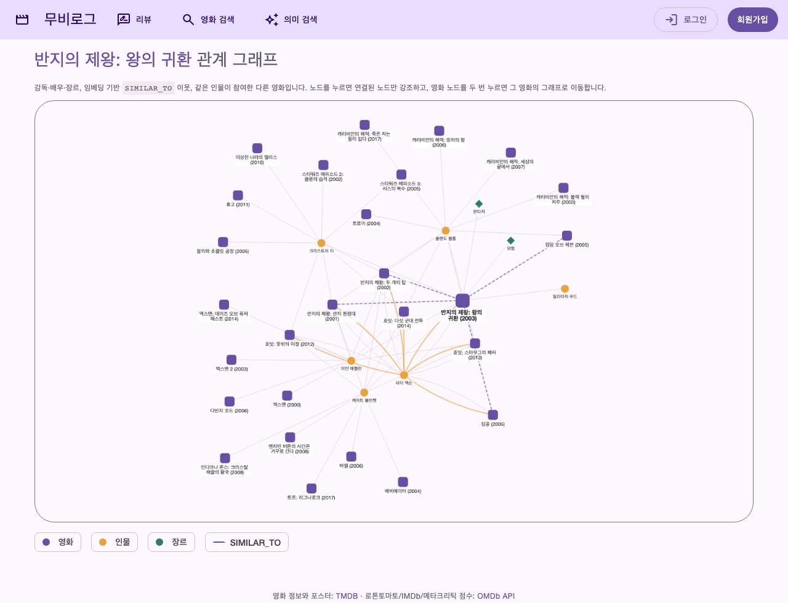
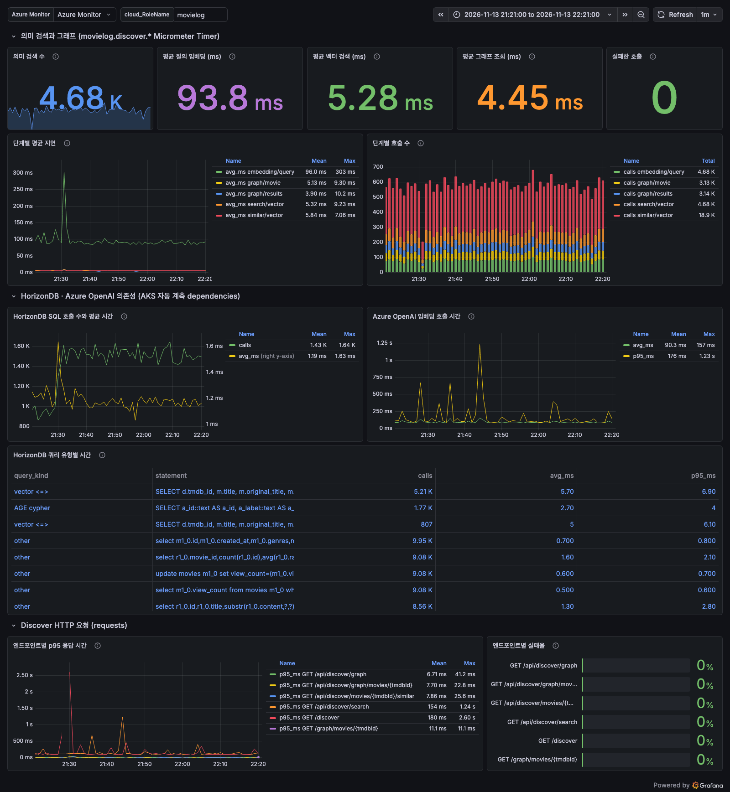

# Azure HorizonDB 벡터 검색과 Apache AGE 그래프 — AKS MovieLog 의미 검색

## 핵심 흐름: 카탈로그 적재 → 임베딩·DiskANN → AGE 그래프 → 의미 검색 { #message }

Azure HorizonDB 하나에 관계형 데이터, 벡터, 그래프를 함께 두면 "자연어로 찾고
관계로 넓혀 보는" 검색을 SQL 두 번으로 만들 수 있습니다. 2026-11-13 Korea Central에서
영화 리뷰 앱 MovieLog를 대상으로 다음 순서로 구성했습니다.

1. **카탈로그 적재** — Wikidata(감독·배우·장르·TMDB id)와 Wikipedia 요약으로 영화
   479편, 인물 1,786명, 장르 124개를 HorizonDB의 `public`·`catalog` 테이블에 넣습니다.
2. **임베딩과 DiskANN** — 영화마다 제목·인물·장르·요약을 한 문서로 묶어 Azure OpenAI
   `text-embedding-3-large`(1,536차원)로 임베딩하고 `pg_diskann` 코사인 index를 만듭니다.
3. **AGE 그래프** — 같은 테이블에서 Apache AGE 그래프 `movie_graph`를 만들고, 임베딩이
   가장 가까운 3편을 `SIMILAR_TO` 관계로 잇습니다.
4. **의미 검색과 관계 그래프** — 앱은 질의를 임베딩해 가까운 영화를 찾고, 찾은 영화들
   사이의 감독·배우·장르·유사 관계를 openCypher로 조회해 함께 그립니다.

아래는 "호빗이나 오크같은게 나오는 영화"라는 질의의 실제 결과입니다. 제목에 "호빗"이
없는 영화도 줄거리 의미로 찾고(1–3위 호빗 3부작, 코사인 유사도 0.478·0.435…),
피터 잭슨·이언 매켈런 같은 공통 인물과 `SIMILAR_TO` 점선이 결과 사이의 관계를 보여 줍니다.



같은 시간대 Grafana 대시보드에서 질의 임베딩은 평균 93.8 ms, HorizonDB 벡터 검색은
5.28 ms, AGE 그래프 조회는 4.45 ms였습니다(2026-11-13 21:21–22:21 KST, 합성 부하
의미 검색 4.68K건, 실패 0건). 응답 시간의 대부분은 Azure OpenAI 호출이고 DB 단계는
수 밀리초입니다.

## Azure HorizonDB: PostgreSQL 기반 AI-ready 관리형 데이터베이스 { #horizondb }

Azure HorizonDB는 PostgreSQL 위에 만든 cloud native 완전 관리형 데이터베이스 서비스이며
2026-11-13 현재 **미리 보기**입니다. PostgreSQL 호환성을 유지하면서 벡터 임베딩과
Microsoft Foundry 연동을 기본으로 제공해, RAG·추천·의미 검색을 데이터베이스 계층에서
구현하는 것을 주요 사용 사례로 듭니다.

| 구분 | 내용 |
|---|---|
| 아키텍처 | compute와 storage를 분리하고 WAL만 storage로 쓰는 database-as-a-log 설계입니다. compute는 stateless이고, storage는 WAL 전용 fleet과 data fleet으로 나뉘며 기본적으로 zone resilient입니다. |
| cluster | 쓰기 가능한 primary 1개와 읽기 가능한 standby replica로 구성됩니다. 모든 replica가 같은 storage 사본을 공유하며 read-write endpoint와 read-only endpoint를 제공합니다. |
| compute replica | vCore당 메모리 8 GB와 로컬 NVMe SSD cache를 가집니다. WAL 전송, checkpoint, 백업 같은 작업은 storage 계층이 맡습니다. |
| 과금 | 프로비저닝한 compute(core hour), 사용한 storage(GB/월), 단기 보존 백업 storage입니다. |
| 지역 | Asia Pacific에서는 Australia East, India South Central, Indonesia Central, Japan East, Korea Central을 지원합니다. |
| 미리 보기 제약 | 백업 보존 기간 7일 고정, 지역 간 read replica·고객 관리 키·유지 관리 기간 설정·내장 PgBouncer·VNet injection 미지원입니다(private link는 지원). |

출처는 Microsoft Learn의 [What is Azure HorizonDB (Preview)?](https://learn.microsoft.com/azure/horizondb/overview)입니다.

### 리소스 구조: cluster · pool · parameter group { #resource-model }

2026-11-13 Azure CLI `horizondb` 확장 1.0.0b9(API `2026-10-01-preview`)에서는 리소스가 다음처럼
나뉘었습니다. Learn quickstart는 `az horizondb create` 한 번으로 관리자와 vCore까지 지정하는
이전 형식을 보여 주므로, 실습은 새 API 구조를 따랐습니다.

| 리소스 | 이 실습의 값 | 메모 |
|---|---|---|
| cluster | PostgreSQL 17, public access | 관리자 계정은 cluster 생성 인자가 아니라 `authentications/passwordMethod` 리소스로 설정했습니다. |
| pool | Intel 1세대, 4 vCores, node 1개, HA 없음 | pool 생성 시에는 기본 parameter group만 받아, 사용자 parameter group은 생성 후 연결했습니다. |
| parameter group | `azure.extensions=vector,pg_diskann,age`, `shared_preload_libraries=age` | 확장은 parameter group으로 허용하고, 공유 메모리를 쓰는 AGE는 preload가 필요합니다. 연결하면 pool이 재시작합니다. |
| firewall rule | 운영자 IP, AKS outbound IP | pool 하위 리소스입니다. |

### 확장: vector · pg_diskann · age { #extensions }

HorizonDB는 확장을 parameter group의 `azure.extensions`로 허용한 뒤 `CREATE EXTENSION`으로
설치합니다. 이 실습이 쓴 확장과 Learn 목록의 버전, 실제 설치된 버전은 다음과 같습니다.
Learn 목록보다 실제 cluster의 버전이 더 높았습니다.

| 확장 | 용도 | Learn 목록 버전 | 실측 버전(2026-11-13) |
|---|---|---|---|
| `vector` | pgvector 벡터 타입과 거리 연산자 | 0.8.0 | 0.8.7 |
| `pg_diskann` | DiskANN 근사 최근접 이웃 index | 0.7.1 | 0.7.6 |
| `age` | Apache AGE 그래프, openCypher(미리 보기, preload 필요) | 1.6.0 | 1.8.0 |
| `azure_ai` | Foundry·Azure ML 연동 AI 함수 | 2.2.1 | 2.5.6 |

## 아키텍처: AGFC → AKS MovieLog → HorizonDB { #architecture }

요청은 커스텀 도메인의 HTTPS로 Application Gateway for Containers(AGFC)를 거쳐 AKS의 MovieLog Pod로 들어오고,
앱은 Azure OpenAI로 질의를 임베딩한 뒤 HorizonDB에 SQL과 openCypher를 보냅니다.
카탈로그와 그래프는 배치 로더가 한 번 만들고, 텔레메트리는 Application Insights를 거쳐
Managed Grafana에서 봅니다.


| 구성 요소 | 역할 | 구성 |
|---|---|---|
| App Gateway for Containers | 공개 진입점, TLS 종료 | AKS add-on의 ALB Controller, 커스텀 도메인의 HTTP·HTTPS listener, HTTP→HTTPS 301 redirect, 로그인 session을 한 Pod에 묶는 `RoutePolicy` managed cookie |
| cert-manager | 인증서 발급·갱신 | Let's Encrypt `ClusterIssuer`, Gateway API HTTP-01 challenge, `Certificate`가 만든 TLS secret을 HTTPS listener가 참조 |
| Microsoft Entra ID | 로그인 | 아이디·비밀번호 로그인 옆의 OpenID Connect 로그인(single-tenant 앱 등록). 첫 로그인 때 ID token의 `tid`·`oid`로 회원을 만듦 |
| Azure Key Vault | 앱 비밀값 | TMDB·OMDb 키와 Entra ID client secret. AKS Secrets Store CSI driver가 앱 workload identity로 private endpoint를 거쳐 읽음 |
| MovieLog 앱 | 의미 검색·그래프 API와 화면 | Spring Boot 4.1, Pod 2개, workload identity로 Azure OpenAI 호출 |
| Azure HorizonDB | 관계형·벡터·그래프 저장과 조회 | 위 [리소스 구조](#resource-model)와 [확장](#extensions) |
| Azure OpenAI | 문서·질의 임베딩 | `text-embedding-3-large`, `dimensions=1536`, key 인증 없이 Entra token |
| 카탈로그 로더 | 데이터셋 생성과 적재 | 표준 라이브러리 Python 스크립트, `psql` |
| Application Insights · Managed Grafana | 관측 | AKS 자동 계측(Java agent 3.7.10), `movielog.discover.*` Timer, HorizonDB·Azure OpenAI dependency |

### HorizonDB 데이터 모델: 관계형 원본 → 벡터 → 그래프 { #data-model }

관계형 테이블이 원본이고, 벡터와 그래프는 같은 데이터베이스 `movielog` 안에서 그 원본에
붙거나 원본에서 다시 만드는 데이터입니다. 세 모델은 별도 저장소나 동기화 없이 `tmdb_id`(영화)와
`qid`(인물) 두 키로 이어집니다.

![HorizonDB 데이터 모델과 작성 순서. 왼쪽에 ⓪ 앱 기동(Hibernate가 public.* 생성), ① 카탈로그 적재(build_catalog.py → catalog.sql), ② 문서 임베딩(embed_catalog.py), ③ DiskANN index(20-vector-index.sql), ④ 그래프 재생성(30-graph.sql) 단계가 있고 각각 관계형·벡터·그래프 영역으로 화살표가 이어짐. 관계형 영역에는 public.movies(tmdb_id UNIQUE), public.reviews·members, catalog.people(qid PK), catalog.movie_credits(tmdb_id, person_qid), catalog.movie_genres(tmdb_id, genre)와 조인 키 설명이 있음. 벡터 영역에는 catalog.movie_docs의 embedding vector(1536) 열, DiskANN index, 코사인 거리 쿼리가 있음. 그래프 영역에는 Movie·Person·Genre vertex와 DIRECTED·ACTED_IN·IN_GENRE·SIMILAR_TO edge가 개수와 함께 있고, 관계형 영역에서 행 → 노드·관계, 벡터 영역에서 임베딩 최근접 3편 → SIMILAR_TO 파생 화살표가 그래프로 이어짐](images/horizondb-data-model.svg)

| 모델 | 저장 위치 | 성격 | 연결 키 | 쓰는 주체 |
|---|---|---|---|---|
| 관계형 | `public.movies`, `public.reviews`·`members`·`comments` | 원본. 앱의 리뷰·회원은 요청마다 바뀜 | `movies.tmdb_id`(UNIQUE), `reviews.movie_id → movies.id` | 앱(Hibernate·JPA), 로더(`movies` upsert) |
| 관계형 | `catalog.people`, `catalog.movie_credits`, `catalog.movie_genres` | 원본. Wikidata 구조 | `tmdb_id`, `qid`(`person_qid → people.qid`) | 로더, 앱(`CatalogIndexer`: TMDB credits·장르) |
| 벡터 | `catalog.movie_docs.embedding vector(1536)` + DiskANN index | 원본 행에 붙은 열. 문서가 바뀌면 다시 임베딩 | `movie_docs.tmdb_id`(PK) | 로더, 앱(`CatalogIndexer`: 카탈로그 적재 뒤 TMDB에서 가져온 영화) |
| 그래프 | `movie_graph`의 label별 테이블(`"Movie"`, `"ACTED_IN"` 등) | 파생. 관계형 행과 임베딩에서 다시 생성 | vertex 속성 `tmdb_id`, `qid` | `30-graph.sql`(최초 생성), `catalog.process_graph_queue`(변경분) |

- **키로 잇는 이유** — `catalog.*` 테이블은 `public.movies`에 외래 키를 두지 않고 `tmdb_id`로
  조인합니다. 앱이 Hibernate로 `public.*`를 만드는 시점과 로더가 `catalog.*`를 채우는 시점이
  달라도 서로를 막지 않습니다.
- **그래프도 테이블** — 2026-11-13 실습 DB에서 AGE는 graph 이름과 같은 schema `movie_graph`에
  label마다 일반 테이블을 만들었습니다. 그래서 vertex 속성 `tmdb_id`로 Cypher 결과를 다시
  관계형 행과 맞출 수 있고, GIN·btree index와 `GRANT`도 일반 테이블처럼 적용합니다.
- **권한 경계** — 앱 role `movielog`는 `public`에 쓰고, `catalog`와 `movie_graph`에는
  `SELECT`를 받습니다. 새 영화를 위해 `catalog`의 `movie_docs`·`people`·`movie_credits`·
  `movie_genres`에 `INSERT`만 더 받고, 그래프 테이블과 변경 queue에는 직접 쓰지 못합니다. 그래프는
  관리자가 소유한 `SECURITY DEFINER` 함수 `catalog.process_graph_queue`·`enqueue_graph_drift`를 통해서만
  바뀝니다.

### 작성 순서: 적재 → 임베딩 → index → 그래프 { #authoring }

데이터는 앞 단계의 결과를 다음 단계가 읽는 순서로 만들며, 모든 단계는 중복 없이 다시 실행할 수
있습니다. 영화 약 480편 기준 소요 시간은 실습에서 측정한 값입니다.

| 단계 | 스크립트 | 읽는 것 | 쓰는 것 | 재실행 동작 | 소요 시간 |
|---|---|---|---|---|---|
| ⓪ 앱 기동 | Hibernate `ddl-auto=update` | JPA entity | `public.*` 테이블 | 없는 테이블·열만 추가 | 앱 시작 시 |
| ① 카탈로그 적재 | `build_catalog.py` → `catalog.sql` | Wikidata SPARQL, Wikipedia 요약 API | `public.movies`, `catalog.*`, `movie_docs.doc` | `ON CONFLICT` upsert. `doc`이 바뀐 행만 `embedding`을 `NULL`로 비움 | 생성 8–11분, 적재 약 3.5분 |
| ② 문서 임베딩 | `embed_catalog.py` | `embedding IS NULL`인 `doc` | `movie_docs.embedding` | 비어 있는 행만 처리. `--all`은 전체 재임베딩 | 479건 약 3.5분 |
| ③ 벡터 index | `20-vector-index.sql` | `embedding` | DiskANN index | `IF NOT EXISTS`. 모델을 바꾸면 `REINDEX` | 수 초 |
| ④ 그래프 재생성 | `30-graph.sql` | `movies`, `catalog.*`, `embedding` | `movie_graph` 전체 | graph를 지우고 다시 생성. 최초 1회 | 약 6–8초 |
| ⑤ 그래프 동기화 설치 | `40-graph-sync.sql` | — | 변경 queue, trigger, 동기화 함수 | `CREATE OR REPLACE`. 이후 그래프는 변경분만 반영 | 수 초 |

Wikidata와 Wikipedia에는 포스터가 없으므로 ① 다음에 `enrich_tmdb.py` → `tmdb.sql`로 TMDB 상세
API의 포스터 경로·상영 시간·IMDb id를 `public.movies`의 빈 열에만 채웁니다. 제목·요약·임베딩·그래프에는
영향이 없으며 478편 기준 약 2분 걸렸습니다.

①–④는 카탈로그에 있는 영화만 다룹니다. 회원이 영화 검색으로 카탈로그 밖의 영화를 처음 열면
앱은 TMDB 상세를 `public.movies`에만 저장하므로, 그 영화는 문서·임베딩이 없어 의미 검색에
나오지 않습니다. 2026-11-14 실습에서 「듄: 파트 2」에 리뷰를 쓴 뒤 「듄」, 「드니 빌뇌브」로
검색해도 나오지 않은 원인이 이것이었습니다. 앱의 `CatalogIndexer`가 30초마다 문서가 없는 영화를
찾아 영화 한 편을 한 transaction으로 처리합니다.

1. TMDB credits에서 감독과 출연 6명을 받고, 인물마다 TMDB `external_ids`의 Wikidata id를 받습니다.
2. ①과 같은 형식의 문서를 만들어 임베딩하고 `catalog.movie_docs`에 넣습니다.
3. 인물·출연·장르를 `catalog.people`·`movie_credits`·`movie_genres`에 넣습니다. 인물 키는
   Wikidata id라서 표기가 달라도(TMDB 「조쉬 브롤린」, Wikidata 「조시 브롤린」) 카탈로그의 같은
   인물로 이어집니다. Wikidata id가 없으면 `tmdb:<person id>`를 씁니다.
4. 이 행들이 바뀌면 아래 trigger가 영화를 그래프 변경 queue에 넣고, 색인 직후 앱이 queue를 반영합니다.

여러 Pod 중 PostgreSQL advisory lock을 잡은 하나만 실행합니다. 2026-11-14 실습에서 「웡카」를 처음 연 뒤
14초 만에 색인과 그래프 반영이 끝났고, 「티모시 샬라메」·「휴 그랜트」 노드와 「찰리와 초콜릿 공장」
`SIMILAR_TO`로 연결됐습니다.

### 그래프 동기화: trigger 변경 queue와 주기 반영 { #graph-sync }

그래프는 관계형 행에서 만든 파생 데이터라서, 원본이 바뀔 때마다 ④로 전체를 다시 만들면 그래프를
지운 6–8초 동안 앱이 빈 그래프를 읽고, 관리자 비밀번호를 가진 작업이 cluster 안에 있어야 합니다.
그래서 HorizonDB trigger가 바뀐 영화를 queue에 기록하고, 앱이 그 영화만 반영하는 방식으로 바꿨습니다.
`db/40-graph-sync.sql`이 queue, trigger, 함수를 만듭니다.

| 단계 | 구성 요소 | 동작 |
|---|---|---|
| 변경 감지 | `public.movies`, `catalog.movie_docs`·`movie_credits`·`movie_genres`·`people` trigger | 그래프에 영향을 주는 열이 바뀐 행의 `tmdb_id`를 `catalog.graph_queue`에 upsert합니다. 인물 이름이 바뀌면 그 인물의 영화를 모두 넣습니다. TMDB 갱신처럼 제목·개봉일이 그대로인 수정은 넣지 않습니다. |
| 반영(30초) | 앱 `MovieGraphSync` → `catalog.process_graph_queue()` | 그래프 advisory lock을 잡고 queue에서 꺼낸 영화의 `Movie` 노드와 `DIRECTED`·`ACTED_IN`·`IN_GENRE`를 ④의 규칙으로 다시 만든 뒤, `SIMILAR_TO` 전체를 임베딩 최근접 3편 규칙과 비교해 다른 쌍만 지우고 만듭니다. 한 transaction이라 앱은 반쯤 바뀐 그래프를 읽지 않습니다. |
| 정합성 점검(1시간) | 앱 → `catalog.enqueue_graph_drift()` + 강제 reconcile | 관계형과 그래프 한쪽에만 있는 영화를 queue에 넣고, queue가 비어 있어도 `SIMILAR_TO`를 맞춥니다. 실패한 실행이나 그래프를 직접 고친 흔적을 정리합니다. |
| 전체 재생성 | `30-graph.sql` | 같은 lock을 잡아 반영 작업과 겹치지 않고, 시작 전에 쌓인 queue를 비웁니다. 최초 생성 때만 씁니다. |

- **`SIMILAR_TO` 전체 비교** — 영화 한 편이 바뀌어도 다른 영화의 최근접 3편이 바뀔 수 있습니다.
  처음에는 바뀐 영화와 닿는 쌍만 다시 만들었는데, 새 영화 때문에 다른 영화의 최근접 3편에서 밀려난
  기존 관계가 남았습니다. 그래서 반영할 때마다 모든 영화의 최근접 3편을 다시 계산해 그래프와
  비교합니다. 482편에서 약 1.3초 걸립니다.
- **Cypher 제약** — 지울 edge를 `WHERE id(r) IN [...]`로 고르면 id가 두 개 이상일 때 AGE가
  `not a common type: 17175`(agtype)로 실패했습니다. 양 끝 `Movie`의 `tmdb_id`로 `MATCH`해 지웁니다.
- **실행 위치** — HorizonDB의 `pg_available_extensions`에는 `pg_cron`이 있지만 2026-11-14 실습 DB의
  `shared_preload_libraries`에는 없어서, 쓰려면 server parameter 변경과 재시작이 필요했습니다. 이미
  workload identity와 advisory lock을 쓰는 앱의 scheduler에서 실행합니다. 실행 시간과 결과는
  `movielog.discover.graph.sync` Timer(`mode`=`queue`·`drift`, `outcome`=`applied`·`idle`·`skipped`·`error`)로 남깁니다.

2026-11-14 실습 DB에서 다음 경우마다 그래프를 label별 속성 hash로 비교했고, 모두 ④로 전체를 다시 만든
결과와 같았습니다.

| 경우 | 결과 |
|---|---|
| 482편 전체를 queue에 넣고 반영 | 9.3초, 7개 label 모두 같음 |
| 앱에서 카탈로그 밖 영화 2편(「패스트 라이브즈」, 「퓨리오사」)을 처음 열고 색인·반영 | 다른 영화에서 밀려난 `SIMILAR_TO`까지 정리되어 같음 |
| 영화 제목과 인물 이름 변경 | 다음 반영에서 노드 속성이 바뀌고, 인물 노드는 1개로 유지 |
| `Movie` 노드 삭제, 그래프에만 있는 영화, 중복·방향 반대·점수가 다른·근거 없는 `SIMILAR_TO` | 정합성 점검 한 번(약 1.3초)으로 복구 |

④는 노드를 먼저 만들고 label 테이블에 GIN index를 건 뒤 관계를 만듭니다. Cypher 문자열에
값을 직접 넣어야 하므로 행을 Cypher map 문자열로 바꿔 200개씩 `UNWIND`합니다.

```sql
-- 30-graph.sql 발췌: 관계형 행 → ACTED_IN 관계
SELECT pg_temp.unwind(
  array_agg(format('{p: %s, m: %s, position: %s}', pg_temp.cy(c.person_qid), c.tmdb_id, c.position)),
  'MATCH (p:Person {qid: e.p}), (m:Movie {tmdb_id: e.m}) CREATE (p)-[:ACTED_IN {position: e.position}]->(m)')
FROM catalog.movie_credits c JOIN public.movies USING (tmdb_id)
WHERE c.role = 'actor';

-- 임베딩 → SIMILAR_TO: 영화마다 코사인 거리가 가장 가까운 3편
SELECT a.tmdb_id, b.tmdb_id, 1 - (a.embedding <=> b.embedding) AS score
FROM catalog.movie_docs a
CROSS JOIN LATERAL (
  SELECT tmdb_id, embedding FROM catalog.movie_docs b
  WHERE b.tmdb_id <> a.tmdb_id ORDER BY b.embedding <=> a.embedding LIMIT 3) b;
```

### 앱 접근 경로: JPA · JdbcClient · JdbcTemplate { #app-access }

앱은 커넥션 풀 하나(HikariCP, 앱 role `movielog`)로 세 모델에 접근하며, 모델마다 다른
Spring 데이터 접근 방식을 씁니다. 연결을 만들 때 `SET search_path = public, ag_catalog`를
실행해 JPA는 `public`을 그대로 쓰고 AGE의 `cypher()` 함수도 찾게 합니다.

![MovieLog 앱의 HorizonDB 접근 sequence. ① 의미 검색에서 브라우저가 GET /discover?q=를 보내면 MovieLog 앱의 EmbeddingClient가 workload identity 토큰으로 Azure OpenAI에 embeddings를 요청해 float[1536]을 받고, VectorSearchRepository가 JdbcClient로 movie_docs와 movies를 조인해 embedding <=> :v 순위와 문서 머리 키워드 순위를 RRF로 합친 영화 12편과 코사인 유사도를 받아 HTML 결과 목록과 그래프 URL을 돌려줌. ② 관계 그래프에서 graph.js가 GET /api/discover/graph?ids=를 보내면 MovieGraphRepository가 JdbcTemplate으로 UNWIND ids MATCH (a:Movie {tmdb_id})-[r]-(b) Cypher를 실행해 vertex·edge 행을 받고 JSON nodes·edges를 돌려줘 Cytoscape.js가 그림. ③ 다른 화면에서 리뷰·회원·영화는 Spring Data JPA가 public.*에 Hibernate SQL을 보내고, 상세 화면의 비슷한 영화는 임베딩 호출 없이 저장된 영화 벡터와 <=>로 6편을 조회함](images/horizondb-app-access.svg)

| 기능 | 앱 클래스 | HorizonDB 접근 | 대상 |
|---|---|---|---|
| 리뷰·댓글·회원·영화 상세 | `MovieRepository`, `ReviewRepository` 등 Spring Data JPA | Hibernate SQL | `public.*` |
| 의미 검색 `/discover` | `QueryCorrector` → `EmbeddingClient` → `VectorSearchRepository`(`JdbcClient`) | 철자 교정 뒤 질의 벡터 `<=>` 순위와 문서 머리 키워드 순위를 RRF로 결합 | `movie_docs` ⋈ `movies` |
| 새 영화 색인(30초 주기) | `CatalogIndexer` → `TmdbCreditsClient`, `EmbeddingClient`, `CatalogIndexRepository` | advisory lock 뒤 `INSERT ... ON CONFLICT DO NOTHING` | `movie_docs`, `people`·`movie_credits`·`movie_genres` |
| 그래프 동기화(30초, 점검 1시간) | `MovieGraphSync` → `GraphSyncRepository` | `SELECT catalog.process_graph_queue(:limit, :reconcile)`, `catalog.enqueue_graph_drift()` | `graph_queue`, `movie_graph` |
| 비슷한 영화(상세 화면) | `VectorSearchRepository.similar` | 저장된 영화 벡터끼리 `<=>`. Azure OpenAI 호출 없음 | `movie_docs` |
| 관계 그래프 `/api/discover/graph` | `MovieGraphRepository`(`JdbcTemplate`) | `ag_catalog.cypher()` 안의 openCypher | `movie_graph` |

```java
// VectorSearchRepository: 질의 벡터를 pgvector 문자열로 바꿔 bind parameter로 전달(키워드 결합 부분은 생략)
jdbc.sql("""
    SELECT d.tmdb_id, m.title, ..., 1 - (d.embedding <=> CAST(:v AS vector)) AS score
    FROM catalog.movie_docs d JOIN public.movies m ON m.tmdb_id = d.tmdb_id
    WHERE d.embedding IS NOT NULL
    ORDER BY d.embedding <=> CAST(:v AS vector)
    LIMIT :limit""")
  .param("v", toLiteral(embedding)).param("limit", limit)
  .query(VectorSearchRepository::hit).list();

// MovieGraphRepository: 검증된 숫자 tmdb_id만 Cypher 문자열에 넣음
jdbc.query("""
    SELECT a_id::text AS a_id, ... FROM ag_catalog.cypher('movie_graph', $cy$
      UNWIND [%s] AS t MATCH (a:Movie {tmdb_id: t})-[r]-(b) RETURN ...
    $cy$) AS (a_id ag_catalog.agtype, ...)""".formatted(ids), MovieGraphRepository::row);
```

- **의미 검색 화면은 두 번 요청합니다.** 서버가 벡터 검색으로 결과 목록을 렌더링하고, 그 결과의
  `tmdb_id` 목록을 그래프 API URL로 내려 줍니다. 브라우저는 그 URL로 그래프 JSON을 받아 그립니다.
- **결과 변환** — Cypher 결과는 `agtype`이라 SQL에서 `::text`로 바꿔 받고, 앱이 vertex·edge
  속성을 Cytoscape.js 형식(`nodes`, `edges`)으로 바꿉니다.
- **계측** — 각 단계는 `DiscoverService`가 `movielog.discover.embedding`·`search`·`similar`·`graph`
  Timer로 감싸고, 세 접근 방식의 SQL은 모두 Application Insights dependency로 수집됩니다.

## 벡터 검색: Azure OpenAI 임베딩과 DiskANN 코사인 거리 { #vector }

벡터 검색은 질의 벡터와 영화 문서 벡터의 코사인 거리(`<=>`)를 HorizonDB에서 정렬하는
SQL 한 문장입니다. 거리 연산자, Flat·IVFFlat·HNSW·DiskANN 선택 기준, DiskANN 매개변수와
필터 결합 검색은 [HorizonDB 벡터·그래프 기능](vector-graph-features/index.md#vector-type)에
정리했습니다. 영화 문서는 다음처럼 구조 정보와 요약을 함께 담습니다.

```text
제목: 인셉션
원제: Inception
개봉: 2010
장르: 드라마, 액션, 모험, SF
감독: 크리스토퍼 놀런
출연: 레오나르도 디카프리오, 마이클 케인, ...
줄거리: 《인셉션》(Inception)은 2010년 영국, 미국 합작의 SF 액션 스릴러 영화이다. ...
Summary: Inception is a 2010 science fiction heist film written and directed by Christopher Nolan, ...
```

```sql
CREATE INDEX movie_docs_embedding_diskann
    ON catalog.movie_docs USING diskann (embedding vector_cosine_ops);

SELECT d.tmdb_id, m.title, 1 - (d.embedding <=> CAST(:v AS vector)) AS score
FROM catalog.movie_docs d JOIN public.movies m ON m.tmdb_id = d.tmdb_id
ORDER BY d.embedding <=> CAST(:v AS vector)
LIMIT 12;
```

- **영어 요약 추가** — 한국어 Wikipedia 도입부는 제작 정보 위주라 줄거리 질의와 잘 맞지
  않았습니다. 화면에는 한국어 요약만 보여 주고, 임베딩 문서에만 영어 도입부를 더했습니다.
- **모델 선택** — 같은 문서·질의로 두 모델의 상위 결과를 비교했습니다. `text-embedding-3-large`는
  출력 3,072차원을 `dimensions` 매개변수로 1,536차원으로 줄여 `vector(1536)` 열에 맞췄습니다.

| 질의 | `text-embedding-3-small` 상위 3편 | `text-embedding-3-large`(1,536차원) 상위 3편 |
|---|---|---|
| 마피아 가문의 권력 승계 | 사마리아, 마더, 포화 속으로 | 대부 3, 대부, 스카페이스 |
| 가난한 가족이 부잣집에 숨어드는 이야기 | 장화, 홍련 · 버닝 · 기생충 | 빈 집, 기생충, 7번방의 선물 |
| 우주에서 가족을 찾아 떠나는 여정 | 내 머리 속의 지우개, 7번방의 선물, 달콤한 인생 | 인터스텔라, 2001: 스페이스 오디세이, 승리호 |

- **DiskANN 사용 여부** — 문서는 planner가 index 사용을 결정한다고 설명합니다. 479행
  규모에서는 실제 계획이 seq scan이었고, `SET LOCAL enable_seqscan TO OFF`로 index 경로를
  확인할 수 있습니다. Learn의 index 선택 기준도 10만 행 미만은 flat scan을 첫 선택으로 둡니다.

### 키워드 보완: 벡터 순위와 키워드 순위의 RRF 결합 { #hybrid }

문서 전체를 하나로 임베딩하면 줄거리 같은 서술형 질의에는 강하지만, 제목이나 인물 이름만 넣은
짧은 질의에는 약합니다. 2026-11-14에 「듄: 파트 2」를 색인한 뒤 벡터만으로 검색하면 「듄」에서
10위, 「드니 빌뇌브」에서 12위였습니다. 그래서 `VectorSearchRepository.search`는 벡터 상위 50편과
키워드 상위 50편의 순위를 Reciprocal Rank Fusion(`1 / (60 + 순위)`의 합)으로 합칩니다.

- **키워드 순위** — 질의 단어가 문서 머리(제목·원제·개봉·장르·감독·출연)에 몇 개 들어 있는지로
  정하고, 같으면 벡터 거리로 정렬합니다. 줄거리는 벡터 쪽에만 맡깁니다.
- **반영 조건** — 질의 단어의 절반 이상이 들어 있는 영화만 키워드 순위에 넣습니다. 이 조건이 없을
  때는 「a shark terrorizes a beach town」에서 원제에 beach가 들어간 「밤의 해변에서 혼자」가
  「죠스」보다 앞섰습니다. 영어 단어는 4자 이상만 씁니다.
- **점수 표시** — 순서는 결합 순위를 따르고, 화면의 점수는 그대로 코사인 유사도입니다.

| 질의 | 벡터만 상위 3편 | RRF 결합 상위 3편 |
|---|---|---|
| 듄 | 듄(2021), 듄(1984), 디워 | 듄(2021), 듄(1984), 듄: 파트 2 |
| 드니 빌뇌브 | 블루 벨벳, 듄(2021), 다빈치 코드 | 듄(2021), 듄: 파트 2, 블레이드 러너 2049 |
| 꿈속에서 벌어지는 하이스트 | 호프, 인터스텔라, 위플래쉬 | 같음 |
| 아이와 함께 보는 판타지 애니메이션 | 센과 치히로의 행방불명, 위쳐: 늑대의 악몽, 신비한 동물사전 | 같음 |

- **전체 일치 가중치** — 질의 단어가 모두 문서 머리에 있는 영화는 키워드 쪽 점수를 두 배로 셉니다.
  가중치가 없을 때 「티모시 샬라메」는 키워드 2위인 「듄」(1/62)이 벡터 1위인 「아멜리에」(1/61)보다
  뒤였습니다. 가중치를 둔 뒤 상위 3편이 「콜 미 바이 유어 네임」, 「듄: 파트 2」, 「듄」이 됐고, 위 표의
  서술형 질의를 포함한 8개 질의(「SF 모험」 포함)의 상위 5편은 달라지지 않았습니다.

### 철자 교정: 자모 편집 거리와 인물·제목 사전 { #spelling }

「드늬 뷜베브」처럼 이름 철자가 틀리면 키워드가 일치하지 않고, 임베딩도 같은 인물로 보지 못해
「듄」 계열이 상위에 나오지 않았습니다. `QueryCorrector`는 질의를 임베딩하기 전에 인물 이름
(`catalog.people`의 한국어·영어 이름)과 영화 제목 사전에서 가장 가까운 항목으로 고칩니다.

- **자모 비교** — 한글을 NFD로 자모까지 분해해 편집 거리를 재고, 모음끼리 바뀐 경우는 0.5로
  셉니다. 외국 이름의 한글 표기는 주로 모음이 달라서, 이 가중치로 「드늬 뷜베브」와 「드니 빌뇌브」의
  유사도가 0.64에서 0.77이 됐습니다.
- **교정 대상** — 어떤 영화 문서에도 없는 단어(뒤의 조사 와·을 등을 떼고도 없는 단어)가 들어 있는
  1–3단어 구간만 고칩니다. 이 조건이 없으면 「아이와」가 「아이유」로, 「하이스트」가 「아티스트」로
  바뀌었습니다.
- **채택 기준** — 유사도 0.75 이상이고 2위보다 0.1 이상 높을 때만 바꿉니다. 1–3단어 구간이 유사도로
  경쟁하고 같으면 긴 구간을 고르므로, 「인셉숀 2」는 「인셉숀」만 고쳐 「인셉션 2」로 검색합니다.
  고친 질의로 임베딩과 키워드 순위를 모두 계산하고, 화면에는 「'드늬 뷜베브'을(를) '드니 빌뇌브'(으)로
  고쳐 검색했습니다」를 보여 줍니다. 교정 횟수는 `movielog.discover.corrected` counter로 남깁니다.

| 입력 | 교정 결과 | 상위 결과 |
|---|---|---|
| 드늬 뷜베브 | 드니 빌뇌브 | 듄(2021), 듄: 파트 2, 블레이드 러너 2049 |
| 봉준오 | 봉준호 | 살인의 추억, 괴물, 옥자 |
| 크리스토퍼 놀랜 | 크리스토퍼 놀런 | 오펜하이머, 인터스텔라, 다크 나이트 |
| 티모시 살라메 | 티모시 샬라메 | 콜 미 바이 유어 네임, 웡카, 듄: 파트 2 |

기준을 정할 때 서술형 질의 16개와 정확한 이름·제목 질의 5개를 함께 넣어 보았고, 어느 것도 바뀌지
않았습니다. 영어 이름 오타(「christopher nolen」)는 이 기준에서 교정되지 않았습니다.
사전은 10분마다, 그리고 새 영화를 색인한 직후 다시 읽습니다.

## 그래프: Apache AGE `movie_graph`와 openCypher 조회 { #graph }

그래프는 관계형 테이블에서 다시 만들 수 있는 파생 데이터로 두었습니다. AGE가 graph를 schema와
label 테이블로 저장하는 방식, `cypher()` 매개변수, openCypher 제약, 벡터와 그래프를 함께 쓰는
graph-augmented RAG 패턴은
[HorizonDB 벡터·그래프 기능](vector-graph-features/index.md#age-storage)에 정리했습니다. 생성 스크립트는
6초 안팎에 노드 2,389개와 관계 5,976개를 만듭니다. `Movie`에는 카탈로그 479편과 앱의 기존 seed 영화 1편이
들어 있고, `Person`은 출연·감독 기록이 있는 인물만 넣습니다.

| 노드 | 수 | 관계 | 수 |
|---|---|---|---|
| `Movie` | 480 | `ACTED_IN` | 2,771 |
| `Person` | 1,785 | `DIRECTED` | 520 |
| `Genre` | 124 | `IN_GENRE` | 1,647 |
| | | `SIMILAR_TO`(임베딩 최근접 3편) | 1,038 |

앱은 결과 영화들을 `UNWIND`로 시작점 삼아 이웃을 조회합니다.

```sql
SELECT * FROM ag_catalog.cypher('movie_graph', $cy$
  UNWIND [27205, 157336, 155] AS t
  MATCH (a:Movie {tmdb_id: t})-[r]-(b)
  RETURN id(a), label(a), properties(a), id(b), label(b), properties(b), id(r), type(r)
$cy$) AS (a_id agtype, a_label agtype, a_props agtype,
          b_id agtype, b_label agtype, b_props agtype, r_id agtype, r_type agtype);
```

- **`UNWIND`와 속성 map** — 처음 쓴 `MATCH (a:Movie)-[r]-(b) WHERE a.tmdb_id IN [...]`는
  영화 8편에 26.7초가 걸렸습니다. 같은 결과(134행)를 `UNWIND ... MATCH (a:Movie {tmdb_id: t})`로
  바꾸자 0.12초로 줄었습니다. 생성 스크립트는 label 테이블의 `properties`에 GIN index를 만듭니다.
- **parameter 처리** — AGE는 Cypher 매개변수를 `cypher()`의 셋째 인자로만 받으며, 그 값은
  prepared statement parameter여야 합니다. 앱은 숫자로 검증한 id만 Cypher 문자열에 넣습니다.
  Spring의 named parameter 파서가 `(a:Movie)`를 parameter로 읽지 않도록 그래프 조회는
  `JdbcTemplate`으로 실행합니다.
- **화면** — 노드와 관계는 DB가 돌려준 그대로 Cytoscape.js가 그리고, 라벨 크기를 포함해
  겹침을 피하는 fCoSE 레이아웃을 씁니다. 같은 JSON으로 그래프 아래에 노드별 관계와 영화 링크를
  담은 텍스트 목록도 만들어, 키보드와 스크린 리더로 같은 관계를 탐색할 수 있습니다.



## 질의 임베딩 위치: 앱 Entra 토큰과 HorizonDB model registry { #embedding-location }

이 실습은 질의 임베딩을 HorizonDB 안이 아니라 앱에서 만들었습니다. HorizonDB의 `azure_ai`
확장은 model registry에 등록한 모델 alias로 AI 함수를 호출하는데, 이 구독 조건에서는
DB 안에서 key 없이 임베딩할 경로가 없었습니다.

| 경로 | 문서 내용 | 2026-11-13 실측 |
|---|---|---|
| 관리형 모델(AI Model Management) | `default-embedding`(`text-embedding-3-small`) 등을 자동 배포·등록합니다. limited preview라 참여 신청 승인이 필요합니다. | 승인 전이라 cluster의 `aiModelManagement`를 켜면 `AiModelManagementAfecNotRegistered`로 거부됐습니다. |
| 직접 등록(BYOM) | `model_registry.model_add`의 인증 방식으로 `subscription-key` 또는 `managed-identity`를 적습니다. | `managed-identity`는 "not supported for bring-your-own (BYOM) models"로 거부됐습니다. 이 구독의 Azure OpenAI는 정책으로 key 인증이 꺼져 있어 `subscription-key`도 쓸 수 없었습니다. |
| 지원 모델 | `azure_openai.create_embeddings()`는 `text-embedding-3-small`, `text-embedding-3-large`, `text-embedding-ada-002`를 지원합니다. | Azure ML endpoint(`*.inference.ml.azure.com`)는 "Endpoint is not valid"로 거부돼 BGE-M3 같은 오픈 모델은 DB 안에서 쓸 수 없었습니다. |

관리자 계정은 `model_registry.model_add_with_registry_type` 같은 UUID 인자 함수에서
`permission denied`를 받았습니다. 이 함수들의 EXECUTE 권한은 서비스용 superuser `azuresu`에만
있었습니다. 사용자는 alias 인자 함수(`model_add`, `model_remove` 등)를 쓰며, UUID 함수는 AI
Model Management 같은 서비스 경로용으로 보입니다(문서에 설명은 없음).

그래서 앱은 AKS workload identity로 Entra token을 받아 Azure OpenAI를 호출하고, 벡터를 SQL
parameter로 넘깁니다. 이 구조에서는 앱의 embedding client만 바꾸면 다른 모델도 쓸 수 있습니다.

## 관측: `movielog.discover.*` Timer와 Grafana 대시보드 { #observe }

의미 검색의 각 단계는 Micrometer Timer(`movielog.discover.embedding`·`search`·`similar`·`graph`)로
기록되고, AKS 자동 계측이 Application Insights `customMetrics`로 보냅니다. HorizonDB 쿼리와
Azure OpenAI 호출은 agent의 dependency로도 수집되어, 대시보드에서 쿼리 종류별(벡터 `<=>`,
AGE cypher, 일반 SQL) 시간을 나눠 볼 수 있습니다.



## MovieLog HorizonDB 실습 sample { #lab }

배포 명령, DB 스크립트, 데이터셋 빌더, Kubernetes manifest, Grafana dashboard JSON은
아래 sample에 있습니다. HorizonDB·AKS·Azure OpenAI·Managed Grafana를 만들고 카탈로그를
적재하기까지 약 90분이 걸리며 유료 자원을 쓰므로, 끝나면 resource group을 삭제합니다.

- [MovieLog on Azure HorizonDB sample README](https://github.com/hellices/devguidesample/blob/main/docs/services/azure-horizondb/movielog-graph-vector/samples/movielog-horizondb/README.md)
- [Grafana dashboard JSON 내려받기](downloads/movielog-horizondb-dashboard.json)

sample은 이 저장소의 `azd` 기준 이전에 만든 명령 나열 방식이며 `azd` 전환은 남아 있습니다.
기존 MovieLog 앱과 AKS 자동 계측 구성은
[Micrometer 비즈니스 지표와 AKS 자동 계측](../../azure-monitor/aks-spring-boot-micrometer-grafana/index.md)
topic에서 이어 받았습니다.

## 미리 보기 제약과 공개 접근 메모 { #constraints }

- **미리 보기 서비스** — HorizonDB, `age` 확장, AI Model Management, AGFC AKS add-on은
  2026-11-13 현재 모두 미리 보기입니다. CLI와 API 구조가 Learn 예제와 달랐으므로 사용 전
  `az horizondb -h`와 provider의 API 버전을 확인합니다.
- **AGFC와 NSG** — AKS 관리형 VNet을 쓰면 add-on이 `aks-appgateway` 서브넷을 만듭니다.
  실습에서는 이 서브넷 NSG에 Internet에서 TCP 80·443을 허용하는 규칙을 넣어야 frontend에
  접속됐습니다. 실습 구독에서는 Internet의 모든 포트를 여는 규칙을 만든 지 약 25분 뒤 조직 보안
  자동화가 규칙을 지워 접속이 끊겼고, 포트를 지정한 규칙은 유지됐습니다.
- **HTTPS와 커스텀 도메인** — 회원 가입과 form login이 있어 HTTP로는 비밀번호와 session cookie가
  평문으로 전달됩니다. 그래서 커스텀 도메인의 CNAME을 Gateway 주소로 향하게 하고,
  [cert-manager와 Let's Encrypt](https://learn.microsoft.com/azure/application-gateway/for-containers/how-to-cert-manager-lets-encrypt-gateway-api)로
  HTTPS listener의 인증서를 발급했습니다. HTTP listener는 HTTP-01 challenge만 응답하고 나머지는
  HTTPS로 301 redirect합니다. 실측에서 인증서 발급은 약 45초 걸렸고, AGFC가 넘기는
  `x-forwarded-proto` 덕분에 앱의 로그인 redirect는 `https://` 주소로, `JSESSIONID`는 `Secure`로
  나왔습니다. listener에 hostname을 지정해 AGFC 기본 FQDN으로 들어온 요청은 404가 됩니다.
- **공개 범위** — AKS 배포(`aks` profile)는 `app.security.require-login=true`로 로그인·회원가입 화면을
  뺀 모든 화면과 API에 로그인을 요구합니다. 로그인하지 않은 요청은 화면이면 `/login`으로, API면 401을
  받습니다. 다만 회원 가입이 열려 있어 누구나 계정을 만들 수 있으므로, 유료 임베딩 호출과 quota를
  지키도록 앱이 Azure OpenAI 호출 전에 Pod마다 클라이언트 주소당 분당 30건, 전체 분당 300건으로
  제한하고 넘으면 429를 돌려줍니다. 실습이 끝나면 NSG 규칙, DNS 레코드와 resource group을 지웁니다.
- **클러스터 자동 중지** — 실습 구독에서는 조직 자동화가 자정 무렵 AKS 클러스터를 중지했습니다.
  다음 날 다시 볼 때는 `az aks start`로 시작합니다. 인증서와 Gateway 구성은 재시작 뒤에도
  유지됐습니다.

## 공식 참고 자료

- [What is Azure HorizonDB (Preview)?](https://learn.microsoft.com/azure/horizondb/overview)
- [Quickstart: Create an Azure HorizonDB cluster](https://learn.microsoft.com/azure/horizondb/configure-maintain/quickstart-create-cluster)
- [List of extensions and modules by name in Azure HorizonDB (Preview)](https://learn.microsoft.com/azure/horizondb/extensions/concepts-extensions-versions)
- [Allow extensions in Azure HorizonDB](https://learn.microsoft.com/azure/horizondb/extensions/how-to-allow-extensions)
- [Load libraries in Azure HorizonDB](https://learn.microsoft.com/azure/horizondb/extensions/how-to-load-libraries)
- [Scalable vector index with DiskANN in Azure HorizonDB (Preview)](https://learn.microsoft.com/azure/horizondb/ai/vector-index-diskann)
- [Choose the right vector index for your workload in Azure HorizonDB (Preview)](https://learn.microsoft.com/azure/horizondb/ai/vector-index-selection-guide)
- [Graph database capabilities with Apache AGE extension for Azure HorizonDB (Preview)](https://learn.microsoft.com/azure/horizondb/graph/age-overview)
- [AI functions in the azure_ai extension in Azure HorizonDB (Preview)](https://learn.microsoft.com/azure/horizondb/ai/ai-functions)
- [AI Model Management in Azure HorizonDB (Preview)](https://learn.microsoft.com/azure/horizondb/ai/ai-model-management)
- [Foundry Models sold by Azure](https://learn.microsoft.com/azure/foundry/foundry-models/concepts/models-sold-directly-by-azure)
- [Quickstart: Deploy Application Gateway for Containers ALB Controller using AKS Add-on](https://learn.microsoft.com/azure/application-gateway/for-containers/quickstart-deploy-application-gateway-for-containers-alb-controller-addon)
- [Cert-manager and Let's Encrypt with Application Gateway for Containers - Gateway API](https://learn.microsoft.com/azure/application-gateway/for-containers/how-to-cert-manager-lets-encrypt-gateway-api)
- [URL Redirect for Azure Application Gateway for Containers - Gateway API](https://learn.microsoft.com/azure/application-gateway/for-containers/how-to-url-redirect-gateway-api)
- [Application Gateway for Containers components](https://learn.microsoft.com/azure/application-gateway/for-containers/application-gateway-for-containers-components)
- [Autoinstrument AKS apps with Azure Monitor Application Insights](https://learn.microsoft.com/azure/azure-monitor/containers/kubernetes-codeless)
- [Use Microsoft Entra Workload ID with Azure Kubernetes Service (AKS)](https://learn.microsoft.com/azure/aks/workload-identity-overview)
- [ID token claims reference](https://learn.microsoft.com/entra/identity-platform/id-token-claims-reference)
- [Connect your Azure identity provider to the Azure Key Vault Secrets Store CSI Driver in Azure Kubernetes Service (AKS)](https://learn.microsoft.com/azure/aks/csi-secrets-store-identity-access)
- [Azure Key Vault provider for Secrets Store CSI Driver for Azure Kubernetes Service (AKS) configuration options](https://learn.microsoft.com/azure/aks/csi-secrets-store-configuration-options)
- [Integrate Key Vault with Azure Private Link](https://learn.microsoft.com/azure/key-vault/general/private-link-service)
- [Apache AGE](https://github.com/apache/age)
