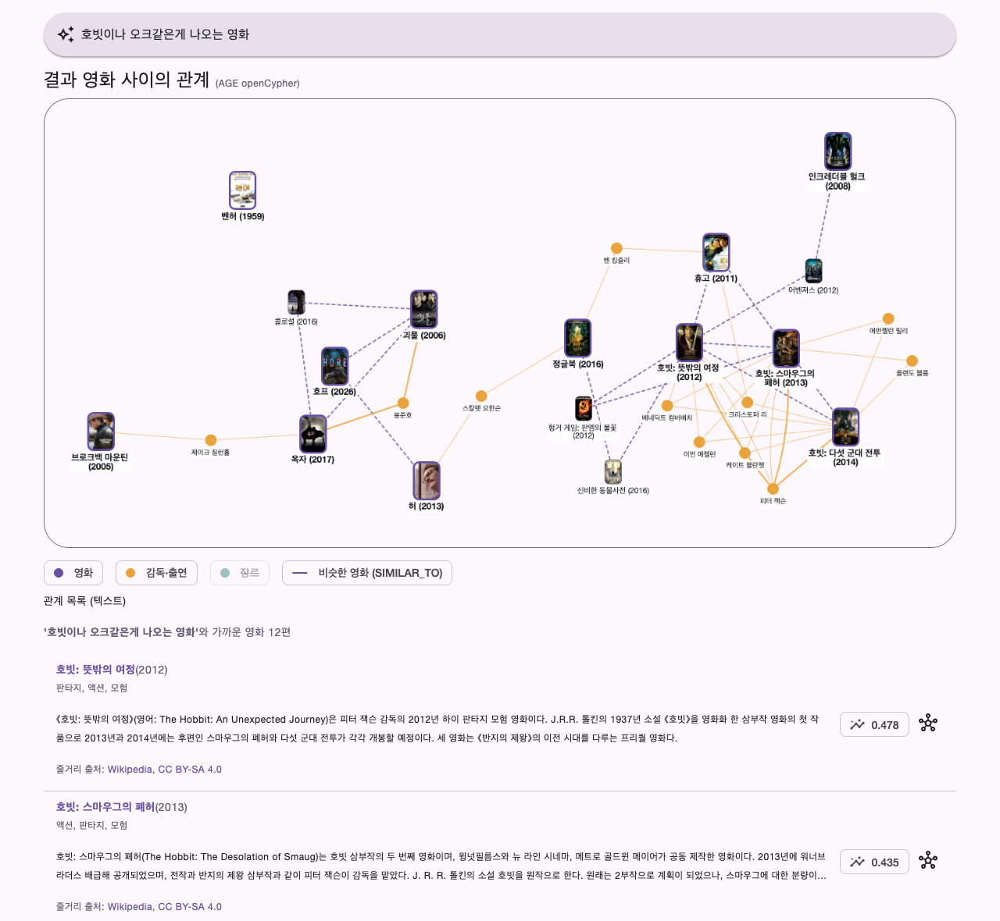
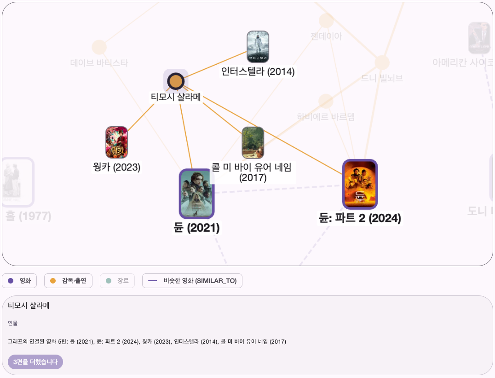

# Azure HorizonDB 벡터 검색과 그래프: MovieLog로 본 임베딩·DiskANN·Apache AGE 활용

## 핵심 흐름: 관계형 원본 → 임베딩·DiskANN → AGE 그래프 → 의미 검색 { #message }

Azure HorizonDB는 PostgreSQL 확장으로 벡터와 그래프를 함께 제공하므로, 관계형 데이터 옆에 임베딩과
관계 그래프를 두고 "자연어로 찾고 관계로 넓혀 보는" 검색을 SQL과 openCypher만으로 만들 수 있습니다.
영화 리뷰 앱 MovieLog에 Wikidata·Wikipedia 영화 카탈로그를 넣어 다음 흐름으로 확인했습니다.

1. **관계형 원본** — 영화 484편, 인물·장르와 출연·감독 관계를 일반 테이블에 둡니다.
2. **임베딩과 DiskANN** — 영화마다 제목·인물·장르·요약을 한 문서로 묶어 임베딩하고 `vector` 열과
   DiskANN index에 둡니다. 같은 문서를 Azure OpenAI `text-embedding-3-large`(1,536차원)와 한국어 특화
   오픈 모델 `dragonkue/BGE-m3-ko`(1,024차원)로 각각 임베딩해 요청마다 모델을 고릅니다.
3. **AGE 그래프** — 같은 테이블에서 Apache AGE 그래프 `movie_graph`를 만들고, 임베딩이 가까운 영화를
   `SIMILAR_TO` 관계로 이어 벡터 결과를 그래프 구조로 저장합니다.
4. **의미 검색과 관계 그래프** — 질의를 임베딩해 가까운 영화를 찾고, 찾은 영화들 사이의 감독·배우·장르·
   유사 관계를 openCypher로 조회해 함께 그립니다.

아래는 "호빗이나 오크같은게 나오는 영화"의 결과입니다(2026-11-13, Azure OpenAI 모델). 제목에 "호빗"이 없는 영화도
줄거리 의미로 찾고, 피터 잭슨·이언 매켈런 같은 공통 인물과 `SIMILAR_TO` 점선이 결과 사이의 관계를 보여 줍니다.



| 단계 | 평균 시간 | 측정 조건 |
|---|---|---|
| 질의 임베딩 — bge-m3-ko(AKS vLLM, T4 spot) | 22.0 ms | 2026-11-15, 40분, 서버 Timer |
| 질의 임베딩 — Azure OpenAI `text-embedding-3-large` | 109.3 ms | 2026-11-15, 40분, 서버 Timer |
| HorizonDB 벡터 검색(벡터·키워드 RRF 결합) | 10.9–11.5 ms | 2026-11-15, 40분, 두 모델 |
| HorizonDB AGE 그래프 조회 | 4.45 ms | 2026-11-13, 1시간, Grafana 대시보드 |

응답 시간의 대부분은 임베딩 호출이고 DB 단계는 수~십여 밀리초입니다.

이 문서의 각 기술 절은 Microsoft Learn 기준의 **기능 설명**을 먼저 두고, MovieLog에서 실제로 확인한 값과 선택은
**`MovieLog 확인`** 하위 절에 나눠 적었습니다. 기능 설명은 다른 앱에도 그대로 적용되고, `MovieLog 확인`은
이 샘플의 데이터·구독·버전에서 관찰한 결과입니다. 재현 절차와 측정 상세는 자식 문서에 있습니다.

| 문서 | 성격 | 내용 |
|---|---|---|
| [HorizonDB 벡터·그래프 기능](vector-graph-features/index.md) | 기능 가이드 | 거리 연산자, index 매개변수, advanced filtering, AGE 저장 구조와 `cypher()` 함수의 세부 동작 |
| [MovieLog 실습](movielog-lab/index.md) | 샘플 실습 | `azd up` 한 번으로 재현하는 배포, 데이터 모델, 그래프 동기화, 앱 구현, 관측 |
| [Flexible Server 성능 비교](flexible-server-comparison/index.md) | 샘플 측정 | 같은 4 vCore 조건의 pgbench와 1,024차원 20만 건 벡터 측정 |

## Azure HorizonDB 개요: PostgreSQL 호환 AI-ready 관리형 데이터베이스 { #horizondb }

Azure HorizonDB는 PostgreSQL 위에 만든 cloud native 완전 관리형 데이터베이스이며 2026-11-16 현재
**미리 보기**입니다. compute와 storage를 나누고 WAL만 storage로 쓰는 database-as-a-log 구조이며,
벡터 임베딩과 Microsoft Foundry 연동을 기본으로 제공해 RAG·추천·의미 검색을 데이터베이스 계층에서
구현하는 것을 주요 사용 사례로 듭니다.

| 구분 | 내용 |
|---|---|
| 구조 | 쓰기 primary 1개와 읽기 replica가 같은 storage를 공유합니다. compute replica는 vCore당 메모리 8 GB와 로컬 NVMe cache를 가지며, WAL 전송·checkpoint·백업은 storage 계층이 맡습니다. |
| 접속 | read-write endpoint와 읽기 replica에 분산하는 read-only endpoint |
| 과금 | 프로비저닝한 compute(core hour), 사용한 storage(GB/월), 단기 보존 백업 storage |
| 미리 보기 제약 | 백업 보존 7일 고정, 지역 간 read replica·고객 관리 키·내장 PgBouncer·VNet injection 미지원(private link는 지원) |

### 벡터·그래프·AI 확장: vector · pg_diskann · age · azure_ai { #extensions }

확장은 parameter group의 `azure.extensions`로 허용한 뒤 `CREATE EXTENSION`으로 설치하며, 공유 메모리를 쓰는
`age`는 `shared_preload_libraries`도 필요합니다. 마지막 열은 MovieLog cluster에서 확인한 설치 버전으로, Learn
목록보다 높았습니다.

| 확장 | 용도 | Learn 목록 버전 | MovieLog cluster 버전 |
|---|---|---|---|
| `vector` | pgvector 벡터 타입과 거리 연산자 | 0.8.0 | 0.8.7 |
| `pg_diskann` | DiskANN 근사 최근접 이웃 index | 0.7.1 | 0.7.6 |
| `age` | Apache AGE 그래프, openCypher | 1.6.0 | 1.8.0 |
| `azure_ai` | Foundry 모델을 부르는 AI 함수와 AI pipeline | 2.2.1 | 2.5.6 |

## 벡터 검색: `vector` 열 · 거리 연산자 · index 선택 { #vector }

벡터는 `vector(n)` 타입의 일반 열이고, 검색은 질의 벡터와의 거리(`<=>` 코사인, `<->` L2, `<#>` 내적)로
정렬하는 SQL 한 문장입니다. 일반 열이므로 관계형 테이블과 join하거나 `WHERE` 조건과 함께 쓸 수 있고,
임베딩 모델마다 열과 index를 따로 둘 수 있습니다.

```sql
ALTER TABLE documents ADD COLUMN embedding vector(1024);
CREATE INDEX ON documents USING diskann (embedding vector_cosine_ops);

SELECT id, title, 1 - (embedding <=> :query_vector) AS score
FROM documents
ORDER BY embedding <=> :query_vector
LIMIT 10;
```

### 벡터 index 선택지: Flat · IVFFlat · HNSW · DiskANN { #index-options }

HorizonDB에서 고를 수 있는 벡터 검색 방식은 네 가지이며, 질의 SQL은 같고 index만 바뀝니다.

| 방식 | 구조 | 최대 차원 | 메모리 | 데이터 변경 | 필터 결합 |
|---|---|---|---|---|---|
| Flat(index 없음) | 전체 비교, recall 100% | 16,000 | 없음 | 비용 없음 | 항상 정확 |
| IVFFlat | list 분할 탐색 | 2,000 | 작음 | recall 저하, 주기적 재생성 | 후필터 |
| HNSW | 다층 그래프 | 2,000 | 큼(RAM에 올라가야 함) | 제자리 반영 | 후필터 |
| DiskANN(`pg_diskann`) | SSD 최적화 그래프 | 16,000(`sq_bits=1`), 4,000(`sq_bits=4`) | 작음(대부분 SSD) | 제자리 반영 | index 안에서 필터(advanced filtering) |

Learn은 10만 행 미만이고 지연이 중요하지 않으면 flat scan을 먼저 권하고, 2,000차원 초과·높은 recall의
필터 결합·RAM보다 크거나 계속 늘어나는 데이터에는 DiskANN, 정적이고 RAM에 들어가는 데이터에는 HNSW,
빠른 build를 위해 recall을 양보할 때는 IVFFlat을 권합니다. 매개변수와 실행 계획은
[벡터 index 선택](vector-graph-features/index.md#vector-index)에 있습니다.

### DiskANN 특징: 기본 권장 · SSD 기반 · 필터 결합 · 차원 여유 { #why-diskann }

- **기본 권장** — Learn은 HorizonDB의 production AI 워크로드 기본값으로 DiskANN을 듭니다.
- **SSD 기반 확장** — HNSW와 달리 index 전체가 메모리에 올라갈 필요가 없어, 데이터가 늘어도 compute를
  키우지 않고 버틸 수 있습니다.
- **필터 결합** — 메타데이터 조건을 붙인 검색을 index 탐색 안에서 거르는 방식(advanced filtering)은
  DiskANN만 제공합니다. planner가 비용과 필터 선택도로 사용 여부를 정하므로 `EXPLAIN`으로 계획을 확인합니다.
- **차원 여유** — spherical quantization을 켜면 3,072차원 같은 고차원 임베딩도 index할 수 있어, 모델을
  바꿔도 index 방식을 바꾸지 않습니다.

### MovieLog 확인: DiskANN 선택과 실행 계획 { #vector-movielog }

MovieLog는 영화 문서 테이블 `catalog.movie_docs`에 모델별 열(`embedding` 1,536차원, `embedding_bge` 1,024차원)과
DiskANN index를 두었습니다. 지금은 484행이라 Learn 기준으로는 flat 범위지만, 리뷰와 영화가 계속 늘어나고 장르·연도
조건 검색을 붙일 계획이라 DiskANN을 골랐습니다.

```sql
SELECT m.title, 1 - (d.embedding_bge <=> CAST(:v AS vector)) AS score
FROM catalog.movie_docs d JOIN public.movies m ON m.tmdb_id = d.tmdb_id
ORDER BY d.embedding_bge <=> CAST(:v AS vector)
LIMIT 12;
```

- **484행 실행 계획** — planner는 seq scan을 골랐고, `SET LOCAL enable_seqscan TO OFF`일 때만 DiskANN index를
  썼습니다.
- **20만 건 필터 결합** — 1,024차원 20만 건에 선택도 2% 조건을 붙인 k-NN은 HorizonDB의 `DiskANNFilteredScan`
  계획이 272–297 ms였고, 같은 세션에서 `diskann.enable_filter_hook = off`로 끈 단건 실행은 53.7 ms였습니다.
  필터 결합은 데이터 분포에 따라 계획을 확인하고 세션 매개변수를 조정해야 했습니다
  ([벡터 적재와 검색](flexible-server-comparison/index.md#vector)).
- **키워드 결합** — 벡터 순위에 제목·인물 이름 일치로 만든 키워드 순위를 Reciprocal Rank Fusion으로 합쳐, 「듄」처럼
  짧은 제목 질의도 놓치지 않게 했습니다([의미 검색 구현](movielog-lab/index.md#search)).

## DB 안 AI 함수: model registry · 관리형 모델 · BYOM { #in-database-ai }

`azure_ai` 확장을 쓰면 앱 대신 HorizonDB가 모델을 불러 SQL 안에서 임베딩·생성·재순위를 실행합니다. 모델은
model registry에 alias로 등록하며, 등록 방법은 두 가지입니다.

| 방식 | 동작 | 상태 |
|---|---|---|
| 관리형 모델(AI Model Management) | cluster에서 켜면 Microsoft Foundry에 `default-embedding`(`text-embedding-3-small`), `default-chat`, `default-reranker`를 배포·등록하고 과금과 관리를 HorizonDB에 통합합니다. 함수에서 `model`을 생략하면 이 모델을 씁니다. | limited preview(참여 승인 필요) |
| BYOM(Bring Your Own Model) | 직접 배포한 Foundry·Azure OpenAI 모델을 `model_registry.model_add()`로 등록합니다. 지원 endpoint는 `*.services.ai.azure.com`, `*.openai.azure.com`, `*.cognitiveservices.azure.com`이며, API Management endpoint로 요청을 보내 부하 분산·정책을 적용할 수도 있습니다. | 미리 보기 |

```sql
SELECT model_registry.model_add(
    '<model-alias>', '<endpoint-URL>', '<deployment-name>', '<model-name>',
    '<API-version>', 'subscription-key', '<endpoint-key>');

SELECT azure_openai.create_embeddings('<model-alias>', 'Alternatives to LEGO');
```

- **지원 모델** — DB 안 임베딩 함수의 지원 모델은 `text-embedding-3-small`, `text-embedding-3-large`,
  `text-embedding-ada-002`입니다. 그 밖의 모델은 앱이나 별도 서비스에서 임베딩해 벡터를 SQL parameter로 넘깁니다.
- **두 가지 호출 방식** — `azure_ai.*`·`azure_openai.*` 함수는 호출한 문장 안에서 바로 실행되고, `ai.*`
  AI pipeline(미리 보기)은 source 테이블·chunk·embed·extract·rank 단계·sink·`on_change` trigger를 SQL로 선언해
  `pg_durable` 위에서 재시도와 checkpoint를 갖춘 채 나중에 실행합니다. 대량 적재와 새 행 자동 임베딩에 맞습니다.
- **접근 제어** — 등록한 모델은 기본적으로 모든 DB 사용자가 쓸 수 있으며, `model_user_add`·`model_user_set`으로
  사용자를 제한합니다.

### MovieLog 확인: BYOM 등록과 `ai.embed` 실측 { #in-database-ai-movielog }

MovieLog 구독에서 두 방식을 시험했고, 최종 앱은 DB 안 임베딩 대신 앱에서 임베딩하는 구조를 유지했습니다.

| 항목 | 2026-11-15 결과 |
|---|---|
| 관리형 모델 | 기능 flag `Microsoft.HorizonDB/enableAiModelManagement`가 승인 대기(`Pending`)라 켤 수 없었습니다. |
| BYOM 인증 | Learn은 `subscription-key`와 `managed-identity`를 적지만, `managed-identity`는 BYOM에서 거부돼 `subscription-key`만 동작했습니다. |
| API Management 경유 | 구독 정책으로 Azure OpenAI key 인증이 꺼져 있어, API Management가 자기 managed identity로 Azure OpenAI를 부르고(`authentication-managed-identity` 정책) HorizonDB에는 API Management subscription key를 등록했습니다. `text-embedding-3-small`과 `-large` 모두 동작했고 첫 호출은 192–253 ms였습니다. |
| `ai.embed` | `azure_ai` 2.5.6에서 `ai.embed(text, model, ...)`가 바로 `real[]`을 돌려주었고, `azure_openai.create_embeddings`는 `ai.embed`를 쓰라는 deprecation 경고를 냈습니다. Learn의 AI pipeline 문서(`azure_ai` 2.3.2 기준)는 `ai.embed()`를 모델을 부르지 않는 pipeline 단계 정의로 설명하므로, 사용 전 `\df ai.embed`로 시그니처를 확인합니다. |
| 오픈 모델 등록 | OpenAI 형식(`/openai/deployments/{d}/embeddings`) 응답을 흉내 내는 mock을 API Management에 만들고 모델 이름을 `bge-m3-ko`로 등록하자 `ai.embed`가 응답을 받아들였습니다. 지원 범위 밖의 관찰입니다. |

```sql
SELECT array_length(ai.embed('마피아 가문의 권력 승계', 'byom-embed-small'), 1);  -- 1536
```

앱 임베딩을 유지한 이유는 bge-m3-ko vLLM 서버가 클러스터 안에만 있어, DB에서 부르려면 지원 형식의 공개 endpoint
뒤에 두어야 했기 때문입니다.

## 임베딩 모델 선택: 지원 OpenAI 모델과 오픈 모델 서빙 { #embedding-models }

임베딩은 문서와 질의를 같은 모델로 만들어야 하므로 모델마다 벡터 열과 index를 따로 둡니다. DB 안 함수는 OpenAI
세 모델만 지원하므로, 한국어 특화 오픈 모델 같은 다른 모델은 직접 서빙합니다. AKS에서는 관리형 GPU 노드 풀이
NVIDIA driver와 device plugin을 설치·관리하며, spot VM은 VM 계열과 상관없이 지역의 spot vCPU 할당량을 씁니다.

### MovieLog 확인: Azure OpenAI와 bge-m3-ko 비교 { #embedding-comparison }

MovieLog는 두 모델의 열을 함께 채우고 API의 `model=openai|bge` 매개변수로 고르게 해, 같은 질의의 결과를 나란히
비교했습니다.

| 항목 | Azure OpenAI `text-embedding-3-large` | `dragonkue/BGE-m3-ko` |
|---|---|---|
| 차원 | 3,072를 `dimensions`로 1,536으로 줄임 | 1,024 |
| 서빙 | 관리형 Azure OpenAI, Entra ID 인증 | AKS의 vLLM 0.32(OpenAI 호환 `/v1/embeddings`), `Standard_NC4as_T4_v3` spot 노드 1대 |
| 질의 임베딩 평균 | 109.3 ms | 22.0 ms |
| 라이선스·비용 | 토큰 과금 | Apache-2.0, GPU VM(spot) 시간 과금 |

2026-11-16에 같은 질의 12개를 두 모델로 검색한 상위 3편입니다(앱의 RRF 결합 결과). 판정은 질의 의도에 맞는
영화가 더 위에 있는 쪽입니다.

| 질의 | Azure OpenAI 상위 3편 | bge-m3-ko 상위 3편 | 더 나은 쪽 |
|---|---|---|---|
| 마피아 가문의 권력 승계 | 대부 3, 대부, 스카페이스 | 대부 3, 대부, 대부 2 | bge-m3-ko(대부 3부작) |
| 인공지능 로봇이 사람이 되고 싶어 하는 이야기 | 아이, A.I., 싸이보그지만 괜찮아 | 아이, A.I., 이미테이션 게임 | 비슷함 |
| 좀비가 나오는 기차 | 부산행, 설국열차, 파묘 | 부산행, 설국열차, 닥터 스트레인지: 대혼돈의 멀티버스 | 비슷함 |
| 호빗이나 오크같은게 나오는 영화 | 호빗: 뜻밖의 여정, 호빗: 스마우그의 폐허, 호빗: 다섯 군대 전투 | 호빗: 다섯 군대 전투, 호빗: 뜻밖의 여정, 호빗: 스마우그의 폐허 | 비슷함 |
| 드니 빌뇌브 | 듄, 듄: 파트 2, 블레이드 러너 2049 | 듄, 블레이드 러너 2049, 듄: 파트 2 | 비슷함 |
| 시간을 되돌려 과거를 바꾸는 이야기 | 벤자민 버튼의 시간은 거꾸로 간다, 시간, 백 투 더 퓨처 | 벤자민 버튼의 시간은 거꾸로 간다, 백 투 더 퓨처, 백 투 더 퓨처 2 | bge-m3-ko(백 투 더 퓨처 1·2) |
| 가난한 가족이 부잣집에 숨어드는 이야기 | 빈 집, 기생충, 7번방의 선물 | 웡카, 슬럼독 밀리어네어, 나 홀로 집에 | Azure OpenAI(기생충) |
| a shark terrorizes a beach town | 죠스, 괴물, 에이리언 | 죠스, 캐리비안의 해적: 세상의 끝에서, 쉬리 | Azure OpenAI |
| 15년 동안 갇혀 있던 남자의 복수 | 복수는 나의 것, 올드보이, 악마를 보았다 | 친절한 금자씨, 복수는 나의 것, 올드보이 | Azure OpenAI(올드보이 2위) |
| 우주에서 가족을 찾아 떠나는 여정 | 인터스텔라, 2001: 스페이스 오디세이, 승리호 | 스타 트렉: 더 비기닝, 인터스텔라, 프로메테우스 | Azure OpenAI(인터스텔라 1위) |
| 꿈속에서 벌어지는 하이스트 | 호프, 패스트 라이브즈, 인터스텔라 | 패스트 라이브즈, 호프, 웡카 | 둘 다 「인셉션」을 찾지 못함 |
| 아이와 함께 보는 판타지 애니메이션 | 센과 치히로의 행방불명, 위쳐: 늑대의 악몽, 신비한 동물사전 | 센과 치히로의 행방불명, 아이, 피터 팬 | 비슷함 |

- **품질** — 12개 중 6개는 비슷했고, bge-m3-ko가 2개, Azure OpenAI가 4개에서 나았습니다. bge-m3-ko는 같은
  시리즈를 묶어 찾는 데 강했고, 줄거리를 추상적으로 말한 질의와 영어 질의에서는 Azure OpenAI가 의도에 더 가까웠습니다.
  코사인 점수는 모델마다 분포가 달라 두 모델 사이에서 비교하지 않습니다.
- **선택** — 품질이 비슷한 범위에서 질의 임베딩이 5배 빠르고, 질의 텍스트가 클러스터 밖으로 나가지 않으며, 비용이
  호출량이 아니라 GPU 노드 시간으로 정해지는 점을 보고 bge-m3-ko를 앱 기본 모델로 두었습니다. 줄거리 중심 검색이
  많다면 Azure OpenAI가 낫고, 요청마다 `model`로 바꿀 수 있게 남겼습니다.
- **spot GPU** — MovieLog 구독의 Korea Central에서는 GPU VM으로 T4와 H100 계열만 조회됐고 GPU 계열 할당량은 0이었지만,
  spot vCPU 할당량으로 T4 노드를 만들 수 있었습니다. spot VM이 회수되면 새 노드가 뜰 때까지 `model=bge` 검색은
  503을 돌려주고 `model=openai`는 계속 동작합니다.
- **모델 추가** — bge-m3-ko는 기존 카탈로그 484편을 1분 26초(배치 32)에 임베딩했습니다. 새 열을 추가해 채운 뒤
  index를 만들고 기본 모델을 바꾸므로, 기존 열은 그대로라 되돌리기 쉽습니다.

## 그래프: Apache AGE와 openCypher { #graph }

Apache AGE는 PostgreSQL 안에 property graph를 두는 확장입니다. graph 하나는 schema 하나, vertex·edge label은
각각 테이블이 되고, openCypher 질의는 `cypher()` 함수로 SQL 안에서 실행해 `agtype` 결과를 받습니다. 그래서
그래프를 관계형 테이블·벡터와 같은 트랜잭션·같은 데이터베이스에서 다룰 수 있습니다.

- **매개변수** — Cypher 매개변수는 `cypher()`의 셋째 인자로 prepared statement parameter만 받습니다.
- **성능** — 시작점 목록을 `UNWIND`로 펼치고 `MATCH (a:Label {key: value})` 속성 map으로 찾으며, label 테이블의
  `properties`에 GIN index를 둡니다.
- **제약** — 원본 테이블이 바뀌어도 graph를 자동으로 따라가는 기능은 없어 trigger나 주기적 재생성을 씁니다.
  저장 구조와 제약은 [그래프 저장 구조](vector-graph-features/index.md#age-storage)에 있습니다.

### MovieLog 확인: `movie_graph` 구성과 조회 성능 { #graph-movielog }

MovieLog는 그래프를 관계형 테이블에서 다시 만들 수 있는 파생 데이터로 두고, 원본이 바뀌면 trigger가 바뀐 영화를
queue에 넣어 앱이 30초마다 반영합니다([그래프 동기화](movielog-lab/index.md#graph-sync)). 2026-11-16 기준
그래프는 다음과 같습니다.

| 노드 | 수 | 관계 | 수 |
|---|---|---|---|
| `Movie` | 484 | `ACTED_IN` | 2,801 |
| `Person` | 1,812 | `DIRECTED` | 525 |
| `Genre` | 125 | `IN_GENRE` | 1,659 |
| | | `SIMILAR_TO`(bge-m3-ko 임베딩 최근접 3편, 쌍 단위) | 1,081 |

앱은 검색 결과 영화들을 `UNWIND`로 시작점 삼아 이웃을 한 번에 조회합니다.

```sql
SELECT * FROM ag_catalog.cypher('movie_graph', $cy$
  UNWIND [27205, 157336, 155] AS t
  MATCH (a:Movie {tmdb_id: t})-[r]-(b)
  RETURN id(a), label(a), properties(a), id(b), label(b), properties(b), id(r), type(r)
$cy$) AS (a_id agtype, a_label agtype, a_props agtype,
          b_id agtype, b_label agtype, b_props agtype, r_id agtype, r_type agtype);
```

- **`UNWIND` 효과** — 처음 쓴 `MATCH (a:Movie)-[r]-(b) WHERE a.tmdb_id IN [...]`는 영화 8편에 26.7초가 걸렸고,
  같은 결과(134행)를 `UNWIND ... MATCH (a:Movie {tmdb_id: t})`로 바꾸자 0.12초가 됐습니다.
- **벡터를 그래프로** — `SIMILAR_TO`는 임베딩 최근접 결과를 관계로 저장한 것이라, "이 영화와 비슷한 영화에 나온
  배우"처럼 벡터와 관계를 섞은 질의를 Cypher 한 번으로 풉니다.



화면은 Cytoscape.js로 그렸습니다. 포스터 노드, 관계 필터, 인물 펼치기 구현은
[그래프 화면](movielog-lab/index.md#graph-ui)에 있습니다.

## 활용 패턴: 하이브리드 검색 · graph-augmented RAG · 재순위 · AI pipeline { #patterns }

벡터·그래프·AI 함수가 한 데이터베이스에 있으면 다음 패턴을 별도 검색 엔진이나 그래프 DB 없이 조합할 수 있습니다.
가운데 열은 HorizonDB에서의 구성이고, 마지막 열은 MovieLog에 적용했는지입니다.

| 패턴 | HorizonDB 구성 | MovieLog 적용 |
|---|---|---|
| 하이브리드 검색 | 벡터 순위와 키워드 순위를 SQL에서 RRF로 결합 | 적용(벡터 상위 50편 + 키워드 상위 50편) |
| 관계 확장(context expansion) | 벡터 결과를 시작점으로 AGE 이웃 탐색 | 적용(결과 영화 사이의 인물·장르·유사 관계 그래프) |
| 벡터 관계 저장 | 최근접 결과를 그래프 관계로 저장 | 적용(`SIMILAR_TO`) |
| 필터 결합 검색 | DiskANN advanced filtering | 미적용(장르 열을 `movie_docs`에 두면 가능) |
| 재순위 | `azure_ai.rank()` cross-encoder로 벡터 후보 재정렬 | 미적용(관리형 `default-reranker` 필요) |
| graph-augmented RAG | 벡터 후보 + 그래프 탐색 + RRF 결과를 `azure_ai.generate()`에 문맥으로 전달 | 미적용 |
| 임베딩 자동화 | AI pipeline `on_change` trigger로 새 행 임베딩 | 미적용(앱이 색인 시 임베딩) |

graph-augmented RAG의 Learn 패턴(authority boosting, context expansion, graph filtering, path-based retrieval)과
MovieLog 대응은 [벡터와 그래프 결합](vector-graph-features/index.md#graph-rag)에 있습니다.

## 성능: MovieLog 환경의 PostgreSQL Flexible Server 비교 측정 { #performance }

Learn에는 HorizonDB와 Azure Database for PostgreSQL flexible server의 성능 비교 문서가 없어, 이 절의 값은 모두 MovieLog
환경에서 직접 잰 결과입니다. 같은 4 vCore 크기에서 HorizonDB는 WAL만 저장 계층에 쓰는 구조 덕분에 쓰기 처리량과 대량
적재에서 앞섰고, 벡터 검색 지연은 조금 뒤졌습니다(2026-11-15, 단일 실행 위주).

| 부하 | HorizonDB | Flexible Server(E4ds_v5, Premium SSD 512 GiB) |
|---|---|---|
| TPC-B 쓰기, 64 연결 | 5,115 tps | 4,108 tps |
| `pgbench -i -s 100` 초기 적재 | 9.6초 | 28.3초 |
| 읽기 전용, 32 연결 | 36,757 tps | 36,187 tps |
| 1,024차원 20만 건 DiskANN index 생성 | 213초 | 225초 |
| k-NN 10건, 8 연결 | 23.0 ms | 19.2 ms |
| 필터(선택도 2%) + k-NN 10건, 8 연결 | 272 ms | 149 ms |

쓰기가 많은 데이터와 대량 재임베딩에는 HorizonDB의 구조가 유리했고, 벡터 검색은 두 서비스 모두 `pg_diskann`을 쓰되
버전(0.7.6과 0.6.6)과 필터 계획이 달라 결과가 갈렸습니다. 측정 환경과 해석, 한계는
[Flexible Server 성능 비교](flexible-server-comparison/index.md)에 있습니다.

## VS Code PostgreSQL 확장: 연결 · AGE 그래프 시각화 · pipeline 보기 { #vscode }

Microsoft의 PostgreSQL extension for Visual Studio Code(`ms-ossdata.vscode-pgsql`, 미리 보기)는 HorizonDB를
구독·resource group·cluster로 찾아 연결하고, 같은 편집기에서 SQL·Cypher·AI 함수를 실행합니다.

| 기능 | HorizonDB에서 쓰는 방법 |
|---|---|
| Connection Manager | read-write endpoint와 read-only endpoint를 profile 두 개로 저장해 작업에 따라 바꿉니다. |
| Apache AGE Graph Visualizer | Cypher 결과가 vertex·edge 객체면 node-edge 그래프로 그립니다. |
| Schema Visualizer | 데이터베이스를 우클릭해 **Visualize Schema**로 테이블과 외래 키 관계를 봅니다. |
| Pipelines & Workflows | AI pipeline 정의와 실행 이력, `pg_durable` workflow 상태를 봅니다. |
| GitHub Copilot `@pgsql` | 연결된 cluster의 확장(`vector`, `pg_diskann`, `azure_ai`, `age`)을 아는 상태로 질의를 돕습니다. |

그래프로 그리려면 속성 대신 객체 전체를 반환하고, 반환한 객체마다 `AS (...)` 열을 하나씩 둡니다. node 이름은
`disp_label` 속성으로 정하며 없으면 내부 id가 보입니다. Learn 예제처럼 `SET`으로 넣으면 graph에 쓰기가 일어나므로
쓰기 권한이 있는 역할로 실행하거나 그래프를 만들 때 `disp_label`을 함께 저장합니다.

### MovieLog 확인: 그래프 시각화용 질의 { #vscode-movielog }

다음 질의는 MovieLog cluster에서 vertex·edge 객체를 그대로 돌려주는 것을 확인했습니다. 확장 화면에서 그려지는
모습은 확인하지 않았습니다.

```sql
SET search_path = ag_catalog, "$user", public;
SELECT * FROM cypher('movie_graph', $$
  MATCH (p:Person)-[r:DIRECTED]->(m:Movie {tmdb_id: 27205})
  RETURN p, r, m
$$) AS (p agtype, r agtype, m agtype);
```

## 실습과 샘플 코드: azd 배포와 외부 코드 레포 { #lab }

앱 소스, Bicep과 azd hook, DB 스크립트, 데이터셋 빌더, Kubernetes manifest, Grafana dashboard는 샘플 코드 레포
[`hellices/sample-movielog-horizondb`](https://github.com/hellices/sample-movielog-horizondb)에 있으며 이 문서는
`v2.7.0` 릴리스를 기준으로 합니다. 앱 이미지는 release workflow가 `ghcr.io/hellices/sample-movielog-horizondb:2.7.0`으로
게시하고, `azd up`의 hook이 digest로 지정해 실습 Azure Container Registry로 가져옵니다.

- [MovieLog 실습](movielog-lab/index.md) — 아키텍처, 데이터 모델, 작성 순서, 앱 구현, 관측, 공개 구성
- [sample-movielog-horizondb README (v2.7.0)](https://github.com/hellices/sample-movielog-horizondb/blob/v2.7.0/README.md)
- [Azure 배포 절차 (v2.7.0)](https://github.com/hellices/sample-movielog-horizondb/blob/v2.7.0/docs/deploy.md)

## 미리 보기 제약: 서비스 · 확장 · AI 기능 { #constraints }

- **미리 보기 범위** — HorizonDB, `age` 확장, AI Model Management(limited preview), AI pipeline, VS Code 확장이
  2026-11-16 현재 미리 보기입니다. CLI와 API 구조가 Learn 예제와 달랐으므로 사용 전 `az horizondb -h`와
  provider API 버전을 확인합니다. MovieLog에서 만난 차이는
  [Learn 문서와 실습 cluster의 차이](vector-graph-features/index.md#observed-differences)와
  [실습 문서](movielog-lab/index.md)에 있습니다.
- **AI 함수 버전** — MovieLog cluster의 `azure_ai` 버전(2.5.6)이 Learn 기준(2.2.1–2.3.2)보다 높아 함수 시그니처가 달랐습니다.
- **임베딩 모델 지원** — DB 안 임베딩의 공식 지원 모델은 OpenAI 세 모델입니다.

## 공식 참고 자료

- [What is Azure HorizonDB (Preview)?](https://learn.microsoft.com/azure/horizondb/overview)
- [List of extensions and modules by name in Azure HorizonDB (Preview)](https://learn.microsoft.com/azure/horizondb/extensions/concepts-extensions-versions)
- [Implement vector search with the pgvector extension in Azure HorizonDB (Preview)](https://learn.microsoft.com/azure/horizondb/ai/vector-search-pgvector)
- [Choose the right vector index for your workload in Azure HorizonDB (Preview)](https://learn.microsoft.com/azure/horizondb/ai/vector-index-selection-guide)
- [Scalable vector index with DiskANN in Azure HorizonDB (Preview)](https://learn.microsoft.com/azure/horizondb/ai/vector-index-diskann)
- [Graph database capabilities with Apache AGE extension for Azure HorizonDB (Preview)](https://learn.microsoft.com/azure/horizondb/graph/age-overview)
- [AI functions in the azure_ai extension in Azure HorizonDB (Preview)](https://learn.microsoft.com/azure/horizondb/ai/ai-functions)
- [AI Model Management in Azure HorizonDB (Preview)](https://learn.microsoft.com/azure/horizondb/ai/ai-model-management)
- [Implement AI pipelines in Azure HorizonDB (Preview)](https://learn.microsoft.com/azure/horizondb/ai/ai-pipelines)
- [Graph-augmented RAG patterns in Azure HorizonDB (Preview)](https://learn.microsoft.com/azure/horizondb/ai/graph-rag)
- [What is the PostgreSQL extension for Visual Studio Code? (Preview)](https://learn.microsoft.com/azure/horizondb/development/vs-code-extension/vs-code-overview)
- [Create a fully managed GPU node pool on Azure Kubernetes Service (AKS)](https://learn.microsoft.com/azure/aks/aks-managed-gpu-nodes)
- [Increase spot vCPU family quotas](https://learn.microsoft.com/azure/quotas/spot-quota)
- [What is Azure Database for PostgreSQL?](https://learn.microsoft.com/azure/postgresql/overview)
- [Apache AGE](https://github.com/apache/age)
