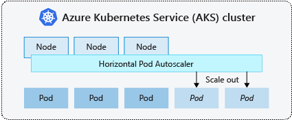
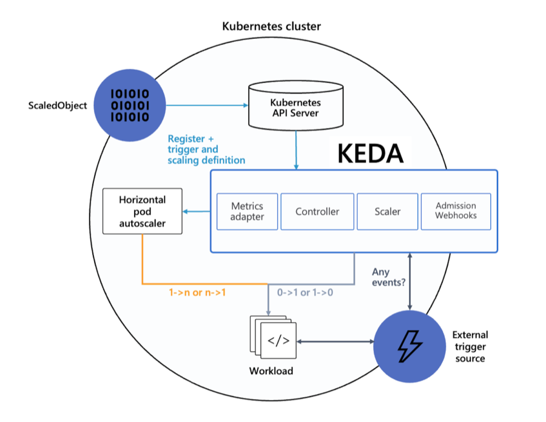
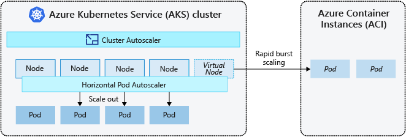

# AKS KEDA와 HPA: KEDA가 만든 HPA로 외부 지표 확장, 요청 수 기반 패턴

KEDA는 Kubernetes HPA를 이용해 Pod 수를 바꿉니다. `ScaledObject`를 만들면 KEDA
operator가 같은 Deployment를 대상으로 하는 HPA(`keda-hpa-<이름>`)를 만들고, KEDA metrics
server가 그 HPA에 요청 수·큐 길이 같은 외부 지표를 제공합니다. replica가 1개 이상일 때
수를 계산하고 바꾸는 것은 HPA controller이며, KEDA가 replica를 직접 바꾸는 것은 HPA가
처리하지 못하는 0↔1 전환뿐입니다.

| 구분 | HPA 직접 사용 | KEDA `ScaledObject` |
|---|---|---|
| 사용자가 만드는 리소스 | `HorizontalPodAutoscaler` | `ScaledObject`. HPA는 KEDA가 만들고 관리 |
| 지표 | CPU·메모리(metrics-server). 다른 지표는 custom·external metrics adapter 필요 | trigger의 scaler가 외부 지표를 조회하고 KEDA metrics server가 external metrics API로 제공 |
| 1개 이상에서 replica 계산 | HPA controller | HPA controller(같은 식, 같은 `behavior`) |
| 0개로 축소·0개에서 시작 | AKS 1.36에서 불가 | KEDA operator가 0↔1 전환 |
| 확장 속도 조절 | `spec.behavior` | `advanced.horizontalPodAutoscalerConfig.behavior`(생성되는 HPA에 그대로 들어감) |

CPU·메모리 지표만 쓰면 HPA를 직접 만들고, Pod 밖 지표로 확장하거나 0개까지 줄여야
하면 KEDA를 씁니다. 어느 쪽이든 늘어난 Pod가 들어갈 노드가 없으면 노드
autoscaler(NAP 또는 Cluster Autoscaler)가 노드를 추가합니다.

```text
ScaledObject ─► KEDA operator ─► HPA (keda-hpa-<이름>) ─► Deployment replica 1↔N ─► 노드 부족 시 노드 autoscaler
                     │                │ 15초마다 지표 요청
                     │                ▼
                     │         KEDA metrics server ─► scaler ─► 지표 원천
                     └─► 0↔1 전환은 KEDA operator가 Deployment replica를 직접 변경
```

## HPA replica 계산: 현재 지표와 목표의 비율



*그림: [Microsoft Learn, AKS scaling overview](https://learn.microsoft.com/azure/aks/concepts-scale), CC BY 4.0*

HPA controller는 기본 15초 주기로 다음 식을 계산합니다. 직접 만든 HPA와 KEDA가 만든 HPA가
같은 식을 씁니다.

```text
desiredReplicas = ceil(currentReplicas × currentMetricValue / desiredMetricValue)
```

비율이 목표의 ±10%(기본 tolerance) 안이면 움직이지 않습니다. 별도
`behavior`를 쓰지 않으면 다음 기본값이 적용됩니다.

| 방향 | 기본 동작 | 의미 |
|---|---|---|
| Scale up | 안정화 창 0초, 15초마다 100% 또는 4개 중 큰 값까지 추가 | 급증에 바로 반응 |
| Scale down | 안정화 창 300초, 15초마다 100%까지 감소 | 최근 5분 최고 권장값 아래로는 줄이지 않음 |

CPU utilization 목표는 container `requests` 대비 비율이므로 requests가
없는 Pod는 계산되지 않습니다. 다음은 기존 Pod 분산 예제의 HPA를 운영 환경에
맞게 보강한 예입니다.

```yaml
apiVersion: autoscaling/v2
kind: HorizontalPodAutoscaler
metadata:
  name: my-app
spec:
  scaleTargetRef:
    apiVersion: apps/v1
    kind: Deployment
    name: my-app
  minReplicas: 4
  maxReplicas: 10
  metrics:
    - type: Resource
      resource:
        name: cpu
        target:
          type: Utilization
          averageUtilization: 60
  behavior:
    scaleDown:
      stabilizationWindowSeconds: 300
      policies:
        - type: Pods
          value: 2
          periodSeconds: 60   # 1분에 2개씩만 줄여 급격한 축소를 막음
```

HPA를 적용한 Deployment manifest에서는 `replicas`를 지워 배포 때마다 HPA가
정한 값을 덮어쓰지 않게 합니다. 배포 쪽 주의점은
[배포 전략 가이드](../deployment-strategies-rollout/index.md)에
있습니다.

## KEDA 구성 요소: operator, scaler, metrics server, admission webhook

KEDA는 HPA를 대신하지 않습니다. 외부 지표를 HPA가 읽을 수 있는 Kubernetes
API로 내보내고, HPA가 다루지 못하는 0개 전환만 직접 처리합니다. AKS KEDA
add-on을 켜면 `kube-system`에 다음 Pod가 뜨고, replica 계산은 control plane의
HPA controller가 맡습니다.

| 구성 요소 | 위치 | 역할 |
|---|---|---|
| KEDA operator | `keda-operator` Pod | `ScaledObject`를 감시해 `keda-hpa-<이름>` HPA를 만들고 고칩니다. `pollingInterval`마다 scaler에 활성 여부를 묻고, 0↔1 전환 때 대상의 replica 수를 직접 바꿉니다. |
| 내장 scaler | operator 프로세스 안 | trigger `type`별 접속 코드입니다. 이벤트 원천(Managed Prometheus, Azure Monitor, Service Bus 등)을 조회해 활성 여부와 현재 지표 값을 돌려줍니다. |
| external scaler | 별도 gRPC 서버 | 내장 scaler와 같은 interface를 KEDA 밖의 별도 프로세스로 구현합니다. trigger에는 `external`·`external-push`와 서버 주소를 적습니다. |
| KEDA metrics server | `keda-operator-metrics-apiserver` Pod | `external.metrics.k8s.io` API를 제공합니다. HPA가 지표를 요청하면 gRPC로 operator에 넘겨 scaler 값을 받아 돌려줍니다. |
| admission webhook | `keda-admission-webhooks` Pod | 같은 workload를 가리키는 HPA·`ScaledObject`가 이미 있는 경우처럼 잘못된 설정을 생성 단계에서 거부합니다. |
| HPA controller | kube-controller-manager(AKS control plane) | 15초마다 KEDA metrics server에서 지표를 읽어 replica 수를 계산하고 대상의 scale subresource를 고칩니다. |

내장 scaler가 operator 안에서 돌기 때문에 Azure 지표를 읽는 Workload Identity도
`keda-operator` service account에 연결합니다. replica 수가 바뀐 뒤 Pod를 만들고
지우는 일은 Deployment controller가 합니다.

```text
이벤트 원천 ◄── 조회 ── scaler (keda-operator 안)
                        │
       ┌────────────────┴───────────────┐
  활성 여부 (pollingInterval)       지표 값 (HPA 요청 때)
       │                                │ gRPC
  KEDA operator                  KEDA metrics server
       │ 0↔1                            ▲ external.metrics.k8s.io, 15초
       ▼                                │
  Deployment replicas ◄──── 1↔N ─── HPA controller (keda-hpa-<이름>)
```



*그림: [Microsoft Learn, Kubernetes Event-driven Autoscaling (KEDA)](https://learn.microsoft.com/azure/aks/keda-about), CC BY 4.0*

## replica 변경 주체: 0↔1은 KEDA operator, 1↔N은 HPA controller

| 단계 | replica를 바꾸는 주체 | 판단 근거 | 설정 |
|---|---|---|---|
| 활성화(0 → 1) | KEDA operator | scaler 활성 여부 | `activation*` 값, `pollingInterval`(기본 30초) |
| 확장·축소(1 ↔ N) | HPA controller | scaler 지표 값과 trigger 목표값 | `threshold`·`targetValue` 등, `advanced.horizontalPodAutoscalerConfig.behavior` |
| 비활성화(1 → 0) | KEDA operator | 모든 trigger 비활성 | `cooldownPeriod`(기본 300초) |

- replica가 0이면 HPA는 대상을 조정하지 않고 `ScalingActive=False` 상태로
  기다립니다. 그래서 0에서 1로 올리는 일은 KEDA operator가 맡고, 1이 되면 HPA가
  이어받습니다. KEDA가 만든 HPA의 `minReplicas`는 1 이상입니다.
- 1↔N 구간에서 HPA는 앞 절의 식으로 replica를 계산합니다. 외부 지표의 기본 목표
  유형은 `AverageValue`라서 scaler 값을 현재 replica 수로 나눈 값을 목표값과
  비교합니다. 예를 들어 Pod당 목표 50 RPS에 전체 400 RPS면 8개가 됩니다.
- HPA가 15초마다 지표를 요청할 때마다 metrics server는 기본적으로 scaler를 새로
  조회합니다. trigger에 `useCachedMetrics: true`를 두면 `pollingInterval`마다 갱신한
  캐시 값을 돌려줘 이벤트 원천의 조회 부하를 줄입니다.
- `minReplicaCount`가 1 이상이면 workload가 0개로 줄지 않으므로 `activation*` 값은 replica
  수에 영향을 주지 않습니다. KEDA 문서는 이를 "scaler가 항상 활성"이라고 표현하지만, 지표가
  activation 값보다 낮을 때 `ScaledObject`의 `Active` 조건이 False로 보일 수 있으며 장애는
  아닙니다.
- 같은 workload에 HPA와 `ScaledObject`를 함께 두지 않습니다. 같은 대상을 가리키는 HPA가
  먼저 있으면 KEDA admission webhook이 `ScaledObject`를 거부합니다(KEDA 2.19
  `verifyHpas`). 이 검증을 끄는 annotation이 있고 webhook이 동작하지 않는 환경도 있으므로,
  검증에 기대지 말고 적용 전에 같은 대상을 가리키는 HPA가 없는지 직접 확인합니다. 나중에 HPA를 만들면 둘이 replica 수를 번갈아 바꿉니다. 기존 HPA에서 옮길 때는 HPA를 지우거나
  `scaledobject.keda.sh/transfer-hpa-ownership: "true"` annotation과
  `advanced.horizontalPodAutoscalerConfig.name`(기존 HPA 이름)으로 소유권을 넘깁니다.
- AKS 1.36의 기본 HPA는 replica 0을 지원하지 않습니다(`HPAScaleToZero`
  feature gate가 1.36까지 alpha). 0까지 줄이려면 KEDA가 필요합니다.
  upstream Kubernetes 1.37부터 이 feature gate는 beta로 기본 활성화되어
  object·external 지표 HPA에 `minReplicas: 0`을 쓸 수 있습니다. AKS 1.37에서
  허용되는지는 클러스터에서 따로 확인합니다.

KEDA가 만든 HPA와 지표 값은 다음 명령으로 확인합니다.

```bash
kubectl get hpa keda-hpa-<scaledobject-name> -n <namespace>
kubectl get scaledobject <scaledobject-name> -n <namespace> \
  -o jsonpath='{.status.externalMetricNames}'
kubectl get --raw "/apis/external.metrics.k8s.io/v1beta1/namespaces/<namespace>/<metric-name>?labelSelector=scaledobject.keda.sh%2Fname%3D<scaledobject-name>"
```

## AKS KEDA add-on 설치 범위: operator·metrics server·내장 scaler

`az aks update --enable-keda`는 operator, metrics server, admission webhook과
`ScaledObject`·`ScaledJob`·`TriggerAuthentication` CRD를 설치합니다. KEDA 버전은
클러스터 Kubernetes 버전을 따르며 AKS 1.36에서는 2.19 계열이고, 업그레이드도 AKS가
합니다. 내장 scaler는 operator에 들어 있어 trigger `type`만 지정하면 됩니다.
HTTP Add-on처럼 별도 controller나 external scaler가 필요한 기능은 Helm으로
설치하고, AKS가 아닌 KEDA 커뮤니티가 지원합니다.

| 구분 | 예 | 설치·지원 |
|---|---|---|
| add-on 포함 | operator, metrics server, admission webhook, CRD | AKS가 설치·업그레이드 |
| add-on 포함 내장 scaler | Azure Monitor, Service Bus, Event Hubs, Storage Queue/Blob, Log Analytics, Application Insights, Data Explorer, Azure Pipelines, Prometheus, cron, CPU·memory 등 | trigger `type`으로 사용. Prometheus scaler는 Azure Monitor managed service for Prometheus 조회가 지원 범위이고 자체 운영 Prometheus는 범위 밖 |
| add-on 미포함 | KEDA HTTP Add-on(beta), Azure Cosmos DB change feed external scaler 등 | Helm 등으로 직접 설치, 커뮤니티 지원 |

- Workload Identity로 Azure 지표를 읽으려면 Workload Identity를 KEDA add-on보다
  먼저 켜는 순서가 권장됩니다. 순서가 바뀌었으면 `keda-operator`
  Pod를 재시작해 환경 변수를 주입합니다. 이후 `keda-operator` service account에
  federated credential과 client ID annotation을 연결합니다.
- 클러스터에는 external metrics server가 하나만 있어야 합니다. KEDA를 Helm으로
  한 번 더 설치하거나 다른 external metrics adapter와 함께 쓰지 않습니다.

## 요청 수 기반 확장 패턴: 지표 지연과 0개 운영 여부

세 패턴 모두 같은 앱(podinfo)과 같은 부하(초당 400건, Pod당 목표 초당 50건)로
패턴마다 1회 실측했습니다. 워크로드 노드는 모두 NAP `default` NodePool의 on-demand VM입니다.
첫 확장 시간은 k6 시작 기준이며 5초 간격 기록이라 근삿값으로 적습니다.

| 패턴 | 지표 경로 | 설치 | 첫 확장(1회 실측) | 0개 운영 | 적합한 경우 |
|---|---|---|---|---|---|
| [Managed Prometheus RPS](prometheus-rps/index.md) | 앱 `/metrics` → Managed Prometheus → `prometheus` scaler | add-on 포함 | 약 70초 | 부적합: Pod가 없으면 지표도 없음 | 앱이 Prometheus 지표를 내고 정밀한 query가 필요할 때 |
| [KEDA HTTP Add-on](http-add-on/index.md) | 요청이 interceptor를 거치며 집계 → `external-push` | Helm 별도 설치 | 약 40초 | 가능: 첫 요청 보류 (노드에 자리 있으면 5초 안쪽, 새 노드면 약 111초) | 유휴 시간이 길어 0개로 줄여야 할 때 |
| [AGC Azure Monitor 메트릭](azure-monitor-agc/index.md) | AGC `TotalRequests` → Azure Monitor → `azure-monitor` scaler | add-on 포함 | 약 155초 | 부적합: 0개 동안 요청 실패 | 앱 수정 없이 진입점 트래픽으로 확장할 때 |

0개 상태에서 요청을 붙잡아 두는 것은 KEDA HTTP Add-on의 interceptor뿐입니다. Managed
Prometheus와 AGC 패턴은 요청이 앱 Service로 바로 가므로 Pod가 0개인 동안 들어온 요청은 보류되지
않고 실패합니다. HTTP Add-on도 보류 시간에는 한도가 있습니다. Pod와 워크로드 노드가 모두 없는
상태에서 burst를 받은 1회 실측에서는 NAP 노드와 첫 Pod가 준비되기까지 약 110초 동안 계획한
요청의 약 22%가 실패하거나 아예 전송되지 못했습니다. `minReplicaCount: 1`에서는
실패가 없었습니다.

## 노드 autoscaler: Pod 확장 이후의 노드 추가

KEDA·HPA는 replica만 바꿉니다. 새 Pod가 들어갈 자리가 없으면 Pending이 되고,
노드 autoscaler(Cluster Autoscaler 또는 NAP)가 그 requests를 보고 노드를 늘립니다.



*그림: [Microsoft Learn, AKS scaling overview](https://learn.microsoft.com/azure/aks/concepts-scale), CC BY 4.0*

NAP를 쓰면 이 두 번째 단계에서 Pending Pod에 맞는 VM 크기를 직접 고릅니다. 노드를 새로
만들어야 하는 확장은 VM 준비 시간만큼 늦어집니다. Learn은 이 시간을 보통 2~5분으로
안내하고, [NAP 실측](../node-auto-provisioning/scale-out-benchmark/index.md)에서는 첫 노드까지 1~1.5분이었습니다.
이 시간을 기다릴 수 없는 Linux 워크로드는 virtual node 제약을 만족할 때 ACI로 급증분을
받을 수 있습니다. 노드 확장까지 고려하면 다음 항목을 함께 정합니다.

- 모든 container에 현실적인 `requests`를 둡니다. NAP는 이 값으로 노드를 고르고, CPU·메모리
  `Utilization` 방식의 HPA도 이 값 대비 비율로 계산합니다. 요청 수 패턴처럼 외부 지표를 쓰는
  HPA는 scaler가 주는 현재 지표와 목표값으로 replica를 정하므로 `requests`가 계산에 들어가지
  않습니다.
- 급증 구간이 예측되면 `minReplicaCount`를 높이거나 KEDA `cron` trigger로 미리
  늘립니다.
- 노드 생성 속도와 NAP 동작은 [AKS NAP 가이드](../node-auto-provisioning/index.md)를
  참고합니다.

## 공식 참고 자료

- [Azure Kubernetes Service (AKS) scaling overview](https://learn.microsoft.com/azure/aks/concepts-scale)
- [KEDA add-on overview](https://learn.microsoft.com/azure/aks/keda-about)
- [Integrations with KEDA on AKS](https://learn.microsoft.com/azure/aks/keda-integrations)
- [KEDA add-on and workload identity](https://learn.microsoft.com/azure/aks/keda-workload-identity)
- [Kubernetes Horizontal Pod Autoscaling](https://kubernetes.io/docs/concepts/workloads/autoscaling/horizontal-pod-autoscale/)
- [Kubernetes Feature Gates (`HPAScaleToZero`)](https://kubernetes.io/docs/reference/command-line-tools-reference/feature-gates/)
- [KEDA ScaledObject specification](https://keda.sh/docs/2.19/reference/scaledobject-spec/)
