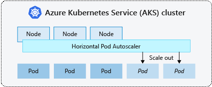
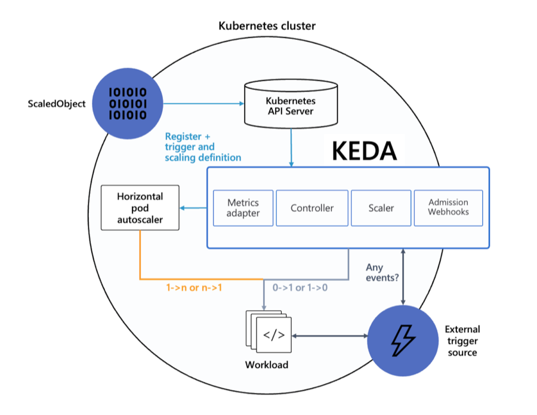
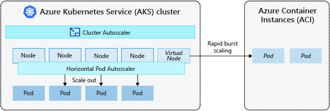

# AKS HPA와 KEDA로 지표별 Pod 확장 방식 고르기

CPU·메모리처럼 Pod 안에서 재는 지표는 HPA만으로 충분합니다. 요청 수,
큐 길이처럼 Pod 밖에 있는 지표로 확장하거나 0개까지 줄여야 하면 KEDA를
씁니다. KEDA는 HPA를 대체하지 않고 **HPA에 외부 지표를 공급하는 계층**입니다.
Pod가 늘어 노드가 부족해지면 그다음은 노드 autoscaler(NAP 또는 Cluster
Autoscaler)가 이어받습니다.

```text
지표 원천 ──► KEDA (ScaledObject) ──► HPA ──► Deployment replica
                 └ 0↔1 활성화는 KEDA가 직접           │
                                             Pending Pod ──► NAP가 노드 생성
```

## HPA는 15초마다 현재 지표와 목표의 비율로 replica를 계산한다



*그림: [Microsoft Learn, AKS scaling overview](https://learn.microsoft.com/azure/aks/concepts-scale), CC BY 4.0*

HPA controller는 기본 15초 주기로 다음 식을 계산합니다.

```text
desiredReplicas = ceil(currentReplicas × currentMetricValue / desiredMetricValue)
```

비율이 목표의 ±10%(기본 tolerance) 안이면 움직이지 않습니다. 별도
`behavior`를 쓰지 않으면 다음 기본값이 적용됩니다.

| 방향 | 기본 동작 | 의미 |
|---|---|---|
| Scale up | 안정화 창 0초, 15초마다 100% 또는 4개 중 큰 값까지 추가 | 급증에 바로 반응 |
| Scale down | 안정화 창 300초, 15초마다 100%까지 감소 | 최근 5분 최고 권장값 아래로는 줄이지 않음 |

CPU utilization 목표는 **container `requests` 대비 비율**이므로 requests가
없는 Pod는 계산되지 않습니다. 기존 Pod 분산 예제의 HPA를 운영형으로 보강하면
다음과 같습니다.

```yaml
apiVersion: autoscaling/v2
kind: HorizontalPodAutoscaler
metadata:
  name: my-app
spec:
  scaleTargetRef:
    apiVersion: apps/v1
    kind: Deployment
    name: my-app
  minReplicas: 4
  maxReplicas: 10
  metrics:
    - type: Resource
      resource:
        name: cpu
        target:
          type: Utilization
          averageUtilization: 60
  behavior:
    scaleDown:
      stabilizationWindowSeconds: 300
      policies:
        - type: Pods
          value: 2
          periodSeconds: 60   # 1분에 2개씩만 줄여 급격한 축소를 막음
```

HPA를 적용한 Deployment manifest에서는 `replicas`를 지워 배포 때마다 HPA가
정한 값을 덮어쓰지 않게 합니다. 자세한 배포 측 주의점은
[배포 전략 가이드](../deployment-strategies-rollout/index.md)를
참고합니다.

## KEDA는 외부 지표를 HPA에 넘기고 0↔1 전환만 직접 한다

`ScaledObject`를 만들면 KEDA operator가 `keda-hpa-<이름>` HPA를 생성하고,
KEDA metrics server가 그 HPA에 외부 지표를 제공합니다. 역할은 둘로 나뉩니다.



*그림: [Microsoft Learn, Kubernetes Event-driven Autoscaling (KEDA)](https://learn.microsoft.com/azure/aks/keda-about), CC BY 4.0*

| 단계 | 담당 | 설정 |
|---|---|---|
| 활성화(0 ↔ 1) | KEDA operator | `activation*` 값, `pollingInterval`(기본 30초), `cooldownPeriod`(기본 300초) |
| 확장(1 ↔ N) | HPA controller | trigger의 목표값(`threshold`, `targetValue` 등), `advanced.horizontalPodAutoscalerConfig.behavior` |

- `minReplicaCount`가 1 이상이면 scaler는 항상 활성 상태이고 `activation*`
  값은 무시됩니다.
- 같은 workload에 HPA와 `ScaledObject`를 함께 두지 않습니다. 같은 대상을 가리키는 HPA가
  먼저 있으면 KEDA admission webhook이 `ScaledObject`를 거부하고, 나중에 HPA를 만들면
  둘이 replica 수를 번갈아 바꿉니다. 기존 HPA에서 옮길 때는 HPA를 지우거나
  `scaledobject.keda.sh/transfer-hpa-ownership: "true"` annotation과
  `advanced.horizontalPodAutoscalerConfig.name`(기존 HPA 이름)으로 소유권을 넘깁니다.
- AKS 1.36의 기본 HPA는 replica 0을 지원하지 않습니다(`HPAScaleToZero`
  feature gate가 1.36까지 alpha). 0까지 줄이려면 KEDA가 필요합니다.
  upstream Kubernetes 1.37부터 이 feature gate는 beta로 기본 활성화되어
  object·external 지표 HPA에 `minReplicas: 0`을 쓸 수 있습니다. AKS 1.37에서
  실제로 허용되는지는 클러스터에서 따로 확인합니다.

## AKS KEDA add-on은 KEDA core만 관리하고 HTTP Add-on은 별도 설치다

`az aks update --enable-keda`로 켜는 add-on은 KEDA core를 설치하고 AKS가
버전과 수명주기를 관리합니다. 설치되는 KEDA 버전은 클러스터 Kubernetes
버전이 정하며, AKS 1.36에서는 KEDA 2.19 계열입니다. 그 밖의 확장 구성 요소는
별도로 설치하며 AKS 지원 범위 밖입니다.

| 구분 | 구성 요소·scaler | 설치·지원 |
|---|---|---|
| **KEDA core (add-on 포함)** | operator, metrics API server, admission webhook, `ScaledObject`·`ScaledJob`·`TriggerAuthentication` CRD | AKS add-on이 설치·업그레이드 |
| **core 내장 scaler** | Azure Monitor, Service Bus, Event Hubs, Storage Queue/Blob, Log Analytics, Application Insights, Data Explorer, Azure Pipelines, Prometheus(Azure Monitor managed service for Prometheus 대상), cron, CPU·memory 등 | 별도 설치 없음. Managed Prometheus를 조회하는 Prometheus scaler는 지원 범위이고 자체 운영 Prometheus는 범위 밖 |
| **별도 add-on·external scaler** | KEDA HTTP Add-on(beta), Azure Cosmos DB change feed external scaler 등 | Helm 등으로 직접 설치, 커뮤니티 지원 |

- Workload Identity로 Azure 지표를 읽으려면 **KEDA add-on보다 Workload
  Identity를 먼저 켜는 것을 권장합니다.** 순서가 바뀌었으면 `keda-operator`
  Pod를 재시작해 환경 변수를 주입합니다. 이후 `keda-operator` service account에
  federated credential과 client ID annotation을 연결합니다.
- 클러스터에는 external metrics server가 하나만 있어야 합니다. KEDA를 Helm으로
  한 번 더 설치하거나 다른 external metrics adapter와 함께 쓰지 않습니다.

## 요청 수로 확장할 때는 지표 지연과 0개 지원 여부로 패턴을 고른다

세 패턴 모두 같은 앱(podinfo)과 같은 부하(초당 400건, Pod당 목표 초당 50건)로
패턴마다 1회 실측했습니다. 워크로드 노드는 모두 NAP `default` NodePool의 on-demand VM입니다.
첫 확장 시간은 k6 시작 기준이며 5초 간격 기록이라 근삿값으로 적습니다.

| 패턴 | 지표 경로 | KEDA 범위 | 첫 확장(1회 실측) | 0개 운영 | 적합한 경우 |
|---|---|---|---|---|---|
| [Managed Prometheus RPS](prometheus-rps/index.md) | 앱 `/metrics` → Managed Prometheus → `prometheus` scaler | core | 약 70초 | 부적합: Pod가 없으면 지표도 없음 | 앱이 Prometheus 지표를 내고 정밀한 query가 필요할 때 |
| [KEDA HTTP Add-on](http-add-on/index.md) | 요청이 interceptor를 거치며 집계 → `external-push` | 별도 add-on | 약 40초 | 가능: 첫 요청 보류 (노드에 자리 있으면 5초 안쪽, 새 노드면 약 111초) | 유휴 시간이 길어 0개로 줄여야 할 때 |
| [AGC Azure Monitor 메트릭](azure-monitor-agc/index.md) | AGC `TotalRequests` → Azure Monitor → `azure-monitor` scaler | core | 약 155초 | 부적합: 0개 동안 요청 실패 | 앱 수정 없이 진입점 트래픽으로 확장할 때 |

0개에서 burst를 받으면 첫 Pod가 준비될 때까지 요청이 보류됩니다. Pod와 워크로드 노드가
모두 없는 상태에서 시작한 1회 실측에서는 NAP 노드와 첫 Pod가 준비되기까지 약 110초 동안
계획한 요청의 약 22%가 실패하거나 아예 전송되지 못했습니다. `minReplicaCount: 1`에서는
실패가 없었습니다.

## Pod 확장 다음 단계는 노드 autoscaler가 맡는다

KEDA·HPA는 replica만 바꿉니다. 새 Pod가 들어갈 자리가 없으면 Pending이 되고,
노드 autoscaler(Cluster Autoscaler 또는 NAP)가 그 requests를 보고 노드를 늘립니다.



*그림: [Microsoft Learn, AKS scaling overview](https://learn.microsoft.com/azure/aks/concepts-scale), CC BY 4.0*

NAP를 쓰면 이 두 번째 단계에서 Pending Pod에 맞는 VM 크기를 직접 고릅니다. 노드를 새로
만들어야 하는 확장은 VM 준비 시간만큼 늦어집니다. Learn은 이 시간을 보통 2~5분으로
안내하고, [NAP 실측](../node-auto-provisioning/scale-out-benchmark/index.md)에서는 첫 노드까지 1~1.5분이었습니다.
이 시간을 기다릴 수 없는 Linux 워크로드는 virtual node 제약을 만족할 때 ACI로 급증분을
받을 수 있습니다. 노드 확장을 전제로 다음을 함께 정합니다.

- 모든 container에 현실적인 `requests`를 둡니다. NAP와 HPA 모두 이 값을 기준으로
  계산합니다.
- 급증 구간이 예측되면 `minReplicaCount`를 높이거나 KEDA `cron` trigger로 미리
  늘립니다.
- 노드 생성 속도와 NAP 동작은 [AKS NAP 가이드](../node-auto-provisioning/index.md)를
  참고합니다.

## 공식 참고 자료

- [Azure Kubernetes Service (AKS) scaling overview](https://learn.microsoft.com/azure/aks/concepts-scale)
- [KEDA add-on overview](https://learn.microsoft.com/azure/aks/keda-about)
- [Integrations with KEDA on AKS](https://learn.microsoft.com/azure/aks/keda-integrations)
- [KEDA add-on and workload identity](https://learn.microsoft.com/azure/aks/keda-workload-identity)
- [Kubernetes Horizontal Pod Autoscaling](https://kubernetes.io/docs/concepts/workloads/autoscaling/horizontal-pod-autoscale/)
- [Kubernetes Feature Gates (`HPAScaleToZero`)](https://kubernetes.io/docs/reference/command-line-tools-reference/feature-gates/)
- [KEDA ScaledObject specification](https://keda.sh/docs/2.19/reference/scaledobject-spec/)
