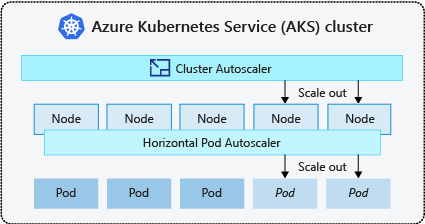
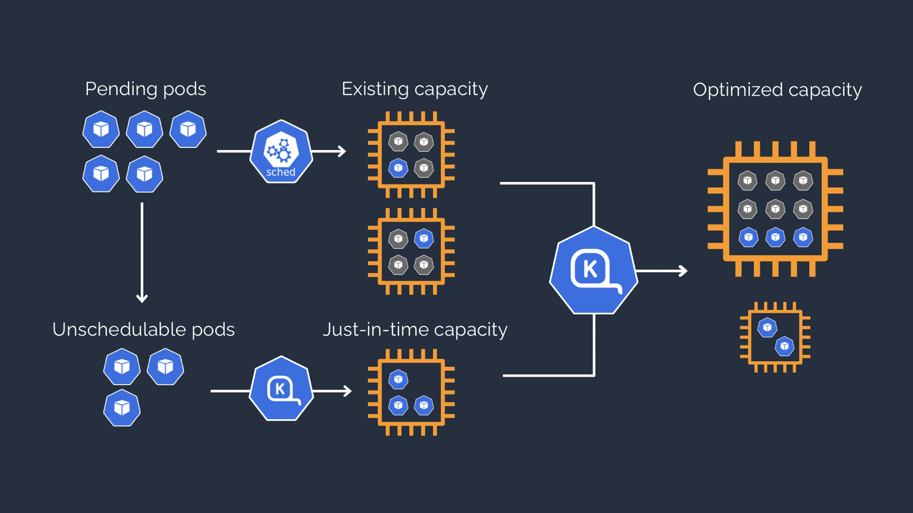

# AKS NAP(Karpenter): CAS 대비 VM 자동 선택·비용 이점과 도입 기준

Node Auto-Provisioning(NAP)은 AKS가 관리하는 [Karpenter](https://karpenter.sh)입니다.
Cluster Autoscaler(CAS)는 미리 만든 VMSS 노드 풀의 노드 수만 바꿉니다.
NAP는 Pending Pod의 requests를 보고 VM 크기와 개수를 함께 정해 노드를 만들고,
비거나 덜 쓰이는 노드도 스스로 정리합니다.

NAP는 2025년 7월 GA됐고 AKS Automatic의 기본 노드 관리 방식입니다. Microsoft Learn은
향후 기능 개발에서 CAS를 "유지보수, 최소한의 기능 개선", NAP를 "지속적인 개발과 새 기능
추가" 대상으로 구분하므로 새 Linux 워크로드는 NAP로 시작합니다. CAS는 폐기되지 않고 계속
지원되며, NAP가 지원하지 않는 구성(Windows 노드 GA, 서비스 주체, kubenet 등)에서는 여전히
유일한 자동 노드 확장 방식입니다.

## CAS·NAP 비교: 확장 방식, 속도, 비용, 운영

실측은 East US 2, AKS 1.36.5, v7 on-demand VM 기준입니다. 같은 조건에서 Pod가 준비되는
시간은 비슷했고, 차이는 VM 크기 선택·비용·축소 방식에서 났습니다.

| 항목 | CAS (VMSS 노드 풀) | NAP (Karpenter) | 유리한 쪽 |
|---|---|---|---|
| 확장 단위 | 노드 풀 하나의 노드 수. 풀마다 VM 크기 하나 | Pending Pod 묶음에 맞춰 VM 크기와 수를 함께 결정 | NAP |
| 설정 | `az aks nodepool`, autoscaler profile | Kubernetes CRD `NodePool`·`AKSNodeClass` | - |
| 기존 풀에 없는 VM 크기 필요 | 확장하지 않음. 풀을 추가해야 함 | 허용 범위에서 선택(6 vCPU Pod, 96초) | NAP |
| 확장 결정(Pod 생성 직후) | 12~27초(scan loop 대기) | 2~5초(이벤트 + 1초 batch) | NAP |
| 첫 노드 Ready(`D4ds_v7`, Pod 20개, 중앙값) | 81초 | 83초 | 비슷 |
| 전체 Pod Ready(같은 조건) | 108초 | 119초(VM 자유 선택 시 103초) | 비슷 |
| 선호 VM quota 초과 시 대체 결정 | 23~24초 | 2~3초 | NAP(전체 Pod Ready는 비슷) |
| 크기가 다른 Pod 20개 | 풀 3개, $3.28~3.82/h | 2대, $1.78/h | NAP(46~54% 저렴) |
| 큰 VM에 Pod 몇 개만 남음 | 32 vCPU 풀 유지(0%) | 4 vCPU VM으로 교체(−87%) | NAP |
| 축소 방식 | 빈 노드·저사용 노드 삭제(기본 10분 미사용 + 추가 후 10분 지연) | 빈 노드 삭제, 여러 노드 합치기, 더 저렴한 VM으로 교체 | NAP |
| 축소 중 옮겨진 Pod(20 → 3 Pod) | 1개(`D4ds_v7` 풀) | 3개 | CAS |
| 중지한 VM 재시작 | `Deallocate` 모드, 첫 노드 50초 | 기능 없음 | CAS |
| 다른 클러스터와 VM 계열 quota 공유 | 매번 VMSS 확장을 시도해 바로 반영 | quota를 10분 주기로 갱신. 반납 뒤 약 4~7.5분 대체 VM 사용(1회) | CAS |
| VMSS 10대·노드 풀 10개 제한 정책 | 0→40 확장 거부 | 단독 VM이라 영향 없음 | NAP(정책 환경) |
| 노드 수명 관리 | 업그레이드 시 surge | drift 감지, `expireAfter`, disruption budget | NAP |
| 구성 범위 | Windows, 서비스 주체, kubenet 등 대부분 | 일부 구성 미지원([목록](#nap-unsupported)) | CAS |
| 향후 개발 | 유지보수, 최소한의 기능 개선 | 지속 개발, 새 기능 추가 | NAP |

측정 조건과 반복 횟수는 [NAP·CAS 시나리오별 실측](scenario-comparison/index.md)과
[CAS·NAP 확장 시간 단계별 실측](scale-out-benchmark/index.md)에 있습니다.

## 권장 근거: GA, AKS Automatic 기본값, 기능 개발 방향

| 공식 근거 | 내용 |
|---|---|
| [Azure Updates (2025-07-17)](https://azure.microsoft.com/updates?id=498247) | NAP 정식 출시(GA) |
| [Learn: NAP 개요](https://learn.microsoft.com/azure/aks/node-auto-provisioning) | 대부분의 프로덕션 워크로드는 AKS Automatic을 기본으로 권장하며, AKS Automatic에는 NAP가 사전 구성됨 |
| [Learn: AKS scaling 개요](https://learn.microsoft.com/azure/aks/concepts-scale) | 빠른 권장: AKS Automatic(NAP·VPA·KEDA 사전 구성)으로 시작. CAS는 "미리 정의한 노드 풀이 있을 때", NAP는 "노드 풀을 직접 구성하지 않고 VM SKU를 자동 선택할 때" |
| [Learn: CAS → NAP 마이그레이션](https://learn.microsoft.com/azure/aks/migrate-from-autoscaler-to-node-auto-provisioning) | 향후 기능 개발: CAS는 "maintained, with minimal feature enhancements", NAP는 "continuous active development and new feature enhancements" |
| [AKS 릴리스 노트 2026-10-25](https://github.com/Azure/AKS/blob/master/CHANGELOG.md) | NAP: Capacity Reservation Group, Trusted Launch, managed GPU, Windows 노드(preview), dual-stack(preview) 추가. CAS: 이미지 업그레이드만 |

## 클러스터별 선택: 새 클러스터, 미지원 구성, CAS 고유 동작

| 클러스터 상황 | 선택 |
|---|---|
| 새 클러스터 | AKS Automatic(NAP 포함). 노드 설정을 세밀하게 제어해야 하면 AKS Standard + NAP |
| 기존 CAS 클러스터가 [NAP 미지원 구성](#nap-unsupported)(Windows GA, 서비스 주체, kubenet 등)을 사용 | CAS 유지, 또는 지원 구성으로 새 클러스터를 만들어 이전 |
| `Deallocate` 재시작, 같은 VM 계열 quota 공유, Pod 이동 최소화가 꼭 필요한 풀 | 해당 풀만 CAS 유지 검토. NAP에서도 quota 여유, `WhenEmpty`, PDB, `do-not-disrupt`로 완화 가능 |
| 그 밖의 기존 CAS 클러스터 | NAP로 전환([전환 가이드](cluster-autoscaler-migration/index.md)) |

## 확장 단위: CAS는 풀의 노드 수, NAP는 VM 크기와 수

CAS는 Pending Pod가 생기면 노드 풀(VMSS) 하나를 골라 같은 크기의 노드를 늘립니다.
HPA가 Pod를 늘리고 CAS가 노드를 늘리는 구조입니다.



*그림: [Microsoft Learn, AKS scaling overview](https://learn.microsoft.com/azure/aks/concepts-scale), CC BY 4.0*

NAP(Karpenter)는 기존 노드에 들어가지 못한 Pod를 모아 그 묶음에 맞는 VM을 바로 만들고,
이후 여러 노드의 Pod를 더 적거나 저렴한 노드로 옮겨 담습니다(consolidation).



*그림: [Karpenter](https://karpenter.sh/), Apache License 2.0*

## 확장 속도: 확장 결정과 재시도에서 차이

NAP는 주기적인 scan 없이 Pending Pod 이벤트로 확장을 결정합니다
([CAS→NAP 마이그레이션](https://learn.microsoft.com/azure/aks/migrate-from-autoscaler-to-node-auto-provisioning)).
Pod가 1초 동안 더 생기지 않으면 그 묶음에 맞는 VM 크기와 수를 바로 정합니다. CAS는 가장
오래된 Pending Pod가 2초 미만이면 다음 loop(최대 scan-interval 10초)까지 기다립니다.

용량이 없을 때의 재시도도 빠릅니다. Karpenter는 node group 없이 인스턴스를 직접 관리하므로
용량이 없으면 몇 분이 아니라 밀리초 단위로 다시 시도합니다
([Karpenter Concepts](https://karpenter.sh/docs/concepts/)). 선호 VM의 quota나 용량이 부족하면
NAP는 다른 SKU로 곧바로 넘어갑니다.

VM 부팅 시간은 그대로입니다. VM을 만들고 노드로 준비하는 시간은 autoscaler가 줄이지 못하며,
VM 준비에는 보통 2~5분이 걸립니다. 이 시간을 기다릴 수 없는 Linux 급증 부하에는 ACI virtual
node를 고려합니다([AKS scaling overview](https://learn.microsoft.com/azure/aks/concepts-scale)).
시간 보장이 필요하면 AKS Automatic의 Pod 준비 SLA(대상 작업의 99.9%를 5분 안에 준비)를
기준으로 삼습니다([NAP 개요](https://learn.microsoft.com/azure/aks/node-auto-provisioning)).

실측에서도 확장 결정 뒤 첫 노드 Ready까지 약 1~1.5분이 걸렸고 두 방식의 차이는 크지
않았습니다. 다음 표는 같은 VM 크기의 Pod 20개를 0개부터 확장한 결과입니다(중앙값, AKS 1.36.5,
`Standard_D4ds_v7` on-demand).

| 시나리오 | 확장 결정 | 첫 노드 Ready | 전체 Pod Ready |
|---|---|---|---|
| CAS, D4 풀 | 15초 | 81초 | 108초 |
| NAP, D4 고정 | 3초 | 83초 | 119초 |
| NAP, v7 D 계열 자유 선택 | 2초 | 88초 | 103초 (D32als_v7 × 1) |

NAP가 더 빠른 상황은 다음 세 가지입니다.

| 상황 | CAS | NAP | 실측 |
|---|---|---|---|
| 새 Pending Pod를 보고 확장 결정 | 가장 오래된 Pending Pod가 2초 미만이면 한 loop 대기(GPU Pod는 30초) | 1초 동안 Pod가 더 없으면 결정 | Pod 생성 직후 CAS 12~27초, NAP 2~5초. Pod가 이미 2초 넘게 대기 중이면 CAS도 3초 |
| 필요한 VM 크기가 기존 풀에 없음 | 확장하지 않음. 풀을 추가해야 함 | 허용 범위에서 맞는 VM 선택 | 6 vCPU Pod: CAS 확장 안 함, NAP 96초 |
| 선호 VM을 만들 수 없음 (quota·용량) | quota 오류처럼 즉시 실패하면 다음 loop에서 다른 풀로 대체. VM이 만들어진 뒤 할당에 실패하면 기본 설정에서 노드 등록 제한 시간(15분)까지 기다릴 수 있음 | 계열 quota가 부족한 SKU는 미리 제외하고, 할당 실패한 SKU는 일정 시간 제외한 뒤 바로 다른 SKU로 재시도 | quota 초과: CAS 23~24초 뒤 대체, NAP 2~3초 만에 대체 |

워크로드가 균일하고 풀 설계가 잘 되어 있으며 용량이 넉넉하면 CAS로도 속도는 충분합니다.
측정 방법은 [CAS·NAP 확장 시간 단계별 실측](scale-out-benchmark/index.md)에서, Pod 대기
시간을 줄이는 방법은 [AKS 노드 확장 지연 단축](scale-up-optimization/index.md)에서 다룹니다.

## NodePool과 AKSNodeClass: 허용 VM 범위와 Azure 노드 설정

NAP를 켜면 `default`(D 계열 on-demand)와 `system-surge` NodePool이 만들어집니다.
워크로드 성격별로 NodePool을 추가한다면 Pod 하나가 NodePool 하나에만 맞도록 조건을
나눕니다. 다음 `general` 예시는 전용 label·taint로 `default`와 겹치지 않게 하고,
운영 환경을 고려해 on-demand만 허용합니다.

```yaml
apiVersion: karpenter.sh/v1
kind: NodePool
metadata:
  name: general
spec:
  limits:
    cpu: "200"                       # 이 풀이 만들 수 있는 vCPU 총량
  disruption:
    consolidationPolicy: WhenEmptyOrUnderutilized
    consolidateAfter: 1m
    budgets:
      - nodes: "20%"                 # 동시에 정리할 수 있는 노드 비율
  template:
    metadata:
      labels:
        workload: general            # 워크로드 nodeSelector와 짝
    spec:
      expireAfter: Never
      taints:
        - key: workload              # 이 taint를 허용한 Pod만 배치되어 default와 겹치지 않음
          value: general
          effect: NoSchedule
      requirements:
        - key: kubernetes.io/arch
          operator: In
          values: [amd64]            # 생략하면 Arm64 SKU도 후보가 됨
        - key: karpenter.sh/capacity-type
          operator: In
          values: [on-demand]        # 생략하거나 spot을 함께 넣으면 spot이 먼저 선택됨
        - key: karpenter.azure.com/sku-family
          operator: In
          values: [D, E]
        - key: karpenter.azure.com/sku-cpu
          operator: Lt
          values: ["33"]
      nodeClassRef:
        group: karpenter.azure.com
        kind: AKSNodeClass
        name: general
---
apiVersion: karpenter.azure.com/v1beta1
kind: AKSNodeClass
metadata:
  name: general
spec:
  imageFamily: Ubuntu        # 또는 AzureLinux
  osDiskSizeGB: 128
  # vnetSubnetID: 사용자 지정 VNet에서 노드 서브넷을 분리할 때 지정
```

이 NodePool을 쓸 워크로드에는 label과 taint에 맞는 선택 조건을 둡니다.

```yaml
spec:
  template:
    spec:
      nodeSelector:
        workload: general
      tolerations:
        - key: workload
          value: general
          effect: NoSchedule
```

## NAP 기능: VM 선택, 비용 정리, 수명 관리

| 기능 | 설정 | 동작 |
|---|---|---|
| VM 선택 | `sku-family`, `sku-name`, `sku-cpu`, `sku-memory`, zone, arch | 조건을 만족하는 SKU 중 Pending Pod를 담을 VM을 고름 |
| 용량 유형 | `karpenter.sh/capacity-type` | 운영 워크로드는 `on-demand`로 고정. spot을 함께 허용하면 spot이 먼저 선택됨 |
| 상한 | `spec.limits.cpu/memory` | 상한에 닿으면 새 노드를 만들지 않음 |
| 풀 우선순위 | `spec.weight` | 여러 NodePool이 맞으면 weight가 큰 풀 선택 |
| Consolidation | `consolidationPolicy`, `consolidateAfter` | 빈 노드 삭제, 여러 노드를 하나로 합치기, 더 저렴한 SKU로 교체 |
| Disruption budget | `disruption.budgets` (`schedule`·`duration`) | 동시에 정리하는 노드 수와 시간대 제한. 미지정 시 10%, AKS가 만드는 `default` NodePool은 30% |
| Drift | NodePool·AKSNodeClass 변경 | 설정과 달라진 노드를 budget 안에서 교체 |
| Expiration | `template.spec.expireAfter` | 지정 수명이 지난 노드를 강제로 교체 |
| 보호 | Pod·노드 annotation `karpenter.sh/do-not-disrupt: "true"` | 자발적 정리 대상에서 제외 |
| Static NodePool | `spec.replicas` | 수요와 관계없이 지정한 수의 NAP 노드 유지. upstream Karpenter에서는 alpha 기능 |

## NAP 활성화: `--node-provisioning-mode Auto`와 NodeClaim 확인

권장 네트워크는 Azure CNI Overlay와 Cilium입니다.

```bash
az aks create -g $RG -n $CLUSTER \
  --node-provisioning-mode Auto \
  --network-plugin azure --network-plugin-mode overlay --network-dataplane cilium \
  --generate-ssh-keys

# 기존 클러스터
az aks update -g $RG -n $CLUSTER --node-provisioning-mode Auto

kubectl get nodepools.karpenter.sh,aksnodeclasses.karpenter.azure.com
kubectl get nodeclaims                       # NAP가 만든(또는 만드는 중인) 노드
kubectl get events -A --field-selector source=karpenter -w   # AKS 1.36 실측 기준 source 이름
```

`--node-provisioning-default-pools None`을 지정하면 기본 NodePool을 만들지 않고 직접
정의한 풀만 씁니다.

## NAP 지원·미지원 구성 { #nap-unsupported }

| 구분 | NAP 지원 | NAP 미지원 |
|---|---|---|
| 네트워크 | Azure CNI Overlay(권장, Cilium 데이터플레인), Azure CNI Node Subnet | kubenet, Azure CNI Pod Subnet 동적 할당, Calico network policy |
| ID | 시스템·사용자 할당 관리 ID | 서비스 주체 |
| OS | Ubuntu, Azure Linux, Azure Container Linux(AKS 1.34 이상, Trusted Launch 필요). Windows Server 2022·2025는 preview (Cilium 미지원) | Windows 노드의 GA 운영 |
| IP | IPv4, IPv4/IPv6 dual-stack(preview) | IPv6 단일 스택 |
| 운영 | - | 클러스터 중지(stop), 생성 후 outbound type 변경, 사용자 지정 VNet의 Basic Load Balancer |

CAS와 NAP를 같은 클러스터에서 함께 쓰려면 마이그레이션용
`AllowClusterAutoscalerAndNAP` feature flag가 필요합니다. 보통은 CAS를 끄고 NAP로 전환합니다.

Windows 지원은 2026-10-25 AKS 릴리스와 AKSNodeClass 문서에 preview로 추가됐지만, NAP 개요의
제한 사항에는 아직 "Windows node pools aren't supported"가 남아 있습니다. preview는 SLA 대상이
아니므로 Windows 노드를 프로덕션에서 운영한다면 해당 풀은 CAS로 둡니다.

기존 CAS 클러스터의 전환 절차와, 위 조건 때문에 전환할 수 없을 때의 재생성 전략은
[Cluster Autoscaler에서 NAP로 전환: 같은 클러스터 전환, 동시 운영, 새 클러스터 이전](cluster-autoscaler-migration/index.md)에서
다룹니다.

## 공식 참고 자료

- [Overview of Node Auto-Provisioning (NAP) in AKS](https://learn.microsoft.com/azure/aks/node-auto-provisioning)
- [Enable or disable NAP](https://learn.microsoft.com/azure/aks/use-node-auto-provisioning)
- [Configure node pools for NAP](https://learn.microsoft.com/azure/aks/node-auto-provisioning-node-pools)
- [Configure node disruption policies for NAP](https://learn.microsoft.com/azure/aks/node-auto-provisioning-disruption)
- [Networking configurations for NAP](https://learn.microsoft.com/azure/aks/node-auto-provisioning-networking)
- [Use the cluster autoscaler in AKS](https://learn.microsoft.com/azure/aks/cluster-autoscaler)
- [AKS scaling overview](https://learn.microsoft.com/azure/aks/concepts-scale)
- [Karpenter Concepts (Quick node provisioning)](https://karpenter.sh/docs/concepts/)
- [Karpenter provider Azure offering error handlers](https://github.com/Azure/karpenter-provider-azure/blob/main/pkg/providers/instance/offerings/commonerrorhandlers.go)
- [Karpenter provider Azure quota provider](https://github.com/Azure/karpenter-provider-azure/blob/main/pkg/providers/quota/quota.go)
- [Cluster Autoscaler 1.35 Azure scale set instance cache](https://github.com/kubernetes/autoscaler/blob/cluster-autoscaler-release-1.35/cluster-autoscaler/cloudprovider/azure/azure_scale_set_instance_cache.go)
- [Cluster Autoscaler FAQ](https://github.com/kubernetes/autoscaler/blob/master/cluster-autoscaler/FAQ.md)
- [Karpenter NodePools](https://karpenter.sh/docs/concepts/nodepools/)
- [Karpenter Settings](https://karpenter.sh/docs/reference/settings/)
- [Cluster Autoscaler 1.35 static_autoscaler.go](https://github.com/kubernetes/autoscaler/blob/cluster-autoscaler-release-1.35/cluster-autoscaler/core/static_autoscaler.go)
- [Karpenter Disruption](https://karpenter.sh/docs/concepts/disruption/)
- [Karpenter provider Azure quota controller](https://github.com/Azure/karpenter-provider-azure/blob/main/pkg/controllers/quota/controller.go)
- [Use Scale-down Mode to delete/deallocate nodes](https://learn.microsoft.com/azure/aks/scale-down-mode)
- [What is AKS Automatic?](https://learn.microsoft.com/azure/aks/intro-aks-automatic)
- [Configure AKSNodeClass resources for NAP](https://learn.microsoft.com/azure/aks/node-autoprovision-aksnodeclass)
- [Generally Available: Node auto-provisioning support in AKS](https://azure.microsoft.com/updates?id=498247)
- [AKS release notes](https://github.com/Azure/AKS/blob/master/CHANGELOG.md)
