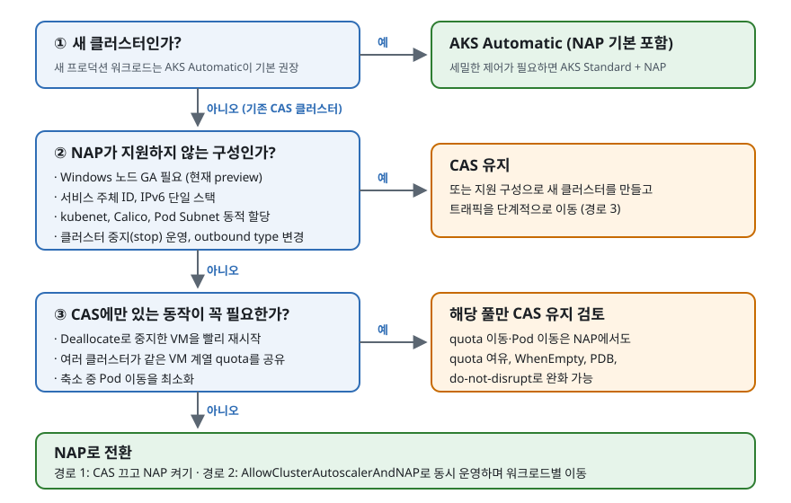
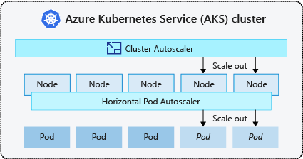
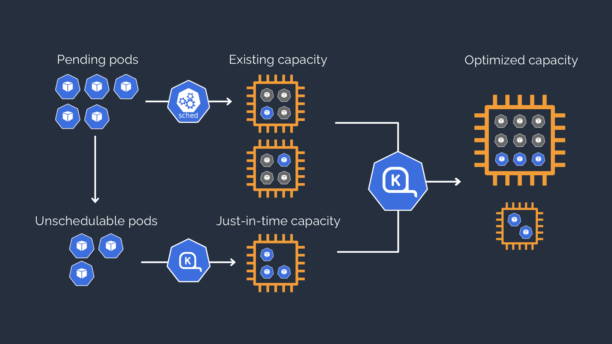

# AKS NAP(Karpenter)는 Microsoft가 권장하는 노드 확장 방향이며 이점은 속도보다 VM 선택과 비용이다

Node Auto-Provisioning(NAP)은 AKS가 관리하는 [Karpenter](https://karpenter.sh)입니다.
Cluster Autoscaler(CAS)가 **미리 만든 VMSS 노드 풀의 노드 수**만 바꾼다면,
NAP는 Pending Pod의 requests를 보고 **VM 크기와 개수를 함께 정해** 노드를 만들고,
비거나 덜 쓰이는 노드를 스스로 정리합니다.

!!! abstract "결론: 새 Linux 워크로드는 NAP가 맞고, CAS는 유지보수 단계다"

    - **최신 권장 방향이 맞습니다.** NAP는 2025년 7월 GA됐고 AKS Automatic의 기본 노드
      관리 방식입니다. Microsoft Learn은 CAS를 "유지보수, 최소한의 기능 개선", NAP를
      "지속적인 개발과 새 기능 추가" 대상으로 구분합니다.
    - **CAS가 폐기된 것은 아닙니다.** 계속 지원되며, NAP가 지원하지 않는 구성(Windows 노드
      GA, 서비스 주체, kubenet 등)에서는 CAS가 유일한 자동 노드 확장 방식입니다.
    - **전환 이유는 속도가 아닙니다.** 같은 조건 실측에서 Pod가 준비되는 시간은 비슷했습니다.
      이점은 VM 크기 자동 선택, 비용 절감(혼합 Pod 46~54%, 큰 노드 축소 87%), quota 부족 시
      빠른 대체 결정, 노드 수명 관리입니다.

## Microsoft는 NAP에 새 기능을 넣고 CAS는 유지보수만 한다

| 공식 근거 | 내용 |
|---|---|
| [Azure Updates (2025-07-17)](https://azure.microsoft.com/updates?id=498247) | NAP 정식 출시(GA) |
| [Learn: NAP 개요](https://learn.microsoft.com/azure/aks/node-auto-provisioning) | 대부분의 프로덕션 워크로드는 AKS Automatic을 기본으로 권장하며, AKS Automatic에는 NAP가 사전 구성됨 |
| [Learn: AKS scaling 개요](https://learn.microsoft.com/azure/aks/concepts-scale) | 빠른 권장: AKS Automatic(NAP·VPA·KEDA 사전 구성)으로 시작. CAS는 "미리 정의한 노드 풀이 있을 때", NAP는 "노드 풀을 직접 구성하지 않고 VM SKU를 자동 선택할 때" |
| [Learn: CAS → NAP 마이그레이션](https://learn.microsoft.com/azure/aks/migrate-from-autoscaler-to-node-auto-provisioning) | 향후 기능 개발: CAS는 "maintained, with minimal feature enhancements", NAP는 "continuous active development and new feature enhancements" |
| [AKS 릴리스 노트 2026-10-25](https://github.com/Azure/AKS/blob/master/CHANGELOG.md) | NAP: Capacity Reservation Group, Trusted Launch, managed GPU, Windows 노드(preview), dual-stack(preview) 추가. CAS: 이미지 업그레이드만 |

아래 흐름으로 클러스터별 선택을 정합니다. 2·3단계의 조건은
[NAP를 켤 수 없는 구성](#nap-unsupported)과 [시나리오별 실측](scenario-comparison/index.md)에
근거합니다.



## CAS는 미리 만든 풀의 노드 수를, NAP는 VM 크기와 수를 함께 정한다

CAS는 Pending Pod가 생기면 노드 풀(VMSS) 하나를 골라 같은 크기의 노드를 늘립니다.
HPA가 Pod를 늘리고 CAS가 노드를 늘리는 구조입니다.



*그림: [Microsoft Learn, AKS scaling overview](https://learn.microsoft.com/azure/aks/concepts-scale), CC BY 4.0*

NAP(Karpenter)는 기존 노드에 들어가지 못한 Pod를 모아 그 묶음에 맞는 VM을 바로 만들고,
이후 여러 노드의 Pod를 더 적거나 저렴한 노드로 옮겨 담습니다(consolidation).



*그림: [Karpenter](https://karpenter.sh/), Apache License 2.0*

| 항목 | Cluster Autoscaler (VMSS) | NAP |
|---|---|---|
| 확장 단위 | 노드 풀(VMSS) 하나당 VM 크기 하나 | Pod 요구에 맞춰 허용 범위 안의 여러 VM 크기 |
| 설정 위치 | `az aks nodepool`·autoscaler profile | Kubernetes CRD(`NodePool`, `AKSNodeClass`) |
| 판단 방식 | Pending Pod 이벤트 + 가장 오래된 Pending Pod가 2초 미만이면 한 loop(최대 scan-interval 10초) 대기, 풀 선택(expander) | Pending Pod 이벤트 기반, 1초 batch 후 결정 |
| 축소 | 10분 미사용 + 추가 후 10분 지연(기본값) | consolidation: 빈 노드 삭제, 여러 노드를 하나로 합치거나 더 저렴한 노드로 교체 |
| 노드 수명 관리 | 업그레이드 시 surge | drift 감지, `expireAfter`, disruption budget |
| 다른 VM 크기가 필요할 때 | 풀을 새로 추가 | `NodePool` requirements만 수정 |

## NAP는 VM 부팅이 아니라 확장 결정과 재시도를 빠르게 한다

공식 소개 문서는 "VM이 더 빨리 뜬다"고 말하지 않습니다.

| 출처 | 속도 관련 표현 |
|---|---|
| Karpenter 문서 | node group 없이 인스턴스를 직접 관리하므로 **용량이 없을 때 몇 분이 아니라 밀리초 단위로 재시도**한다 |
| Microsoft Learn NAP 개요 | Pending Pod에 맞는 VM 구성을 **효율적이고 비용 효과적으로** 제공한다. 속도 보장은 AKS Automatic의 Pod 준비 SLA(99.9%를 5분 안)로 제시 |
| Microsoft Learn CAS→NAP 마이그레이션 | 전환 이유 표는 VM 크기 유연성, 비용, 관리 부담, 노드 수명 관리, 향후 기능 개발이다. 설정 비교 표에서 NAP는 주기 scan 없이 Pending Pod 이벤트로 바로 결정한다고 설명 |
| Microsoft Learn AKS scaling overview | VM 준비는 보통 2~5분이므로 이를 기다릴 수 없는 Linux 급증 부하에는 ACI virtual node를 고려하라 |

VM을 만들고 노드로 준비하는 시간은 autoscaler가 줄이지 못합니다. 이 저장소의 실측에서는
확장 결정 뒤 첫 노드 Ready까지 약 1~1.5분이었고 두 방식 간 차이가 크지 않았습니다. 같은 VM
크기의 Pod 20개를 0개부터 확장한 결과(중앙값, AKS 1.36.5, `Standard_D4ds_v7` on-demand)입니다.

| 시나리오 | 확장 결정 | 첫 노드 Ready | 전체 Pod Ready |
|---|---|---|---|
| CAS, D4 풀 | 15초 | 81초 | 108초 |
| NAP, D4 고정 | 3초 | 83초 | 119초 |
| NAP, v7 D 계열 자유 선택 | 2초 | 88초 | 103초 (D32als_v7 × 1) |

NAP가 실제로 빨라지는 상황은 세 가지입니다.

| 상황 | CAS | NAP | 실측 |
|---|---|---|---|
| 새 Pending Pod를 보고 확장 결정 | 가장 오래된 Pending Pod가 2초 미만이면 한 loop 대기(GPU Pod는 30초) | 1초 동안 Pod가 더 없으면 결정 | Pod 생성 직후 CAS 12~27초, NAP 2~5초. Pod가 이미 2초 넘게 대기 중이면 CAS도 3초 |
| 필요한 VM 크기가 기존 풀에 없음 | 확장하지 않음. 풀을 추가해야 함 | 허용 범위에서 맞는 VM 선택 | 6 vCPU Pod: CAS 확장 안 함, NAP 96초 |
| 선호 VM을 만들 수 없음 (quota·용량) | quota 오류처럼 즉시 실패하면 다음 loop에서 다른 풀로 대체. VM이 만들어진 뒤 할당에 실패하면 기본 설정에서 노드 등록 제한 시간(15분)까지 기다릴 수 있음 | 계열 quota가 부족한 SKU는 미리 제외하고, 할당 실패한 SKU는 일정 시간 제외한 뒤 바로 다른 SKU로 재시도 | quota 초과: CAS 23~24초 뒤 대체, NAP 2~3초 만에 대체 |

워크로드가 균일하고 풀을 미리 잘 설계했으며 용량이 넉넉하면 CAS도 속도 면에서
충분합니다. 측정 방법은 [CAS와 NAP 확장 실측](scale-out-benchmark/index.md)에, Pod 대기
시간을 줄이는 방법은 [확장 지연 줄이기](scale-up-optimization/index.md)에 있습니다.

## 실측에서 NAP는 비용과 VM 선택에서, CAS는 노드 재시작과 적은 Pod 이동에서 나았다

유불리 시나리오를 가설로 세우고 같은 환경에서 실측한 결과입니다.

| 시나리오 | 결과 | 유리한 쪽 |
|---|---|---|
| 크기가 다른 Pod 20개 혼합 | NAP 2대 $1.78/h, CAS 풀 3개 $3.28~3.82/h | NAP |
| 큰 VM에 Pod 몇 개만 남음 | NAP는 32 vCPU VM을 4 vCPU VM으로 교체(−87%), CAS 32 vCPU 풀은 그대로 | NAP |
| 선호 VM quota 초과 | 대체 결정 NAP 2~3초, CAS 23~24초. 전체 Pod Ready는 비슷 | NAP (결정 단계) |
| VMSS 10대·노드 풀 10개 제한 정책 | CAS 0→40 확장 거부, NAP 영향 없음 | NAP |
| 같은 zone·같은 VM 확장 | 첫 노드 Ready NAP 54~59초, CAS 69~82초(차이 대부분은 확장 결정). 전체 Pod는 비슷 | 비슷 |
| 축소 중 Pod 이동 | NAP 3개, CAS 1개 | CAS |
| 할당 해제한 VM 재시작 | CAS `Deallocate` 50초, NAP 기능 없음 | CAS |
| 다른 클러스터가 같은 계열 quota를 쓰고 반납 | NAP는 10분 주기로 quota를 다시 읽어, 1회 실측에서 반납 약 4분 뒤까지 1순위 VM 대신 대체 VM 사용(약 7.5분 뒤 복귀) | CAS |

자세한 가설, 조건과 수치는 [NAP와 CAS 시나리오별 실측](scenario-comparison/index.md)에 있습니다.

## NodePool은 허용할 VM 범위를, AKSNodeClass는 Azure 노드 설정을 정한다

NAP를 켜면 `default`(D 계열 on-demand)와 `system-surge` NodePool이 만들어집니다.
워크로드 성격별로 NodePool을 추가하고, 하나의 Pod가 하나의 NodePool에만
맞도록 requirements를 겹치지 않게 둡니다.

```yaml
apiVersion: karpenter.sh/v1
kind: NodePool
metadata:
  name: general
spec:
  limits:
    cpu: "200"                       # 이 풀이 만들 수 있는 vCPU 총량
  disruption:
    consolidationPolicy: WhenEmptyOrUnderutilized
    consolidateAfter: 1m
    budgets:
      - nodes: "20%"                 # 동시에 정리할 수 있는 노드 비율
  template:
    spec:
      expireAfter: Never
      requirements:
        - key: kubernetes.io/arch
          operator: In
          values: [amd64]            # 생략하면 Arm64 SKU도 후보가 됨
        - key: karpenter.sh/capacity-type
          operator: In
          values: [spot, on-demand]  # 둘 다 허용하면 spot 우선
        - key: karpenter.azure.com/sku-family
          operator: In
          values: [D, E]
        - key: karpenter.azure.com/sku-cpu
          operator: Lt
          values: ["33"]
      nodeClassRef:
        group: karpenter.azure.com
        kind: AKSNodeClass
        name: general
---
apiVersion: karpenter.azure.com/v1beta1
kind: AKSNodeClass
metadata:
  name: general
spec:
  imageFamily: Ubuntu        # 또는 AzureLinux
  osDiskSizeGB: 128
  # vnetSubnetID: 사용자 지정 VNet에서 노드 서브넷을 분리할 때 지정
```

## NAP 기능은 VM 선택, 비용 정리, 수명 관리로 나뉜다

| 기능 | 설정 | 동작 |
|---|---|---|
| VM 선택 | `sku-family`, `sku-name`, `sku-cpu`, `sku-memory`, zone, arch | 조건을 만족하는 SKU 중 Pending Pod를 담을 VM을 고름 |
| Spot 혼합 | `karpenter.sh/capacity-type` | spot과 on-demand를 함께 허용하면 spot 우선 |
| 상한 | `spec.limits.cpu/memory` | 상한에 닿으면 새 노드를 만들지 않음 |
| 풀 우선순위 | `spec.weight` | 여러 NodePool이 맞으면 weight가 큰 풀 선택 |
| Consolidation | `consolidationPolicy`, `consolidateAfter` | 빈 노드 삭제, 여러 노드를 하나로 합치기, 더 저렴한 SKU로 교체 |
| Disruption budget | `disruption.budgets` (`schedule`·`duration`) | 동시에 정리하는 노드 수와 시간대 제한. 미지정 시 10%, AKS가 만드는 `default` NodePool은 30% |
| Drift | NodePool·AKSNodeClass 변경 | 설정과 달라진 노드를 budget 안에서 교체 |
| Expiration | `template.spec.expireAfter` | 지정 수명이 지난 노드를 강제로 교체 |
| 보호 | Pod·노드 annotation `karpenter.sh/do-not-disrupt: "true"` | 자발적 정리 대상에서 제외 |
| Static NodePool | `spec.replicas` | 수요와 관계없이 지정한 수의 NAP 노드 유지. upstream Karpenter에서는 alpha 기능 |

## 새 클러스터는 `--node-provisioning-mode Auto`로 켜고 NodeClaim으로 확인한다

권장 네트워크는 Azure CNI Overlay와 Cilium입니다.

```bash
az aks create -g $RG -n $CLUSTER \
  --node-provisioning-mode Auto \
  --network-plugin azure --network-plugin-mode overlay --network-dataplane cilium \
  --generate-ssh-keys

# 기존 클러스터
az aks update -g $RG -n $CLUSTER --node-provisioning-mode Auto

kubectl get nodepools.karpenter.sh,aksnodeclasses.karpenter.azure.com
kubectl get nodeclaims                       # NAP가 만든(또는 만드는 중인) 노드
kubectl get events -A --field-selector source=karpenter -w   # AKS 1.36 실측 기준 source 이름
```

`--node-provisioning-default-pools None`을 주면 기본 NodePool 없이 직접 정의한
풀만 사용합니다.

## 네트워크·ID·OS 구성이 맞지 않으면 NAP를 켤 수 없다 { #nap-unsupported }

| 구분 | NAP 지원 | NAP 미지원 |
|---|---|---|
| 네트워크 | Azure CNI Overlay(권장, Cilium 데이터플레인), Azure CNI Node Subnet | kubenet, Azure CNI Pod Subnet 동적 할당, Calico network policy |
| ID | 시스템·사용자 할당 관리 ID | 서비스 주체 |
| OS | Ubuntu, Azure Linux, Azure Container Linux(AKS 1.34 이상, Trusted Launch 필요). Windows Server 2022·2025는 **preview** (Cilium 미지원) | Windows 노드의 GA 운영 |
| IP | IPv4, IPv4/IPv6 dual-stack(**preview**) | IPv6 단일 스택 |
| 운영 | - | 클러스터 중지(stop), 생성 후 outbound type 변경, 사용자 지정 VNet의 Basic Load Balancer |

- **CAS와의 관계:** 같은 클러스터에서 함께 쓰려면 마이그레이션용
  `AllowClusterAutoscalerAndNAP` feature flag가 필요합니다. 일반적으로는 CAS를 끄고 NAP로 전환합니다.
- Windows 지원은 2026-10-25 AKS 릴리스와 AKSNodeClass 문서에 preview로 추가됐고, NAP 개요의 제한
  사항에는 아직 "Windows node pools aren't supported"로 남아 있습니다. preview는 SLA 대상이
  아니므로 Windows 노드를 프로덕션에서 운영한다면 해당 풀은 CAS로 둡니다.

기존 CAS 클러스터를 옮기는 절차와 위 조건 때문에 전환할 수 없을 때의 재생성
전략은 [Cluster Autoscaler에서 NAP로 무중단 전환](cluster-autoscaler-migration/index.md)에
정리했습니다.

## 공식 참고 자료

- [Overview of Node Auto-Provisioning (NAP) in AKS](https://learn.microsoft.com/azure/aks/node-auto-provisioning)
- [Enable or disable NAP](https://learn.microsoft.com/azure/aks/use-node-auto-provisioning)
- [Configure node pools for NAP](https://learn.microsoft.com/azure/aks/node-auto-provisioning-node-pools)
- [Configure node disruption policies for NAP](https://learn.microsoft.com/azure/aks/node-auto-provisioning-disruption)
- [Networking configurations for NAP](https://learn.microsoft.com/azure/aks/node-auto-provisioning-networking)
- [Use the cluster autoscaler in AKS](https://learn.microsoft.com/azure/aks/cluster-autoscaler)
- [AKS scaling overview](https://learn.microsoft.com/azure/aks/concepts-scale)
- [Karpenter Concepts (Quick node provisioning)](https://karpenter.sh/docs/concepts/)
- [Karpenter provider Azure offering error handlers](https://github.com/Azure/karpenter-provider-azure/blob/main/pkg/providers/instance/offerings/commonerrorhandlers.go)
- [Karpenter provider Azure quota provider](https://github.com/Azure/karpenter-provider-azure/blob/main/pkg/providers/quota/quota.go)
- [Cluster Autoscaler 1.35 Azure scale set instance cache](https://github.com/kubernetes/autoscaler/blob/cluster-autoscaler-release-1.35/cluster-autoscaler/cloudprovider/azure/azure_scale_set_instance_cache.go)
- [Cluster Autoscaler FAQ](https://github.com/kubernetes/autoscaler/blob/master/cluster-autoscaler/FAQ.md)
- [Karpenter NodePools](https://karpenter.sh/docs/concepts/nodepools/)
- [Karpenter Settings](https://karpenter.sh/docs/reference/settings/)
- [Cluster Autoscaler 1.35 static_autoscaler.go](https://github.com/kubernetes/autoscaler/blob/cluster-autoscaler-release-1.35/cluster-autoscaler/core/static_autoscaler.go)
- [Karpenter Disruption](https://karpenter.sh/docs/concepts/disruption/)
- [Karpenter provider Azure quota controller](https://github.com/Azure/karpenter-provider-azure/blob/main/pkg/controllers/quota/controller.go)
- [Use Scale-down Mode to delete/deallocate nodes](https://learn.microsoft.com/azure/aks/scale-down-mode)
- [What is AKS Automatic?](https://learn.microsoft.com/azure/aks/intro-aks-automatic)
- [Configure AKSNodeClass resources for NAP](https://learn.microsoft.com/azure/aks/node-autoprovision-aksnodeclass)
- [Generally Available: Node auto-provisioning support in AKS](https://azure.microsoft.com/updates?id=498247)
- [AKS release notes](https://github.com/Azure/AKS/blob/master/CHANGELOG.md)
