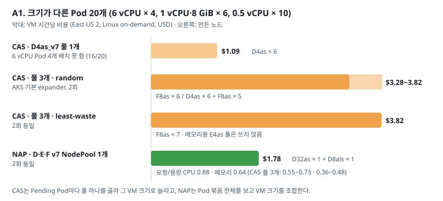

# AKS NAP는 VM 크기를 고르거나 큰 노드를 줄일 때 앞섰고 같은 조건의 확장 속도는 CAS와 비슷했다

NAP와 VMSS Cluster Autoscaler(CAS)의 유불리를 시나리오별 가설로 세우고 실측했습니다.
NAP의 이점은 **비용과 VM 크기 선택**에서 분명했습니다. 반대로 "NAP가 더 빠르다"거나
"VMSS가 더 빠르다"는 가설은 같은 조건에서 대부분 확인되지 않았습니다.

| # | 시나리오 | 예상 | 실측 결과 | 판정 |
|---|---|---|---|---|
| A1 | 크기가 다른 Pod 혼합 | NAP가 노드·비용 최소 | NAP 2대 $1.78/h, CAS 풀 3개 6~11대 $3.28~3.82/h | **맞음** (NAP 46~54% 저렴) |
| A2 | 큰 노드 축소 | NAP만 VM을 작게 교체 | NAP −87%, CAS 32 vCPU 풀 0% | **맞음** |
| A3 | 선호 VM quota 초과 | NAP가 빨리 대체 | 대체 결정 NAP 2~3초, CAS 23~24초. Pod Ready는 비슷 | **맞음** (결정 단계만) |
| A4 | VMSS·풀 수 제한 정책 | (사전 가설 없음) | CAS 0→40 요청이 정책에 거부, NAP는 영향 없음 | NAP 유리 (환경 의존) |
| B1 | 같은 zone 확장 | NAP VM 준비가 느림 | 첫 노드 NAP 54~59초, CAS 69~82초 (차이 대부분은 결정 단계) | **틀림** |
| B2 | 40대 동시 확장 | NAP 꼬리 지연이 큼 | 전체 Pod Ready NAP 221초, CAS 198초 (1회) | 차이 작음 |
| B3 | quota 정보 갱신 지연 | NAP가 최대 10분 선호 VM 제외 | quota 반납 약 4분 뒤까지 대체 VM 7대 선택, 약 7.5분 뒤에는 1순위 선택 | **맞음** (1회, 대조군 실패) |
| B4 | 축소 중 Pod 이동 | NAP가 더 많이 옮김 | NAP 3개, CAS 1개 | **맞음** |
| B5 | 할당 해제 VM 재시작 | CAS만 가능 | 첫 노드 Ready 50초 (새 VM 78~104초) | **맞음** |

## 모든 시나리오는 East US 2, AKS 1.36.5, v7 on-demand에서 측정했다

- 두 클러스터 모두 Azure CNI Overlay + Cilium, 시스템 풀 `Standard_D4ds_v7` × 2입니다.
- CAS profile은 `scan-interval=10s`, `scale-down-unneeded-time=1m`, `scale-down-delay-after-add=0m`입니다.
- NAP NodePool은 모두 `capacity-type: on-demand`, `arch: amd64`를 명시했습니다.
- 비용은 2026-10-31 Azure Retail Prices API의 East US 2 Linux on-demand 시간당 가격(USD)으로
  계산했습니다. VM 가격만 포함하고 디스크·네트워크는 제외했습니다.
- 리전 vCPU 한도(100) 때문에 시나리오를 순서대로 실행했고, 반복 횟수는 1~3회입니다.

## A1. 크기가 다른 Pod가 섞이면 NAP는 노드 2대로 담아 비용을 절반으로 줄였다

6 vCPU·8 GiB Pod 4개, 1 vCPU·8 GiB Pod 6개, 0.5 vCPU·1 GiB Pod 10개를 동시에 만들었습니다.

| 구성 | 배치 | 노드 | 요청/용량 (CPU·메모리) | 시간당 비용 | 모든 Pod Ready |
|---|---|---|---|---|---|
| CAS, `D4as_v7` 풀 1개 | 16/20 | D4as × 6 | 0.46·0.62 | $1.09 | 6 vCPU Pod 4개 미배치 |
| CAS, D4as·E4as·F8as 풀 3개, expander `random`(AKS 기본값) | 20/20 | F8as × 6 / D4as × 6 + F8as × 5 | 0.73·0.48 / 0.55·0.36 | $3.28 / $3.82 | 92초 / 148초 |
| CAS, 같은 풀 3개, expander `least-waste` | 20/20 | F8as × 7 (2회 동일) | 0.62·0.41 | $3.82 | 96초 / 80초 |
| NAP, D·E·F v7(32 vCPU 이하) NodePool 1개 | 20/20 | D32as × 1 + D8als × 1 (2회 동일) | 0.88·0.64 | $1.78 | 139초 / 102초 |

- CAS는 확장할 때마다 **풀 하나를 골라 그 VM 크기로 늘립니다.** 남은 Pod는 다음 loop에서
  다른 풀로 갈 수 있어 random 2회차처럼 여러 풀이 섞이기도 합니다. 세 가지
  Pod를 모두 담을 수 있는 F8as 풀이 주로 선택되어 메모리 Pod까지 8 vCPU VM에 들어갔고,
  메모리용 E4as 풀은 한 번도 쓰이지 않았습니다.
- NAP는 Pod 묶음 전체를 보고 32 vCPU VM 1대와 8 vCPU VM 1대를 골랐습니다. 노드 용량 대비
  요청 비율이 가장 높고 비용은 CAS 3개 풀보다 46~54% 낮았습니다.
- **속도는 NAP가 앞서지 않았습니다.** CAS는 8 vCPU VM 여러 대를 VMSS로 만들었고 NAP는 32 vCPU
  VM을 기다렸습니다. 모든 Pod Ready는 CAS 80~148초, NAP 102~139초였습니다.

## A2. 큰 노드가 남은 채 Pod가 줄면 NAP만 VM을 작게 바꿨다

Pod 20개(각 1 vCPU)를 띄운 뒤 3개로 줄이고 12분 동안 30초마다 기록했습니다.

| 구성 | 축소 전 | 축소 후 최종 | 비용 변화 | 도달 시간 | 옮겨진 Pod |
|---|---|---|---|---|---|
| NAP, v7 D 계열 자유 선택 | D32als × 1, $1.29/h | D4als × 1, $0.16/h | **−87%** | 약 194초 | 3 |
| CAS, `D32als_v7` 풀 | D32als × 1, $1.29/h | 그대로 | **0%** | - | 0 |
| CAS, `D4ds_v7` 풀 | D4ds × 7, $2.28/h | D4ds × 1, $0.33/h | −86% | 약 224초 | 1 |

- CAS는 VM 크기를 바꾸지 못하므로 큰 VM 풀에 Pod가 조금만 남으면 그 노드를 계속 유지합니다.
- 작은 VM 풀이면 CAS도 빈 노드를 지워 비슷하게 줄입니다. NAP의 차이는 **큰 VM을 작은 VM으로
  교체**할 수 있다는 점입니다.

## A3. 선호 VM을 만들 수 없을 때 NAP는 시도 없이 바로 대체했다

[CAS와 NAP 확장 실측](../scale-out-benchmark/index.md)의 결과입니다(각 2회). 시스템 풀이 같은
계열 16 vCPU를 쓰는 상태에서 96 vCPU VM을 1순위로 두자 CAS는 요청이 리전 quota 초과로 실패한
뒤 23~24초에 대체 풀로 넘어갔고, NAP는 VM 계열 quota를 미리 확인해 2~3초 만에 대체 VM을
골랐습니다. 앞선 것은 대체 결정 단계뿐이었습니다. 첫 노드 Ready는 CAS 66~76초, NAP 83초였고
모든 Pod Ready는 CAS 104~112초, NAP 96~130초였습니다.

## A4. VMSS 인스턴스 수와 노드 풀 수를 제한하는 정책은 CAS에만 걸렸다

실험 구독에는 관리 그룹 수준의 Azure Policy가 적용되어 있었습니다.

| 정책 | CAS에 미친 영향 | NAP에 미친 영향 |
|---|---|---|
| VMSS 인스턴스 10대 초과 배포 거부 | 2 vCPU 풀을 0→40대로 늘리는 요청이 거부되어 풀이 backoff, Pod 40개가 Pending으로 남음 | 단독 VM 40대 생성, 영향 없음 |
| AKS 노드 풀 10개 초과 거부 | 풀이 11개가 되자 클러스터 설정 변경이 거부됨 | NodePool은 AKS 노드 풀이 아니므로 영향 없음 |

CAS는 VM 크기마다, 그리고 VMSS 크기 제한마다 노드 풀을 따로 만들어야 합니다. 같은 40대를
CAS로 만들려면 10대 상한 풀 4개와 `balance-similar-node-groups=true`를 사용했습니다. 이 정책은
실험 구독의 조직 정책이지만, 거버넌스 정책이 있는 환경에서는 같은 차이가 생길 수 있습니다.

## B1. 같은 zone에서는 NAP의 첫 노드가 중앙값 13초 빨랐고 차이의 대부분은 확장 결정이었다

이전 측정에서 NAP가 노드 준비에 더 오래 걸린 것이 단독 VM 방식 때문인지 확인하려고, 두 쪽 모두
zone 1에 `Standard_D4ds_v7` 노드를 만들게 하고 Pod 20개로 3회씩 측정했습니다.

| 구성 | 확장 결정 | 첫 노드 Ready | 마지막 노드 Ready | 모든 Pod Ready |
|---|---|---|---|---|
| CAS, zone 1 VMSS 풀 | 13~14초 | 69~82초 | 94~260초 | 102~271초 (중앙값 108) |
| NAP, zone `eastus2-1` | 2~5초 | 54~59초 | 86~122초 | 98~131초 (중앙값 106) |

- 가설과 반대로 NAP의 첫 노드가 중앙값 13초(56초 대 69초) 빨랐습니다. 이 중 약 10초는 확장
  결정 차이였고, 결정 → 첫 노드 Ready는 NAP 50~57초, CAS 55~69초로 비슷했습니다.
- 이전 측정의 차이는 NAP가 노드를 zone 1~4에 나눠 만들고 CAS 풀은 zone을 지정하지 않은 조건
  차이에서 왔을 가능성이 큽니다. 다만 다른 시간대의 3회 측정이라 원인을 단정하지 않습니다.
- 한두 대가 크게 늦어지는 꼬리 지연은 두 방식 모두 생겼습니다. CAS 3회차에서는 마지막 노드가
  260초에야 Ready가 됐습니다.

## B2. 40대를 한 번에 만들어도 두 방식의 차이는 작았다

2 vCPU VM 40대가 필요한 Pod 40개를 만들었습니다(각 1회).

| 구성 | 확장 결정 | 첫 노드 Ready | 마지막 노드 Ready | 모든 Pod Ready |
|---|---|---|---|---|
| CAS, 10대 상한 풀 4개 + 풀 균형 | 3초 | 80초 | 180초 | 198초 |
| NAP, `Standard_D2ds_v7` | 3초 | 73초 | 196초 | 221초 |

- NAP는 3초에 NodeClaim 40개를 만들었고 모두 8초 안에 `Launched`가 됐습니다. 실패나 재시도는
  없었습니다(`results/nap-nodeclaim-phases.csv`).
- CAS는 한 loop에서 VMSS 4개를 차례로 10대씩 늘렸습니다. 이번에는 Pod가 이미 2초 넘게 지난
  시점에 loop가 돌아 대기 없이 3초 만에 결정했습니다.
- 1회 측정이라 23초 차이는 VM 준비 편차 범위로 봅니다.

## B3. quota가 풀려도 NAP는 다음 갱신까지 이전 사용량으로 판단했다

실측 리전의 vCPU 한도는 100입니다. NAP는 리전 전체가 아니라 VM 계열별 quota
(`StandardDdsv7Family`)로 판단하며, 계열 한도 값은 따로 기록하지 않았습니다. `pref64`(weight 100, `Standard_D64ds_v7`)와 `alt`(weight 10,
`Standard_D4as_v7`, 다른 계열) NodePool을 두고, CAS 클러스터의 `Standard_D4ds_v7` 노드 6대로
같은 Ddsv7 계열 사용량을 16에서 40 vCPU로 올렸다가 반납했습니다. 각 시점에 1 vCPU Pod 20개를
만들어 NAP가 고른 NodePool만 확인하고 바로 지웠습니다.

| 시점 | 실제 Ddsv7 사용량 | NAP 선택 |
|---|---|---|
| 직전 시도의 점유를 반납한 직후(대조군, `pref64` 예상) | 16 | `alt` × 7 |
| 점유 11분 뒤 | 40 | `alt` × 7 (예상대로) |
| 반납 약 20초 뒤 | 16 | `alt` × 7 |
| 반납 약 235초(약 4분) 뒤 | 16 | `alt` × 7 |
| 반납 약 450초(약 7.5분) 뒤 | 16 | `pref64` × 1 |

반납 뒤 시각은 NodePool 선택을 읽은 시점입니다. 실측 당시 스크립트는 확인용 NodeClaim 정리가
끝난 뒤 시각(170·383·483초)을 기록했으므로, 스크립트 순서(확장 후 15초 대기, 45초 간격)로
선택 시점을 역산했습니다(±5초). 공개한 스크립트는 선택을 읽은 시각을 바로 기록합니다.

- NAP는 계열별 quota 사용량을 10분마다 조회해 캐시합니다. NAP 자신이 만들고 지운 VM은 바로
  반영하지만, **다른 클러스터나 VMSS가 쓰고 반납한 quota는 다음 조회까지 반영하지 않습니다.**
- 이번에는 quota가 풀린 뒤 적어도 약 4분 동안 1순위 VM을 시도하지 않고 대체 NodePool로 노드 7대를
  만들었고, 약 7.5분 뒤에는 1순위 VM으로 돌아왔습니다. 전환 시점은 그 사이 어딘가입니다.
  대조군은 `pref64`를 고를 것으로 예상했지만 `alt`를 골라 대조군 역할을 하지 못했습니다.
  직전 시도의 점유가 캐시에 남았기 때문으로 추정하지만 확인하지는 못했습니다(1회 측정).
- quota가 남아 있는데도 부족하다고 판단하면 시도 없이 대체 VM으로 갑니다. 반대로 quota가
  부족한데도 충분하다고 판단하면 VM 생성이 실패하고 일반 오류 처리로 넘어갑니다.
- CAS는 quota를 미리 거르지 않고 매번 VMSS 확장을 시도합니다. 실패하면 그 풀을 처음 5분(최대
  30분) backoff하므로, 한 번 실패한 뒤에는 CAS도 수 분 동안 1순위 풀을 쓰지 않습니다. 이번
  시나리오처럼 실패 없이 quota만 바뀐 경우에는 CAS가 바로 반영합니다.
- 같은 구독에서 여러 클러스터나 VMSS가 같은 VM 계열 quota를 나눠 쓰면, NAP가 고르는 VM 크기는
  최대 10분 전 quota 상태를 따를 수 있습니다. 1순위 VM 계열에는 quota 여유를 두는 편이 안전합니다.

## B4. NAP의 VM 교체는 비용을 줄이는 대신 Pod를 더 옮겼다

A2에서 NAP는 큰 VM을 작은 VM으로 바꾸면서 남은 Pod 3개를 모두 새 노드로 옮겼습니다. CAS의
`D4ds_v7` 풀은 빈 노드를 지우면서 1개를 옮겼고, `D32als_v7` 풀은 아무것도 옮기지 않았습니다.
재시작 비용이 큰 워크로드는 PDB나 `karpenter.sh/do-not-disrupt` annotation으로 이동을 제한하고,
`consolidationPolicy: WhenEmpty`로 빈 노드만 정리하게 할 수 있습니다.

## B5. 할당 해제한 VM을 다시 시작하는 방식은 CAS에만 있다

CAS 풀의 `--scale-down-mode Deallocate`는 축소 때 VM을 지우지 않고 중지했다가 다시 시작합니다.
재시작 시 첫 노드 Ready는 50초로 새 VM(78~104초)보다 빨랐습니다. NAP에는 같은 기능이 없습니다.
자세한 측정은 [확장 지연 줄이기](../scale-up-optimization/index.md)에 있습니다.

## 실측 과정에서 확인한 CAS의 운영상 약점

- CAS가 축소를 결정한 노드는 약 75초 동안 `Ready,SchedulingDisabled`였다가 VM이 지워진 뒤
  `NotReady`로 중앙값 약 4분(노드 101대, 최대 7분) 더 남았습니다
  (`results/cas-node-object-linger.csv`). node 수로 상태를 보는 모니터링과 자동화가 이 시간을 함께 셉니다.
- AKS의 CAS expander 기본값은 `random`입니다. 여러 풀을 운영하면 expander와 풀 구성을 함께
  설계해야 합니다.

## 선택 기준은 워크로드 모양, 축소 비용, 정책 환경이다

| 환경 | 권장 |
|---|---|
| Pod 크기가 다양하거나 자주 바뀜 | NAP. 풀 설계 없이 비용이 낮음 |
| 큰 VM에서 부하가 크게 줄어드는 패턴 | NAP. VM 교체로 비용 절감, PDB로 이동 제어 |
| 선호 VM의 quota·용량이 자주 부족함 | NAP. 다른 VM으로 빨리 대체 |
| VMSS·노드 풀 수를 제한하는 정책이 있음 | NAP |
| 같은 크기 Pod 위주, 풀 설계가 끝남 | CAS로도 충분. 속도 차이는 작음 |
| 축소·재확장이 잦고 노드를 빨리 되살려야 함 | CAS `Deallocate` 풀 |
| 노드 이동을 최소화해야 하는 장시간 워크로드 | CAS 또는 NAP `WhenEmpty`·PDB |

## 반복 횟수와 실험 환경이 결론을 제한한다

- 시나리오별 반복은 1~3회입니다. 속도 차이 수십 초는 VM 준비 편차 범위일 수 있습니다.
- VM 생성 요청이 받아들여진 뒤의 할당 실패(AllocationFailed)는 재현하지 못했습니다.
- A4의 정책은 실험 구독의 조직 정책입니다. 정책이 없는 구독에서는 CAS도 VMSS 하나로 40대까지
  늘릴 수 있습니다.
- 비용은 VM 시간당 가격만 비교했습니다. 예약 인스턴스, 절감 플랜, 디스크 비용은 포함하지 않았습니다.

## 공식 출처

- [Overview of Node Auto-Provisioning (NAP) in AKS](https://learn.microsoft.com/azure/aks/node-auto-provisioning)
- [Configure node pools for NAP](https://learn.microsoft.com/azure/aks/node-auto-provisioning-node-pools)
- [Configure node disruption policies for NAP](https://learn.microsoft.com/azure/aks/node-auto-provisioning-disruption)
- [Use the cluster autoscaler in AKS](https://learn.microsoft.com/azure/aks/cluster-autoscaler)
- [Cluster autoscaling in AKS overview](https://learn.microsoft.com/azure/aks/cluster-autoscaler-overview)
- [Use Scale-down Mode to delete/deallocate nodes](https://learn.microsoft.com/azure/aks/scale-down-mode)
- [Karpenter provider Azure quota provider](https://github.com/Azure/karpenter-provider-azure/blob/main/pkg/providers/quota/quota.go)
- [Karpenter provider Azure quota controller](https://github.com/Azure/karpenter-provider-azure/blob/main/pkg/controllers/quota/controller.go)
- [Cluster Autoscaler FAQ](https://github.com/kubernetes/autoscaler/blob/master/cluster-autoscaler/FAQ.md)
- [Azure Retail Prices overview](https://learn.microsoft.com/rest/api/cost-management/retail-prices/azure-retail-prices)
