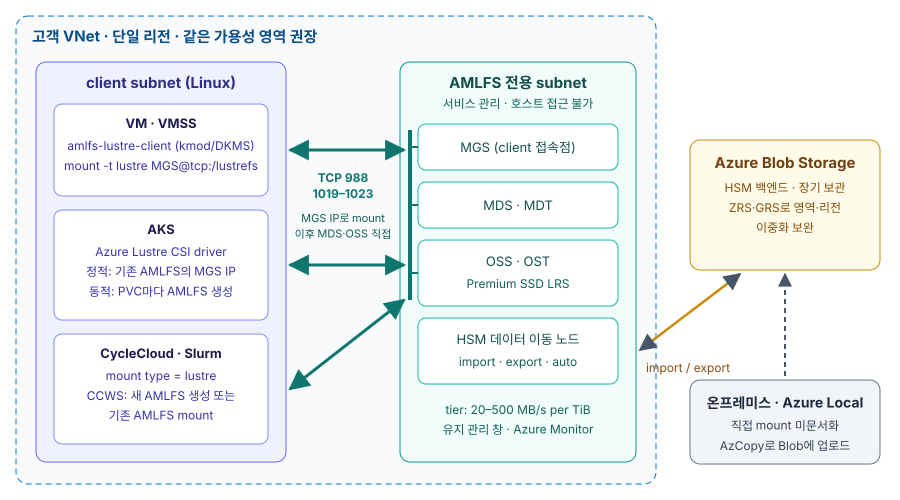

# Lustre와 Azure Managed Lustre: 아키텍처·관리형 기능·HPC 컴퓨트 연결

## 핵심 흐름: Lustre 병렬 I/O → Azure 관리형 서버·Blob HSM → 같은 영역 컴퓨트 mount { #core-flow }

이 주제의 결론은 세 단계로 요약됩니다.

1. **Lustre는 metadata와 data 경로를 나눈 병렬 파일 시스템입니다.** client는 MDS에서
   파일 layout을 받은 뒤 OST에 있는 데이터를 여러 OSS와 직접 병렬로 주고받으므로
   OSS·OST를 더하면 총 대역폭이 늘어납니다(DoM으로 MDT에 둔 작은 파일 구간은 MDS가 처리). 그 대신 데이터 보호는 주로 하위 RAID에(파일 단위 mirror인 FLR은 선택
   기능), HA는 Pacemaker 같은 외부 도구에 맡겨야 해서 직접 운영하기 어렵습니다.
2. **Azure Managed Lustre(AMLFS)는 서버 계층 운영을 서비스로 바꾸고 Blob Storage를
   HSM 백엔드로 붙입니다.** 사용자는 MB/s per TiB tier와 용량만 고르고, 유지 관리 창·
   Azure Monitor·CMK·root squash 같은 Azure 운영 기능을 얻습니다. 대신 파일 시스템은
   단일 가용성 영역의 LRS 디스크에 있고 서버 튜닝 자유도는 없습니다.
3. **HPC 컴퓨트는 AMLFS VNet(또는 peering된 VNet)의 Linux 노드가 TCP로 mount하며,
   공시 성능을 얻으려면 같은 가용성 영역에 둡니다.** VM은
   Microsoft client 패키지, AKS는 Azure Lustre CSI driver, CycleCloud·Slurm은
   `type = lustre` mount 설정을 사용합니다. 온프레미스나 Azure Local(구 Azure Stack
   HCI)에서의 직접 mount는 문서화되어 있지 않고, Blob을 거친 데이터 이동이 공식
   경로입니다.

규모 감각을 위해 Microsoft가 공개한 MLPerf Storage v3.0 결과를 보면, tier 125·
4,096 TiB AMLFS는 학습 읽기 379.1 GiB/s, checkpoint 쓰기 642.2 GiB/s를 기록했고,
16개 시뮬레이션 가속기 구성에서는 다섯 tier 모두 공칭 대역폭 밀도의 95.6–97.3%를
보였습니다. 이 값은 Microsoft의
시험 구성 결과이며 성능 보장이 아니고, 이 문서에서 재측정하지 않았습니다.

## 자체 운영 Lustre와 Azure Managed Lustre의 책임 차이 { #responsibility }

AMLFS를 선택하면 서버 운영 책임이 Microsoft로 넘어가고, 사용자는 네트워크·client·
데이터 수명주기에 집중합니다.

| 영역 | 자체 운영 Lustre | Azure Managed Lustre |
|---|---|---|
| MGS·MDS·OSS 서버 | 설치·커널·backend(ldiskfs/ZFS) 직접 관리 | 서비스가 고객 subnet에 배치·관리 |
| HA·디스크 보호 | 공유 스토리지 failover, 외부 HA, RAID 직접 설계 | 고객 구성 없음, Premium SSD LRS |
| 성능 단위 | OSS·OST 수로 설계 | 20·40·125·250·500 MB/s per TiB tier |
| HSM | coordinator·copytool·백엔드 구성 | Blob 컨테이너 지정(생성 시에만) |
| 네트워크 | tcp·o2ib(RDMA) 선택, LNet routing | VNet subnet, client는 `@tcp` mount |
| 이중화·DR | FLR, 복제 설계 | 단일 영역. Blob(ZRS·GRS) export와 보조 리전 재생성 |
| client | 커널 버전에 맞춘 빌드 | Microsoft가 배포판·커널별 패키지 게시 |

## 선택 기준: 워크로드와 운영 조건 { #decision }

| 조건 | 권장 방향 |
|---|---|
| AI 학습·HPC 시뮬레이션처럼 큰 파일을 여러 노드가 병렬로 읽고 쓰는 작업 | AMLFS를 Blob 앞단의 작업 계층으로 두고, 결과를 Blob으로 export |
| 컨테이너 기반 학습·배치 | AKS + CSI driver 정적 프로비저닝으로 공유 데이터셋 mount |
| Slurm 기반 기존 HPC 이전 | CycleCloud Workspace for Slurm에서 AMLFS를 함께 생성 또는 mount |
| InfiniBand RDMA로 Lustre 트래픽을 보내야 하거나 서버 튜닝이 필요한 경우 | AMLFS 문서 범위 밖. 자체 운영 Lustre 검토 |
| 영역·리전 장애에도 파일 시스템이 계속 살아 있어야 하는 경우 | AMLFS 단독으로는 불충분. Blob 이중화와 재생성 절차 설계 |
| 온프레미스·Azure Local에서 같은 데이터를 직접 mount해야 하는 경우 | 문서화되지 않음. Blob 경유 데이터 교환으로 설계 |

## 세부 문서

1. [Lustre 아키텍처: MGS·MDS·OSS 구성, 병렬 I/O 경로와 장단점](upstream-architecture/index.md) —
   오픈 소스 Lustre의 구성 요소, LNet, striping·PFL·DoM·DNE, HSM, HA 모델과 장단점
2. [Azure Managed Lustre 관리형 기능](managed-features/index.md) — 처리량 tier, Blob HSM
   통합, 보안, 운영 기능과 생성 후 변경할 수 없는 제약
3. [Azure Managed Lustre 컴퓨트 연결](compute-integration/index.md) — 네트워크 요건,
   VM client, AKS CSI driver, CycleCloud·Slurm, 온프레미스·Azure Local 범위

## 기준일과 문서 간 불일치 { #limitations }

이 비교는 2026-11-10에 공식 문서를 전체 조회한 결과이며, 직접 배포나 성능 측정은
하지 않았습니다. Learn 문서 사이에 AKS와 AMLFS의 같은 subnet 배치, RHEL 9.8 client
지원, 20 tier SKU 표기가 서로 다르게 적혀 있어 각 세부 문서의 해석 제한 절에 정리했습니다.
서버 측 Lustre 정확한 릴리스, 지원 리전 목록, 영역 중복 옵션, InfiniBand 사용 여부는
공식 문서에서 확인하지 못했습니다.

## 공식 출처

front matter의 `official_sources`와 각 세부 문서의 출처 목록을 참고합니다.
