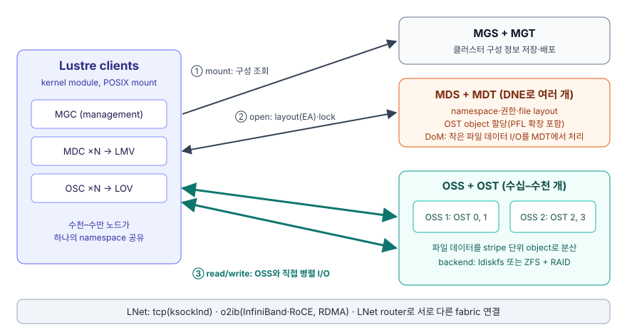

# Lustre 아키텍처: MGS·MDS·OSS 구성, 병렬 I/O 경로와 장단점

Lustre는 **metadata 경로(MDS)와 data 경로(OSS)를 분리하고, client가 여러 OSS와
직접 병렬로 데이터를 주고받게 해서** OSS·OST를 더할수록 총 대역폭이 늘어나는 오픈
소스 병렬 파일 시스템입니다. 이 구조는 큰 파일의 병렬 I/O에 강하지만, 데이터 보호와
HA를 하위 스토리지와 외부 HA 도구에 맡기므로 직접 운영 부담이 크다고 볼 수
있습니다(설계 해석).
Azure가 이 부담을 어떻게 덜어 주는지는
[관리형 기능](../managed-features/index.md)에서 이어집니다.

## 구성 요소: MGS·MDS·OSS와 client 모듈 { #components }

Lustre 설치는 구성 서버(MGS)와 하나 이상의 파일 시스템으로 이루어지고, 각 파일
시스템은 metadata 서버, object storage 서버와 client로 구성됩니다. 각 서버는
target이라는 저장 장치를 서비스합니다.

| 구성 요소 | 역할 |
|---|---|
| MGS·MGT | 클러스터의 모든 Lustre 파일 시스템 구성 정보를 MGT에 저장하고 target과 client에 배포합니다. MDS와 같은 노드(HA 쌍)에 둘 수 있으며, MGT와 MDT를 같은 저장소에 두는 것도 가능하지만 매뉴얼은 별도 저장소를 선호하고 위키는 단일 LUN 결합을 강하게 비권장합니다. |
| MDS·MDT | 이름·디렉터리·권한·file layout 같은 metadata를 MDT에 저장하고 open·close·rename 같은 namespace 연산을 처리합니다. 파일 생성 시 OST object를 할당합니다. |
| OSS·OST | 파일 데이터를 OST의 object로 저장하고 I/O 요청을 처리합니다. OSS 하나가 보통 OST 2–8개를 서비스합니다(더 많이도 가능). |
| client | MGC, MDC, OST마다 하나인 OSC로 구성됩니다. LOV가 여러 OSC를, LMV가 여러 MDT에 대응하는 MDC를 묶어 하나의 namespace로 보여 줍니다. |
| LNet | 서버와 client 간 metadata·데이터 통신을 담당하는 커널 모듈 네트워크 계층입니다. |

backend 파일 시스템으로는 성능을 강화한 ext4인 **ldiskfs** 또는 **ZFS**를
사용하며, 둘은 MDT 파일 수·크기 같은 확장 한계가 다릅니다.

## I/O 경로: metadata 조회와 OSS 직접 데이터 전송 { #io-path }

client는 파일의 위치 정보만 MDS에서 받고, 실제 데이터는 OSS와 직접 주고받습니다.

1. mount 시 client는 MGS에서 파일 시스템 구성을 받습니다.
2. 파일을 열면 MDT object의 확장 속성인 **layout EA**를 가져옵니다. layout은 파일이
   어느 OST object에 어떤 크기로 나뉘어 있는지 알려 줍니다.
3. client는 layout을 이용해 해당 OSS들과 직접 병렬 I/O를 수행합니다. 파일이 열린
   뒤에는 MDS가 I/O에 관여하지 않습니다.

전체 대역폭은 OSS 네트워크 대역폭 합과 OST 디스크 대역폭 합 중 작은 값으로
결정됩니다. 그래서 OSS·OST를 더하면 용량과 대역폭이 함께 늘어납니다.

## LNet: tcp·o2ib 네트워크 추상화와 routing { #lnet }

LNet은 Lustre 전용 네트워크 API로, 네트워크 유형별 driver(LND)를 통해 여러
fabric을 동시에 지원합니다. 노드 주소(NID)는 `10.70.207.11@tcp0`,
`10.20.30.11@o2ib0` 형식입니다.

- `tcp`(ksocklnd): Ethernet, IPoIB 등 TCP를 쓰는 모든 네트워크
- `o2ib`(ko2iblnd): InfiniBand, Omni-Path, RoCE의 RDMA 경로
- LNet router: Ethernet과 InfiniBand처럼 서로 다른 fabric을 연결

## 파일 레이아웃: striping·PFL·DoM { #layouts }

Lustre는 파일 데이터를 RAID 0 방식으로 여러 OST object에 나누어 저장합니다.
object 수는 `stripe_count`, 한 object에 연속으로 쓰는 크기는 `stripe_size`이며
기본값은 1개·1 MiB(1,048,576 bytes, 매뉴얼 표기 1MB)입니다. MDS는 OST 여유 공간 차이가 작으면 round robin, 크면
가중 무작위 방식으로 OST를 고릅니다.

| 기능 | 목적 | 동작 |
|---|---|---|
| striping | 큰 파일 하나의 대역폭을 여러 OST로 확장 | 최대 2,000개 OST(ZFS MDT 또는 `ea_inode` 사용 ldiskfs, `ea_inode`는 2.13부터 기본)까지 분산. `ea_inode` 없는 ldiskfs MDT는 160개 |
| PFL(Progressive File Layout) | I/O 패턴을 미리 몰라도 무난한 성능 | 파일 앞부분은 적은 stripe, 뒤로 갈수록 넓은 stripe를 쓰는 복합 layout. 파일이 커질 때 MDS가 object를 추가 할당 |
| DoM(Data on MDT) | 작은 파일 I/O 개선 | PFL의 특수한 경우로 첫 구간을 MDT에 저장해 OST 왕복과 작은 random I/O를 줄임 |

stripe를 넓히면 lock과 네트워크 연산이 늘고, OSS 하나의 장애가 많은 파일의 일부에
영향을 줍니다. 작은 파일은 striping 이점이 없어 단일 OST object나 DoM이 적합합니다.

## 메타데이터 확장: DNE remote·striped directory { #dne }

Lustre 2.4 전에는 파일 시스템마다 MDT가 하나뿐이었고, **DNE(Distributed
Namespace)** 로 metadata 부하를 여러 MDT·MDS로 나눌 수 있게 되었습니다.

- remote directory(DNE1): 특정 하위 트리를 특정 MDT에 배정
- striped directory(DNE2): 한 디렉터리의 항목을 여러 MDT에 분산(2.8 이상)

중첩된 MDT 관계는 MDT 하나를 잃으면 그 아래 모든 하위 디렉터리에 접근할 수 없게
되므로 기본 비활성이며 권장하지 않습니다.

## 일관성: LDLM 분산 lock { #ldlm }

Lustre Distributed Lock Manager(LDLM)는 여러 client가 같은 파일과 디렉터리를 동시에
읽고 써도 일관성을 유지하도록 byte 단위 파일 lock과 세밀한 metadata lock을 제공합니다.
MDT의 LDLM은 inode 권한과 경로 이름을, 각 OST의 LDLM은 그 OST의 stripe lock을 관리하므로
OST가 늘면 lock 처리 능력도 함께 늘어납니다. Lustre client는 전체 POSIX 테스트를
로컬 ext4와 같은 방식으로 통과하며(일부 예외), `mmap()` I/O도 지원합니다.

## HSM·changelog: 외부 저장 계층과 변경 이벤트 { #hsm-changelog }

**HSM**은 Lustre를 느린 대용량 저장소 앞의 고속 cache로 사용합니다. 파일을 외부
저장소로 복사하는 것을 archive, Lustre에서 데이터를 비우는 것을 release, 다시
가져오는 것을 restore라고 합니다. MDT의 **coordinator**가 요청을 배분하고, agent
client 노드의 사용자 공간 **copytool**이 실제 복사를 수행합니다. 따라서 HSM에는
최소한 계산용 client 하나와 agent client 하나가 필요합니다.

**changelog**는 생성·삭제·이름 변경·속성 변경을 FID, 이름, 시각, 사용자 정보와 함께
기록합니다. archive 연동, mirror 복제, 감시 스크립트, 감사에 쓰입니다.

## 가용성 모델: 공유 스토리지 failover와 외부 HA 의존 { #availability }

Lustre의 HA는 흔히 **같은 저장 장치를 공유하는 서버 쌍**으로 구성합니다. MDT가 하나면
MDS를 active/passive 쌍으로, MDT가 여럿이면 active/active로 둘 수 있고, OSS 쌍은 각
노드가 OST 일부를 맡는 active/active로 둡니다(OST 하나는 한 번에 한 노드만 mount).
failover를 설정해 포맷한 ldiskfs target에는 multi-mount protection(MMP)이 자동으로
켜져 두 노드의 동시 mount를 막습니다.

- Lustre는 파일 시스템 계층의 failover만 제공합니다. 노드 감시, 장애 감지, fencing은
  Pacemaker·Corosync 같은 **외부 HA 소프트웨어**가 맡아야 합니다.
- fencing이 실패해 두 노드가 같은 저장 장치를 쓰면 데이터가 심각하게 손상될 수 있습니다.
- Lustre 자체는 **데이터 이중화를 제공하지 않고** backend 저장 장치의 이중화에만
  의존합니다. 공식 매뉴얼은 OST에 RAID 5 또는 가급적 RAID 6, MDT에 RAID 1 또는 RAID
  10을 권합니다. OST failover는 디스크 장애로 인한 손상을 막지 못합니다.
- 2.11에 도입된 **FLR(File Level Redundancy)** 은 파일별로 선택해 여러 OST에 mirror를
  두는 내장 데이터 이중화 기능이며(MDT 이중화는 아님), 첫 단계 구현은 쓰기 시 주 mirror만 갱신하고 나머지를
  stale로 표시한 뒤 나중에 동기화하는 delayed write 방식입니다.

## 장점: 확장성·POSIX 호환·오픈 소스 { #strengths }

Lustre의 장점은 큰 규모의 공유 namespace에서 OSS·OST를 더해 용량과 총 대역폭을
늘릴 수 있다는 점입니다.

| 장점 | 근거 |
|---|---|
| 규모 | 위키는 파일 시스템 하나가 수백 PB, 수천 client, 수 TB/s 합산 처리량까지 확장된다고 설명. 매뉴얼 Table 1.1의 운영 사례로 5만 client 이상, 합산 20 TB/s, 700 PiB 용량이 보고됨 |
| 비중단 확장 | OST·MDT를 추가해 용량과 대역폭을 서비스 중단 없이 늘림 |
| POSIX 호환 | client에서 전체 POSIX 테스트를 로컬 ext4와 같은 방식으로 통과(일부 예외), `mmap()` I/O 지원 |
| 저장소 통합 | 클러스터마다 파일 시스템을 따로 두고 데이터를 복사할 필요를 줄임 |
| 오픈 소스 | GPL 2.0 라이선스, 약 9개월 주기의 주 릴리스 계획 |
| 네트워크 유연성 | LNet으로 TCP와 RDMA fabric을 함께 쓰고 routing으로 연결 |

## 단점: 데이터 이중화 부재·운영 복잡도·작은 파일 성능 { #weaknesses }

Lustre의 약점은 신뢰성과 운영 편의를 하위 계층과 운영자에게 맡기는 구조에서 나옵니다
(설계 해석).

| 단점 | 근거 |
|---|---|
| 데이터 이중화 제한 | Lustre는 backend RAID에 의존하며, 2.11의 FLR 전에는 저장 장치 장애를 완화하는 장치가 없었음. FLR도 파일별 선택 기능 |
| HA 외부 의존 | 노드 감시·fencing을 외부 HA 도구로 구성해야 하며 잘못되면 데이터 손상 위험 |
| client 커널 의존 | client 커널과 `kmod-lustre-client` 패키지 버전이 같아야 함(DKMS 제외) |
| 분산된 관리 | quota 명령을 MGS·MDS·OSS·client에 나누어 실행해야 하며 root quota는 강제되지 않음 |
| 작은 파일·metadata 집약 워크로드 | 큰 파일에 최적화되어 작은 파일은 추가 RPC 왕복이 생김. DoM·DNE가 이를 보완 |
| peer-to-peer 부적합 | 소프트웨어 수준 복제가 없어 client와 서버를 같은 노드에 두는 구성에는 맞지 않음 |

위 항목을 종합하면 자체 운영 Lustre는 단일 NFS 서버보다 운영 부담이 크다고 볼 수
있습니다. 이 종합은 공식 문서의 개별 사실에서 도출한 해석입니다.

## 릴리스 현황: 2.15 유지 관리 릴리스와 2.17 주 릴리스 { #releases }

2026-11-10에 확인한 lustre.org 기준 현재 유지 관리 릴리스는 **2.15.8**(위키 표기는
LTS 유지 관리 릴리스), 현재 주 릴리스는 **2.17.0**(2025-12-29)이며 2.18.0을 개발
중입니다. 2.15.8 출시일은
lustre.org 홈(2025-12-03)과 위키 Main Page(2025-12-02)가 하루 다르게 표기합니다.
Azure Managed Lustre의 client 호환 버전도 OS에 따라 2.15 또는 2.17입니다.

## 해석 제한과 미확인 사항 { #limitations }

- 확장 수치는 위키의 설계 범위 설명과 매뉴얼 Table 1.1의 운영 사례이며 이 문서에서
  측정하지 않았습니다.
- LDLM은 공식 매뉴얼에 전용 장이 없어 기능 개요와 위키 소개를 근거로 했습니다.
- 위키의 `Release_2.17.0` 페이지는 출시 전 계획 문서로 남아 있어 릴리스 상태는
  lustre.org 홈과 위키 Main Page를 기준으로 했습니다.

## 공식 출처

Lustre 동작은 front matter `official_sources`의 lustre.org, wiki.lustre.org,
doc.lustre.org 원문과 대조했고, Azure 문맥은 Microsoft Learn의 Azure Managed Lustre
개요와 대조했습니다. 2026-11-10에 각 문서를 전체 조회했습니다.
