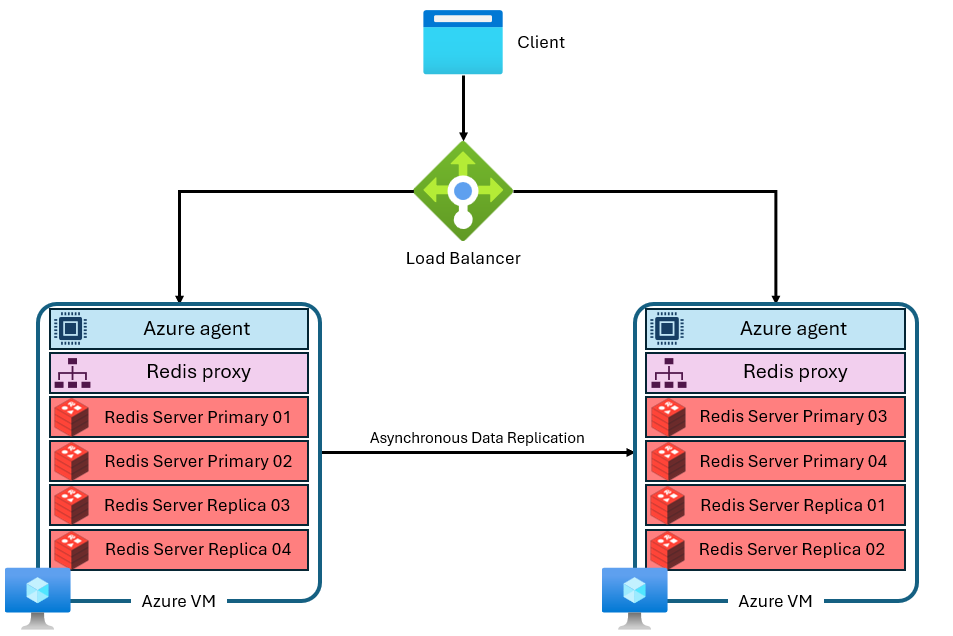

# Azure Managed Redis 클러스터링 정책별 연결과 마이그레이션 가이드

Azure Managed Redis는 **OSS**, **Enterprise**, **Non-clustered** 세 가지 클러스터링 정책을 제공합니다. 어떤 정책을 쓰는지에 따라 클라이언트 생성 방식, 장애 시 토폴로지 갱신 책임과 Azure Cache for Redis에서 옮길 때 바꿔야 할 코드가 달라집니다.

이 가이드는 다음 내용을 한 문서에 정리합니다. 실제로 OSS 정책과 node-redis `createCluster` 조합에서 Planned Maintenance 이후 연결이 복구되지 않은 경과는 [장애 사례](../index.md)에 있습니다.

- 세 가지 정책의 차이와 기본값
- Node.js와 Java 라이브러리별 연결 방식과 토폴로지 갱신 동작
- Azure Cache for Redis에서 옮길 때 기존 연결 형태(단일/클러스터)별 마이그레이션 방법

!!! note "기준 시점"
    Microsoft Learn과 클라이언트 라이브러리 내용은 2026-10-24에 확인했습니다. 라이브러리 기본값은 버전마다 다르므로 사용 중인 버전의 문서도 함께 확인합니다.

---

## 한눈에 보기: 내 구성에서 확인할 것 { #at-a-glance }

먼저 아래 표에서 현재 구성에 해당하는 행을 찾은 뒤, 오른쪽 열에 연결된 섹션을 확인합니다.

| 현재 구성 | 클라이언트 연결 형태 | Azure Managed Redis 정책 | 필요한 코드 변경 | 반드시 확인할 것 |
|---|---|---|---|---|
| Azure Cache for Redis Basic/Standard 또는 클러스터를 쓰지 않는 Premium | 단일 엔드포인트 | **Enterprise** (변경 최소) | 호스트·포트·인증 정보 | 기본값 OSS로 만들면 `MOVED` 오류 발생, 일부 멀티키 명령 `CROSSSLOT` → [3.2](#migrate-from-single-endpoint) |
| 〃 | 〃 | **OSS** (성능 우선) | 클러스터 클라이언트로 전환 | 해시 태그, 토폴로지 갱신 설정 → [2장](#client-libraries), [3.2](#migrate-from-single-endpoint) |
| 〃 | 〃 | **Non-clustered** (25GB 이하) | 호스트·포트·인증 정보 | 크기 상한, 성능 → [3.2](#migrate-from-single-endpoint) |
| 클러스터를 사용하는 Azure Cache for Redis Premium | 클러스터 클라이언트 | **OSS** | 호스트·포트·인증 정보 | 85XX 포트 하드코딩 금지, 토폴로지 갱신 → [3.3](#migrate-from-cluster-client) |
| 〃 | 〃 | **Enterprise** | 단일 엔드포인트 클라이언트로 **반드시** 전환 | `CLUSTER NODES`·`CLUSTER SLOTS` 차단 → [3.3](#migrate-from-cluster-client) |
| Azure Cache for Redis Enterprise/Enterprise Flash | OSS 정책이면 클러스터, Enterprise 정책이면 단일 엔드포인트 | 원본과 **같은 정책을 명시** | 호스트(DNS 접미사)·인증 정보 | 정책을 지정하지 않으면 OSS로 생성 → [3.4](#migrate-from-enterprise-tier) |
| Azure Managed Redis OSS 운영 중 | 클러스터 클라이언트 | 유지 또는 Enterprise로 재생성 | 토폴로지 갱신·연결 재생성 로직 | Planned Maintenance 후 미복구 → [장애 사례](../index.md) |
| Azure Managed Redis Enterprise 운영 중 | 단일 엔드포인트 | 유지 | 없음 | 프록시 처리량 한계, 일부 멀티키 `CROSSSLOT` → [1.2](#policy-comparison) |

---

## 1. 세 가지 클러스터링 정책 { #cluster-policies }

Azure Managed Redis는 Redis Enterprise 기반이며 모든 인스턴스가 내부적으로 클러스터 구성을 사용합니다. 각 노드(VM)는 여러 Redis 프로세스(샤드)를 실행하고, 주 샤드와 복제본 샤드를 노드에 나눠 배치하며, 노드마다 Redis proxy가 연결을 관리합니다.



*그림: Azure Managed Redis 아키텍처. 출처: [Microsoft Learn – Azure Managed Redis architecture](https://learn.microsoft.com/azure/redis/architecture)*

클러스터링 정책은 **클라이언트가 이 구성에 어떤 방식으로 연결하는지**를 정합니다.

### 1.1 정책별 연결 모델

[](images/clustering-policies.svg)

**OSS 정책**

- Redis Cluster API를 그대로 노출합니다.
- 클라이언트는 `10000` 포트로 처음 연결한 뒤 `CLUSTER NODES` 등으로 샤드 위치를 알아내고, 각 샤드(85XX 포트)에 **직접** 연결합니다.
- slot과 노드의 매핑, `MOVED`·`ASK` 리디렉션 처리는 **클라이언트 라이브러리 책임**입니다.
- 85XX 포트는 바뀔 수 있으므로 애플리케이션에 하드코딩하지 않습니다.

**Enterprise 정책**

- 모든 연결에 **단일 엔드포인트**(`10000` 포트)를 제공합니다.
- 노드의 프록시가 요청을 올바른 샤드로 라우팅하므로 클라이언트에는 비클러스터 Redis처럼 보입니다.
- 클러스터를 지원하지 않는 클라이언트도 사용할 수 있습니다.
- RediSearch 모듈을 쓰려면 이 정책이 필요합니다.

**Non-clustered 정책**

- 데이터를 샤딩하지 않는 전통적인 단일 프로세스 Redis처럼 동작합니다.
- 25GB 이하 캐시에서만 사용할 수 있습니다.

### 1.2 정책별 비교 { #policy-comparison }

| 항목 | OSS | Enterprise | Non-clustered |
|---|---|---|---|
| 연결 모델 | 클라이언트가 샤드에 직접 연결 | 단일 엔드포인트 + 내부 프록시 | 단일 엔드포인트, 샤딩 없음 |
| 클라이언트 요구 사항 | Redis Cluster API 지원 필수 | 모든 표준 클라이언트 | 모든 표준 클라이언트 |
| 성능 | 일반적으로 가장 높은 처리량, 가장 낮은 지연 | 단일 프록시 노드가 병목이 될 수 있음 | 멀티샤드 병렬 처리를 쓰지 못해 일반적으로 가장 낮음 |
| 멀티키 명령 | 모든 키가 같은 slot이어야 함 | `DEL`, `MSET`, `MGET`, `EXISTS`, `UNLINK`, `TOUCH`만 slot을 넘어 허용 | 제한 없음 |
| `CLUSTER NODES`/`CLUSTER SLOTS` | 사용 가능(클라이언트 탐색용) | **차단** | 해당 없음 |
| RediSearch | 지원 안 함 | **필수** | 지원 안 함 |
| 최대 크기 | 제한 없음 | 제한 없음 | 25GB |
| 생성 후 정책 변경 | **불가**(삭제 후 재생성) | **불가**(삭제 후 재생성) | 클러스터 정책으로 변경 가능(active geo-replication 그룹 제외) |

!!! warning "Active geo-replication과 Enterprise 정책의 멀티키 명령"
    Enterprise 정책에서 active geo-replication을 사용하면 `DEL`, `MSET`, `UNLINK` 같은 멀티키 쓰기 명령도 같은 slot의 키에만 실행할 수 있습니다. slot을 넘어 허용되는 명령은 `MGET`, `EXISTS`, `TOUCH`뿐입니다.

### 1.3 기본값은 OSS이고 생성 후 바꿀 수 없음

- Azure CLI(`az redisenterprise create --clustering-policy`)와 ARM/SDK의 `clusteringPolicy` 기본값은 `OSSCluster`입니다. Azure Portal에서는 **Advanced** 탭의 **Clustering policy**에서 선택합니다.
- 템플릿이나 스크립트에서 정책을 지정하지 않으면 **OSS 정책으로 생성**됩니다.
- OSS와 Enterprise 정책은 생성 후 바꿀 수 없습니다. 바꾸려면 캐시를 삭제하고 다시 만들어야 합니다.

따라서 **단일 엔드포인트 클라이언트를 그대로 쓸 계획이라면 Enterprise(또는 Non-clustered) 정책을 반드시 명시**해야 합니다. 자세한 절차는 [3.5](#set-and-check-policy)를 참고합니다.

---

## 2. 언어별 클라이언트 연결 방식 { #client-libraries }

정책은 클라이언트 생성자 선택으로 이어집니다. Enterprise와 Non-clustered는 같은 단일 엔드포인트 클라이언트를 쓰고, OSS는 클러스터 클라이언트를 써야 합니다.

### 2.1 Node.js { #nodejs }

| 라이브러리 | Enterprise / Non-clustered | OSS | OSS 토폴로지 갱신 동작 |
|---|---|---|---|
| node-redis (`redis`, `@redis/client`) | `createClient({ url })` | `createCluster({ rootNodes: [{ url }] })` | `MOVED`·`ASK` 응답을 받을 때 slot 맵을 다시 읽습니다. 주기적 갱신 옵션은 없고, 노드 연결 오류만으로는 다시 읽지 않습니다(`@redis/client` 5.11.0 구현 기준). |
| ioredis | `new Redis(url)` | `new Redis.Cluster([{ host, port: 10000 }], options)` | `MOVED` 응답 시 갱신합니다. `slotsRefreshInterval`을 설정하면 주기적으로 갱신하며 기본값은 비활성입니다. |

OSS 정책에서 TLS를 사용할 때는 다음을 확인합니다.

- 클러스터가 노드 주소를 IP로 알려 줄 수 있습니다. TLS 인증서는 캐시 호스트 이름으로 발급되므로 인증서 검증에 호스트 이름을 사용해야 합니다.
- node-redis: Microsoft Learn Node.js 빠른 시작처럼 `nodeAddressMap`에서 IP를 캐시 호스트 이름으로 바꿉니다.
- ioredis: `redisOptions.tls.servername`에 캐시 호스트 이름을 지정합니다.

**Enterprise / Non-clustered (node-redis)**

```javascript
const { createClient } = require('redis');

const host = process.env.REDIS_HOST; // <cache-name>.<region>.redis.azure.net

const client = createClient({
  url: `rediss://${host}:10000`,
  credentialsProvider, // Microsoft Entra ID 또는 액세스 키
  pingInterval: 60_000,
  socket: {
    tls: true,
    servername: host,
    connectTimeout: 5_000,
    reconnectStrategy: (retries) =>
      Math.min(2 ** retries * 100, 5_000) + Math.floor(Math.random() * 500),
  },
});
client.on('error', (err) => console.error('redis error', err));
await client.connect();
```

**OSS (node-redis)**

```javascript
const net = require('node:net');
const { createCluster } = require('redis');

const host = process.env.REDIS_HOST;

const cluster = createCluster({
  rootNodes: [{ url: `rediss://${host}:10000` }],
  defaults: {
    credentialsProvider,
    pingInterval: 60_000,
    socket: {
      tls: true,
      servername: host,
      connectTimeout: 5_000,
      reconnectStrategy: (retries) =>
        Math.min(2 ** retries * 100, 5_000) + Math.floor(Math.random() * 500),
    },
  },
  // 노드 주소가 IP로 오면 TLS 검증을 위해 캐시 호스트 이름으로 바꾼다
  nodeAddressMap: (address) => {
    const [nodeHost, port] = address.split(':');
    return { host: net.isIP(nodeHost) ? host : nodeHost, port: Number(port) };
  },
});
cluster.on('error', (err) => console.error('redis cluster error', err));
await cluster.connect();
```

node-redis로 OSS 정책을 사용할 때는 [장애 사례의 연결 재생성 패턴](../index.md#option-recreate-connection)도 함께 적용합니다.

### 2.2 Java { #java }

Java에서는 주로 **Lettuce**와 **Jedis**를 사용합니다. 두 라이브러리 모두 Microsoft Learn의 Azure Managed Redis 클라이언트 라이브러리 목록에 있으며, Azure가 라이브러리별 모범 사례 가이드를 제공합니다. Spring Boot는 기본으로 Lettuce를 사용합니다.

#### Lettuce와 Jedis 비교 { #lettuce-vs-jedis }

| 항목 | Lettuce | Jedis |
|---|---|---|
| 구조 | Netty 기반이며 스레드 안전합니다. 블로킹·트랜잭션 명령을 쓰지 않으면 여러 스레드가 연결 하나를 공유할 수 있습니다. | 연결 풀 기반입니다. 최신 `RedisClient`는 풀을 내장하고 있습니다. |
| API 형태 | 동기, 비동기, 리액티브 | 동기 (파이프라인은 별도 API) |
| Spring Boot | 기본 클라이언트 (`spring-boot-starter-data-redis`) | `spring.data.redis.client-type=jedis` 설정과 Jedis 의존성 추가 |
| Enterprise / Non-clustered | `RedisClient.create(redisUri)` | 7.2.0 이상: `RedisClient.builder().hostAndPort(host, 10000)`<br>이전: `JedisPooled`, `UnifiedJedis` |
| OSS | `RedisClusterClient.create(redisUri)` | 7.2.0 이상: `RedisClusterClient.builder().nodes(nodes)`<br>이전: `JedisCluster` (7.2.0부터 deprecated) |
| OSS 토폴로지 기본 동작 | 주기적 갱신은 기본 비활성입니다. 적응형(adaptive) 갱신은 6.x에서 기본 비활성, 7.0부터 기본 활성입니다. | `MOVED` 응답과 연속 연결 실패 시 slot 캐시를 다시 읽습니다. 주기적 갱신은 기본으로 하지 않습니다. |
| 주기적 갱신 설정 | `ClusterTopologyRefreshOptions.enablePeriodicRefresh(...)` | `topologyRefreshPeriod(...)` (5.1.0 이상) |
| OSS + TLS 노드 주소 매핑 | `MappingSocketAddressResolver` | `DefaultJedisClientConfig.hostAndPortMapper(...)` |
| Azure 가이드 | [Lettuce Best Practices](https://github.com/Azure/AzureCacheForRedis/blob/main/Lettuce%20Best%20Practices.md) | [Jedis Best Practices](https://github.com/Azure/AzureCacheForRedis/blob/main/Redis-BestPractices-Java-Jedis.md) |

어떤 클라이언트를 고를지는 다음 기준으로 판단합니다.

- **Spring Boot 애플리케이션**: 기본값인 Lettuce를 유지합니다. Jedis로 바꾸면 Spring Boot 속성은 풀 설정(`spring.data.redis.jedis.pool.*`)만 제공하고 클러스터 토폴로지 갱신 속성은 제공하지 않습니다.
- **비동기·리액티브 처리 또는 적은 연결 수**: Lettuce를 사용합니다.
- **단순한 동기 코드나 기존 Jedis 코드**: Jedis를 유지하되 7.2.0 이상의 `RedisClient`·`RedisClusterClient`로 옮기는 것을 검토합니다.
- **OSS 정책**: 어느 쪽이든 주기적 토폴로지 갱신을 **명시적으로 켭니다**. [장애 사례](../index.md)처럼 노드가 교체되면 리디렉션 응답 없이 연결만 실패할 수 있기 때문입니다.

#### Lettuce { #lettuce }

**Enterprise / Non-clustered**

```java
RedisURI uri = RedisURI.Builder.redis(host, 10000)
        .withSsl(true)
        .withAuthentication(username, password) // 또는 Microsoft Entra ID 자격 증명 공급자
        .build();

RedisClient client = RedisClient.create(uri);
client.setOptions(ClientOptions.builder()
        .socketOptions(SocketOptions.builder()
                .connectTimeout(Duration.ofSeconds(5))
                .keepAlive(true)
                .build())
        .build());
StatefulRedisConnection<String, String> connection = client.connect();
```

**OSS**

Azure의 Lettuce 모범 사례가 권장하는 토폴로지 갱신 설정을 적용한 예입니다.

```java
RedisClusterClient client = RedisClusterClient.create(uri);

ClusterTopologyRefreshOptions refresh = ClusterTopologyRefreshOptions.builder()
        .enablePeriodicRefresh(Duration.ofSeconds(5))
        .enableAllAdaptiveRefreshTriggers()
        .adaptiveRefreshTriggersTimeout(Duration.ofSeconds(5))
        .dynamicRefreshSources(false)
        .build();

client.setOptions(ClusterClientOptions.builder()
        .topologyRefreshOptions(refresh)
        .socketOptions(SocketOptions.builder()
                .connectTimeout(Duration.ofSeconds(5))
                .keepAlive(true)
                .build())
        .build());
StatefulRedisClusterConnection<String, String> connection = client.connect();
```

TLS 인증서 검증에 실패하면 Azure Lettuce 가이드의 `MappingSocketAddressResolver` 예제처럼 노드 IP를 캐시 호스트 이름으로 매핑합니다.

#### Jedis { #jedis }

Microsoft Learn의 Java 빠른 시작은 Jedis와 `redis-authx-entraid`로 Microsoft Entra ID 인증을 구성합니다. 아래 예는 Jedis 7.2.0 이상의 빌더 API를 사용합니다.

```java
JedisClientConfig config = DefaultJedisClientConfig.builder()
        .ssl(true)
        .user(username)
        .password(password)           // 또는 .authXManager(...)로 Microsoft Entra ID 사용
        .connectionTimeoutMillis(5_000)
        .socketTimeoutMillis(1_000)
        .build();
```

**Enterprise / Non-clustered**

```java
RedisClient jedis = RedisClient.builder()
        .hostAndPort(host, 10000)
        .clientConfig(config)
        .build();
```

**OSS**

```java
RedisClusterClient jedis = RedisClusterClient.builder()
        .nodes(Set.of(new HostAndPort(host, 10000)))
        .clientConfig(config)
        .topologyRefreshPeriod(Duration.ofSeconds(5))
        .build();
```

7.2.0보다 이전 버전을 사용한다면 다음과 같이 대응합니다.

- Enterprise / Non-clustered: `new JedisPooled(new HostAndPort(host, 10000), config)`를 사용합니다.
- OSS: `topologyRefreshPeriod`를 받는 `JedisCluster` 생성자를 사용합니다(5.1.0 이상).
- OSS에서 TLS 인증서 검증에 실패하면 `DefaultJedisClientConfig.builder().hostAndPortMapper(...)`로 노드 IP를 캐시 호스트 이름으로 매핑합니다.
- 풀을 직접 구성한다면 Azure Jedis 가이드에 따라 유휴 연결 제거 시간(`minEvictableIdleTimeMillis`)을 10분보다 짧게 둡니다.

#### Spring Boot { #spring-boot }

!!! tip "Spring Boot 예제를 그대로 옮길 때"
    Microsoft Learn의 Spring Boot 연결 예제는 `spring.data.redis.host`와 `spring.data.redis.port=10000`을 사용하는 **단일 엔드포인트 설정**입니다. 이 설정은 Enterprise 또는 Non-clustered 정책과 맞습니다. 기본값인 OSS 정책으로 만든 캐시에서는 `spring.data.redis.cluster.nodes`를 사용합니다. Spring Boot 2.x는 접두사가 `spring.redis.*`입니다.

```properties
# Enterprise / Non-clustered
spring.data.redis.host=<cache-name>.<region>.redis.azure.net
spring.data.redis.port=10000
spring.data.redis.ssl.enabled=true
```

```properties
# OSS (기본 클라이언트인 Lettuce 기준)
spring.data.redis.cluster.nodes=<cache-name>.<region>.redis.azure.net:10000
spring.data.redis.ssl.enabled=true
spring.data.redis.lettuce.cluster.refresh.period=5s
spring.data.redis.lettuce.cluster.refresh.dynamic-refresh-sources=false
# Spring Boot 3.x 속성. 4.x에서는 제거되어 Lettuce 기본값을 사용
spring.data.redis.lettuce.cluster.refresh.adaptive=true
```

#### Redisson

Redisson을 사용한다면 Enterprise / Non-clustered 정책에는 `useSingleServer()`, OSS 정책에는 `useClusterServers()`를 사용합니다. Microsoft Learn은 다음을 권장합니다.

- 3.14.1 이상을 사용합니다.
- `scanInterval`로 토폴로지를 주기적으로 스캔합니다. Microsoft Learn의 클러스터 기준 설정 예시는 `1000`ms입니다.

### 2.3 정책과 무관한 공통 연결 설정

| 항목 | 권장 값 | 이유 |
|---|---|---|
| Connect timeout | 5초 | 너무 짧으면 높은 CPU 상황에서 *연결 → 실패 → 재시도* 루프에 빠집니다. |
| Command timeout | 5초 미만에서 시작해 조정 | 값 크기와 지연 요구에 맞춥니다. |
| Keepalive / ping | 10분 미만(예: node-redis `pingInterval: 60000`) | Azure Managed Redis는 10분 동안 유휴 상태인 연결을 닫습니다. |
| 재시도 | 지수 백오프 + 지터 | 동시에 재연결하면 연결 생성 속도 제한에 걸립니다. |
| Linux `net.ipv4.tcp_retries2` | `5` | 기본값에서는 비정상 종료된 연결을 13분 이상 감지하지 못할 수 있습니다. |
| 연결 재생성 | 오류가 일정 시간 이상 지속되면 연결 객체를 새로 만들기 | 라이브러리가 복구 불가능한 상태에 빠질 수 있습니다. Azure Node.js 가이드는 약 30초를 예로 듭니다. |
| 이전 연결 정리 | 재생성 시 기존 연결 종료 | 티어별 연결 수 한도가 있습니다. |

---

## 3. Azure Cache for Redis에서 마이그레이션

Azure Cache for Redis의 Basic, Standard, Premium 티어는 노드마다 단일 스레드 Redis 프로세스 하나를 실행하고 주 노드와 복제본 노드로 구성됩니다. 반면 Azure Managed Redis는 [1장의 그림](#cluster-policies)처럼 노드마다 여러 샤드를 실행합니다. 마이그레이션에서 클라이언트 설정을 다시 봐야 하는 이유가 이 구조 차이입니다.


*그림: Azure Cache for Redis(Basic·Standard·Premium) 아키텍처. 출처: [Microsoft Learn – Azure Managed Redis architecture](https://learn.microsoft.com/azure/redis/architecture)*

아래 흐름에서 현재 구성에 맞는 경로를 찾은 뒤 3.2~3.4의 해당 섹션을 확인합니다.

[](images/migration-flow.svg)

### 3.1 먼저 확인할 현재 구성

| 확인 항목 | 확인 방법 | 영향 |
|---|---|---|
| 원본 티어 | Portal 개요 또는 리소스 종류(`Microsoft.Cache/redis` 또는 `Microsoft.Cache/redisEnterprise`) | 마이그레이션 경로 결정 |
| Premium 클러스터 사용 여부 | Portal의 클러스터 설정 또는 `az redis show` 결과의 `shardCount` | 3.2 또는 3.3 선택 |
| Enterprise 티어 정책 | `az redisenterprise database show` 결과의 `clusteringPolicy` | 3.4 |
| 클라이언트 생성자 | 코드에서 `createCluster`, `Redis.Cluster`, `RedisClusterClient`, `JedisCluster`, `useClusterServers`, `spring.data.redis.cluster.nodes` 검색 | 실제 연결 형태 확인 |
| 멀티키·트랜잭션·Lua 사용 | `MGET`, `MSET`, `MULTI`, `EVAL`, `SUNION` 등 사용 위치 검색 | `CROSSSLOT` 위험 |
| 여러 DB 사용 | `SELECT`, `database` 설정 | Azure Managed Redis는 DB 0만 지원 |
| 포트·TLS 모드 | 연결 문자열 | 6380/6379 → 10000, TLS 또는 비TLS 중 하나만 지원 |

공통으로 바뀌는 연결 정보는 다음과 같습니다.

| 항목 | Azure Cache for Redis | Azure Managed Redis |
|---|---|---|
| DNS 접미사 | `.redis.cache.windows.net` (Enterprise: `redisenterprise.cache.azure.net`) | `<region>.redis.azure.net` |
| 포트 | TLS 6380 / 비TLS 6379 | 10000 (TLS 또는 비TLS 중 하나만) |
| 노드 직접 연결 포트 | Premium 클러스터: 130XX/150XX 범위 | 85XX 범위(OSS 정책, 변경 가능) |
| 데이터베이스 | 여러 개(Basic/Standard/Premium) | DB 0만 |
| 네트워크 격리 | VNet 주입 가능 | VNet 주입·IP 방화벽 미지원, Private Link 사용 |

### 3.2 단일 엔드포인트로 연결하던 경우 { #migrate-from-single-endpoint }

Basic, Standard, 클러스터를 쓰지 않는 Premium에서 `createClient`, `new Redis()`, `RedisClient`, `JedisPooled`, `spring.data.redis.host`처럼 **단일 엔드포인트**로 연결하던 애플리케이션입니다.

Azure Managed Redis는 기본적으로 클러스터 구성입니다. 기본값인 OSS 정책을 그대로 선택하면 클러스터를 지원하지 않는 클라이언트는 다른 샤드에 있는 키에서 `MOVED` 오류를 받습니다. 세 가지 선택지 중 하나를 고릅니다.

| 선택지 | 클라이언트 변경 | 장점 | 주의할 점 |
|---|---|---|---|
| **A. Enterprise 정책** | 호스트·포트·인증 정보만 | 기존 클라이언트 구조 유지, 크기 제한 없음 | 생성 시 정책 **명시 필수**. `MULTI`, Lua, `SUNION` 등 허용 목록 밖의 멀티키 명령은 `CROSSSLOT` 발생. 프록시 처리량 한계. |
| **B. OSS 정책** (Microsoft 권장, 성능 우선) | 클러스터 클라이언트로 전환(2장) | 가장 높은 처리량 | 모든 멀티키 명령의 키를 해시 태그(`{user1}:a`, `{user1}:b`)로 같은 slot에 배치. 토폴로지 갱신 설정 필요. |
| **C. Non-clustered 정책** | 호스트·포트·인증 정보만 | 기존 Redis와 가장 비슷하고 `CROSSSLOT` 없음 | 25GB 이하. 성능이 가장 낮음. 확장하려면 정책을 먼저 바꿔야 함. |

선택 기준은 다음과 같습니다.

1. 25GB 이하이고 slot을 넘는 트랜잭션·Lua·멀티키 명령을 많이 사용하면 **C**
2. 코드 변경을 최소화하면서 크기 제한이 없어야 하면 **A**
3. 클라이언트 전환과 키 설계 변경을 감수하고 성능이 중요하면 **B**

### 3.3 클러스터 클라이언트로 연결하던 경우 { #migrate-from-cluster-client }

클러스터를 사용하는 Premium에서 `createCluster`, `Redis.Cluster`, `RedisClusterClient`, `JedisCluster`, `spring.data.redis.cluster.nodes` 등으로 연결하던 애플리케이션입니다.

| 선택지 | 클라이언트 변경 | 주의할 점 |
|---|---|---|
| **OSS 정책** (자연스러운 경로) | 호스트를 `<cache-name>.<region>.redis.azure.net:10000`로 변경하고 인증 정보 교체 | 노드 포트가 130XX/150XX에서 85XX로 바뀌므로 하드코딩한 노드 주소 제거. TLS 호스트 이름 매핑과 토폴로지 갱신 설정을 다시 검증(2장). |
| **Enterprise 정책** | 단일 엔드포인트 클라이언트로 **반드시 전환** | Enterprise 정책은 `CLUSTER NODES`, `CLUSTER SLOTS` 등 탐색 명령을 차단하므로 클러스터 클라이언트가 토폴로지를 읽지 못합니다. |

Enterprise 정책으로 바꿀 때 언어별로 바꿀 위치는 다음과 같습니다.

| 언어 | 변경 전(클러스터) | 변경 후(단일 엔드포인트) |
|---|---|---|
| Node.js node-redis | `createCluster({ rootNodes })` | `createClient({ url })` |
| Node.js ioredis | `new Redis.Cluster([...])` | `new Redis(url)` |
| Java Lettuce | `RedisClusterClient` | `RedisClient` |
| Java Jedis | `JedisCluster` / `RedisClusterClient` | `JedisPooled` / `RedisClient` |
| Java Redisson | `useClusterServers()` | `useSingleServer()` |
| Spring Boot | `spring.data.redis.cluster.nodes` | `spring.data.redis.host` + `port` |

### 3.4 Azure Cache for Redis Enterprise 티어에서 옮기는 경우 { #migrate-from-enterprise-tier }

Enterprise와 Enterprise Flash 티어는 Azure Managed Redis와 같은 Redis Enterprise 스택을 사용합니다. OSS와 Enterprise 정책만 지원하므로 **원본과 같은 정책을 선택하면 클러스터 동작이 그대로 유지**됩니다. 주로 호스트 이름과 인증 정보만 바꾸면 됩니다.

!!! warning "원본이 Enterprise 정책이면 새 캐시에도 Enterprise 정책을 명시"
    Azure Managed Redis의 기본 정책은 OSS입니다. 원본이 Enterprise 정책이었는데 IaC나 CLI에서 정책을 지정하지 않으면 새 캐시는 OSS 정책으로 생성됩니다. 이 경우 단일 엔드포인트 클라이언트는 `MOVED` 오류를 받습니다. 정책은 생성 후 바꿀 수 없으므로 캐시를 다시 만들어야 합니다.

    원본 정책은 `az redisenterprise database show` 출력의 `clusteringPolicy`로 확인한 뒤, 새 캐시를 만들 때 같은 값을 지정합니다.

### 3.5 정책을 명시해 생성하고 기존 정책을 확인하는 방법 { #set-and-check-policy }

```bash
# 기존 캐시(Azure Cache for Redis Enterprise 또는 Azure Managed Redis)의 정책 확인
az redisenterprise database show \
  --cluster-name <cache-name> \
  --resource-group <resource-group> \
  --output json
# 출력의 clusteringPolicy 값: OSSCluster | EnterpriseCluster | NoCluster
```

```bash
# 정책을 명시해 Azure Managed Redis 생성
az redisenterprise create \
  --cluster-name <cache-name> \
  --resource-group <resource-group> \
  --location <region> \
  --sku Balanced_B10 \
  --clustering-policy EnterpriseCluster \
  --public-network-access Disabled
```

Bicep이나 ARM 템플릿을 사용하면 `Microsoft.Cache/redisEnterprise/databases` 리소스의 `clusteringPolicy` 속성을 반드시 지정합니다. 지정하지 않으면 `OSSCluster`가 적용됩니다.

---

## 그림 원본

직접 작성한 그림은 Excalidraw 원본으로 [`samples/diagrams/`](https://github.com/hellices/devguidesample/tree/main/docs/services/azure-managed-redis/cluster-failover-recovery/samples/diagrams)에 있습니다. 수정 방법은 해당 폴더의 README를 참고합니다.

## 관련 문서

- [Azure Managed Redis Cluster Failover 장애 분석 및 복구 전략](../index.md): 이 가이드의 OSS 정책 주의 사항이 실제로 문제가 된 장애 사례입니다.
- [Azure Managed Redis Eviction Policy와 TTL 설계 가이드](../../eviction-policy-and-ttl/index.md): 메모리 한도에서의 키 삭제 정책과 TTL 설계를 다룹니다.

## 참고 자료

**Microsoft Learn**

- [Choose a clustering policy for Azure Managed Redis](https://learn.microsoft.com/azure/redis/choose-clustering-policy)
- [Azure Managed Redis architecture](https://learn.microsoft.com/azure/redis/architecture)
- [Azure Managed Redis Client libraries](https://learn.microsoft.com/azure/redis/best-practices-client-libraries)
- [Connection resilience with Azure Managed Redis](https://learn.microsoft.com/azure/redis/best-practices-connection)
- [Understand the differences - Basic, Standard, and Premium tiers versus Azure Managed Redis](https://learn.microsoft.com/azure/redis/migrate/migrate-basic-standard-premium-understand)
- [Understand the differences - Azure Cache for Redis Enterprise versus Azure Managed Redis](https://learn.microsoft.com/azure/redis/migrate/migrate-redis-enterprise-understand)
- [Scale an Azure Cache for Redis instance](https://learn.microsoft.com/azure/azure-cache-for-redis/cache-how-to-scale)
- [Client libraries for Azure Cache for Redis (Redisson)](https://learn.microsoft.com/azure/azure-cache-for-redis/cache-best-practices-client-libraries#best-practices-for-redisson-java)
- [Quickstart: Connect to Azure Managed Redis in a Node.js app](https://learn.microsoft.com/azure/redis/nodejs-get-started)
- [Quickstart: Use Azure Managed Redis in Java with Jedis](https://learn.microsoft.com/azure/redis/java-get-started)
- [Connect a Spring Boot application to Azure Cache for Redis](https://learn.microsoft.com/azure/developer/java/spring-framework/configure-spring-boot-initializer-java-app-with-redis-cache)
- [az redisenterprise](https://learn.microsoft.com/cli/azure/redisenterprise), [az redisenterprise database](https://learn.microsoft.com/cli/azure/redisenterprise/database)

**Azure 클라이언트 가이드 (Microsoft Learn에서 링크)**

- [Lettuce Best Practices](https://github.com/Azure/AzureCacheForRedis/blob/main/Lettuce%20Best%20Practices.md)
- [Jedis Best Practices](https://github.com/Azure/AzureCacheForRedis/blob/main/Redis-BestPractices-Java-Jedis.md)
- [Node.js Best Practices](https://github.com/Azure/AzureCacheForRedis/blob/main/Redis-BestPractices-Node-js.md)

**클라이언트 라이브러리**

- [node-redis Clustering](https://github.com/redis/node-redis/blob/master/docs/clustering.md)
- [ioredis Cluster](https://github.com/redis/ioredis#cluster)
- [Lettuce Redis Cluster](https://redis.github.io/lettuce/ha-sharding/#redis-cluster)
- [Jedis: Connect to a Redis cluster](https://redis.io/docs/latest/develop/clients/jedis/connect/)
