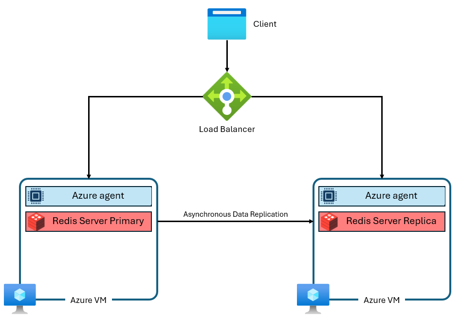

# Azure Cache for Redis에서 Azure Managed Redis로 마이그레이션

이 가이드는 **기존 캐시와 별도로 Azure Managed Redis를 준비하고 애플리케이션을 전환하는 경로**를 다룹니다. 연결 문자열만 바꾸기 전에 원본 정책·명령 사용·데이터 보존 요구를 확인합니다. 자동 마이그레이션 도구의 절차를 설명하는 문서는 아닙니다.

세 가지 정책의 비교와 선택 기준은 [정책 개요](../clustering-policies/index.md)에, 실제 연결 코드는 [Node.js](../clustering-policies/nodejs/index.md)와 [Java](../clustering-policies/java/index.md)에 있습니다. 여기서는 **현재 구성에서 무엇이 달라지는지**에 집중합니다.

## 1. 현재 구성부터 확인

| 확인 항목 | 기록할 내용 |
|---|---|
| 원본 서비스 | Basic·Standard·Premium인지, Enterprise·Enterprise Flash인지 |
| 원본 클러스터링 | Premium의 클러스터 사용 여부, Enterprise 계열의 실제 클러스터링 정책 |
| 애플리케이션 연결 | 단일 엔드포인트/클러스터 클라이언트, 라이브러리 버전과 실제 적용 설정 |
| 명령·키 설계 | 멀티키 명령·트랜잭션·Lua, 해시 태그와 여러 DB 사용 여부 |
| 데이터의 역할 | 재생성 가능한 캐시인지, 세션·락·업무 상태처럼 유실을 허용하기 어려운지 |
| 네트워크·인증 | DNS, 사설 연결 경로, TLS, 접근 키 또는 Entra 인증 |
| 전환 조건 | 허용 중단 시간·데이터 손실 범위, 성공 기준과 롤백 조건 |

Basic·Standard·Premium과 Azure Managed Redis는 내부 구조도 다릅니다. 특히 “지금 단일 엔드포인트로 연결한다”는 사실만으로 대상도 Non-clustered여야 한다고 판단하지 않습니다.

*출처: [Microsoft Learn — Azure Managed Redis architecture](https://learn.microsoft.com/azure/redis/architecture). 클러스터를 쓰지 않는 주·복제본 구성의 비교 그림이며 Basic은 복제본이 없는 구성이므로 구분합니다. 대상 구조는 [정책 개요의 아키텍처](../clustering-policies/index.md#cluster-policies)를 참고합니다.*

## 2. 원본 연결 형태에 맞춰 대상 정책 결정

### 단일 엔드포인트로 연결하던 경우 { #migrate-from-single-endpoint }

Basic·Standard 또는 클러스터를 사용하지 않는 Premium에서 옮기는 경우입니다.

- **기존 일반 클라이언트를 유지하려면** Enterprise 또는 Non-clustered의 제약이 워크로드에 맞는지 확인합니다.
- **OSS를 선택한다면** 클러스터 클라이언트로 전환하고 TLS 주소 매핑·토폴로지 갱신을 구성합니다.
- 어느 쪽이든 [멀티키 명령과 크기 제약](../clustering-policies/index.md#policy-comparison)을 먼저 점검합니다. 일반 연결을 유지해도 명령 호환성까지 그대로 보장되지는 않습니다.

### 클러스터 클라이언트로 연결하던 경우 { #migrate-from-cluster-client }

클러스터를 사용하는 Premium에서 옮기는 경우에는 OSS를 우선 비교 대상으로 삼을 수 있습니다. 기존 노드 주소·포트 하드코딩을 제거하고, 새 엔드포인트를 통해 토폴로지를 발견하도록 합니다.

Enterprise를 선택하면 **일반 단일 엔드포인트 클라이언트로 변경**해야 합니다. 호스트만 바꾸고 클러스터 탐색을 계속하면 대상 정책이 차단하는 명령을 보내게 됩니다.

### Enterprise / Enterprise Flash에서 옮기는 경우 { #migrate-from-enterprise-tier }

원본에서 **OSS인지 Enterprise인지 확인한 뒤** 대상에 같은 정책을 명시하면 대응하는 클러스터 연결 방식을 유지할 수 있습니다. 티어 이름이 Enterprise라는 이유만으로 Enterprise 정책이라고 판단하지 않습니다.

두 제품의 기반 소프트웨어는 같지만 호스트·인증 정보·SKU·HA 구성은 다시 확인합니다. 특히 Azure Cache for Redis Enterprise에는 없는 Microsoft Entra ID 인증을 대상에서 채택한다면 자격 증명 교체뿐 아니라 토큰 갱신 구현도 필요합니다.

정책 조회와 생성 시 명시하는 CLI는 [정책 확인·생성 절차](../clustering-policies/index.md#set-and-check-policy) 한 곳에서 관리합니다.

## 3. 연결·기능 호환성 점검 { #compatibility }

| 항목 | 변경 또는 확인 사항 |
|---|---|
| 호스트 | Basic·Standard·Premium의 `.redis.cache.windows.net`, Enterprise 계열의 `redisenterprise.cache.azure.net` 대신 새 `<cache-name>.<region>.redis.azure.net`을 사용 |
| 포트 | Basic·Standard·Premium의 TLS `6380`/비TLS `6379` 대신 `10000` 사용. Enterprise 계열은 기존에도 `10000` |
| TLS 모드 | 대상은 TLS 또는 비TLS 중 한 모드만 사용. 이 가이드의 연결 예제는 TLS 기준 |
| 노드 포트 | OSS에서는 새 클라이언트가 발견하도록 구성. 기존 Premium의 노드 포트를 재사용하지 않음 |
| Redis DB | 대상은 DB 0만 사용. 여러 DB를 사용했다면 키 이름 충돌·권한·삭제 범위를 고려해 재설계 |
| 네트워크 격리 | 대상은 VNet 주입과 IP 기반 방화벽 규칙을 지원하지 않음. Private Link·DNS와 애플리케이션 접근 경로를 준비 |
| 메모리 | 명목 SKU 크기만 비교하지 않음. 대상은 약 20%를 시스템용으로 예약하므로 실제 사용량과 여유 공간을 반영 |
| 기능·키 수명 | 원본의 명령·모듈·알림 기능과 대상 지원을 점검하고 [eviction·TTL](../eviction-policy-and-ttl/index.md) 요구도 재확인 |

자세한 제품 차이는 [Basic·Standard·Premium 비교](https://learn.microsoft.com/azure/redis/migrate/migrate-basic-standard-premium-understand) 또는 [Enterprise 비교](https://learn.microsoft.com/azure/redis/migrate/migrate-redis-enterprise-understand)를 사용합니다. 기존 가이드의 일부 연결 예제만 성공한 것으로 전체 호환성을 판단하지 않습니다.

## 4. 데이터 처리 전략 결정 { #data-migration }

연결 전환은 **데이터 이관과 별개의 작업**입니다. 새 캐시에 접속할 수 있어도 원본 데이터가 자동으로 복사되는 것은 아닙니다.

| 데이터 요구 | 검토할 전략과 주의점 |
|---|---|
| 원본 데이터소스에서 다시 만들 수 있는 캐시 | 빈 캐시로 시작하거나 미리 채우기. 전환 직후 캐시 미스 증가와 원본 부하를 수용할 수 있어야 함 |
| 특정 시점의 데이터 복사 | RDB export/import. 원본 티어의 지원을 확인하고 스냅샷 이후 쓰기의 처리 방법을 정함. Basic·Standard는 Premium과 같은 export 기능을 전제로 할 수 없음 |
| 쓰기를 계속하면서 이전 | 이중 쓰기나 프로그램 기반 복사 검토. 초기 데이터·TTL·삭제·쓰기 순서·부분 실패와 일관성 확인이 필요 |

구체적인 실행 방법은 [Microsoft Learn의 데이터 마이그레이션 절차](https://learn.microsoft.com/azure/redis/migrate/migrate-basic-standard-premium-self-service#step-2-migrate-your-data)를 따릅니다. 이중 쓰기만 추가하면 무중단·무손실이 자동 보장된다고 가정하지 않습니다. 세션·락처럼 동시성과 유효 기간이 중요한 데이터는 캐시 재생성 전략과 분리해 검토합니다.

## 5. 애플리케이션 전환과 검증 { #cutover }

1. **대상 준비:** 별도 이름으로 생성하고 정책·네트워크·인증을 확인합니다. 검증 전 원본 캐시를 삭제하지 않습니다.
2. **코드 적용:** [Node.js 연결](../clustering-policies/nodejs/index.md) 또는 [Java 연결](../clustering-policies/java/index.md)을 적용하고 기존 설정과 충돌하지 않는지 확인합니다.
3. **데이터 준비:** 위에서 정한 데이터 전략을 수행하고 대표 키의 값·TTL·필요한 자료구조를 검증합니다.
4. **테스트 트래픽:** 여러 슬롯의 키, 멀티키 명령·트랜잭션·Lua, 연결 단절 후 복구, Entra 토큰 갱신 등 실제 사용하는 경로를 검증합니다.
5. **점진적 전환:** 연결 대상을 바꾸고 오류율·지연·캐시 적중률·연결 수·메모리·원본 데이터소스 부하를 관찰합니다. 성공 기준은 전환 전에 수치와 관찰 기간으로 합의합니다.
6. **원본 정리:** 검증 기간과 롤백 가능 기간이 끝난 뒤에만 원본을 정리합니다. 두 캐시를 유지하는 동안 비용이 발생합니다.

### 롤백은 데이터 방향까지 포함

원본 엔드포인트와 배포 설정을 보관하는 것만으로 충분하지 않을 수 있습니다. 대상에만 쓰인 데이터가 있다면 원본으로 연결을 되돌려도 그 데이터는 돌아오지 않습니다.

전환 전에 **원본의 최신성 유지 방법, 대상에만 반영된 쓰기의 처리, 롤백 시 허용할 데이터 손실·세션 영향**을 결정합니다. 실패한 요청을 무조건 재실행하거나 두 캐시를 임의로 번갈아 사용하지 않습니다.
