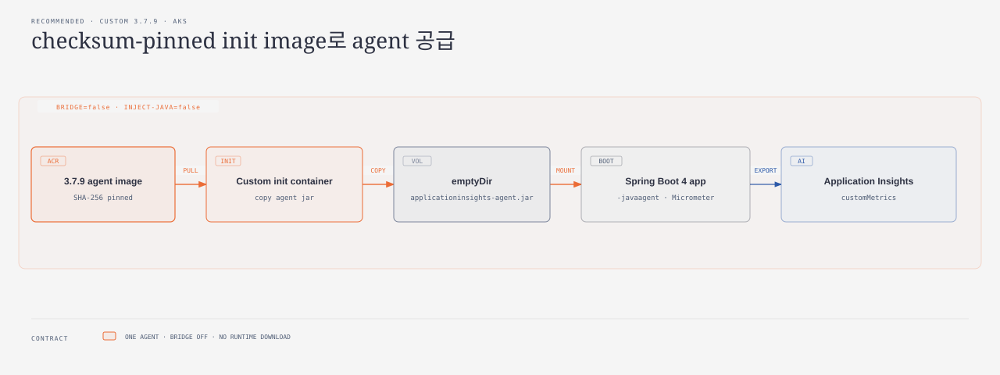

# AKS Java Micrometer custom metric 누락 임시 대응

## 적용 대상과 결론

이 가이드는 **Spring Boot 4.x와 AKS Application Monitoring Java agent
3.7.7-aks의 Micrometer auto-configuration version gap**을 다룹니다.

Application Insights Java 3.7.7은 Spring Boot 3의 Micrometer
auto-configuration class만 찾습니다. Spring Boot 4.0.0에서 class가 이동한
뒤에는 Azure Monitor `MeterRegistry`가 Spring context에 연결되지 않아
custom meter가 Application Insights로 전송되지 않습니다. Boot 4 class
지원은 microsoft/ApplicationInsights-Java#4672에서 수정되어 3.7.9에
포함됐습니다.

**기본 권장은 checksum-pinned 3.7.9 jar를 별도 ACR init image로 공급하는
방식입니다.** 공식 fix를 그대로 사용하고 application code가 agent 내부
구현을 알지 않게 합니다.

## A/B/C 선택

| 순위 | 임시 대응 | 적합한 경우 | 장점 | 비용과 위험 | 판단 |
|---|---|---|---|---|---|
| **A. ACR custom 3.7.9 init image** | checksum을 검증한 3.7.9 jar를 ACR image로 만들고 `emptyDir`로 공급합니다. | 기본 운영 대응, 앱 code와 agent 내부 class 의존을 피해야 할 때 | 공식 3.7.9 fix를 그대로 사용하고 앱 code가 agent 내부 이름을 알 필요 없음 | webhook 주입을 끄고 image build, scan, pull, retention과 원복을 직접 운영 | **기본 권장** |
| **B. 관리형 3.7.7 + 앱 bridge** | agent가 만든 registry를 Spring `MeterRegistry` bean으로 노출합니다. | 관리형 onboarding을 유지하면서 code로 해결하려는 경우 | 기존 connection string, resource metadata와 agent 운영을 유지 | agent 내부 runtime class 이름에 의존하고 3.7.9+ 전환 때 반드시 꺼야 함 | 코드 변경 선택지 |
| **C. 앱 image에 3.7.9 jar 포함** | application image에 jar를 포함하고 `JAVA_TOOL_OPTIONS`로 시작합니다. | 소수 Pod의 빠른 PoC 또는 별도 init image 운영이 불가능한 경우 | 구성 요소가 적고 즉시 검증 가능 | 앱과 agent release가 결합되고 image가 커지며 원복에도 앱 재빌드 필요 | PoC 3순위 |

별도 Micrometer→Azure/OpenTelemetry/Prometheus exporter는 이 버그의 기본
대응으로 권장하지 않습니다. 표준 metric 중복, cumulative/delta
temporality, 이름, cardinality, backend와 query 계약을 다시 검증하고
나중에 제거해야 합니다. Prometheus 수집은 Application Insights
`customMetrics`와 같은 저장·조회 경로도 아닙니다.

## 권장 아키텍처



1. ACR Tasks가 공식 3.7.9 jar를 다운로드하고 SHA-256을 검증한 image를
   build합니다.
2. Helm custom mode가 managed webhook 주입을 끕니다.
3. init container가 image 안의 jar를 shared `emptyDir`에 복사합니다.
4. app container가 같은 volume을 read-only로 mount하고
   `JAVA_TOOL_OPTIONS=-javaagent:...`로 agent를 시작합니다.
5. agent가 JVM 안의 Micrometer registry를 읽어 Application Insights
   `customMetrics`로 전송합니다.

Spring Boot Actuator는 `MeterRegistry`와 `ObservationRegistry` 자동 구성에
사용하지만 `/actuator/metrics` HTTP endpoint를 외부에 열 필요는 없습니다.

## 준비 사항

- AKS Application Monitoring의 named CR 또는 Portal namespace-wide
  onboarding이 이미 동작해야 합니다.
- 대상 application이 Spring Boot 4.x와 Actuator/Micrometer를 사용해야
  합니다.
- ACR remote build 권한과 AKS kubelet identity의 image pull 권한이
  필요합니다.
- connection string을 보관할 Kubernetes Secret을 준비합니다.
- 대표 gauge, counter, timer와 낮은 cardinality dimension을 가진 canary
  transaction을 준비합니다.
- bridge flag가 chart에 있다면 기본값과 custom mode 값은 모두 `false`로
  유지합니다.

## 현재 agent와 schema 확인 {#managed-state-check}

```bash
kubectl explain instrumentations.monitor.azure.com.spec --recursive

kubectl get pod <pod-name> -n <namespace> \
  -o jsonpath='{range .spec.initContainers[*]}{.name}{"\t"}{.image}{"\n"}{end}'

curl -fsSL \
  https://mcr.microsoft.com/v2/applicationinsights/auto-instrumentation/java/tags/list \
  | jq -r '.tags[] | select(endswith("-aks"))'
```

`Instrumentation` CR은 connection string과 대상 platform을 구성하지만
agent image/version override를 제공하지 않습니다. 실제 Pod에 주입된 image와
MCR tag는 적용 당일 다시 조회하세요. 이 가이드는 actual image가
`3.7.7-aks`일 때만 적용합니다.

## A. ACR custom 3.7.9 init image 적용

### 1. checksum-pinned image build

<details markdown="1">
<summary>Dockerfile과 build 단계 보기</summary>

```dockerfile
FROM alpine:3.22

RUN wget -O /applicationinsights-agent-codeless.jar \
        https://github.com/microsoft/ApplicationInsights-Java/releases/download/3.7.9/applicationinsights-agent-3.7.9.jar \
    && echo "4ab7a442bf9defc7475d026c6b49042793ebb010c391a1db91ae07da0c04d848  /applicationinsights-agent-codeless.jar" \
        | sha256sum -c -

ENTRYPOINT ["cp", "/applicationinsights-agent-codeless.jar", "/azure-monitor-auto-instrumentation-java/applicationinsights-agent-codeless.jar"]
```

- 다운로드와 checksum 검증은 image build에서 끝냅니다.
- checksum mismatch면 build가 실패하므로 검증되지 않은 jar가 ACR에
  push되지 않습니다.
- runtime init container는 외부 artifact repository에 연결하지 않습니다.

</details>

기존 mutable tag의 존재만 확인해서 build를 건너뛰지 않습니다.
version-controlled Dockerfile로 image를 build한 뒤 manifest digest를
기록합니다.

```bash
ACR_NAME=<acr-name>

az acr build \
  --registry "$ACR_NAME" \
  --image observability/applicationinsights-agent:3.7.9 \
  --file Dockerfile \
  .

AGENT_DIGEST="$(az acr manifest show-metadata \
  --registry "$ACR_NAME" \
  --name observability/applicationinsights-agent:3.7.9 \
  --query digest \
  --output tsv)"
test -n "$AGENT_DIGEST"

AGENT_IMAGE="${ACR_NAME}.azurecr.io/observability/applicationinsights-agent@${AGENT_DIGEST}"
```

build 또는 digest 조회가 실패하면 Helm upgrade를 실행하지 않습니다.
승인 기록에는 `AGENT_DIGEST`를 남기고 deployment에는 mutable tag가 아니라
`repository@sha256:<digest>` 형식의 `AGENT_IMAGE`를 전달합니다.

### 2. Helm managed/custom switch

공개 interface는 다음 세 값입니다.

| 값 | 의미 |
|---|---|
| `monitoring.javaAgentMode=managed` | 기존 named CR 또는 Portal namespace onboarding을 사용합니다. |
| `monitoring.javaAgentMode=custom` | managed injection을 끄고 custom init/env/volume을 렌더링합니다. |
| `monitoring.javaAgentImage` | custom mode에서 사용할 ACR image입니다. |

custom mode에서는 bridge를 반드시 `false`로 고정합니다.

```bash
helm upgrade <release> <chart> \
  --namespace <namespace> \
  --set monitoring.javaAgentMode=custom \
  --set monitoring.micrometerBridgeEnabled=false \
  --set-string monitoring.javaAgentImage="$AGENT_IMAGE"
```

rendered Pod template에는 다음 항목이 있어야 합니다.

- `instrumentation.opentelemetry.io/inject-java: "false"`
- ACR init container 한 개
- agent jar용 `emptyDir`와 app container read-only mount
- `JAVA_TOOL_OPTIONS=-javaagent:/azure-monitor-auto-instrumentation-java/applicationinsights-agent-codeless.jar`
- Secret 기반 `APPLICATIONINSIGHTS_CONNECTION_STRING`
- `APPLICATIONINSIGHTS_METRICS_TO_LOGANALYTICS_ENABLED=true`
- self-diagnostics와 bounded log volume
- `OTEL_SERVICE_NAME`과 downward API 기반 Pod/node resource attributes

하나의 JVM에 managed agent와 custom agent가 함께 붙지 않는지 rendered
manifest와 실제 Pod spec을 모두 확인합니다.

### 3. Portal namespace-wide onboarding을 사용한 경우

Portal namespace-wide onboarding은 namespace에 `Instrumentation/default`를
만듭니다. 다른 Deployment가 이 구성을 계속 사용할 수 있으므로 CR을
삭제하지 말고 대상 Deployment만 override합니다.

```bash
kubectl get instrumentation default -n <namespace> -o yaml
```

custom mode는 workload annotation을 `"false"`로 렌더링합니다. 관리형으로
돌아갈 때 custom init/env/volume을 제거하고 annotation을 `"true"`로
되돌립니다. annotation은 반드시
`spec.template.metadata.annotations`에 둡니다.

## 배포와 검증

1. nonproduction 또는 한 replica에 custom mode를 먼저 적용합니다.
2. init container가 하나이고 의도한 ACR 3.7.9 image인지 확인합니다.
3. bridge environment가 `"false"`인지 확인합니다.
4. agent log에서 3.7.9 startup을 확인합니다.
5. startup/readiness/liveness와 restart 수가 baseline을 유지하는지 봅니다.
6. gauge, counter, timer와 dimension을 발생시키는 합성 transaction을 한 번
   실행합니다.
7. 한 export step 이상 기다린 뒤 현재 Pod instance만 filter해
   `customMetrics`를 확인합니다.
8. 각 positive metric이 한 행씩 도착하는지 확인해 중복 export 여부를
   검사합니다.
9. 합성 데이터를 삭제하고 read-after-delete를 확인합니다.

```kusto
customMetrics
| where name startswith "onboarding_write"
| project timestamp, name, value, customDimensions,
          cloud_RoleName, cloud_RoleInstance
| order by timestamp desc
```

Application Insights Java는 Micrometer metric 이름의 점을 underscore로
정규화합니다. Counter는 increment가 없던 다음 step에 0이 보일 수 있으므로
최신 한 행만 보지 말고 테스트 시간대의 positive sample과
`customDimensions`를 함께 확인하세요.

## 관리형 3.7.9+로 돌아가기

관리형 image에 3.7.9 이상이 보인다는 사실만으로 전환하지 않습니다. 같은
Spring Boot/Micrometer canary에서 gauge, counter, timer, dimension과 중복
여부를 먼저 검증합니다.

```bash
helm upgrade <release> <chart> \
  --namespace <namespace> \
  --set monitoring.javaAgentMode=managed \
  --set monitoring.micrometerBridgeEnabled=false
```

rendered manifest에서 custom init container, `JAVA_TOOL_OPTIONS`, custom
connection string env와 `emptyDir`가 사라지고 annotation이 원래 named CR
값 또는 Portal namespace mode의 `"true"`로 돌아왔는지 확인합니다.

## C. application image에 3.7.9 포함

빠른 PoC에서는 같은 checksum을 검증해 jar를 application image에 직접
포함할 수 있습니다. managed injection은 끄고 `JAVA_TOOL_OPTIONS`로 하나의
agent만 시작합니다.

이 방식은 application과 agent release가 결합되고 image가 커지며 agent
원복에도 application 재빌드가 필요합니다. 장기 운영안으로 승격하지
마세요.

<details markdown="1">
<summary>B. 관리형 3.7.7 application bridge 코드 옵션 펼쳐보기</summary>

### bridge 옵션의 경계

bridge는 실환경과 회귀 test로 검증한 임시 코드 옵션이지만 agent의 public
API가 아닌 runtime class 이름
`io.opentelemetry.javaagent.instrumentation.micrometer.ai.AzureMonitorMeterRegistry`
에 의존합니다. 기본값은 `false`로 두고 managed 3.7.7에서만 켭니다.

| agent 구성 | bridge flag | 결과 | 배포 규칙 |
|---|---:|---|---|
| managed `3.7.7-aks` | `true` | 성공 | bridge 코드 옵션에서만 사용 |
| custom `3.7.9` | `true` | 실패: registry unavailable, CrashLoop, Helm timeout | values 생성과 Helm render 단계에서 거부 |
| custom `3.7.9` | `false` | 성공 | 기본 권장 조합 |
| 향후 managed `3.7.9+` | `false` | agent auto-configuration takeover test 통과 | agent upgrade와 같은 rollout에서 bridge를 끔 |

`@ImportAutoConfiguration`과 `@AutoConfigureAfter`로 bridge를 늦추는 시도도
custom 3.7.9 실환경에서 안정적으로 back-off하지 않았습니다.

### root cause와 bridge 동작

3.7.7 `ActuatorInstrumentation`은 Spring Boot 3 class만 검사하지만 별도
`MetricsInstrumentation`은 `AzureMonitorMeterRegistry.INSTANCE`를
`Metrics.globalRegistry`에 추가합니다. registry는 생성자에서 publisher
thread를 시작하고 기본 60초 step으로 publish합니다.

Boot 4에서 끊긴 지점은 registry 생성이나 export가 아니라 이 registry를
Spring bean으로 노출하는 단계입니다. bridge는 global registry에서 runtime
class 이름이 정확히 일치하는 instance를 찾아
`azureMonitorMeterRegistry` bean으로 반환합니다.

### bridge configuration

```java
package com.example.observability;

import io.micrometer.core.instrument.MeterRegistry;
import io.micrometer.core.instrument.Metrics;
import org.springframework.boot.autoconfigure.AutoConfigureAfter;
import org.springframework.boot.autoconfigure.AutoConfigureBefore;
import org.springframework.boot.autoconfigure.condition.ConditionalOnMissingBean;
import org.springframework.boot.autoconfigure.condition.ConditionalOnProperty;
import org.springframework.context.annotation.Bean;

@AutoConfigureAfter(name = {
    "io.opentelemetry.javaagent.instrumentation.micrometer.ai.AzureMonitorAutoConfiguration",
    "org.springframework.boot.micrometer.metrics.autoconfigure.MetricsAutoConfiguration",
    "org.springframework.boot.micrometer.metrics.autoconfigure.export.simple.SimpleMetricsExportAutoConfiguration"
})
@AutoConfigureBefore(name =
    "org.springframework.boot.micrometer.metrics.autoconfigure.CompositeMeterRegistryAutoConfiguration")
@ConditionalOnProperty(
    name = "management.application-insights.micrometer-bridge.enabled",
    havingValue = "true")
public class AzureMonitorMeterRegistryBridgeConfiguration {

    private static final String AZURE_MONITOR_REGISTRY =
        "io.opentelemetry.javaagent.instrumentation.micrometer.ai.AzureMonitorMeterRegistry";

    @Bean
    @ConditionalOnMissingBean(name = "azureMonitorMeterRegistry")
    MeterRegistry azureMonitorMeterRegistry() {
        return Metrics.globalRegistry.getRegistries().stream()
            .filter(registry -> registry.getClass().getName().equals(AZURE_MONITOR_REGISTRY))
            .findFirst()
            .orElseThrow(() -> new IllegalStateException(
                "Application Insights AzureMonitorMeterRegistry is unavailable"));
    }
}
```

agent 내부 type에 대한 compile dependency는 추가하지 않습니다. flag가
`true`인데 registry가 없으면 startup을 명시적으로 실패시킵니다.

application에서 configuration을 import합니다.

```java
@SpringBootApplication
@ImportAutoConfiguration(AzureMonitorMeterRegistryBridgeConfiguration.class)
public class Application {
}
```

Helm flag 기본값은 `false`입니다.

```yaml
monitoring:
  javaAgentMode: managed
  micrometerBridgeEnabled: false
```

managed 3.7.7에서 code 옵션을 선택할 때만 켭니다.

```bash
helm upgrade <release> <chart> \
  --namespace <namespace> \
  --set monitoring.javaAgentMode=managed \
  --set monitoring.micrometerBridgeEnabled=true
```

### bridge 검증

rendered Pod에 custom init container와 custom agent volume이 없어야 하며
actual agent가 managed `3.7.7-aks`인지 확인합니다. Gauge, timer, counter와
dimension을 발생시켜 current Pod instance마다 수집되는지, 같은 합성
transaction이 중복 export되지 않는지 확인합니다. 합성 데이터는 검증 뒤
삭제하고 read-after-delete까지 수행합니다.

### 3.7.9에서는 bridge를 반드시 끔

custom 3.7.9 + bridge `true`는
`Application Insights AzureMonitorMeterRegistry is unavailable`로
CrashLoop했고 Helm rollout이 timeout됐습니다.

managed 3.7.9+에서도 `@ConditionalOnMissingBean`만 믿고 자동 back-off를
기대하지 마세요. configuration 순서에 따라 같은 bean 이름이 충돌할 수
있습니다. agent upgrade와 같은 rollout에서
`monitoring.micrometerBridgeEnabled=false`로 바꾸세요.

</details>

## Troubleshooting

### init container가 `ImagePullBackOff`

- ACR tag가 실제로 존재하는지 확인합니다.
- AKS kubelet identity의 ACR pull 권한과 registry RBAC/ABAC mode를
  확인합니다.
- 가능하면 tag 대신 검증한 image digest를 사용합니다.
- ACR 조회 또는 build 실패 뒤 Helm을 계속 실행하지 않습니다.

### agent는 시작했지만 custom metric이 없음

- actual agent가 3.7.9인지 확인합니다.
- custom mode의 bridge flag가 `false`인지 확인합니다.
- Micrometer instrumentation을 비활성화한 설정이 없는지 확인합니다.
- 점을 underscore로 바꾼 이름으로 조회합니다.
- current Pod instance와 positive sample, dimension을 함께 확인합니다.
- managed agent나 별도 exporter가 동시에 붙지 않았는지 확인합니다.
- `/actuator/metrics`를 외부에 열어 해결하려 하지 마세요.

### `CompositeGauge`와 `LongTaskTimer` type 충돌

custom Gauge를 `onboarding.write.active`로 등록하면서
`Observation("onboarding.write")`에 `DefaultMeterObservationHandler`를
연결하면 Observation이 생성하는 active `LongTaskTimer`와 이름/type이
충돌할 수 있습니다.

Gauge를 `onboarding.write.inflight`처럼 Observation 이름과 겹치지 않게
바꾸고, 실제 Observation handler와 `MeterRegistry`를 함께 연결한 회귀
test를 유지하세요.

## 보안과 운영 주의사항

- connection string, 실제 resource 이름, Pod UID, 내부 hostname과 원본
  self-diagnostics 로그를 저장소나 ticket에 붙이지 않습니다.
- ACR image를 scan하고 가능하면 digest로 pin합니다.
- base image와 agent 보안 update를 추적하고 30일마다 managed MCR tag와
  실제 injected image를 재확인합니다.
- self-diagnostics volume에 `sizeLimit`과 log retention을 둡니다.
- metric dimension은 허용 목록과 cardinality budget을 적용하며
  user-controlled 값이나 건강 데이터 값을 넣지 않습니다.
- runtime download init container를 별도 권장안으로 승격하지 않습니다.

## 검증 상태

- Microsoft Learn은 Java AKS autoinstrumentation과 Micrometer custom metric
  지원을 확인합니다.
- 3.7.7/3.7.9 source, PR #4672와 release는 Boot 4
  auto-configuration 차이를 확인합니다.
- custom 3.7.9 bridge on/off, managed 3.7.7 bridge와 managed 3.7.9 takeover
  조합을 sample test와 배포 검증 계약으로 고정했습니다.
- Microsoft Learn 원문과 official source, sample 검증을 함께 대조해
  `verification_status: verified`로 기록했습니다.

## 공식 참고 자료

- [AKS codeless Application Insights monitoring](https://learn.microsoft.com/azure/azure-monitor/containers/kubernetes-codeless)
- [Application Insights Java Micrometer 자동 수집](https://learn.microsoft.com/azure/azure-monitor/app/java-standalone-config)
- [3.7.7 Actuator instrumentation source](https://github.com/microsoft/ApplicationInsights-Java/blob/3.7.7/agent/instrumentation/micrometer-1.0/src/main/java/io/opentelemetry/javaagent/instrumentation/micrometer/ai/ActuatorInstrumentation.java)
- [3.7.7 Micrometer global registry instrumentation](https://github.com/microsoft/ApplicationInsights-Java/blob/3.7.7/agent/instrumentation/micrometer-1.0/src/main/java/io/opentelemetry/javaagent/instrumentation/micrometer/ai/MetricsInstrumentation.java)
- [3.7.7 registry step configuration](https://github.com/microsoft/ApplicationInsights-Java/blob/3.7.7/agent/instrumentation/micrometer-1.0/src/main/java/io/opentelemetry/javaagent/instrumentation/micrometer/ai/AzureMonitorRegistryConfig.java)
- [Spring Boot 4 fix PR](https://github.com/microsoft/ApplicationInsights-Java/pull/4672)
- [Application Insights Java 3.7.9 release](https://github.com/microsoft/ApplicationInsights-Java/releases/tag/3.7.9)
