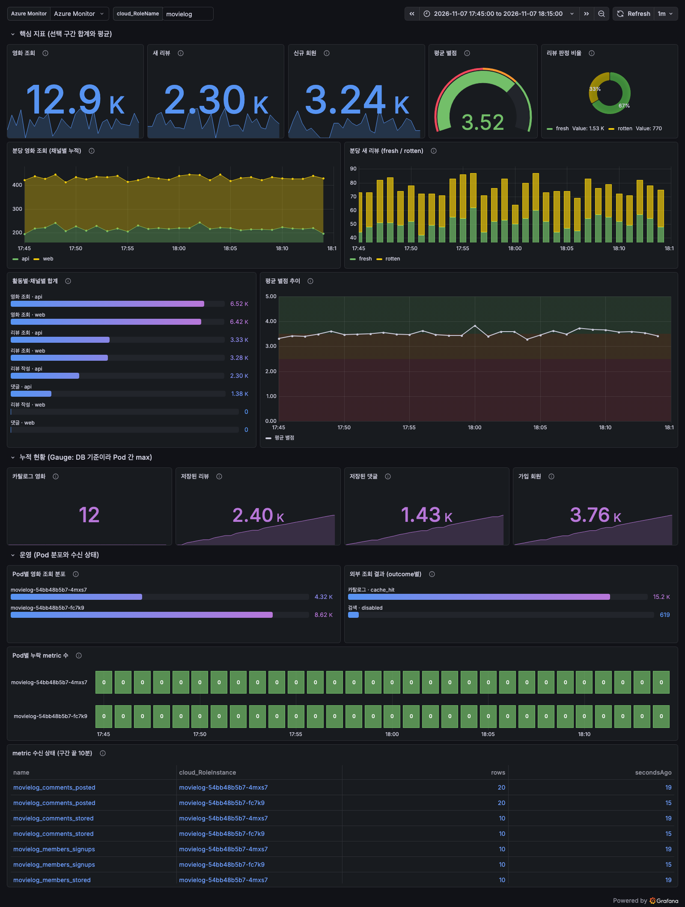
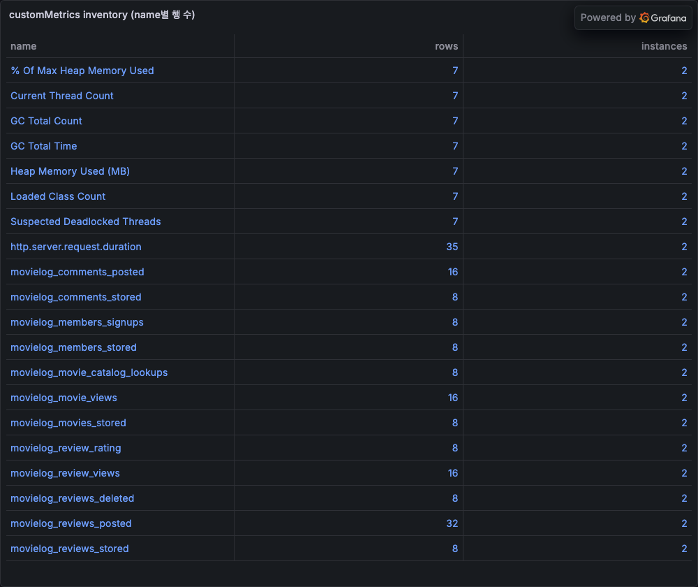
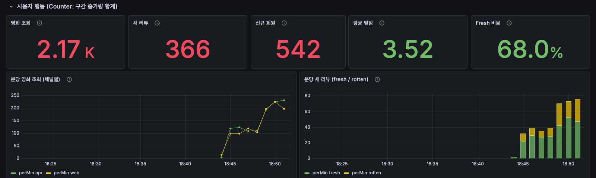

# Micrometer 비즈니스 지표는 AKS 자동 계측이 수집하고, agent가 실제 지표를 보며 Grafana 대시보드를 완성합니다

## meter 기록, 자동 수집, agent 검증의 세 단계로 비즈니스 대시보드가 완성됩니다 { #message }

"오늘 리뷰가 몇 건 올라왔나", "별점 평균이 떨어지고 있나" 같은 비즈니스 지표를
보려고 exporter를 붙이거나, scrape 설정을 만들거나, 대시보드 query를 손으로
설계할 필요는 없습니다. 세 단계만 연결하면 됩니다.

1. **앱은 Micrometer meter만 남깁니다.** 도메인 이벤트가 일어날 때 Counter,
   DistributionSummary, Gauge를 기록합니다.
2. **AKS 자동 계측이 수집합니다.** Pod에 주입된 Application Insights Java agent가
   Micrometer 지표를 읽어 `customMetrics`로 보냅니다. 앱에는 exporter도, metrics
   endpoint도 필요 없습니다.
3. **agent가 실제 지표를 보며 Grafana 대시보드를 만듭니다.** 코드의 meter 이름을
   추측하지 않고 `customMetrics`를 직접 조회해 집계식을 정하고, 모든 panel
   query를 실행하고, 렌더링한 화면을 캡처해 확인합니다.

아래는 영화 리뷰 앱 MovieLog를 AKS에 올려 이 흐름 그대로 만든 대시보드입니다.
2026-11-06 실제 환경에서 합성 사용자 트래픽으로 캡처했습니다.



## 앱 코드는 도메인 이벤트에서 meter를 올리는 것으로 끝납니다 { #record }

MovieLog의 서비스 코드는 Micrometer를 모릅니다. 리뷰 작성 같은 도메인 이벤트를
발행하면 한 class가 meter로 바꿉니다.

```java
@TransactionalEventListener(fallbackExecution = true)
void reviewCreated(ReviewEvents.Created event) {
    counter("reviews.posted", "New reviews", "channel", channel(), "verdict",
            event.fresh() ? "fresh" : "rotten").increment();
    reviewRating.record(event.rating() / 2.0);
}
```

- tag 값은 `web`/`api`, `fresh`/`rotten`처럼 고정된 몇 개만 씁니다. 영화 ID나
  사용자명을 넣지 않습니다.
- 내보낼 meter를 prefix로 제한합니다. agent가 보내는 지표는 모두 과금 대상
  `customMetrics` 행이 되기 때문입니다.

```properties
management.metrics.enable.all=false
management.metrics.enable.movielog=true
```

## AKS 자동 계측은 Instrumentation CR과 annotation만으로 지표를 실어 나릅니다 { #collect }

클러스터에서 Application Monitoring을 켜고, namespace에 `Instrumentation` CR을
만든 뒤 Deployment의 Pod template에 annotation을 하나 답니다.

```yaml
apiVersion: monitor.azure.com/v1
kind: Instrumentation
metadata:
  name: movielog
spec:
  settings:
    autoInstrumentationPlatforms: []
  destination:
    applicationInsightsConnectionString: "<connection-string>"
---
# Deployment spec.template.metadata.annotations
instrumentation.opentelemetry.io/inject-java: "movielog"
```

재시작한 Pod에 agent가 주입되면 60초마다 `movielog_*` 지표가 도착합니다.
Micrometer 이름의 점은 underscore로 바뀝니다(`movielog.movie.views` →
`movielog_movie_views`). 요청, 의존성, JVM 지표도 같은 agent가 함께 수집합니다.



## agent에게 "그려 줘"가 아니라 "조회하고, 만들고, 실행하고, 확인해"라고 시킵니다 { #agent }

agent에게 대시보드를 그리라고만 하면 코드의 meter 이름과 흔한 KQL 패턴으로
panel을 추측합니다. 실제 데이터를 먼저 보게 하면 추측으로는 놓치는 문제가
대시보드를 올리기 전에 드러납니다. MovieLog에서는 다음 문제를 잡았습니다.

| agent 단계 | 하는 일 | MovieLog에서 잡은 문제 |
|---|---|---|
| probe | 실제 `customMetrics`의 이름, dimension, 값 모양 조회 | DB 기준 gauge를 Pod마다 같은 값으로 보내 sum이면 2배 |
| build | probe가 정한 집계식으로 dashboard JSON 생성 | Counter는 `sum`, 분포는 `sum(valueSum)/sum(valueCount)`로 구분 |
| verify | 모든 panel query를 Grafana에서 실행 | KQL 예약어 `views`로 panel 1개가 400 |
| look | 렌더링한 화면을 캡처해 직접 확인 | subscription ID 노출, 정상 값의 빨간색, 끝이 급락하는 미완성 bin |

look 단계의 첫 캡처입니다. query는 모두 성공했지만 화면에서는 정상 건수가
경고색으로 보이고 legend가 읽기 어려웠습니다. 수정한 결과가 이 문서 맨 위의
대시보드입니다.



agent는 Azure Managed Grafana에 내장된 MCP endpoint(`/api/azure-mcp`)로 조회와
dashboard 반영을 하거나, sample의 CLI 도구로 같은 과정을 밟습니다. 그대로 붙여
쓸 수 있는 지시문은 [agent-dashboard-prompt.md](downloads/agent-dashboard-prompt.md)에
있습니다.

## 직접 재현하려면 MovieLog 실습을 따릅니다 { #lab }

[MovieLog 실습](movielog-lab/index.md)은 AKS, Application Insights, Azure Managed
Grafana를 만들고 MovieLog와 합성 부하를 배포한 뒤, 위 네 단계를 명령과 실측값,
캡처로 재현합니다. 약 90분이 걸리고 유료 자원을 쓰며, 마지막에 resource group을
지워 정리합니다. 실행 가능한 앱, manifest, agent 도구는 이 페이지의
`movielog-app` sample에 있습니다.

## Spring Boot 4는 주입된 agent가 3.7.9 이상인지 먼저 확인합니다 { #spring-boot-4 }

Application Insights Java agent는 3.7.9부터 Spring Boot 4의 Micrometer 구성을
인식합니다. 2026-11-06 기준 AKS가 주입하는 관리형 agent는 `3.7.7-aks`였고,
MovieLog에서도 이 상태로는 `movielog_*`가 한 건도 오지 않았습니다.

- 원인과 임시 대응: [AKS Java Micrometer custom metric 누락 임시 대응](../aks-java-micrometer-custom-metrics/index.md)
- MovieLog에서 3.7.10 init image로 바꾼 절차와 전후 비교: [실습의 버전 확인 절](movielog-lab/index.md#version-gate)

## 공식 참고 자료

- [Autoinstrument AKS apps with Azure Monitor Application Insights](https://learn.microsoft.com/azure/azure-monitor/containers/kubernetes-codeless)
- [Configure Azure Monitor Application Insights for Java](https://learn.microsoft.com/azure/azure-monitor/app/java-standalone-config)
- [Metrics in Application Insights](https://learn.microsoft.com/azure/azure-monitor/app/metrics-overview)
- [How to manage data sources in Azure Managed Grafana](https://learn.microsoft.com/azure/managed-grafana/how-to-data-source-plugins-managed-identity)
- [Configure an Azure Managed Grafana remote MCP server](https://learn.microsoft.com/azure/managed-grafana/grafana-mcp-server)
- [Fix Spring Boot 4 Micrometer auto-configuration (ApplicationInsights-Java PR #4672)](https://github.com/microsoft/ApplicationInsights-Java/pull/4672)
