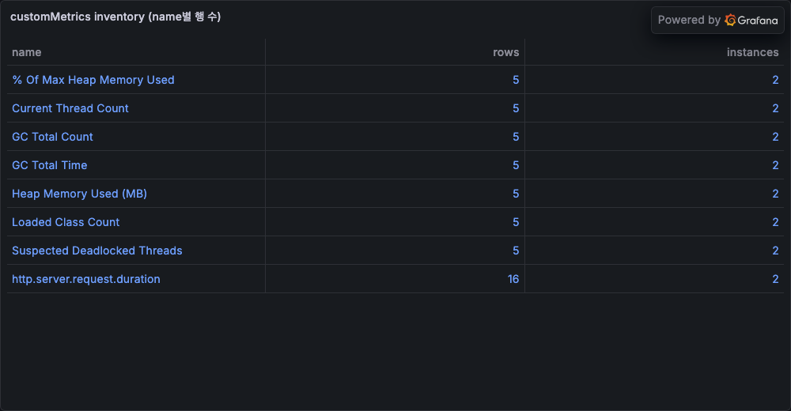
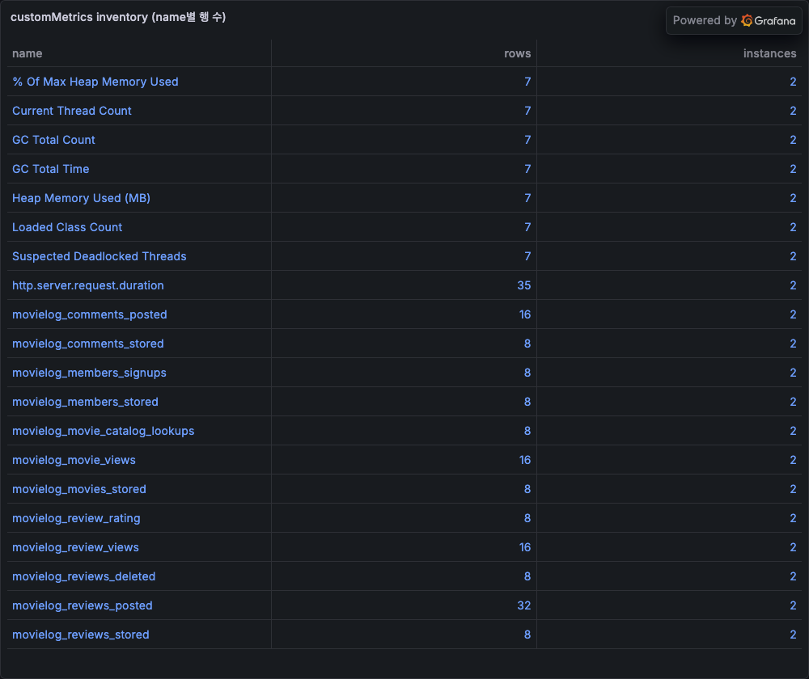
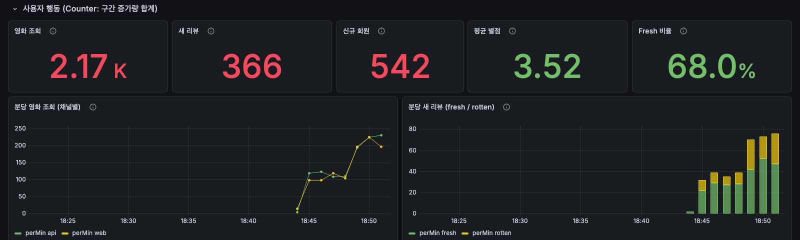
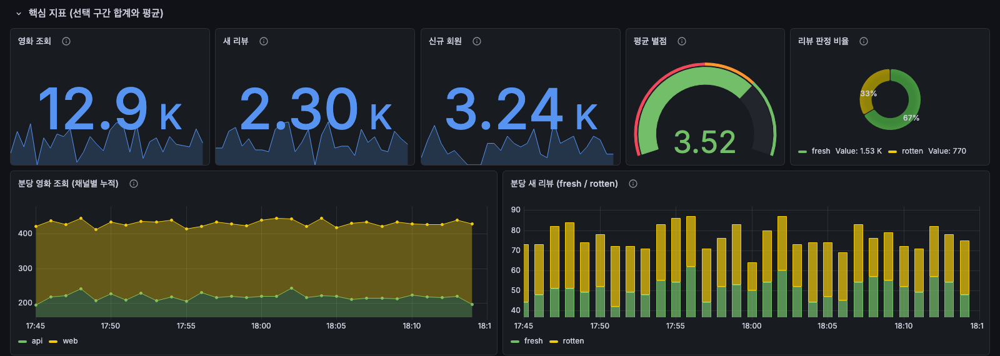
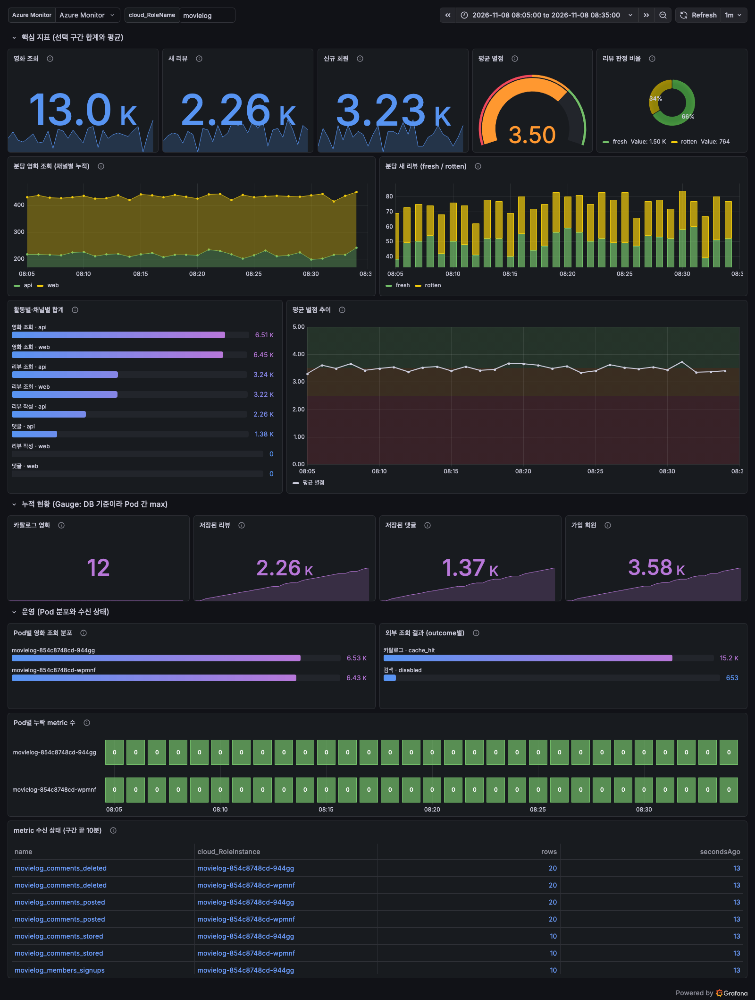

# MovieLog 실습: AKS 자동 계측 지표 수집과 agent 검증 Grafana 대시보드

## 실습 범위: 수집 경로부터 agent 검증 대시보드까지 { #summary }

[주제 소개](../index.md)에서 설명한 흐름을 영화 리뷰 앱 MovieLog로 직접
재현합니다. 아래 명령과 수치, 캡처는 Korea Central에서 실제로 구성해 얻은
결과입니다. 수집과 첫 대시보드 작성은 2026-11-06에, 질문 유형별 시각화 개편과
[대시보드 반영](#publish)은 2026-11-07에 실행했습니다.

```text
[MovieLog, Spring Boot 4.1.2 / Java 25]
  BusinessMetrics ── movielog.* Counter · DistributionSummary · Gauge
        │  Spring MeterRegistry
        ▼
[Application Insights Java agent]  ← AKS 자동 계측(webhook)이 Deployment에 주입
        │  60초마다 export, 이름은 snake_case (movielog.movie.views → movielog_movie_views)
        ▼
[Application Insights customMetrics] ── workspace 기반
        │  KQL
        ▼
[Azure Managed Grafana · Azure Monitor data source] → 대시보드
```

이 실습에서만 얻은 결과는 다음과 같습니다. 흐름과 방법론의 요약은
[주제 소개](../index.md#message)에 있습니다.

- 관리형 `3.7.7-aks`로는 `movielog_*`가 0건이었고, 3.7.10 init image로 바꾸자
  12개 지표가 두 Pod에서 도착했습니다([버전 게이트](#version-gate)).
- 이미 주입된 Deployment에서 custom agent로 바꾸려면 patch를 두 번에 나눠야
  했습니다([webhook 주입 해제](#webhook-revert)).
- agent의 probe·verify·look 단계가 gauge 중복 합산, KQL 예약어, 식별자 노출,
  꺾은선 일색의 화면과 panel 간 합계 불일치를 대시보드 공개 전에 잡았습니다
  ([agent 대시보드 방법론](#agent-method)).

## 실습 자원: 단일 resource group 구성 { #resources }

실습 자원은 한 resource group에 만들고 끝나면 통째로 지웁니다.

| 자원 | 실습 구성 | 비고 |
|---|---|---|
| AKS | Kubernetes 1.36, `Standard_D4s_v5` 2 node, `--enable-azure-monitor-app-monitoring` | Linux node pool만 지원 |
| Application Insights | workspace 기반, Log Analytics workspace 연결 | 지표 저장소 |
| Azure Container Registry | Basic, `az acr build`로 image 빌드 | 로컬 Docker 불필요 |
| Azure Managed Grafana | Standard, Grafana 12.4 | Azure Monitor data source 기본 포함 |
| 클러스터 내부 | PostgreSQL 1개, MovieLog 2 replica, 합성 사용자 6개 | `movielog` namespace |

- 필요 권한: resource group Contributor, role assignment 생성 권한, Grafana Admin.
- Azure CLI 2.86.0 이상이 필요합니다. 실습은 2.89.1로 진행했습니다.
- AKS, Managed Grafana Standard와 수집 데이터에 비용이 발생합니다. 실습이 끝나면
  [정리](#cleanup)를 실행합니다.

이후 명령은 같은 shell에서 아래 변수를 그대로 이어 씁니다. 따옴표 안의 `<...>`만
자기 값으로 바꿉니다.

```bash
RG=rg-movielog-lab; LOC=koreacentral
ACR="<acr-name>"           # 전역에서 고유한 ACR 이름
GRAFANA="<grafana-name>"   # Managed Grafana 이름
az group create -n $RG -l $LOC
az monitor log-analytics workspace create -g $RG -n law-movielog-lab
az monitor app-insights component create -g $RG -a appi-movielog-lab -l $LOC \
  --workspace "$(az monitor log-analytics workspace show -g $RG -n law-movielog-lab --query id -o tsv)"
az acr create -g $RG -n "$ACR" --sku Basic
ACR_SERVER="$(az acr show -n "$ACR" --query loginServer -o tsv)"
az aks create -g $RG -n aks-movielog-lab --node-count 2 --node-vm-size Standard_D4s_v5 \
  --enable-azure-monitor-app-monitoring --attach-acr "$ACR" --generate-ssh-keys
az grafana create -g $RG -n "$GRAFANA" --sku-tier Standard
```

`az grafana create`는 Grafana Admin과 Monitoring Reader 역할을 자동으로
할당하려고 시도합니다. 실습에서는 이 단계가 CLI 오류로 실패해 직접
할당했습니다. 역할이 없으면 Grafana에 로그인하거나 데이터를 읽을 수 없으므로
생성 뒤 확인합니다.

```bash
az role assignment create --assignee-object-id "$(az grafana show -g $RG -n "$GRAFANA" --query identity.principalId -o tsv)" \
  --assignee-principal-type ServicePrincipal --role "Monitoring Reader" \
  --scope "$(az group show -n $RG --query id -o tsv)"
az role assignment create --assignee-object-id "$(az ad signed-in-user show --query id -o tsv)" \
  --assignee-principal-type User --role "Grafana Admin" \
  --scope "$(az grafana show -g $RG -n "$GRAFANA" --query id -o tsv)"
```

## MovieLog meter: 도메인 이벤트와 집계 시점 { #meters }

MovieLog의 서비스 코드는 Micrometer를 모릅니다. 리뷰 작성 같은 도메인 이벤트를
발행하면 `BusinessMetrics`가 meter를 올립니다. 트랜잭션 안에서 발행된 이벤트는 커밋
뒤에만 집계되므로 롤백된 작업은 빠집니다. 검색과 카탈로그 조회처럼 외부 API 호출이라
트랜잭션 밖에서 발행되는 이벤트는 `fallbackExecution = true`로 즉시 집계됩니다.

```java
@TransactionalEventListener(fallbackExecution = true)
void reviewCreated(ReviewEvents.Created event) {
    counter("reviews.posted", "New reviews", "channel", channel(), "verdict",
            event.fresh() ? "fresh" : "rotten").increment();
    reviewRating.record(event.rating() / 2.0);
}
```

| Micrometer meter | 종류 | tag |
|---|---|---|
| `movielog.movie.views`, `movielog.review.views` | Counter | `channel` = `web`/`api` |
| `movielog.reviews.posted` | Counter | `channel`, `verdict` = `fresh`/`rotten` |
| `movielog.comments.posted`, `movielog.members.signups` 등 | Counter | `channel` |
| `movielog.movie.catalog.lookups` | Counter | `outcome` = `cache_hit` 등 |
| `movielog.review.rating` | DistributionSummary | 없음 |
| `movielog.movies.stored`, `movielog.reviews.stored` 등 | Gauge (DB `count(*)`, 1분 cache) | 없음 |

영화 ID, 제목, 사용자명은 tag에 넣지 않습니다. 영화별 조회 수는 DB 컬럼에 둡니다.

AKS용 `aks` profile은 Actuator HTTP endpoint를 `health`만 열고 `movielog`
prefix만 내보냅니다. agent는 프로세스 안의 registry를 직접 읽으므로
`/actuator/prometheus`가 필요 없습니다. 허용 목록 밖의 meter는 만들어지지 않아
과금 대상 `customMetrics` 행도 생기지 않습니다.

```properties
management.endpoints.web.exposure.include=health
management.metrics.enable.all=false
management.metrics.enable.movielog=true
```

TMDB API key 없이 동작하도록 `aks` profile은 영화 12편을 seed로 넣습니다.
seed 영화는 local catalog에서 제공되므로 `catalog.lookups`의 `outcome`은
`cache_hit`만 나타납니다.

## 배포: Instrumentation CR과 Pod template annotation { #deploy }

앱은 `Instrumentation` CR과 Pod template annotation으로 배포합니다.

```bash
cd docs/services/azure-monitor/aks-spring-boot-micrometer-grafana/samples/movielog-app  # 저장소 루트 기준
az acr build -r "$ACR" -t movielog:1.0.0 --platform linux/amd64 .

az aks get-credentials -g $RG -n aks-movielog-lab
kubectl apply -f k8s/00-postgres.yaml
kubectl create secret generic movielog-db -n movielog \
  --from-literal=username=movielog --from-literal=password="$(openssl rand -base64 24)"

export APPLICATIONINSIGHTS_CONNECTION_STRING="$(az monitor app-insights component show \
  -g $RG -a appi-movielog-lab --query connectionString -o tsv)"
export APP_IMAGE="$ACR_SERVER/movielog:1.0.0"
envsubst < k8s/10-instrumentation.yaml | kubectl apply -f -
envsubst < k8s/20-movielog.yaml | kubectl apply -f -
kubectl rollout status deploy/movielog -n movielog
kubectl scale deploy/movielog -n movielog --replicas=2

kubectl create configmap loadgen -n movielog --from-file=loadgen/loadgen.py
kubectl apply -f k8s/30-loadgen.yaml
```

- `Instrumentation` CR은 `default`가 아닌 이름으로 만들고
  `autoInstrumentationPlatforms: []`로 둡니다. language는 annotation이 정합니다.
- annotation `instrumentation.opentelemetry.io/inject-java: "movielog"`은
  `spec.template.metadata.annotations`에 둡니다.
- connection string이 든 렌더링 결과는 저장소에 커밋하지 않습니다.
- 첫 배포는 replica 1개로 schema를 만든 뒤 2개로 늘립니다.

JVM flag는 Pod의 `JAVA_TOOL_OPTIONS`에 선언합니다. 실습에서 webhook은 Pod의
값 앞에 `-javaagent`를 붙였고, 원래 값을
`JAVA_TOOL_OPTIONS_BEFORE_AUTO_INSTRUMENTATION`에 보관했습니다.

```text
JAVA_TOOL_OPTIONS = -javaagent:/azure-monitor-auto-instrumentation-java/applicationinsights-agent-codeless.jar -XX:MaxRAMPercentage=75.0 -XX:+ExitOnOutOfMemoryError
```

## agent 버전 게이트: 3.7.7-aks 지표 누락과 3.7.10 전환 { #version-gate }

관리형 `3.7.7-aks`에서는 `movielog_*`가 0건이었고, 3.7.10 init image로 바꾸자 도착했습니다.

배포 직후 주입된 agent를 확인했습니다.

```bash
POD="$(kubectl get pod -n movielog -l app=movielog -o jsonpath='{.items[0].metadata.name}')"
kubectl get pod "$POD" -n movielog \
  -o jsonpath='{range .spec.initContainers[*]}{.name}{"\t"}{.image}{"\n"}{end}'
```

```text
azure-monitor-auto-instrumentation-java  mcr.microsoft.com/applicationinsights/auto-instrumentation/java:3.7.7-aks
```

Application Insights Java 3.7.7은 Spring Boot 3의 Micrometer
auto-configuration class만 찾습니다. Spring Boot 4에서는 agent registry가
Spring `MeterRegistry`에 연결되지 않습니다. 이 문제는
[microsoft/ApplicationInsights-Java#4672](https://github.com/microsoft/ApplicationInsights-Java/pull/4672)에서
수정되어 3.7.9부터 포함됐습니다. 2026-11-06 기준 MCR의 최신 `-aks` tag는
`3.7.7-aks`, upstream 최신 GA는 3.7.10이었습니다.

3.7.7-aks로 실행한 구간(18:38~18:41 KST)에는 agent 기본 JVM 지표와
`http.server.request.duration`만 있고 `movielog_*`는 없습니다.



checksum을 고정한 3.7.10 jar를 ACR init image로 만들어 주입을 바꾸자
`movielog_*` 12개가 두 Pod에서 모두 도착했습니다.



```bash
az acr build -r "$ACR" -t observability/applicationinsights-agent:3.7.10 \
  --platform linux/amd64 agent-init
export AGENT_IMAGE="$ACR_SERVER/observability/applicationinsights-agent@$(az acr repository show \
  -n "$ACR" --image observability/applicationinsights-agent:3.7.10 --query digest -o tsv)"
kubectl create secret generic appinsights -n movielog \
  --from-literal=connection-string="$APPLICATIONINSIGHTS_CONNECTION_STRING"

# 1) webhook이 이전 주입분을 걷어내도록 annotation만 먼저 끕니다.
kubectl patch deployment movielog -n movielog --type merge -p \
  '{"spec":{"template":{"metadata":{"annotations":{"instrumentation.opentelemetry.io/inject-java":"false"}}}}}'
kubectl rollout status deploy/movielog -n movielog
# 2) 정리된 Deployment에 3.7.10 init image와 agent 환경 변수를 넣습니다.
envsubst < k8s/21-agent-3.7.10.patch.yaml > /tmp/agent-patch.yaml
kubectl patch deployment movielog -n movielog --type strategic --patch-file /tmp/agent-patch.yaml
kubectl rollout status deploy/movielog -n movielog
# Pod마다 시작한 agent 버전을 확인합니다.
kubectl logs -n movielog -l app=movielog -c movielog --tail=-1 --prefix | grep "Agent .* started"
```

```text
[pod/movielog-54bb48b5b7-f6wzm/movielog] ... Application Insights Java Agent 3.7.10 started successfully
[pod/movielog-54bb48b5b7-k8jjm/movielog] ... Application Insights Java Agent 3.7.10 started successfully
```

### webhook 주입 해제와 2단계 전환 { #webhook-revert }

이미 주입된 Deployment를 한 번에 바꾸면 webhook이 agent 설정을 지웁니다.

실습 클러스터의 `app-monitoring-webhook`은 Pod가 아니라 **Deployment**의
CREATE·UPDATE에 동작했습니다. 이미 주입된 Deployment에 annotation `"false"`와
custom agent 환경 변수를 한 patch로 넣자, webhook이 주입 해제를 하면서
`APPLICATIONINSIGHTS_*` 변수를 모두 지우고 `JAVA_TOOL_OPTIONS`를 주입 전 값으로
되돌렸습니다. 새 Pod는 agent 없이 시작했습니다.

annotation을 먼저 `"false"`로 바꾸고, 정리된 Deployment에 custom 설정을 두 번째
patch로 넣으면 유지됩니다. 처음부터 custom agent로 배포한다면 annotation
`"false"`와 custom 설정을 함께 둔 manifest로 생성해도 됩니다. 이 동작은 공식
문서에 기술된 계약이 아니라 2026-11-06 실습에서 관측한 결과입니다. 적용 뒤에는
항상 Pod의 init container image와 agent 시작 로그를 확인합니다.

관리형 image가 3.7.9 이상이 되면 관리형 주입으로 돌아갑니다. 이때 `kubectl apply`는
실패했습니다. patch로 넣은 init container와 volume은 `last-applied` 설정에 없어
그대로 남고, webhook이 주입하는 volume mount와 경로가 겹쳐
`mountPath ... must be unique`로 거부됐습니다. 전체 객체를 바꾸는
`kubectl replace`로 원래 manifest를 적용하자 관리형 `3.7.7-aks` 주입으로
돌아갔습니다.

```bash
envsubst < k8s/20-movielog.yaml | kubectl replace -f -
# replace는 manifest의 replicas: 1로 되돌리므로 다시 늘립니다.
kubectl scale deploy/movielog -n movielog --replicas=2
```

## agent 대시보드 방법론: probe → build → verify → look { #agent-method }

이 절은 probe → build → verify → look 각 단계를 실제 명령과 출력으로 실행합니다.
단계별 목적과 잡은 문제의 요약은 [주제 소개의 agent 절](../index.md#agent)에
있습니다.

agent에게 줄 prompt 전체는
[agent-dashboard-prompt.md](../downloads/agent-dashboard-prompt.md)에 있습니다.
도구는 둘 중 하나를 씁니다. 두 경로 모두 실습에서 동작을 확인했습니다.

| 도구 경로 | probe | 반영·확인 |
|---|---|---|
| Managed Grafana MCP (`https://<grafana-endpoint>/api/azure-mcp`) | `amgmcp_query_resource_log` | `amgmcp_dashboard_update`, `amgmcp_dashboard_inspect` |
| CLI toolkit (`samples/movielog-app/agent`) | `kql.sh` + `01~03*.kql` | `az grafana dashboard create`, `verify_panels.py`, `capture.mjs` |

Managed Grafana MCP는 VS Code의 GitHub Copilot에서 Entra OAuth로 연결합니다.
`amgmcp_query_resource_log`는 시간 범위를 보내지 않고 `$__timeFilter`, `$__timeTo()` 같은
Grafana macro를 거부하므로 query 안에 `ago(...)`와 `now()`를 직접 씁니다.

```json
{
  "servers": {
    "movielog-grafana": { "type": "http", "url": "https://<grafana-endpoint>/api/azure-mcp" }
  }
}
```

### probe 1: inventory와 지표 도착 여부 { #probe-inventory }

inventory로 지표가 실제로 오는지부터 확인합니다.

```kusto
customMetrics
| where timestamp > ago(30m)
| summarize rows = count(), firstSeen = min(timestamp), lastSeen = max(timestamp),
            instances = dcount(cloud_RoleInstance)
    by name, cloud_RoleName
| order by name asc
```

prefix 지표가 없으면 대시보드 작업을 멈추고 주입된 agent 버전, annotation,
allowlist를 먼저 확인합니다. 실습의 3.7.7-aks 구간이 이 경우였습니다.
inventory는 `cloud_RoleName`(`movielog`)도 알려 줍니다. dashboard의 `role` 변수에
이 값을 씁니다.

`kql.sh`가 쓰는 `az monitor app-insights query`는 query의 시간 조건과 별개로 기본
최근 1시간만 조회합니다. 지난 실습 구간을 다시 probe하려면 `KQL_OFFSET=12h`처럼
범위를 넓힙니다.

inventory는 코드에 있는 meter가 실제로 발생했는지도 드러냅니다. 2026-11-06
실습에서 `movielog_movie_searches`가 없었던 것은 load generator가 검색 parameter를
`q`가 아닌 `query`로 보내 400으로 끝났기 때문입니다. 2026-11-07 같은 클러스터에서
수정한 load generator ConfigMap을 적용하자 TMDB key 없이도 검색 시도가
`movielog_movie_searches`(`outcome` = `disabled`)로 두 Pod에서 도착해, 비즈니스 지표가
13개가 됐습니다. 리뷰 반영으로 추가한 `movielog.comments.deleted`는 실습 클러스터의
image가 그보다 오래되어 없었습니다. 현재 코드로 image(`movielog:1.0.1`)를 다시 빌드해
배포하자 14개가 모두 두 Pod에서 도착했습니다.

### probe 2: dimension 값 개수와 사용 가능한 축 { #probe-dimensions }

dimension 값 개수로 panel에 쓸 수 있는 축을 고릅니다.

```kusto
customMetrics
| where timestamp > ago(30m)
| where name startswith "movielog_"
| mv-expand dim = bag_keys(customDimensions) to typeof(string)
| extend value = tostring(customDimensions[dim])
| summarize distinctValues = dcount(value), sampleValues = make_set(value, 8) by name, dim
```

```text
name                            dim          distinctValues  sampleValues
movielog_movie_views            channel      2               ["web","api"]
movielog_reviews_posted         verdict      2               ["rotten","fresh"]
movielog_movie_catalog_lookups  outcome      1               ["cache_hit"]
movielog_*                      application  1               ["spring-sample"]
```

`channel`, `verdict`, `outcome`은 값이 고정된 축이라 panel 분할에 씁니다.
`application`은 모든 meter에 붙은 공통 tag라 값이 하나뿐이므로 쓰지 않습니다.
값 개수가 계속 늘어나는 dimension이 보이면 대시보드가 아니라 코드를 고칠
대상입니다.

### probe 3: 값 모양과 metric별 집계식 { #probe-value-shape }

값 모양을 보고 metric마다 집계식을 정합니다.

```kusto
customMetrics
| where timestamp > ago(30m)
| where name startswith "movielog_"
| where isnotempty(cloud_RoleInstance)
| summarize rows = count(), instances = dcount(cloud_RoleInstance),
            maxValueCount = max(valueCount),
            minValue = min(value), maxValue = max(value),
            sumValueSum = sum(valueSum), sumValueCount = sum(valueCount)
    by name
| extend rowsPerInstancePerMin = round(rows * 1.0 / instances / 30, 2)
```

실습 30분 구간(09:50~10:20 UTC)의 결과 일부입니다. 이 구간에는 agent 전환으로
Pod가 교체되어 instance가 3개로 보입니다.

```text
name                     rows  instances  maxValueCount  minValue  maxValue  sumValueSum  sumValueCount
movielog_movie_views     112   3          1              0         210       12316        112
movielog_review_rating   55    2          71             21.5      255       7456.5       2124
movielog_members_stored  56    3          1              759       3948      123846       56
```

| 관측 | 의미 | 집계식 |
|---|---|---|
| 모든 행이 `valueCount` = 1, `value`가 0부터 증가량 크기 | Counter: export 간격(60초)의 증가량 | `sum(value)` |
| `maxValueCount` > 1, `valueSum`이 합계 | DistributionSummary: 간격 안 기록 수와 합계 | `sum(valueSum) / sum(valueCount)` |
| `*_stored`가 두 Pod에서 같은 값 | Gauge: 각 Pod가 같은 DB `count(*)`를 보고 | Pod 간 `max(value)`, sum 금지 |
| Pod·series별 1분에 1행 | export 간격 60초 | bin은 `max_of($__interval, 1m)` 이상 |

Counter도 `valueCount`가 비어 있지 않고 1로 들어옵니다. 따라서 `valueCount`가
있는지가 아니라 1보다 큰 값이 있는지로 분포 meter를 구분합니다. 기록이 드문
DistributionSummary·Timer는 모든 간격이 1일 수도 있으므로 `maxValueCount` = 1이면
코드의 meter 종류로 한 번 더 확인합니다.

`movielog.review.rating`은 별점을 `stars` 단위로 기록합니다. 위 결과의 평균은
7456.5 / 2124 ≈ 3.5개입니다. 행 단위 `avg(value)`를 쓰면 기록 수가 다른 간격이 같은
가중치를 받아 왜곡됩니다.

### build: panel별 질문·집계식과 dashboard JSON { #build }

panel마다 답할 질문과 집계식을 먼저 정한 뒤 JSON을 만듭니다.

`agent/build_dashboard.py`는 probe 3의 표를 그대로 코드로 옮겼습니다.

| panel | 질문 | 집계식 | 시각화 |
|---|---|---|---|
| 영화 조회, 새 리뷰, 신규 회원 | 기간 동안 몇 건인가 | bin별 `sum(value)`의 구간 합계 | stat + sparkline |
| 평균 별점 | 리뷰 품질이 기준 이상인가 | `sum(valueSum) / sum(valueCount)` | gauge(3.5개부터 초록) |
| 리뷰 판정 비율 | 긍정 리뷰 비율은 | `verdict`별 `sum(value)` | donut |
| 분당 영화 조회, 분당 새 리뷰 | 채널·판정별 처리량은 | bin별 `sum(value) / (bin / 1m)` | 누적 area, 누적 bar |
| 활동별·채널별 합계 | 어느 활동·채널이 많은가 | 활동·`channel`별 `sum(value)` | bar gauge |
| 평균 별점 추이 | 리뷰 품질이 변했는가 | bin별 `sum(valueSum) / sum(valueCount)` | line + threshold 배경 |
| 카탈로그 영화, 저장된 리뷰·댓글, 가입 회원 | 누적 규모와 추이는 | bin별 Pod 간 `max(value)`의 마지막 값 | stat + sparkline |
| Pod별 영화 조회 분포 | 트래픽이 한 Pod에 몰리는가 | `cloud_RoleInstance`별 `sum(value)` | bar gauge |
| 외부 조회 결과 | 카탈로그·검색이 어떻게 끝나는가 | `outcome`별 `sum(value)` | bar gauge |
| Pod별 누락 metric 수 | Pod마다 빠진 지표가 없는가 | 상시 meter 목록 11개 − bin별 목록 내 `dcount(name)` | status history(0 초록, 1 이상 빨강) |
| metric 수신 상태 | 구간 끝에서 끊기지 않았는가 | 구간 끝 10분 행 수와 구간 끝 기준 마지막 수신 후 경과 초 | table |

```kusto
customMetrics
| where $__timeFilter(timestamp)
| where cloud_RoleName == ${role:singlequote}   // 입력값을 KQL 문자열로 안전하게 감쌈
| where name == "movielog_reviews_stored"
| where timestamp < bin(now(), max_of($__interval, 1m))   // 채워지는 중인 현재 bin 제외
| summarize stored = max(value) by bin(timestamp, max_of($__interval, 1m))   // Pod 간 sum 금지
| order by timestamp asc
```

stat panel은 같은 bin 시계열을 받아 마지막 값이나 합계로 줄이고, 배경에
sparkline을 그립니다. 숫자 하나와 추이를 한 칸에 담으므로 같은 지표의 꺾은선
panel을 따로 둘 필요가 없습니다.

누락 metric 수의 기대 목록은 수신 데이터에서 추론하지 않고 코드 기준으로 고정합니다.
`BusinessMetrics`가 시작 때 0으로 등록하는 Counter 7개와 DB Gauge 4개가 대상입니다.
받은 데이터에서 목록을 만들면 모든 Pod에서 빠진 meter는 목록에서도 빠져 0(초록)으로
보이고, `valueCount`로 Counter를 고르면 간격마다 한 번씩만 기록된 분포 meter가
섞입니다. 처음 사용할 때 생기는 Counter(검색, 카탈로그 조회)와 DistributionSummary는
목록에서 뺍니다. 실습 40분 동안 Pod·분 단위로 빠진 metric은 기록이 없던 분의
`movielog_review_rating` 한 번뿐이었습니다. 분포 meter는 기록이 없는 간격에 행을
보내지 않으므로(`valueCount` = 0인 행 0건) 목록에 넣으면 한산한 시간에 빨간 칸이
생깁니다. meter를 추가하거나 등록 방식을 바꾸면 `build_dashboard.py`의
`STEADY_METRICS`도 함께 고칩니다. 칸이 비어 있으면 그 Pod가 그 bin에 아무 지표도
보내지 않은 것입니다. 교체된 Pod도 종료 뒤에는 빈 칸으로 남습니다.

### verify: Grafana 전체 panel query 실행 { #verify }

모든 panel query를 Grafana에서 실행해 0행과 오류를 찾습니다.

`verify_panels.py`는 dashboard의 모든 query를 Managed Grafana의
`/api/ds/query`로 실행합니다. Grafana data plane API는 audience
`https://dashboard.azure.com`의 Entra access token으로 호출합니다. 호출자에게는
Grafana Viewer 이상 역할이 필요합니다.

```bash
export GRAFANA_URL="$(az grafana show -g $RG -n "$GRAFANA" --query properties.endpoint -o tsv)"
export GRAFANA_TOKEN="$(az account get-access-token --resource https://dashboard.azure.com --query accessToken -o tsv)"
python3 agent/verify_panels.py grafana/movielog-dashboard.json --appinsights-id "<app-insights-resource-id>"
```

첫 실행에서 한 panel이 실패했습니다.

```text
FAIL 영화 조회   frames=0 rows=0  HTTP 400 ... Query could not be parsed at 'views'
OK   새 리뷰     frames=1 rows=1
...
1 panel query(ies) returned no data or an error.
```

`views`는 KQL 예약어입니다. column 이름을 `movieViews`로 바꾼 뒤 14개 query가
모두 통과했고, 그다음에 `az grafana dashboard create --overwrite true`로
올렸습니다. 질문 유형별 시각화로 바꾼 뒤의 query 17개도 같은 방법으로 모두
통과했습니다.

`verify_panels.py`는 숫자 field가 모두 null인 행을 데이터로 세지 않고, 접힌 row
안의 panel도 실행합니다. 0은 정상 값으로 셉니다. 실습 클러스터를 멈춘 뒤 다시
실행하자 13개 panel은 지난 데이터로 통과하고 구간 끝 10분만 보는 "metric 수신 상태"
panel이 FAIL로 나왔습니다. 수집이 멈춘 상태를 잡아낸 결과입니다.

### look: 렌더링 화면 캡처와 시각 점검 { #look }

렌더링한 화면을 캡처해 query로는 안 보이는 문제를 찾습니다.

`capture.mjs`는 같은 Entra token을 Grafana origin 요청에만 bearer header로 붙여
headless Chromium에서 dashboard를 캡처합니다. redirect는 따라가지 않고 브라우저에
돌려주므로 다른 origin으로 token이 넘어가지 않습니다. 실습 dashboard도
`js.monitor.azure.com`을 호출했으므로 이 제한이 필요합니다. 대화형 로그인이나
service account가 필요 없고, Grafana 내부 scroll 높이를 재서 viewport를 늘리므로
아래쪽 panel까지 한 장에 담깁니다. panel 로딩이 60초 안에 끝나지 않으면
실패로 종료합니다.
agent는 이 이미지를 직접 보고 점검합니다. 첫 캡처에서는 다음 문제가
보였습니다.



| 화면에서 본 문제 | 원인 | 수정 |
|---|---|---|
| 변수 막대에 Application Insights resource ID, 즉 subscription ID가 보임 | textbox 변수 노출 | 값을 미리 채운 배포용 JSON에서는 변수를 숨김 |
| 정상 건수가 빨간색 | stat 기본 threshold 80 | stat 색을 고정색으로 지정 |
| legend가 `perMin api` | 값 column 이름이 series 이름 앞에 붙음 | `displayName`에 dimension label 사용 |
| 아래쪽 panel이 비어 보임 | Grafana의 내부 scroll과 `fullPage` 캡처 불일치 | 내부 scroll 높이를 재서 viewport를 늘림 |
| 모든 분당 series가 오른쪽 끝에서 급락 | 아직 채워지는 현재 bin까지 그림 | 시계열 query에 `where timestamp < bin(now(), <bin>)` 추가 |

수정 뒤 대시보드는 query는 맞았지만 query panel 14개 중 9개가 시계열이라 합계·비율·Pod
분포를 묻는 panel도 꺾은선으로 보였습니다. panel마다 질문 유형에 맞는 시각화를
고르도록 바꾸고([질문 유형별 panel 시각화](../index.md#visualization)) 다시 look
단계를 돌리자 다음 문제가 보였습니다.

| 화면에서 본 문제 | 원인 | 수정 |
|---|---|---|
| stat의 영화 조회 849와 Pod별 bar gauge 합계 1,279가 다름 | stat만 채워지는 현재 bin을 빼고 donut·bar gauge는 포함 | 모든 panel query에서 현재 bin 제외 |
| 행 두 개짜리 bar gauge가 panel을 가득 채우고 Pod 이름이 잘림 | bar 높이 자동, 이름은 왼쪽 고정 폭 | 이름을 bar 위에 두고 높이를 32px로 고정(이 높이에 이름도 포함되어 14px이면 이름이 사라짐) |
| 조회가 많은 Pod가 빨간색 | green-yellow-red 색 구간 | 크기만 나타내는 중립 색 구간 |
| 30분 캡처에서 stat 영화 조회 12.5K와 Pod별 합계 12.95K가 다름 | 상대 범위(`now-30m`)로 분 경계에서 캡처해 panel마다 다른 1분 구간을 집계 | 같은 KQL 한 번으로 세 합계가 12,804로 같음을 확인하고, 문서용 캡처는 분 단위로 맞춘 절대 범위(`from`·`to` epoch ms)로 다시 찍음 |

수정 뒤 대시보드는 [실습 결과](#result)에 있습니다. 캡처에서 다음도 확인했습니다.

- Pod별 영화 조회 분포는 Pod가 바뀔 때마다 달라집니다. 로그인 세션 때문에 Service에
  `sessionAffinity: ClientIP`를 두어 합성 사용자 Pod마다 한 앱 Pod에 고정되기
  때문입니다. 처음 합성 사용자 3개일 때는 모든 요청이 한 Pod로 갔고, 6개로 늘린 뒤
  4.32K 대 8.62K로 나뉘었고, image를 바꿔 Pod가 교체된 뒤에는 6.53K 대 6.43K였습니다.
- 평균 별점 gauge가 3.50으로 보이는데 주황색입니다. 실제 값이 3.4996이라 표시만
  반올림됐고 fresh 기준 3.5에는 못 미칩니다. 소수 둘째 자리 표시에서는 경계값 근처
  색이 숫자와 어긋나 보일 수 있으므로 tooltip이나 query로 실제 값을 확인합니다.
- 활동별·채널별 합계에서 `리뷰 작성 · web`과 `댓글 · web`이 0입니다. 0으로 미리
  등록한 counter이고 합성 사용자는 API로만 리뷰와 댓글을 씁니다.

## 대시보드 반영 실습: 로컬 agent 직접 반영과 JSON import { #publish }

같은 dashboard를 로컬 agent가 직접 반영하는 방법과, JSON 파일로 추출해 import하는
방법을 모두 실행했습니다(2026-11-07). 두 방식의 선택 기준은
[주제 소개의 반영 방식](../index.md#publish)에 있습니다. 아래 명령은
`samples/movielog-app` 폴더에서 실행합니다.

### 로컬 agent 직접 반영 { #publish-direct }

CLI로 반영할 때는 Application Insights resource ID를 채운 JSON을 만들어 바로
올립니다. 이 JSON은 resource ID 변수를 숨기고 값을 채우므로 저장소에 커밋하지
않습니다.

```bash
AIID="$(az monitor app-insights component show -g $RG -a appi-movielog-lab --query id -o tsv)"
python3 agent/build_dashboard.py --appinsights-id "$AIID" > /tmp/movielog-live.json
az grafana dashboard create -g $RG -n "$GRAFANA" \
  --definition @/tmp/movielog-live.json --overwrite true
```

Managed Grafana MCP를 쓰면 agent가 `amgmcp_dashboard_update`로 전체 JSON을
만들거나 바꾸고(`dashboard`), 일부만 고칠 때는 JSONPath patch(`dashboardUid` +
`operations`)를 보냅니다. 실습에서는 probe용 dashboard의 제목을 patch하고
`amgmcp_dashboard_inspect`(`jsonPath: "$.title"`)로 바뀐 값을 확인한 뒤 되돌렸습니다.

```json
{
  "dashboardUid": "movielog-agent-probe",
  "operations": [
    { "op": "replace", "path": "$.title", "value": "agent probe - customMetrics inventory (mcp update test)" }
  ]
}
```

### JSON 추출과 Grafana import { #publish-import }

1. **가져갈 JSON을 준비합니다.** 저장소의 `grafana/movielog-dashboard.json`은
   변수 값이 빈 범용 JSON이며 `python3 agent/build_dashboard.py`로 다시 만들 수
   있습니다. 이미 검증한 dashboard를 가져가려면 Grafana의 공유 메뉴에서
   **Export > Save to file**을 쓰거나 CLI로 내보냅니다.

    ```bash
    az grafana dashboard show -g $RG -n "$GRAFANA" \
      --dashboard movielog-business-metrics --query dashboard -o json > movielog-export.json
    ```

2. **Export한 JSON에서 환경 값을 지웁니다.** 실습 Export에서는 `appinsights`
   변수에 이 환경의 resource ID가 세 군데 들어 있었습니다. 아래 명령으로 지운 뒤
   0건이 되는지 확인하고 커밋합니다.

    ```bash
    python3 - <<'EOF'
    import json
    d = json.load(open("movielog-export.json"))
    for v in d["templating"]["list"]:
        if v["name"] == "appinsights":
            v["query"] = ""
            v["current"] = {"text": "", "value": ""}
            v["hide"] = 0
    d.pop("id", None)
    json.dump(d, open("movielog-export.json", "w"), ensure_ascii=False, indent=2)
    EOF
    grep -c "/subscriptions/" movielog-export.json   # 0
    ```

3. **대상 Grafana로 import합니다.** 포털에서는 대상 Grafana의
   **Dashboards > New > Import**에서 JSON 파일을 올리거나 붙여 넣고, folder와 UID를
   확인한 뒤 **Import**를 누릅니다. CLI는 다음과 같습니다. import는 JSON의 UID를
   그대로 쓰므로, `--overwrite true`는 대상에 있는 같은 UID의 dashboard를 의도적으로
   바꿀 때만 붙입니다.

    ```bash
    TARGET_RG="<target-resource-group>"; TARGET_GRAFANA="<target-grafana-name>"
    az grafana dashboard import -g "$TARGET_RG" -n "$TARGET_GRAFANA" \
      --definition movielog-export.json
    ```

    Export한 Grafana와 같은 곳에 import하면 원본이 변수 값이 빈 사본으로 바뀝니다.
    같은 Grafana에서 시험하려면 UID와 제목을 먼저 바꿉니다. 입력은 Export해
    정리한 파일이나 저장소의 범용 JSON 중 어느 것이든 됩니다.

    ```bash
    python3 - <<'EOF'
    import json
    d = json.load(open("movielog-export.json"))
    d["uid"] = "movielog-import-test"
    d["title"] += " (import test)"
    json.dump(d, open("movielog-import-test.json", "w"), ensure_ascii=False)
    EOF
    az grafana dashboard import -g $RG -n "$GRAFANA" --definition movielog-import-test.json
    ```

4. **변수를 채우고 저장합니다.** import 직후에는 `appinsights`가 비어 있어 panel이
   비어 보입니다. 변수 막대에 Application Insights resource ID를 넣고 dashboard를
   저장해야 값이 유지됩니다. URL에 `?var-appinsights=<URL 인코딩한 resource ID>`를
   붙이는 방법은 그 화면에서만 적용되므로 확인용으로 씁니다. `role`은
   `customMetrics`의 `cloud_RoleName`입니다.
5. **결과를 확인합니다.** `agent/verify_panels.py`로 query를 실행하고
   `agent/capture.mjs`로 화면을 캡처합니다.

실습에서는 두 작업을 따로 실행했습니다. 먼저 live dashboard를 Export하고 2단계
명령으로 resource ID 3건이 0건이 되는 것을 확인했습니다. import는 저장소의 범용
JSON(`grafana/movielog-dashboard.json`)을 입력으로 위 명령처럼 UID와 제목을 바꿔
`--overwrite` 없이 같은 Grafana에 가져왔습니다. 질문 유형별 시각화로 바꾼 JSON으로
다시 실행한 결과는 `status: success`, panel 20개(row 3개와 query panel 17개)였고,
`var-appinsights`로 변수를 채우자 원본과 같은 값이 나왔습니다. 확인 뒤 테스트
dashboard는 삭제했습니다. 포털 import 절차는 Microsoft Learn 문서 기준이며
실습에서는 CLI로 실행했습니다. 아래 캡처는 resource ID가 보이는 변수 막대를
잘라냈습니다.



## 실습 결과: 판정 기준과 실측값 { #result }

실습 결과는 아래 기준과 실측값으로 판정합니다. 대시보드 캡처는 현재 sample 코드로
빌드한 `movielog:1.0.1` image의 2026-11-07 23:05~23:35 UTC 구간입니다. 화면의 시각은
브라우저 시간대(KST)로 표시됩니다.



| 확인 항목 | 기대 | 실측 |
|---|---|---|
| 관리형 주입 agent | 3.7.9 미만이면 custom meter 없음 | `3.7.7-aks`, `movielog_*` 0건 |
| custom init agent | 3.7.10 시작, custom meter 도착 | 시작 로그 확인, 12개 이름 × 2 instance. 검색 수정 뒤 13개, 현재 코드 image에서 14개 |
| export 주기 | Pod·series별 1분 1행 | MCP 조회 15분 동안 `movie_views` 60행(2 series × 2 Pod × 15) |
| allowlist | `jvm_*`, `http_server_requests` Micrometer 지표 없음 | 없음. agent 기본 JVM 지표와 `http.server.request.duration`만 별도로 존재 |
| dashboard query | 17개 모두 데이터 반환 | `verify_panels.py` 17/17 OK |
| 화면 점검 | 식별자 없음, panel 간 합계 일치, 누락 metric 0 | 영화 조회 12,958 = 채널 6.51K + 6.45K = Pod 6.53K + 6.43K, 두 Pod 모든 bin 누락 0 |

## 수집 비용: meter × tag 조합 × Pod 수 { #cost }

수집 비용은 meter × tag 조합 × Pod 수에 비례해 늘어납니다.

workspace의 `AppMetrics` table에서 10분(09:50~10:00 UTC) 수집량을 측정했습니다.

| 지표 묶음 | 이름 수 | 분당 행 | 행당 과금 크기 |
|---|---|---|---|
| `movielog_*` (Micrometer) | 12 | 28.8 | 약 408 bytes |
| agent 기본 지표 | 8 | 19.1 | 약 403 bytes |

`movielog_*`는 Pod 2개 기준 하루 약 4만 1천 행, 약 17 MB입니다. Pod 수,
meter 수, tag 조합 수가 늘면 비례해 늘어납니다.

- Application Insights metric은 수집 데이터 크기로 과금됩니다.
- Metrics explorer에서 dimension을 유지하는 **With dimensions** 설정은 custom
  metrics 요금이 추가로 발생합니다. KQL dashboard만 쓴다면 켤 필요가 없습니다.
- 수집 간격은 agent의 `metricIntervalSeconds`로 바꿀 수 있지만 dashboard의 최소
  bin도 함께 늘려야 합니다.
- 같은 meter를 Actuator Prometheus endpoint와 Managed Prometheus로도 수집하면
  두 저장소에 각각 비용이 발생합니다. 한 경로만 기준으로 둡니다.

## 대표 오류와 대응 { #troubleshooting }

| 증상 | 원인 | 조치 |
|---|---|---|
| request는 보이지만 `movielog_*`가 없음 | 주입된 agent가 3.7.9 미만 | init container image 확인 후 [버전 조건](#version-gate) 적용 |
| custom agent patch 뒤 agent가 시작하지 않음 | webhook이 주입 해제하며 `APPLICATIONINSIGHTS_*` 삭제 | annotation `"false"`를 먼저 적용한 뒤 custom patch |
| 관리형으로 되돌리는 `kubectl apply`가 `mountPath ... must be unique` | patch로 넣은 init container·volume이 남아 webhook 주입과 충돌 | `kubectl replace`로 manifest 전체 교체 |
| `az acr build`가 `layer does not exist`로 실패 | classic builder에서 빈 layer나 같은 내용의 layer가 연속 | sample Dockerfile처럼 layer마다 다른 marker 파일 추가 |
| `az grafana create` 뒤 Grafana 로그인·조회 실패 | 자동 role assignment 실패 | Grafana Admin, Monitoring Reader를 직접 할당 |
| panel 하나가 400 | KQL 예약어(`views`, `first` 등)를 column 이름으로 사용 | column 이름 변경 후 `verify_panels.py` 재실행 |
| Grafana API 401 | token audience나 Grafana 역할 누락 | `--resource https://dashboard.azure.com`, Grafana 역할 확인 |
| 누적 수치가 Pod 수배 | DB 기준 gauge를 Pod 간 sum | Pod 간 `max(value)` |

## 정리: resource group 삭제 { #cleanup }

resource group을 삭제하면 모든 실습 자원이 사라집니다.

```bash
az group delete -n $RG --yes --no-wait
```

AKS가 만든 node resource group(`MC_...`)도 함께 삭제됩니다. 삭제 완료 뒤
`az group exists -n $RG`가 `false`인지 확인합니다.

## 검증 범위 { #verification }

- 2026-11-06 Korea Central에서 AKS, Application Insights, ACR, Managed Grafana를
  만들고 수집과 대시보드 작성 절차를 실행했고, 2026-11-07에 같은 환경에서
  대시보드 반영 절차를 실행했습니다. 같은 날 클러스터를 다시 시작해 질문 유형별
  시각화로 바꾼 대시보드를 배포하고 query 실행과 캡처를 반복했습니다. 이어서 현재
  sample 코드로 빌드한 `movielog:1.0.1` image를 같은 Deployment에 배포하고
  (`kubectl set image`, custom agent 3.7.10 유지) 2026-11-07 23:05~23:35 UTC 구간을
  다시 캡처했습니다. 캡처는 모두 이 실습 환경에서 얻었습니다.
- Microsoft Learn에서 AKS 자동 계측, Java Micrometer 자동 수집과 이름 변환,
  export 간격, custom metric 저장과 비용, Managed Grafana data source 권한,
  data plane API 인증, MCP endpoint, dashboard import·export를 원문 전체로
  대조했습니다.
- meter 종류별 column 매핑은 Application Insights Java 3.7.10 source로
  확인했습니다.
- Deployment webhook의 주입 해제 동작, `kubectl apply` 충돌, role assignment
  실패는 실습 관측이며 공식 동작 계약이 아닙니다. 문서의 두 단계 전환과
  `kubectl replace` 복귀는 관리형 → custom → 관리형 → custom 순서로 다시 실행해
  확인했습니다.
- MovieLog test suite는 JDK 25에서 통과했습니다.
- 대시보드 반영은 2026-11-07 실습 Grafana에서 `az grafana dashboard create`,
  MCP `amgmcp_dashboard_update` patch와 원복, `az grafana dashboard show` Export와
  환경 값 제거(resource ID 3건 → 0건), 저장소 범용 JSON의 UID·제목을 바꾼
  `az grafana dashboard import`를 실행해 확인했습니다.

## 관련 가이드

- [AKS Java Micrometer custom metric 누락 임시 대응](../../aks-java-micrometer-custom-metrics/index.md)

## 공식 참고 자료

- [Autoinstrument AKS apps with Azure Monitor Application Insights](https://learn.microsoft.com/azure/azure-monitor/containers/kubernetes-codeless)
- [Configure Azure Monitor Application Insights for Java](https://learn.microsoft.com/azure/azure-monitor/app/java-standalone-config)
- [Add and modify OpenTelemetry for .NET, Java, Node.js, and Python applications](https://learn.microsoft.com/azure/azure-monitor/app/opentelemetry-add-modify)
- [Metrics in Application Insights](https://learn.microsoft.com/azure/azure-monitor/app/metrics-overview)
- [Azure Monitor and Prometheus](https://learn.microsoft.com/azure/azure-monitor/metrics/prometheus-metrics-overview)
- [Grant Azure Monitor access to Azure Managed Grafana](https://learn.microsoft.com/azure/managed-grafana/how-to-permissions)
- [How to manage data sources in Azure Managed Grafana](https://learn.microsoft.com/azure/managed-grafana/how-to-data-source-plugins-managed-identity)
- [Authenticate to Azure Managed Grafana data plane APIs with Microsoft Entra ID](https://learn.microsoft.com/azure/managed-grafana/how-to-authenticate-data-plane-api)
- [Configure an Azure Managed Grafana remote MCP server](https://learn.microsoft.com/azure/managed-grafana/grafana-mcp-server)
- [Dashboards with Grafana in Application Insights](https://learn.microsoft.com/azure/azure-monitor/app/grafana-dashboards)
- [Create a dashboard in Azure Managed Grafana](https://learn.microsoft.com/azure/managed-grafana/how-to-create-dashboard)
- [Migrate to Azure Managed Grafana](https://learn.microsoft.com/azure/managed-grafana/how-to-migrate)
- [Application Insights Java 3.7.10 AzureMonitorMeterRegistry source](https://github.com/microsoft/ApplicationInsights-Java/blob/3.7.10/agent/instrumentation/micrometer-1.0/src/main/java/io/opentelemetry/javaagent/instrumentation/micrometer/ai/AzureMonitorMeterRegistry.java)
- [Application Insights Java 3.7.10 AzureMonitorNamingConvention source](https://github.com/microsoft/ApplicationInsights-Java/blob/3.7.10/agent/instrumentation/micrometer-1.0/src/main/java/io/opentelemetry/javaagent/instrumentation/micrometer/ai/AzureMonitorNamingConvention.java)
- [Grafana Azure Monitor query editor](https://grafana.com/docs/grafana/latest/datasources/azure-monitor/query-editor/)
