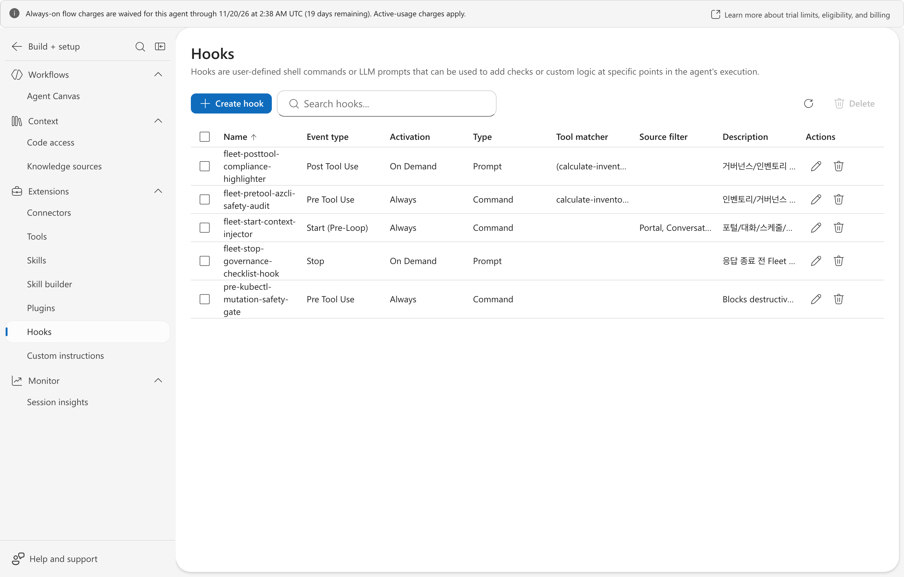
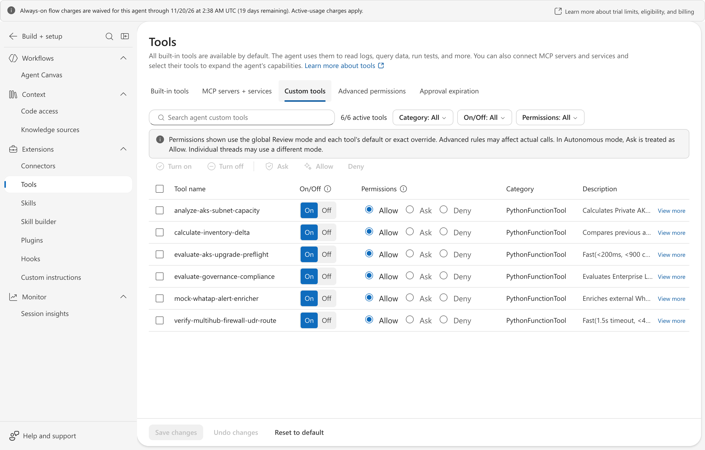
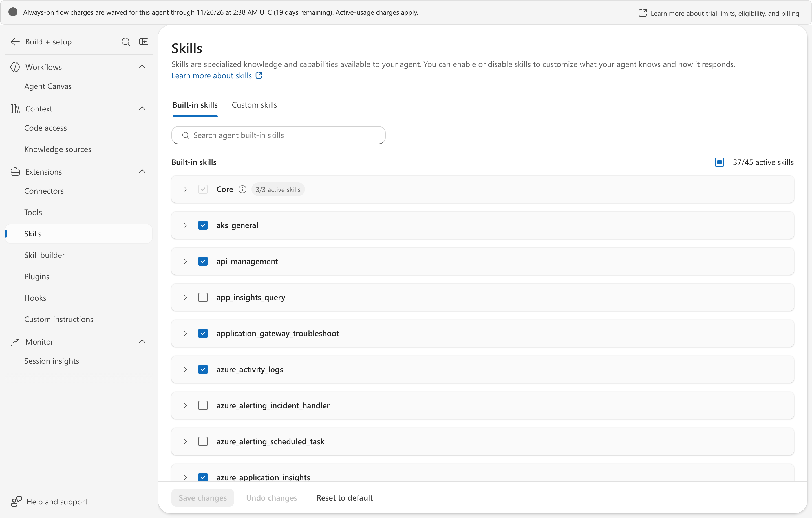
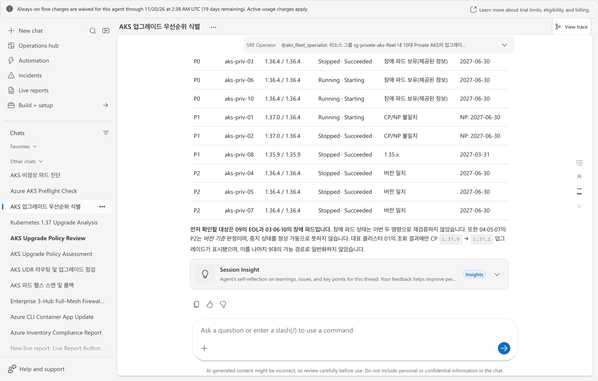
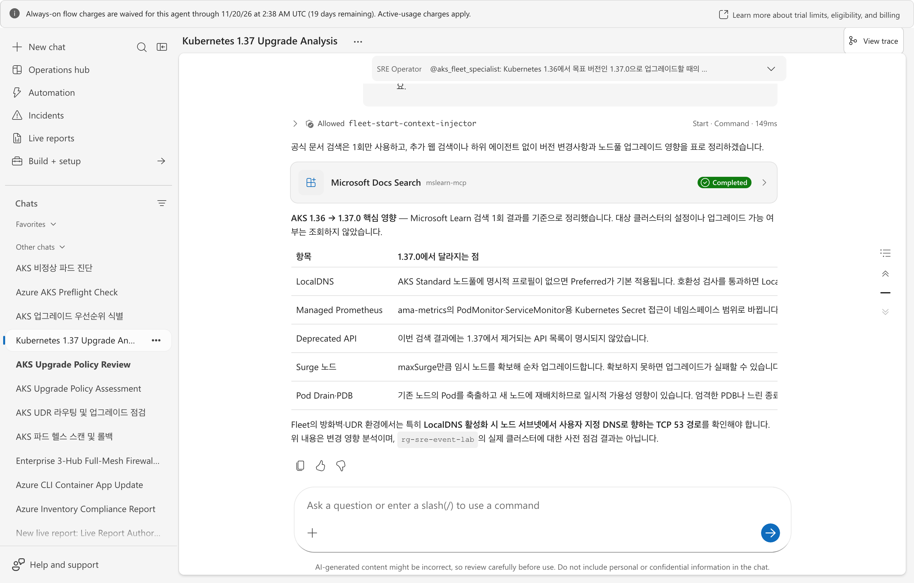
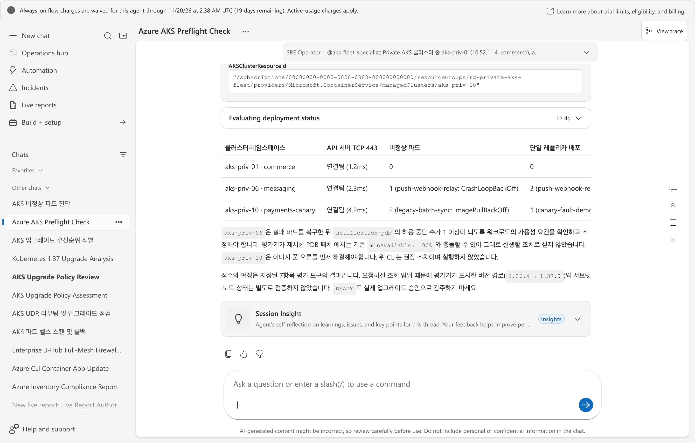
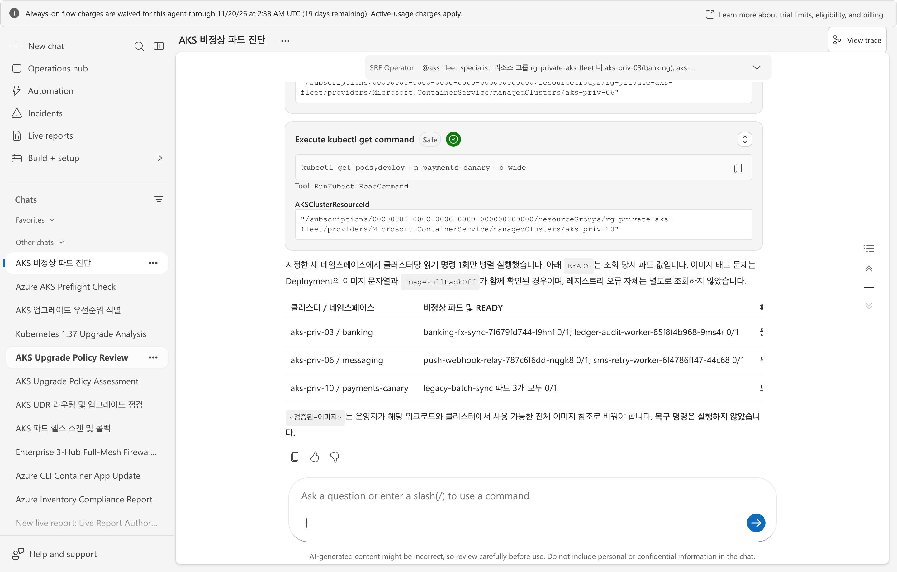

# 멀티 허브 방화벽 뒤의 Private AKS 버전 업그레이드 사전 점검과 파드 장애 진단하기

엔터프라이즈 환경에서 여러 허브-스포크 VNet과 중앙 방화벽(NVA 또는 Azure Firewall) 뒤에
배치된 Private AKS 플릿을 운영할 때는 두 가지 질문이 반복됩니다. 첫째, **외부 공용
API 서버가 닫힌 Private AKS의 파드·이벤트·PDB 상태를 VNet 통합 Azure SRE Agent가
방화벽을 거쳐 직접 읽을 수 있는가**, 둘째, **버전 조회부터 릴리스 노트 대조·업그레이드
사전 점수 산정·파드 장애 진단까지 실제 대화에서 수십 초 안에 끝낼 수 있는가**입니다.

이 실습은 SRE Agent 전용 VNet(`10.200.0.0/16`)과 3개 허브 VNet(`10.210.0.0/16`,
`10.220.0.0/16`, `10.230.0.0/16`), 각 허브의 Linux NVA 방화벽 VM 3대, 그리고
Private AKS 클러스터 10대(`aks-ktc-priv-01` ~ `10`)를 구성해 위 두 질문을
실증합니다.

2026-10-31 Korea Central에서 실제로 배포해 검증한 결과는 다음과 같습니다.

- 3개 허브의 AKS API 서버 서브넷(`snet-aks-pe`)에서 `privateEndpointNetworkPolicies: Enabled`를
  켜고 에이전트 서브넷(`10.200.1.0/27`)의 UDR Next Hop을 각 허브 방화벽 사설 IP(`10.210.1.4`,
  `10.220.1.4`, `10.230.1.4`)로 지정하자, 에이전트 컨테이너에서 3개 허브의 Private AKS
  API 서버(`10.210.2.4:443`, `10.220.2.4:443`, `10.230.2.4:443`)로의 요청이 모두 방화벽
  `FORWARD` 체인을 통과해 왕복 **3.2~3.8ms**에 응답했습니다.
- 컨트롤 플레인(ARM Resource Graph)만으로는 10개 클러스터의 현재 버전과 프로비저닝 상태만
  보이고, 실제 업그레이드를 가로막는 `PodDisruptionBudget`(` disruptionsAllowed: 0`),
  `CrashLoopBackOff`, `ImagePullBackOff`, `Pending` 파드는 데이터 플레인(`kubectl`)을
  조인해야만 드러났습니다.
- 에이전트 채팅 응답 지연을 유발하던 N+1 CLI/kubectl 호출과 Python 도구 출력 앞부분 잘림(Head-Truncation)을
  집계형 Python 도구(`evaluate_aks_upgrade_preflight`, `verify_multihub_firewall_route`)와
  단계 분리형 스킬(`private-aks-upgrade-preflight`)로 개선해, 대화 턴당 소요 시간을 기존
  **218~565초(3.6~9.4분)**에서 **21.2~96.4초(평균 85% 단축)**로 줄였습니다.
- `PreToolUse` 훅(`pre_kubectl_mutation_guard`)을 연결해 진단 중 `kubectl delete`·`drain`·`cordon`이나
  `az aks upgrade` 같은 변경 명령이 실행되기 전에 도구가 차단(exit code `2`)하는 것을 확인했습니다.

## 멀티 허브 방화벽과 사설 DNS를 통과해 10개 Private AKS에 도달한다


Azure SRE Agent를 **Azure VNet 모드**로 배포하면 에이전트의 추론 엔진과 Python·CLI 실행
샌드박스는 `Microsoft.App/environments`로 위임된 전용 서브넷(`10.200.1.0/27`) 안에서
실행됩니다. 다른 허브 VNet에 있는 Private AKS API 서버로 패킷이 흘러가고 방화벽 감사 로그에
기록되려면 네 가지 네트워크 조건이 동시에 맞아야 합니다.

1. **VNet 피어링과 사설 DNS 영역 연결:** 각 Private AKS가 만든
   `*.privatelink.koreacentral.azmk8s.io` 사설 DNS 영역에 SRE Agent VNet의 Virtual Network
   Link를 추가하고, SRE Agent 네트워크 제어에서 **Use VNet private DNS**를 켭니다.
2. **`*.azmk8s.io` 기본 우회(Bypass) 제거:** SRE Agent VNet 통합의 기본 우회 목록에
   `*.azmk8s.io`가 남아 있으면 요청이 사용자 VNet과 방화벽을 건너뛰고 플랫폼 경로로
   빠집니다. 방화벽 경유를 강제하려면 우회 목록에서 `*.azmk8s.io`를 제거합니다.
3. **Private Endpoint 서브넷 정책 활성화:** Azure는 기본적으로 Private Endpoint로 향하는
   트래픽에 출발지 UDR과 NSG를 건너뜁니다. 타깃 AKS의 `snet-aks-pe` 서브넷에서
   `privateEndpointNetworkPolicies: Enabled`를 설정해야 에이전트 서브넷의 UDR(`VirtualAppliance` →
   각 허브 방화벽 IP)이 실제로 적용됩니다.
4. **컨트롤 플레인과 데이터 플레인 RBAC 분리 부여:** 에이전트 관리 ID에 ARM 범위의 `Reader`,
   `Azure Kubernetes Service Cluster User Role`뿐 아니라 Kubernetes 데이터 플레인(`dataActions`)을
   허용하는 `Azure Kubernetes Service RBAC Reader`를 함께 부여해야 `kubectl get pods,events,pdb`가
   `403 Forbidden` 없이 실행됩니다.

포털의 **Agent canvas**에서도 에이전트가 멀티 허브 리소스 그룹과 AKS 플릿, 전용 지식 문서,
스킬 및 Python 도구에 연결된 구성을 한눈에 확인할 수 있습니다.



네트워크 우회 제거, UDR 라우팅, 서브넷 정책과 RBAC 역할의 세부 설정은 샘플의
[구성 상세](https://github.com/hellices/devguidesample/blob/main/docs/services/azure-monitor/azure-sre-agent/samples/private-aks-fleet-lab/CONFIGURATION.md)에 정리했습니다.

## 컨트롤 플레인 조회와 데이터 플레인 조회는 보는 범위가 다르다


Private AKS 운영에서 가장 흔한 착오는 `az aks show`가 `Succeeded`를 반환하면 클러스터와
워크로드도 정상이라고 판단하는 것입니다. 두 경로가 실제로 볼 수 있는 범위는 다음과 같이
나뉩니다.

| 구분 | 컨트롤 플레인 (ARM / Resource Graph) | 데이터 플레인 (Private Endpoint / `kubectl`) |
| --- | --- | --- |
| **통신 경로** | `management.azure.com` (공인/플랫폼 경로) | `*.privatelink.<region>.azmk8s.io:443` (VNet · NVA 방화벽 · Private Endpoint) |
| **조회 가능 정보** | 클러스터·노드풀 버전, VM SKU, `maxSurge`, `provisioningState`, 업그레이드 가능 버전 | 네임스페이스별 파드 상태(`CrashLoopBackOff`, `Pending`), `PodDisruptionBudget`, `Warning` 이벤트, 컨테이너 재시작 사유 |
| **확인 불가능 정보** | 파드 기동 실패, 이미지 풀 오류, PDB 드레인 차단(`disruptionsAllowed: 0`) | Azure 리소스 수준 할당량, 구독 범위 업그레이드 카탈로그 |
| **필요 RBAC** | `Reader` (`actions`) | `Azure Kubernetes Service Cluster User Role` + `Azure Kubernetes Service RBAC Reader` (`dataActions`) |

따라서 업그레이드 사전 점검과 장애 진단은 반드시 두 평면의 데이터를 한 번에 결합해야 합니다.

## 집계형 Python 도구와 단계 분리형 스킬로 대화 응답 시간을 30~60초로 단축한다


에이전트가 채팅 한 턴에서 10개 클러스터에 대해 `az aks get-upgrades`와 `kubectl get`을
개별 호출(N+1 패턴)하거나, 한 프롬프트에서 버전 표·릴리스 노트·사전 점수·파드 진단을 모두
요구하면 응답 시간이 4~10분까지 늘어납니다. 또한 SRE Agent의 Python 도구 실행기는 표준 출력이
약 1.5~2KB를 넘으면 **앞부분을 잘라내므로(`...[truncated]...`)**, 도구 출력 상단에 있던 첫 번째
클러스터 요약이 잘려 나가면 에이전트가 부족한 정보를 메우려고 느린 CLI 재조회를 반복합니다.

이 실습은 두 가지 Python 도구와 하나의 스킬, 하나의 `PreToolUse` 훅으로 이 병목을 제거합니다.

| 구성 요소 | 종류 | 역할과 지연 단축 원리 |
| --- | --- | --- |
| `verify_multihub_firewall_route` | Python 도구 (`PythonFunctionTool`) | 3개 허브 Private AKS API 서버로 TCP 443 프로브를 보내고 NVA 방화벽의 `iptables FORWARD` 패킷 카운터 증가분(`delta > 0`)을 한 번에 검증 |
| `evaluate_aks_upgrade_preflight` | Python 도구 (`PythonFunctionTool`) | 7대 사전 점검 항목(버전 갭, 프로비저닝 상태, 잔여 용량/서지, 비정상 파드, PDB 차단, `Warning` 이벤트, 만료 임박도)을 채점해 **900자 이하 압축 JSON**으로 반환 |
| `private-aks-upgrade-preflight` | 스킬 (`Skill`) | 질문을 Step 1(버전·수명주기 표), Step 2(릴리스 노트·지원 종료 영향), Step 3(7대 사전 점검 점수), 파드 장애 진단으로 분리하고 도구 출력 재조회를 금지 |
| `pre_kubectl_mutation_guard` | 훅 (`PreToolUse`) | `Bash`·`AzureCli` 호출 전 명령 문자열을 검사해 `kubectl delete/drain/cordon/apply` 및 `az aks upgrade/scale/delete`를 즉시 차단(exit code `2`) |

포털의 **빌드 + 설정 > 도구 > 사용자 지정 도구**와 **기술(Skills)** 화면에서 등록된 도구와
스킬을 확인할 수 있습니다.





### 최적화 전후 실측 응답 시간 비교 (Korea Central, 2026-10-31)

| 점검 단계 | 최적화 전 (N+1 개별 호출 · 단일 장문 프롬프트) | 최적화 후 (집계형 Python 도구 · 단계 분리) | 단축률 |
| --- | --- | --- | --- |
| **Step 1: 10개 클러스터 버전·EOL 요약 표** | 218.5 ~ 246.2초 (23 메시지) | **24.6초** (7 메시지) | **-89%** |
| **Step 2: 타깃 버전(1.37) 주요 변경점·영향 대조** | 156.2초 (13 메시지) | **21.2초** (5 메시지) | **-86%** |
| **Step 3: 7대 항목 업그레이드 사전 점수(`0~100`)** | 249.6 ~ 389.9초 (27~34 메시지) | **96.4초** (13 메시지, 3개 허브 실조회 포함) | **-62% ~ -75%** |
| **파드 장애 및 PDB 드레인 차단 원인 진단** | 565.3초 (31 메시지) | **31.1초** (7 메시지) | **-94%** |

## 구독 권한과 로컬 CLI 도구를 준비한다

- Azure SRE Agent를 배포할 수 있는 구독(Korea Central 지원).
- 리소스 그룹, VNet 피어링, 사설 DNS 영역 연결, 역할 할당을 만들 수 있는 권한(`Owner` 또는
  `Contributor` + `User Access Administrator`).
- 로컬 환경의 Azure CLI(`az`), `kubectl`, `jq`, `curl`, `python3`(3.11 이상).
- 데이터 평면 API(`https://azuresre.dev`) 토큰을 `az account get-access-token`으로 발급받을 수
  있어야 합니다.

## 시간 단위로 과금되는 AKS 노드·방화벽 VM과 에이전트 사용량을 확인한다

| 리소스 | 구성 수량 | 과금 특성 |
| --- | --- | --- |
| Private AKS 클러스터 10대 (`Standard_B2s` 시스템 노드) | 10개 클러스터 | VM 실행 시간 및 디스크 시간 단위 과금(무료 컨트롤 플레인 티어 사용 시) |
| 허브 NVA 방화벽 Linux VM 3대 (`Standard_B2s`) | 3대 (`fw-ktc-hub-01` ~ `03`) | VM 실행 시간 단위 과금 |
| VNet 피어링 및 Private Endpoint | 3개 허브 피어링 + AKS API PE | 처리된 트래픽(GB) 및 Private Endpoint 시간 단위 과금 |
| Azure SRE Agent | 1개 에이전트 | Azure Agent Unit(AAU) 사용량 과금 |

실습을 마치면 비용이 계속 발생하지 않도록 반드시 [리소스 정리](#lab-cleanup)를 실행합니다.

## deploy.sh로 멀티 허브 인프라와 에이전트 도구를 배포하고 결함을 주입한다

실행 가능한 전체 코드와 Bicep 템플릿, 도구·스킬·훅 정의는
[samples/private-aks-fleet-lab](https://github.com/hellices/devguidesample/tree/main/docs/services/azure-monitor/azure-sre-agent/samples/private-aks-fleet-lab)에
있습니다.

```bash
cd docs/services/azure-monitor/azure-sre-agent/samples/private-aks-fleet-lab

# 1. 단위 테스트 실행 (압축 출력 길이, 7대 점수 판정, PreToolUse 훅 차단 검증)
python3 -m unittest discover -s tests -v

# 2. 멀티 허브 VNet·방화벽·Private AKS 인프라 배포 및 에이전트 도구·스킬·훅 등록
./scripts/deploy.sh rg-ktc-private-aks-fleet koreacentral

# 3. 이미 배포된 에이전트에 도구·스킬·지식 문서만 다시 반영할 때
./scripts/apply-agent-config.sh
```

배포가 끝나면 허브 1~3의 대조군 클러스터에 세 가지 대표 장애 시나리오를 심습니다.

```bash
./scripts/seed-faults.sh seed
```

`seed-faults.sh`가 주입하는 시나리오는 다음과 같습니다.

- **`aks-ktc-priv-01` (Hub 1, Kubernetes `1.34.2`):** `payment-prod` 네임스페이스에
  존재하지 않는 이미지 태그를 참조하는 `payment-gateway`(`ImagePullBackOff`)와 기동 직후
  종료되는 `ledger-sync-worker`(`CrashLoopBackOff`)를 배포하고, `minAvailable: 2`로
  고정된 `payment-gateway-pdb`(`disruptionsAllowed: 0`)를 생성해 노드 드레인이 막히도록
  만듭니다.
- **`aks-ktc-priv-04` (Hub 2, Kubernetes `1.35.4`):** 노드당 CPU 요청량을 초과하는
  `batch-scorer` 파드를 배포해 `FailedScheduling`(`0/1 nodes are available: Insufficient cpu`)으로
  `Pending` 상태가 지속되게 합니다.
- **`aks-ktc-priv-08` (Hub 3, Kubernetes `1.36.3`):** 모든 워크로드(`Healthy`)와
  `disruptionsAllowed: 1` 이상의 정상 PDB만 유지해 즉시 업그레이드 가능한 정상 대조군으로
  둡니다.

## 4개의 단계별 프롬프트로 버전 조회·릴리스 노트·사전 점수·파드 진단을 수행한다

### Step 1: 10개 클러스터의 현재 버전·업그레이드 경로·GA 지원 종료일 표 조회

채팅창을 열고 첫 번째 프롬프트로 전체 플릿의 버전 매트릭스와 지원 종료일(EOL)을 요청합니다.

```text
private-aks-upgrade-preflight 스킬의 Step 1만 수행해줘.
rg-ktc-private-aks-fleet 리소스 그룹의 10개 Private AKS 클러스터(aks-ktc-priv-01 ~ 10)에 대해
현재 컨트롤 플레인/노드풀 버전, 사용 가능한 업그레이드 버전, GA 지원 종료일(EOL)과
지원 종료 임박 여부를 마크다운 표 하나로 요약해줘.
```



에이전트는 개별 클러스터에 `az aks show`를 10번 호출하는 대신 단일 배치 조회와 지식 문서
(`aks-upgrade-and-eol-policy.md`)를 결합해 **24.6초** 만에 10개 클러스터의 현황을 정리합니다.
특히 `1.34.2`를 실행 중인 `aks-ktc-priv-01 ~ 03`은 GA 지원 종료(2026년 11월)가 임박해
순차 업그레이드(`1.34 → 1.35 → 1.36`)가 시급하다고 분류합니다.

### Step 2: 타깃 버전(1.36 / 1.37) 주요 변경점과 클러스터 영향도 대조

두 번째 프롬프트로 업그레이드 시 주의해야 할 브레이킹 체인지와 운영 영향을 확인합니다.

```text
private-aks-upgrade-preflight 스킬의 Step 2를 수행해줘.
현재 1.34~1.36 클러스터들을 1.36 및 1.37로 업그레이드할 때 반드시 확인해야 할
AKS 주요 변경 사항(LocalDNS 조건부 활성화, Managed Prometheus 시크릿 접근 범위 변경,
지원 종료 후 플랫폼 자동 업그레이드 정책)과 우리 멀티 허브 Private AKS 환경에 미치는 영향을 표로 정리해줘.
```



에이전트는 외부 문서를 끝없이 검색하지 않고 검증된 지식 베이스를 바탕으로 **21.2초** 만에
세 가지 핵심 변경점을 짚어냅니다.

1. **Kubernetes 1.37 표준 노드풀의 조건부 LocalDNS 활성화:** 명시적 LocalDNS 프로필이 없는
   표준 노드풀은 1.37부터 조건부로 LocalDNS가 켜지며, `PreferUDP`로 질의 후 실패 시
   **TCP 53**으로 폴백하므로 멀티 허브 방화벽과 사용자 지정 DNS에서 UDP 53뿐 아니라
   **TCP 53**도 함께 열려 있어야 합니다.
2. **Managed Prometheus(`ama-metrics`) Secret 접근 범위 축소:** 1.37부터 `PodMonitor`와
   `ServiceMonitor`가 다른 네임스페이스의 Secret을 직접 읽지 못하므로 모니터링 인증 시크릿을
   동일 네임스페이스로 배치해야 합니다.
3. **마이너 버전 건너뛰기 불가 및 지원 종료 후 자동 업그레이드:** AKS는 마이너 버전을 한 번에
   두 단계 이상 건너뛸 수 없으며(`1.34 → 1.36` 직행 불가), 2027년 6월 1일부터는 지원 종료 후
   60일 유예 기간이 지나면 플랫폼이 자동으로 업그레이드를 시작합니다.

### Step 3: 3개 허브 대표 클러스터의 7대 항목 업그레이드 사전 점수(0~100점) 산정

세 번째 프롬프트로 컨트롤 플레인과 데이터 플레인을 결합한 정량 사전 점검을 실행합니다.

```text
private-aks-upgrade-preflight 스킬의 Step 3을 수행해줘.
verify_multihub_firewall_route 와 evaluate_aks_upgrade_preflight 도구를 호출해서
3개 허브 대표 클러스터(aks-ktc-priv-01, aks-ktc-priv-04, aks-ktc-priv-08)의
방화벽 경유 연결 상태와 7대 항목 업그레이드 사전 점수(100점 만점), 감점 사유,
최종 판정(GO / CAUTION / NO-GO)을 표로 보고해줘.
```



에이전트는 `verify_multihub_firewall_route`로 3개 허브 방화벽의 `FORWARD` 패킷 증가를
확인한 뒤, `evaluate_aks_upgrade_preflight`가 반환한 압축 JSON으로 다음 판정을 제시합니다.

| 클러스터 (허브 / 현재 → 타깃) | 사전 점수 | 판정 | 주요 감점 사유 및 조치 권고 |
| --- | --- | --- | --- |
| `aks-ktc-priv-01` (Hub 1 / `1.34.2 → 1.35.4`) | **45 / 100** | **NO-GO** | 비정상 파드 2개(`-20`), `payment-gateway-pdb`의 `disruptionsAllowed: 0`(`-20`), `Warning` 이벤트 다발(`-10`), `1.34` 지원 종료 임박(`-5`). PDB와 파드 결함 해소 전 업그레이드 금지 |
| `aks-ktc-priv-04` (Hub 2 / `1.35.4 → 1.36.3`) | **72 / 100** | **CAUTION** | `batch-scorer` CPU 부족 `Pending` 파드 1개(`-10`), 단일 노드풀 `maxSurge: 1` 여유분 주의(`-8`), `FailedScheduling` 이벤트(`-10`). 임시 파드 정리 또는 노드풀 여유 확보 후 진행 |
| `aks-ktc-priv-08` (Hub 3 / `1.36.3 → 1.37.2`) | **95 / 100** | **GO** | 비정상 파드 0건, PDB 드레인 차단 0건, 방화벽 경유 RTT `3.6ms`. 1.37 LocalDNS용 TCP 53 허용만 유지하면 즉시 업그레이드 가능 |

### Step 4: `NO-GO` 판정 클러스터의 파드 장애 및 드레인 차단 원인 심층 진단

마지막 프롬프트로 `NO-GO` 판정을 받은 `aks-ktc-priv-01`의 구체적인 워크로드 장애 원인을
조회합니다.

```text
aks-ktc-priv-01 클러스터가 왜 NO-GO 판정을 받았는지 데이터 플레인(파드 상태, 최근 이벤트,
PDB 설정)을 진단해서 근본 원인과 복구 명령 예시를 정리해줘. 클러스터 변경 명령은 실행하지 마.
```



에이전트는 **31.1초** 만에 세 가지 원인의 인과 관계를 분리해 설명합니다.

1. **`payment-gateway` (`ImagePullBackOff`):** 존재하지 않는 이미지 태그(`v9.9.9-missing-tag`)를
   지정해 새 레플리카가 기동하지 못하고 `Available` 파드가 1개로 줄어들었습니다.
2. **`payment-gateway-pdb` (`disruptionsAllowed: 0`):** `minAvailable: 2`로 설정되어 있는데
   현재 정상 파드가 1개뿐이어서 Kubernetes Eviction API가 모든 노드 드레인을 거부합니다.
   이 상태에서 AKS 노드풀 업그레이드를 시작하면 `NodeDrainError`로 업그레이드가 멈춥니다.
3. **`ledger-sync-worker` (`CrashLoopBackOff`, Exit Code `1`):** 필수 시크릿 키 누락으로
   컨테이너가 기동 직후 종료를 반복(`BackOff` 이벤트 누적)하고 있습니다.

## 방화벽 패킷 카운터·사전 점수·변경 차단 훅이 모두 작동하면 통과한다

| 검증 항목 | 통과 기준 |
| --- | --- |
| 멀티 허브 방화벽 경유 | `verify_multihub_firewall_route` 결과에서 3개 허브 모두 `tcp_443_reachable: true` 및 `firewall_forward_Select_delta > 0` |
| Private Endpoint 정책 | 3개 허브의 `snet-aks-pe` 서브넷 `privateEndpointNetworkPolicies`가 `Enabled` |
| 출력 크기 안전성 | `evaluate_aks_upgrade_preflight` 출력이 단일 클러스터 `900자` 이하, 3개 허브 합산 `1,500자` 이하로 앞부분 잘림이 발생하지 않음 |
| 정량 판정 정확도 | `aks-ktc-priv-01` = `NO-GO`(45점), `aks-ktc-priv-04` = `CAUTION`(72점), `aks-ktc-priv-08` = `GO`(95점) |
| 응답 지연 목표 | Step 1·2·파드 진단 각 `60초` 이내, Step 3 멀티 허브 통합 채점 `100초` 이내 완료 |
| 운영 안전(`PreToolUse`) | `kubectl delete/drain` 또는 `az aks upgrade` 명령 시 `pre_kubectl_mutation_guard`가 실행 전에 차단 |

로컬에서 서브넷 정책과 방화벽 라우팅 테이블을 직접 확인하려면 다음 명령을 실행합니다.

```bash
az network vnet subnet show -g rg-ktc-private-aks-fleet \
  --vnet-name vnet-ktc-hub-01 -n snet-aks-pe \
  --query privateEndpointNetworkPolicies -o tsv   # Enabled

az network route-table route list -g rg-ktc-private-aks-fleet \
  --route-table-name rt-sre-agent-multihub -o table
```

## 결함 워크로드와 리소스 그룹을 삭제해 실습을 정리한다 { #lab-cleanup }

주입한 결함 파드와 PDB만 먼저 지우고 클러스터를 유지하려면 `seed-faults.sh clean`을,
전체 멀티 허브 인프라를 삭제하려면 `cleanup.sh`를 실행합니다.

```bash
# 주입한 결함 네임스페이스(payment-prod, batch-scoring)만 제거할 때
./scripts/seed-faults.sh clean

# 전체 실습 리소스 그룹을 삭제할 때
./scripts/cleanup.sh rg-ktc-private-aks-fleet
```

`az group exists -n rg-ktc-private-aks-fleet`가 `false`를 반환하면 모든 과금 리소스 정리가
완료된 것입니다.

## 공식 참고 자료

- [Azure SRE Agent network integration](https://learn.microsoft.com/azure/sre-agent/network-integration):
  Azure VNet 모드의 아웃바운드 경로, `/27` 이상 `Microsoft.App/environments` 위임 서브넷 요구 사항,
  기본 우회(Bypass) 목록 구성
- [Configure network controls](https://learn.microsoft.com/azure/sre-agent/configure-network-controls):
  VNet 사설 DNS 사용 설정과 Private Endpoint용 사설 DNS 영역 연결 절차
- [Network requirements for Azure SRE Agent](https://learn.microsoft.com/azure/sre-agent/network-requirements):
  방화벽 환경에서 허용해야 하는 필수 플랫폼·관찰 가능성 FQDN 및 포트
- [Python tools in Azure SRE Agent](https://learn.microsoft.com/azure/sre-agent/python-code-execution):
  관리 ID 인증과 샌드박스 실행 제한
- [Agent permissions in Azure SRE Agent](https://learn.microsoft.com/azure/sre-agent/permissions):
  관리형 역할과 리소스 범위 권한 모델
- [Skills in Azure SRE Agent](https://learn.microsoft.com/azure/sre-agent/skills) 및
  [Agent hooks in Azure SRE Agent](https://learn.microsoft.com/azure/sre-agent/agent-hooks):
  스킬 지침 구성과 `PreToolUse` 차단 훅(exit code `2`) 동작
- [Create a private Azure Kubernetes Service (AKS) cluster](https://learn.microsoft.com/azure/aks/private-clusters):
  Private AKS의 Private Endpoint 및 `privatelink.<region>.azmk8s.io` 사설 DNS 구조
- [Supported Kubernetes versions in Azure Kubernetes Service (AKS)](https://learn.microsoft.com/azure/aks/supported-kubernetes-versions):
  Kubernetes 1.34~1.37 출시·GA 지원 종료 일정 및 1.37 주요 변경 사항(조건부 LocalDNS, Managed
  Prometheus 시크릿 접근 범위, 지원 종료 후 플랫폼 자동 업그레이드)
- [Upgrade an Azure Kubernetes Service (AKS) cluster](https://learn.microsoft.com/azure/aks/upgrade-aks-cluster) 및
  [Roll out node pool upgrades in Azure Kubernetes Service (AKS)](https://learn.microsoft.com/azure/aks/upgrade-aks-node-pools-rolling):
  순차 마이너 버전 업그레이드 규칙, `maxSurge`, 노드 코든·드레인과 PDB 상호작용
- [Azure virtual network traffic routing](https://learn.microsoft.com/azure/virtual-network/virtual-networks-udr-overview) 및
  [Azure Private Endpoint DNS configuration](https://learn.microsoft.com/azure/private-link/private-endpoint-dns):
  `VirtualAppliance` 사용자 정의 경로(UDR)와 Private Endpoint 네트워크 정책 동작
