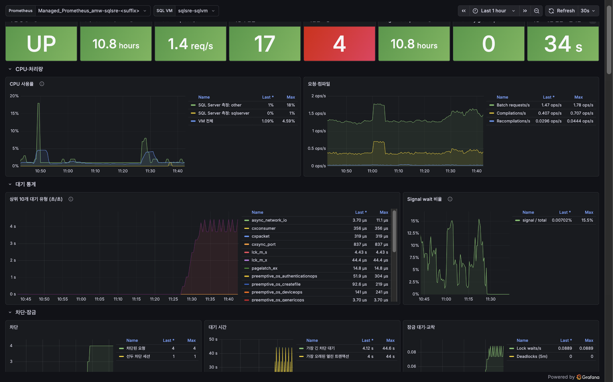
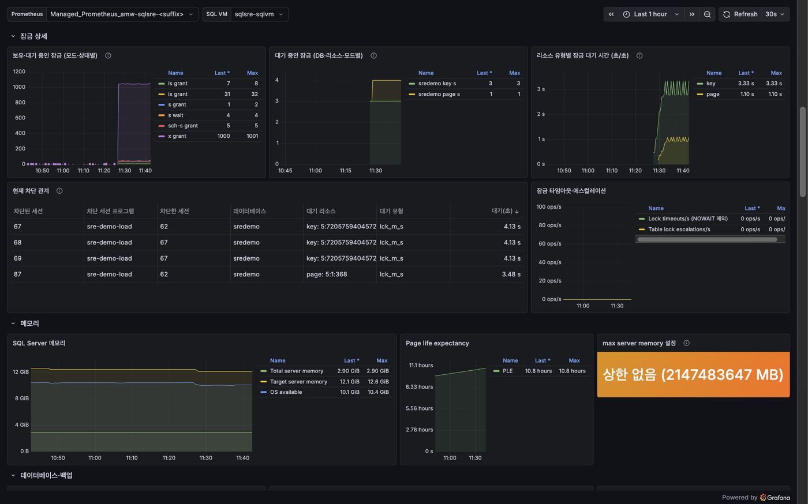
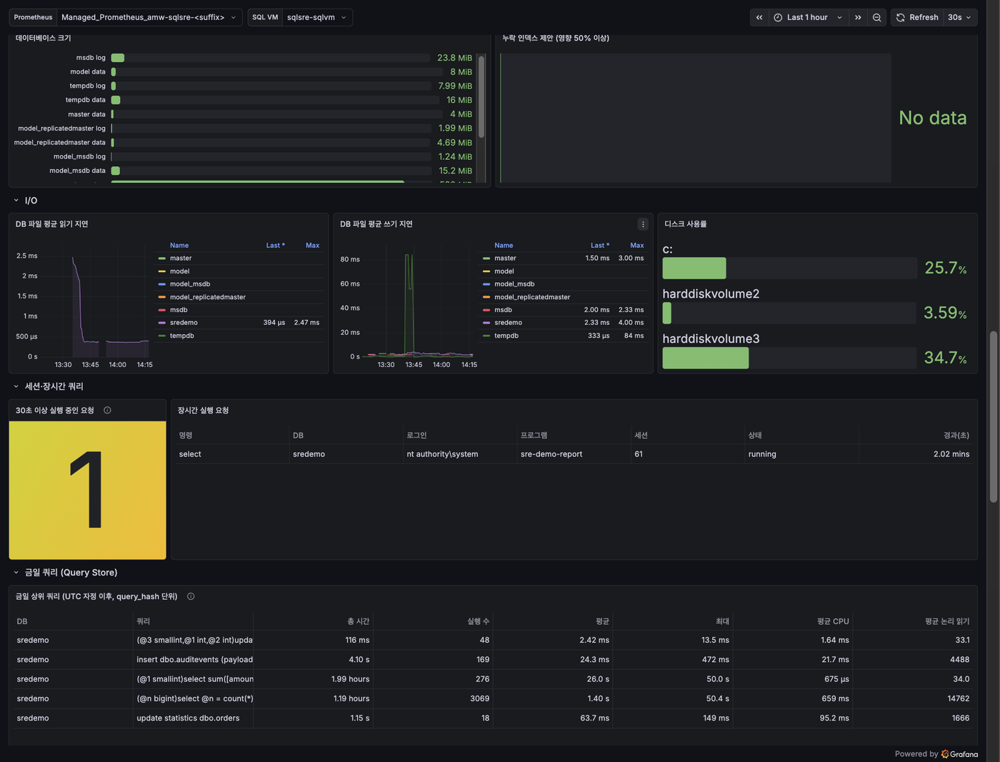
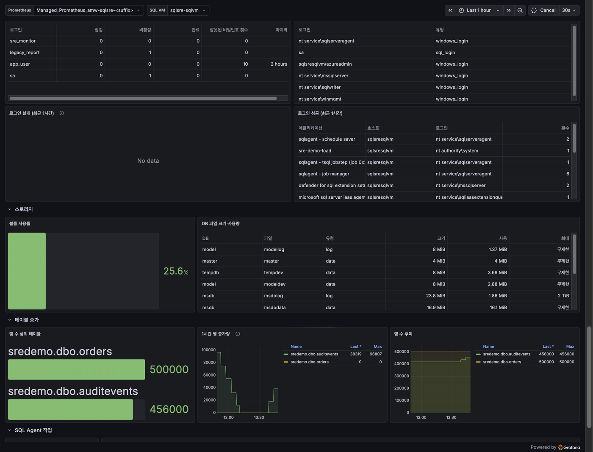
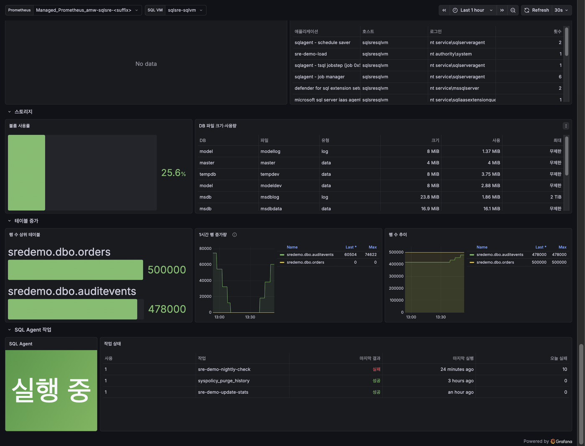

# SQL Insights 은퇴 이후 SQL Server VM을 exporter와 Azure Managed Grafana로 모니터링하기

이 실습은 [SRE Agent 상태 점검 실습](../sql-server-vm-health-check/index.md)과 같은
SQL Server VM에 지표 파이프라인을 더합니다. 관리자들이 널리 쓰는 SQL Server
점검 쿼리가 공통으로 보는 항목을 sql_exporter collector로 만들고,
windows_exporter의 SQL Server 성능 카운터와 함께 Prometheus 에이전트가 Azure
Monitor workspace로 보냅니다. Azure Managed Grafana에서는 `SQL Server VM 상태`
대시보드로 봅니다.

2026-10-27 Korea Central에서 실제로 배포해 확인한 결과는 다음과 같습니다.

- Prometheus 에이전트의 remote write는 첫 60초 동안 7,242개 샘플을 보냈고
  실패·재시도는 0건이었습니다.
- 대시보드의 패널 쿼리를 Azure Monitor workspace에 그대로 실행하자, 정상
  서버에서 비어 있어야 하는 `문제 DB` 패널을 제외한 모든 쿼리가 데이터를
  반환했습니다.
- Grafana 12.4.8(Standard)이 자체 관리 ID로 같은 workspace를 조회해 HTTP 200을
  반환했고, CPU 부하 중 상위 대기는 `SOS_SCHEDULER_YIELD`(초당 2.35초)였습니다.
- 확장한 collector로 잠긴 계정(`app_user`, 실패 10회), 계정·클라이언트·사유별
  로그인 실패(각 48건), `AuditEvents` 1시간 증가량, 오늘 실패한 SQL Agent 작업,
  금일 Query Store 상위 쿼리가 대시보드에 나타났습니다. 46개 패널 중 데이터가 없던
  것은 부하가 없을 때 비어 있어야 하는 현재 잠금·차단, 장시간 실행 요청, 문제 DB
  패널뿐이었고, 잠금 부하 중에는 잠금 패널도 채워졌습니다.

## Grafana 대시보드 하나로 상태·잠금·쿼리·계정·용량을 본다



잠금 부하를 건 상태에서는 잠금 상세 행에 모드·상태별 잠금 수와 현재 차단 관계(차단 세션,
대기 세션, 대기 리소스)가 표로 나타납니다.









같은 지표를 SRE Agent도 `SqlServerMetricsQuery` 도구로 조회합니다. 채팅 예시는
[SRE Agent 실습](../sql-server-vm-health-check/index.md)에 있습니다.

## 관리자들이 먼저 돌리는 공개 점검 쿼리 모음

SQL Server 관리자들이 상태 점검에 널리 쓰는 공개 스크립트는 다음과 같습니다.
모두 DMV와 시스템 뷰를 읽으며, 일부는 서버에 저장 프로시저를 설치해야 합니다.
라이선스와 상태는 2026-10-27 각 저장소·배포처 기준입니다.

| 모음 | 관리 주체 | 라이선스 | 주로 보는 것 |
| --- | --- | --- | --- |
| [SQL Server Diagnostic Information Queries](https://glennsqlperformance.com/resources/) | Glenn Berry | 배포처 조건 확인 | SQL Server 버전별 스크립트. 구성, 대기 통계, CPU·메모리, 파일 I/O 지연, 상위 쿼리, 인덱스 |
| [First Responder Kit](https://github.com/BrentOzarULTD/SQL-Server-First-Responder-Kit) (`sp_Blitz`, `sp_BlitzFirst`, `sp_BlitzCache`, `sp_BlitzIndex`, `sp_BlitzWho`) | Brent Ozar Unlimited | MIT | 서버 전반 위험 점검, 짧은 구간 샘플링, 계획 캐시 상위 쿼리, 인덱스 진단, 현재 실행 요청 |
| [sp_WhoIsActive](https://github.com/amachanic/sp_whoisactive) | Adam Machanic | GPL-3.0 | 현재 실행 중인 세션, 차단, 대기, 열린 트랜잭션 |
| [DarlingData](https://github.com/erikdarlingdata/DarlingData) (`sp_PressureDetector` 등) | Erik Darling | MIT | CPU·메모리 압박, Query Store 분석 |
| [Tiger Toolbox](https://github.com/microsoft/tigertoolbox) | Microsoft SQL Server Tiger team | 저장소 조건 확인 | 모범 사례 점검 스크립트 |
| [SQL Server Maintenance Solution](https://github.com/olahallengren/sql-server-maintenance-solution) | Ola Hallengren | MIT | 점검보다 백업·무결성 검사·인덱스 유지 관리 작업 |

이 스크립트들이 공통으로 출발하는 항목은 `sys.dm_os_wait_stats` 같은 DMV입니다.
대기 통계는 `VIEW SERVER STATE` 권한으로 읽을 수 있고 엔진 시작 이후 누적된
값입니다. 이 실습은 외부 저장 프로시저를 설치하지 않고, 공통 항목만 읽기 전용
쿼리로 다시 작성해 지표로 만듭니다.

| 점검 항목 | 사용한 DMV·시스템 뷰 | 지표 |
| --- | --- | --- |
| 대기 통계 (유휴성 대기 제외) | `sys.dm_os_wait_stats` | `mssql_wait_time_seconds_total`, `mssql_signal_wait_time_seconds_total` |
| CPU 사용률 | `sys.dm_os_ring_buffers` 스케줄러 모니터 | `mssql_cpu_percent` |
| 차단과 선두 차단 세션 | `sys.dm_exec_requests` | `mssql_blocked_requests`, `mssql_head_blockers`, `mssql_longest_blocked_wait_seconds` |
| 오래 열린 트랜잭션 | `sys.dm_tran_active_transactions`, `sys.dm_tran_session_transactions` | `mssql_oldest_open_transaction_seconds` |
| DB 상태·복구 모델 | `sys.databases` | `mssql_database_online` |
| 로그 사용률과 재사용 대기 | `sys.dm_os_performance_counters`, `sys.databases` | `mssql_log_used_percent`, `mssql_log_reuse_waiting` |
| 마지막 백업 | `msdb.dbo.backupset` | `mssql_last_backup_timestamp_seconds` |
| DB 파일 I/O 지연 | `sys.dm_io_virtual_file_stats` | `mssql_io_stall_seconds_total`, `mssql_io_operations_total` |
| 누락 인덱스 제안 | `sys.dm_db_missing_index_*` | `mssql_missing_index_suggestions` |
| 메모리 상한 설정 | `sys.configurations` | `mssql_max_server_memory_bytes` |
| 잠금 보유·대기 (DB·리소스 유형·모드·상태) | `sys.dm_tran_locks` | `mssql_locks`, `mssql_blocking_wait_seconds` |
| 장시간 실행 요청 (30초 이상) | `sys.dm_exec_requests`, `sys.dm_exec_sessions` | `mssql_long_running_request_seconds` |
| 금일 상위 쿼리 (UTC 자정 이후, `query_hash` 단위) | 각 사용자 DB의 Query Store | `mssql_query_today_executions`, `mssql_query_today_avg_duration_seconds` 등 |
| SQL 로그인 잠금·사용 중지·만료, sysadmin 구성원 | `sys.sql_logins`, `LOGINPROPERTY`, 서버 역할 | `mssql_sql_login_*`, `mssql_sysadmin_member` |
| 최근 1시간 로그인 실패·성공 | XE 세션 `sre_login_audit`의 이벤트 파일 | `mssql_failed_logins_last_hour`, `mssql_successful_logins_last_hour` |
| 볼륨·DB 파일 사용량 | `sys.dm_os_volume_stats`, 각 DB의 `sys.database_files`와 `FILEPROPERTY` | `mssql_volume_*`, `mssql_db_file_*` |
| 테이블 행 수·예약 공간 | 각 사용자 DB의 `sys.dm_db_partition_stats` | `mssql_table_rows`, `mssql_table_reserved_bytes` |
| SQL Agent 상태와 작업 실패 | `sys.dm_server_services`, `msdb.dbo.sysjobs`·`sysjobhistory` | `mssql_agent_running`, `mssql_job_*` |

행 증가량은 별도 이력 테이블 없이 `delta(mssql_table_rows[1h])`처럼 시계열에서
계산합니다. 금일 쿼리, 스토리지, 테이블 지표는 5분, 로그인 이벤트는 1분 간격으로
캐시해 scrape마다 DB를 순회하지 않습니다(collector의 `min_interval`).

Batch requests, Page life expectancy, Memory grants pending, 잠금 대기, 교착 같은
성능 카운터는 windows_exporter의 `mssql` collector가 수집합니다.

## Microsoft 관리형 선택지가 이 VM에 맞지 않는 이유

| 선택지 | 상태 (2026-10-27 확인) | 이 실습에서의 판단 |
| --- | --- | --- |
| SQL Insights | 2024-12-31에 은퇴. 문서는 SQL Server VM에 VM Insights와 DCR을 안내 | 사용할 수 없음 |
| Database watcher (preview) | 지원 대상은 Azure SQL Database와 Azure SQL Managed Instance | SQL Server on Azure VM 대상 아님 |
| SQL Server on Azure VMs performance monitoring (preview) | SQL IaaS Agent 확장이 수집. Developer·Express·Evaluation edition은 클라이언트 연결 데이터(`SqlServerClientConnections`)만 수집 | 이 실습 VM은 Developer edition이라 대기·세션 데이터가 없음 |
| Azure Monitor Agent의 Prometheus 수집 | DCR의 `prometheusForwarder`는 Kubernetes 클러스터용 | VM의 exporter를 직접 수집하지 못함 |

Standard·Enterprise edition이라면 performance monitoring (preview)도 함께 검토할
만합니다. 이 실습은 edition과 관계없이 동작하고 Grafana에서 PromQL로 다룰 수 있는
exporter 방식을 택했습니다.

## SQL Server exporter 후보 비교

| exporter | 수집 방식 | 상태 (2026-10-27) | 이 실습의 사용 |
| --- | --- | --- | --- |
| [windows_exporter](https://github.com/prometheus-community/windows_exporter) `mssql` collector | SQL Server 성능 카운터(WMI 클래스) | v0.32.0, MIT, MSI로 서비스 설치 | 사용. OS 지표(cpu, memory, logical_disk 등)도 함께 수집 |
| [sql_exporter](https://github.com/burningalchemist/sql_exporter) | 설정 파일의 SQL 쿼리를 지표로 변환 | 0.24.12, MIT, Windows 서비스 등록 지원 | 사용. 위 점검 항목을 collector로 정의 |
| [Telegraf `sqlserver` input](https://github.com/influxdata/telegraf/tree/master/plugins/inputs/sqlserver) | 미리 정의된 DMV 쿼리 묶음(성능 카운터, 대기, 요청, 백업 등) | Telegraf v1.40.2, MIT | 대안. 출력 형식과 수집 경로를 따로 구성해야 함 |
| [Grafana Alloy `prometheus.exporter.mssql`](https://grafana.com/docs/alloy/latest/reference/components/prometheus/prometheus.exporter.mssql/) | sql_exporter를 내장. 기본 `mssql_standard` collector, `query_config`로 사용자 쿼리 지정 | Alloy 구성 요소 | 대안. 사용자 쿼리를 지정하면 기본 collector를 대체 |
| [OpenTelemetry `sqlserverreceiver`](https://github.com/open-telemetry/opentelemetry-collector-contrib/tree/main/receiver/sqlserverreceiver) | 성능 카운터와 DMV | 지표는 beta, 일부 지표는 Development 단계 | 대안. 잠금 대기율·교착률·차단 프로세스 수 같은 카운터 |
| [awaragi/prometheus-mssql-exporter](https://github.com/awaragi/prometheus-mssql-exporter) | Node.js 기반 고정 쿼리 | 마지막 릴리스 2022-04 | 제외 |

## 잠금 현황은 postgres_exporter처럼 기본 제공되지 않아 직접 정의

PostgreSQL의 [postgres_exporter](https://github.com/prometheus-community/postgres_exporter)는
`pg_locks`를 DB·모드별로 센 `pg_locks_count{datname,mode}`를 기본으로 냅니다.
SQL Server용 exporter를 같은 관점에서 비교하면 다음과 같습니다(2026-10-27 확인).

| 원본 | 잠금 관련 지표 | 한계 |
| --- | --- | --- |
| windows_exporter `mssql` | Locks 성능 카운터: 리소스 유형(`resource`)별 잠금 대기 수·대기 시간, 교착, 타임아웃 | 누적 카운터라 지금 잠금을 잡은 세션이나 대기 중인 객체를 알 수 없음 |
| Alloy `mssql_standard`, OTel `sqlserverreceiver` | 잠금 대기율, 교착률, 차단된 프로세스 수 | 마찬가지로 현재 잠금 목록이 아님 |
| 이 실습의 sql_exporter collector | `sys.dm_tran_locks`를 DB·리소스 유형·모드·상태(`GRANT`/`WAIT`)별로 센 `mssql_locks`, 대기 중인 잠금의 대기 시간 `mssql_blocking_wait_seconds`(차단 세션·대기 세션·프로그램·대기 리소스 레이블) | 30초 scrape 사이의 짧은 잠금은 놓침 |

`mssql_locks`는 `pg_locks_count`에 해당하는 현재 잠금 분포이고, 어느 세션이 어느
테이블을 잡았는지 같은 세부 조회는 [SRE Agent의 `locks` operation](../sql-server-vm-health-check/index.md)이
실행 시점의 DMV로 답하고, 더 파고들 때는 에이전트가 `SqlServerQuery`로 읽기 전용
SQL을 직접 실행합니다. 세션 ID 같은 레이블은 시계열 수를 늘리므로 대기 중인
잠금에만 붙입니다.

## Prometheus가 30초마다 exporter를 수집해 관리 ID로 workspace에 전송


VM 안의 수집은 pull, VM에서 Azure로 보내는 것은 push입니다. 조회 쪽(Grafana,
SRE Agent)은 저장된 시계열을 필요할 때 PromQL로 읽습니다.

| 구성 요소 | 동작 방식 | 주기 | 내용 |
| --- | --- | --- | --- |
| Prometheus 3.15.1 (agent 모드, 예약 작업 `PrometheusAgent`) | 두 exporter의 `/metrics`를 scrape (pull) | 30초, 제한 시간 25초 | 수집한 시계열에 외부 레이블 `sql_vm`을 붙임. 로컬에는 전송 대기용 WAL만 둠 |
| windows_exporter v0.32.0 (서비스) | scrape 요청을 받을 때 성능 카운터·OS 지표를 읽어 응답 | 30초 | SQL Server 성능 카운터(batch requests, 컴파일, PLE, 메모리, 잠금 대기·교착·타임아웃), CPU·메모리·디스크·네트워크 |
| sql_exporter 0.24.12 `mssql_health` | scrape 요청 때 DMV 쿼리 실행 | 30초 (`min_interval` 25초) | 대기, CPU, 차단·잠금, 장시간 요청, 열린 트랜잭션, DB 상태·로그, 백업, 파일 I/O, 로그인 상태, SQL Agent 작업 |
| sql_exporter `mssql_audit` | scrape 요청 때 쿼리, 결과를 캐시해 재사용 | 60초 | 최근 1시간 로그인 실패·성공 (XE 이벤트 파일) |
| sql_exporter `mssql_inventory` | scrape 요청 때 사용자 DB를 순회해 쿼리, 결과 캐시 | 5분 | 금일 상위 쿼리(Query Store), 볼륨·DB 파일 사용량, 테이블 행 수·크기 |
| XE 세션 `sre_login_audit` | SQL Server가 이벤트 발생 시 파일에 기록 (push) | 최대 5초 버퍼 | 로그인 실패(오류 18456), 풀 재사용이 아닌 로그인 성공 |
| Prometheus remote write | VM 관리 ID 토큰으로 workspace 기본 DCR에 전송 (push, HTTPS, NAT Gateway 경유) | 기본 설정으로 샘플을 묶어 최대 약 5초 안에 전송 | 실패하면 WAL에서 재시도 |
| Azure Managed Grafana 대시보드 | 패널별 PromQL 조회 (pull) | 대시보드가 열려 있는 동안 30초 | 기본 시간 범위 최근 1시간 |

exporter 바인딩, 서비스 계정, 권한, 관리 ID 범위에 대한 설계 결정은
[구성 상세](https://github.com/hellices/devguidesample/blob/main/docs/services/azure-monitor/azure-sre-agent/samples/sqlvm-health-lab/CONFIGURATION.md#지표-파이프라인)에 정리했습니다.

## 같은 deploy.sh가 지표 파이프라인과 대시보드까지 구성

[SRE Agent 실습](../sql-server-vm-health-check/index.md)의 `deploy.sh`가 Azure Monitor
workspace, Azure Managed Grafana, VM의 지표용 관리 ID를 만들고, VM에 exporter와 Prometheus
에이전트를 설치한 뒤 대시보드를 가져옵니다. 설치 단계와 remote write 확인 방법은
[구성 상세](https://github.com/hellices/devguidesample/blob/main/docs/services/azure-monitor/azure-sre-agent/samples/sqlvm-health-lab/CONFIGURATION.md#지표-파이프라인-배포)를 참고합니다.

## 대시보드 패널과 확인할 신호

| 영역 | 패널 | 확인할 신호 |
| --- | --- | --- |
| 요약 | 수집 상태, 가동 시간, Batch requests/s, 사용자 연결, 차단된 요청, Page life expectancy, Memory grants pending, 가장 오래된 열린 트랜잭션 | 차단 1 이상, grant pending 1 이상, 오래 열린 트랜잭션 |
| CPU·처리량 | SQL Server 측정 CPU와 VM 전체 CPU, 요청·컴파일·재컴파일 | SQL Server 외 프로세스의 CPU 사용, 재컴파일 급증 |
| 대기 통계 | 상위 10개 대기 유형, signal wait 비율 | 차단(`LCK_M_*`), I/O(`PAGEIOLATCH_*`), CPU(`SOS_SCHEDULER_YIELD`) 중 무엇이 지배적인지 |
| 차단·잠금 | 차단 수·선두 세션, 가장 긴 차단 대기, 잠금 대기·교착 | 지속되는 차단과 교착 발생 |
| 메모리 | Total·Target server memory와 OS 가용 메모리, PLE, max server memory 설정 | 상한 미설정(2147483647 MB) |
| 데이터베이스·백업 | 로그 사용률, 마지막 전체·로그 백업, 오프라인·로그 재사용 대기, DB 크기, 누락 인덱스 제안 | 백업 `기록 없음`, 로그 사용률 증가 |
| I/O | DB별 평균 읽기·쓰기 지연, 디스크 사용률 | 파일 지연 증가와 디스크 여유 공간 |
| 잠금 상세 | 모드·상태별 보유·대기 잠금, DB·리소스·모드별 대기 잠금, 리소스 유형별 잠금 대기 시간, 현재 차단 관계 표, 잠금 타임아웃·에스컬레이션 | `WAIT` 상태 잠금의 지속, 같은 차단 세션 반복 |
| 세션·장시간 쿼리 | 30초 이상 실행 중인 요청 수와 목록(세션, 로그인, 프로그램, 대기 유형, SQL 앞부분) | 5분 이상 요청, 잠금·I/O 대기 중인 장시간 요청 |
| 금일 쿼리 (Query Store) | 누적 실행 시간·실행 수·평균 실행 시간 상위 쿼리 | 실행 수가 많은 짧은 쿼리, 평균이 긴 쿼리 |
| 보안·접속 | SQL 로그인 잠김·사용 중지·만료·실패 횟수, sysadmin 구성원, 최근 1시간 로그인 실패·성공 | 잠긴 계정, 존재하지 않는 로그인 시도, 예상하지 않은 sysadmin |
| 스토리지 | 볼륨 사용률, DB 파일 크기·사용량·최대 크기 | 볼륨 80%, 파일 90% 이상 |
| 테이블 증가 | 행 수 상위 테이블, 1시간 행 증가량, 행 수 추이 | 평소보다 큰 증가 |
| SQL Agent 작업 | Agent 실행 여부, 작업별 마지막 결과·실행 시각·금일 실패 수 | 실패 1회 이상 |

모든 쿼리는 Prometheus 외부 레이블 `sql_vm`으로 VM을 구분하므로, 같은
workspace에 여러 SQL Server VM을 보내면 대시보드 상단 변수로 전환할 수 있습니다.

## 모든 패널 쿼리를 workspace와 Grafana에서 실행해 검증

`scripts/verify_dashboard_queries.py`가 대시보드의 모든 패널 쿼리를 workspace에 실행하고,
Grafana HTTP API로도 같은 데이터 원본을 조회했습니다. 측정값과 실행 방법은
[구성 상세](https://github.com/hellices/devguidesample/blob/main/docs/services/azure-monitor/azure-sre-agent/samples/sqlvm-health-lab/CONFIGURATION.md#대시보드-검증)에 있습니다.

## remote write·패널 데이터·Grafana 경로·최소 권한이 모두 확인되면 통과

| 확인 항목 | 통과 기준 |
| --- | --- |
| remote write | `prometheus_remote_storage_samples_failed_total`이 0이고 `samples_total`이 증가 |
| 패널 데이터 | `verify_dashboard_queries.py`가 종료 코드 0 |
| Grafana 경로 | Grafana 데이터 원본 쿼리가 HTTP 200과 시계열을 반환 |
| 노출 범위 | exporter와 Prometheus가 `127.0.0.1`에만 바인딩, NSG 변경 없음 |
| 최소 권한 | `NT SERVICE\SqlExporterSvc`가 sysadmin이 아니고 위 서버 권한과 `msdb` 이력 읽기만 보유 |
| 확장 패널 | 부하별로 잠금·로그인 실패·행 증가·작업 실패 패널이 값을 반환 |

## Grafana Standard 인스턴스와 지표 수집·조회 비용

| 자원 | 과금 특성 |
| --- | --- |
| Azure Managed Grafana Standard (X1) | Standard 요금. 새 workspace는 Standard 계층만 만들 수 있습니다. 가격은 Azure Managed Grafana 가격 페이지를 확인합니다. |
| Azure Monitor workspace (managed Prometheus) | 수집량과 쿼리량 기준. 저장은 18개월까지 추가 비용이 없습니다. |
| VM, NAT Gateway 등 | [SRE Agent 실습](../sql-server-vm-health-check/index.md)과 동일 |

이 실습의 수집량은 VM 한 대, 30초 간격입니다. sql_exporter의 대기 유형 레이블과
금일 쿼리의 `query_hash`·`query_text`, 테이블 이름 레이블이 시계열 수를 가장 많이
늘립니다. 금일 쿼리는 DB별 상위 10개, 테이블은 DB별 행 수 상위 20개로 제한했습니다. 여러
VM으로 확장할 때는 이 상한과 대기 유형 수를 줄이는 것을 검토합니다.

## 리소스 그룹 삭제로 정리하고 workspace 관리 리소스 그룹 확인

```bash
./scripts/cleanup.sh
```

Azure Monitor workspace와 Grafana도 같은 리소스 그룹에 있으므로 함께
삭제됩니다. workspace의 기본 DCR·DCE는 Azure가 만든
`MA_<workspace>_<region>_managed` 리소스 그룹에 있습니다(관측). 스크립트는 정리
후 이 리소스 그룹이 남아 있으면 알려 줍니다.

## 구성 중 만난 오류는 구성 상세에 정리

windows_exporter 수집기 이름, sql_exporter 예약 레이블, 로그인 감사 이벤트 읽기, Prometheus
바이너리 교체 같은 문제와 대응은 [구성 상세](https://github.com/hellices/devguidesample/blob/main/docs/services/azure-monitor/azure-sre-agent/samples/sqlvm-health-lab/CONFIGURATION.md#문제-해결)에 모았습니다.

## 공식 참고 자료

- [SQL Insights has been retired](https://learn.microsoft.com/azure/azure-sql/database/sql-insights-overview):
  2024-12-31 은퇴, SQL Server VM은 VM Insights와 DCR 안내
- [Enable performance monitoring for SQL Server on Azure VMs (preview)](https://learn.microsoft.com/azure/azure-sql/virtual-machines/windows/enable-performance-monitoring-sql-vm):
  edition별 수집 범위
- [Monitor Azure SQL workloads with database watcher (preview)](https://learn.microsoft.com/azure/azure-sql/database-watcher-overview):
  지원 대상
- [Connect self-managed Prometheus to Azure Monitor managed service for Prometheus](https://learn.microsoft.com/azure/azure-monitor/metrics/prometheus-remote-write):
  VM의 관리 ID 인증, Prometheus 버전 요구 사항, DCR 역할, 403 지연
- [Azure Monitor managed service for Prometheus technical details](https://learn.microsoft.com/azure/azure-monitor/metrics/prometheus-metrics-details):
  대소문자 비구분
- [Azure Monitor and Prometheus](https://learn.microsoft.com/azure/azure-monitor/metrics/prometheus-metrics-overview):
  workspace 저장과 요금 구조
- [Structure of a data collection rule (DCR) in Azure Monitor](https://learn.microsoft.com/azure/azure-monitor/data-collection/data-collection-rule-structure):
  `prometheusForwarder`의 대상
- [What is Azure Managed Grafana?](https://learn.microsoft.com/azure/managed-grafana/overview):
  Standard·Essential 서비스 계층
- [Add an Azure Monitor workspace to Azure Managed Grafana to collect Prometheus data](https://learn.microsoft.com/azure/managed-grafana/how-to-connect-azure-monitor-workspace),
  [Connect Grafana to Azure Monitor managed service for Prometheus](https://learn.microsoft.com/azure/azure-monitor/metrics/prometheus-grafana):
  Monitoring Data Reader 역할
- [sys.dm_os_wait_stats (Transact-SQL)](https://learn.microsoft.com/sql/relational-databases/system-dynamic-management-views/sys-dm-os-wait-stats-transact-sql),
  [Monitor SQL Server Components](https://learn.microsoft.com/sql/relational-databases/performance/monitor-sql-server-components)
- [sys.dm_tran_locks (Transact-SQL)](https://learn.microsoft.com/sql/relational-databases/system-dynamic-management-objects/sys-dm-tran-locks-transact-sql):
  잠금 요청 상태와 리소스 유형
- [Monitor performance by using the Query Store](https://learn.microsoft.com/sql/relational-databases/performance/monitoring-performance-by-using-the-query-store):
  SQL Server 2022 새 DB의 기본 `READ_WRITE` 모드
- [GRANT Server Permissions (Transact-SQL)](https://learn.microsoft.com/sql/t-sql/statements/grant-server-permissions-transact-sql),
  [sys.sql_logins (Transact-SQL)](https://learn.microsoft.com/sql/relational-databases/system-catalog-views/sys-sql-logins-transact-sql),
  [sys.dm_db_partition_stats (Transact-SQL)](https://learn.microsoft.com/sql/relational-databases/system-dynamic-management-objects/sys-dm-db-partition-stats-transact-sql):
  collector 로그인에 필요한 권한
- [sys.fn_xe_file_target_read_file (Transact-SQL)](https://learn.microsoft.com/sql/relational-databases/system-functions/sys-fn-xe-file-target-read-file-transact-sql),
  [SET QUOTED_IDENTIFIER (Transact-SQL)](https://learn.microsoft.com/sql/t-sql/statements/set-quoted-identifier-transact-sql):
  이벤트 파일 읽기와 XML 메서드 조건
- [Run scripts in your Windows VM by using managed Run Commands](https://learn.microsoft.com/azure/virtual-machines/windows/run-command-managed)
- [windows_exporter mssql collector](https://github.com/prometheus-community/windows_exporter/blob/master/docs/collector.mssql.md),
  [sql_exporter](https://github.com/burningalchemist/sql_exporter),
  [go-mssqldb](https://github.com/microsoft/go-mssqldb): 수집 클래스, Windows 서비스 등록,
  사용자 없는 DSN의 Windows SSO
- [Grafana Alloy `prometheus.exporter.mssql`](https://grafana.com/docs/alloy/latest/reference/components/prometheus/prometheus.exporter.mssql/),
  [OpenTelemetry `sqlserverreceiver`](https://github.com/open-telemetry/opentelemetry-collector-contrib/tree/main/receiver/sqlserverreceiver),
  [postgres_exporter](https://github.com/prometheus-community/postgres_exporter): 잠금 관련 지표 비교
- [Prometheus configuration](https://prometheus.io/docs/prometheus/latest/configuration/configuration/):
  `scrape_interval`, remote write `batch_send_deadline` 기본값 5초
