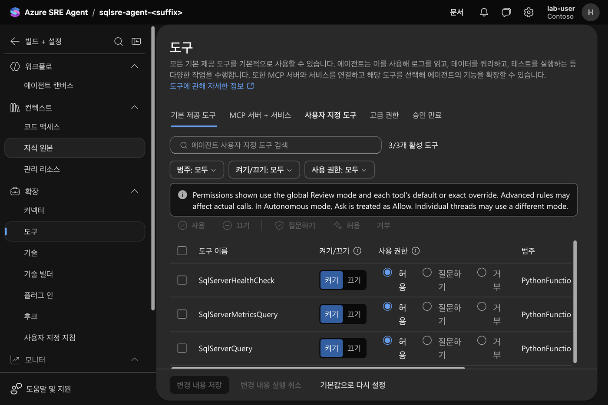
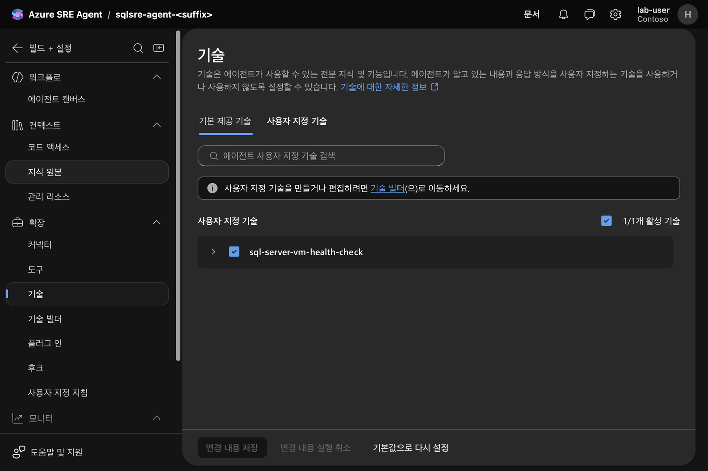
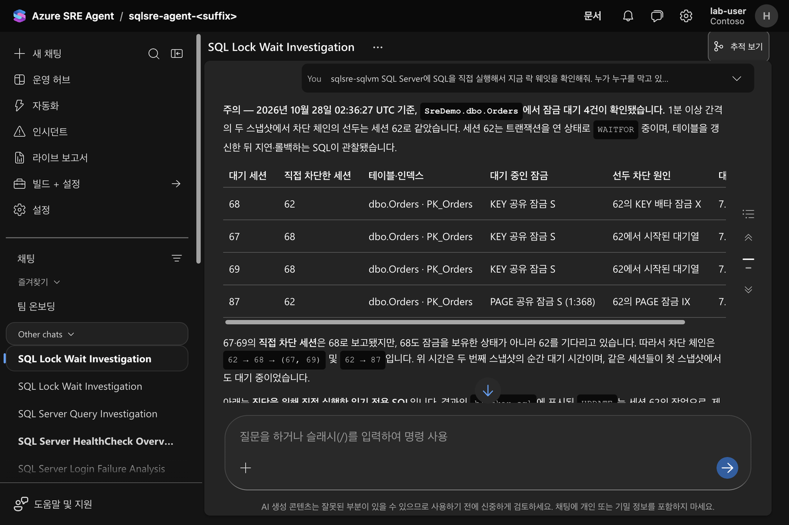
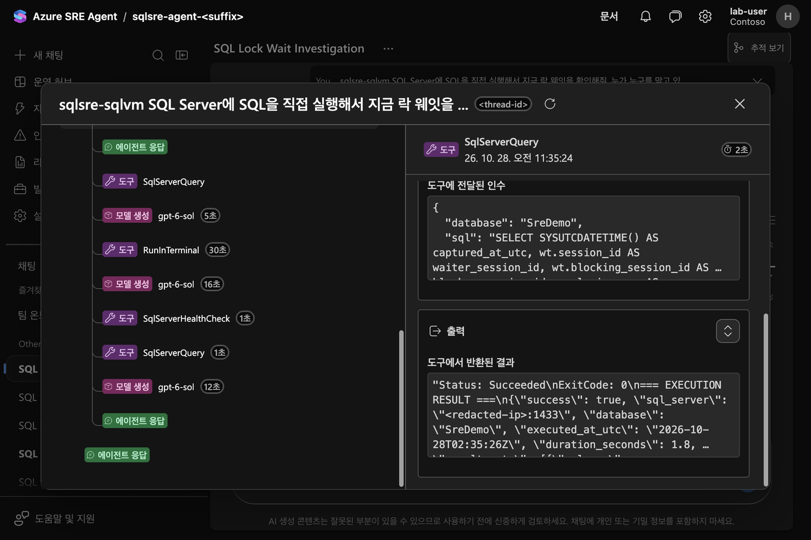
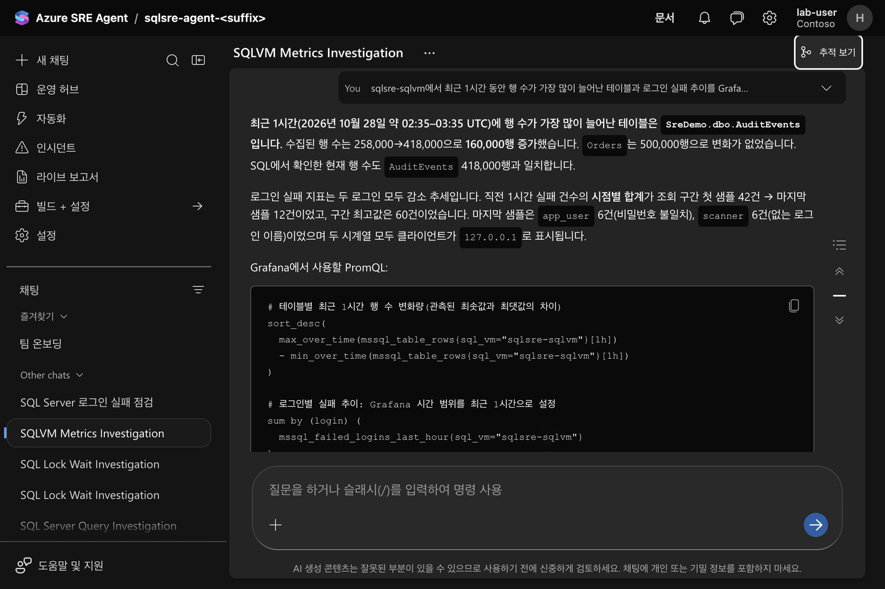
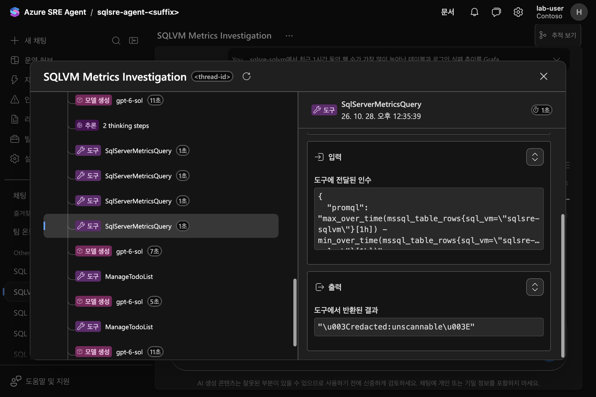
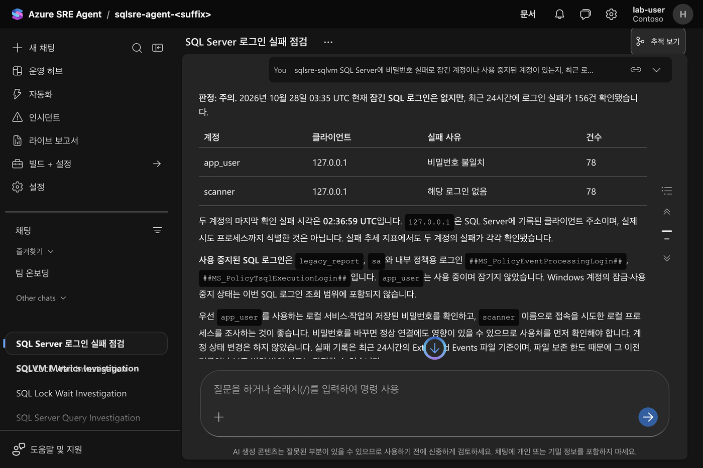
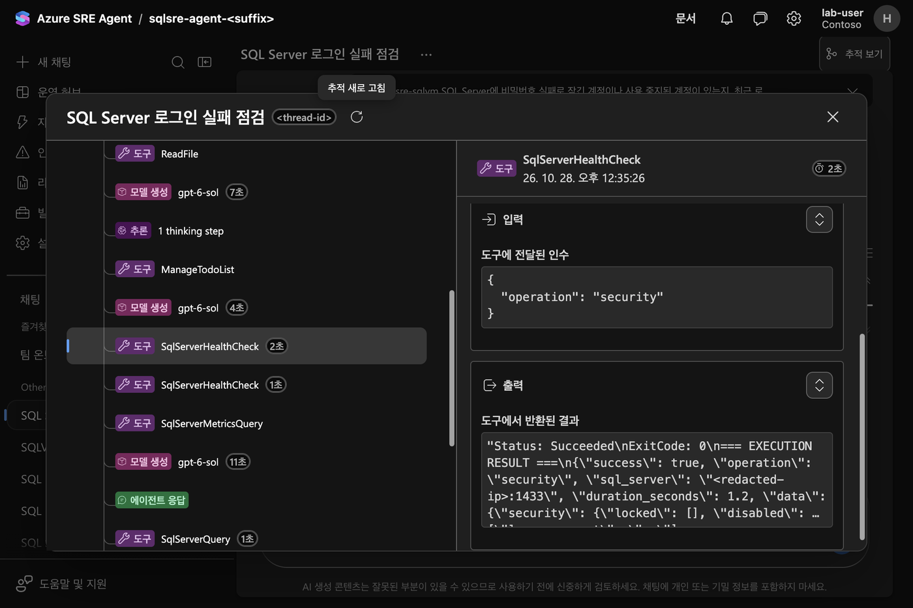

# VNet 통합 Azure SRE Agent로 사설 SQL Server VM 상태 점검하기

이 실습은 Azure SRE Agent를 SQL Server VM과 같은 가상 네트워크에 통합하고,
에이전트가 SQL Server의 사설 IP로 직접 접속해 내부 통계(DMV)를 읽어 상태를
판정할 수 있는지 확인합니다. 단순 상태 확인을 넘어 DBA가 일상적으로 보는 잠금
보유·대기, 장시간 실행 쿼리, 금일 수행 쿼리와 느린 SQL, 비밀번호로 잠긴 계정과
로그인 시도, 스토리지 사용량, 테이블 행 증가량, SQL Agent 작업 실패까지 같은
경로로 점검합니다. SQL Server VM에는 공용 IP가 없고, TCP 1433은
에이전트 위임 서브넷에서 오는 연결만 허용합니다. 에이전트의 Python 도구는
관리 ID로 Private Endpoint 뒤의 Key Vault에서 최소 권한 로그인 비밀번호를 읽은 뒤
TLS로 SQL Server에 접속합니다.

2026-10-27 Korea Central에서 실제로 배포해 확인한 결과는 다음과 같습니다.

- 도구 연결은 에이전트 서브넷의 `10.42.2.5`에서 SQL Server `10.42.1.4:1433`으로
  들어왔고, SQL Server가 보고한 연결 암호화(`encrypt_option`)는 `TRUE`였습니다.
- CPU 부하 상태에서 에이전트는 도구를 12번 호출해 로그 사용률 96%, 백업 기록
  부재, `Orders(CustomerId)` 누락 인덱스, 데이터 파일 쓰기 지연, 최대 서버 메모리
  미설정을 근거로 **주의**를 판정했습니다.
- 잠금 부하 상태에서는 43초 간격의 두 조회로 차단이 지속됨을 확인하고 차단 체인
  `52 → 54 → 56, 51`과 원인 세션 52를 지목했으며, 세션을 종료하지 않았습니다.
- 확장한 점검에서는 세션 77이 `SreDemo.dbo.Orders`에 `IX` 잠금을 잡은 채 대기를
  일으킨 체인 `77 → 80 → 78, 79`, 오늘 22만 회 실행돼 누적 시간 1위인 고객별 집계
  쿼리, `app_user`·`scanner`의 로그인 실패 각 48건, 오늘 두 번 실패한 SQL Agent
  작업과 오류 메시지를 근거와 함께 보고했습니다.
- 에이전트가 직접 작성한 SQL로 `sys.dm_os_waiting_tasks`와 `sys.dm_tran_locks`를
  조회해 `PK_Orders` 키의 `X` 잠금 보유 세션과 `S` 잠금 대기 체인, 선두 세션의 열린
  트랜잭션과 로그 사용량을 실행한 SQL과 함께 보고했습니다. 같은 도구에 `UPDATE`를
  그대로 넘기라는 요청은 도구가 거부해 데이터가 바뀌지 않았습니다.

같은 VM의 지표를 시계열로 보려면 [exporter와 Azure Managed Grafana 실습](../sql-server-vm-grafana/index.md)을
함께 배포합니다. `deploy.sh`가 두 실습을 한 번에 구성합니다.

## VNet 안의 SRE Agent는 세 가지 도구로 SQL Server를 본다


에이전트가 사설 SQL Server를 보는 방법은 여러 가지가 있습니다. Run Command로 VM 안에서
스크립트를 실행하거나, 공용 엔드포인트를 열거나, 로그를 Log Analytics로 보내 KQL로 볼 수도
있습니다. 이 실습은 공용 경로 없이 **VNet 통합 에이전트가 Python 도구로 SQL Server에 직접
접속**하는 방식과 **exporter 지표를 PromQL로 조회**하는 방식을 함께 씁니다.

| 도구 | 방식 | 언제 쓰나 |
| --- | --- | --- |
| `SqlServerHealthCheck` | `pymssql`로 접속해 정해 둔 읽기 쿼리 20종 실행 | 매번 같은 기준으로 보는 점검: 상태 요약, 잠금, 장시간·느린 쿼리, 계정, 스토리지, 작업 |
| `SqlServerQuery` | 에이전트가 직접 쓴 읽기 전용 T-SQL 실행, 항상 롤백 | 정해 둔 점검으로 답이 안 나올 때 DMV를 직접 조회 |
| `SqlServerMetricsQuery` | Azure Monitor workspace에 PromQL 조회 | 추세와 증가량: 1시간 행 증가, 로그인 실패 추이 |

세 도구는 sre.azure.com의 **빌드 + 설정 > 도구 > 사용자 지정 도구**에 Python 도구로
등록되고, 스킬 `sql-server-vm-health-check`가 질문 유형별로 어느 도구를 쓸지 알려 줍니다.





### 직접 SQL로 락 웨잇 확인

채팅에 "SQL을 직접 실행해서 지금 락 웨잇을 확인해줘"라고 물으면 에이전트가
`sys.dm_os_waiting_tasks`와 `sys.dm_tran_locks`를 조인하는 SQL을 직접 작성해 실행하고,
누가 누구를 막는지와 잠긴 테이블·키를 표로 정리합니다.



답변의 **추적 보기**를 열면 실제로 어떤 도구에 어떤 SQL이 전달됐는지 확인할 수 있습니다.



### exporter 지표로 증가량과 추이 확인

"최근 1시간 동안 행 수가 가장 많이 늘어난 테이블과 로그인 실패 추이"처럼 시간에 따른 변화가
필요한 질문은 `SqlServerMetricsQuery`로 Grafana와 같은 지표를 조회합니다.





### 정해 둔 점검으로 계정 상태 확인

잠긴 계정이나 로그인 실패처럼 자주 보는 항목은 `SqlServerHealthCheck`의 `security`,
`login_attempts` operation으로 바로 답합니다.





## 질문할 때만 에이전트 도구가 Key Vault 비밀번호로 SQL Server를 조회

SRE Agent 쪽은 상시 폴링하지 않습니다. 운영자가 질문하면 에이전트가 스킬에 따라
도구를 고르고, 도구가 호출될 때마다 다음 순서로 동작합니다.

1. 도구 코드가 에이전트의 사용자 할당 관리 ID(`sqlsre-agent-<suffix>-id`)로
   `https://vault.azure.net` 토큰을 받습니다.
2. 같은 VNet의 사설 DNS가 Key Vault 이름을 Private Endpoint로 해석하고, 도구는
   비밀 `sql-monitor-password`를 읽습니다. 비밀번호는 도구 코드나 에이전트 구성에
   저장하지 않고, 호출마다 다시 읽어 메모리에서만 씁니다.
3. SQL Server TCP 1433에 TLS 필수로 접속해 읽기 전용 쿼리를 실행하고 연결을
   닫습니다. 연결 애플리케이션 이름은 `sre-agent-health-check` 또는
   `sre-agent-adhoc-query`입니다.

비밀번호는 `configure-sql.sh`가 배포 PC에서 무작위로 만들고, managed Run Command의
보호 매개 변수로 VM에 전달해 `sre_monitor`를 만들거나 비밀번호를 바꾼 뒤, ARM
경로로 Key Vault 비밀에 씁니다. 로컬 파일에는 남기지 않습니다. 스크립트를 다시
실행하면 SQL 로그인과 비밀이 함께 교체되고, 다음 도구 호출부터 새 값을 씁니다.

| 도구 | 실행 시점 | 읽는 대상 | 인증 |
| --- | --- | --- | --- |
| `SqlServerHealthCheck` | 질문할 때 (pull) | 고정 operation 20개의 읽기 쿼리 | `sre_monitor` (Key Vault 비밀번호) |
| `SqlServerQuery` | 질문할 때 (pull) | 에이전트가 쓴 읽기 전용 T-SQL | `sre_monitor` (Key Vault 비밀번호) |
| `SqlServerMetricsQuery` | 질문할 때 (pull) | Azure Monitor workspace의 exporter 시계열 | 에이전트 관리 ID (Monitoring Data Reader) |

exporter 쪽 수집 주기와 항목은 [Grafana 실습](../sql-server-vm-grafana/index.md)에
정리했습니다. VM 안의 sql_exporter는 비밀번호 없이 Windows 인증
(`NT SERVICE\SqlExporterSvc`)으로 접속합니다.

| 결정 | 이유 |
| --- | --- |
| 에이전트를 Azure VNet 모드로 통합 | 이 모드에서는 비플랫폼 아웃바운드 트래픽이 위임 서브넷을 지나며, NSG·사설 DNS·네트워크 로그가 그대로 적용됩니다. |
| 에이전트 전용 /27 서브넷을 `Microsoft.App/environments`에 위임 | Azure VNet 모드의 서브넷 요구 사항입니다. 다른 서비스와 공유할 수 없습니다. |
| SQL 연결 유형 Private, NSG에서 에이전트 서브넷만 1433 허용 | Private 연결은 VNet 안에서 SQL Server에 접속하게 하고 외부용 NSG 규칙을 만들지 않습니다. 같은 VNet의 다른 서브넷도 명시적 거부 규칙으로 막습니다. |
| 에이전트 전용 SQL 로그인 `sre_monitor` | 서버 상태·메타데이터 읽기 권한과 `msdb`의 백업·작업 이력 SELECT만 부여합니다. 사용자 DB에는 연결만 할 수 있고 테이블 데이터는 읽지 못합니다. |
| 비밀번호를 Private Endpoint 전용 Key Vault에 저장 | Python 도구 코드에 비밀을 넣지 않고, 공용 네트워크에서 데이터 평면 접근을 막습니다. |
| TLS 필수(`encryption='require'`)와 `read_only=True` | VNet 내부에서도 자격 증명과 결과를 평문으로 보내지 않습니다. 첫 배포에서는 기본값으로 연결해 `encrypt_option=FALSE`가 관측되었습니다. |
| SQL 드라이버 `pymssql`을 sandbox에 사전 설치 | 도구 정의의 `dependencies`만으로는 Azure VNet 모드에서 설치되지 않았습니다(관측). 공식 `zava-aks-postgres` lab과 같은 방식으로 `sandboxConfiguration.packages`를 씁니다. |
| 고정 점검과 직접 SQL 도구를 분리 | 반복 점검은 `SqlServerHealthCheck`의 고정 `operation`으로 같은 기준을 유지하고, 세부 원인은 `SqlServerQuery`로 에이전트가 쓴 T-SQL을 실행합니다. 직접 SQL도 같은 읽기 전용 로그인으로 실행되며 항상 롤백됩니다. |
| 시점 비교는 exporter 시계열에 맡김 | 행 증가량처럼 과거 값이 필요한 점검은 [Grafana 실습](../sql-server-vm-grafana/index.md)이 쌓는 시계열을 `SqlServerMetricsQuery`로 PromQL 조회합니다. SQL Server에 이력 테이블을 만들지 않습니다. |

## SRE Agent 등록 구독과 서브넷 조인 권한 준비

- Azure SRE Agent를 만들 수 있는 구독. Korea Central은 지원 리전이며,
  sre.azure.com의 **Create agent** 리전 목록이 비어 있으면 구독 등록부터 요청합니다.
- 리소스 그룹과 역할 할당을 만들 수 있는 권한(Owner 또는 Contributor + User
  Access Administrator). 에이전트를 서브넷에 연결하려면 서브넷의
  `Microsoft.Network/virtualNetworks/subnets/join/action` 권한도 필요합니다.
- Azure CLI, `jq`, `openssl`, `curl`, `python3`.
- 에이전트 데이터 평면 호출에 쓰는 `https://azuresre.dev` 대상 토큰을 Azure CLI로
  받을 수 있어야 합니다.

## 시간 단위로 과금되는 VM·NAT Gateway·Private Endpoint와 에이전트 사용량

| 자원 | 과금 특성 |
| --- | --- |
| `Standard_D4s_v5` Windows VM + Premium SSD OS 디스크 | 실행 시간 단위. SQL Server Developer edition이라 SQL 라이선스 비용은 없습니다. |
| NAT Gateway + Standard 공용 IP | 시간 단위와 처리 데이터량 |
| Key Vault Private Endpoint | 시간 단위와 처리 데이터량 |
| Azure SRE Agent | Azure Agent Unit 사용량. 템플릿은 월 한도를 `2000`으로 둡니다. |
| Log Analytics, Application Insights, Key Vault | 사용량 기준. 이 실습에서는 적습니다. |

실습이 끝나면 바로 [정리](#lab-cleanup)를 실행합니다.

## 세 서브넷과 NSG로 1433을 에이전트 서브넷에만 개방

| 서브넷 | 주소 | 용도 | 아웃바운드 |
| --- | --- | --- | --- |
| `snet-sql` | `10.42.1.0/24` | SQL Server VM, 고정 사설 IP `10.42.1.4` | NAT Gateway |
| `snet-agent` | `10.42.2.0/27` | SRE Agent 위임 서브넷 | NAT Gateway |
| `snet-endpoint` | `10.42.3.0/27` | Key Vault Private Endpoint `10.42.3.4` | 없음 |

`snet-sql` NSG의 인바운드 규칙은 다음 두 개입니다. 기본 규칙
`AllowVnetInBound`보다 우선순위가 높아 같은 VNet의 다른 서브넷도 1433에
접근하지 못합니다.

| 우선순위 | 이름 | 원본 | 포트 | 동작 |
| --- | --- | --- | --- | --- |
| 100 | `allow-sql-from-sre-agent` | `10.42.2.0/27` | 1433 | 허용 |
| 200 | `deny-sql-from-other-sources` | `*` | 1433 | 거부 |

모든 서브넷은 `defaultOutboundAccess: false`인 private subnet입니다. SQL VM의
Windows Update·정품 인증과 에이전트의 ARM·Log Analytics 호출은 NAT Gateway로
나갑니다. Key Vault는 `privatelink.vaultcore.azure.net` 사설 DNS 영역을 VNet에
연결하고, 에이전트의 **VNet 사설 DNS 사용**(`usePrivateDnsResolution: true`)으로
사설 IP를 해석합니다.

에이전트 리소스의 네트워크 설정은 다음과 같습니다.

```bicep
vnetConfiguration: {
  subnetResourceId: agentSubnetId
}
sandboxConfiguration: {
  egress: {
    mode: 'AzureVNet'
    allowedHosts: []
    allowedRegistries: [ 'pypi' ]
    allowedCodeRepositories: []
    allowHttpMcpServerNetworkAccess: false
    vnetConfiguration: { usePrivateDnsResolution: true }
  }
  packages: [
    { name: 'pymssql', version: '2.4.5', packageManager: 'pip' }
  ]
}
```

`allowedRegistries`의 `pypi`는 패키지 설치만 에이전트 인프라 네트워크로 보내는
우회 설정입니다. 원격 MCP와 코드 저장소 우회는 끕니다.

## 에이전트 관리 ID는 리소스 그룹 읽기와 Key Vault 비밀 읽기만 보유

| 주체 | 범위 | 역할 |
| --- | --- | --- |
| 에이전트 UAMI·시스템 MI | 실습 리소스 그룹 | Reader, Monitoring Reader, Log Analytics Reader |
| 에이전트 UAMI | Key Vault | Key Vault Secrets User |
| 에이전트 UAMI | Azure Monitor workspace | Monitoring Data Reader (PromQL 조회) |
| 에이전트 UAMI | 에이전트 리소스 | SRE Agent Administrator (공식 템플릿과 동일) |
| 배포한 사용자 | 에이전트 리소스 | SRE Agent Administrator |

에이전트는 VM에서 명령을 실행할 Azure 권한이 없습니다. SQL Server 안에서도
`sre_monitor`는 다음 권한만 가집니다.

```sql
GRANT VIEW SERVER STATE, VIEW ANY DEFINITION, CONNECT ANY DATABASE TO [sre_monitor];
USE msdb;
CREATE USER [sre_monitor] FOR LOGIN [sre_monitor];
GRANT SELECT ON dbo.backupset TO [sre_monitor];
GRANT SELECT ON dbo.sysjobs TO [sre_monitor];
GRANT SELECT ON dbo.sysjobhistory TO [sre_monitor];
```

| 권한 | 필요한 점검 | 근거 |
| --- | --- | --- |
| `VIEW SERVER STATE` | 대기, 요청, 잠금(`sys.dm_tran_locks`), 이벤트 파일 읽기 | 서버 범위 DMV 요구 권한. SQL Server 2022에서는 하위 권한인 `VIEW SERVER PERFORMANCE STATE`를 포함 |
| `VIEW ANY DEFINITION` | 다른 SQL 로그인의 잠금 상태(`sys.sql_logins`), 테이블 이름과 행 수(`sys.dm_db_partition_stats`), 파일 목록 | `sys.sql_logins`는 자신과 `sa` 외 로그인을 보려면 추가 권한이 필요하고, `sys.dm_db_partition_stats`는 성능 상태와 보안 정의 권한을 함께 요구 |
| `CONNECT ANY DATABASE` | 사용자 DB의 Query Store와 테이블 메타데이터 | 현재·미래의 모든 DB에 연결만 허용. 데이터 읽기 권한은 주지 않음 |
| `msdb` 세 테이블 SELECT | 마지막 백업, SQL Agent 작업 목록과 실행 이력 | 백업·작업 이력은 `msdb` 테이블에만 있음 |

SQL Server 2022의 세분화된 권한(`VIEW SERVER PERFORMANCE STATE`,
`VIEW ANY PERFORMANCE DEFINITION`)만으로 시험했을 때는 `sys.dm_db_partition_stats`에서
테이블 이름을 얻지 못했습니다(관측). 그래서 위 조합으로 정했고, 같은 VM에서
`sre_monitor`로 테이블 데이터를 SELECT하면 권한 오류가 나는 것을 확인했습니다.

## deploy.sh 한 번으로 인프라·SQL 준비·도구 등록 완료

sample은 [samples/sqlvm-health-lab](https://github.com/hellices/devguidesample/tree/main/docs/services/azure-monitor/azure-sre-agent/samples/sqlvm-health-lab)에 있습니다.

```bash
cd docs/services/azure-monitor/azure-sre-agent/samples/sqlvm-health-lab
./scripts/deploy.sh rg-sqlvm-sre-lab koreacentral
```

1. `infra/main.bicep`을 구독 범위로 배포합니다. VNet·NSG·NAT Gateway, SQL Server
   2022 Developer on Windows Server 2022(`MicrosoftSQLServer:sql2022-ws2022:sqldev-gen2`),
   SQL IaaS Agent 등록(Private, 1433), Key Vault와 Private Endpoint·사설 DNS,
   Log Analytics·Application Insights, 에이전트 UAMI와 VNet 통합
   `Microsoft.App/agents`, 역할 할당을 만듭니다.
2. `scripts/configure-sql.sh`가 VMAccess로 로컬 관리자 비밀번호를 일회용 값으로
   재설정하고, managed Run Command를 그 계정으로 실행해 다음을 처리합니다.
   - SQL Server 인증 모드를 혼합 모드로 바꾸고 서비스를 한 번 재시작
   - `sre_monitor` 로그인 생성 또는 비밀번호 교체와 권한 부여
   - `SreDemo` DB(FULL 복구 모델, 50만 행 `dbo.Orders`, `CustomerId` 인덱스 없음,
     증가 관찰용 `dbo.AuditEvents`) 생성
   - `configure-checks.ps1`: 로그인 감사용 Extended Events 세션 `sre_login_audit`,
     점검 대상 데모 로그인, 데모 SQL Agent 작업 생성(아래 표)

   이어서 `sre_monitor` 비밀번호를 ARM(`management.azure.com`) 경로로 Key Vault
   비밀 `sql-monitor-password`에 씁니다. Key Vault 방화벽은 데이터 평면에만
   적용되므로 공용 액세스가 꺼진 상태에서도 제어 평면으로 비밀을 만들 수
   있습니다. 일회용 관리자 비밀번호는 저장하지 않습니다.
3. `scripts/apply-agent-config.sh`가 에이전트 데이터 평면에 Python 도구와 스킬을
   등록합니다.

| `configure-checks.ps1`이 만드는 대상 | 점검 목적 |
| --- | --- |
| XE 세션 `sre_login_audit`: `error_reported`(오류 18456)와 풀 재사용이 아닌 `login`(`is_cached = 0`) 이벤트, 오류 로그 폴더의 `event_file` 대상(10MB × 4개) | 로그인 실패·성공의 계정, 클라이언트 주소, 호스트, 애플리케이션 |
| `app_user` (`CHECK_POLICY = ON`) | 잘못된 비밀번호로 잠기는 계정. SQL 로그인은 Windows 계정 잠금 정책을 따르며, 이 VM은 임계값 10회·잠금 10분(관측) |
| `legacy_report` (`DISABLE`) | 사용 중지 계정 |
| SQL Agent 작업 `sre-demo-nightly-check`(30분마다 실패), `sre-demo-update-stats`(매시 성공) | 작업 실패와 오류 메시지 |

| 등록 대상 | 데이터 평면 요청 |
| --- | --- |
| `SqlServerHealthCheck`, `SqlServerQuery`, `SqlServerMetricsQuery` (`PythonFunctionTool`) | `PUT /api/v1/extendedAgent/apply`, `ToolList` 본문, `application/x-yaml` |
| `sql-server-vm-health-check` 스킬 | `PUT /api/v2/extendedAgent/skills/{name}` |

두 경로는 공식 `microsoft/sre-agent` 저장소의 lab 스크립트 방식을 따릅니다.
도구 코드의 `@@SQL_HOST@@`, `@@KEY_VAULT_NAME@@`, `@@AGENT_CLIENT_ID@@`,
`@@PROMETHEUS_QUERY_ENDPOINT@@` 같은 값은 등록 직전에 `scripts/render_agent_config.py`가 채웁니다. 등록 응답은
HTTP 202이므로, 도구를 바꾼 직후 호출하면 이전 버전이 실행될 수 있습니다.
`GET /api/v1/extendedAgent/tools`로 반영을 확인한 뒤 새 대화에서 호출합니다.

## CPU·잠금·장시간 쿼리·로그인 실패·행 증가 부하 주입

```bash
./scripts/generate-load.sh cpu 20        # CustomerId 조건 전체 스캔 6개 세션
./scripts/generate-load.sh blocking 6    # 값을 바꾼 UPDATE 후 50초 잠금 유지 + 읽기 세션 3개
./scripts/generate-load.sh longrun 15    # Note LIKE '%x%' 전체 스캔을 반복하는 요청 1개
./scripts/generate-load.sh badlogin 15   # app_user 비밀번호 오류(10회 후 잠김) + 없는 로그인 scanner
./scripts/generate-load.sh growth 60     # 30초마다 dbo.AuditEvents에 2,000행 추가
```

부하는 VM의 `SreDemoLoad-<mode>` 예약 작업으로 실행되므로 Run Command가 끝난 뒤에도
지정한 시간 동안 계속됩니다. 여러 모드를 동시에 실행할 수 있습니다.

## 질문마다 정해진 읽기 전용 operation과 exporter 지표로 답변

스킬은 질문 유형별로 호출할 `operation`을 정해 둡니다. 같은 항목을
[Grafana 실습](../sql-server-vm-grafana/index.md)의 exporter도 수집하므로, 에이전트는
현재 상태를 SQL로 확인하고 추이는 `SqlServerMetricsQuery`로 조회합니다.

| 점검 | `SqlServerHealthCheck` operation | 읽는 원본 | exporter 지표 (Grafana 행) |
| --- | --- | --- | --- |
| 전반 상태 | `summary` → `cpu`, `waits`, `memory`, `databases`, `backups`, `io`, `missing_indexes` | 링 버퍼, 대기 통계, 성능 카운터, `msdb.dbo.backupset` | `mssql_cpu_percent`, `mssql_wait_time_seconds_total` 등 (요약~I/O) |
| 잠금 보유·대기 | `locks` | `sys.dm_tran_locks`, `sys.dm_exec_requests`, `sys.partitions` | `mssql_locks`, `mssql_blocking_wait_seconds` (잠금 상세) |
| 장시간 실행 쿼리 | `long_running` (30초 이상) | `sys.dm_exec_requests`, `sys.dm_exec_sql_text` | `mssql_long_running_request_seconds` (세션·장시간 쿼리) |
| 금일 수행 쿼리 | `today_queries` (UTC 자정 이후, `query_hash` 단위) | 각 사용자 DB의 Query Store | `mssql_query_today_*` (금일 쿼리) |
| 느린 SQL·회귀 | `slow_queries` (평균 500ms 이상 또는 직전 7일 평균의 2배 이상) | Query Store 실행 통계 | `mssql_query_today_avg_duration_seconds` |
| 잠긴·사용 중지·만료 계정, sysadmin | `security` | `sys.sql_logins`, `LOGINPROPERTY`, 서버 역할 | `mssql_sql_login_*`, `mssql_sysadmin_member` (보안·접속) |
| 로그인 시도 | `login_attempts` (최근 24시간) | XE 세션 `sre_login_audit`의 이벤트 파일 | `mssql_failed_logins_last_hour`, `mssql_successful_logins_last_hour` |
| 스토리지 | `storage` | `sys.dm_os_volume_stats`, 각 DB의 `sys.database_files`와 `FILEPROPERTY` | `mssql_volume_*`, `mssql_db_file_*` (스토리지) |
| 테이블 행 증가 | `table_growth` + `SqlServerMetricsQuery`의 `delta(mssql_table_rows[1h])` | `sys.dm_db_partition_stats` | `mssql_table_rows`, `mssql_table_reserved_bytes` (테이블 증가) |
| SQL Agent 작업 | `jobs` | `sys.dm_server_services`, `msdb.dbo.sysjobs`·`sysjobhistory` | `mssql_agent_running`, `mssql_job_*` (SQL Agent 작업) |

사용자 DB를 순회하는 operation은 DB마다 `EXEC [db].sys.sp_executesql`로 같은
읽기 쿼리를 실행합니다. Query Store는 SQL Server 2022에서 새 DB에 기본으로
`READ_WRITE` 모드로 켜지므로 `SreDemo`는 별도 설정이 없습니다. 이전 버전에서
만든 DB는 Query Store를 켜야 `today_queries`와 `slow_queries`가 결과를 냅니다.
도구와 exporter가 실행한 점검 쿼리 자체는 Query Store 결과에서 제외합니다.

## 고정 점검으로 답하지 못하는 질문은 SqlServerQuery로 SQL을 직접 실행

락 웨잇의 대기 리소스나 특정 DB의 인덱스 사용 통계처럼 고정 `operation`에 없는
항목은 에이전트가 T-SQL을 작성해 `SqlServerQuery`로 실행합니다. 매개 변수는
`sql`(배치 하나), `database`(DB 문맥, 기본 `master`), `max_rows`(1~1000, 기본 200),
`timeout_seconds`(5~120, 기본 30)입니다. 읽기 전용은 세 층으로 보장합니다.

| 층 | 동작 |
| --- | --- |
| SQL Server 권한 (기본 경계) | `sre_monitor`는 서버 상태와 메타데이터만 읽습니다. 같은 로그인으로 쓰기를 시도하면 `UPDATE`는 오류 229, `ALTER LOGIN`은 15151, `CREATE TABLE`은 262로 거부됩니다(관측). |
| 도구의 문장 검사 | 주석·문자열·구분 식별자를 지운 뒤 `INSERT`·`UPDATE`·`DELETE`·`MERGE`·DDL·`GRANT`·`KILL`·`BACKUP`·`USE`·`WAITFOR`·트랜잭션 제어·`EXEC`·`DBCC`·`OPENROWSET`을 거부합니다. 예외는 임시 테이블(`#t`, `@t`), `sp_who2`·`sp_lock`·`sp_helpdb`·`sp_spaceused` 같은 조회 프로시저, `DBCC SQLPERF`·`INPUTBUFFER`·`OPENTRAN`·`SHOW_STATISTICS`입니다. 첫 문장은 `SELECT`, `WITH`, `SET`, `DECLARE`, `IF`, `BEGIN TRY` 등으로 시작해야 합니다(첫 문장의 프로시저 이름만으로 실행되는 것을 막음). |
| 실행 환경 | 자동 커밋을 끈 트랜잭션에서 실행하고 끝나면 항상 롤백합니다. `LOCK_TIMEOUT 5000`, `DEADLOCK_PRIORITY LOW`, 쿼리 시간 제한, 결과 집합 5개·행 수·셀 1,000자 제한을 둡니다. 연결 애플리케이션 이름은 `sre-agent-adhoc-query`라 SQL Server 세션과 로그인 감사에서 구분됩니다. |

문장 검사는 실수와 잘못된 지시를 일찍 막는 보조 장치이고, 실제 경계는 로그인
권한입니다. 그래서 쓰기 권한이나 사용자 데이터 읽기 권한을 이 로그인에 추가하지
않습니다. 오류가 나면 도구는 SQL Server 오류 번호와 메시지를 그대로 돌려주고,
스킬은 에이전트가 쿼리를 고쳐 다시 실행하도록 안내합니다. 스킬에는 잠금 대기,
세션별 보유 잠금, 열린 트랜잭션과 로그 사용량, 메모리 grant와 tempdb 사용량 참고
쿼리를 넣었습니다. 단위 테스트가 이 참고 쿼리들이 문장 검사를 통과하는지
확인하고, VM에서도 `sre_monitor` 권한으로 모두 실행되는 것을 확인했습니다.

2026-10-27 23:15 UTC, `blocking` 부하 중에 두 대화로 확인한 결과입니다.

| 요청 | 에이전트가 실행한 내용 | 결과 |
| --- | --- | --- |
| SQL을 직접 실행해 지금 락 웨잇, 차단 세션의 열린 트랜잭션과 로그 사용량, 실행한 SQL을 보여 달라 | `sys.dm_os_waiting_tasks` ⨝ `sys.dm_tran_locks`(`lock_owner_address = resource_address`), 열린 트랜잭션 조회, `SreDemo` 문맥의 `sys.partitions` 조회 | 체인 `78 → 82 → 80, 81`. 세션 78이 `PK_Orders` 키(HoBT `72057594045726720`)에 `X`/`GRANT`, 나머지는 같은 키에 `S`/`WAIT`로 약 14초 대기. 세션 78의 트랜잭션 로그 사용 120,128바이트, 로그 레코드 1,001개. 두 스냅샷에서 트랜잭션 시작 시각이 달라 한 트랜잭션이 아니라 반복되는 차단으로 판정 |
| `UPDATE SreDemo.dbo.Orders ...`를 그대로 실행하고, 테이블 행 수와 인덱스 사용 통계를 조회하라 | `UPDATE` 전달 후 `database=SreDemo`로 `sys.dm_db_partition_stats`, `sys.dm_db_index_usage_stats` 조회 | `UPDATE`는 도구가 거부해 실행되지 않음. `Orders` 500,000행·`PK_Orders` scan 70,944회, `AuditEvents` 240,000행을 실행한 SQL과 함께 보고 |

## 연결 출처 10.42.2.5와 TLS 적용을 SQL Server가 직접 보고

SQL Server가 보는 도구 연결 정보를 `overview` 결과에 포함했습니다. 에이전트에게
값만 그대로 보여 달라고 요청한 결과입니다.

| 필드 | 값 |
| --- | --- |
| `success` | `true` |
| `sql_server` | `10.42.1.4:1433` |
| `data.overview.tool_client_address` | `10.42.2.5` (`snet-agent`) |
| `data.overview.tool_connection_encrypted` | `TRUE` |

## CPU 부하에서 로그·백업·인덱스 근거로 주의 판정

sre.azure.com에서 에이전트 채팅을 열고 다음처럼 요청합니다.

```text
sql-server-vm-health-check 스킬을 사용해서 SQL Server VM(sqlsre-sqlvm)의 상태를
점검해줘. SqlServerHealthCheck 도구로 summary를 먼저 조회하고, 이상 신호가 있으면
필요한 항목을 추가로 조회한 뒤 결론·근거·권고를 정리해줘.
```

에이전트는 `summary`, `cpu`, `waits`, `io`, `backups`, `databases`,
`missing_indexes`, `overview`, `top_queries`, `memory`, `active_requests`(2회)를
호출했습니다.

| 영역 | 에이전트가 제시한 근거 | 판단 |
| --- | --- | --- |
| 로그·백업 | `SreDemo` FULL 복구 모델, 로그 사용률 96%, 전체·로그 백업 기록 없음 | 용량과 복구 가능성 우선 확인 |
| CPU·쿼리 | SQL CPU 95~98% 구간 뒤 63~74%, `CustomerId` 조회 실행당 평균 14,762 논리 읽기 | 쿼리 최적화 검토 |
| 인덱스 | `Orders(CustomerId)` 누락 인덱스 사용 107,649회 | 실행 계획 확인 후 검토 |
| 차단·메모리 | 약 39초 간격 두 조회에서 차단 0건, 메모리 grant 대기 0 | 현재 압박 없음 |
| I/O·설정 | `SreDemo` 데이터 파일 누적 평균 쓰기 지연 361.56ms, 최대 서버 메모리 미설정 | 재측정과 상한 계획 |

에이전트는 `log_reuse_wait`가 `NOTHING`이라 백업 부재만으로 로그 사용률의 원인을
단정하지 않았고, 통계가 서버 시작 후 약 175분 누적값이라는 한계도 밝혔습니다.

## 잠금 부하에서 차단 체인과 원인 세션 지목

```text
sqlsre-sqlvm에서 지금 쿼리가 멈춘 것 같다는 제보가 있어. sql-server-vm-health-check
스킬로 차단(blocking) 여부를 확인하고 blocking chain과 원인 세션을 알려줘.
변경 작업은 하지 말고 권고만 해줘.
```

| 항목 | 에이전트가 확인한 결과 |
| --- | --- |
| 판정 | 위험. 43초 간격 두 조회 모두 `SreDemo` SELECT 3개가 `LCK_M_S`로 약 45초 대기 |
| 차단 체인 | `52 → 54 → 56, 51` |
| 원인 | 세션 52(`sre-demo-load`, 열린 트랜잭션 1개)가 `Orders`를 UPDATE한 뒤 트랜잭션 안에서 `WAITFOR DELAY` 실행 |
| 권고 | 의도된 작업인지 확인하고 대기를 트랜잭션 밖으로 이동. 세션 종료는 롤백 영향 때문에 영향 확인 전 시행하지 않음 |

호출은 `summary`와 `active_requests` 2회였고, 변경 작업은 없었습니다.

## 확장 점검에서 잠금 보유 세션·느린 SQL·로그인 실패·작업 실패를 근거로 보고

부하를 함께 실행한 상태에서 질문별로 새 대화를 열어 확인했습니다. 시각은 모두
2026-10-27 UTC입니다.

| 질문 | 에이전트 호출 | 보고 내용 |
| --- | --- | --- |
| 지금 잠금 상태, 어떤 세션이 어떤 테이블을 잡고 누가 기다리는지 (17:47, `blocking`) | `locks` 2회(45초 간격), `active_requests` | 세션 77이 `SreDemo.dbo.Orders`에 `IX` 잠금과 열린 트랜잭션 1개를 보유하고 `WAITFOR` 중. 세션 80이 `KEY` `S` 잠금을 약 40초 대기, 78·79는 80을 대기. 체인 `77 → 80 → 78, 79`. 세션 종료 없이 트랜잭션 축소와 RCSI 검토를 권고 |
| 오래 도는 쿼리와 잠금 (16:49, `longrun`) | `long_running` 2회, `locks` 2회, `active_requests`, `waits` | 세션 78의 `Note LIKE '%x%'` 집계가 514초 실행, CPU 262초, 논리 읽기 약 310만. 잠금 대기는 0건이라 차단이 아니라 비효율 쿼리로 판정 |
| 오늘 수행된 쿼리와 지연 SQL (16:49) | `today_queries`, `slow_queries`, `waits`, `missing_indexes`, `active_requests` | 고객별 집계 227,499회·평균 92.2ms로 누적 시간 1위, `Note` 검색이 평균 2,411ms로 건당 1위, 평균 2.2ms 쿼리의 최대 50초 이상치. 문장 변형 19,997개를 근거로 매개변수화와 `CustomerId` 인덱스 검토를 권고 |
| 잠긴·사용 중지 계정과 로그인 실패 (17:47, `badlogin` 후) | `security`, `SqlServerMetricsQuery` | 사용 중지 `legacy_report`, `sa`. 잠긴 계정 없음(`app_user`는 10분 잠금 해제 뒤). 실패는 `app_user`(비밀번호 불일치)와 `scanner`(없는 로그인) 각 48건, `127.0.0.1`. `mssql_failed_logins_last_hour`도 각 48건으로 일치 |
| 스토리지, 1시간 행 증가, SQL Agent 실패 (16:49, `growth`) | `storage`, `table_growth`, `jobs`, `SqlServerMetricsQuery`(행 증가·1시간 전 값·볼륨·파일 사용률) | C: 사용률 21.8%, `SreDemo` 데이터 파일 91.7%(자동 증가 64MB). `AuditEvents` 0→30,000행 증가가 보였지만 1시간 전 샘플이 없어 확정하지 않음. `sre-demo-nightly-check`가 16:08·16:30에 `3 orphan orders found`(오류 50000)로 실패 |

에이전트는 매번 집계 범위와 한계를 함께 밝혔습니다. 예를 들어 Query Store의
기준선이 오늘 하루뿐이라 회귀 여부를 확정하지 않았고, 이벤트 파일은 풀에서
재사용된 연결을 기록하지 않는다고 설명했습니다.

## 연결 출처·TLS·판정·무변경 조건을 모두 만족하면 통과

| 확인 항목 | 통과 기준 |
| --- | --- |
| VNet 경로 | `overview.tool_client_address`가 `snet-agent` 범위(`10.42.2.0/27`) |
| 암호화 | `overview.tool_connection_encrypted`가 `TRUE` |
| 네트워크 격리 | VM 공용 IP 없음, `snet-sql` NSG가 1433을 `snet-agent`에만 허용, Key Vault `publicNetworkAccess: Disabled` |
| 도구 실행 | 모든 호출이 `success: true`이고 `section_errors` 없음 |
| CPU 부하 판정 | 로그·백업·누락 인덱스·CPU 근거를 제시 |
| 잠금 부하 판정 | 두 번 이상 조회해 지속 차단을 확인하고 `head_blockers` 세션과 잠긴 테이블을 지목 |
| 확장 점검 | 장시간 쿼리, 금일·느린 쿼리, 잠긴·사용 중지 계정, 로그인 실패, 스토리지, 행 증가, 작업 실패 질문에 각 operation 결과를 근거로 답하고, Grafana 지표와 값이 일치 |
| 데이터 비노출 | `sre_monitor`로 사용자 테이블을 SELECT하면 오류 229(권한 거부) |
| 직접 SQL | `SqlServerQuery`가 락 웨잇 같은 DMV 조회는 결과를 반환하고, `UPDATE`·DDL·`EXEC` 같은 변경 문장은 실행 전에 거부 |
| 운영 안전 | 에이전트가 인덱스 생성, 세션 종료, 설정 변경을 실행하지 않음 |

네트워크 격리는 다음 명령으로 확인합니다.

```bash
az vm list-ip-addresses -g rg-sqlvm-sre-lab -n sqlsre-sqlvm \
  --query "[0].virtualMachine.network.publicIpAddresses" -o tsv   # 빈 출력
az network nsg rule list -g rg-sqlvm-sre-lab --nsg-name sqlsre-nsg -o table
az keyvault show -n <key-vault-name> --query properties.publicNetworkAccess -o tsv  # Disabled
```

## 리소스 그룹 삭제와 Key Vault 제거로 정리 완료 { #lab-cleanup }

```bash
./scripts/cleanup.sh
```

리소스 그룹(VM, NAT Gateway, Private Endpoint, 에이전트 포함)을 삭제하고
soft-delete 상태의 Key Vault를 영구 삭제한 뒤 로컬 `.lab-state.json`을 지웁니다.
`az group exists -n rg-sqlvm-sre-lab`이 `false`를 반환하면 정리가 끝난 것입니다.

## 배포·실행 중 만난 오류와 대응

| 증상 | 원인 | 대응 |
| --- | --- | --- |
| 도구가 `pymssql is not installed` 반환, 에이전트는 판정 불가 보고 | 도구 정의의 `dependencies`가 Azure VNet 모드에서 설치되지 않음(관측) | `sandboxConfiguration.packages`로 `pymssql`을 sandbox에 사전 설치합니다. |
| SQL Server에서 도구 연결의 `encrypt_option`이 `FALSE` | `pymssql` 기본 암호화 설정 `request`로는 TLS가 협상되지 않음(관측) | `tds_version='7.4'`, `encryption='require'`를 지정합니다. |
| 도구를 바꾼 직후 새 필드가 결과에 없음 | 도구 등록 API가 비동기(HTTP 202)로 반영됨 | 저장된 도구 코드를 조회해 반영을 확인한 뒤 새 대화에서 호출합니다. |
| Key Vault를 공용 액세스로 만들었는데 `Disabled`로 바뀜 | 테넌트 수준 보안 통제가 공용 액세스를 끔(이 실습 구독에서 관측) | 처음부터 공용 액세스를 끄고 Private Endpoint와 사설 DNS로만 접근합니다. 비밀 쓰기는 ARM 제어 평면을 씁니다. |
| `az deployment sub create`가 끝났는데 배포는 계속 `Running` | SQL IaaS Agent 등록이 오래 걸림 | `deploy.sh`는 `--no-wait` 후 `az deployment sub wait`로 최종 상태를 확인합니다. |
| 재배포 뒤 SQL 로그인 `Login failed` | 연결 유형이 같으면 SQL IaaS Agent가 바뀐 SQL 인증 비밀번호를 다시 적용하지 않음(관측) | SQL IaaS Agent의 SQL 인증 설정을 쓰지 않고, 설정 스크립트가 매번 `sre_monitor` 비밀번호를 교체해 Key Vault에 씁니다. |
| 잠금 부하에서 차단이 보이지 않음 | `SET Status = Status`는 값이 바뀌지 않아 충돌 잠금이 유지되지 않음 | 부하 스크립트는 실제 값을 바꾼 뒤 롤백합니다. |
| 에이전트가 "잠금 보유 세션과 테이블을 확정할 수 없다"고 보고 | 잠금 요약이 DB·모드별 개수만 반환 | `locks`에 세션별 테이블 잠금(`held_table_locks`)을 추가하고, `KEY`·`PAGE`·`RID` 잠금은 `sys.partitions.hobt_id`로 테이블 이름을 찾습니다. |
| 에이전트가 계정 상태 결과가 잘려 잠긴 계정 여부를 확정하지 못함 | 긴 도구 결과의 앞부분이 잘림(관측) | `security`가 `locked`, `disabled` 같은 결론 목록을 먼저 반환하고 빈 값을 제거합니다. |
| 로그인 실패가 있었는데 0건 | `ring_buffer` 대상의 XML이 `truncated=1`로 잘려 새 이벤트가 빠짐(관측) | `event_file` 대상으로 바꾸고 `sys.fn_xe_file_target_read_file`로 읽습니다. |
| 이벤트 파일을 `timestamp_utc > ...`로 거르면 0건 | 같은 조건을 `CASE`로 세면 287건인데 `WHERE`에서는 0건(SQL Server 2022, 관측) | 공식 예제처럼 `CAST(timestamp_utc AS datetime2(7))`로 비교합니다. |
| 이벤트 XML을 읽는 쿼리가 오류 1934 | XML 데이터 형식 메서드는 `QUOTED_IDENTIFIER ON`이 필요한데 드라이버 세션 기본값이 아님 | 쿼리 앞에 `SET QUOTED_IDENTIFIER ON;`을 둡니다. |
| 로그인 실패가 두 배로 집계 | 실패 한 번에 오류 18456 이벤트가 두 번 발생. 오류 로그용 메시지에만 `[CLIENT: ...]`가 있음 | 메시지에 `[CLIENT: ...]`가 있는 이벤트만 셉니다. |
| 금일 상위 쿼리에 점검 쿼리가 나옴 | exporter와 도구가 DB마다 실행하는 메타데이터 쿼리도 Query Store에 기록됨 | `query_store_runtime_stats`, `dm_db_partition_stats`, `sys.database_files`를 포함한 문장을 제외합니다. |
| 관리자 RunAs 스크립트가 출력 없이 `System error ... 'Incorrect function.'` | 스크립트가 종료 코드 1로 끝나면 managed Run Command가 이 메시지만 반환(관측) | 스크립트를 `try`/`catch`로 감싸 `C:\SreLab`에 로그를 남기고, SYSTEM으로 실행한 별도 Run Command로 로그를 읽습니다. |
| 실습 중 VM이 `Deallocated`로 바뀜 | 실습과 무관한 구독 자동화(서비스 주체)가 VM 할당을 해제함(활동 로그에서 관측) | `az vm start`로 시작합니다. SQL Server, exporter 서비스, Prometheus 예약 작업은 자동으로 다시 시작됩니다. |

## 공식 참고 자료

- [Azure SRE Agent network integration](https://learn.microsoft.com/azure/sre-agent/network-integration):
  세 가지 egress 모드, Azure VNet 모드의 트래픽 경로, 서브넷 요구 사항(/27 이상,
  `Microsoft.App/environments` 위임, 같은 리전, 전용), 사전 설치 패키지, 우회 설정
- [Configure network controls](https://learn.microsoft.com/azure/sre-agent/configure-network-controls):
  서브넷 조인 권한, VNet 사설 DNS 사용, Private Endpoint용 사설 DNS 영역 연결
- [Python tools in Azure SRE Agent](https://learn.microsoft.com/azure/sre-agent/python-code-execution):
  관리 ID 인증과 최대 900초 실행 제한
- [Agent permissions in Azure SRE Agent](https://learn.microsoft.com/azure/sre-agent/permissions)
- [Supported regions for Azure SRE Agent](https://learn.microsoft.com/azure/sre-agent/supported-regions)
- [Deploy with infrastructure as code in Azure SRE Agent](https://learn.microsoft.com/azure/sre-agent/deploy-iac)
- [Connect to a SQL Server virtual machine on Azure](https://learn.microsoft.com/azure/azure-sql/virtual-machines/windows/ways-to-connect-to-sql):
  Public·Private·Local 연결 유형과 Private의 NSG 동작
- [Provision SQL Server on Azure VM (Azure portal)](https://learn.microsoft.com/azure/azure-sql/virtual-machines/windows/create-sql-vm-portal):
  로컬 관리자 계정으로 Windows 인증 접속
- [sys.dm_os_wait_stats (Transact-SQL)](https://learn.microsoft.com/sql/relational-databases/system-dynamic-management-views/sys-dm-os-wait-stats-transact-sql):
  `VIEW SERVER STATE` 요구, 엔진 시작 이후 누적
- [sys.dm_tran_locks (Transact-SQL)](https://learn.microsoft.com/sql/relational-databases/system-dynamic-management-objects/sys-dm-tran-locks-transact-sql):
  `GRANT`·`WAIT` 요청 상태, 리소스 유형별 `resource_associated_entity_id`와 `sys.partitions.hobt_id`
- [sys.dm_os_waiting_tasks (Transact-SQL)](https://learn.microsoft.com/sql/relational-databases/system-dynamic-management-objects/sys-dm-os-waiting-tasks-transact-sql):
  대기 작업, 차단 세션, `resource_address`, SQL Server 2022의 `VIEW SERVER PERFORMANCE STATE` 요구
- [SET LOCK_TIMEOUT (Transact-SQL)](https://learn.microsoft.com/sql/t-sql/statements/set-lock-timeout-transact-sql):
  밀리초 단위 잠금 대기 제한
- [Monitor performance by using the Query Store](https://learn.microsoft.com/sql/relational-databases/performance/monitoring-performance-by-using-the-query-store):
  SQL Server 2022 새 DB의 기본 `READ_WRITE` 모드
- [GRANT Server Permissions (Transact-SQL)](https://learn.microsoft.com/sql/t-sql/statements/grant-server-permissions-transact-sql):
  `CONNECT ANY DATABASE`, `VIEW ANY DEFINITION`, `VIEW SERVER STATE`의 범위와 SQL Server 2022 세분화 권한
- [sys.sql_logins (Transact-SQL)](https://learn.microsoft.com/sql/relational-databases/system-catalog-views/sys-sql-logins-transact-sql),
  [LOGINPROPERTY (Transact-SQL)](https://learn.microsoft.com/sql/t-sql/functions/loginproperty-transact-sql),
  [Password policy](https://learn.microsoft.com/sql/relational-databases/security/password-policy):
  다른 로그인을 보는 권한, `IsLocked`·`BadPasswordCount`, `CHECK_POLICY`와 Windows 계정 잠금 정책
- [sys.fn_xe_file_target_read_file (Transact-SQL)](https://learn.microsoft.com/sql/relational-databases/system-functions/sys-fn-xe-file-target-read-file-transact-sql):
  기본 로그 폴더 상대 경로, `timestamp_utc`와 `CAST` 예제, SQL Server 2022 권한
- [SET QUOTED_IDENTIFIER (Transact-SQL)](https://learn.microsoft.com/sql/t-sql/statements/set-quoted-identifier-transact-sql):
  XML 데이터 형식 메서드 호출 조건
- [sys.dm_db_partition_stats (Transact-SQL)](https://learn.microsoft.com/sql/relational-databases/system-dynamic-management-objects/sys-dm-db-partition-stats-transact-sql):
  행 수 출처와 요구 권한
- [Query Prometheus metrics using the API and PromQL](https://learn.microsoft.com/azure/azure-monitor/metrics/prometheus-api-promql):
  `https://prometheus.monitor.azure.com` 토큰과 Monitoring Data Reader
- [Integrate Key Vault with Azure Private Link](https://learn.microsoft.com/azure/key-vault/general/private-link-service):
  `privatelink.vaultcore.azure.net`과 공용 액세스 비활성화
- [Configure network security for Azure Key Vault](https://learn.microsoft.com/azure/key-vault/general/network-security):
  방화벽 규칙은 데이터 평면에만 적용
- [Run scripts in your Windows VM by using managed Run Commands](https://learn.microsoft.com/azure/virtual-machines/windows/run-command-managed):
  `RunAsUser`·`RunAsPassword`와 보호된 매개 변수
- [Default outbound access in Azure](https://learn.microsoft.com/azure/virtual-network/ip-services/default-outbound-access)
- [microsoft/sre-agent](https://github.com/microsoft/sre-agent): Bicep 템플릿,
  Python 도구 등록 방식, `zava-aks-postgres` lab의 VNet 통합·사전 설치 패키지 구성
- [pymssql module reference](https://pymssql.readthedocs.io/en/stable/ref/pymssql.html):
  `encryption`, `read_only` 연결 옵션
