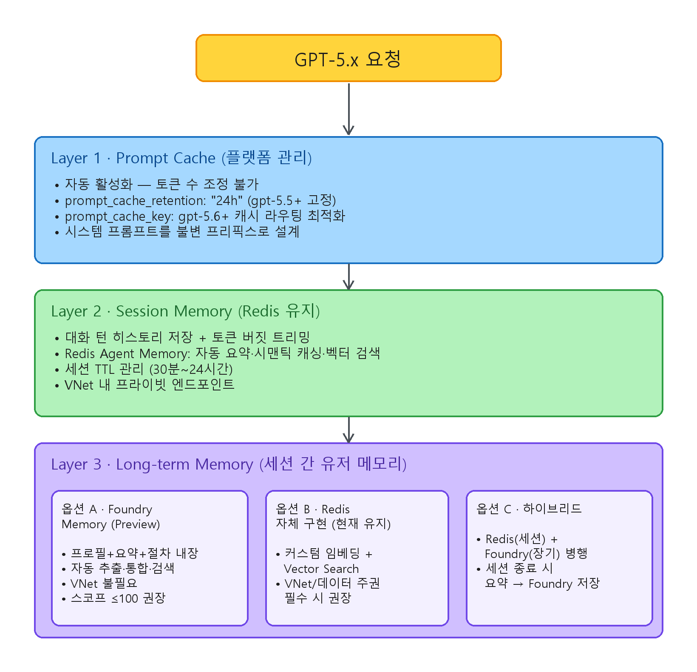

---
services:
- microsoft-foundry
official_sources:
- title: Microsoft Foundry documentation
  url: https://learn.microsoft.com/azure/ai-foundry/
- title: Prompt caching
  url: https://learn.microsoft.com/azure/foundry/openai/how-to/prompt-caching
- title: Azure OpenAI reasoning models
  url: https://learn.microsoft.com/azure/foundry/openai/how-to/reasoning
- title: Memory management for Azure Managed Redis
  url: https://learn.microsoft.com/azure/redis/best-practices-memory-management
- title: Choose a tier and plan capacity for Azure Managed Redis
  url: https://learn.microsoft.com/azure/redis/plan-tiers-and-capacity
document_type: guide
status: needs-review
verification_status: needs-review
sources_checked_at: 2026-11-02
last_verified: null
review_cycle_days: 180
applies_to:
- 공식 원문 재검토 필요
title: 프롬프트 캐시·Redis 세션·Foundry Memory로 나눈 Microsoft Foundry GPT-5.x 메모리 계층
description: 프롬프트 캐시의 적중 조건과 비용, Redis 세션 메모리 관리, Foundry Memory Service의 한도를 비교하고 VNet과 성숙도 요건에 따라 하이브리드 구성을 고르는 기준을 정리합니다.
technologies:
- rag
tags:
- design
- ai-agents
redirect_from:
- guides/microsoft-foundry/gpt-memory-layer/index.md
---

# 프롬프트 캐시·Redis 세션·Foundry Memory로 나눈 Microsoft Foundry GPT-5.x 메모리 계층

> 이관된 원문입니다. 공식 Microsoft Learn 문서와의 의미 검증이 필요합니다.

---

## 계층별 지속 시간과 관리 주체

GPT-5.x 모델을 Microsoft Foundry에서 운영하면 메모리는 세 계층으로 나뉩니다. 프롬프트 캐시는 Azure가 자동으로 관리하고 세션 메모리는 개발자가 직접 운영합니다. 장기 메모리는 Foundry Memory Service에 맡기거나 직접 구현합니다.

| 레이어 | 범위 | 지속성 | 관리 주체 |
|--------|------|--------|-----------|
| ① Prompt Cache (컨텍스트 메모리) | 요청 간 프롬프트 프리픽스 KV 텐서 | gpt-5.4 이하: `in_memory` 5~10분(기본) 또는 `24h` 최대 24시간 / gpt-5.5: 24h 확장 보존 / gpt-5.6 이상: `prompt_cache_retention` 미적용, Standard 종량제는 최소 30분(`prompt_cache_options.ttl`). [모델별 상세](#prompt-cache-retention) | Azure 플랫폼 (기본 활성화, gpt-5.6 이상 Standard 종량제만 끌 수 있음) |
| ② Session Memory (대화 상태) | 단일 세션 내 턴 히스토리 | 세션 수명 (개발자가 TTL 관리) | 개발자 (Redis 등 외부 저장소) |
| ③ Long-term Memory (유저 메모리) | 세션 간 사용자 프로필·요약·절차 | default_ttl_seconds 설정 (0 = 무제한) | Foundry Memory Service 또는 자체 구현 |

---

## ① 기본으로 켜지는 자동 프롬프트 캐시

### 같은 프리픽스의 KV 텐서 재사용

Prompt Caching은 동일한 프롬프트 프리픽스의 KV 텐서를 GPU 메모리나 GPU-local 스토리지에 유지합니다. 같은 프리픽스로 다시 요청하면 그 부분을 다시 계산하지 않습니다. 지원 모델에서는 모두 기본으로 켜져 있습니다. gpt-5.5 이하와 PTU-M 배포에서는 끌 수 없고, gpt-5.6 이상 Standard 종량제 배포에서만 `prompt_cache_options.mode`를 `explicit`로 두고 breakpoint를 넣지 않으면 캐싱과 cache write 과금 없이 요청할 수 있습니다.

요청이 들어오면 프롬프트 프리픽스(일반적으로 처음 256 토큰)의 해시로 라우팅합니다. 캐시된 KV 텐서와 일치하면 cache hit가 됩니다.

### 처음 1,024 토큰의 바이트 일치 조건

공식 문서 기준으로 프롬프트가 1,024 토큰 이상이어야 캐시 대상이 됩니다. 처음 1,024 토큰이 완전히 같아야 cache hit가 나며 이 구간에서 한 글자만 달라도 cache miss가 나고 `cached_tokens`는 0이 됩니다. 처음 1,024 토큰 뒤에서 달라지면 그 앞까지 일치한 프리픽스는 계속 적중하므로 `cached_tokens`가 0보다 클 수 있습니다. gpt-5.5 이하에서는 1,024 토큰 뒤의 적중을 128 토큰 단위로 계산하며 gpt-5.6 이상에는 이 단위가 적용되지 않습니다.

### 모델별 캐시 범위 제어 방법

gpt-5.5 이하에서는 캐시되는 토큰 수를 지정하거나 제한할 수 없습니다. 캐시 범위는 프롬프트 프리픽스가 일치하는 길이로 자동 결정되며 `prompt_cache_retention`으로 보존 정책만 고릅니다. gpt-5.6 이상에서는 `prompt_cache_key`로 캐시 라우팅을 고정하고, Standard 종량제 배포라면 [명시적 breakpoint](#prompt-cache-breakpoint)로 재사용할 프리픽스의 끝을 직접 지정할 수 있습니다.

#### 캐시 유지 시간을 정하는 `prompt_cache_retention` { #prompt-cache-retention }

| 모델 | 허용 값 | 기본값 | 비고 |
|------|---------|--------|------|
| gpt-5.4 이하 (gpt-5.4, 5.3-codex, 5.2, 5.1 계열, 5, 5-codex, 4.1) | `"in_memory"`, `"24h"` | `"in_memory"` | 비 ZDR 조직은 2026.05.29부터 기본값 `"24h"`로 변경됨 |
| gpt-5.5 | `"24h"` 만 허용 | `"24h"` | 확장 보존이 기본. `"in_memory"` 미지원. ZDR 조직 포함 전체 적용 |
| gpt-5.6 이상 | 적용 안 됨 (사용 중단) | — | Standard 종량제 배포는 `prompt_cache_options.ttl`로 최소 수명을 지정하며 `"30m"`이 기본값이자 유일한 값. PTU-M 배포는 미지원 |

두 보존 정책의 캐시 가격은 같습니다. `in_memory`는 5~10분 동안 요청이 없으면 캐시를 비우고 늦어도 1시간 안에 반드시 제거합니다. Azure 구독 사이에는 캐시를 공유하지 않습니다. `24h`는 KV 텐서를 GPU-local 스토리지로 옮겨 최대 24시간 유지합니다. 원본 프롬프트 텍스트는 디스크에 절대 저장하지 않습니다.

```json
{
  "model": "gpt-5.4",
  "messages": [...],
  "prompt_cache_retention": "24h"
}
```

#### gpt-5.6 이상에서 캐시 라우팅을 고정하는 `prompt_cache_key`

`prompt_cache_key`는 프리픽스 해시와 결합되는 stable key입니다. 같은 시스템 프롬프트를 공유하는 고빈도 워크로드에서 캐시 적중률을 높입니다.

같은 프리픽스와 키 조합으로 분당 약 15건을 넘게 요청하면 일부 요청에서 cache miss가 날 수 있습니다. 요청이 많으면 여러 키로 나누되 키와 프리픽스의 대응은 바꾸지 않습니다. API 버전 제약은 없으며 v1 API에서 동작합니다.

```json
{
  "model": "gpt-5.6-sol",
  "messages": [...],
  "prompt_cache_key": "support-agent-system-v2"
}
```

#### gpt-5.6 이상 Standard 종량제의 명시적 캐시 breakpoint { #prompt-cache-breakpoint }

gpt-5.6 이상에서는 콘텐츠 블록에 `prompt_cache_breakpoint: { "mode": "explicit" }`를 붙여 재사용할 프리픽스의 끝을 표시합니다. 그 블록과 앞의 모든 프롬프트가 재사용 프리픽스가 되며, breakpoint 뒤의 내용은 바뀌어도 캐시된 프리픽스가 무효화되지 않습니다. Responses API와 Chat Completions API 모두 지원하고, Standard 종량제 배포에서만 쓸 수 있습니다. PTU-M 배포와 gpt-5.5 이하는 지원하지 않으며 gpt-5.5 이하에 이 파라미터를 보내면 `400` 오류가 납니다.

| 설정 | 동작 |
|------|------|
| `prompt_cache_options.mode: "implicit"` (기본) | 마지막 메시지에 breakpoint를 자동으로 두고 명시한 breakpoint도 함께 사용 |
| `prompt_cache_options.mode: "explicit"` | 명시한 breakpoint만 캐시 읽기·쓰기에 사용. breakpoint가 없으면 캐싱과 cache write 과금 없음 |
| `prompt_cache_options.ttl: "30m"` | 요청의 모든 breakpoint에 최소 30분 수명 지정. 기본값이자 유일한 값이며 보존 정책을 고르지는 않음 |

- breakpoint를 둘 수 있는 블록은 Responses API의 `input_text`·`input_image`·`input_file`, Chat Completions API의 `text`·`image_url`·`input_audio`·`file`입니다.
- breakpoint까지의 렌더링된 프리픽스가 1,024 토큰 이상이어야 캐시됩니다.
- 요청 하나는 새 cache write를 최대 4개 만듭니다. `implicit` 모드에서는 마지막 메시지가 한 자리를 쓰므로 명시한 breakpoint는 최근 3개까지 기록됩니다.
- 이전 대화 턴의 breakpoint는 읽기 전용이며, 캐시 읽기에는 대화의 최근 breakpoint 50개까지 고려합니다.

```json
{
  "model": "<your-gpt-5.6-deployment-name>",
  "prompt_cache_key": "tenant:contoso:support-policy-v2",
  "prompt_cache_options": { "mode": "explicit", "ttl": "30m" },
  "messages": [
    {
      "role": "system",
      "content": [{
        "type": "text",
        "text": "<1,024 토큰 이상의 재사용 지침>",
        "prompt_cache_breakpoint": { "mode": "explicit" }
      }]
    },
    { "role": "user", "content": "<가변 사용자 입력>" }
  ]
}
```

### API별 `cached_tokens` 위치로 보는 적중 여부

캐시 적중 토큰 수는 API마다 다른 위치에 있습니다.

| API | 캐시 읽기 | 캐시 쓰기 (gpt-5.6 이상 Standard 종량제) |
|-----|-----------|------------------------------------------|
| Chat Completions | `usage.prompt_tokens_details.cached_tokens` | `usage.prompt_tokens_details.cache_write_tokens` |
| Responses | `usage.input_tokens_details.cached_tokens` | Microsoft Learn에 위치가 명시되지 않음. 응답 본문을 확인하고 없으면 비용 분석의 청구 미터로 산정 |

Chat Completions 응답:

```json
{
  "usage": {
    "prompt_tokens": 15000,
    "completion_tokens": 1518,
    "total_tokens": 16518,
    "completion_tokens_details": {
      "reasoning_tokens": 576
    },
    "prompt_tokens_details": {
      "cached_tokens": 12800
    }
  }
}
```

Responses API 응답:

```json
{
  "usage": {
    "input_tokens": 15000,
    "input_tokens_details": {
      "cached_tokens": 12800
    },
    "output_tokens": 1518,
    "output_tokens_details": {
      "reasoning_tokens": 576
    },
    "total_tokens": 16518
  }
}
```

### 메시지·이미지·도구 정의·출력 스키마 캐시

system, developer, user, assistant 메시지는 모두 캐시 대상입니다. 이미지는 URL 링크와 base64 인코딩 모두 캐시되며 `detail` 파라미터까지 같아야 합니다. 도구 정의는 messages 배열과 함께 캐시됩니다. Structured outputs를 쓰면 스키마가 시스템 메시지 프리픽스에 추가되어 함께 캐시됩니다.

### gpt-5.6부터 별도 과금되는 캐시 쓰기

| 모델 | 캐시 쓰기 (Cache Write) | 캐시 읽기 (Cache Read) |
|------|------------------------|----------------------|
| gpt-5.5 이하 | 추가 과금 없음 (입력 토큰 가격에 포함) | 할인된 입력 토큰 가격 |
| gpt-5.6 이상 | 별도 과금 (비캐시 입력 토큰의 약 1.25배) | 할인된 입력 토큰 가격 |
| Provisioned 배포 | gpt-5.6+는 별도 과금 | 최대 100% 할인 |

gpt-5.6의 Usage 응답에서 `cache_write_tokens` 필드가 빠지는 이슈가 보고되었고 Microsoft가 확인하고 있습니다. 필드가 없어도 과금은 적용됩니다.

아래 가격은 서드파티 소스에서 가져온 Global Standard 기준 참고값입니다. 공식 가격은 Azure 포털에서 확인해야 합니다.

| 모델 | Input / 1M | Cached Input / 1M | Output / 1M |
|------|-----------|-------------------|-------------|
| gpt-5.5 | $5.00 | $0.50 | $30.00 |
| gpt-5.4 | $2.50~$5.00 | $0.50 | $15.00~$30.00 |
| gpt-5.2 | $1.75 | $0.17 | — |
| gpt-5.1 | $1.25 | $0.13 | $10.00 |
| gpt-5-nano | $0.05 | $0.005 | $0.40 |
| gpt-5.6 | 가격 미확정. 현재 $0.01/1M로 표시되며 청구 오류일 수 있어 Microsoft가 조사 중 | — | — |

### 고정 콘텐츠 앞 배치와 프리픽스 바이트 유지

1. 시스템 프롬프트와 few-shot 예시를 프롬프트 앞부분에 고정합니다. 사용자 입력이나 타임스탬프 같은 가변 콘텐츠는 뒤에 둡니다.
2. 공백, 줄바꿈, 이스케이프 문자까지 프리픽스를 바이트 단위로 똑같이 유지합니다.
3. gpt-5.6 이상에서 같은 키로 분당 약 15건을 넘으면 `prompt_cache_key`를 여러 개로 나눕니다. 이때도 프리픽스와 키의 대응은 바꾸지 않습니다.
4. 데이터 레지던시를 확인합니다. in_memory는 모든 리전과 호환되며 24h 확장 캐시는 Data Zone이나 Regional 배포 경계 안에 유지됩니다.

### 캐싱·과금의 알려진 이슈 네 가지(2026년 7월 22일 기준, Explicit Caching은 11월 2일 갱신)

| 이슈 | 상태 | 영향 | 워크어라운드 |
|------|------|------|-------------|
| gpt-5.6 + Responses API 캐싱 미작동 | Microsoft 수정 중 (7/10 확인, "late next week" 예고) | `cached_tokens: 0` 반환. Chat Completions API (~95% 히트율)는 정상 | Chat Completions API 사용 |
| gpt-5.6 `cache_write_tokens` 필드 누락 | API 버전 이슈 가능성, MS 조사 중 | Usage 응답에 cache write 토큰 수 미표시 (과금은 적용) | 최신 API 버전 사용 확인 |
| Explicit Caching 지원 범위 | 2026-11-02 Learn 기준 gpt-5.6 이상 Standard 종량제 배포에서 지원. PTU-M 배포와 gpt-5.5 이하는 미지원 (7월 22일 기준 미지원에서 변경) | gpt-5.5 이하에 `prompt_cache_options`·`prompt_cache_breakpoint`를 보내면 `400` 오류 | gpt-5.5 이하·PTU-M은 자동(implicit) 캐싱 사용 |
| gpt-5.6 가격 불확실 | 미터 ID가 Retail Prices API에 미등록 | 모든 토큰 카테고리 $0.01/1M 표시 (의도적 여부 불명) | Azure Billing 지원 티켓 오픈 |

---

## ② Foundry 밖에서 Redis로 직접 운영하는 세션 메모리

### Azure Managed Redis에 대화 상태를 두는 오케스트레이션 계층

Redis로 세션 안의 대화 히스토리를 직접 관리하는 패턴입니다. Foundry 플랫폼은 세션 메모리를 자체 관리하지 않으므로 이 계층은 개발자가 책임집니다.

```
┌─────────────┐     ┌──────────────────┐     ┌──────────────────┐
│   Client     │────▶│   App Server      │────▶│  Azure OpenAI    │
│              │     │  (오케스트레이션)   │     │  GPT-5.x         │
└─────────────┘     └────────┬─────────┘     └──────────────────┘
                             │
                    ┌────────▼────────┐
                    │  Azure Managed   │
                    │  Redis           │
                    │                  │
                    │  • 대화 턴 히스토리 │
                    │  • 세션 메타데이터  │
                    │  • 시맨틱 캐시     │
                    │  • 벡터 인덱스     │
                    └─────────────────┘
```

### Redis에 둘 대화 턴·세션 메타데이터·토큰 예산

Redis에는 messages 배열 전체나 요약본을 JSON으로 직렬화한 대화 턴 히스토리를 저장합니다. 세션 ID, 사용자 ID, 생성 시각과 마지막 활동 시각, 현재 토큰 사용량 같은 세션 메타데이터도 함께 둡니다. 컨텍스트 윈도우를 넘지 않도록 메시지를 자르거나 요약하는 토큰 버짓 관리 로직도 이 계층에서 처리합니다.

### 111,616~922,000 토큰인 모델별 입력 한도

공식 문서와 대조한 모델별 컨텍스트 윈도우입니다.

| 모델 | 총 컨텍스트 | 입력 한도 | 출력 한도 | 릴리즈일 |
|------|------------|-----------|-----------|----------|
| gpt-5.6-sol / terra / luna | 1,050,000 | 922,000 | 128,000 | 2026-07-09 |
| gpt-5.5 | 1,050,000 | 922,000 | 128,000 | 2026-04-24 |
| gpt-5.4 | 1,050,000 | 922,000 | 128,000 | 2026-03-05 |
| gpt-5.4-pro | 1,050,000 | 922,000 | 128,000 | 2026-03-05 |
| gpt-5.4-mini | 400,000 | 272,000 | 128,000 | 2026-03-17 |
| gpt-5.4-nano | 400,000 | 272,000 | 128,000 | 2026-03-17 |
| gpt-5.3-codex | 400,000 | 272,000 | 128,000 | 2026-02-24 |
| gpt-5.3-chat (Preview) | 128,000 | 111,616 | 16,384 | 2026-03-03 |
| gpt-5.2 | 400,000 | 272,000 | 128,000 | 2025-12-11 |
| gpt-5.2-chat (Preview) | 128,000 | 111,616 | 16,384 | 2025-12-11 |
| gpt-5.1 | 400,000 | 272,000 | 128,000 | 2025-11-13 |
| gpt-5.1-chat (Preview) | 128,000 | 111,616 | 16,384 | 2025-11-13 |
| gpt-5.1-codex / codex-mini | 400,000 | 272,000 | 128,000 | 2025-11-13 |
| gpt-5.1-codex-max | 400,000 | 272,000 | 128,000 | 2025-12-04 |
| gpt-5 | 400,000 | 272,000 | 128,000 | 2025-08-07 |
| gpt-5-mini | 400,000 | 272,000 | 128,000 | 2025-08-07 |
| gpt-5-nano | 400,000 | 272,000 | 128,000 | 2025-08-07 |
| gpt-5-chat (Preview) | 128,000 | 111,616 | 16,384 | 2025-08-07 |

### 최신 메시지 우선 히스토리 트리밍

아래 함수는 시스템 프롬프트와 응답 버퍼를 뺀 입력 한도 안에서 최신 메시지부터 남깁니다.

```python
import tiktoken

# 모델별 입력 한도 매핑
MODEL_INPUT_LIMITS = {
    "gpt-5.6-sol":   922_000,
    "gpt-5.6-terra": 922_000,
    "gpt-5.6-luna":  922_000,
    "gpt-5.5":       922_000,
    "gpt-5.4":       922_000,
    "gpt-5.4-mini":  272_000,
    "gpt-5.4-nano":  272_000,
    "gpt-5.3-codex": 272_000,
    "gpt-5.3-chat":  111_616,
    "gpt-5.2":       272_000,
    "gpt-5.1":       272_000,
    "gpt-5":         272_000,
}

def trim_history(
    messages: list,
    model: str = "gpt-5.6-sol",
    system_prompt_tokens: int = 2_000,
    response_buffer: int = 16_000,
) -> list:
    """최신 메시지 우선으로 토큰 버짓 내에서 히스토리 트리밍"""
    max_input = MODEL_INPUT_LIMITS.get(model, 272_000)
    available = max_input - system_prompt_tokens - response_buffer

    # tiktoken은 알고 있는 모델명만 지원 — gpt-5.x 계열은 KeyError 발생하므로 fallback 필요
    try:
        enc = tiktoken.encoding_for_model(model)
    except KeyError:
        enc = tiktoken.get_encoding("o200k_base")  # gpt-4o/5.x 계열 인코딩

    trimmed = []
    total = 0
    for msg in reversed(messages):
        # 주의: msg["content"]가 문자열이라고 가정. 멀티모달(list) 콘텐츠는
        # enc.encode()가 실패하므로 별도 텍스트 추출 후 인코딩해야 함.
        tokens = len(enc.encode(msg["content"]))
        if total + tokens > available:
            break
        trimmed.insert(0, msg)
        total += tokens
    return trimmed
```

### 세션 캐시를 에이전트 메모리로 넓힌 Azure Managed Redis Agentic Memory

Redis는 Build 2026에서 Azure Managed Redis의 Agentic Memory 기능을 발표했습니다. 기존 Redis 세션 캐시에 에이전트 워크로드용 기능을 더한 것입니다.

Working Memory는 세션 범위의 라이브 메시지를 저장하고 자동으로 요약하거나 잘라 냅니다. Long-term Memory는 대화에서 추출한 사실과 선호도를 벡터 임베딩으로 오래 저장합니다. Semantic Caching(LangCache)은 비슷한 프롬프트에 이전 응답을 재사용해 토큰 비용을 줄입니다. Contextual Grounding은 "그것" 같은 대명사와 참조를 실제 엔티티로 풀어 줍니다. Deduplication은 콘텐츠 해시로 중복 메모리를 막습니다. Memory Promotion은 신호가 강한 사실을 Working Memory에서 Long-term Memory로 자동 승격합니다.

이 기능은 REST API, MCP Server, Python client library로 사용할 수 있으며 Microsoft Agent Framework, Semantic Kernel과 네이티브로 통합됩니다.

### 함께 정할 Redis TTL·유사도 임계값·메모리 정책

1. 비활성 세션은 TTL로 자동 만료합니다. 일반적으로 30분에서 24시간 사이로 둡니다.
2. Semantic Caching은 유사 쿼리를 캐시해 반복 토큰 비용을 줄입니다. 엉뚱한 응답을 재사용하지 않도록 유사도 임계값을 조정해야 합니다.
3. Redis Vector Search로 관련 대화를 시맨틱 검색합니다.
4. 메모리 압력에 대비해 `maxmemory-policy`를 설정합니다. 에이전트 워크로드에는 `allkeys-lru`나 `volatile-lru`를 권장합니다.
5. Azure Managed Redis는 VNet 통합과 Private Endpoint를 지원합니다.

---

## ③ 관리형 장기 사용자 메모리인 Foundry Memory Service

### 직접 구현한 장기 메모리를 대체하는 Public Preview 서비스

Azure AI Foundry Agent Service에 내장된 매니지드 장기 메모리 서비스입니다. Redis로 직접 구현한 장기 메모리 부분을 대체할 수 있습니다. 2026년 6월 2일 최신 프리뷰 기준으로 Public Preview 상태입니다. API 버전은 `2025-11-15-preview`, SDK는 `azure-ai-projects >= 2.0.0`을 사용합니다.

### 기본으로 켜지는 프로필·대화 요약·절차 메모리

| 유형 | 설명 | 검색 타이밍 |
|------|------|------------|
| User Profile Memory | 사용자 선호·설정·접근성 등 지속 컨텍스트 | 대화 시작 시 정적 주입 (items 파라미터 없이 search) |
| Chat Summary Memory | 이전 대화 주제·맥락의 증류 요약 | 턴마다 현재 메시지 기반 시맨틱 검색 |
| Procedural Memory (Latest Preview) | 반복 워크플로·실행 패턴 학습. 에이전트 trajectory에서 성공 패턴 추출 | 유사 작업 요청 시 검색 |

### 서비스가 자동 처리하는 추출·통합·검색

```
대화 → [Extraction] → [Consolidation] → [Storage]
                                              ↓
                          검색 요청 → [Retrieval] → 에이전트 컨텍스트 주입
```

Extraction 단계에서 LLM이 대화에서 선호도, 사실, 컨텍스트를 자동으로 추출합니다. Consolidation 단계는 겹치는 토픽을 병합하고 서로 충돌하는 정보를 정리합니다. 검색 요청이 오면 Retrieval 단계가 시맨틱 검색과 메타데이터를 함께 쓰는 하이브리드 검색으로 관련 메모리를 반환합니다.

### 채팅·임베딩 모델과 TTL을 지정한 Memory Store 생성

```python
from azure.ai.projects import AIProjectClient
from azure.ai.projects.models import (
    MemoryStoreDefaultDefinition,
    MemoryStoreDefaultOptions,
)
from azure.identity import DefaultAzureCredential

client = AIProjectClient(
    endpoint=os.environ["FOUNDRY_PROJECT_ENDPOINT"],
    # 형식: https://{ai-services-account}.services.ai.azure.com/api/projects/{project-name}
    credential=DefaultAzureCredential(),
)

options = MemoryStoreDefaultOptions(
    chat_summary_enabled=True,
    user_profile_enabled=True,
    procedural_memory_enabled=True,        # Latest preview에서 추가
    default_ttl_seconds=30 * 24 * 60 * 60, # 30일. 0 = 무제한
    user_profile_details="민감 정보(나이, 재무정보, 위치, 인증정보) 수집 금지",
)

definition = MemoryStoreDefaultDefinition(
    chat_model="gpt-5.4",                  # Chat 모델 배포명
    embedding_model="text-embedding-3-small", # 임베딩 모델 배포명
    options=options,
)

memory_store = client.beta.memory_stores.create(
    name="production_memory",
    definition=definition,
    description="Production user memory with 30-day TTL",
)
```

### MemorySearchPreviewTool을 이용한 에이전트 메모리 연결

```python
from azure.ai.projects.models import MemorySearchPreviewTool, PromptAgentDefinition

tool = MemorySearchPreviewTool(
    memory_store_name="production_memory",
    scope="{{$userId}}",   # 런타임 자동 해석:
                            #   1순위: x-memory-user-id 헤더 값
                            #   2순위: Entra 토큰의 {tid}_{oid}
    update_delay=1,         # 비활성 1초 후 메모리 업데이트 (기본 300초)
)

agent = client.agents.create_version(
    agent_name="SupportAgent",
    definition=PromptAgentDefinition(
        model="gpt-5.4",
        instructions="이전 대화 맥락을 활용하여 응답하세요.",
        tools=[tool],
    ),
)
```

### items 유무로 나뉘는 프로필 검색과 맥락 검색

```python
from azure.ai.projects.models import MemorySearchOptions

# 정적 메모리 (User Profile) 검색 — items 없이 호출
static = client.beta.memory_stores.search_memories(
    name="production_memory",
    scope="user_123",
)

# 컨텍스트 메모리 (시맨틱 검색) — 최신 메시지 기반
contextual = client.beta.memory_stores.search_memories(
    name="production_memory",
    scope="user_123",
    items=[{"role": "user", "content": "이전 주문 내역 알려줘", "type": "message"}],
    options=MemorySearchOptions(max_memories=5),
)
```

### Latest Preview의 메모리 항목 생성·조회·수정·삭제

```python
# 생성
created = client.beta.memory_stores.create_memory(
    name="production_memory",
    scope="user_123",
    content="사용자는 한국어 응답을 선호함",
    kind="user_profile",  # user_profile | chat_summary | procedural
)

# 조회
item = client.beta.memory_stores.get_memory(
    name="production_memory",
    memory_id=created.memory_id,
)

# 수정
updated = client.beta.memory_stores.update_memory(
    name="production_memory",
    memory_id=created.memory_id,
    content="사용자는 한국어 응답 + 기술 용어 영문 표기를 선호함",
)

# 목록
memories = client.beta.memory_stores.list_memories(
    name="production_memory",
    scope="user_123",
)

# 삭제
client.beta.memory_stores.delete_memory(
    name="production_memory",
    memory_id=created.memory_id,
)
```

Latest Preview에서 API 경로가 `/items`에서 `/memories`로 바뀌었습니다.

### 사용자의 기억·삭제 요청 즉시 반영

사용자가 "이것 기억해"나 "이것 잊어"라고 말하면 메모리에 바로 반영됩니다. 결과는 응답 output의 `memory_command_call` 항목으로 돌아옵니다.

```python
response = openai_client.responses.create(
    input="내 선호 좌석은 통로측이라는 걸 기억해",
    conversation=conversation.id,
    extra_body={"agent_reference": {"name": agent.name, "type": "agent_reference"}},
)

for item in response.output:
    if getattr(item, "type", None) == "memory_command_call":
        print(item.arguments)  # {"action": "remember", "content": "선호 좌석: 통로측"}
        print(item.status)     # "completed"
```

이렇게 저장한 메모리도 스토어의 TTL 설정을 따릅니다.

### `2025-11-15-preview` REST API 엔드포인트

```
POST /memory_stores?api-version=2025-11-15-preview                          # 스토어 생성
GET  /memory_stores?api-version=2025-11-15-preview                          # 스토어 목록
POST /memory_stores/{name}:update_memories?api-version=2025-11-15-preview   # 메모리 업데이트
POST /memory_stores/{name}:search_memories?api-version=2025-11-15-preview   # 메모리 검색
POST /memory_stores/{name}/memories?api-version=2025-11-15-preview          # 메모리 항목 생성
GET  /memory_stores/{name}/memories/{id}?api-version=2025-11-15-preview     # 메모리 항목 조회
POST /memory_stores/{name}/memories/{id}?api-version=2025-11-15-preview     # 메모리 항목 수정
DELETE /memory_stores/{name}/memories/{id}?api-version=2025-11-15-preview   # 메모리 항목 삭제
POST /memory_stores/{name}:delete_scope?api-version=2025-11-15-preview      # 스코프 전체 삭제
DELETE /memory_stores/{name}?api-version=2025-11-15-preview                  # 스토어 삭제
```

### 스코프 100개·항목 10,000개 한도와 VNet 미지원

메모리 스토어 하나에는 스코프를 최대 100개, 스코프 하나에는 메모리 항목을 최대 10,000개 둘 수 있습니다. 메모리 검색과 업데이트 요청은 각각 분당 1,000건까지입니다. VNet 통합은 지원하지 않습니다. `update_delay` 기본값은 300초(5분)이며 0으로 설정하면 즉시 처리합니다.

### Korea Central을 포함한 19개 지원 리전

Australia East, Brazil South, Canada East, East US 2, France Central, Italy North, Japan East, Korea Central, North Central US, Norway East, South Africa North, South India, Sweden Central, Switzerland North, UAE North, UK South, West US, West US 2, West US 3

### 필수 구성인 Content Safety와 Prompt Injection Detection

Azure AI Content Safety와 Prompt Injection Detection은 필수 구성입니다. 공격과 적대적 입력을 가정한 테스트를 정기적으로 실행하고 컴플라이언스를 위해 메모리 삭제 감사 로그를 보관합니다.

---

## Redis와 Foundry Memory Service의 통제 범위·운영 부담 비교

| 기준 | Redis (자체 구현) | Foundry Memory Service |
|------|-------------------|----------------------|
| 세션 메모리 | 직접 제어 (TTL, 구조, 트리밍) | 세션 메모리 자체는 미제공 (장기 메모리 전용) |
| 장기 유저 메모리 | 직접 구현 필요 (벡터 임베딩 + 검색) | 내장 (프로필·요약·절차 3종) |
| 메모리 추출/통합 | LLM 파이프라인 직접 구축 | 자동 (Extraction → Consolidation → Retrieval) |
| 시맨틱 캐싱 | LangCache (Build 2026) | 별도 구성 필요 |
| 벡터 검색 | Redis Vector Search | 하이브리드 검색 내장 |
| 운영 부담 | 높음 (인프라 + 파이프라인 관리) | 낮음 (매니지드) |
| VNet/프라이빗 엔드포인트 | 완전 지원 | 미지원 |
| 데이터 주권 제어 | 완전 제어 | 제한적 (19개 리전) |
| 성숙도 | GA | Public Preview |
| 스케일 한도 | 스코프·항목 수의 고정 한도 없음. 배포 SKU의 메모리 한도 안에서 동작하며 부족하면 키가 퇴거되거나 상위 SKU로 확장 필요 | 스코프 100, 항목 10K/스코프 |
| 비용 모델 | Redis 인스턴스 비용 (고정) | Chat + Embedding 모델 토큰 비용 (사용량 비례) |
| 멀티모달 메모리 | 직접 구현 | 이미지 이해·보존 지원 (Build 2026 발표) |

---

## Redis 세션 운영 환경에 권장하는 세 계층 하이브리드 구성

Redis 기반 세션 메모리를 이미 운영하고 있다면 세 계층을 분리하고 계층마다 강점이 있는 도구를 쓰는 하이브리드 아키텍처를 권장합니다.



<!-- editable source: https://github.com/hellices/devguidesample/blob/main/docs/services/microsoft-foundry/gpt-memory-layer/samples/architecture/hybrid-architecture.excalidraw (https://excalidraw.com 에서 열어 편집) -->

### 전환 전 GA 여부·VNet 요건·스케일 한도 확인

- [ ] Foundry Memory Service가 GA인지 확인합니다. 지금은 Public Preview이므로 프로덕션 적용에 주의합니다.
- [ ] VNet이 필수라면 Redis를 유지합니다. Foundry Memory는 VNet을 지원하지 않습니다.
- [ ] 스코프 100개, 스코프당 항목 10K 한도가 워크로드에 충분한지 검증합니다.
- [ ] Redis를 유지한다면 키 수, 키당 오버헤드와 증가분으로 SKU 메모리를 산정합니다. 기본 퇴거 정책 `volatile-lru`는 TTL이 있는 키만 퇴거하므로, Used Memory Percentage가 계속 75%를 넘으면 상위 SKU로 확장합니다. 축소에는 제약이 있어 처음부터 여유를 둡니다.
- [ ] gpt-5.4 이하에서는 `prompt_cache_retention`의 `"in_memory"`와 `"24h"`를 비교합니다. 두 정책의 캐시 가격은 같으므로 `cached_tokens`로 적중률 차이를 확인합니다. gpt-5.5는 확장 보존(24h)이 기본이라 바꿀 값이 없습니다. gpt-5.6 이상에서는 이 필드가 적용되지 않고 cache write가 별도 과금되므로 쓰기·읽기 비용을 함께 산정합니다. Usage 응답에 `cache_write_tokens`가 있으면 `cached_tokens`와 함께 쓰고, 필드가 빠진 응답은 0으로 간주하지 말고 Azure Cost Management 비용 분석의 실제 미터별 청구로 산정합니다.
- [ ] gpt-5.6 Responses API 캐싱 버그가 해결되기 전까지 Chat Completions API를 사용합니다.
- [ ] gpt-5.6 가격은 Azure Billing 지원 티켓으로 확인한 뒤 비용을 계획합니다.
- [ ] Memory Store API 버전은 `2025-11-15-preview`, SDK는 `azure-ai-projects >= 2.0.0`을 사용합니다.
- [ ] Content Safety와 Prompt Injection Detection을 구성한 뒤 메모리 서비스를 켭니다.

---

## 참조 링크

- [Prompt caching (Microsoft Foundry)](https://learn.microsoft.com/en-us/azure/foundry/openai/how-to/prompt-caching)
- [Foundry Models sold by Azure](https://learn.microsoft.com/en-us/azure/foundry/foundry-models/concepts/models-sold-directly-by-azure)
- [Memory in Foundry Agent Service](https://learn.microsoft.com/en-us/azure/foundry/agents/concepts/what-is-memory)
- [Create and use memory](https://learn.microsoft.com/en-us/azure/foundry/agents/how-to/memory-usage)
- [Foundry Memory Build 2026 발표](https://devblogs.microsoft.com/foundry/memory-build2026/)
- [Azure OpenAI Quotas and Limits](https://learn.microsoft.com/en-us/azure/foundry/openai/quotas-limits)
- [Redis Agent Memory](https://redis.io/agent-memory/)

---

*마지막 업데이트: 2026년 11월 2일(프롬프트 캐시 적중 조건·보존 정책·Explicit Caching을 Microsoft Learn과 대조해 갱신). 나머지 내용은 2026년 7월 22일 기준이며 공식 원문 의미 검증 대기*
