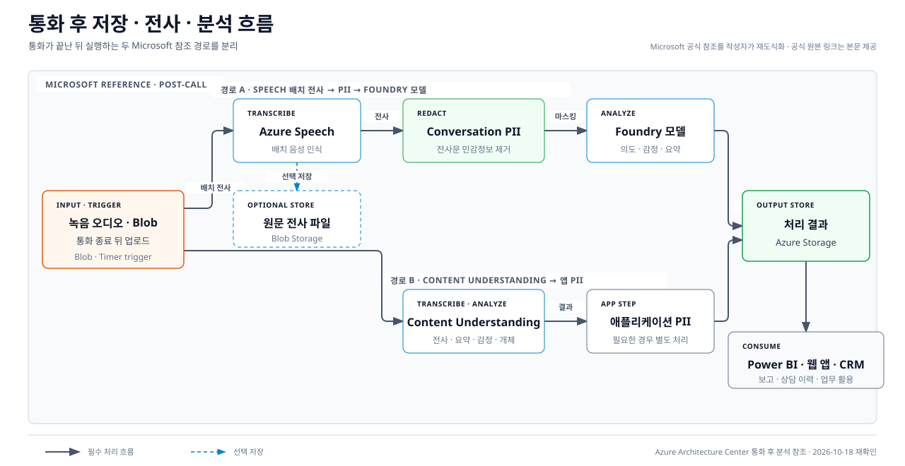

---
services:
- microsoft-foundry
- azure-openai
- azure-storage
- azure-architecture
official_sources:
- title: Extract and analyze call center data
  url: https://learn.microsoft.com/azure/architecture/ai-ml/openai/architecture/call-center-openai-analytics
- title: Data, privacy, and security for Voice live
  url: https://learn.microsoft.com/azure/foundry/responsible-ai/speech-service/voice-live/data-privacy-security
- title: Data, privacy, and security for Speech to text
  url: https://learn.microsoft.com/azure/foundry/responsible-ai/speech-service/speech-to-text/data-privacy-security
- title: Data, privacy, and security for Foundry Models sold by Azure
  url: https://learn.microsoft.com/azure/foundry/responsible-ai/openai/data-privacy
- title: Use the GPT Realtime API for speech and audio with Azure OpenAI
  url: https://learn.microsoft.com/azure/foundry/openai/how-to/realtime-audio
- title: Create a batch transcription
  url: https://learn.microsoft.com/azure/ai-services/speech-service/batch-transcription-create
- title: Get batch transcription results
  url: https://learn.microsoft.com/azure/ai-services/speech-service/batch-transcription-get
- title: Azure Blob storage trigger for Functions
  url: https://learn.microsoft.com/azure/azure-functions/functions-bindings-storage-blob-trigger
- title: Access tiers for blob data
  url: https://learn.microsoft.com/azure/storage/blobs/access-tiers-overview
- title: Blob Storage scalability and performance targets
  url: https://learn.microsoft.com/azure/storage/blobs/scalability-targets
- title: Azure Blob Storage lifecycle management overview
  url: https://learn.microsoft.com/azure/storage/blobs/lifecycle-management-overview
- title: Soft delete for blobs
  url: https://learn.microsoft.com/azure/storage/blobs/soft-delete-blob-overview
document_type: research
status: current
verification_status: needs-review
sources_checked_at: 2026-10-17
title: Microsoft 공식 문서로 본 Azure 음성 에이전트 데이터 저장
description: Microsoft 참조 아키텍처와 제품 문서에서 음성 원본·텍스트·분석 결과의 저장과 성능 근거를 확인합니다.
technologies:
- rest-api
tags:
- evaluate
- ai-agents
- storage
published_at: 2026-10-17
topic_order: 2
---

# Microsoft 공식 문서로 본 Azure 음성 에이전트 데이터 저장

> - 리서치 발행일: 2026-10-17 (한국시간)
> - Microsoft 주요 공식 원문 재확인일: 2026-10-17
> - 연결 문서: [앱 음성 서비스 기록관리 사례와 정책](../business-patterns/index.md)
> - 범위: Microsoft가 공개한 참조 아키텍처와 제품 문서에서 확인되는 원음·음성 텍스트·분석 결과의 저장 시점과 위치, 오디오 형식·압축, 지연·저장 성능 지침.
> - 제외: 특정 애플리케이션의 확정 아키텍처 · 이 문서가 독자적으로 정한 저장 위치나 보유기간 · 법률 의견 · 가격 견적.

> **읽는 기준**
>
> - **Microsoft 참조 아키텍처:** Microsoft가 예시 구성과 데이터 흐름을 직접 제시한 자료.
> - **제품 동작:** 각 Azure 서비스 문서가 명시한 기본 저장·처리 방식과 제한.
> - **Microsoft 일반 지침:** Blob Storage·Data Lake Storage·Speech 성능 문서의 명시적 권고. 음성 에이전트 전용 지침이 아닐 때는 그 범위를 함께 표시.
> - **단순 계산:** Microsoft가 공개한 샘플률·비트 수·채널 수에 표준 계산식을 적용한 값. Microsoft의 용량 권고가 아님.

## Microsoft가 공개한 관련 참조 아키텍처

### 통화 후 콜센터 분석 아키텍처

[Azure Architecture Center의 콜센터 데이터 추출·분석 아키텍처](https://learn.microsoft.com/en-us/azure/architecture/ai-ml/openai/architecture/call-center-openai-analytics)는 음성 원본, 음성 텍스트, 분석 결과의 저장 위치를 데이터 흐름에 명시한 Microsoft 참조임.

- **자료 유형:** Azure Architecture Center 참조 아키텍처
- **주요 범위:** 통화가 끝난 뒤 수행하는 배치 분석
- **사용 서비스:** Azure Blob Storage, Azure Speech, Microsoft Foundry, Azure Language 또는 Azure Content Understanding, Power BI
- **공식 그림:** [Microsoft 아키텍처 SVG](https://learn.microsoft.com/en-us/azure/architecture/ai-ml/openai/architecture/_images/call-center-analytics.svg)
- **편집 가능한 원본:** [Microsoft 제공 Visio 파일](https://arch-center.azureedge.net/call-center-analytics.vsdx)



> **그림 범위:** 위쪽은 Voice Live의 실시간 제품 동작, 아래쪽은 통화 후 저장·분석 참조 흐름임. 아래쪽에서 Speech→Language→Foundry 경로와 Content Understanding→애플리케이션 PII 제거 경로를 구분하고, 선택적 원문 음성 텍스트 저장은 Speech 처리 이후에 표시함. 파란 점선은 같은 Architecture Center 문서가 Voice Live·GPT Realtime의 오디오와 음성 텍스트를 분석용 Blob Storage에 저장하는 대안으로 제시한 경로임. 두 공식 문서 범위를 한 장에 병치한 것으로, Microsoft가 제공한 단일 아키텍처나 서비스의 기본 자동 저장 동작을 뜻하지 않음.

## 서비스 자체는 무엇을 저장하는가?

다음 표는 참조 아키텍처에서 애플리케이션이 수행하는 저장과 서비스 자체의 기본 동작을 나누어 정리함.

| 서비스·기능 | Microsoft 문서에 명시된 동작 | 저장 위치·기간 |
|---|---|---|
| **Azure AI Speech 실시간 음성 인식** | 오디오는 Azure 서버 메모리에서만 처리되고 저장 상태로 남지 않음 | 서비스 저장 없음 |
| **Azure AI Speech 배치 음성 인식 입력** | `contentContainerUrl` 또는 `contentUrls`로 지정한 오디오를 읽어 처리함 | 고객이 지정한 오디오 URL·컨테이너 |
| **Azure AI Speech 배치 음성 인식 결과** | `destinationContainerUrl`을 지정하지 않으면 Microsoft 관리 컨테이너에 결과를 저장함. 지정하면 지원되는 고객 Azure 컨테이너에 저장함 | 서비스 내 transcription의 `timeToLiveHours` 지원 범위는 완료 후 6시간~31일. 작업을 삭제하면 Microsoft 관리 결과도 삭제됨. 고객 컨테이너 사본의 보유기간 연동은 인용 문서에서 확인되지 않음 |
| **Voice Live API** | Voice Live 자체는 고객 데이터를 저장하거나 보관하지 않음. 연결한 모델·Agent·Custom Voice 등은 각 기능의 정책을 따름 | Voice Live 자체 저장 없음 |
| **Voice Live 지원 로그** | 지원 티켓을 연 뒤 사용자가 동의해 켤 수 있는 별도 디버깅 로그 | 같은 리전의 Microsoft 관리 Azure Storage, 생성 후 30일 자동 삭제 |
| **Foundry voice-based prompt agent** | `store` 기본값은 `false`. `true`이면 대화 기록, 이벤트 시간선, 원음이 함께 저장됨 | Foundry voice agent 저장 기능. 2026-10-14 기준 미리 보기 |
| **Azure 판매 모델(Azure OpenAI 포함)** | 모델 자체는 무상태로 프롬프트·응답을 모델에 보관하지 않음. Responses API·Threads·Stored completions 같은 상태 유지 기능은 별도 데이터 저장소를 만듦 | Azure가 판매하는 Foundry 모델에 관한 정책 범위. 고객 리소스의 기능별 데이터 저장소 |
| **Azure 판매 모델의 남용 모니터링** | 잠재적 남용 지표가 감지되면 일부 프롬프트·응답이 검토 표본으로 선택될 수 있음. 자동 검토는 저장하지 않지만 사람 검토 대상은 고객 리소스별로 논리 분리된 남용 모니터링 저장소에 보관될 수 있음 | Azure가 판매하는 Foundry 모델(Azure OpenAI 포함)의 정책 범위. 승인된 modified abuse monitoring에서는 위 저장·사람 검토 절차를 수행하지 않지만 자동 검토는 남을 수 있음. [공식 적용 범위](https://learn.microsoft.com/en-us/azure/foundry/responsible-ai/openai/data-privacy) |
| **미리 구축된 음성의 음성 합성(TTS)** | 입력 텍스트와 출력 오디오를 Microsoft 로그에 저장하지 않음 | 서비스 로그 저장 없음 |
| **Foundry 추적** | 기본적으로 꺼져 있음. 켜면 [Application Insights](https://learn.microsoft.com/en-us/azure/azure-monitor/app/app-insights-overview)와 [Log Analytics](https://learn.microsoft.com/en-us/azure/azure-monitor/logs/log-analytics-workspace-overview) 설정에 따라 추적 자료가 저장됨 | 고객이 연결한 Application Insights·Log Analytics |

근거:

- [Speech to text 데이터 처리](https://learn.microsoft.com/en-us/azure/foundry/responsible-ai/speech-service/speech-to-text/data-privacy-security)
- [Voice Live 데이터 처리](https://learn.microsoft.com/en-us/azure/foundry/responsible-ai/speech-service/voice-live/data-privacy-security)
- [voice-based prompt agent 구성](https://learn.microsoft.com/en-us/azure/foundry/agents/how-to/configure-voice-agent)
- [Foundry Models 데이터 처리](https://learn.microsoft.com/en-us/azure/foundry/responsible-ai/openai/data-privacy)
- [Text to speech 데이터 처리](https://learn.microsoft.com/en-us/azure/foundry/responsible-ai/speech-service/text-to-speech/data-privacy-security)
- [Foundry 추적 데이터](https://learn.microsoft.com/en-us/azure/foundry/observability/concepts/trace-data)

## 공식 자료에서 확인되는 저장 시점과 저장 위치

| 시점 | 무엇 | 어디 | Microsoft 자료의 범위 |
|---|---|---|---|
| **통화 녹음 후** | 녹음 오디오 파일 | Azure Blob Storage | 콜센터 통화 후 분석 참조 아키텍처 |
| **새 Blob 업로드 감지 후** | 새 오디오 파일을 처리할 작업 | [Blob trigger](https://learn.microsoft.com/en-us/azure/azure-functions/functions-bindings-storage-blob-trigger#choose-a-blob-storage-trigger-implementation)가 Azure Functions 시작 | 콜센터 통화 후 분석 참조 아키텍처. 이벤트 기반·폴링 기반 구현에 따라 지연 특성이 다름 |
| **정해진 일괄 실행 시각** | 일정 기간 모인 오디오 파일 | Timer trigger가 Azure Functions 시작 | 콜센터 통화 후 분석 참조 아키텍처 |
| **배치 음성 인식 후, 선택 시** | 원문 음성 텍스트 파일 | Azure Blob Storage | 콜센터 통화 후 분석 참조 아키텍처 |
| **개인정보 제거·모델 분석 후** | 요약·감정·통화 목적·개체 등 처리 결과 | Azure Storage | 콜센터 통화 후 분석 참조 아키텍처 |
| **Content Understanding 처리 후** | 음성 텍스트와 추출 결과 | Blob Storage 또는 다른 데이터 저장소 | 콜센터 통화 후 분석 참조 아키텍처 |
| **업무 시스템 반영 시** | 통화 이력·요약·통화 이유 | CRM 시스템 | 콜센터 통화 후 분석 참조 아키텍처 |
| **실시간 가상 에이전트 분석을 위해 저장할 때** | Voice Live 또는 GPT Realtime의 오디오와 음성 텍스트 | Azure Blob Storage | 같은 참조 아키텍처의 가상 에이전트 대안 |
| **Foundry voice agent 세션에서 `store=true`일 때** | 대화 기록·이벤트 시간선·원음 | Foundry voice agent 저장 기능 | 미리 보기 제품 문서 |
| **Voice Live 지원 로그를 사용자가 켰을 때** | 지원용 음성 로그 | Microsoft 관리 Azure Storage | Voice Live 개인정보 처리 문서 |

## Blob Storage에 대해 Microsoft가 설명하는 범위

### 참조 아키텍처에서 저장하는 자료

Azure Architecture Center 참조는 Blob Storage에 다음 자료를 저장함.

- 전화 서버가 만든 원음 파일
- 선택적으로 남기는 원문 음성 텍스트 파일
- Foundry 모델 또는 Azure Content Understanding이 만든 처리 결과

[Blob 유형 문서](https://learn.microsoft.com/en-us/rest/api/storageservices/understanding-block-blobs--append-blobs--and-page-blobs)는 block blob을 텍스트·이진 파일과 같은 개체에 사용하는 유형으로 설명함. [Blob 액세스 계층 문서](https://learn.microsoft.com/en-us/azure/storage/blobs/access-tiers-overview)는 Hot·Cool·Cold·Archive와 Smart tier를 설명하며, 액세스 계층 설정은 block blob에만 허용된다고 명시함.

### Microsoft의 Blob 성능 지침

[Blob Storage 확장성·성능 목표](https://learn.microsoft.com/en-us/azure/storage/blobs/scalability-targets)에 명시된 내용:

- `Put Blob` 또는 `Put Block`에서 blob이나 block 크기가 **256KiB보다 클 때** 고처리량 block blob 최적화를 활용할 수 있음.
- 단일 block blob 요청률은 초당 최대 약 **3,000회인 목표값**이며 보장값이 아님. 같은 표의 단일 page blob 목표값은 초당 최대 500회임.
- 실제 처리량은 동시성, 요청 크기, 성능 계층, 업로드 원본과 다운로드 목적지 속도 등에 따라 달라짐.
- 순차적이거나 append-only인 blob 이름은 한 partition에 트래픽을 집중시킬 수 있음.
- Microsoft는 트래픽을 점진적으로 늘리고, 503 오류가 발생하면 지수형 backoff를 사용하라고 안내함.

이 지침은 **Azure Blob Storage 일반 지침**임. Microsoft 문서는 Voice Live의 100ms 음성 조각과 Blob 요청 크기를 직접 연결한 값을 제시하지 않음.

### Data Lake Storage 분석 지침

[Azure Data Lake Storage 모범 사례](https://learn.microsoft.com/en-us/azure/storage/blobs/data-lake-storage-best-practices)에 명시된 내용:

- Azure 안의 원본 자료는 Data Lake Storage 계정과 같은 Azure 지역에 있을 때 성능이 가장 좋음.
- Hadoop·Spark 같은 분석 엔진에서는 파일당 처리 부담 때문에 **256MB~100GB** 크기의 큰 파일이 일반적으로 더 나은 성능을 냄.
- 실시간으로 들어오는 작은 파일은 Event Hubs·Kafka와 Stream Analytics·Spark Streaming 등을 사용해 더 큰 분석 파일로 모을 수 있음.

이 수치는 **Data Lake 분석 데이터 세트 지침**이며, 개별 음성 통화 파일의 크기 규격으로 제시된 값은 아님.

## 오디오 형식과 압축은 어디에서 처리되는가?

| 경로 | Microsoft 문서에 명시된 형식·처리 |
|---|---|
| **Speech SDK 원시 스트림(raw stream)** | 8kHz 또는 16kHz, 16비트 단일 채널 PCM. 지원하지 않는 입력은 호출 애플리케이션이 변환함 |
| **Speech SDK 압축 입력** | MP3·Ogg/Opus·FLAC·A-law·μ-law 등을 GStreamer가 애플리케이션에서 압축 해제한 뒤, 압축되지 않은 PCM으로 Speech 서비스에 전송함 |
| **Voice Live** | 사용법 문서는 입력 16kHz·24kHz와 기본 24kHz를 설명함. SDK 형식 열거형은 PCM16과 G.711 μ-law·A-law를 설명함 |
| **Azure OpenAI Realtime 2.x** | 실시간 이벤트 오디오는 헤더 없는 24kHz, 16비트, 단일 채널 PCM을 사용함 |
| **배치·빠른 음성 인식** | WAV·MP3·Ogg/Opus·FLAC·WMA·AAC·A-law·μ-law·AMR·WebM·Speex 등을 지원함. Microsoft는 최상의 음성 인식 품질을 위해 무손실 WAV PCM 또는 FLAC을 권고함 |
| **Speech SDK 음성 합성 출력** | PCM·MP3·Ogg/Opus 등 여러 출력 형식을 지원함. 제한된 대역폭에서는 압축 형식 전송을 사용할 수 있음 |

근거:

- [Speech SDK 원시 오디오 스트림](https://learn.microsoft.com/en-us/azure/ai-services/speech-service/how-to-use-audio-input-streams)
- [Speech SDK 압축 입력](https://learn.microsoft.com/en-us/azure/ai-services/speech-service/how-to-use-codec-compressed-audio-input-streams)
- [Voice Live 사용법](https://learn.microsoft.com/en-us/azure/ai-services/speech-service/voice-live-how-to)
- [Voice Live 입력 형식](https://learn.microsoft.com/en-us/javascript/api/@azure/ai-voicelive/inputaudioformat?view=azure-node-latest)
- [Voice Live 출력 형식](https://learn.microsoft.com/en-us/javascript/api/@azure/ai-voicelive/outputaudioformat?view=azure-node-latest)
- [Realtime 2.x 오디오 형식](https://learn.microsoft.com/en-us/azure/foundry/openai/concepts/realtime-2)
- [배치 음성 인식 오디오 형식](https://learn.microsoft.com/en-us/azure/ai-services/speech-service/batch-transcription-audio-data)

## 공식 입력값으로 계산한 저장량

아래 값은 Microsoft의 저장 용량 권고가 아님. Microsoft 문서에 나온 샘플률·비트 수·채널 수에 다음 표준 계산식을 적용한 값임.

```text
초당 바이트 = 샘플률 × (비트 깊이 / 8) × 채널 수
시간당 바이트 = 초당 바이트 × 3,600
```

아래 MB는 1MB = 1,000,000바이트인 **10진수 MB** 기준임.

| 구성 | 계산 | 분당 크기 | 시간당 크기 | 공식 입력값 출처 |
|---|---:|---:|---:|---|
| PCM 8kHz·16비트·단일 채널 | 8,000 × 2 | 0.96MB | 57.6MB | Speech SDK |
| PCM 16kHz·16비트·단일 채널 | 16,000 × 2 | 1.92MB | 115.2MB | Speech SDK·[Azure Communication Services](https://learn.microsoft.com/en-us/azure/communication-services/concepts/call-automation/audio-streaming-concept) |
| PCM 24kHz·16비트·단일 채널 | 24,000 × 2 | 2.88MB | 172.8MB | Voice Live·Realtime |
| G.711 8kHz·8비트·단일 채널 | 8,000 × 1 | 0.48MB | 28.8MB | Voice Live 형식 열거형 |
| MP3 48kbps | 48,000 ÷ 8 | 0.36MB | 21.6MB | Speech SDK 음성 합성 지연 문서의 전송 예시 |

- 입력과 출력 음성을 모두 저장하는 경우의 합계는 각 방향의 실제 형식과 저장 시간으로 계산한 값의 합임.
- WAV 헤더·JSON 메타데이터·암호화·복제·blob 버전은 위 계산에 포함하지 않음.
- FLAC·Ogg/Opus는 음성 내용과 인코딩 설정에 따라 크기가 달라 고정값을 계산하지 않음.

## Microsoft가 공개한 지연·연결 지침

### Azure OpenAI Realtime

[Realtime 음성 문서](https://learn.microsoft.com/en-us/azure/foundry/openai/how-to/realtime-audio)에 명시된 값:

| 연결 방식 | 문서의 대략적 지연 | 문서가 제시한 용도 |
|---|---:|---|
| **WebRTC** | 약 100ms | 웹·모바일·브라우저 클라이언트. Microsoft가 대부분의 저지연 실시간 오디오에 권고 |
| **WebSocket** | 약 200ms | 서버 간 서비스·사용자 지정 미들웨어 |
| **SIP** | 환경에 따라 다름 | 전화 연동 |

문서는 이 값의 측정 구간과 실험 조건을 함께 제시하지 않습니다. 따라서
사용자의 발화 종료부터 응답 재생까지 걸리는 종단 간 지연이나 SLA로
사용할 수 없습니다. 실제 평가는 모델·배포 유형·리전·코덱·동시성별로
구간을 정의하고 p50·p95를 따로 측정해야 합니다.

Realtime API의 최대 세션 시간은 60분임. 이 제한은 Azure OpenAI Realtime API 문서의 범위이며 Voice Live 전체 제한으로 제시된 값은 아님.

### Speech SDK 음성 합성

[Speech SDK 음성 합성 지연 지침](https://learn.microsoft.com/en-us/azure/ai-services/speech-service/how-to-lower-speech-synthesis-latency)에 명시된 권고:

- 첫 바이트 지연, 완료 지연, 네트워크 지연, 서비스 첫 바이트 지연을 각각 측정함.
- 전체 오디오가 끝날 때까지 기다리지 않고 스트리밍으로 재생함.
- 음성 합성 연결을 미리 열고 `SpeechSynthesizer`를 재사용함.
- 서비스 환경에서는 Microsoft가 제시한 object pool 예제를 사용할 수 있음.
- 네트워크가 불안정하거나 대역폭이 제한될 때 압축 오디오 전송을 사용함.
- 문서 예시에서 24kHz PCM은 384kbps, 24kHz MP3는 48kbps임.

이 사전 연결·재사용 지침은 **SpeechSynthesizer**에 대한 문서임. SpeechRecognizer 또는 Voice Live 전체에 같은 지침을 적용한다고 명시하지 않음.

## Blob 액세스 계층과 복원에 대한 공식 수치

| 계층 | Microsoft가 안내한 최소 저장기간 | 온라인 여부 |
|---|---:|---|
| **Hot** | 없음 | 즉시 읽기 |
| **Cool** | 30일 | 즉시 읽기 |
| **Cold** | 90일 | 즉시 읽기 |
| **Archive** | 180일 | 오프라인, 읽기 전에 복원 필요 |

[Smart tier](https://learn.microsoft.com/en-us/azure/storage/blobs/access-tiers-smart)는 사용 패턴에 따라 Hot·Cool·Cold 온라인 계층 사이에서 데이터를 자동으로 이동해 비용을 최적화함. 위 표의 30일·90일·180일은 각각 Cool·Cold·Archive에 적용되는 최소 저장기간이며 Smart tier 자체의 단일 최소기간이 아님.

[Blob 액세스 계층](https://learn.microsoft.com/en-us/azure/storage/blobs/access-tiers-overview)은 최소기간 전에 삭제·덮어쓰기·다른 계층 이동을 하면 조기 삭제 비용이 발생할 수 있다고 설명함. 이 기간은 Azure Storage의 계층별 비용 기준이며 업무 자료의 법적 보유기간을 정하는 값이 아님.

[Archive 복원 문서](https://learn.microsoft.com/en-us/azure/storage/blobs/archive-rehydrate-overview)에 명시된 수치:

- 10GB 미만 객체의 Standard 우선순위 복원은 최대 15시간이 걸릴 수 있음.
- 10GB 미만 객체의 High 우선순위 복원은 1시간 미만에 끝날 수 있으나 수요와 크기에 따라 더 오래 걸릴 수 있음.
- 우선순위 복원 처리량은 storage account 전체에서 시간당 최대 10GiB임.
- 작은 blob을 많이 복원하면 각 blob 처리 부담 때문에 시간이 더 걸릴 수 있음.

[Blob 수명주기 관리](https://learn.microsoft.com/en-us/azure/storage/blobs/lifecycle-management-overview)에 명시된 내용:

- 생성·수정·마지막 접근 시각, 경로 prefix, blob tag를 기준으로 계층 이동·삭제 규칙을 만들 수 있음.
- 정책을 추가하거나 수정한 뒤 변경이 적용되고 첫 실행이 시작되기까지 최대 24시간이 걸릴 수 있음.
- 계정 요청률이 한도에 가까우면 정책 실행이 더 늦어질 수 있음.
- `LifecyclePolicyCompleted` 이벤트, 메트릭, 로그로 실행 결과를 확인할 수 있음.

### 수명주기 삭제가 곧 최종 삭제를 뜻하지 않는 경우

- **Soft delete:** soft delete가 켜진 계정에서 수명주기 delete가 실행되면
  blob은 즉시 영구 삭제되지 않고 설정된 soft-delete 보유기간 동안 복구
  가능한 상태로 남음. soft-deleted 상태의 blob에는 수명주기 delete가 다시
  적용되지 않음. [공식 동작](https://learn.microsoft.com/en-us/azure/storage/blobs/soft-delete-blob-overview)
- **버전·스냅샷:** 현재 버전, 이전 버전과 snapshot은 서로 다른 수명주기
  대상을 가질 수 있으므로 각 대상의 규칙과 실제 잔존 여부를 따로 확인해야 함.
- **불변 보존:** immutable container의 blob에는 수명주기 delete가 동작하지
  않음. 시간 기반 보존이나 법적 보존이 끝나기 전에는 삭제할 수 없음.
- **24시간의 의미:** 최대 24시간은 정책 변경이 반영되고 첫 실행이 시작되기
  전까지의 설명이며, 모든 대상 blob의 삭제 완료 기한이 아님. 실제 실행
  시간은 대상 수와 계정 요청률에 따라 더 길어질 수 있음.

## 공개 문서에서 확인되지 않은 값

다음 값은 이 조사에서 대조한 Microsoft 공식 문서에 공통 수치로 제시되어 있지 않음.

- Voice Live 전체 세션의 공통 최대시간
- 실시간 Voice Live에 필요한 최소 네트워크 대역폭
- 장치·코덱·CPU와 무관하게 적용할 수 있는 압축·해제 지연
- 실시간 음성 조각을 몇 개 모아 Blob block 하나로 써야 하는지
- Voice Live 세션 중 Blob 파일을 확정해야 하는 정확한 이벤트
- [Azure AI 진단 로그](https://learn.microsoft.com/en-us/azure/ai-services/diagnostic-logging)의 `RequestResponse` 범주에 원문·오디오가 포함되는지에 대한 공통 설명

Voice Live 사용법 문서의 16kHz·24kHz 설명, Voice Live SDK 형식 열거형의 PCM16·G.711 설명, Azure OpenAI Realtime 2.x의 24kHz PCM 계약은 각각 적용 범위가 다름.
