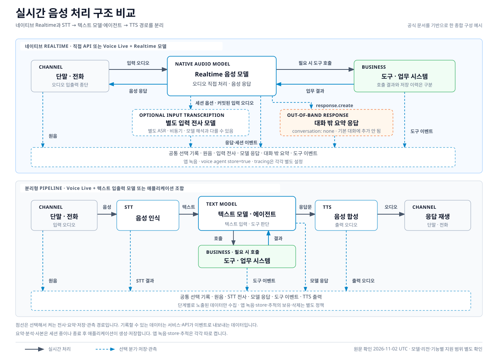
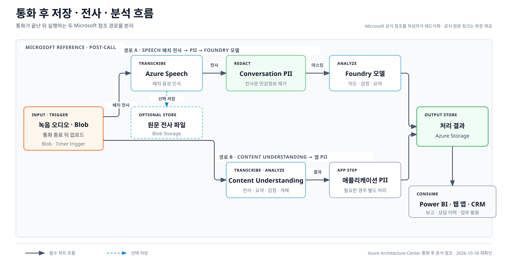

---
services:
- microsoft-foundry
- azure-openai
- azure-storage
- azure-architecture
official_sources:
- title: Voice Live API Overview
  url: https://learn.microsoft.com/azure/ai-services/speech-service/voice-live
- title: Supported regions for Azure Speech
  url: https://learn.microsoft.com/azure/ai-services/speech-service/regions
- title: Extract and analyze call center data
  url: https://learn.microsoft.com/azure/architecture/ai-ml/openai/architecture/call-center-openai-analytics
- title: Data, privacy, and security for Azure AI Voice Live API
  url: https://learn.microsoft.com/azure/foundry/responsible-ai/speech-service/voice-live/data-privacy-security
- title: Data and Privacy for Speech to text
  url: https://learn.microsoft.com/azure/foundry/responsible-ai/speech-service/speech-to-text/data-privacy-security
- title: Data, privacy, and security for Foundry Models sold by Azure
  url: https://learn.microsoft.com/azure/foundry/responsible-ai/openai/data-privacy
- title: Use the GPT Realtime API for speech and audio
  url: https://learn.microsoft.com/azure/foundry/openai/how-to/realtime-audio
- title: Configure a voice agent
  url: https://learn.microsoft.com/azure/foundry/agents/how-to/configure-voice-agent
- title: Voice agent tracing, monitoring, and evaluation
  url: https://learn.microsoft.com/azure/foundry/agents/concepts/voice-agent-observability
- title: Foundry Agent Service limits, quotas, and regional support
  url: https://learn.microsoft.com/azure/foundry/agents/concepts/limits-quotas-regions
- title: Realtime API reference
  url: https://learn.microsoft.com/azure/foundry/openai/realtime-audio-reference
- title: How to use the Voice Live API
  url: https://learn.microsoft.com/azure/ai-services/speech-service/voice-live-how-to
- title: Realtime client events reference (classic)
  url: https://learn.microsoft.com/azure/foundry-classic/openai/realtime-audio-reference-ga
- title: Azure OpenAI in Microsoft Foundry Models quotas and limits
  url: https://learn.microsoft.com/azure/foundry/openai/quotas-limits
- title: Data, privacy, and security for text to speech
  url: https://learn.microsoft.com/azure/foundry/responsible-ai/speech-service/text-to-speech/data-privacy-security
- title: Tracing and data handling
  url: https://learn.microsoft.com/azure/foundry/observability/concepts/trace-data
- title: Identify and extract PII from conversations
  url: https://learn.microsoft.com/azure/ai-services/language-service/personally-identifiable-information/how-to/redact-conversation-pii
- title: PII detection language support
  url: https://learn.microsoft.com/azure/ai-services/language-service/personally-identifiable-information/language-support
- title: Create a batch transcription
  url: https://learn.microsoft.com/azure/ai-services/speech-service/batch-transcription-create
- title: Get batch transcription results
  url: https://learn.microsoft.com/azure/ai-services/speech-service/batch-transcription-get
- title: Azure Blob storage trigger for Functions
  url: https://learn.microsoft.com/azure/azure-functions/functions-bindings-storage-blob-trigger
- title: Access tiers for blob data
  url: https://learn.microsoft.com/azure/storage/blobs/access-tiers-overview
- title: Blob rehydration from the archive tier
  url: https://learn.microsoft.com/azure/storage/blobs/archive-rehydrate-overview
- title: Blob Storage scalability and performance targets
  url: https://learn.microsoft.com/azure/storage/blobs/scalability-targets
- title: Azure Blob Storage lifecycle management overview
  url: https://learn.microsoft.com/azure/storage/blobs/lifecycle-management-overview
- title: Soft delete for blobs
  url: https://learn.microsoft.com/azure/storage/blobs/soft-delete-blob-overview
- title: Use the GPT Realtime API via WebRTC
  url: https://learn.microsoft.com/azure/foundry/openai/how-to/realtime-audio-webrtc
- title: Use the GPT Realtime API via WebSockets
  url: https://learn.microsoft.com/azure/foundry/openai/how-to/realtime-audio-websockets
- title: Use the GPT Realtime API via SIP
  url: https://learn.microsoft.com/azure/foundry/openai/how-to/realtime-audio-sip
- title: Call Recording overview
  url: https://learn.microsoft.com/azure/communication-services/concepts/voice-video-calling/call-recording
- title: Bring your own Azure storage overview
  url: https://learn.microsoft.com/azure/communication-services/concepts/call-automation/call-recording/bring-your-own-storage
- title: Audio streaming overview
  url: https://learn.microsoft.com/azure/communication-services/concepts/call-automation/audio-streaming-concept
- title: Customer-managed keys for Azure Storage encryption
  url: https://learn.microsoft.com/azure/storage/common/customer-managed-keys-overview
- title: Use private endpoints for Azure Storage
  url: https://learn.microsoft.com/azure/storage/common/storage-private-endpoints
- title: Authorize access to data in Azure Storage
  url: https://learn.microsoft.com/azure/storage/common/authorize-data-access
- title: Create a user delegation SAS for a container or blob with the Azure CLI
  url: https://learn.microsoft.com/azure/storage/blobs/storage-blob-user-delegation-sas-create-cli
- title: Store business-critical blob data with immutable storage in a write once, read many (WORM) state
  url: https://learn.microsoft.com/azure/storage/blobs/immutable-storage-overview
- title: Manage and find Azure Blob data with blob index tags
  url: https://learn.microsoft.com/azure/storage/blobs/storage-manage-find-blobs
- title: Azure Communication Services retirement and breaking changes guide
  url: https://learn.microsoft.com/azure/communication-services/acs-retirement-and-breaking-changes-guide
- title: Bring your own storage for call recording quickstart
  url: https://learn.microsoft.com/azure/communication-services/quickstarts/call-automation/call-recording/bring-your-own-storage
- title: Enable and configure Microsoft Defender for Storage
  url: https://learn.microsoft.com/azure/defender-for-cloud/tutorial-enable-storage-plan
- title: Overview of Microsoft Defender for Storage
  url: https://learn.microsoft.com/azure/defender-for-cloud/defender-for-storage-introduction
- title: Monitor Azure Blob Storage
  url: https://learn.microsoft.com/azure/storage/blobs/monitor-blob-storage
- title: Connect to Azure Blob Storage in Microsoft Purview
  url: https://learn.microsoft.com/purview/register-scan-azure-blob-storage-source
- title: Data sources that connect to Data Map
  url: https://learn.microsoft.com/purview/data-map-data-sources
- title: Authoring and publishing protection policies for Azure sources (preview)
  url: https://learn.microsoft.com/purview/data-gov-protection-policy-azure-sources
document_type: research
status: current
verification_status: needs-review
sources_checked_at: 2026-11-02
title: Microsoft 공식 문서로 본 Azure 음성 에이전트 데이터 저장
description: Azure 음성 에이전트에서 원음을 캡처하는 위치, 서비스별 저장 설정, 저장소 보안과 설계를 Microsoft 공식 문서로 정리합니다.
technologies:
- rest-api
tags:
- evaluate
- ai-agents
- storage
published_at: 2026-10-17
topic_order: 1
---

# Microsoft 공식 문서로 본 Azure 음성 에이전트 데이터 저장

> - 목적: Azure로 음성 에이전트를 만들 때 원음과 전사를 어디서 받아 어디에 얼마나 저장할지, 저장소를 어떻게 보호할지 정합니다. Azure OpenAI Realtime·Voice Live·Foundry voice agent·Azure Communication Services를 다루며, OpenAI 직접 API는 다루지 않습니다.
> - 방법: Microsoft Learn·Azure Architecture Center와 OpenAI Realtime 문서의 기재 내용을 정리했습니다. Azure 리소스를 배포해 동작을 시험하지는 않았습니다.
> - 확인일: 발행 2026-10-17, 원문 확인 2026-10-18~20, 연결 방식·ACS 녹음·저장소 보안·out-of-band 응답 2026-11-02. 사례와 법령은 [앱 음성 서비스 기록관리 사례와 정책](../index.md)에 있습니다.

> **읽는 기준**
>
> - **Microsoft 참조 아키텍처:** Microsoft가 예시 구성과 데이터 흐름을 직접 제시한 자료.
> - **제품 문서 기재 내용:** 각 Azure 서비스 문서가 밝힌 기본 저장·처리 방식과 제한.
> - **Microsoft 일반 지침:** Blob Storage·Data Lake Storage·Speech 성능 문서의 명시적 권고. 음성 에이전트 전용 지침이 아닐 때는 그 범위를 함께 표시.
> - **단순 계산:** Microsoft가 공개한 샘플률·비트 수·채널 수에 표준 계산식을 적용한 값.

## 네이티브 Realtime과 분리형 파이프라인의 처리 구조 차이 {#realtime-voice-architectures}

Azure의 실시간 음성 처리는 어떤 모델을 쓰느냐에 따라 두 구조로 나뉩니다.

| 구조 | 처리 흐름 | 전사문의 의미 |
|---|---|---|
| **네이티브 Realtime** | 오디오를 Realtime 음성 모델이 직접 처리하고 음성으로 응답 | [입력 전사](#input-transcription)를 켜면 별도 전사 모델이 비동기로 만드는 보조 기록. 모델의 해석과 다를 수 있음 |
| **분리형 파이프라인** | STT → 텍스트 모델·에이전트 → TTS | STT 결과가 텍스트 모델 입력이 됨. 단계마다 로그·사본이 생길 수 있음 |

[Voice Live](https://learn.microsoft.com/en-us/azure/ai-services/speech-service/voice-live)는
음성 인식, 생성형 모델, 음성 합성을 API 하나로 묶은 관리형 서비스입니다.
Realtime 모델을 고르면 네이티브 구조로, GPT-4.1·GPT-5 같은 텍스트 모델을
고르면 Azure 음성 인식·합성을 앞뒤에 붙인 분리형 구조로 동작합니다.
애플리케이션이 Speech·텍스트 모델·TTS를 직접 연결해도 분리형 구조입니다.

<div class="voice-diagram-scroll" role="region" aria-label="네이티브 Realtime과 분리형 음성 파이프라인 비교 도식 가로 스크롤" tabindex="0" markdown="1">

[](../images/azure-voice-agent-realtime-architectures.svg)

</div>

> 공식 문서를 바탕으로 이 리서치가 그린 구성 예시입니다. 입력 전사는 Realtime
> 세션 옵션입니다. 켜면 서비스가 커밋된 입력 오디오를 별도 ASR 모델로 보내
> 응답 생성과 동시에 전사하며, 그 결과는 모델의 해석과 다를 수 있습니다
> ([이벤트 레퍼런스](https://learn.microsoft.com/azure/foundry-classic/openai/realtime-audio-reference-ga)).
> 점선은 애플리케이션 녹음·세션 저장·추적을 각각 켤 수 있는 지점입니다.

## 세션 옵션으로 켜는 입력 전사와 전사 이벤트 {#input-transcription}

네이티브 Realtime 모델은 오디오를 직접 처리하므로 사용자 발화의 텍스트가 따로
생기지 않습니다. 텍스트가 필요하면 세션에서 입력 전사(input audio transcription)를
켭니다. 켜면 서비스가 커밋된 입력 오디오를 별도 전사 모델로 보내고, 결과를
이벤트로 돌려줍니다. 위 그림의 `OPTIONAL INPUT TRANSCRIPTION`이 이 설정입니다.

| 항목 | Azure OpenAI Realtime | Voice Live |
|---|---|---|
| 설정 위치 | GA: `session.audio.input.transcription`. Azure how-to 예시와 preview: `session.input_audio_transcription` | `session.input_audio_transcription` |
| `model` 값 | Azure에 배포한 전사 모델의 **배포 이름** | 모델 이름. `gpt-realtime`·`gpt-realtime-mini`와는 `whisper-1`·`gpt-4o-transcribe`·`gpt-4o-mini-transcribe`·`gpt-4o-transcribe-diarize`·`mai-transcribe`(preview)를, 텍스트 모델·에이전트와는 `azure-speech`·`mai-transcribe`(preview)를 사용. `mai-transcribe`는 현재 `mai-transcribe-2`(preview)를 가리키며, 스트리밍용 `mai-transcribe-2-streaming`(preview)도 선택 가능 |
| 기본값 | 꺼짐 | 텍스트 모델(분리형)을 쓰면 `azure-speech`가 자동으로 켜짐 |
| 인식 보정 | `language`(ISO-639-1 코드)와 `prompt`로 전사 모델에 힌트 제공 | `language`, `prompt`(OpenAI 전사 모델), `phrase_list`(MAI Transcribe), phrase list·custom speech(`azure-speech`) |

Voice Live 전사 모델은 모델마다 지원 리전과 처리 범위가 다르고, `mai-transcribe-2-streaming`은 `mai-transcribe-2`와도 리전이 다릅니다. 모델을 고르기 전에 [Speech 기능 가용성과 처리 범위](https://learn.microsoft.com/azure/ai-services/speech-service/regions?tabs=voice-live#speech-feature-availability-and-processing-scope)를 확인합니다.

Azure OpenAI Realtime GA 형식의 설정 예시입니다.

```json
{
  "type": "session.update",
  "session": {
    "type": "realtime",
    "audio": {
      "input": {
        "transcription": {
          "model": "<전사 모델 배포 이름>",
          "language": "ko"
        }
      }
    }
  }
}
```

전사 결과는 다음 이벤트로 옵니다. 모든 이벤트에 입력 오디오 항목의 `item_id`가
들어 있으므로, 이 값으로 원음·전사·응답을 연결합니다.

| 이벤트 | 내용 |
|---|---|
| `conversation.item.input_audio_transcription.delta` | 전사 중간 결과 |
| `conversation.item.input_audio_transcription.completed` | 최종 전사(`transcript`) |
| `conversation.item.input_audio_transcription.failed` | 전사 실패 |

입력 전사는 다음처럼 동작합니다.

- **시작 시점:** 입력 오디오 버퍼가 커밋될 때 시작합니다. 서버 VAD를 쓰면 발화가
  끝날 때, 수동 턴 처리에서는 `input_audio_buffer.commit`을 보낼 때입니다.
- **순서:** 응답 생성과 별개로 비동기로 실행되므로 `completed` 이벤트가 응답
  이벤트보다 먼저 올 수도, 나중에 올 수도 있습니다.
- **정확도:** 전사는 별도 ASR 모델의 결과라 Realtime 모델이 이해한 내용과 다를 수
  있습니다. OpenAI 레퍼런스는 이 전사를 "모델이 들은 내용 그대로가 아니라 입력
  오디오에 대한 참고(guidance)"로 다루라고 설명합니다.
- **저장:** Voice Live는 고객 데이터를 저장하지 않고, Realtime API에는 세션 내용을
  저장해 두는 기능이 없습니다. 단, Azure OpenAI 모델은 남용 모니터링으로 사람
  검토 대상이 된 일부 프롬프트·응답을 보관할 수 있습니다([아래](#persistence-controls)).
  전사를 남기려면 애플리케이션이 `completed` 이벤트를 받아 `item_id`와 함께
  저장하거나, Foundry voice agent의 `store=true`를 씁니다.

근거: [Azure Realtime 사용법](https://learn.microsoft.com/azure/foundry/openai/how-to/realtime-audio#session-configuration)
· [Azure Realtime API reference](https://learn.microsoft.com/azure/foundry/openai/realtime-audio-reference)(배포 이름 차이)
· [Realtime 이벤트 레퍼런스](https://learn.microsoft.com/azure/foundry-classic/openai/realtime-audio-reference-ga)
· [Voice Live 사용법](https://learn.microsoft.com/azure/ai-services/speech-service/voice-live-how-to#audio-input-transcription)
· [OpenAI Realtime 세션 레퍼런스](https://developers.openai.com/api/reference/resources/realtime/subresources/calls/methods/create)
· [OpenAI 실시간 전사 가이드](https://developers.openai.com/api/docs/guides/realtime-transcription)

## 연결 방식별 원음 캡처 지점 {#audio-capture-path}

서비스가 원음을 저장하지 않는 구성에서 원음을 남기려면 애플리케이션이 음성을
받을 지점을 정해야 합니다. 음성이 앱 서버를 지나는 WebSocket 구조는 그 방법 중
하나이고, WebRTC처럼 음성이 앱 서버를 거치지 않는 연결에도 캡처 방법이 있습니다.

| 연결 방식 | 음성 경로 | 애플리케이션이 원음을 저장하는 방법 |
|---|---|---|
| [WebRTC](https://learn.microsoft.com/azure/foundry/openai/how-to/realtime-audio-webrtc) | 브라우저가 앱 서비스에서 받은 임시 토큰으로 Azure와 직접 연결. 음성은 앱 서버를 거치지 않음 | 브라우저에서 따로 녹음해 업로드하거나, 앱 서비스가 세션 협상(SDP)을 대신 처리한 뒤 응답의 `Location` 헤더로 관찰자 WebSocket을 열어 세션을 녹음 |
| [WebSocket](https://learn.microsoft.com/azure/foundry/openai/how-to/realtime-audio-websockets) | 서버 간 연결. 클라이언트 음성이 앱 서버를 거쳐 Azure로 감 | 앱 서버가 주고받는 오디오를 그대로 저장 |
| [SIP](https://learn.microsoft.com/azure/foundry/openai/how-to/realtime-audio-sip) | 전화망 SIP 트렁크가 Azure로 통화를 보냄. 앱은 webhook으로 수신 이벤트를 받아 통화를 수락하고, 같은 세션에 WebSocket을 열어 이벤트를 받고 명령을 보냄 | 문서는 이 WebSocket을 이벤트·명령용으로 설명. 통화 원음은 ACS 같은 전화 채널 쪽에서 녹음 |
| Azure Communication Services 통화 | 전화(PSTN)·VoIP 통화를 ACS Call Automation이 처리 | [Call Recording](https://learn.microsoft.com/azure/communication-services/concepts/voice-video-calling/call-recording)으로 녹음하거나 [오디오 스트리밍](https://learn.microsoft.com/azure/communication-services/concepts/call-automation/audio-streaming-concept)으로 앱 WebSocket에 실시간 전달 |

ACS 통화 녹음은 다음과 같이 저장됩니다.

- **기본 저장소:** 녹음 파일을 ACS 임시 저장소에 24시간 두며, 그 뒤에는 내려받을 수
  없습니다. Event Grid의 `RecordingFileStatusUpdated` 이벤트를 받아 24시간 안에
  가져가야 합니다.
- **고객 저장소(BYOS):** [Bring Your Own Storage](https://learn.microsoft.com/azure/communication-services/concepts/call-automation/call-recording/bring-your-own-storage)를
  설정하면 고객 Blob Storage에 바로 저장합니다.
  [BYOS 빠른 시작](https://learn.microsoft.com/azure/communication-services/quickstarts/call-automation/call-recording/bring-your-own-storage)에
  따라 ACS 리소스의 시스템 할당 관리 ID에 `Storage Blob Data Contributor` 역할을 줍니다. 내보내기가 성공해도 ACS 임시 저장소에
  24시간 사본이 남습니다.
- **형식:** 혼합 녹음은 mp3·wav(16kHz), 비혼합 녹음은 참여자별 채널을 나눈 wav(최대
  5채널)입니다.
- **실시간 스트리밍:** 오디오 스트리밍은 16비트 PCM mono 16kHz·24kHz를 앱 WebSocket으로
  보내며, 혼합 스트림과 참여자별 비혼합 스트림(최대 4채널)을 고를 수 있습니다.

신규 서비스에서 ACS를 캡처 경로로 고르기 전에
[종료·변경 가이드](https://learn.microsoft.com/azure/communication-services/acs-retirement-and-breaking-changes-guide)의
다음 내용을 확인합니다.

- **단독 서비스 종료:** Microsoft는 2026-09-23에 ACS 단독 서비스(standalone offering)를
  2028-09-30에 종료한다고 발표했습니다.
- **Teams 연동만 지원:** Call Automation·Call Recording·Audio Streaming은 종료가 아닌
  호환성 변경(breaking change) 대상입니다. 2028-09-30 이후에도 남지만 Teams와
  연동하는 시나리오에서만 지원되고, Teams와 연동하지 않는 단독 시나리오는 지원되지
  않습니다.
- **신규 전화번호 제한:** 2026-10-23 이전에 만든 ACS 리소스가 없는 고객은 PSTN 통화·SMS
  같은 종료 대상 전화 업무용 전화번호를 새로 받을 수 없습니다.

## 처리 구조별로 생기는 원음·전사·이벤트 기록 {#records-by-architecture}

| 기록 | 네이티브 Realtime | 분리형 파이프라인 | 통화 후 분석 |
|---|---|---|---|
| **입력·출력 오디오** | 모델이 직접 처리. 애플리케이션 녹음·voice agent `store`는 별도 선택 | STT 입력·TTS 출력. 애플리케이션 녹음·voice agent `store`는 별도 선택이며 단계별 사본이 생길 수 있음 | 이미 보관된 녹음이 분석 입력 |
| **전사문** | 선택 전사 모델이 만드는 보조 기록일 수 있음 | 텍스트 모델에 전달되는 STT 결과 | 배치 전사 또는 Content Understanding 결과 |
| **대화·도구 이벤트** | conversation item·response·tool event 연결 | STT·모델·TTS 단계와 업무 호출 연결 | 분석 작업·입력 파일·결과 ID 연결 |
| **업무 결과** | 도구 호출 결과. 주문·기기 동작·지원 티켓 이력은 업무 시스템에 저장 | 동일 | CRM·보고 시스템에 저장 |
| **추적·지원 로그** | 기능을 켠 경우 별도 저장 | 기능을 켠 경우 별도 저장 | 파이프라인·Functions·Storage 로그 |
| **분석 결과·사본** | 구현에 따라 세션 중 또는 종료 후 생성. 보유·삭제는 원음·전사와 따로 정함 | 동일 | 통화 후 작업에서 생성해 Azure Storage에 저장 |

전사문은 구조마다 만드는 주체가 다릅니다.

- **네이티브 Realtime:** [입력 전사](#input-transcription)를 켜면 별도 전사 모델이
  입력 오디오를 전사합니다. 모델이 이해한 내용과 다를 수 있습니다.
- **분리형:** STT 결과가 그대로 텍스트 모델의 입력입니다.
- **통화 후 분석:** 저장된 녹음을 배치 전사로 다시 처리한 결과입니다.

세션 기록을 서비스 쪽에 저장해 두고 다시 조회하려면 Foundry voice agent의
`store`를 씁니다. 네이티브·분리형 voice agent 모두 `store=true`면 전사·이벤트·원음을
저장합니다. GPT Realtime API나 Voice Live API를 직접 호출하면 세션 내용을 저장해 두는 기능이
없으므로 필요한 기록은 애플리케이션이 저장합니다. Azure OpenAI 모델의 남용
모니터링에 따른 보관은 [아래](#persistence-controls)에 따로 정리했습니다.

### Realtime out-of-band 응답으로 받는 대화 중 요약 {#out-of-band-summary}

Realtime API의 `response.create`에 `"conversation": "none"`을 지정하면 기본
대화와 별개인 응답(out-of-band response)이 생성됩니다
([Azure 문서](https://learn.microsoft.com/azure/foundry/openai/how-to/realtime-audio#out-of-band-responses)).
이 응답은 대화 기록에 추가되지 않으므로, 음성 대화를 이어가면서 같은 세션에서
요약을 텍스트로 받을 수 있습니다.

```json
{
  "type": "response.create",
  "response": {
    "conversation": "none",
    "output_modalities": ["text"],
    "metadata": { "topic": "summary" },
    "instructions": "지금까지 대화를 3줄로 요약해"
  }
}
```

| 필드·동작 | 설명 |
|---|---|
| `conversation: "none"` | 응답을 기본 대화에 추가하지 않음. 음성 응답의 맥락에 요약이 섞이지 않음 |
| `metadata` | 같은 값이 `response.done`에 담겨 옴. 이 값으로 요약 응답과 음성 응답을 구분 |
| `input` | 요약에 쓸 대화 범위를 기존 item 참조나 새 메시지로 직접 지정(예: 최근 N턴). 생략하면 지금까지의 기본 대화를 근거로 응답 |
| 동시 생성 | 여러 응답을 동시에 생성할 수 있음 |

위 예시는 [OpenAI Realtime 사양](https://developers.openai.com/api/docs/guides/realtime-conversations)의
필드 이름(`output_modalities`·`instructions`)을 씁니다.
[Azure Realtime API](https://learn.microsoft.com/azure/foundry/openai/realtime-audio-reference)는
이 사양을 따릅니다. Azure how-to 예시의 `modalities`는 `output_modalities`의 이전
이름입니다. 예시의 문자열 `prompt`는 GA 사양에서 프롬프트 템플릿을 참조하는 필드이므로,
요약 지시문은 `instructions`로 보냅니다.

요약은 원음·전사와 다른 새 파생 기록이므로 저장 위치와 보유기간을 애플리케이션이
따로 정합니다.

**사용자가 응답 도중 끼어든 경우:** 재생되지 않은 응답은
`conversation.item.truncate`로 잘립니다. 재생되지 않은 오디오와 그 응답의 텍스트
전사가 대화에서 지워지며, 재생 지점에 맞춰 잘린 전사는 따로 제공되지 않습니다
([Azure 문서](https://learn.microsoft.com/azure/foundry/openai/how-to/realtime-audio#response-interruption) ·
[OpenAI 문서](https://developers.openai.com/api/docs/guides/realtime-conversations)).
WebRTC·SIP 연결에서는 서버가 자동으로 자르고, WebSocket 연결에서는 클라이언트가
재생을 멈추고 이 이벤트를 보내야 합니다.

- 기본 대화로 요약할 때: WebSocket에서 truncate를 보내지 않으면 사용자가 듣지
  못한 응답까지 요약에 들어갑니다.
- 애플리케이션이 출력 자막 이벤트를 모아 다른 텍스트 모델로 요약할 때: 자막은
  재생 지점에 맞춰 잘리지 않으므로 실제로 들린 내용보다 많을 수 있습니다.

## 기능별 설정으로만 저장되는 Azure 음성 서비스 데이터 {#persistence-controls}

### 서비스별 원음·대화 내용 저장 여부

각 서비스의 데이터 처리 문서가 밝힌 원음·대화 내용의 서비스 측 저장
방식입니다. 서비스가 저장하지 않는다는 설명은 애플리케이션 녹음이나 연결
기능의 저장에는 해당하지 않습니다.

| 서비스·저장 조건 | 저장 대상 | 저장 위치·접근 | 보유·삭제 |
|---|---|---|---|
| **Azure AI Speech 실시간 음성 인식** | 원음은 서버 메모리에서 처리하고 저장 상태로 남기지 않음 | 이 실시간 처리의 원음 저장소 없음 | 서비스가 보유하지 않음. 앱이 받은 전사·오디오를 따로 저장한다면 앱 정책 |
| **Voice Live API 자체** | Voice Live 자체는 고객 데이터를 저장·보관하지 않음 | 기본 세션의 고객 데이터 저장소 없음. 연결 모델·Agent·Custom Voice 등의 저장은 별도 | 연결 기능·앱 사본은 각각의 정책을 따름 |
| **Voice Live 지원 로그 / 티켓과 사용자 동의** | Microsoft 엔지니어의 문제 진단용 음성 데이터 | 리소스와 같은 리전의 Microsoft 관리 Azure Storage. 승인된 디버깅 엔지니어가 통제된 방식으로 접근 | 로그 생성 후 30일 자동 삭제 |
| **Foundry voice agent / `store=true`** | 전사문·이벤트 시간선·원음 | 음성 에이전트 소유 저장소. agent endpoint의 저장 대화 API로 조회. BYOS 녹음은 고객 Azure Storage의 URI로 반환되며 계정 RBAC 적용 | 저장 대화·Microsoft 관리 오디오의 기본 보유기간 60일. 저장 대화 삭제 시 responses·items·오디오도 삭제. BYOS 사본은 고객 저장소 정책 |
| **미리 구축된 음성의 실시간 합성(TTS)** | 입력 텍스트·출력 오디오는 서비스 로그에 저장하지 않음 | 이 실시간 합성의 내용 저장소 없음 | 고객 앱이 저장한 출력과 배치 합성·학습용 음성 데이터는 별도 정책 |

#### Foundry voice agent `store=true`의 전사·이벤트·원음 60일 보관 {#voice-agent-persistence}

[구성 문서](https://learn.microsoft.com/azure/foundry/agents/how-to/configure-voice-agent#persist-conversations)의
`store` 기본값은 `false`이며, `true`일 때 전사·이벤트·원음을 함께
영속화합니다. 별도의 오디오 저장 스위치는 없습니다. 연결 요청의
`store` 매개변수로 한 세션만 재정의할 수 있습니다. 이 설정은 미리 보기인
Foundry voice agent의 기능입니다.

- **왜·무엇을:** 세션의 대화 내용을 다시 조회·재생하거나 조사·평가하려는 경우 저장을 명시적으로 선택합니다. [저장 대화 조회 문서](https://learn.microsoft.com/azure/foundry/agents/concepts/voice-agent-observability#read-stored-conversations)는 턴별 전사·오디오와 발신자 왼쪽/에이전트 오른쪽의 병합 스테레오 녹음을 설명합니다.
- **어디에·누가 접근하는가:** 음성 에이전트 소유 저장소의 대화·오디오를 서비스 endpoint로 읽습니다. 고객 저장소를 가져오는 BYOS에서는 녹음 URI가 고객 계정을 가리키며 그 계정의 Azure RBAC가 접근을 통제합니다.
- **얼마나·어떻게 지우는가:** [서비스 기본 제한](https://learn.microsoft.com/azure/foundry/agents/concepts/limits-quotas-regions#default-service-limits)은 저장 대화와 Microsoft 관리 오디오에 60일을 명시합니다. 저장 대화 삭제는 그 responses·items·오디오를 함께 삭제합니다. BYOS 오디오·다운로드본·외부 반출본·추적은 각 저장소의 보유 정책을 따릅니다.
- **고객 저장소:** BYOS 저장소의 리전·접근 역할·수명주기와 반출·백업 사본의 삭제는 고객이 정합니다.

### 모델 상태 유지·남용 모니터링·추적의 별도 저장소

| 기능 | Microsoft 문서에 명시된 동작 | 저장 위치·기간 |
|---|---|---|
| **Azure 판매 모델(Azure OpenAI 포함)** | 모델 자체는 무상태. Responses API·Threads·Stored completions 같은 상태 유지 기능은 별도 데이터 저장소를 만듦 | 기능별 저장소와 보유기간 |
| **Azure 판매 모델의 남용 모니터링** | 사람 검토 대상으로 선택된 일부 프롬프트·응답은 고객 리소스별로 논리 분리된 저장소에 보관될 수 있음 | 고객 리소스별로 논리 분리된 저장소 |
| **Foundry 추적** | 기본적으로 꺼져 있으며, 프로젝트에 Application Insights를 연결하면 모델·도구·STT·TTS 등 단계의 실행 데이터를 추적. 전사·오디오 참조는 기본 수집하지 않음 | 연결한 Application Insights·Log Analytics의 리전·보유기간 |

추적을 끄면 새 추적 자료 수집은 중단되지만 이미 저장된 자료는 연결한
Application Insights와 Log Analytics의 보유 정책을 따릅니다. 실시간
세션 저장, 추적, 남용 모니터링, 상태 유지 기능은 각각 따로 설정합니다.

[음성 추적 문서](https://learn.microsoft.com/azure/foundry/agents/concepts/voice-agent-observability#transcripts-and-audio)에
따르면 전사·오디오 참조는 기본 수집하지 않습니다. 수집을 켜면
Application Insights에는 오디오 참조가 기록되고, 녹음 자체는 음성
에이전트 소유 저장소에 남습니다. 그래서 추적과 원음의 보유기간은 따로
관리됩니다.

### 배치 전사 결과의 저장 위치와 보유 기간

| 기능 | 입력·결과 동작 | 보유·삭제 |
|---|---|---|
| **Azure AI Speech 배치 음성 인식 입력** | `contentContainerUrl` 또는 `contentUrls`로 지정한 오디오를 읽어 처리 | 고객이 지정한 URL·컨테이너 |
| **Azure AI Speech 배치 음성 인식 결과** | `destinationContainerUrl`이 없으면 Microsoft 관리 컨테이너, 있으면 지원되는 고객 Azure 컨테이너에 저장 | 서비스 내 `timeToLiveHours`는 완료 후 6시간~31일. 고객 컨테이너 사본은 고객 수명주기 정책 |
| **통화 후 분석 결과** | 요약·감정·통화 목적·개체 등 처리 결과를 Azure Storage에 저장 | 애플리케이션이 목적별로 기간 설정 |

Microsoft 관리 결과는 transcription 작업을 삭제하면 함께 삭제됩니다. 고객
컨테이너에 저장한 결과는 그 컨테이너의 수명주기 정책으로 관리합니다.

### 공식 참조의 단계별 저장 위치

| 시점 | 대상 | 저장소 또는 처리 주체 | Microsoft 자료의 범위 |
|---|---|---|---|
| **실시간 가상 에이전트 분석을 위해 저장할 때** | Voice Live 또는 GPT Realtime의 오디오와 음성 텍스트 | Azure Blob Storage | 통화 후 분석 참조의 가상 에이전트 대안 |
| **Foundry voice agent 세션에서 `store=true`일 때** | 전사문·이벤트 시간선·원음 | 음성 에이전트 소유 저장소. BYOS 녹음은 고객 Azure Storage | [저장 대화·Microsoft 관리 오디오 60일과 BYOS 경계](#voice-agent-persistence) |
| **Voice Live 지원 로그를 사용자가 켰을 때** | 지원용 음성 로그 | Microsoft 관리 Azure Storage | Voice Live 개인정보 처리 문서 |
| **통화 녹음 후** | 녹음 오디오 파일 | Azure Blob Storage | 통화 후 분석 참조 아키텍처 |
| **새 Blob 업로드 감지 후** | 새 오디오 파일을 처리할 작업 | [Blob trigger](https://learn.microsoft.com/en-us/azure/azure-functions/functions-bindings-storage-blob-trigger#choose-a-blob-storage-trigger-implementation)가 Azure Functions 시작 | 이벤트 기반·폴링 기반 구현에 따라 지연 특성이 다름 |
| **정해진 일괄 실행 시각** | 일정 기간 모인 오디오 파일 | Timer trigger가 Azure Functions 시작 | 통화 후 분석 참조 아키텍처 |
| **배치 음성 인식 후, 선택 시** | 원문 전사 파일 | Azure Blob Storage | 통화 후 분석 참조 아키텍처 |
| **개인정보 제거·모델 분석 후** | 요약·감정·통화 목적·개체 등 처리 결과 | Azure Storage | 통화 후 분석 참조 아키텍처 |
| **Content Understanding 처리 후** | 전사문과 추출 결과 | Blob Storage 또는 다른 데이터 저장소 | 통화 후 분석 참조 아키텍처 |
| **업무 시스템 반영 시** | 통화 이력·요약·통화 이유 | CRM 시스템 | 통화 후 분석 참조 아키텍처 |

근거:

- [Speech to text 데이터 처리](https://learn.microsoft.com/en-us/azure/foundry/responsible-ai/speech-service/speech-to-text/data-privacy-security)
- [Voice Live 데이터 처리](https://learn.microsoft.com/en-us/azure/foundry/responsible-ai/speech-service/voice-live/data-privacy-security)
- [voice-based prompt agent 구성](https://learn.microsoft.com/en-us/azure/foundry/agents/how-to/configure-voice-agent)
- [Foundry Models 데이터 처리](https://learn.microsoft.com/en-us/azure/foundry/responsible-ai/openai/data-privacy)
- [Text to speech 데이터 처리](https://learn.microsoft.com/en-us/azure/foundry/responsible-ai/speech-service/text-to-speech/data-privacy-security)
- [Foundry 추적 데이터](https://learn.microsoft.com/en-us/azure/foundry/observability/concepts/trace-data)

## 원음 저장 리전과 따로 정해지는 음성·모델 처리 위치 {#storage-and-processing-scope}

음성 데이터의 저장·처리 위치는 다섯 곳으로 나뉩니다.

1. 애플리케이션이 원음·파생 기록을 저장하는 리전
2. STT·TTS 같은 음성 기능의 처리 범위
3. 선택 모델의 추론 범위
4. 선택 지원 로그의 저장 위치
5. Application Insights·Log Analytics 추적 저장 위치

Blob Storage를 한국 리전에 두어도 Voice Live 음성 기능, LLM 추론, 지원
로그, 추적 데이터의 처리·저장 위치는 각각의 배포 범위를 따릅니다. [Voice Live 리전 표](https://learn.microsoft.com/en-us/azure/ai-services/speech-service/regions?tabs=voice-live#llm-availability-and-processing-scope)는
음성 기능과 LLM의 지역 가용성·처리 범위를 별도로 제시하며, 각 기능은
Global·Data Zone·Regional 범위를 가질 수 있습니다.

- **애플리케이션 저장:** Blob Storage·Application Insights·Log Analytics의 선택 리전과 복제·보유 설정
- **음성 기능:** Voice Live 리소스 리전과 별개로 표시된 음성 인식·HD 음성 합성 처리 범위
- **모델 추론:** 선택한 Global·Data Zone·Regional 배포와 모델별 지원 범위
- **지원 로그:** Voice Live 지원 로그를 켠 경우 Voice Live 리소스와 같은 리전의 Microsoft 관리 Storage
- **추적:** Foundry 프로젝트에 연결한 Application Insights·Log Analytics 리소스

## 모델 전달 전후로 갈리는 PII 통제 범위 {#pii-by-stage}

| 경로 | PII 통제 시점 | 통제가 되돌리지 못하는 범위 |
|---|---|---|
| **네이티브 Realtime** | 전달 전 수집 최소화·클라이언트 통제. 텍스트 PII는 모델 처리 뒤 선택 전사·출력·저장 단계 | 모델에 이미 전달된 원음 |
| **애플리케이션 분리형** | 지원 언어·버전에서 STT 뒤, 텍스트 모델 전달 전 적용 가능 | 원음과 별도 음성 사본 |
| **Voice Live 관리형 분리 경로** | Microsoft 문서가 공개한 지원 통제만 적용 | 관리형 경로에 이미 전달된 원음 |
| **통화 후 Speech 경로** | 배치 전사 뒤, Foundry 모델 전달 전 Conversation PII | 원음 Blob |
| **Content Understanding 경로** | 추출 결과 반환 뒤 애플리케이션 단계 | 서비스에 이미 전달된 원음 |

- 사후 마스킹은 이미 끝난 모델 전송을 되돌리지 못합니다.
- 전사문을 마스킹해도 원음에는 그대로 남습니다.
- Conversation PII는 민감 구간의 오디오 타이밍을 반환하므로, 원음의 해당 구간은 애플리케이션이 따로 처리합니다.
- [2026-10-18 확인 기준 언어 지원](https://learn.microsoft.com/en-us/azure/ai-services/language-service/personally-identifiable-information/language-support?tabs=conversation-pii#conversation-pii-language-support)에서 Text PII는 한국어를 지원하지만 Conversation PII `2024-11-01` GA 언어 목록은 영어·프랑스어·독일어·스페인어입니다.

Architecture Center 본문은 Conversation PII를 `preview`로 표기하지만,
언어 지원 문서는 `2024-11-01` GA를 제시합니다.

## 녹음·전사·분석 결과를 Blob Storage에 나눠 두는 통화 후 분석 참조 {#post-call-architecture}

[Azure Architecture Center의 콜센터 데이터 추출·분석 아키텍처](https://learn.microsoft.com/en-us/azure/architecture/ai-ml/openai/architecture/call-center-openai-analytics)는
통화가 끝난 뒤 녹음과 전사를 배치 처리하는 Microsoft 공식 참조
아키텍처입니다.

- **자료 유형:** Azure Architecture Center 참조 아키텍처
- **주요 범위:** 통화가 끝난 뒤 수행하는 배치 분석
- **사용 서비스:** Azure Blob Storage, Azure Speech, Microsoft Foundry, Azure Language 또는 Azure Content Understanding, Power BI
- **Microsoft 공식 그림:** [Microsoft 아키텍처 SVG](https://learn.microsoft.com/en-us/azure/architecture/ai-ml/openai/architecture/_images/call-center-analytics.svg)
- **Microsoft 제공 Visio:** [편집 가능한 원본 파일](https://arch-center.azureedge.net/call-center-analytics.vsdx)

<div class="voice-diagram-scroll" role="region" aria-label="Microsoft 통화 후 분석 참조의 처리·저장 흐름 도식 가로 스크롤" tabindex="0" markdown="1">

[](../images/azure-voice-agent-ms-reference-architecture.svg)

</div>

> **그림 성격:** Microsoft 공식 참조의 두 분석 경로를 이 리서치가
> 재도식화했습니다. 위 링크의 Microsoft 제공 SVG가 공식 원본입니다.
> Content Understanding 결과는 애플리케이션이 바로 저장하거나, 필요한
> 경우 별도 PII 처리를 거친 뒤 같은 결과 저장 단계로 합류합니다.

## soft delete·버전·불변 보존이 늦추는 Blob 수명주기 삭제 {#storage-lifecycle}

[Blob 수명주기 관리](https://learn.microsoft.com/en-us/azure/storage/blobs/lifecycle-management-overview)는
생성·수정 시각, 경로 prefix와 blob tag를 기준으로 계층 이동·삭제 규칙을
정의할 수 있다고 설명합니다. 마지막 접근 시각 조건을 사용하려면 storage
account에서 last access time tracking을 먼저 켜야 합니다.

- 정책을 추가하거나 수정한 뒤 변경이 적용되고 첫 실행이 시작되기까지 최대 24시간이 걸릴 수 있음.
- 계정 요청률이 한도에 가까우면 정책 실행이 더 늦어질 수 있음.
- `LifecyclePolicyCompleted` 이벤트, 메트릭과 로그로 실행 결과를 확인할 수 있음.

- **Soft delete:** soft delete가 켜진 계정에서 수명주기 delete가 실행되면
  blob은 즉시 영구 삭제되지 않고 설정된 보유기간 동안 복구 가능한
  상태로 남음. soft-deleted blob에는 수명주기 delete가 다시 적용되지
  않음. [공식 동작](https://learn.microsoft.com/en-us/azure/storage/blobs/soft-delete-blob-overview)
- **버전·스냅샷:** 현재 버전, 이전 버전과 snapshot에는 수명주기 규칙을
  각각 지정함.
- **불변 보존:** immutable container의 blob에는 수명주기 delete가
  동작하지 않음. 시간 기반 보존이나 법적 보존이 끝나기 전에는 삭제할 수 없음.
- **실행 시간:** 최대 24시간은 정책 반영과 첫 실행 시작까지의 시간이며,
  삭제 완료까지는 대상 수와 계정 요청률에 따라 더 걸릴 수 있음.

## 원음 저장소의 키·네트워크·인증·불변 보존·감사 설정 {#storage-security}

원음과 전사는 개인정보이므로 저장소 계정에 다음 통제를 함께 겁니다.

| 통제 | Azure Storage 기능 | 동작 |
|---|---|---|
| 암호화 키 | [고객 관리 키(CMK)](https://learn.microsoft.com/azure/storage/common/customer-managed-keys-overview) | Key Vault 또는 Managed HSM에 둔 키로 암호화. 스토리지 계정의 관리 ID가 Microsoft Entra ID로 Key Vault에 접근 |
| 네트워크 | [Private Endpoint](https://learn.microsoft.com/azure/storage/common/storage-private-endpoints) | 가상 네트워크의 클라이언트가 Microsoft 백본의 Private Link로 접근. 가상 네트워크에서 Storage FQDN이 private endpoint IP로 해석되도록 private DNS zone(기본 생성)이나 자체 DNS를 구성. Private Endpoint를 만들어도 public endpoint는 자동으로 막히지 않으므로, Private Link로만 접근하게 하려면 스토리지 방화벽에서 public endpoint 접근을 거부하거나 공용 네트워크 액세스를 끔. 이렇게 해도 private endpoint가 연결된 가상 네트워크 트래픽은 허용 |
| 인증 | [Microsoft Entra ID와 관리 ID](https://learn.microsoft.com/azure/storage/common/authorize-data-access) | Microsoft는 Entra ID와 관리 ID를 권장하고 Shared Key(계정 키) 인증은 허용하지 않도록 설정하라고 권장 |
| 임시 다운로드 | [user delegation SAS](https://learn.microsoft.com/azure/storage/blobs/storage-blob-user-delegation-sas-create-cli) | 계정 키 대신 Entra 자격 증명으로 서명. 최대 7일까지만 유효 |
| 법적 보존 | [불변 저장소(WORM)](https://learn.microsoft.com/azure/storage/blobs/immutable-storage-overview) | 시간 기반 보존 정책이나 법적 보존(legal hold)이 걸린 동안 생성·읽기만 되고 수정·삭제는 안 됨. 컨테이너 단위 또는 계정·컨테이너·버전 단위로 설정. 수명주기 삭제도 동작하지 않음 |
| 위협 탐지 | [Microsoft Defender for Storage](https://learn.microsoft.com/azure/defender-for-cloud/defender-for-storage-introduction) | 비정상 접근·유출 시도 같은 위협 탐지가 기본. 업로드 시 악성코드 검사와 민감 데이터 위협 탐지는 [켜고 끌 수 있는 기능](https://learn.microsoft.com/azure/defender-for-cloud/tutorial-enable-storage-plan)이라 구독 또는 스토리지 계정 설정에서 켜져 있는지 확인. 업로드 검사에는 계정별 월 검사량 상한(기본 10,000GB)이 있음 |
| 접근 감사 | [진단 설정과 `StorageBlobLogs`](https://learn.microsoft.com/azure/storage/blobs/monitor-blob-storage) | 진단 설정을 만들어야 읽기·쓰기·삭제 요청 로그가 수집됨. 로그에 인증 유형 등 요청 정보가 남음 |
| 민감 데이터 발견 | [Microsoft Purview](https://learn.microsoft.com/purview/register-scan-azure-blob-storage-source) | Blob Storage 계정을 등록·스캔해 메타데이터를 추출하고 민감 데이터를 분류. [스캔 지원 형식](https://learn.microsoft.com/purview/data-map-data-sources#file-types-supported-for-scanning)은 CSV·JSON·TXT 같은 정형 파일과 문서 파일이며 WAV·MP3 같은 오디오는 포함되지 않으므로, 전사 텍스트를 Blob에 저장할 때 해당. 스캔만으로 접근이 제한되지는 않으며, 민감도 레이블이 붙은 데이터의 접근을 막으려면 [보호 정책](https://learn.microsoft.com/purview/data-gov-protection-policy-azure-sources)(preview)을 따로 만듦 |

## 기록별 삭제·감사를 위한 보존 등급별 컨테이너와 연결 키 {#storage-layout}

다음은 위 기능을 조합한 설계 예시입니다.

- **컨테이너는 보존 등급별로 나눕니다.** 예: `audio-feedback`(48시간),
  `audio-history`(30일), `audio-compliance`(법정 기간). 불변 정책은 컨테이너
  단위로 걸 수 있으므로 법정 보존 대상은 별도 컨테이너에 둡니다.
- **경로는 날짜와 세션으로 나눕니다.** 예:
  `audio-history/2026/11/02/{session_key}/{item_id}.wav`. 날짜 경로는 수명주기 규칙의
  경로 접두사 조건에, 세션 경로는 삭제 요청 처리에 씁니다.
- **[Blob 인덱스 태그](https://learn.microsoft.com/azure/storage/blobs/storage-manage-find-blobs)에 보존 등급과 세션 키를 넣습니다.**
  blob당 최대 10개, 키 1~128자, 값 0~256자이며, 수명주기 규칙의 `blobIndexMatch`
  조건으로 등급별 삭제를 할 수 있습니다. 인덱스 태그는 CMK가 아니라 Microsoft 관리
  키로 암호화되므로 개인정보를 넣지 않습니다. `legal-hold=true` 같은 태그는 검색용
  표시이고, 실제 삭제 차단은 불변 저장소의 법적 보존으로 겁니다.
- **원음·전사·응답을 같은 키로 연결합니다.** Realtime 이벤트에는 대화 item의 `id`,
  입력 전사 완료 이벤트의 `item_id`, `response.done`의 `response.id`가 들어 있습니다
  ([OpenAI Realtime 가이드](https://developers.openai.com/api/docs/guides/realtime-conversations)).
  애플리케이션이 세션마다 발급하는 세션 키(SIP 연결이면 `call_id`)와 함께 저장하면
  삭제 요청이나 감사 때 한 세션의 원음·전사·요약·업무 기록을 모두 찾을 수 있습니다.

| 기록 | 저장 위치 예시 | 연결 키 |
|---|---|---|
| 입력·출력 원음 | Blob 컨테이너 `audio-history/{날짜}/{session_key}/` | 세션 키, `item_id` |
| 입력 전사 | 애플리케이션 DB | `item_id` (`conversation.item.input_audio_transcription.completed`) |
| 응답 텍스트·요약 | 애플리케이션 DB | `response.id`, out-of-band 요약은 `metadata` 값 |
| 업무 결과 | 업무 시스템 | 세션 키, 도구 호출 `call_id` |

## 용량·복원 시간·음질을 정하는 저장 형식 {#audio-format}

| 결정 항목 | 기준 |
|---|---|
| 저장비용 | 파일 크기 × 사본 수 × 보관 기간에 요청·복원 비용을 더함 |
| 복원 시간 | Archive 계층은 복원 대기가 있으므로 즉시 재생이 필요한 기간에는 온라인 계층에 둠 |
| 음질 | 손실 압축에서 버린 정보는 복원할 수 없으므로 코덱·비트레이트를 저장 시점에 정함 |

- **컨테이너 vs 코덱:** WAV는 컨테이너라서 확장자만으로 무압축 여부나 원래 전화망 음질 보존을 알 수 없음. [WAVE 설명](https://www.loc.gov/preservation/digital/formats/fdd/fdd000001.shtml).
- **전화망 음질:** G.711 같은 전화망 코덱과 전처리 단계에서 이미 정보가 줄어 있음. [음성 품질 요소](https://www.loc.gov/preservation/digital/formats/content/sound_quality.shtml) · [ITU-T G.711](https://www.itu.int/ITU-T/recommendations/rec.aspx?rec=10653).
- **ZIP 패키징:** 이미 압축된 오디오는 ZIP으로 묶어도 거의 줄지 않음.
- **전사로 원음 대체:** 전사를 음성 합성으로 되살려도 원래 음색·억양·속도·침묵은 남지 않음.

Azure 음성 서비스별 입력·출력 형식은 다음과 같습니다.

| 경로 | Microsoft 문서에 명시된 형식·처리 |
|---|---|
| **Speech SDK 원시 스트림(raw stream)** | 8kHz 또는 16kHz, 16비트 단일 채널 PCM. 지원하지 않는 입력은 호출 애플리케이션이 변환함 |
| **Speech SDK 압축 입력** | MP3·Ogg/Opus·FLAC·A-law·μ-law 등을 GStreamer가 애플리케이션에서 압축 해제한 뒤, 압축되지 않은 PCM으로 Speech 서비스에 전송함 |
| **Voice Live** | 사용법 문서는 입력 16kHz·24kHz와 기본 24kHz를 설명합니다. SDK 형식 열거형은 PCM16과 G.711 μ-law·A-law를 설명합니다 |
| **Azure OpenAI Realtime 2.x** | 실시간 이벤트 오디오는 헤더 없는 24kHz, 16비트, 단일 채널 PCM을 사용함 |
| **배치·빠른 음성 인식** | WAV·MP3·Ogg/Opus·FLAC·WMA·AAC·A-law·μ-law·AMR·WebM·Speex 등을 지원합니다. Microsoft는 최상의 음성 인식 품질을 위해 무손실 WAV PCM 또는 FLAC을 권고합니다 |
| **Speech SDK 음성 합성 출력** | PCM·MP3·Ogg/Opus 등 여러 출력 형식을 지원합니다. 제한된 대역폭에서는 압축 형식 전송을 사용할 수 있습니다 |

근거:

- [Speech SDK 원시 오디오 스트림](https://learn.microsoft.com/en-us/azure/ai-services/speech-service/how-to-use-audio-input-streams)
- [Speech SDK 압축 입력](https://learn.microsoft.com/en-us/azure/ai-services/speech-service/how-to-use-codec-compressed-audio-input-streams)
- [Voice Live 사용법](https://learn.microsoft.com/en-us/azure/ai-services/speech-service/voice-live-how-to)
- [Voice Live 입력 형식](https://learn.microsoft.com/en-us/javascript/api/@azure/ai-voicelive/inputaudioformat?view=azure-node-latest)
- [Voice Live 출력 형식](https://learn.microsoft.com/en-us/javascript/api/@azure/ai-voicelive/outputaudioformat?view=azure-node-latest)
- [Realtime 2.x 오디오 형식](https://learn.microsoft.com/en-us/azure/foundry/openai/concepts/realtime-2)
- [배치 음성 인식 오디오 형식](https://learn.microsoft.com/en-us/azure/ai-services/speech-service/batch-transcription-audio-data)

## 보충: Blob Storage와 Data Lake 성능

### 참조 아키텍처에서 저장하는 자료

Azure Architecture Center 참조는 Blob Storage에 다음 자료를 저장합니다.

- 전화 서버가 만든 원음 파일
- 선택적으로 남기는 원문 음성 텍스트 파일
- Foundry 모델 또는 Azure Content Understanding이 만든 처리 결과

[Blob 유형 문서](https://learn.microsoft.com/en-us/rest/api/storageservices/understanding-block-blobs--append-blobs--and-page-blobs)는 block blob을 텍스트·이진 파일과 같은 개체에 사용하는 유형으로 설명합니다. [Blob 액세스 계층 문서](https://learn.microsoft.com/en-us/azure/storage/blobs/access-tiers-overview)는 Hot·Cool·Cold·Archive와 Smart tier를 설명하며, 액세스 계층 설정은 block blob에만 허용된다고 명시합니다.

### Microsoft의 Blob 성능 지침

[Blob Storage 확장성·성능 목표](https://learn.microsoft.com/en-us/azure/storage/blobs/scalability-targets)에 명시된 내용:

- `Put Blob` 또는 `Put Block`에서 blob이나 block 크기가 **256KiB보다 클 때** 고처리량 block blob 최적화를 활용할 수 있음.
- 단일 block blob 요청률은 초당 최대 약 3,000회(목표값)입니다. 같은 표의 단일 page blob 목표값은 초당 최대 500회입니다.
- 실제 처리량은 동시성, 요청 크기, 성능 계층, 업로드 원본과 다운로드 목적지 속도 등에 따라 달라짐.
- 순차적이거나 append-only인 blob 이름은 한 partition에 트래픽을 집중시킬 수 있음.
- Microsoft는 트래픽을 점진적으로 늘리고, 503 오류가 발생하면 지수형 backoff를 사용하라고 안내합니다.

### Data Lake Storage 분석 지침

[Azure Data Lake Storage 모범 사례](https://learn.microsoft.com/en-us/azure/storage/blobs/data-lake-storage-best-practices)에 명시된 분석용 데이터 세트 기준:

- Azure 안의 원본 자료는 Data Lake Storage 계정과 같은 Azure 지역에 있을 때 성능이 가장 좋음.
- Hadoop·Spark 같은 분석 엔진에서는 파일당 처리 부담 때문에 256MB~100GB 크기의 큰 파일이 일반적으로 더 나은 성능을 냄.
- 실시간으로 들어오는 작은 파일은 Event Hubs·Kafka와 Stream Analytics·Spark Streaming 등을 사용해 더 큰 분석 파일로 모을 수 있음.

## 보충: 공식 입력값으로 계산한 저장량

Microsoft 문서에 나온 샘플률·비트 수·채널 수에 다음 표준 계산식을 적용한 값입니다.

```text
초당 바이트 = 샘플률 × (비트 깊이 / 8) × 채널 수
시간당 바이트 = 초당 바이트 × 3,600
```

아래 MB는 1MB = 1,000,000바이트인 10진수 MB 기준입니다.

| 구성 | 계산 | 분당 크기 | 시간당 크기 | 공식 입력값 출처 |
|---|---:|---:|---:|---|
| PCM 8kHz·16비트·단일 채널 | 8,000 × 2 | 0.96MB | 57.6MB | Speech SDK |
| PCM 16kHz·16비트·단일 채널 | 16,000 × 2 | 1.92MB | 115.2MB | Speech SDK·[Azure Communication Services](https://learn.microsoft.com/en-us/azure/communication-services/concepts/call-automation/audio-streaming-concept) |
| PCM 24kHz·16비트·단일 채널 | 24,000 × 2 | 2.88MB | 172.8MB | Voice Live·Realtime |
| G.711 8kHz·8비트·단일 채널 | 8,000 × 1 | 0.48MB | 28.8MB | Voice Live 형식 열거형 |
| MP3 48kbps | 48,000 ÷ 8 | 0.36MB | 21.6MB | [Speech SDK 음성 합성 지연 문서](https://learn.microsoft.com/en-us/azure/ai-services/speech-service/how-to-lower-speech-synthesis-latency)의 전송 예시 |

- [Realtime 세션](https://learn.microsoft.com/en-us/azure/foundry/openai/how-to/realtime-audio)은 최대 60분이므로 24kHz PCM 단일 방향 원음은 세션당 최대 약 172.8MB입니다.
- 입력과 출력 음성을 모두 저장하는 경우의 합계는 각 방향의 실제 형식과 저장 시간으로 계산한 값의 합입니다.
- WAV 헤더·JSON 메타데이터·암호화·복제·blob 버전은 위 계산에 포함하지 않음.
- FLAC·Ogg/Opus는 음성 내용과 인코딩 설정에 따라 크기가 달라 고정값을 계산하지 않음.

## 보충: Blob 액세스 계층과 복원

| 계층 | GPv2 조기 삭제 과금 기준 | 온라인 여부 |
|---|---:|---|
| **Hot** | 없음 | 즉시 읽기 |
| **Cool** | 30일 | 즉시 읽기 |
| **Cold** | 90일 | 즉시 읽기 |
| **Archive** | 180일 | 오프라인, 읽기 전에 복원 필요 |

[Blob 액세스 계층](https://learn.microsoft.com/en-us/azure/storage/blobs/access-tiers-overview)에서
Cool 30일·Cold 90일은 general-purpose v2(GPv2) 계정에서 조기 삭제
요금을 계산하는 최소 저장기간입니다. 기간 안에도 삭제·덮어쓰기·다른
계층 이동은 가능하지만 남은 기간에 비례한 요금이 발생할 수 있습니다.
legacy Blob Storage 계정은 Cool·Cold 모두 최소기간이 없습니다.

[Smart tier](https://learn.microsoft.com/en-us/azure/storage/blobs/access-tiers-smart)는 사용 패턴에 따라 Hot·Cool·Cold 온라인 계층 사이에서 데이터를 자동으로 이동해 비용을 최적화합니다.

[Archive 복원 문서](https://learn.microsoft.com/en-us/azure/storage/blobs/archive-rehydrate-overview)에 명시된 수치:

- 10GB 미만 객체의 Standard 우선순위 복원은 최대 15시간이 걸릴 수 있음.
- 10GB 미만 객체의 High 우선순위 복원은 1시간 미만에 끝날 수 있으나 수요와 크기에 따라 더 오래 걸릴 수 있음.
- High 우선순위 복원 처리량은 storage account 전체에서 시간당 최대 10GiB입니다.
- 작은 blob을 많이 복원하면 각 blob 처리 부담 때문에 시간이 더 걸릴 수 있음.
