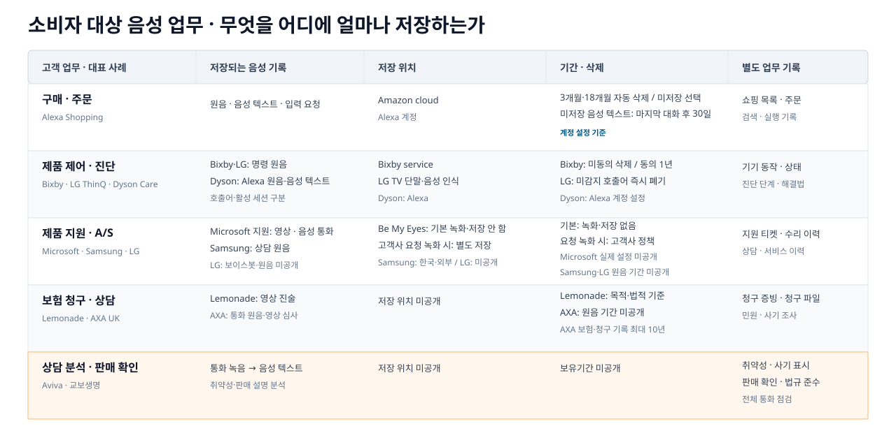

---
services:
- microsoft-foundry
- azure-openai
- azure-storage
official_sources:
- title: Foundry Tools for Call Center Overview
  url: https://learn.microsoft.com/azure/ai-services/speech-service/call-center-overview
- title: Data, privacy, and security for Speech to text
  url: https://learn.microsoft.com/azure/foundry/responsible-ai/speech-service/speech-to-text/data-privacy-security
- title: Learn about retention for Copilot and AI apps
  url: https://learn.microsoft.com/purview/retention-policies-copilot
document_type: research
status: current
verification_status: needs-review
sources_checked_at: 2026-10-17
title: 앱 음성 서비스 기록관리 사례와 정책
description: 실제 음성 서비스가 원음, 음성 텍스트, 요약과 업무 결과를 저장·삭제하는 방식을 비교합니다.
technologies:
- rest-api
tags:
- evaluate
- ai-agents
- storage
published_at: 2026-10-17
topic_order: 1
---

# 앱 음성 서비스 기록관리 사례와 정책

> - 리서치 발행일: 2026-10-17 (한국시간)
> - 사례·제품 정책 세부 확인일: 2026-10-14. 시행일·갱신일·지역·기능 모드는 해석에 필요한 경우 본문에 표시하며, 공개 문서가 밝히지 않은 값은 추정하지 않음.
> - 법령 세부 확인일: 2026-10-10. 직접 대조 범위는 개인정보 보호법 주요 조문, 한국 AI 기본법 제2·31조와 시행령 제23조, EU AI Act 제5·50·113조, COPPA 2025 개정 원문, California Civil Code §1798.100·1798.140. 금융 규칙·BIPA는 법률 참고이며 이 날짜의 현행법 대조 완료를 뜻하지 않음.
> - 범위: 실제 앱의 제품 구매 준비·제품 지원·고객서비스(CS)를 우선하고, 학습·금융 앱은 업무 목적별 비교, 전화 컨택센터·게임 안전·공공 본인확인·코덱은 부록으로 둠.
> - 연결 문서: [Microsoft 공식 문서로 본 Azure 음성 에이전트 데이터 저장](../azure-storage/index.md)

> **읽는 기준**
>
> - **사례·제품 사실:** 업체·서비스 공개 문서에서 확인한 실제 동작·정책
> - **법령·지침:** 해당 국가·업무·자료 유형에 적용 여부를 따로 판단할 규칙
> - **교차 사례 분석:** 사례·법령·표준을 조합한 연구 해석. 특정 업체의 실제 운영 방식이나 법적 의무를 뜻하지 않음

## 음성 서비스 기록관리에서 눈여겨볼 만한 6가지 패턴

### 1. [한 번의 음성에서 여러 기록이 생김](#voice-record-types)

- 대화 처리: 원음(原音: 실제 녹음) → 음성 텍스트(전사, 轉寫: 음성을 글자로 바꾼 기록) → 질문/응답 → 요약·음성 요약
- 업무 처리: 주문 · 기기 동작 · 지원 티켓 · 분석 결과 · 감사 로그
- 관리 이유: 각 기록의 사용 목적·접근권한·보유기간·삭제 범위가 서로 다르며, [Microsoft 제품도 기록 종류별 저장 위치가 다름](#microsoft-record-locations)

### 2. [업무에 따라 달라지는 음성 보관](#raw-audio-retention)

- 바로 삭제: 상품 검색 · 제품 제어 등 일회성 요청
- 일정 기간 보관: 청구 증빙 · 안전 신고 · 본인확인
- 보유 시작 기준(기산점, 起算點: 기간을 세기 시작하는 시점): 요청 완료 · 사건 종료 · 동의 유지 · 법정 의무
- [실제 차이](#gaming-public-identity): Xbox 미제출 신고 음성은 온라인 상태 누적 24시간 / HMRC 음성 생체정보는 최대 7년

### 3. [같은 회사라도 기능·지역에 따라 정책이 다름](#business-use-cases)

- 기능 차이: 일반 통화 / 기업 지원 / AI 대화 / 수학 튜터 등 [모드별 저장·삭제 정책](#product-storage-comparison)
- 처리 위치: 단말의 호출어 감지 / 클라우드 전송·분석
- 지역 차이: 미국·한국·EU 등 적용 정책과 이용자 권리 차이
- 외부 업체: 음성 비서 · 음성 인식 · AI 모델 · 서비스를 도입한 회사가 만든 사본까지 확인
- 책임 구분: 처리 책임 주체(controller: 목적·방법 결정) / 위탁 처리자(processor: 대신 처리)

### 4. [삭제 버튼만으로는 완전 삭제가 아님](#deletion-completion)

- 이용자 화면: 대화 삭제 · 계정 이력 삭제
- 별도 잔존 가능: 음성 텍스트 · 요약 · 검색색인 · 학습 자료 · 외부 처리자 사본 · 백업 · 법규 준수용 보존 사본
- 삭제 확인 항목(문서 제안): 위치별 삭제 입증 자료(증적, 證跡: 완료를 증명하는 기록) · 검색 미반환 · 재생성 차단 · 백업 만료
- 실제 사례: [FTC Alexa 사건](#alexa-deletion-case)의 삭제 요청·파생 자료(派生資料: 원본에서 새로 만든 자료)·학습 이용 불일치

### 5. [고지·접근권한·감사·보유는 따로 관리](#jurisdiction-rules)

- 이용자 대상: AI 사용 고지 · 녹음 동의 · 저장/삭제 설정
- 운영자 대상: 제작자·관리자 접근권한 · 다운로드 권한 · [감사 로그와 별도 기록](#microsoft-record-locations)
- 보유 정책: 일반 만료 · 법적 보존(legal hold: 분쟁·조사 때문에 삭제 중단)
- 구분할 항목(문서 제안): 한 설정을 껐다고 다른 기록·권한·감사 로그까지 함께 중단된 것으로 판단하지 않음

### 6. [음성 텍스트·요약·음성 생체정보는 검증 필요](#transcript-summary-quality)

- 음성 텍스트 오류: 숫자 · 금액 · 날짜 · 이름 · 부정어 · 화자 구분
- 요약 오류: 중요 내용 누락 · 원문에 없는 주장 · 근거 구간 불일치
- [음성 생체정보 위험](#voice-biometric-attacks): voiceprint(목소리 특징을 수치화한 정보)를 노리는 녹음 재생 · 합성음성 · 음성변환 공격
- 대응 검토 항목(문서 제안): 모델·언어·환경별 평가 · 원문 연결 · 사람 검토 · 정정/이의제기 · 비음성 인증 대안

## 업무별 저장 방식과 기록 수명주기를 비교하면 무엇이 보이는가?

### 업무마다 무엇을 어디에 얼마나 저장하는가?

도식과 동일한 정보는 다음 텍스트 표에서도 확인할 수 있다.

| 고객 업무·대표 사례 | 저장되는 음성 기록 | 저장 위치 | 기간·삭제 | 별도 업무 기록 |
|---|---|---|---|---|
| 구매·주문 · Alexa Shopping | 원음·음성 텍스트·입력 요청 | Amazon cloud · Alexa 계정 | 3개월·18개월 자동 삭제 또는 미저장 선택. 미저장 음성 텍스트는 마지막 대화 후 30일 | 쇼핑 목록·주문 · 검색·실행 기록 |
| 제품 제어·진단 · Bixby(미국 정책)·LG 미국 Smart TV·Dyson Care | Bixby 명령 원음 · LG Smart TV 호출어 미감지 오디오와 활성 세션 · Dyson Alexa 원음·음성 텍스트 | Bixby service · LG Smart TV 단말·음성 인식 · Dyson Alexa | Bixby 미국 정책: 검토 미동의 시 요청 처리 후 원음 삭제, 동의 시 총 1년. LG 미국 Smart TV: 호출어 미감지 오디오는 즉시 폐기하나 활성 세션 명령 원음의 고정 보유기간은 미공개. Dyson은 Alexa 계정 설정 적용 | 기기 동작·상태 · 진단 단계·해결법 |
| 제품 지원·A/S · Microsoft·Samsung·LG | Microsoft 영상·음성 통화 · Samsung 상담 원음 · LG 보이스봇 원음 미공개 | Be My Eyes 기본 녹화·저장 없음, 고객사 요청 녹화 시 별도 저장 · Samsung 한국·외부 · LG 미공개 | 기본 녹화·저장 없음 · 요청 녹화 시 고객사 정책 · Microsoft 실제 설정 미공개 · Samsung·LG 원음 기간 미공개 | 지원 티켓·수리 이력 · 상담·서비스 이력 |
| 보험 청구·상담 · Lemonade·AXA UK | Lemonade 영상 진술 · AXA 통화 원음·영상 심사 | 저장 위치 미공개 | Lemonade 목적·법적 기준 · AXA 원음 기간 미공개 · AXA 보험·청구 기록 최대 10년 | 청구 증빙·청구 파일 · 민원·사기 조사 |
| 상담 분석·판매 확인 · Aviva·교보생명 | 통화 녹음→음성 텍스트 · 취약성·판매 설명 분석 | 저장 위치 미공개 | 보유기간 미공개 | 취약성·사기 표시 · 판매 확인·법규 준수 · 전체 통화 점검 |

### 한 번의 음성은 어떤 기록으로 나뉘는가?

## 목적에 따라 달라지는 원음 보관 방식 { #raw-audio-retention }

<strong>원음 보존 판단과 정책 경계 보기</strong>

### 업무 목적별 원음 보관 판단표

- **이 절의 성격:** 이 문서의 설계 검토 예시
- **사례 근거:** [구매·제품 지원·보험·상담에서는 음성을 어떻게 쓰는가?](#business-use-cases)의 원음 미저장·선택 보관·사건 증빙·본인확인 차이
- **법령 근거:** [PIPA 파기 원칙](https://www.law.go.kr/법령/개인정보보호법) · [California 보유기간 기준](https://leginfo.legislature.ca.gov/faces/codes_displaySection.xhtml?sectionNum=1798.100.&lawCode=CIV)
- **이 예시가 뜻하지 않는 것:** 특정 업체 실제 설정 · 보편적 법적 의무 · 특정 제품의 확정 정책 · 구현 완료 상태

| 업무 목적 | 원음 필요성 판단 | 검토 항목 | 종료·예외 |
|---|---|---|---|
| 일회성 명령·상품 탐색 | 요청 실행 후 재생이 필요한가 | 처리 후 원음 삭제; 필요한 목록·주문 결과만 별도 근거로 관리 | 재생용 원음뿐 아니라 임시 버퍼·공급자 사본까지 삭제 범위 |
| 제품 지원·후속 상담 | 확인된 상담기록으로 연속성을 확보할 수 있는가 | 확인된 음성 텍스트·요약·티켓과 원음 보관을 별도 결정 | 사건 종료·후속 지원 기간을 보유 시작 기준으로 명시 |
| 거래 증빙·분쟁·청구 심사 | 발언 자체가 증거인가; 어떤 기록 의무가 적용되는가 | 필요한 구간·대상만 보존; 법정 최소기간과 업무상 필요를 구분 | 명시된 법정 의무·유효한 법적 보존 외에는 목적 종료 시 파기 검토 |
| 품질 검토(QA)·교육·제품 개선 | 전체 원음이 필요한가; 표본·마스킹본으로 가능한가 | 적법한 근거를 별도 평가; 선택 동의 방식이면 동의한 표본으로 제한 | 서비스 이용 동의와 개선용 동의를 합치지 않음; 철회와 법적 예외 분리 |
| 음성 본인확인 | 음성 생체인증을 허용하는 정책·관할인가 | 허용된 경우에만 등록 원음·생체 템플릿·인증 이벤트 분리 | NIST 인증 지침 적용 시 음성 생체 비교 불가; [음성 생체정보·합성음성 공격 검토](#voice-biometric-attacks) 참조 |
| 감정·성격·진실성 추론 | 업무 필요·과학적 타당성·법적 허용성이 있는가 | 별도 승인이 없는 기본선은 생성·보존하지 않음 | EU 금지 범위는 생체 기반 직장·교육기관 감정 추론과 의료·안전 예외를 구분 |

**기간 검토 순서:** 업무·산출물 분류 → 처리 근거 → 적용 기록 의무 → 보유 시작 기준·종료 조건 → 보유기간 → 보존 예외 → 삭제 검증.

**경계:** 원음 미저장 ≠ 음성 텍스트 미저장 · 개선 미동의 ≠ 서비스 처리 중단 · 마스킹 ≠ 익명화 · 이력 숨김 ≠ 삭제 · 원음 삭제 ≠ 주문 취소.

## 음성의 관리 항목에는 무엇이 있는가? { #voice-record-types }

- **이 절의 성격:** 이 문서의 설계 검토 예시
- **사용 방법:** 아래 항목과 표는 작성 예시이며, 실제 저장소·지역·처리자·기간·정책은 별도 결정 필요
- **용도:** 수명주기 그림 → 산출물별 정책표
- **작성 항목:** 산출물별 목적 · 저장소 · 보유 시작 기준 · 기간 · 법적 보존 · 삭제 · 증적

<strong>산출물별 정책 작성과 수명주기 항목 보기</strong>

### 관리해야 할 기록과 책임

- **식별·연결 관계:** 조직·사용자·세션 ID, 산출물 ID, 부모·파생·사본 ID, 저장 위치 목록.
- **정책:** 목적 ID, 처리 근거, 고지·동의 버전과 이력, 보유 정책 버전.
- **책임:** 업무 소유자, 저장소 운영자, 처리자·재위탁자, 삭제 승인·수행 주체.
- **기간:** 보유 시작 사건·시각, 만료 시각, 법적 보존 범위·상태, 백업 최종 만료일.
- **국외 처리:** 저장 지역(리전)과 국가, 음성 인식(STT)·대규모 언어 모델(LLM) 처리 국가, 재위탁·원격 접근 국가. 저장 지역만으로 국외이전 여부를 판단하지 않음.

**검토 범위:** 실시간 스트림은 재생 파일과 별개로 보고, 단말·중계·음성 인식·대규모 언어 모델의 버퍼, 오류 덤프·진단 수집, 처리자의 임시 사본까지 확인.

### 원음·음성 텍스트·요약별 정책 작성 항목

- **사례 근거:** [구매·제품 지원·보험·상담에서는 음성을 어떻게 쓰는가?](#business-use-cases) · [Microsoft 제품마다 기록은 어디에 남는가?](#microsoft-record-locations)
- **법령·지침 근거:** [PIPA 파기·국외이전](https://www.law.go.kr/법령/개인정보보호법) · [ISO/IEC 27555 삭제 거버넌스](https://www.iso.org/standard/71673.html) · [ICO 백업 삭제 지침](https://ico.org.uk/for-organisations/uk-gdpr-guidance-and-resources/individual-rights/individual-rights/right-to-erasure/)
- **특정 업체 적용:** 없음. Microsoft·Amazon·Samsung 등 어느 한 업체의 운영 양식이 아님
- **표 안 내용:** 확정값이 아닌 작성 항목·예시. 실제 저장소명·지역·처리자·기간·정책 버전은 설계 시 확정
- **기간 사용 금지:** 다른 사업자의 30일·90일을 기본값으로 복사하지 않음

| 산출물·업무 소유자 | 목적·처리 근거 | 저장소·지역·처리자 | 보유 시작 기준·기간 | 법적 보존 | 삭제 방법 | 검증 증적 |
|---|---|---|---|---|---|---|
| **원음 / 지원·증빙 담당** | 재생·발언 확인; 서비스 처리·동의·법정 의무 중 해당 근거 명시. 개선용은 별도 목적 | 미디어 저장소·단말 버퍼·음성 인식 사본; 각각의 국가·지역·사업자·재위탁자 | 요청 완료·사건 종료·거래일 중 지정; 미보관이면 처리 후 버퍼 폐기, 보관이면 근거 있는 기간 | 해당 사건·구간만, 보존 근거·권한 별도 | 원본·객체 버전·복제본·임시 파일 삭제; 파생물 연결 추적 | 위치별 영수증·ID 직접 조회/재생 불가·버퍼 폐기·백업 만료 |
| **전사(음성 텍스트) / 상담기록 담당** | 업무 이력·검색; 서비스 목적의 필요성과 민감정보 처리 근거 | 대화 DB·CRM·티켓 사본·음성 인식(STT) 출력; 저장/처리 국가·각 처리자 | 대화 종료 또는 사건 종료; 상담기록 정책의 기간 | 음성 텍스트·정정본 중 사건 범위 지정 | DB/CRM/티켓 사본·색인·벡터 삭제 또는 적법한 별도 보존 분리 | 사본별 영수증·직접/키워드/의미 검색 미반환 시험·정정본 범위 |
| **요약 / 사건 담당** | 후속 처리·인수인계; 원래 업무 목적과 필요성 | 티켓·CRM·대규모 언어 모델 출력·공급자 임시 저장; 지역·모델/재위탁자 | 사건 종료 등 지정; 요약 정책 기간, 단순 재생성으로 연장 금지 | 사건 요약·버전별 범위 지정 | 현재·과거 버전·업무 사본·모델 임시 사본 삭제 | 티켓/CRM 영수증·검색 불가·재요약 차단 확인 |
| **분석 결과 / 품질 검토·분석 담당** | 품질·주제·통계; 개선 목적 근거·집계 수준 명시 | 분석 DB·보고서·데이터웨어하우스; 지역·분석 처리자 | 분석 대상 기간 종료; 개인별 결과와 익명 통계의 기간 구분 | 사건 관련 결과만; 통계 전체 보존으로 확대 금지 | 개인별 결과·중간 데이터·내보낸 보고서 처리; 익명성 별도 검증 | 개인 식별 검색 불가·집계 재식별 평가·사본별 처리 증적 |
| **마스킹본 / 개인정보·품질 검토 담당** | 제한된 검토·제공; 잔여 개인정보의 근거 유지 | 별도 파생 저장소·품질 검토 사본; 지역·마스킹 처리자 | 생성일/원본 업무 종료 중 지정; 변환으로 기간 재시작 금지 | 원본·마스킹본을 각각 지정 | 마스킹본·원본·편집 중간본·매핑표의 각 정책 실행 | 마스킹 누락 시험·원본 잔존 점검·매핑표/사본 영수증 |
| **음성 생체정보(voiceprint) / 인증 담당** | 허용된 고유 식별·인증; 관할별 생체정보 근거 | 생체 템플릿 전용 저장소·등록 원음 별도; 국가·인증 처리자 | 등록일·인증 관계 종료 등 지정; 원음/템플릿 각각 기간 | 근거 있는 특정 템플릿만; 인증 사용 중단과 보존 분리 | 템플릿·등록 원음·모델/공급자 사본 삭제; 인증 연계 폐기 | 등록·인증 불가 시험·템플릿 영수증·공급자 삭제 확인 |
| **검색색인·벡터 / 검색 담당** | 업무 검색; 원자료와 연결된 목적·근거 | 검색 엔진·벡터 DB·검색 캐시; 지역·검색 처리자 | 원자료의 보유 시작 기준·만료 상속 원칙, 다른 목적은 별도 근거 | 증거 보존이 곧 검색 허용은 아님 | 문서·벡터 표현·캐시·스냅샷 삭제, 재색인/큐 재생 차단 | ID/키워드/의미 검색 불가·재색인 후 재시험 |
| **시스템·보안 로그 / 운영·보안 담당** | 장애·접근·삭제 추적; 보안 목적·법정 의무 평가. 콘텐츠 전문 제외 | 로그 저장소·보안 로그 분석 시스템(SIEM)·감사 보관소; 국가·운영/보안 처리자 | 이벤트 발생일; 목적별 기간·감사 증적 기간 별도 | 해당 사건 이벤트만 별도 보호 | 기간별 구간(segment) 만료·식별자 최소화; 추가 전용(append-only) 로그도 무기한 보존 금지 | 만료 작업·접근 이력·무결성 검증·로그 자체 삭제 증적 |

**기간 검토 항목**

- **법정 의무:** 적용되는 기록·보유 시작 기준·기간을 조문에 연결.
- **업무 필요:** 필요가 끝나면 삭제 검토. “계정이 존재하는 동안”을 모든 산출물의 자동 기간으로 사용하지 않음.
- **보존 예외:** 다른 법령상 보존·유효한 법적 보존의 근거와 범위 기록. 내부 표지만으로 파기 의무를 무기한 유예하지 않음.
- **마스킹·가명처리:** 개인정보성이 남으면 동일하게 목적·권리·보유 관리. 익명화 주장에는 재식별 평가 필요.
- **모델 학습:** 삭제가 필요한 개인 자료의 학습 편입 여부·근거·철회 처리를 사전 결정. 원본 삭제만으로 모델 영향 제거를 입증할 수 없음.

## 구매·제품 지원·보험·상담에서는 음성을 어떻게 쓰는가? { #business-use-cases }

- **이 절의 성격:** 실제 사례·제품 공개 문서
- **우선:** 제품 구매 · 사용/제어 · 진단 · 지원
- **비교군:** 청구 · 보험 상담 · 고객센터 · 금융 문의 · 학습
- **태그 검색:** 브라우저 찾기(`Ctrl/Cmd+F`) → `#제품지원` · `#A/S` · `#보험` · `#고객상담`
- **해석 주의:** 상담 업무가 있다는 사실만으로 원음 녹음·고정 보유기간을 추정하지 않음. 공개되지 않은 항목은 `확인되지 않음`으로 표시.

<strong>사례별 음성 처리·저장·삭제 근거 보기</strong>

### 제품 지원: Microsoft Disability Answer Desk(장애인·접근성 지원 창구) × Be My Eyes

- **태그:** `#Microsoft` `#제품지원` `#B2C`
- **업체·고객:** Microsoft 제품 지원과 시각장애·저시력 이용자의 영상 지원 앱.
- **고객 업무:** Windows·Office의 접근성·사용 문제를 카메라와 음성으로 설명, 상담원 연결.
- **서비스 근거:** Microsoft가 Be My Eyes 영상 지원을 안내; Be My Eyes의 Microsoft 사례는 Service Connect·Service AI 활용 설명.
- **Be My Eyes Service Connect의 저장 구조:** Be My Eyes 기업 Service Connect 정책상 도입 고객사가 요청하지 않으면 Be My Eyes는 영상 통화를 녹화·저장하지 않음. 이 사례의 도입 고객사는 Microsoft지만, 공개 자료만으로 Microsoft의 실제 녹화 요청 여부·저장 위치·보유기간은 확인할 수 없음. 고객사가 녹화를 요청하면 고객사가 처리 책임 주체, Be My Eyes가 위탁 처리자이며 고객사 정책 적용.
- **일반 서비스의 저장:** 영상 통화·사진·오디오 수집·저장, 미국 처리. 일반 통화 녹음은 무기한 또는 시각장애·저시력 사용자의 삭제 요청 접수 후 30일 이내 삭제. Be My AI 문의는 생성 후 60일 또는 요청 후 30일 삭제.
- **정책 경계:** 일반 봉사자 연결·Be My AI·기업 지원은 서로 다른 모드. 일반 녹음·연구 공유 규칙을 Microsoft 지원에 적용하지 않음.
- **근거:** [Microsoft 지원 채널](https://www.microsoft.com/en-us/accessibility/disability-answer-desk) · [공급자 Microsoft 사례](https://www.bemyeyes.com/business/microsoft-case-study/) · [모드별 정책](https://www.bemyeyes.com/privacy-policy/).

### 구매 준비·재구매: Alexa Shopping

- **태그:** `#Amazon` `#구매` `#B2C`
- **업체·업무:** Amazon 소매 서비스; 쇼핑 목록 추가·상품 탐색·재구매·주문 확인.
- **채널:** Echo 등의 음성 요청과 Amazon·Alexa 앱의 목록·주문 관리 연결. 앱 내부 음성 입력만의 사례가 아닌 다기기 서비스.
- **저장:** 원음·음성 텍스트·입력 요청을 Amazon 클라우드에서 관리.
- **보유:** 녹음 3개월·18개월 자동 삭제 또는 미저장 선택. 미저장 선택 시 요청 처리 후 원음 삭제, 기존 계정 원음도 자동 삭제.
- **음성 텍스트:** 미저장 모드에서도 음성 텍스트·입력 요청은 해당 대화의 마지막 상호작용 후 30일 보유.
- **업무 결과:** 원음·음성 텍스트 삭제와 주문·쇼핑 목록·상품 검색·실행 기록의 삭제 범위 분리. 외부 기능(skill)은 별도 정책.
- **근거:** [실제 쇼핑 서비스](https://www.amazon.com/alexa-shopping-hub/b?ie=UTF8&node=21467932011) · [원음·음성 텍스트·삭제 FAQ](https://www.amazon.com/gp/help/customer/display.html?nodeId=GVP69FUJ48X9DK8V).

### 보유 제품 제어: Samsung Bixby × SmartThings

- **태그:** `#Samsung` `#제품제어` `#B2C`
- **업체·업무:** 한국 전자제품 기업의 글로벌 음성 서비스; SmartThings에 등록한 조명·플러그·온도조절기·잠금장치·가전과 자동화 동작(routine)을 음성으로 제어.
- **고객 흐름:** Samsung 계정으로 Bixby를 설정하면 SmartThings 기기와 자동 연결되고 “Hi, Bixby”로 스마트홈을 제어. 제품 동작은 SmartThings의 기기·계정 맥락과 연결.
- **원음 관리:** Bixby 미국 정책은 음성 검토에 동의하지 않으면 명령 제공 후 원음 삭제. 검토 동의 시 식별자와 1개월 연결, 이후 분리하여 총 1년 보유하며 일부를 개선·학습 검토에 사용.
- **기록 경계:** 호출어(wake-up)·명령 녹음과 연결 기기·서비스 정보, 사용 시각·기간·설정은 다른 기록 객체. 원음 삭제가 기기 동작이나 SmartThings 이력 삭제를 뜻하지 않음.
- **지역 경계:** 저장기간 근거는 **미국 Bixby 정책**이다. 한국 SmartThings/Bixby의 실제 제품 제어 사례를 보여주되 한국 이용자의 동일 기간으로 일반화하지 않음.
- **근거:** [SmartThings 음성 서비스](https://support.smartthings.com/hc/en-us/articles/360052409891-Voice-Services-in-SmartThings) · [Bixby 제품 안내](https://www.samsung.com/us/apps/bixby/) · [Bixby 미국 정책](https://d264isyiyrfhr3.cloudfront.net/storage/tos/usa/2.1.3/1782805872274/eng/usa_eng_pp.html).

### 보유 제품 제어: LG ThinQ·Smart TV

- **태그:** `#LG` `#제품제어` `#B2C`
- **업체·업무:** 한국 전자제품 기업의 ThinQ 앱·허브와 Smart TV; 등록한 에어컨·TV 등 지원 제품의 전원·온도·운전 모드·상태를 음성으로 제어.
- **활성화 경계:** LG의 미국 Smart TV 설명은 음성정보 동의(Voice Information Agreement) 후 마이크 버튼 또는 사용자가 켠 핸즈프리 모드에서만 음성 인식 활성화.
- **로컬 처리:** 호출어가 감지되지 않은 오디오는 단말에서 처리 후 즉시 버리고 저장·음성 텍스트 변환·전송하지 않음. 활성 세션은 무음이면 약 10초, 전체 최대 약 18초이며 음성을 텍스트로 바꿀 수 있음.
- **저장 경계:** 오프라인 음성을 나중에 올리기 위해 저장하지 않고 세션 종료 후 수집을 중단. 일반 LG 정책은 화자 음성·번역된 텍스트를 수집할 수 있다고 밝히지만 제품별 고정 보유기간은 제시하지 않음.
- **이용자 제어:** 지원 제품은 마이크 하드웨어 스위치 또는 설정으로 음성 인식을 끌 수 있고, 지원 시장에서는 음성정보의 관리·삭제 요청 가능.
- **지역 경계:** 제품 제어 흐름은 한국 LG 안내, 데이터 처리 세부는 미국 Smart TV 설명과 글로벌 정책의 범위다.
- **근거:** [ThinQ ON 음성 제어 가이드](https://www.lge.co.kr/story/user-guide/ai-home-air-conditioner-control-guide) · [지원 제품 확인](https://www.lge.co.kr/support/solutions-20154574797709) · [Smart TV 음성 개인정보 설명](https://www.lg.com/us/newsroom/corporate/statement-understanding-privacy-on-lg-smart-tvs) · [LG 글로벌 정책](https://www.lg.com/global/privacy/).

### 제품 진단: Dyson Care on Alexa

- **태그:** `#Dyson` `#Amazon` `#제품진단` `#B2C`
- **업체·업무:** 글로벌 가전기업 Dyson의 무선청소기 소유자가 “Alexa, open Dyson Care”라고 말해 성능·전원·외관 문제를 단계별로 진단.
- **업무 결과:** Alexa가 질문과 해결 단계를 안내하고, Dyson 측의 제품·설정·센서·성능 데이터는 MyDyson의 지원·문제 해결·제품 신뢰성 목적과 연결될 수 있음.
- **음성 경계:** 사용자 음성은 Alexa 서비스의 원음·음성 텍스트 설정과 삭제 정책 대상. Dyson의 smart-machine notice는 음성 비서 연결 시 데이터 공유를 설명하지만 Dyson Care 원음의 별도 고정 보유기간은 제시하지 않음.
- **삭제 경계:** Alexa 음성 이력 삭제와 Dyson 계정·제품 성능·진단 자료 삭제는 별도 범위. 외부 음성 비서를 통한 제품 지원은 두 사업자의 처리 책임·위탁 관계를 명시해야 함.
- **근거:** [Dyson Care 음성 진단](https://www.dyson.com/support/voice/amazon-alexa) · [Dyson smart-machine notice](https://privacy.dyson.com/en/smart-machines) · [Alexa 원음·음성 텍스트 정책](https://www.amazon.com/gp/help/customer/display.html?nodeId=GVP69FUJ48X9DK8V).

### 제품 A/S: Samsung Electronics Service

- **태그:** `#Samsung` `#A/S` `#고객상담` `#B2C`
- **업체·업무:** 전화·원격상담·방문 수리를 통한 제품 문의, 고장 진단, 수리 접수, 사후 지원.
- **저장 대상:** Samsung 글로벌 정책은 고객서비스 연락 때 수집하는 **음성 녹음**, 채팅·대화 기록, 수리 이력을 서로 다른 기록으로 명시.
- **처리 위치:** 글로벌 정책은 한국 이전과 외부 음성 인식·콜센터 처리자의 음성 수신·저장 가능성을 명시.
- **보유:** Samsung Electronics Service 한국 정책은 계약·결제 기록 5년, 소비자 불만·분쟁 기록 3년, 접속 기록 3개월을 제시. **이 기간을 통화 원음 기간으로 확대 적용하지 않음**; 공개 자료에서 상담 원음의 고정 기간은 확인되지 않음.
- **법인 경계:** Samsung Electronics 글로벌 정책과 한국의 Samsung Electronics Service 정책은 적용 법인·자료 범위가 다름.
- **근거:** [Samsung 글로벌 정책](https://privacy.samsung.com/privacy-policy/en-US.html) · [Samsung Electronics Service 개인정보 처리방침](https://www.samsungsvc.co.kr/utils/dealing).

### 제품 A/S: LG Electronics Service AICC(AI 고객센터)

- **태그:** `#LG` `#A/S` `#고객상담` `#음성봇` `#B2C`
- **업체·업무:** 고객 문의·자가 수리 안내·수리 접수·원격 진단. AI 챗·보이스봇, 상담원 지원 Qbot, ThinQ 제품 데이터를 분석하는 Argus를 함께 운영.
- **음성 사용:** 보이스봇이 문의 내용을 분석해 해결 안내 또는 수리 접수로 연결. LG 발표는 불필요한 방문 수리를 37% 줄였다고 설명.
- **별도 업무 기록:** 개인정보 정책은 고객상담과 A/S 예약·제공·서비스 이력 관리를 별도 목적으로 구분.
- **저장 경계:** 보이스봇 운영은 확인되지만 **통화 원음의 녹음 여부·저장 위치·고정 보유기간은 공개 자료에서 확인되지 않음**.
- **근거:** [LG AICC 운영 사례](https://www.lge.co.kr/story/newsroom/236071) · [LG전자 서비스 개인정보 처리방침](https://account.lge.co.kr/terms/emp/detailView?tmsId=A_ITG_PRV_GDPR).

### 제품 A/S: Whirlpool·Wpro 소비자 콜센터

- **태그:** `#Whirlpool` `#BekoEurope` `#A/S` `#고객상담` `#B2C`
- **업체·업무:** EMEA 지역 가전제품 문의·주문·보증 서비스 요청을 처리하는 소비자 콜센터.
- **저장 대상:** 이용자 동의를 받은 전화 녹음, 통화 시각, 연락처, 주문 정보. 제품·보증 서비스 요청인 계약 기록은 별도 관리.
- **보유:** 목적 달성에 엄격히 필요한 기간이라는 일반 기준만 공개; 통화 녹음의 고정 기간은 제시하지 않음.
- **법인 경계:** 해당 정책의 처리 책임 주체는 Beko Europe 계열 Beko Italy Manufacturing. 미국 Whirlpool Corporation 정책으로 일반화하지 않음.
- **근거:** [Wpro 소비자 콜센터 개인정보 고지](https://www.wpro-whirlpool.com/privacy-notice).

### 청구·보상: Lemonade

- **태그:** `#Lemonade` `#보험청구` `#B2C`
- **업체·업무:** 디지털 보험사; 앱의 사고 신고·보험금 청구·지급 진행.
- **음성 사용:** 약 1분의 영상 진술로 사고 경위 설명. 실시간 AI 음성 대화가 아닌, 음성을 포함한 청구 증빙 제출.
- **저장 대상:** 영상·오디오·사진·서명·영수증 등 청구 자료; 청구 서비스 제공자 처리·공유.
- **목적:** FAQ는 청구 처리·검토, 개인정보 정책은 심사·사기방지·시스템 개선·법적 제공 조건까지 구분.
- **보유·접근:** 목적 및 법적·회계·보안·사기방지·보고 요건에 필요한 기간. 서비스·정상 업무상 필요한 인원으로 접근 제한; 열람·정정·삭제 요청 창구.
- **근거:** [청구 흐름](https://www.lemonade.com/claims) · [영상 진술 FAQ](https://www.lemonade.com/faq) · [자료·보유 정책](https://www.lemonade.com/privacy-policy).

### 보험 상담·청구: AXA UK

- **태그:** `#AXA` `#보험` `#보험청구` `#고객상담`
- **업체·업무:** 영국 자동차·주택 보험의 가입·변경·취소·청구·민원·사기 조사.
- **저장 대상:** 녹음된 전화 원음과 전화번호·일시·통화시간. 청구 파일·민원 조사·사기 조사 기록은 별도 업무 기록.
- **녹음 목적:** 규제·내부 기준 준수 확인, 민원 조사, 사기 탐지. 미녹음을 요청할 수 있지만 가입·이용·취소 상담은 제한될 수 있음.
- **보유:** 견적 정보 3년, 보험계약·청구 기록은 관계 종료 후 최대 10년이라는 일반 기록 기준. **통화 원음의 고정 기간이라고 명시된 값은 아님**.
- **영상 청구:** 간단한 주택보험 사고는 실시간 영상 통화로 당일 손해 심사·합의 가능. 영상 통화 자체의 녹음·보유 여부는 공개되지 않음.
- **근거:** [전화 녹음](https://www.axa.co.uk/privacy-policy/how-we-collect-data/) · [기록 보유](https://www.axa.co.uk/privacy-policy/record-keeping/) · [영상 청구 심사](https://www.axa.co.uk/about/inside-axa/claim-assessment/).

### 보험 상담 분석: Aviva × Verint

- **태그:** `#Aviva` `#보험` `#고객상담` `#음성분석`
- **업체·업무:** 영국 보험 고객·설계사 통화에서 취약고객 보호와 준법 절차 이행 여부 확인.
- **처리 흐름:** 기존 통화 녹음 → 약 4시간 이내 음성 텍스트 생성 → 건강·생애사건·대처능력·재정 회복력 등 취약성 범주와 사기·고위험 신호 분석.
- **별도 업무 기록:** 원음과 별개로 취약성·준법 표시, 감사 결과 생성. 내부 감사가 필수 위험 고지 여부 확인에 활용.
- **저장 경계:** 저장 위치·원음·음성 텍스트·분석 결과의 보유기간은 공개 사례에서 확인되지 않음.
- **자료 성격:** Aviva 자체 정책이 아니라 명명된 고객의 운영을 설명한 Verint 고객 사례.
- **근거:** [취약고객 분석](https://www.verint.com/case-studies/aviva-life-reimagines-vulnerable-customer-experience-with-verint-speech-analytics/) · [준법 분석](https://www.verint.com/case-studies/aviva-increases-nps-and-improves-compliance-using-verint-speech-analytics/).

### 보험 판매 확인: 교보생명 × Kakao Enterprise

- **태그:** `#교보생명` `#보험` `#고객상담` `#음성봇`
- **업체·업무:** 보험 판매 후 설명 확인, 다이렉트 청약 표준 스크립트 낭독, 마케팅 재동의, 연체 안내.
- **처리 흐름:** AI 음성봇 통화·상담원 3자 통화 → 음성 인식·텍스트 변환 → 필수 설명 누락·금칙어·상담 유형 정확도 분석.
- **별도 업무 기록:** 원음과 별개로 보험 판매 확인 결과·준법 평가 생성. 기존 표본 청취에서 전체 통화 조사로 확대.
- **저장 경계:** 원음·음성 텍스트·평가 결과의 저장 위치와 보유기간은 공개 자료에서 확인되지 않음.
- **자료 성격:** 교보생명 자체 개인정보 정책이 아니라 고객 관계자 발언이 포함된 언론 사례.
- **근거:** [교보생명 AICC(AI 고객센터) 운영 사례](https://www.fortunekorea.co.kr/news/articleView.html?idxno=26316).

### 고객 문의: Bank of America Erica

- **태그:** `#BankOfAmerica` `#금융문의` `#B2C`
- **업체·업무:** 미국 은행; 인증된 Mobile Banking 앱의 거래 검색·지출 확인·계좌 문의.
- **지원 연결:** 해결하지 못한 문의는 전화·채팅 전문가 연결. 은행은 생성형 AI·LLM이 아닌 정해진 응답 기반 서비스로 설명.
- **음성 관리:** 품질 확인·정확한 상호작용 기록·음성 텍스트 변환·응답 개선. 음성 응답에 외부 서비스 제공자 사용.
- **저장·보유:** 음성 상호작용 90일 저장·분석; 보관하는 음성 텍스트의 개인정보 마스킹.
- **업무 결과:** 거래는 일반 앱 거래와 같은 확인 제공, 모바일·온라인 뱅킹에서 별도 조회.
- **근거:** [은행의 업무·음성 기록 FAQ](https://info.bankofamerica.com/en/digital-banking/erica).

### 말하기 학습: Duolingo

- **태그:** `#Duolingo` `#학습` `#B2C`
- **업체·업무:** 언어 학습 서비스; 말하기 활동·Duolingo Max의 Lily 대화 연습.
- **음성의 역할:** 명령 입력보다 학습 수행 자료.
- **저장·사용:** AI 기능의 제출 오디오·텍스트에서 녹음·음성 텍스트 생성·저장·활용 가능성 명시. 학습 효과·개인화·개선 및 자체 AI 학습·운영 목적.
- **처리자 경계:** 외부 음성 인식·AI 공급자 전송 가능. AI 공급자는 계약상 개인정보를 자체 목적으로 사용하지 못하며, Duolingo 자체 활용은 별도.
- **기능 모드 차이:** 비디오 통화 등 일반 AI 기능은 오디오 녹음·음성 텍스트를 생성·저장할 수 있다. 수학 튜터는 원음을 음성 인식·텍스트 변환 목적으로 Apple에 전달한 뒤 즉시 삭제하지만, 음성 텍스트는 보관·이용·AI 공급자 공유 대상이 될 수 있다.
- **이용자 제어:** 말하기 활동 건너뛰기, 개선용 오디오 공유 거부. 아동 음성의 개선용 공유 제외.
- **보유:** 일반 개인정보의 계정 삭제까지 보유, 법적·분쟁 예외, 익명 자료 무기한 보유 가능성. 일반 조항을 모든 원음의 고정 보유기간으로 바꾸지 않음.
- **근거:** [실제 대화 학습](https://blog.duolingo.com/video-call/) · [AI·음성·보유 정책](https://www.duolingo.com/privacy).

## 삭제 요청은 언제 완전히 끝났다고 볼 수 있는가? { #deletion-completion }

- **이 절의 성격:** 이 문서의 설계 검토 예시
- **사례 근거:** [FTC Alexa 삭제 사건](#alexa-deletion-case) · Microsoft Purview의 준법 보존 사본
- **지침 근거:** [ISO/IEC 27555](https://www.iso.org/standard/71673.html) · [ICO 삭제권 지침](https://ico.org.uk/for-organisations/uk-gdpr-guidance-and-resources/individual-rights/individual-rights/right-to-erasure/) · [NIST SP 800-88](https://csrc.nist.gov/pubs/sp/800/88/r2/final)
- **이 예시가 뜻하지 않는 것:** Microsoft 또는 특정 클라우드의 현재 운영 절차 · 법령이나 표준이 그대로 요구하는 단일 절차
- **완료 판정 항목:** 위치별 삭제 증적 + 재생성 차단
- **검토 대상:** 원본 · 파생물 · 검색 · 처리자 사본 · 백업
- **단독으로 충분하지 않은 확인:** 삭제 API 성공

<strong>삭제·법적 보존·복원 운영 상세 보기</strong>

### 삭제 요청의 상태는 어떻게 바뀌는가?

| 단계 | 운영 조건·확인 자료 |
|---|---|
| 대상 확정 | 요청/만료 ID, 권한·범위, 원음과 모든 파생·사본의 대상 목록(manifest), 정책 버전. 주문 취소와 음성 삭제는 별도 업무 |
| 법적 보존 확인 | 법적 근거·사건 ID·범위·부과일·재검토일·해제 권한. 해당 부분만 보존; 나머지는 삭제 진행 |
| 신규 처리 차단 | 쓰기 차단(fence)·삭제 표식(tombstone)·작업 취소. 신규 녹음·음성 텍스트·요약·재색인·학습 반입·큐 재처리 차단 |
| 원본·파생물 삭제 | 미디어 객체/과거 버전·DB·CRM/티켓·분석·마스킹본·템플릿·검색색인·벡터·캐시·큐·처리자 사본별 작업 |
| 백업 만료/암호학적 삭제 | 사용 가능한 백업·스냅샷 목록과 최종 만료일, 접근 차단, 복원 시 삭제 표식 재적용. 키 폐기로 지우는 경우 아래 조건 확인 |
| 검증 완료 | 위치별 증적 수집, 조회 미반환 시험, 재처리/복원 시험, 예외·보존 대상 분리, 담당자 판정 |

**동시 처리:** 대상 확정 시 삭제 대기 표시로 신규 파생 작업을 먼저 격리. 법적 보존 판정 후 보존 또는 삭제로 처리하되, 삭제 실행 직전 최신 상태를 다시 확인. 진행 중 작업의 늦은 출력도 쓰기 차단으로 거부·폐기.

**실패 분기:** 권한·API·처리자 실패 → `실패/재시도` · 일부 저장소만 삭제 → `부분 완료` · 백업 잔존 → `백업 만료 대기`. 동일 요청은 멱등 재시도; 실패·누락 위치·기한 초과는 담당자에게 알림. API 성공을 `검증 완료`로 치환하지 않음.

### 무엇으로 삭제 완료를 확인하는가?

| 검증 대상 | 남길 확인 자료 | 완료 판정 |
|---|---|---|
| 원본·버전·업무 사본 | 위치·산출물 ID·요청 ID·처리 결과·시각·수행자·정책 버전의 삭제 영수증 | 선언한 모든 사본의 성공 확인; 누락·실패 없음 |
| 검색·벡터·캐시 | ID 직접 조회, 키워드/의미 검색, 직접 재생·다운로드 경로의 **미반환 시험(negative test)** | 정상 접근권한으로도 반환 없음; 접근 거부만으로 물리적 삭제를 주장하지 않음 |
| 큐·늦은 출력 | 작업(job) 취소·재시도·지연 전달·재색인 후 시험 | 원본·음성 텍스트·요약·검색 결과 재생성 없음 |
| 외부 처리자 | 처리자·재위탁자별 삭제 확인, 계약상 기한, 예외·만료일 | 삭제 또는 적법한 별도 보존 범위 확인. 사용자 안내 범위와 일치 |
| 백업·복원 | 백업 최종 만료일·폐기/키 폐기 증적·격리 복원 시험 | 백업 제거 확인, 또는 검증된 암호학적 삭제. 대기 중에는 최종 완료로 표시하지 않음 |
| 법적 보존·외부 반출 | 법적 보존 범위·해제 조건, 다운로드/제공 수신자와 후속 처리 기록 | 보존 부분·외부 통제 한계를 별도 보고; 통제 불가능한 사본까지 삭제했다고 보증하지 않음 |

미반환 시험은 콘텐츠를 감사 로그에 복제하는 시험이 아니라, 합성 시험자료·최소 식별자로 삭제 대상이 조회·재생되지 않는지 확인하는 시험이다. 검색 미반환은 저장소 삭제 증적과 함께 사용한다.

**완료 판정:** 처리 범위 전체의 증적 확보 + 재생성 차단 확인 + 백업 처리 종료. 일부가 법적 보존 대상이면 **삭제 대상 범위 완료 / 보존 범위 유지**를 나눠 표시한다. 요청 처리 종료와 모든 자료의 파기 완료는 다른 상태다.

**근거의 역할 분리**

- [ISO/IEC 27555:2021](https://www.iso.org/standard/71673.html): 개인정보 삭제 정책·규칙·문서·역할·프로세스의 거버넌스. 구체적 삭제 메커니즘·신뢰성·법적 기간을 정하지 않음.
- [ICO Right to erasure](https://ico.org.uk/for-organisations/uk-gdpr-guidance-and-resources/individual-rights/individual-rights/right-to-erasure/): 유효한 삭제 요청은 운영 시스템(live)과 백업을 함께 다루고, 즉시 덮어쓸 수 없는 백업은 정해진 주기까지 **사용 불가(beyond use)** 상태로 두며 이용자에게 처리 범위를 명확히 설명.
- [NIST SP 800-88 Rev.2](https://csrc.nist.gov/pubs/sp/800/88/r2/final): 저장매체 소거(sanitization) 지침. 애플리케이션의 논리 삭제·처리자 전파·백업 복원 방지를 모두 대신하지 않음.
- 위 상태 흐름·미반환 시험·영수증 묶음은 이 세 자료의 범위를 향후 음성 기능 설계에 연결한 **운영 검토 예시**이며 표준이 동일한 절차를 직접 요구한다고 표현하지 않는다.

### 법적 보존이 걸리면 삭제·복원은 어떻게 달라지는가?

- **등록:** 사건 ID·법적 근거·자료/시간 범위·부과일·책임자·재검토일·해제 승인자.
- **적용 중:** 필요한 증거만 제한 보존; 일반 검색·품질 검토·학습 사용 허용으로 해석하지 않음.
- **해제:** 원래 보유 시작 기준·만료 정책 재개. 이미 만료된 자료는 삭제 대상으로 전환; 해제일을 새 보유기간 시작일로 사용하지 않음.
- **복원:** 먼저 격리 → 조직 환경(tenant) 접근권한·최신 삭제 표식·법적 보존·정책 버전 대조 → 삭제 대상 제외 → 검증 → 서비스 노출.
- **복원 방어:** 삭제 대상 목록(manifest)·삭제 표식(tombstone)은 가장 오래 남는 복구 가능 백업까지 대응; 기록 자체의 최소화·기간도 지정.

### 누가 재생·반출·삭제할 수 있어야 하는가?

- **역할 분리:** 원음 재생 / 대량 다운로드 / 삭제 수행 / 법적 보존 해제. 최소권한·필요 시점 권한(JIT), 대량 반출·해제 승인.
- **감사 이벤트:** 행위자·대상·시각·행위·결과·승인·정책 버전. 원음·음성 텍스트 전문은 제외.
- **무결성:** 추가 전용(append-only) 감사 로그·무결성 해시. 해시는 바이트 동일성 확인이지 발언의 진실성·정확성·화자 신원 보증이 아님.
- **반출:** 수신자·목적·만료·추적 가능한 워터마크. 워터마크는 복제 방지나 완전 삭제 증거가 아님.
- **사고:** 유출·무단 재생·대량 반출·삭제 실패의 탐지, 영향 범위·재발 방지·복원 검증. [NIST SP 800-61 Rev.3](https://csrc.nist.gov/pubs/sp/800/61/r3/final), 2025-04.

**암호학적 삭제 검토 항목:** 삭제 대상만 분리된 키 범위, 모든 키 복제본·백업·키 위탁 보관(escrow)·캐시의 폐기, 평문/다른 키로 암호화한 사본 부재, 키 관리·실행·검증 증적. 공유 키 폐기가 다른 이용자의 자료를 파괴하지 않는지도 확인한다. [NIST SP 800-88 Rev.2](https://csrc.nist.gov/pubs/sp/800/88/r2/final), 2025-09. 저장매체 소거 지침이며 클라우드 삭제 API의 완전 삭제 인증은 아니다.

## 한국·EU·미국 법규는 어디까지 적용되는가? { #jurisdiction-rules }

- **이 절의 성격:** 법령·감독 지침
- **판단 축:** 이용자/사업자/처리 국가 · 업무/자료 유형 · 처리 책임/위탁 관계 · 아동/생체/자동결정
- **해당 없음:** 법률 의견 · 전 세계 공통 보유기간표

<strong>한국·EU·미국 규칙과 Alexa 집행 사례 보기</strong>

| 관할·근거 | 음성 서비스의 적용 경계 | 운영 기록에 연결할 항목 |
|---|---|---|
| **[한국 개인정보 보호법 제15·18조](https://www.law.go.kr/법령/개인정보보호법)** | 수집·이용의 적법한 근거와 목적 범위; 목적 외 이용·제공 제한 및 예외. 서비스 제공과 모델 학습을 자동으로 같은 목적으로 묶지 않음 | 목적·근거·고지/동의 버전, 개선용 별도 평가 |
| **[한국 개인정보 보호법 제21·26·28조의8·30조](https://www.law.go.kr/법령/개인정보보호법)** | 불필요한 개인정보 파기, 다른 법령상 보존 시 분리; 위탁 문서·관리; 국외 제공은 조회 포함, 처리위탁·보관도 국외이전 범위. 별도 동의 외 법정 경로도 있음. 현행본 시행 2026-09-11 | 저장/처리 국가·기간·수신자, STT/LLM·재위탁·원격 접근, 파기 증적·방침 |
| **[한국 개인정보 보호법 제22조의2·23·36·37조의2](https://www.law.go.kr/법령/개인정보보호법)** | 동의가 필요한 만 14세 미만 아동은 법정대리인 동의·확인. 민감정보는 별도 규율; 정정·삭제, 법정 요건에 해당하는 자동화된 결정 권리 | 아동 경로·쉬운 고지, 식별 목적 생체정보 구분, 정정·이의제기 절차 |
| **[한국 AI 기본법 제2·31조](https://www.law.go.kr/법령/인공지능발전과신뢰기반조성등에관한기본법) · [시행령 제23조](https://www.law.go.kr/법령/인공지능발전과신뢰기반조성등에관한기본법시행령)** | 생성형 또는 고영향 AI 제품·서비스의 AI 기반 운용 사실 사전고지, 생성 결과 표시, 실제와 구분하기 어려운 가상 음향 표시. 제품·화면상 명백함·내부 업무 등 시행령상 예외. 법 현행본 2026-07-21, 시행령 현행본 2026-08-20 | 기능 모드·고지 시점·화면/음성 방식·예외 근거. 일반 구매·지원 AI는 그 사실만으로 고영향 AI가 아니며 법 제2조제4호 영역·중대한 영향 여부를 별도 판단 |
| **[한국 PIPC 생성형 AI 이용자 가이드](https://pipc.go.kr/np/cop/bbs/selectBoardArticle.do?bbsId=BS074&mCode=C020010000&nttId=12084)** | 2026-05-19 공식 이용자 안내; 학습 활용 옵트아웃, 대화 기록 저장·삭제 설정, 외부 서비스 연동 등 이용자 통제 확인 | 운영자 법적 의무표가 아닌 UX·고지·권리행사 점검 자료 |
| **[EU GDPR](https://eur-lex.europa.eu/eli/reg/2016/679/oj/eng) · [EDPB 음성비서 지침](https://www.edpb.europa.eu/documents/guideline/guidelines-022021-on-virtual-voice-assistants_en)** | 목적·필요성·기간 제한, 처리 근거·처리자·국외이전·권리. 웨이크워드·동석자·공용기기·단말/클라우드 처리의 구분. EDPB 최종판 2021-07-07 | 오작동 수집 최소화, 음성/음성 텍스트/명령 이력별 제어·삭제 UX |
| **[EU AI Act 제5·50·113조](https://eur-lex.europa.eu/eli/reg/2024/1689/oj/eng)** | 일반 STT와 생체 기반 감정·생체 분류 구분. 직장·교육기관 감정 추론 금지에 의료·안전 목적 예외. 제50조는 표준 편집·수사·예술·창작물의 예외·완화 별도 규정. 금지 규칙 2025-02-02, 제50조 2026-08-02 적용 | AI 상호작용 고지, 공급자의 합성 오디오 machine-readable 표시와 배포자의 deepfake 공개를 역할·예외별 평가 |
| **[미국 COPPA, 16 CFR Part 312](https://www.federalregister.gov/documents/2025/04/22/2025-05904/childrens-online-privacy-protection-rule)** | 아동 지향 서비스 또는 13세 미만임을 실제 아는 수집에 적용. 아동 음성 파일은 개인정보, 음성 생체정보(voiceprint) 등 생체 식별자 포함. 2025-06-23 시행, 일반 준수기한 2026-04-22 | 부모 동의·권리, 필요한 기간만 보유·삭제 정책. 특정 요청 응답용 음성만 수집하고 다른 이용·공개 없이 응답 직후 삭제하는 제312.5(c)(9) 예외를 학습·품질 검토·장기 녹음으로 확대하지 않음 |
| **[미국 California CCPA/CPRA](https://oag.ca.gov/privacy/ccpa) · [§1798.100](https://leginfo.legislature.ca.gov/faces/codes_displaySection.xhtml?sectionNum=1798.100.&lawCode=CIV) · [§1798.140](https://leginfo.legislature.ca.gov/faces/codes_displaySection.xhtml?sectionNum=1798.140.&lawCode=CIV)** | 적용 요건을 충족하는 사업자; 개인정보 정의에 audio·생체정보 범주. §1798.100(a)(3)은 범주별 보유기간 또는 기준 고지와 공개 목적에 합리적으로 필요한 기간 초과 금지 | 수집 시 고지·목적·기간 기준, 열람·삭제·정정 요청, 법정 예외·service provider/contractor 사본 |
| **[미국 Illinois BIPA §15](https://my.ilga.gov/legislation/ilcs/fulltext?DocName=074000140K15) / 법률 참고** | 일반 원음과 법상 voiceprint 구분. 생체정보 사전 고지·서면 release·공개 보유/파기 정책; 목적 달성 또는 마지막 상호작용 후 3년 중 빠른 시점 기준 | 적용 범위·예외와 현행 조문 대조 후 템플릿별 정책 확정; 일반 녹음의 3년 보유 의무로 해석 금지 |

### Alexa 사건은 삭제 버튼만으로 부족함을 어떻게 보여주는가? { #alexa-deletion-case }

[FTC의 2023 Amazon Alexa 사건](https://www.ftc.gov/legal-library/browse/cases-proceedings/192-3128-amazoncom-alexa-us-v)은 공개 제품 설정이 아니라 **삭제 운영 실패**의 실제 사례다. FTC 사건 요약은 Amazon이 COPPA를 위반하고 Alexa 이용자·부모에게 삭제 관행을 오인하게 했다는 혐의를 해결하기 위해 삭제 관행 전면 개편과 강화된 보호조치를 요구한다고 설명하며, 2023-07-19 법원에 입력된 합의명령을 제공한다.

- **분석상 의미:** 삭제 버튼·정책 문구·API 성공만으로 원음·음성 텍스트·지리정보·학습 이용 중단을 증명할 수 없음.
- **운영 연결:** 삭제 대상 목록(manifest), 파생물 연결 관계, 학습 반입 차단, 처리자 확인, 복원 시 재삭제, 이용자에게 실제 처리 범위 설명.
- **증거 경계:** 사건 페이지·고소장·합의명령의 혐의와 구제조치를 현재 Alexa 제품의 모든 동작이나 모든 음성 서비스의 위반으로 일반화하지 않음.

## 음성 텍스트·요약·음성 생체정보는 무엇을 검증해야 하는가?

- **이 절의 성격:** 연구·표준 + 이 문서의 평가 항목 예시
- **연구·표준 근거:** [KEBAP 한국어 ASR](https://aclanthology.org/2023.emnlp-main.292/) · [PNAS 미국 영어 연구](https://pmc.ncbi.nlm.nih.gov/articles/PMC7149386/) · [NIST AI RMF](https://www.nist.gov/itl/ai-risk-management-framework) · [ISO/IEC 30107](https://www.iso.org/standard/83828.html)
- **특정 업체 적용:** 아래 평가 항목은 이 문서가 만든 예시. 연구 수치와 NIST·ISO 범위를 개별 서비스 성능으로 일반화하지 않음
- **기록 품질 검토:** 숫자·금액·부정어·화자·요약 누락을 별도 측정.
- **생체·합성 검토:** voiceprint와 일반 원음 분리, 재생·합성 공격과 비음성 인증 대안 확인.
- **접근성·주변인 검토:** 텍스트·사람 상담 경로, 동석자·공용기기·아동의 우발 음성 최소화.

<strong>음성 텍스트·화자 분리·요약 품질 평가 보기</strong>

### 음성 텍스트·요약의 오류는 어떻게 평가하는가? { #transcript-summary-quality }

**검토 전제:** 음성 텍스트·요약은 오류가 포함될 수 있는 추정 기록으로 보고, 원음과 동일한 증거로 자동 승격하지 않음.

**측정 용어:** WER = 단어 오류율 · DER = 화자 분리 오류율 · JER = 화자별 구간의 겹침 기반 오류율. 요약의 주장·누락률은 평가 단위와 정답 기준을 별도 정의한다.

| 위험 | 측정·기록 항목 | 검토·판정 |
|---|---|---|
| 발화 인식 | WER, 숫자·금액·날짜·이름·부정어별 오류율 | 금액·결제·동의·진단 등 중요 항목은 확인 전 확정 기록·행동으로 사용하지 않음 |
| 화자 분리 | DER/JER, 화자 미상률·겹친 발화, 화자 연결 신뢰도 | “화자 A”는 분리 라벨이지 인증된 고객 신원 아님 |
| 요약 | 근거 없는 주장률·중요 누락률, 원문/구간 연결 | 원문에 없는 사실 추가·핵심 조건 누락은 교정 대상 |
| 신뢰도 | 실제 오류와 신뢰도 점수(confidence)의 보정, 언어·집단별 분포 | 점수가 높다는 이유만으로 정확성을 보증하지 않음 |
| 환경·집단 차이 | 방언·연령·코드스위칭·장애 관련 발화·코덱·소음별 시험 | 전체 평균뿐 아니라 각 조건의 실패·사람 연결률 점검 |

- **측정 기준:** 버전별 정답 자료·표본수·조건·측정법·수치 임계값·승인자를 확정. 업계 공통 기준처럼 임의의 WER 목표를 기입하지 않음.
- **추적 항목:** 모델·버전·언어·처리 시각, 발화 시간 구간, 신뢰도 점수·화자 신뢰도, 요약 근거, 정정자·정정 사유·버전.
- **원음 연결 검토:** 원음이 적법하게 보관되는 경우에만 타임코드 재생 연결. 원음 미보관이면 이용자 확인·검토된 텍스트 등 대체 증거; 품질 검증을 이유로 모든 원음을 장기 보관하지 않음.
- **정정 흐름:** 음성 텍스트 변경 → 요약·검색·업무 사본 영향 확인 → 수정/재생성 → 버전 이력. 과거 오류도 필요 이상으로 무기한 보유하지 않음.
- **중대한 결과 검토:** 보험·신용·채용·교육·제재 등의 최종 판단에 음성 텍스트·요약만 사용하지 않는 방안. 사람 검토·이용자 정정·이의제기와 적용 법정 권리를 연결.

**연구 근거**

- [Koenecke 외, PNAS 2020](https://pmc.ncbi.nlm.nih.gov/articles/PMC7149386/): 미국 영어 인터뷰, 5개 상용 ASR, 흑인 화자 73명·백인 화자 42명에서 평균 WER 35%·19%. **당시 연구 표본의 결과**이며 현재 제품·한국어의 성능 수치가 아님.
- [Koo 외, KEBAP, EMNLP 2023](https://aclanthology.org/2023.emnlp-main.292/): 한국어 ASR를 소음 환경·화자 특성 37개 speech-level resource와 13개 text-level 오류 유형으로 평가하고 상용 ASR를 검증. 한국어도 단일 평균 WER보다 조건·오류 유형별 시험이 필요하다는 근거이며 특정 구현이나 현재 제품의 성능 결과는 아님.
- [NIST AI RMF](https://www.nist.gov/itl/ai-risk-management-framework)와 [NIST AI 600-1 GenAI Profile](https://www.nist.gov/publications/artificial-intelligence-risk-management-framework-generative-artificial-intelligence): 음성 인식 오류와 생성형 요약의 근거 없는 출력을 서로 다른 위험으로 측정·관리하는 틀. 자발적 위험관리 지침이며 정확도 합격선을 정하지 않음.

<strong>음성 생체정보·합성음성·인증 위험 보기</strong>

### 음성 생체정보·합성음성은 어떤 공격을 확인해야 하는가? { #voice-biometric-attacks }

- **산출물 구분:** 등록 원음 / 생체 템플릿 / 인증 이벤트 / 일반 상담 녹음. 목적·권한·기간·삭제 각각 지정.
- **공격 분류:** 재생·합성·음성변환, 마이크 입력의 제시 공격(presentation attack), 디지털 경로의 주입 공격(injection attack), 탈취·등록 오염.
- **시험 항목:** 잘못 허용하거나 거부하는 비율(FAR/FRR·FMR/FNMR), 공격 유형별 성공률·제시 공격 탐지(PAD) 성능·실사용 실패율; 공격 자료·환경·버전·임계값 고정.
- **표준 범위:** [ISO/IEC 30107-1:2023](https://www.iso.org/standard/83828.html)은 제시 공격 탐지(PAD)의 용어·프레임워크. 수집 장치에서의 제시 공격 범위이며 다른 공격은 범위 밖; 개별 음성인증의 안전 인증이 아님.
- **NIST 적용 경계:** [SP 800-63B-4의 생체인증 조건](https://pages.nist.gov/800-63-4/sp800-63b.html#biometric_use)은 **음성 기반 생체 비교를 사용하지 말 것**으로 규정. 이 지침 준수가 요구되면 음성 생체정보에 다중 인증을 추가하는 방식만으로 충족되지 않음. 전 세계 음성 서비스에 대한 법적 금지와는 구분.
- **인증 대안 검토:** 해당 정책이 허용하는 비음성 인증·다중 인증(MFA), 사람 검토·복구 경로. 합성음성의 출처 표시를 본인 의사·권한의 증거로 사용하지 않음.
- **감정·성격·진실성 검토:** 타당성·편향·법적 허용성을 별도 검토. 단순 음성 인식(STT)·텍스트 분류와 생체 기반 감정 추론을 혼동하지 않음.

<strong>접근성·동석자·공용기기 처리 보기</strong>

### 접근성·동석자·공용기기에서 무엇을 고려해야 하는가?

- **대체 경로:** 텍스트·키보드·화면 확인·사람 상담. 음성 사용·녹음 동의를 필수 이용조건으로 자동 결합하지 않음.
- **수집 경계:** 명시적 시작·종료 표시, 웨이크워드 전후 구간 최소화, 오작동 호출의 기본 미보존.
- **동석자 처리:** 미상 화자를 계정 소유자로 추정하지 않음; 배경 발화·제3자 음성의 기본 미보존과 분리/삭제 처리.
- **공용기기 처리:** 계정 전환·잠금·최근 요청 재생 권한, 이전 이용자의 이력 노출 차단.
- **아동 처리:** 아동/법정대리인 경로·쉬운 고지·비음성 대안. 미성년자의 우발적 배경 음성은 기본 미보존; 의도된 아동 서비스는 관할별 별도 처리 근거.
- **실패 UX:** 인식 실패·녹음 중단·삭제 대기/예외를 명확하게 표시. 해결되지 않은 문의의 사람 연결은 [Erica](https://info.bankofamerica.com/en/digital-banking/erica), 말하기 건너뛰기는 [Duolingo 정책](https://www.duolingo.com/privacy)의 실제 제어 사례.

## 주요 AI·음성 제품은 무엇을 저장하고 언제 지우는가? { #product-storage-comparison }

- **이 절의 성격:** 제품·서비스 공개 문서
- **비교 단위:** 서비스 · 기능 모드 · 설정 · 지역
- **해당 없음:** 실제 구매·지원 업무의 저장 정책 대체

<strong>Bixby·Gemini·ChatGPT·Microsoft Copilot·Siri 비교 보기</strong>

| 서비스·범위 | 원음 | 전사(음성 텍스트)·이력·삭제 경계 |
|---|---|---|
| **Bixby / 미국 정책, 2026-06-01** | 검토 미동의: 요청 처리 후 삭제. 동의: 식별자 연결 1개월, 총 1년 보관 | 계정 단위 동의·철회. 불필요 정보는 법적 예외를 전제로 백업 포함 45일 이내 삭제 또는 익명화. [정책](https://d264isyiyrfhr3.cloudfront.net/storage/tos/usa/2.1.3/1782805872274/eng/usa_eng_pp.html) |
| **Gemini Live / 개인 계정** | Keep Activity 켜짐: 녹음·음성 텍스트·공유 콘텐츠를 계정 활동에 저장. 원음/영상/화면의 개선 활용은 별도 선택 | 활동 자동 삭제 기본 18개월, 3·36개월·무기한 선택. 꺼짐/임시 대화 72시간; 사람 검토 대화·관련 자료 최대 3년, 활동 삭제와 별개. 연결 서비스 자료는 별도. [Live](https://support.google.com/gemini/answer/15274899?hl=en) · [정책](https://support.google.com/gemini/answer/13594961?hl=en) |
| **ChatGPT Voice / 음성 모드별** | Live·Advanced Voice 클립은 채팅 기록의 음성 텍스트와 함께 저장. Standard는 음성 텍스트 변환 후 삭제하며, 학습 공유 선택 시 예외 | FAQ는 Live·Advanced 클립을 30일 보관한다고 설명하면서 채팅 삭제 후 연결 클립도 30일 이내 삭제한다고 별도로 명시하나, 두 30일 기산점의 관계는 설명하지 않음. 일반 대화는 사용자 삭제/워크스페이스 정책을 따르고 Archive는 삭제가 아님. 보안·법적·계정 연결 해제 학습 자료 예외가 있음. [음성](https://help.openai.com/en/articles/20001274-chatgpt-voice) · [보유](https://help.openai.com/en/articles/8983778-chat-and-file-retention-in-chatgpt) |
| **Microsoft Copilot Voice Chat / 상용 Copilot 라이선스** | 기본 오디오 미저장. 사용자가 Microsoft에 피드백을 제공하도록 피드백 기능이 켜진 경우에만 대화 오디오를 임시 저장하고 48시간 후 삭제 | 음성 텍스트는 Copilot 앱의 텍스트 대화와 같은 방식으로 저장·관리. Voice Chat FAQ는 상용 Copilot 라이선스 범위이며 GCC·GCC High는 향후 제공 예정, DoD 범위는 인용 문서에서 확인되지 않음. [음성 FAQ](https://support.microsoft.com/en-us/microsoft-365-copilot/frequently-asked-questions-about-voice-features-in-microsoft-365-copilot) · [조직 데이터](https://learn.microsoft.com/ko-kr/microsoft-365/copilot/microsoft-365-copilot-privacy) |
| **Siri·Dictation / Apple 정책** | 지원 구성은 단말 처리; 개선 미동의 시 Apple 오디오 미저장 | 서버 음성 텍스트·요청 이력은 계정 아닌 순환 임의 식별자 연결, 최대 2년과 검토 표본 예외. 단말에서 이력 삭제 제어. [정책](https://www.apple.com/legal/privacy/data/en/ask-siri-dictation/) |

<strong>Microsoft 공개 문서로 본 기록 객체·저장·권한·보존 보기</strong>

### Microsoft 제품마다 기록은 어디에 남는가? { #microsoft-record-locations }

| 계층 | 공개 문서에서 확인되는 동작 | 기록관리 경계 |
|---|---|---|
| **Teams 녹음·전사(음성 텍스트)** | 회의·이벤트: 주최자 OneDrive. 채널 회의: SharePoint. 1:1·그룹 통화: 녹화 시작 사용자 OneDrive. 주최자·공동 주최자·내부/외부 참여자별 권한 차이. [저장·권한](https://learn.microsoft.com/en-us/microsoftteams/tmr-meeting-recording-change) | 회의·채널·통화 유형별 저장 소유자·공유권한 분리 |
| **Teams Copilot 질문·응답** | 녹음·음성 텍스트 변환 없이 회의·통화 중 메모·할 일 생성 가능. 조직의 Purview 보유 정책 설정에 따라 질문·응답이 준법 보존·eDiscovery 대상이 될 수 있음. [무녹음 Copilot](https://support.microsoft.com/en-us/teams/copilot/use-copilot-without-transcribing-or-recording-a-teams-meeting-or-call) | 보존 가능성을 모든 조직의 고정 동작으로 일반화하지 않음. 라이선스·서비스 클라우드·회의 옵션·조직 정책에 따라 가용성과 보유 결과가 달라짐 |
| **Purview Copilot 질문·응답 보유** | Microsoft Copilot experiences 정책 위치에서 Microsoft 365 Copilot·Copilot Studio 등의 질문·응답에 대한 보유·삭제 정책을 설정. 준법 사본은 사용자 Exchange 사서함의 숨김 폴더에 저장되고 eDiscovery로 검색. [Copilot·AI 앱 보유](https://learn.microsoft.com/en-us/purview/retention-policies-copilot) | 조직 정책·법적 보존·백엔드 삭제 주기·서비스 클라우드 지원 범위를 별도 확인. 질문·응답 보유·삭제 정책과 감사 로그 비활성화는 서로 다른 제어 |
| **Copilot Studio 임시 저장** | 세션 정보(session information) 등 제품 기능 지원용 임시 데이터는 Copilot Studio 저장소에서 최대 28일 보관 후 자동 삭제한다고 설명. [대화 기록 제어](https://learn.microsoft.com/en-us/microsoft-copilot-studio/admin-transcript-controls) | 제품 기능 지원용 임시 저장과 Dataverse 대화 기록을 같은 저장소·기간으로 보지 않음 |
| **Copilot Studio Dataverse 대화 기록** | 대화 기록과 관련 부가정보(metadata)를 기본적으로 Dataverse에 저장하며 환경별 저장 여부·제작자 열람/다운로드·보안 역할·보유기간을 제어. 저장을 끈 뒤 최대 24시간 추가 저장 가능. Dataverse for Teams 환경·Microsoft Copilot 에이전트는 Dataverse 대화 기록 테이블 대상에서 제외. [대화 기록 제어](https://learn.microsoft.com/en-us/microsoft-copilot-studio/admin-transcript-controls) | Copilot Studio 임시 저장과 Dataverse 사본의 접근·보유·삭제를 별도 확인 |
| **Copilot Studio 감사 이벤트** | Purview Audit의 상호작용 이벤트에는 시각·조직·사용자·리소스 ID·대화 기록 스레드 ID 등의 부가정보가 포함되며, 전체 대화 텍스트는 감사 이벤트 자체가 아니라 별도로 저장됨. [감사 로그](https://learn.microsoft.com/en-us/microsoft-copilot-studio/admin-logging-copilot-studio) | 감사 이벤트 수집·Audit 표시·Purview DSPM for AI의 대화 텍스트 조회·사용자/에이전트 텍스트 보유 정책은 서로 다른 제어 |
| **D365 통화 녹음·전사(음성 텍스트)** | 업무 흐름별 음성 텍스트 또는 음성 텍스트+녹음, 자동/수동 시작, 일시정지/재개. Copilot Studio AI 에이전트 대화 기록은 통화 녹음 설정과 독립 생성 가능. 전화 키패드 음 전용(DTMF-only) 구성은 발화 미저장. [설정](https://learn.microsoft.com/en-us/dynamics365/customer-service/administer/voice-channel-configure-transcripts) · [FAQ](https://learn.microsoft.com/en-us/dynamics365/customer-service/administer/voice-channel-faqs) | 민감 구간 일시정지 / 원음·음성 텍스트·AI 에이전트 기록 분리 |
| **D365 분석 결과·Dataverse** | 통화 녹음 기반 대화 지표·전체 음성 텍스트 제공. Copilot 질문·응답, 피드백, 요약, 상호작용은 Dataverse의 대화 기록·상호작용·이벤트·대화 분석 테이블에 저장·다운로드 가능. [분석](https://learn.microsoft.com/en-us/dynamics365/customer-service/use/voice-channel-reports-analytics) · [Dataverse 테이블](https://learn.microsoft.com/en-us/dynamics365/customer-service/develop/download-copilot-transcript-data) | 원음 삭제가 분석·요약·상호작용 기록 삭제를 의미하는지 별도 확인 필요 |
| **Teams 음성 요약** | 최대 8개 회의 음성 텍스트로 새 음성 요약 생성, OneDrive 저장. 공개 기능 문서 기준으로 회의 음성 텍스트는 기본 120일이며 주최자가 더 일찍 삭제할 수 있고, 음성 요약은 60일 후 자동 삭제. [음성 요약](https://support.microsoft.com/en-us/teams/copilot/listen-to-audio-recaps-of-your-meetings) | 공개 문서의 기본 기간을 모든 조직에 고정 적용하지 않음. 조직의 Teams·Purview 정책과 설정을 별도 확인 |

**제품·환경별 경계:** Teams·Copilot Studio·D365·Microsoft Copilot의 정책을 하나의 공통 저장소나 공통 보유기간으로 합치지 않음. 상용·GCC·GCC High·DoD 등 서비스 클라우드와 조직 설정별 가용성은 해당 환경 문서에서 다시 확인.

## 컨택센터·금융·공공으로 넓히면 보관 기준은 어떻게 달라지는가?

<strong>컨택센터·고객 사례·게임·공공·오디오 형식·금융 규칙 보기</strong>

### 컨택센터 제품마다 녹음·저장·삭제는 어떻게 다른가?

| 제품 | 제품 문서에서 확인되는 운영 | 기록관리 쟁점 |
|---|---|---|
| **Dynamics 365 Contact Center** | 업무 흐름별 전사(음성 텍스트)/녹음, 자동/수동 시작·일시정지/재개, 조직 단위 오디오 녹음 제어. Copilot Studio 대화 기록은 녹음 꺼짐과 독립 생성, 키패드 입력 전용 구성은 발화 저장 제외 | 녹음 제어와 AI 대화 기록 분리; 참여자별 적용 법률에 따른 동의 책임은 구성 조직. [설정](https://learn.microsoft.com/en-us/dynamics365/customer-service/administer/voice-channel-configure-transcripts) · [FAQ](https://learn.microsoft.com/en-us/dynamics365/customer-service/administer/voice-channel-faqs) |
| **D365 데스크톱 보조 앱 / 화면 녹화** | **화면 녹화 문서 기준:** 로컬 임시 저장 → 조직 Dataverse 업로드 → 성공 후 로컬 파일 삭제. 화면 녹화·대화 기록 기본 무기한, 문서가 지칭하는 Copilot Studio 대화 기록 30일; 대량 삭제 작업으로 기간 관리 | **화면 녹화 문서 기준값**이며 모든 통화 원음·고객 설정에 확대하지 않음. 이 문서의 30일, Copilot Studio 제품 기능용 임시 저장 최대 28일, Dataverse 대화 기록 제어는 서로 다른 문서·기록 범위. 삭제된 화면 녹화 복구 불가. [저장·보유](https://learn.microsoft.com/en-us/dynamics365/contact-center/administer/configure-screen-recording) |
| **Amazon Connect** | 자동응답(IVR)·상담원 단계/참여자별 녹음; 고객 S3 저장·상담 ID 검색·권한 조회·WAV 다운로드 | 원본·음성 텍스트·요약·마스킹본이 별도 생성될 수 있음. 제거본도 민감 자료, 자동 마스킹 누락 가능. [녹음](https://docs.aws.amazon.com/connect/latest/adminguide/about-recording-behavior.html) · [다운로드](https://docs.aws.amazon.com/connect/latest/adminguide/download-recordings.html) · [분석](https://docs.aws.amazon.com/connect/latest/adminguide/analyze-conversations.html) · [마스킹](https://docs.aws.amazon.com/connect/latest/adminguide/sensitive-data-redaction.html) |
| **NICE CXone** | 녹음/녹음 안 함(Do Not Record) 정책·비율·필터; 신규 고객 환경 기본 100% 음성 녹음. 활성/장기 저장·복원 작업 | 선택 녹음 기능 ≠ 선택 녹음 기본값. 규칙 미매칭 파일은 활성 저장에 잔존 가능. [녹음 정책](https://help.nice-incontact.com/content/recording/definerecordingpolicies.htm) · [저장소](https://help.nice-incontact.com/content/admin/storageservices/storageservices.htm) · [수명주기](https://help.nice-incontact.com/content/admin/storageservices/lifecyclemanagement.htm) · [복원](https://help.nice-incontact.com/content/admin/storageservices/retrievestoredfiles.htm) |
| **Genesys Cloud** | 보관된 상호작용(archived interaction)의 조회·복원 기간 지정 | 복원본 노출 기간·권한·추가 저장량 관리. [복원](https://help.genesys.cloud/articles/retrieve-archived-interactions/) |

**Microsoft 제품 경계**

- **일정 기준:** 아래 제한·전환 일정은 공개 문서 확인일 **2026-10-14 기준** 계획. 실제 도입·전환 결정 전 최신 중앙 가이드와 제품 문서를 다시 확인.
- **D365 Contact Center:** 관리형 컨택센터. Microsoft 365 Copilot 앱의 음성 정책과 별개.
- **Teams Phone·클라우드 컨택센터(CCaaS) 통합:** [Unify·Extend·Connect 모델](https://learn.microsoft.com/en-us/microsoftteams/teams-contact-center). 전화 연결만으로 모든 녹음이 Teams에 저장된다고 추정하지 않음.
- **Azure Communication Services(ACS) 전환:** [중앙 가이드](https://learn.microsoft.com/en-us/azure/communication-services/acs-retirement-and-breaking-changes-guide)와 [D365 전환 문서](https://learn.microsoft.com/en-us/dynamics365/contact-center/administer/migrate-from-azure-communication-services)의 영향 대상·일정을 각각 확인. 영향받는 독립형 기능 종료 2028-09-30, D365의 ACS Direct Offer/Direct Routing 구성은 Teams Phone Extensibility 전환 경로. D365 제품 자체 종료나 모든 ACS API 종료를 뜻하지 않음.
- **신규 도입 제한:** 중앙 가이드의 2026-10-23 신규 도입 제한과 D365 표의 2026-09-30 새 고객 전화번호 취득 제한은 범위별 표기. 단일 공통 가입 종료일로 합치지 않음.
- **실시간 음성 에이전트:** [Copilot Studio IVR 릴리스 계획](https://learn.microsoft.com/en-us/dynamics365/release-plan/2026wave1/service/dynamics365-contact-center/enable-real-time-voice-agents-voice-driven-interactions)의 2026-04-27 일반 공급 일정은 기능 계획 근거이며 고객의 실제 원음 보유 설정은 별도.
- **추가 제어:** [녹음·음성 텍스트 조회](https://learn.microsoft.com/en-us/dynamics365/customer-service/use/voice-channel-call-recordings-transcripts) · [녹음 개별/일괄 삭제](https://learn.microsoft.com/en-us/dynamics365/customer-service/administer/voice-channel-delete-calls).

### 고객센터·지원 조직은 녹음을 어떻게 활용하는가?

저장 정책의 직접 근거와 **고객·벤더의 업무·성과 사례**를 구분한다. 아래 고객·벤더 사례는 업무·성과 맥락이며 원음 보유기간의 근거로 사용하지 않는다.

| 기관·업종 | 공개된 업무·기록 활용 | 태그 | 근거 |
|---|---|---|---|
| Public Trust / 뉴질랜드 신탁·유언·유산 | 전화·채팅·이메일 고객 여정 통합, 과거 상담 녹음 검색. Microsoft는 검색 약 20분 → 수 초 보고 | `#Microsoft` `#고객센터` `#신탁` | [Microsoft](https://www.microsoft.com/en/customers/story/23374-public-trust-dynamics-365-contact-center) · [Fusion5](https://www.fusion5.com/au/microsoft/case-studies/public-trust-transforms-customer-interactions-with-dynamics-365-contact-center) |
| GVB / 암스테르담 대중교통 | D365 고객서비스·접점 통합 | `#Microsoft` `#고객센터` `#교통` | [Microsoft](https://www.microsoft.com/en/customers/story/25298-gvb-dynamics-365) |
| SIAG / 남티롤 공공 IT·시민 서비스 | 약 40개 시스템 통합·시민 문의 처리 | `#Microsoft` `#고객센터` `#공공` | [Microsoft](https://www.microsoft.com/en/customers/story/26118-siag-dynamics-365-customer-service/) |
| Microsoft CSS / 자사 고객지원 | Copilot 지원 전환; 공개 채팅 평균 처리시간 12% 감소·동료 지원 필요 상담원 13% 감소 | `#Microsoft` `#고객센터` `#자사사례` | [Microsoft 공개 발표](https://blogs.microsoft.com/blog/2024/06/04/announcing-dynamics-365-contact-center-a-copilot-first-cloud-contact-center-to-transform-service-experiences/) |
| Capital One / 미국 은행 | Amazon Connect 자연어 의도 분석·IVR·가상 대기·콜백 | `#Amazon` `#고객센터` `#금융` | [AWS 사례](https://aws.amazon.com/solutions/case-studies/capital-one-amazon-connect/) |
| U.S. Bank / 미국 은행 | 컨택센터·전화번호 통합, 음성·채팅·SMS 지원 확장 | `#Amazon` `#고객센터` `#금융` | [공동 발표](https://press.aboutamazon.com/aws/2026/5/u-s-bank-expands-collaboration-with-aws-to-accelerate-progressive-technology-transformation-and-ai-driven-customer-experience-innovation) |
| Rabobank / 네덜란드 은행 | Genesys Cloud 80개 이상 부서, 음성 분석·라우팅·디지털 셀프서비스 | `#Genesys` `#고객센터` `#금융` | [Genesys](https://www.genesys.com/customer-stories/rabobank) |
| HSBC / 글로벌 은행 | Genesys Cloud CX·AI 고객서비스; 별도 UK 전화뱅킹 Voice ID는 음성 생체정보(voiceprint) 인증 | `#Genesys` `#고객센터` `#금융` | [Genesys](https://www.genesys.com/customer-stories/hsbc) · [UK Voice ID](https://www.hsbc.co.uk/ways-to-bank/phone-banking/) · [사기 방지 사례](https://www.about.hsbc.co.uk/news-and-media/hsbc-voiceid-attempted-fraud) |
| MAPS Credit Union / 미국 신용협동조합 | NICE CXone·FIS 계좌정보의 상담원 화면 연결 | `#NICE` `#고객센터` `#금융` | [Condado](https://www.condado.com/case-studies/maps-credit-union) |
| KB금융 / 한국 금융그룹 | 7개 계열사 고객센터 연결·KB Link 상담원 연결 | `#KB금융` `#고객센터` `#금융` | [전자신문](https://www.etnews.com/20240419000213) |
| 하나은행 / 한국 은행 | 금융거래 관계 설정·관리의 처리 항목으로 음성녹취 고지 | `#하나은행` `#음성녹취` `#금융` | [처리방침](https://biz.kebhana.com/conts/index.do?goUrl=/cont/customer/customer08/customer081/index.jsp) |

### 게임 안전·공공 본인확인에서 원음은 어떻게 다른가? { #gaming-public-identity }

앱 기반 구매·지원과 다른 목적의 비교. 게임 안전 신고와 공공 본인확인의 원음 역할·접근권한·보유 시작 기준 차이.

| 서비스·업무 | 음성 처리 | 저장·보유·삭제 | 태그 |
|---|---|---|---|
| **Xbox 음성 신고 2023 공개 설계 / 게임 안전·괴롭힘 신고** | 신고가 필요한 게임 내 최근 60초 음성을 플레이어가 직접 캡처. 일반 캡처 목록 미표시, 다운로드·수정·공유 불가. 신고 시작 전 Xbox 미저장·미업로드 | 콘솔에 온라인 상태 누적 24시간 보관. 미제출 시 자동 삭제, 제출 시 Xbox Safety Team 조사 증거로 전달. 2023-09 선택 영어권 시장 배포까지 확인; 현재 지역·화면별 녹음 길이로 일반화하지 않음. [기능 설계](https://news.xbox.com/en-us/2023/07/12/xbox-voice-reporting-feature/) · [공개 배포](https://news.xbox.com/en-us/2023/09/05/xbox-september-2023-update/) | `#Microsoft` `#게임안전` `#게임` |
| **HMRC Voice ID / 공공 세무서비스 본인확인** | 가입 문구 최대 5회 녹음, 원음을 수치형 음성 생체정보로 변환. HMRC가 처리 책임 주체, 통신 서비스 제공자가 캡처·암호화 위탁 처리자. 영국 데이터센터 저장 | 최초 녹음 3년 뒤 다음 통화에서 동의 재확인. 연락이 없으면 최대 7년 후 삭제. 동의 철회·Voice ID 시스템 교체 시 삭제. 미사용자는 보안 질문으로 본인확인. [GOV.UK privacy notice](https://www.gov.uk/government/publications/voice-identification-privacy-notice/voice-identification-privacy-notice) | `#HMRC` `#본인확인` `#공공` |

HMRC가 “voiceprint는 복제·도난될 수 없다”고 설명하는 문구는 해당 기관의 서비스 설명이지 일반적인 기술 보증으로 사용하지 않는다. 합성·재생 공격과 NIST 인증 지침의 범위는 [음성 생체정보·합성음성 공격 검토](#voice-biometric-attacks)에서 별도로 다룬다.

### 오디오 형식과 보관비용에서 놓치기 쉬운 점

| 결정 항목 | 구분 |
|---|---|
| 저장비용 | 파일 크기·사본수·기한·요청 빈도·복원 비용. 짧은 보관에 장기 계층을 자동 추가하지 않음 |
| 복원 SLA | 아카이브 대기·권한·복원본 만료·동시 조회량. 낮은 저장비용과 즉시 재생은 별도 |
| 손실 여부 | 코덱·비트레이트·전처리 명시. 손실 압축에서 버린 정보는 복원 불가 |

- **컨테이너 vs 코덱:** WAV 확장자만으로 무압축·원래 전화망 음질 보존을 판정하지 않음. [WAVE 설명](https://www.loc.gov/preservation/digital/formats/fdd/fdd000001.shtml).
- **손실 vs 무손실:** 디코딩해 재생하는 것과 압축 전 정보의 복구는 다름. 전화망 처리·전처리의 손실도 별도. [음성 품질 요소](https://www.loc.gov/preservation/digital/formats/content/sound_quality.shtml) · [ITU-T G.711](https://www.itu.int/ITU-T/recommendations/rec.aspx?rec=10653).
- **ZIP 패키징:** 파일 묶음/무손실 압축과 오디오 인코딩 구분. 이미 압축된 오디오는 추가 절감이 작을 수 있음.
- **아카이브 복원:** 저장 계층의 접근성 변경이지 손실 코덱의 역복구가 아님. [S3 복원](https://docs.aws.amazon.com/AmazonS3/latest/userguide/restoring-objects.html) · [녹음 계층 관리](https://aws.amazon.com/blogs/contact-center/best-practices-managing-call-recordings-in-amazon-connect/).
- **음성 텍스트→음성 합성:** 원래 음색·억양·속도·침묵의 복원이 아니라 새로운 음성 생성.

### 금융·결제 보유기간을 음성에 그대로 적용할 수 있는가?

기존 조사에서의 **업무별 범위 요약**. 일반 앱·모든 고객센터 녹음의 공통 기간이 아니며, 적용 시 상품·기록·현행 조문을 다시 대조한다.

| 규칙 | 지정 기록의 범위·기간 |
|---|---|
| 한국 금융소비자보호법 시행령 제26조 | 지정 계약·이행 자료 원칙 10년, 일부 장기 상품은 더 긴 계약·보장기간 기준. [조문](https://www.law.go.kr/LSW/lsSideInfoP.do?lsiSeq=285715&joNo=0026&joBrNo=00&docCls=jo&urlMode=lsScJoRltInfoR) |
| 한국 신용정보법 제20조의2 | 거래관계 종료 후 최장 5년 이내 삭제 원칙, 목적 먼저 달성 시 달성일부터 3개월 이내 규정·법정 예외. [조문](https://www.law.go.kr/LSW/lsSideInfoP.do?lsiSeq=283841&joNo=0020&joBrNo=02&docCls=jo&urlMode=lsScJoRltInfoR) |
| 한국 전자금융거래법 제22조 | 거래 추적·검색·오류 정정에 필요한 기록, 법률상 대통령령 기간 5년 범위. [조문](https://www.law.go.kr/LSW/lsSideInfoP.do?lsiSeq=290247&joNo=0022&joBrNo=00&docCls=jo&urlMode=lsScJoRltInfoR) |
| MiFID II·FCA SYSC 10A | 투자 주문 수령·전달·집행 관련 전화·전자통신, 일반 5년·감독당국 요청 최대 7년. [MiFID 제16조(7)](https://eur-lex.europa.eu/eli/dir/2014/65/2025-01-17/eng) · [FCA](https://handbook.fca.org.uk/handbook/SYSC/10A/) |
| FINRA Rule 4511 | 적용 장부·기록에 별도 기간이 없을 때 최소 6년. 모든 음성 통화의 6년 의무가 아님. [규칙](https://www.finra.org/rules-guidance/rulebooks/finra-rules/4511) |
| PCI DSS 민감 인증정보 | 승인 후 CVV 등 녹취 보관 금지 범위. 마스킹만으로 원본 잔존 문제가 해결되지 않음. [PCI FAQ 1210](https://www.pcisecuritystandards.org/faqs/1210/) |

추가 맥락: [FTC Safeguards Rule](https://www.ftc.gov/legal-library/browse/rules/safeguards-rule) · [한국 생체정보 안내서](https://pipc.go.kr/np/cmm/fms/FileDown.do?atchFileId=FILE_000000000559107&fileSn=1) · [NIST SP 800-92 로그관리](https://csrc.nist.gov/pubs/sp/800/92/final). 보안 지침이 음성 녹음·로그의 일률적인 법정 기간을 부여하지 않는다.

