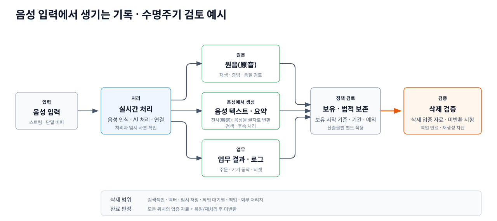

---
services:
- microsoft-foundry
- azure-openai
- azure-storage
- azure-architecture
official_sources:
- title: Foundry Tools for Call Center Overview
  url: https://learn.microsoft.com/azure/ai-services/speech-service/call-center-overview
- title: Data and Privacy for Speech to text
  url: https://learn.microsoft.com/azure/foundry/responsible-ai/speech-service/speech-to-text/data-privacy-security
- title: Learn about retention for Copilot and AI apps
  url: https://learn.microsoft.com/purview/retention-policies-copilot
- title: Manage Teams meeting transcription
  url: https://learn.microsoft.com/microsoftteams/copilot-teams-transcription
- title: Manage Microsoft Copilot in Teams calls
  url: https://learn.microsoft.com/microsoftteams/copilot-teams-calling-transcription
document_type: research
status: current
verification_status: needs-review
sources_checked_at: 2026-11-02
title: 앱 음성 서비스 기록관리 사례와 정책
description: 음성 서비스가 공개 정책과 도움말에 밝힌 원음, 음성 텍스트, 요약과 업무 결과의 저장·삭제 방식을 비교합니다.
technologies:
- rest-api
tags:
- evaluate
- ai-agents
- storage
published_at: 2026-10-17
---

# 앱 음성 서비스 기록관리 사례와 정책

> - 목적: 음성 서비스를 추가할 때 원음과 파생 데이터(전사·요약·업무 결과)를 어디에 얼마나 저장할지 정하는 데 참고할 기준을 모읍니다.
> - 방법: 업체·기관이 공개한 개인정보 처리방침, 도움말, 제품 문서와 법령 원문을 정리했습니다. 제품을 직접 시험하지 않았고, 저장 위치·조건·기간이 공개되지 않은 사례는 넣지 않았습니다.
> - 확인일: 발행 2026-10-17, 사례·제품 문서 2026-10-14~20, 법령 2026-10-19, 주요 AI 음성 제품 정책·한국 법령 2026-11-02. Azure 구현은 [Microsoft 공식 문서로 본 Azure 음성 에이전트 데이터 저장](azure-storage/index.md)에 있습니다.

## 음성 서비스의 원음 보관은 다섯 가지 패턴으로 나뉜다 {#retention-patterns}

아래 절에서 조사한 소비자 음성 서비스와 법령을 원음을 남기는 이유에 따라
묶었습니다. 같은 서비스도 설정에 따라 여러 패턴에 걸칩니다(예: Bixby 기본값은 1번,
녹음 검토에 동의하면 2번). Azure Speech·Voice Live·Foundry voice agent처럼
개발자가 설정하는 플랫폼의 기본 동작은 [아래 표](#platform-defaults)와
[Azure 문서](azure-storage/index.md#persistence-controls)에 따로 정리했습니다.

| 패턴 | 사례 | 원음 | 전사·파생 기록 |
|---|---|---|---|
| **1. 미저장·임시 처리** | Teams Copilot 회의·통화 중 전용 모드, Microsoft 365 Copilot 음성 채팅, Bixby 기본값, ChatGPT Standard, LG Smart TV 호출어 대기 | 요청을 처리한 뒤 바로 삭제하거나 단말에서 폐기 | Teams Copilot의 임시 STT는 회의·통화가 끝나면 저장하지 않음. 서비스에 따라 전사는 대화 기록으로 남음(ChatGPT Standard) |
| **2. 개선·진단·품질 분석용 저장** | 동의·설정 시: Microsoft 365 Copilot 피드백 48시간, Bixby 녹음 검토 1년, Siri 개선 참여 최대 2년(검토된 일부는 2년 초과). 모든 대화: [Bank of America Erica](https://info.bankofamerica.com/en/digital-banking/erica) 품질 확인·정확도 분석 90일 | 서비스 개선·품질 확인 목적으로 서비스가 정한 기간만 저장. 소비자 서비스는 대부분 사용자 동의를 조건으로 함 | 원음과 다른 규칙. Siri 요청 데이터는 참여와 관계없이 최대 2년 |
| **3. 계정 이력형(사용자 제어)** | Gemini 기본 18개월(3·36개월·무기한 선택), Alexa 3·18개월 또는 미저장, ChatGPT Live·Advanced 클립 30일 | 사용자가 다시 듣거나 지울 수 있게 계정에 저장. 기간을 사용자가 고르는 경우가 많음 | 원음과 기간이 다름. ChatGPT 전사는 채팅을 지울 때까지, Alexa는 미저장 모드에서도 텍스트 30일 |
| **4. 업무·규제 증빙형** | 금융소비자보호법 계약 자료 10년, 자본시장법 시행령의 고령자·부적합 투자자 대상 고위험 투자상품 판매 녹취, MiFID II 투자 주문 통화 5~7년, [AXA UK 통화 녹음](https://www.axa.co.uk/privacy-policy/how-we-collect-data/)(규제 기준 점검·민원·사기 조사), 컨택센터 녹음 | 법령이나 업무 목적에 따라 조직이 기간을 정함 | 계약·상담·민원 기록을 업무 시스템에 따로 보존 |
| **5. 생체 인증형** | [HMRC Voice ID](https://www.gov.uk/government/publications/voice-identification-privacy-notice/voice-identification-privacy-notice), Illinois BIPA, Texas 생체 식별자 법 | 등록 녹음을 voiceprint로 변환해 저장. HMRC는 3년마다 재동의, 최대 7년 | BIPA는 수집 목적 달성 시점과 마지막 상호작용 후 3년 중 빠른 시점에 삭제, Texas는 목적 종료 후 1년 안에 삭제 |

패턴과 관계없이 두 가지가 공통으로 나타납니다.

- **원음보다 전사·요청 데이터가 오래 남습니다.** 원음을 저장하지 않거나 짧게
  두는 서비스도 전사와 요청 데이터는 따로 보관합니다.
- **사용자 삭제에 예외가 있습니다.** 사용자가 지우거나 필요가 없어지면 대부분
  30~45일 안에 삭제하지만, 사람이 검토했거나 학습용으로 계정에서 분리한 사본은
  남습니다(Gemini 사람 검토 대화 최대 3년, Siri 검토분 2년 초과).

Azure로 구현할 때 음성을 어디서 받아 어디에 저장하는지, 저장소 보안과 설계는
[Microsoft 공식 문서로 본 Azure 음성 에이전트 데이터 저장](azure-storage/index.md)에서
다룹니다.

### Azure 음성 플랫폼은 원음을 저장하지 않는 것이 기본이다 {#platform-defaults}

아래는 서비스를 만드는 개발자가 정하는 플랫폼 설정입니다. 최종 사용자가 아니라
애플리케이션이 저장 여부와 기간을 결정합니다.

| 플랫폼 | 기본 동작 | 저장하는 경우 |
|---|---|---|
| Azure Speech 실시간 음성 인식 | 원음을 메모리에서 처리하고 저장하지 않음 | 애플리케이션이 직접 저장 |
| Voice Live | 고객 데이터를 저장하지 않음 | 지원 로그를 켜면 진단용 음성을 30일 보관 |
| Foundry voice agent | `store=false` | `store=true`면 전사·이벤트·원음을 기본 60일 보관 |

## 주요 AI 음성 제품은 원음을 남기는 조건과 기간이 서로 다르다 {#product-storage-comparison}

각 서비스가 웹에 공개한 개인정보 처리방침과 도움말에 적힌 내용을
2026-11-02에 확인해 정리했습니다. 제품을 직접 사용해 저장 동작을
시험하지는 않았습니다.

- **원음:** 사용자가 말한 오디오 녹음
- **전사:** 원음을 텍스트로 바꾼 기록

| 서비스·적용 범위 | 기본 설정의 원음 | 원음을 남기는 경우와 기간 | 전사·대화 기록 |
|---|---|---|---|
| [Bixby](#bixby-policy) / 미국 정책 | 명령 처리 후 삭제 | 녹음 검토를 허용하면 합계 1년. 첫 1개월만 계정 식별자와 연결 | — |
| [Gemini](#gemini-policy) / 개인 계정 | 활동 저장(Keep Activity)이 켜져 있으면 Gemini 활동에 저장 | 활동 자동 삭제 기본 18개월(3·36개월·무기한 선택). 활동 저장을 끄면 72시간 | 원음과 함께 Gemini 활동에 저장 |
| [ChatGPT](#chatgpt-policy) / 음성 모드별 | Live·Advanced는 클립 저장. Standard는 전사 후 삭제 | Live·Advanced 클립 30일 | 사용자가 채팅을 지울 때까지 채팅 기록에 저장 |
| [Microsoft 365 Copilot](#m365-copilot-policy) / 음성 채팅 | 저장 안 함 | 피드백 기능을 켜면 48시간 | 텍스트 대화와 같은 방식으로 저장 |
| [Siri·받아쓰기](#siri-policy) / Apple 정책 | Apple 서버에 저장 안 함 | 개선 프로그램에 참여하면 Apple 서버에 최대 2년. 검토된 일부는 2년 초과 | 단말에 요청 이력 저장. Apple 서버에는 개선 참여 시 저장 |

### Bixby: 녹음 검토를 허용한 경우에만 원음을 1년 보관한다 {#bixby-policy}

[Bixby 미국 개인정보 고지](https://d264isyiyrfhr3.cloudfront.net/storage/tos/usa/2.1.3/1782805872274/eng/usa_eng_pp.html)
(2026-06-01 시행) 기준입니다.

| 기록 | 저장 조건 | 보관 기간 | 끄거나 지울 때 |
|---|---|---|---|
| 명령 원음 | 기본: 요청한 명령을 처리한 뒤 삭제 | 저장 안 함 | — |
| 명령 원음 | `Allow audio recording review`(녹음 검토 허용)를 켠 경우. 문제 진단과 사람 검토·학습에 사용 | 첫 1개월은 계정 식별자와 연결. 이후 식별자를 떼고 다른 녹음과 섞어 합계 1년 | 설정에서 동의 철회 가능 |
| 기기·사용·위치 정보 | 서비스 이용 시 수집 | 수집 목적에 필요한 기간 | 필요가 없어지면 백업 포함 45일 이내 삭제 또는 익명화. 삭제 요청도 가능하나 법정 보관 자료는 제외 |

녹음 검토 동의는 Samsung 계정 단위로 적용되어 같은 계정으로 로그인한
모든 기기에 반영됩니다. 45일은 필요 없어진 개인정보 전반에 대한 삭제
기한입니다.

### Gemini: 원음 보관 기간은 활동 저장 설정을 따른다 {#gemini-policy}

[Gemini 앱 개인정보 허브](https://support.google.com/gemini/answer/13594961?hl=en)
(2026-10-26 갱신)와 [Gemini Live 도움말](https://support.google.com/gemini/answer/15274899?hl=en) 기준입니다.

| 기록 | 저장 조건 | 보관 기간 | 끄거나 지울 때 |
|---|---|---|---|
| Live 오디오·영상·화면 공유와 전사 | 활동 저장 켜짐: Google 계정의 Gemini 활동에 저장 | 자동 삭제 기본 18개월. 3·36개월·무기한으로 변경 가능 | Gemini 활동에서 직접 삭제 가능 |
| 활동 저장을 끈 상태의 대화·임시 채팅 | 활동에 남지 않음 | 계정에 72시간 | 응답·안전 목적에 사용. 피드백을 보내지 않으면 학습에 쓰지 않음 |
| 사람이 검토한 대화 | 서비스 개선용으로 선택된 경우. 계정과 분리 | 최대 3년 | Gemini 활동을 지워도 남음 |

원음·영상·화면 공유는 기본적으로 서비스 개선에 쓰이지 않습니다.
Gemini 활동에서 오디오 개선 사용 설정을 켜야 개선과 학습에 쓰이며,
켜면 이미 저장된 오디오도 대상이 됩니다. 전사는 활동 저장 설정이
따로 통제합니다.

### ChatGPT: Live·Advanced 음성 클립은 30일, 전사는 채팅과 함께 남는다 {#chatgpt-policy}

[ChatGPT Voice 도움말](https://help.openai.com/en/articles/20001274-chatgpt-voice)과
[채팅·파일 보관 도움말](https://help.openai.com/en/articles/8983778-chat-and-file-retention-in-chatgpt) 기준입니다.

| 기록 | 저장 조건 | 보관 기간 | 끄거나 지울 때 |
|---|---|---|---|
| Live·Advanced 음성 클립(Advanced는 영상 클립 포함) | 해당 모드 사용 시 채팅 기록의 전사와 함께 저장 | 30일 | 채팅을 지우면 30일 이내 삭제. 보안·안전·법적 사유와 이미 계정에서 분리된 학습 공유 클립은 예외 |
| Standard 음성 원음 | 응답 생성 전 전사에 사용 | 전사가 끝나면 삭제(전사 실패 시도 삭제) | 학습용 오디오 공유를 켠 경우 예외 |
| 음성 대화 전사 | 음성 대화가 끝나면 채팅에 추가 | 사용자가 지우거나 워크스페이스 보관 정책이 지울 때까지 | 삭제 후 30일 이내 영구 삭제 예정. 보관(Archive)은 삭제가 아님 |

클립은 `Include your audio recordings` 설정을 켠 경우에만 학습에
쓰입니다. 전사는 `Improve the model for everyone`이 켜져 있으면 플랜과
설정에 따라 학습에 쓰일 수 있습니다. 도움말은 전사가 실제 발화와
정확히 일치하지 않을 수 있다고 안내합니다.

### Microsoft 365 Copilot: 음성 채팅 원음은 피드백용으로만 48시간 남는다 {#m365-copilot-policy}

[Microsoft 365 Copilot 음성 기능 FAQ](https://support.microsoft.com/en-us/microsoft-365-copilot/frequently-asked-questions-about-voice-features-in-microsoft-365-copilot) 기준입니다.

| 기록 | 저장 조건 | 보관 기간 | 끄거나 지울 때 |
|---|---|---|---|
| 사용자·Copilot 음성 | 기본 | 저장 안 함 | — |
| 대화 오디오(배경 소음 포함 가능) | 피드백 기능이 켜진 경우 Microsoft에 피드백을 보내기 위해 임시 저장 | 48시간 후 삭제 | — |
| 음성 대화 전사 | Copilot 앱의 텍스트 대화와 같은 방식으로 저장·관리 | [Copilot 데이터 보존 정책](https://learn.microsoft.com/copilot/microsoft-365/microsoft-365-copilot-privacy)을 따름 | 텍스트 대화와 같음 |

FAQ는 음성 채팅의 사용자 데이터를 모델 학습에 쓰지 않으며, `Hey Copilot`
호출어 감지는 단말에서 동작하고 대화를 녹음·저장하지 않는다고 밝힙니다.

### Siri·받아쓰기: 단말에는 요청 이력이, Apple 서버에는 개선 참여 시 원음이 남는다 {#siri-policy}

Apple의 [Siri·받아쓰기 개인정보 안내](https://www.apple.com/legal/privacy/data/en/ask-siri-dictation/)와
[개선 프로그램 안내](https://www.apple.com/legal/privacy/data/en/improve-siri-dictation/)
(모두 2026-10-30 갱신) 기준입니다.

| 기록 | 저장 위치 | 저장 조건 | 보관 기간 | 끄거나 지울 때 |
|---|---|---|---|---|
| Siri·받아쓰기 요청 이력(전사) | 단말 | 기본. Siri 개인화에 사용 | — | 설정 > Siri에서 Siri를 끄면 삭제 |
| 원음 | Apple 서버 | `Improve Siri and Dictation`(Siri 및 받아쓰기 개선) 참여 시에만 저장 | 최대 2년. 검토된 일부는 2년 초과 | 설정 > 개인정보 보호 및 보안 > 분석 및 개선에서 참여 해제 |
| 전사·Siri 응답 | Apple 서버 | 개선 참여 시 저장 | 최대 2년. 검토된 일부는 2년 초과 | 위와 같음 |
| 요청 데이터(요청 범주, 성공 여부, 기기 사양·설정, 성능 통계, 위치 서비스를 켠 경우 대략적 위치) | Apple 서버 | 개선 참여와 관계없이 저장 | 최대 2년 | — |

단말에서 처리되지 않는 요청은 Apple로 전송되어 처리되며, 단말 처리
여부는 Siri 또는 키보드 설정에 표시됩니다. Siri AI를 켜면 요청이 Private
Cloud Compute에서 처리될 수 있고, Apple은 이 데이터를 저장하지 않는다고
설명합니다. Apple 서버에 저장되는 원음·전사·요청 데이터는 시간당 여러
번 바뀌는 임의의 기기 식별자와 연결되며 Apple 계정과는 연결되지
않습니다. 원음 검토는 Apple 직원만 합니다.

## 업무형 음성 서비스는 원음을 기본으로 남기지 않거나 목적별 기간을 둔다 {#business-use-cases}

업체·기관이 공개한 정책과 도움말에서 저장 위치·조건·기간이 구체적으로
나온 사례만 모았습니다.

| 업무 | 서비스 | 원음·파생 기록의 저장 방식 | 근거 |
|---|---|---|---|
| 구매·주문 | Alexa Shopping | 원음은 Amazon 클라우드의 Alexa 계정에 저장하며 3개월·18개월 자동 삭제 또는 미저장을 선택. 미저장을 고르면 요청 처리 후 원음을 지우고 기존 녹음도 삭제. 음성 텍스트·입력 요청은 미저장 모드에서도 마지막 상호작용 후 30일 보유. 주문·쇼핑 목록 기록은 원음 삭제와 별도 | [쇼핑 서비스](https://www.amazon.com/alexa-shopping-hub/b?ie=UTF8&node=21467932011) · [원음·삭제 FAQ](https://www.amazon.com/gp/help/customer/display.html?nodeId=GVP69FUJ48X9DK8V) |
| 제품 제어 | LG 미국 Smart TV | 호출어가 감지되지 않은 오디오는 단말에서 처리 후 즉시 폐기하며 저장·텍스트 변환·전송하지 않음. 활성 세션은 무음이면 약 10초, 최대 약 18초. 오프라인 음성을 나중에 올리려고 저장하지 않음 | [Smart TV 음성 개인정보 설명](https://www.lg.com/us/newsroom/corporate/statement-understanding-privacy-on-lg-smart-tvs) |
| 영상 지원 | Be My Eyes 기업 서비스(Microsoft Disability Answer Desk 사용) | 기업 Service Connect는 고객사가 요청하지 않으면 영상 통화를 녹화·저장하지 않음. 녹화를 요청하면 고객사가 처리 책임 주체, Be My Eyes는 위탁 처리자. 일반 서비스의 통화 녹음은 무기한 보관하고 시각장애·저시력 사용자가 삭제를 요청하면 30일 이내 삭제. Be My AI 문의는 생성 후 60일 또는 요청 후 30일 이내 삭제 | [Microsoft 지원 채널](https://www.microsoft.com/en-us/accessibility/disability-answer-desk) · [Microsoft 사례](https://www.bemyeyes.com/business/microsoft-case-study/) · [모드별 정책](https://www.bemyeyes.com/privacy-policy/) |
| 금융 문의 | Bank of America Erica | 음성 상호작용을 90일 저장·분석. 보관하는 음성 텍스트는 개인정보를 마스킹. 음성 응답에 외부 서비스 제공자 사용 | [Erica FAQ](https://info.bankofamerica.com/en/digital-banking/erica) |
| 말하기 학습 | Duolingo | 수학 튜터는 원음을 Apple 음성 인식에 보낸 뒤 즉시 삭제하고 음성 텍스트는 보관·AI 공급자 공유 가능. 일반 AI 기능은 제출 오디오·텍스트를 녹음·전사·저장할 수 있고 계정 삭제까지 보유(법적·분쟁 예외). 아동 음성은 개선용 공유에서 제외 | [개인정보 처리방침](https://www.duolingo.com/privacy) |

## 컨택센터 제품은 녹음 범위와 저장소를 조직이 설정한다 {#contact-center-recording}

| 제품 | 녹음·저장 방식 |
|---|---|
| **Dynamics 365 Contact Center** | 업무 흐름별로 전사만 또는 전사+녹음을 설정하고 자동·수동 시작과 일시정지·재개 가능. 조직 단위로 오디오 녹음을 제어. Copilot Studio 대화 기록은 녹음을 꺼도 생성되며, 키패드 입력 전용 구성은 발화를 저장하지 않음. 녹음은 개별·일괄 삭제 가능. [설정](https://learn.microsoft.com/en-us/dynamics365/customer-service/administer/voice-channel-configure-transcripts) · [FAQ](https://learn.microsoft.com/en-us/dynamics365/customer-service/administer/voice-channel-faqs) · [삭제](https://learn.microsoft.com/en-us/dynamics365/customer-service/administer/voice-channel-delete-calls) |
| **D365 데스크톱 보조 앱 / 화면 녹화** | 로컬에 임시 저장한 뒤 조직 Dataverse에 올리고, 업로드가 끝나면 로컬 파일 삭제. 화면 녹화·대화 기록은 기본 무기한이고 문서가 지칭하는 Copilot Studio 대화 기록은 30일. 대량 삭제 작업으로 기간을 관리하며 삭제한 화면 녹화는 복구 불가. [저장·보유](https://learn.microsoft.com/en-us/dynamics365/contact-center/administer/configure-screen-recording) |
| **Amazon Connect** | 자동응답(IVR)·상담원 단계와 참여자별로 녹음 설정. 고객 S3 버킷에 저장하고 상담 ID로 검색·WAV 다운로드. 분석을 켜면 전사·요약·마스킹본이 원본과 별도로 생성. [녹음](https://docs.aws.amazon.com/connect/latest/adminguide/about-recording-behavior.html) · [다운로드](https://docs.aws.amazon.com/connect/latest/adminguide/download-recordings.html) · [분석](https://docs.aws.amazon.com/connect/latest/adminguide/analyze-conversations.html) · [마스킹](https://docs.aws.amazon.com/connect/latest/adminguide/sensitive-data-redaction.html) |
| **NICE CXone** | 녹음/녹음 안 함(Do Not Record) 정책·비율·필터로 녹음 대상 지정. 신규 고객 환경은 기본 100% 음성 녹음. 활성·장기 저장소와 복원 작업 제공. 수명주기 규칙에 맞지 않는 파일은 활성 저장소에 남음. [녹음 정책](https://help.nice-incontact.com/content/recording/definerecordingpolicies.htm) · [저장소](https://help.nice-incontact.com/content/admin/storageservices/storageservices.htm) · [수명주기](https://help.nice-incontact.com/content/admin/storageservices/lifecyclemanagement.htm) · [복원](https://help.nice-incontact.com/content/admin/storageservices/retrievestoredfiles.htm) |

## 법령은 녹음할 수 있는 대상과 지정된 기록의 보존기간을 정한다 {#jurisdiction-rules}

조문이 기간이나 삭제 시점을 숫자로 정한 경우만 모았습니다.

| 관할·근거 | 대상 기록 | 기간·기산점 | 음성 기록에 적용할 때 |
|---|---|---|---|
| **[한국 전자상거래법 시행령 제6조](https://law.go.kr/LSW/lsLinkCommonInfo.do?lspttninfSeq=63460&chrClsCd=010202)** | 표시·광고 / 계약·청약철회 / 대금결제·공급 / 불만·분쟁 기록 | **6개월 / 5년 / 5년 / 3년** | 통화 원음이 아니라 거래 기록에 적용 |
| **[한국 금융소비자보호법 제28조](https://www.law.go.kr/LSW/lsLinkCommonInfo.do?lsJoLnkSeq=1033002393)·[시행령 제26조](https://law.go.kr/lsLinkCommonInfo.do?lspttninfSeq=166903&chrClsCd=010202)** | 계약체결·이행, 광고, 권리행사, 업무위탁 자료 | 원칙 **10년**. 10년 초과 보장·계약은 해당 보장·계약기간 | 녹취가 해당 자료에 포함될 때 적용 |
| **금융 내부통제 자료 / 이에 준하는 고시 자료** | 시행령 제26조제1항제5호 내부통제 자료 / 제7호 위임 자료 | 내부통제는 금융위원회 고시로 **5년 이내**, 제7호 자료는 고시로 **10년 이내** | 실제 기간은 적용되는 금융위원회 고시 기준 |
| **[EU MiFID II Article 16(7)](https://eur-lex.europa.eu/legal-content/EN/TXT/?uri=CELEX:02014L0065-20240109)** | 자기계정 거래·고객 주문 접수·전달·실행과 관련되거나 이를 의도한 전화·전자통신 | **5년**, 감독기관 요청 시 **최대 7년** | 대상 투자업무 통화 녹음에 직접 적용 |
| **[EU AI Act Articles 19(1), 26(6)](https://eur-lex.europa.eu/eli/reg/2024/1689/oj/eng)** | 공급자·배포자가 통제하는 고위험 AI 자동 생성 로그 | 목적에 맞는 기간, **최소 6개월**. 적용되는 EU·회원국 법률이 달리 정하면 그 규칙 적용 | 고위험 AI 시스템의 자동 생성 로그에 적용 |
| **[COPPA 16 CFR 312.5(c)(9)](https://www.federalregister.gov/documents/full_text/text/2025/04/22/2025-05904.txt)** | 아동의 특정 요청 응답용 음성 파일만 수집하고 다른 개인정보·이용·공개가 없는 예외 | 응답 **직후 삭제** | 조건을 모두 충족할 때만 적용되는 예외 |
| **Illinois BIPA [§10](https://www.ilga.gov/documents/legislation/ilcs/documents/074000140K10.htm)·[§15(a)](https://www.ilga.gov/documents/legislation/ilcs/documents/074000140K15.htm)** | §10이 정의하는 voiceprint 포함 생체 식별자·정보 | §15(a): 목적 달성 또는 마지막 상호작용 후 **3년** 중 빠른 시점 | 일반 녹음이 아니라 voiceprint에 적용 |
| **[Texas B&amp;C Code §503.001](https://tcss.legis.texas.gov/resources/BC/htm/BC.503.htm)** | 상업 목적으로 수집한 voiceprint 등 생체 식별자 | 목적 종료 후 합리적 기간, 늦어도 **1년**. 다른 법정 문서와 연결되면 그 의무 종료 후 1년 | 금융기관 voiceprint와 일부 AI·보안·사기 용도는 예외 조항 확인 |

### 한국 법령은 녹음할 수 있는 대화·동의 방식·판매 녹취를 따로 정한다

| 법령 | 규정 | 음성 서비스에 적용할 때 |
|---|---|---|
| **통신비밀보호법 [제3조 제1항](https://www.law.go.kr/LSW/lsSideInfoP.do?lsiSeq=290003&joNo=0003)·[제14조 제1항](https://www.law.go.kr/LSW/lsSideInfoP.do?lsiSeq=290003&joNo=0014)·[제16조 제1항](https://www.law.go.kr/LSW/lsSideInfoP.do?lsiSeq=290003&joNo=0016)** | 공개되지 않은 타인 간의 대화를 녹음하거나 청취하지 못함. 위반하면 1년 이상 10년 이하 징역과 5년 이하 자격정지. [대법원 2006도4981](https://law.go.kr/LSW/precInfoP.do?evtNo=2006%EB%8F%844981)은 대화에 참여한 사람이 녹음한 경우는 타인 간의 대화가 아니라고 판단 | 사용자와 서비스 사이의 대화 녹음은 해당하지 않음. 공용기기나 호출어 대기 중에 주변 사람들끼리 나눈 대화를 녹음하면 해당할 수 있음. 호출어를 감지하기 전 오디오를 단말에서 폐기하는 설계(LG Smart TV)는 이 위험을 줄이는 예이지만, 호출어를 잘못 인식하면 주변 대화가 녹음될 수 있음 |
| **개인정보 보호법 [제15조 제2항](https://www.law.go.kr/LSW/lsSideInfoP.do?lsiSeq=283839&joNo=0015)·[제22조 제1항](https://www.law.go.kr/LSW/lsSideInfoP.do?lsiSeq=283839&joNo=0022)** | 동의를 받을 때 수집·이용 목적, 항목, 보유·이용 기간, 동의 거부권과 불이익을 알려야 함. 동의 사항을 각각 구분해 받아야 함 | 원음 저장, 사람 검토, 학습 사용을 각각 따로 동의받음(Bixby 녹음 검토, Siri 개선 참여와 같은 구조). 고지문에 원음과 전사의 보유기간을 따로 적음 |
| **개인정보 보호법 [제25조 제5항](https://www.law.go.kr/LSW/lsSideInfoP.do?lsiSeq=283839&joNo=0025)** | 고정형 영상정보처리기기(CCTV 등)는 녹음 기능을 사용할 수 없음 | 매장·시설에 고정 설치한 카메라 기기에 음성 기능을 붙일 때 해당 |
| **자본시장법 시행령 [제68조 제5항 제2호의2·제2호의3](https://www.law.go.kr/LSW/lsSideInfoP.do?lsiSeq=291081&joNo=0068&joBrNo=00)과 금융투자업규정 제4-20조의2** | 적합성·적정성 평가에서 부적합 판정을 받았거나 65세 이상인 개인 일반투자자에게 정해진 투자성 상품을 팔 때 판매과정을 녹취하고, 투자자가 요청하면 녹취 파일을 제공해야 함. 2영업일 이상 숙려기간도 부여. 녹취 대상 상품은 [금융소비자보호법 시행령 제12조 제1항 제2호](https://www.law.go.kr/LSW/lsSideInfoP.do?lsiSeq=285715&joNo=0012&joBrNo=00)의 투자성 상품(파생상품·파생결합증권, 조건부자본증권 성격의 사채, 고난도금융투자상품 등)이며, 거래소·해외 시장에서 투자자가 직접 매매하는 상장 상품은 제외. 고난도금융투자상품은 제2호의3에 따라 모든 개인 일반투자자에게 같은 의무 적용 | 음성 에이전트가 이 대상에게 해당 상품을 권유·판매하면 판매과정 녹취가 의무. 의무 조항은 금융소비자보호법 시행 뒤에도 자본시장법 시행령에 있으며, 대상 판정 기준만 금융소비자보호법을 따름. 녹취 보존기간은 이 조문에 없고, 금융소비자보호법 시행령 제26조가 계약체결 자료를 10년 보존하도록 정함 |

### 개인정보 보호법·GDPR·CCPA는 공통 보존 일수를 정하지 않는다

한국 개인정보 보호법, GDPR, CCPA/CPRA는 목적·필요성·고지한 기준 또는
필요 종료 후 삭제를 요구할 뿐 음성 원음에 적용할 공통 일수는 정하지
않습니다. 보관 기간은 서비스가 목적에 맞춰 정하고 고지해야 합니다.

[COPPA §312.10](https://www.federalregister.gov/documents/full_text/text/2025/04/22/2025-05904.txt)도
일반 아동 개인정보에는 공통 일수를 두지 않고, 특정 목적에 합리적으로
필요한 기간만 보유하고 무기한 보유를 금지하며 서면 삭제 시점을 정하도록
요구합니다.

### 금융·결제 기록에 붙는 추가 규칙

| 규칙 | 지정 기록의 범위·기간 |
|---|---|
| 한국 신용정보법 제20조의2 | 거래관계 종료 후 최장 5년 이내 삭제 원칙, 목적 먼저 달성 시 달성일부터 3개월 이내 규정·법정 예외. [조문](https://www.law.go.kr/LSW/lsSideInfoP.do?lsiSeq=283841&joNo=0020&joBrNo=02&docCls=jo&urlMode=lsScJoRltInfoR) |
| 한국 전자금융거래법 제22조 | 거래 추적·검색·오류 정정에 필요한 기록, 법률상 대통령령 기간 5년 범위. [조문](https://www.law.go.kr/LSW/lsSideInfoP.do?lsiSeq=290247&joNo=0022&joBrNo=00&docCls=jo&urlMode=lsScJoRltInfoR) |
| FINRA Rule 4511 | 적용 장부·기록에 별도 기간이 없을 때 최소 6년. [규칙](https://www.finra.org/rules-guidance/rulebooks/finra-rules/4511) |
| PCI DSS 민감 인증정보 | 승인 후 CVV 등 민감 인증정보는 녹취에도 보관 금지. 전사만 마스킹하면 원음에 남음. [PCI FAQ 1210](https://www.pcisecuritystandards.org/faqs/1210/) |

## Alexa 사건은 아동 음성의 무기한 보관과 삭제 후 남은 전사가 쟁점이었다 {#alexa-deletion-case}

### 사건 개요

| 항목 | 내용 |
|---|---|
| **당사자** | 원고는 미국 정부(연방거래위원회 FTC의 통보·승인을 받아 법무부가 소송 수행), 피고는 Amazon.com, Inc.와 Amazon.com Services LLC |
| **법원·사건번호** | 미국 워싱턴주 서부 연방지방법원, Case 2:23-cv-00811 |
| **경과** | 2023-05-31 고소장 제출 → 2023-07-19 합의명령 제출. Amazon은 혐의를 인정도 부인도 하지 않고 합의 |
| **적용 법률** | 아동 온라인 개인정보 보호법(COPPA)과 FTC법 제5조(기만적·불공정 행위) |
| **대상 제품** | Alexa 음성 비서와 Echo 기기, 아동용 Echo Dot Kids Edition, 부모가 아동 이용을 관리하는 FreeTime on Alexa·FreeTime Unlimited |

### 무슨 일이 있었나

Alexa는 사용자가 말을 걸 때마다 녹음 파일과 전사문을 만들어 Amazon
클라우드에 저장합니다. Amazon은 아동용 Echo Dot Kids Edition과 부모용
관리 서비스 FreeTime을 팔았고,
[고소장](https://search.ftc.gov/system/files/ftc_gov/pdf/Amazon-Complaint-%28Dkt.1%29.pdf)에
따르면 13세 미만 아동 80만 명 이상이 자기 Alexa 프로필을 갖고 있었습니다.

문제는 이 녹음의 보관과 삭제였습니다.

- **보관:** 첫 Echo 출시 때부터 기본 설정은 녹음을 지우지 않는 것이었습니다.
  FTC로부터 첫 민사 조사 요구(Civil Investigative Demand)를 받고 두 달 뒤인 2019년 9월에 3개월·18개월 자동 삭제 옵션이
  생겼지만 기본값은 무기한 그대로였습니다.
- **삭제:** 2019년 중반까지는 사용자나 부모가 앱에서 녹음을 지우면 재생 버튼과
  텍스트가 함께 사라져 모두 지워진 것처럼 보였습니다. 실제로는 원음만 지워지고
  전사문은 별도 저장소에 남아 Alexa 개선에 계속 쓰였습니다.
- **접근:** 2018년 8월부터 2019년 9월까지 약 3만 명의 직원이 음성 녹음에 접근할
  수 있었고, 그중 약 1만 5천 명은 업무상 필요가 없었습니다.

정부는 녹음을 몇 초면 끝나는 요청 처리, 부모의 녹음 확인, 음성 인식 개선 중
어느 목적으로 보아도 영구 보관은 "합리적으로 필요한" 범위를 넘는다고 보았습니다.
COPPA는 아동 개인정보를 수집 목적에 합리적으로 필요한 기간만 보관하도록
요구합니다. 아래 혐의는 정부가 고소장에서 주장한 내용입니다. 원문은
[FTC 사건 페이지](https://www.ftc.gov/legal-library/browse/cases-proceedings/192-3128-amazoncom-alexa-us-v)와
[합의명령](https://search.ftc.gov/system/files/ftc_gov/pdf/1923128amazonalexaorderfiled.pdf)에서
볼 수 있습니다.

### 고소장이 제기한 혐의

| 대상 | FTC·DOJ 고소장의 주장 |
|---|---|
| **원음·전사문** | 기본 설정이 아동·성인의 원음과 전사문을 비활성 계정까지 무기한 저장 |
| **제품 개선** | 저장한 원음·전사문을 요청 처리뿐 아니라 Alexa 학습·개선에 사용 |
| **삭제 요청** | 일부 요청에서 원음 삭제 뒤에도 전사문을 유지하고 이를 알리지 않음 |
| **위치·음성정보** | 이용자 요청 뒤에도 위치·음성정보를 삭제하지 않고 잠재적 이용을 위해 유지 |

### 합의명령이 요구한 조치

| 조치 | 명령 내용 |
|---|---|
| **민사 벌금** | **USD 25 million** |
| **비활성 아동 프로필 식별** | Alexa와 상호작용한 뒤 **18개월 이상** 사용되지 않은 아동 프로필을 찾는 절차를 명령 입력 후 **6개월 이내** 구축 |
| **비활성 아동 정보 삭제** | 위 정의에 해당하는 프로필 식별 후 **90일 이내** 삭제. 부모가 보유를 요청하거나 프로필이 다시 활성화되면 예외 |
| **삭제 요청 이행** | Amazon이 제공한 삭제 기능으로 요청된 Alexa 위치·음성정보와 아동 개인정보 삭제 |
| **삭제 뒤 모델·제품 이용** | 삭제 처리한 정보를 이후 **어떤 데이터 제품이든** 생성·개선하는 데 사용 금지. |

## 기록마다 담당자·보관 기준·삭제 증빙을 따로 정한다 {#record-retention-checklist}

원음을 저장하지 않아도 요청 처리용 임시 STT, 전사, 요약, 업무 결과는 생길 수
있습니다. 기록마다 저장 조건·위치·기간·삭제 방법을 정하고, 수집 중단과
이미 저장된 사본의 삭제를 구분합니다.

| 기록 | 담당자 예시 | 정책에 고정할 값 | 삭제 확인 자료 |
|---|---|---|---|
| **입력·출력 오디오** | 서비스·녹음 담당 | 목적, 캡처 방식, 저장소·지역, 기산점, 기간 | 객체·버전 삭제 로그, 처리자 삭제 확인, 백업 만료 기록 |
| **전사문·요약** | 상담기록·사건 담당 | 원음 연결, 정정 버전, 검색 사본, 기산점·기간 | DB·티켓·색인 삭제, 키워드·의미 검색 미반환 |
| **이벤트·업무 결과** | 제품·업무 시스템 담당 | 이벤트 ID, 권위 있는 결과, 법정 기록 분류 | 이벤트·업무 기록 삭제 또는 별도 보존 근거 |
| **voiceprint** | 인증·보안 담당 | 동의, 등록 원음, 템플릿, 마지막 상호작용, 적용 법령 | 등록 원음·템플릿 삭제 감사 로그 |
| **trace·검색·반출 사본** | 운영·보안·데이터 담당 | 수집 필드, 접근권한, 지역, 기간, 하류 사본 | 만료 작업, 접근 기록, 색인·캐시·반출본 삭제 |

삭제 완료는 객체·버전·등록 원음·템플릿 삭제 로그처럼 저장소 상태를 보여주는
자료로 확인합니다.

## Microsoft 업무 제품은 녹음·전사·Copilot 기록을 서로 다른 저장소에 둔다 {#microsoft-record-locations}

Teams·Copilot Studio·Dynamics 365처럼 이미 쓰고 있는 Microsoft 업무 제품에 음성 기능을 붙일 때
기록이 어디에 남는지 정리했습니다.

Microsoft 업무 제품별 기록 위치 보기

| 기록 | 저장 위치·기간 |
|---|---|
| **Teams 녹음·전사(음성 텍스트)** | 회의·이벤트: 주최자 OneDrive. 채널 회의: SharePoint. 1:1·그룹 통화: 녹화 시작 사용자 OneDrive. 주최자·공동 주최자·내부/외부 참여자별 권한 차이. [저장·권한](https://learn.microsoft.com/en-us/microsoftteams/tmr-meeting-recording-change) |
| **Teams Copilot / 회의·이벤트** | `Only during the meeting`에서는 녹음·전사 저장 기능을 켜지 않아도 사용 가능하지만 임시 STT 데이터로 음성을 텍스트로 변환합니다. 이 처리 데이터는 회의·이벤트 종료 후 저장되지 않음. [회의 전용 모드](https://learn.microsoft.com/microsoftteams/copilot-teams-transcription#only-during-the-meeting) 상용 클라우드에서는 Copilot 질문·응답이 Purview 보유 정책의 준법 보존 대상이 될 수 있음. |
| **Teams Copilot / 통화** | `Only during the call`도 임시 STT 데이터를 사용합니다. 통화 전용 정책 문서는 통화 종료 후 이 처리 데이터와 사용자·Copilot 사이의 교환 정보를 저장하지 않는다고 설명. [통화 전용 모드](https://learn.microsoft.com/microsoftteams/copilot-teams-calling-transcription#only-during-the-call) |
| **Purview Copilot 질문·응답 보유** | Microsoft Copilot experiences 정책 위치에서 Microsoft 365 Copilot·Copilot Studio 등의 질문·응답에 대한 보유·삭제 정책을 설정. 준법 사본은 사용자 Exchange 사서함의 숨김 폴더에 저장되고 eDiscovery로 검색. [Copilot·AI 앱 보유](https://learn.microsoft.com/en-us/purview/retention-policies-copilot) |
| **Copilot Studio 임시 저장** | 세션 정보(session information) 등 제품 기능 지원용 임시 데이터는 Copilot Studio 저장소에서 최대 28일 보관 후 자동 삭제한다고 설명. [대화 기록 제어](https://learn.microsoft.com/en-us/microsoft-copilot-studio/admin-transcript-controls) |
| **Copilot Studio Dataverse 대화 기록** | 대화 기록과 관련 부가정보(metadata)를 기본적으로 Dataverse에 저장하며 환경별 저장 여부·제작자 열람/다운로드·보안 역할·보유기간을 제어. 저장을 끈 뒤 최대 24시간 추가 저장 가능. Dataverse for Teams 환경·Microsoft Copilot 에이전트는 Dataverse 대화 기록 테이블 대상에서 제외. [대화 기록 제어](https://learn.microsoft.com/en-us/microsoft-copilot-studio/admin-transcript-controls) |
| **Copilot Studio 감사 이벤트** | Purview Audit의 상호작용 이벤트에는 시각·조직·사용자·리소스 ID·대화 기록 스레드 ID 등의 부가정보가 포함되며, 전체 대화 텍스트는 감사 이벤트 자체가 아니라 별도로 저장됨. [감사 로그](https://learn.microsoft.com/en-us/microsoft-copilot-studio/admin-logging-copilot-studio) |
| **D365 통화 녹음·전사(음성 텍스트)** | 업무 흐름별 음성 텍스트 또는 음성 텍스트+녹음, 자동/수동 시작, 일시정지/재개. Copilot Studio AI 에이전트 대화 기록은 통화 녹음 설정과 독립 생성 가능. 전화 키패드 음 전용(DTMF-only) 구성은 발화 미저장. [설정](https://learn.microsoft.com/en-us/dynamics365/customer-service/administer/voice-channel-configure-transcripts) · [FAQ](https://learn.microsoft.com/en-us/dynamics365/customer-service/administer/voice-channel-faqs) |
| **D365 분석 결과·Dataverse** | 통화 녹음 기반 대화 지표·전체 음성 텍스트 제공. Copilot 질문·응답, 피드백, 요약, 상호작용은 Dataverse의 대화 기록·상호작용·이벤트·대화 분석 테이블에 저장·다운로드 가능. [분석](https://learn.microsoft.com/en-us/dynamics365/customer-service/use/voice-channel-reports-analytics) · [Dataverse 테이블](https://learn.microsoft.com/en-us/dynamics365/customer-service/develop/download-copilot-transcript-data) |
| **Teams 음성 요약** | 최대 8개 회의 음성 텍스트로 새 음성 요약 생성, OneDrive 저장. 회의 음성 텍스트는 기본 120일이며 주최자가 더 일찍 삭제할 수 있고, 음성 요약은 60일 후 자동 삭제. [음성 요약](https://support.microsoft.com/en-us/teams/copilot/listen-to-audio-recaps-of-your-meetings) |

