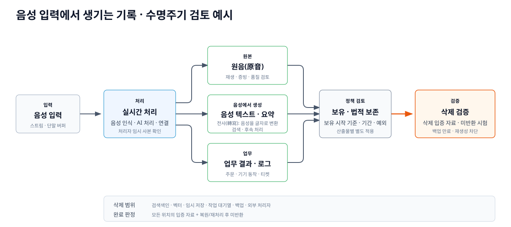

---
services:
- microsoft-foundry
- azure-openai
- azure-storage
- azure-architecture
official_sources:
- title: Foundry Tools for Call Center Overview
  url: https://learn.microsoft.com/azure/ai-services/speech-service/call-center-overview
- title: Data, privacy, and security for Speech to text
  url: https://learn.microsoft.com/azure/foundry/responsible-ai/speech-service/speech-to-text/data-privacy-security
- title: Learn about retention for Copilot and AI apps
  url: https://learn.microsoft.com/purview/retention-policies-copilot
document_type: research
status: current
verification_status: needs-review
sources_checked_at: 2026-10-19
title: 앱 음성 서비스 기록관리 사례와 정책
description: 실제 음성 서비스가 원음, 음성 텍스트, 요약과 업무 결과를 저장·삭제하는 방식을 비교합니다.
technologies:
- rest-api
tags:
- evaluate
- ai-agents
- storage
published_at: 2026-10-17
---

# 앱 음성 서비스 기록관리 사례와 정책

> - 리서치 발행일: 2026-10-17 (한국시간)
> - 최근 출처 원문 확인일: 2026-10-19 (한국시간). `sources_checked_at`은 아래 조사 범위 중 가장 최근의 원문 확인일이며 CI 실행일이 아닙니다. 전체 의미 검증 상태는 `needs-review`로 유지합니다.
> - 사례·제품 정책 세부 확인일: 2026-10-14. 시행일·갱신일·지역·기능 모드는 해석에 필요한 경우 본문에 표시하며, 공개 문서가 밝히지 않은 값은 추정하지 않음.
> - 법령·집행 원문 확인일: 2026-10-19 (한국시간). 한국 전자상거래·금융소비자 기록, MiFID II 통화, EU 고위험 AI 로그, COPPA 아동 음성, Illinois·Texas voiceprint, Amazon Alexa 고소장·합의명령의 인용 범위를 직접 구분함.
> - 범위: 실제 앱의 제품 구매 준비·제품 지원·고객서비스(CS)를 우선하고, 학습·금융 앱은 업무 목적별 비교, 전화 컨택센터·게임 안전·공공 본인확인·코덱은 부록으로 둠.
> - 연결 문서: [Microsoft 공식 문서로 본 Azure 음성 에이전트 데이터 저장](azure-storage/index.md)

> **읽는 기준**
>
> - **사례·제품 사실:** 업체·서비스 공개 문서에서 확인한 실제 동작·정책
> - **법령·지침:** 해당 국가·업무·자료 유형에 적용 여부를 따로 판단할 규칙
> - **교차 사례 분석:** 사례·법령·표준을 조합한 연구 해석. 특정 업체의 실제 운영 방식이나 법적 의무를 뜻하지 않음

## 주요 AI·음성 제품은 무엇을 저장하고 언제 지우는가? {#product-storage-comparison}

이 표는 서비스·기능 모드·설정·지역별 공개 정책을 직접 비교한 이 문서의
핵심 리서치 결과입니다. 실제 고객 설정이나 비공개 운영을 추정하지 않습니다.

| 서비스·범위 | 원음 | 전사(음성 텍스트)·이력·삭제 경계 |
|---|---|---|
| **Bixby / 미국 정책, 2026-06-01** | 검토 미동의: 요청 처리 후 삭제. 동의: 식별자 연결 1개월, 총 1년 보관 | 계정 단위 동의·철회. 불필요 정보는 법적 예외를 전제로 백업 포함 45일 이내 삭제 또는 익명화. [정책](https://d264isyiyrfhr3.cloudfront.net/storage/tos/usa/2.1.3/1782805872274/eng/usa_eng_pp.html) |
| **Gemini Live / 개인 계정** | Keep Activity 켜짐: 녹음·음성 텍스트·공유 콘텐츠를 계정 활동에 저장. 원음/영상/화면의 개선 활용은 별도 선택 | 활동 자동 삭제 기본 18개월, 3·36개월·무기한 선택. 꺼짐/임시 대화 72시간; 사람 검토 대화·관련 자료 최대 3년, 활동 삭제와 별개. 연결 서비스 자료는 별도. [Live](https://support.google.com/gemini/answer/15274899?hl=en) · [정책](https://support.google.com/gemini/answer/13594961?hl=en) |
| **ChatGPT Voice / 음성 모드별** | Live·Advanced Voice 클립은 채팅 기록의 음성 텍스트와 함께 저장. Standard는 음성 텍스트 변환 후 삭제하며, 학습 공유 선택 시 예외 | FAQ는 Live·Advanced 클립을 30일 보관한다고 설명하면서 채팅 삭제 후 연결 클립도 30일 이내 삭제한다고 별도로 명시하나, 두 30일 시작 기준의 관계는 설명하지 않음. 일반 대화는 사용자 삭제/워크스페이스 정책을 따르고 Archive는 삭제가 아님. 보안·법적·계정 연결 해제 학습 자료 예외가 있음. [음성](https://help.openai.com/en/articles/20001274-chatgpt-voice) · [보유](https://help.openai.com/en/articles/8983778-chat-and-file-retention-in-chatgpt) |
| **Microsoft Copilot Voice Chat / 상용 Copilot 라이선스** | 기본 오디오 미저장. 사용자가 Microsoft에 피드백을 제공하도록 피드백 기능이 켜진 경우에만 대화 오디오를 임시 저장하고 48시간 후 삭제 | 음성 텍스트는 Copilot 앱의 텍스트 대화와 같은 방식으로 저장·관리. Voice Chat FAQ는 상용 Copilot 라이선스 범위이며 GCC·GCC High는 향후 제공 예정, DoD 범위는 인용 문서에서 확인되지 않음. [음성 FAQ](https://support.microsoft.com/en-us/microsoft-365-copilot/frequently-asked-questions-about-voice-features-in-microsoft-365-copilot) · [조직 데이터](https://learn.microsoft.com/ko-kr/microsoft-365/copilot/microsoft-365-copilot-privacy) |
| **Siri·Dictation / Apple 정책, 2026-09-14** | 지원 구성은 단말 처리; 개선 미동의 시 Apple 오디오 미저장 | 요청 이력은 시간당 여러 번 바뀌는 임의의 기기 생성 식별자와 연결되며 최대 2년 보유·이용 가능. 검토된 일부 자료는 2년 초과 보유 예외. [일반 정책](https://www.apple.com/legal/privacy/data/en/ask-siri-dictation/) · [개선 참여 정책](https://www.apple.com/legal/privacy/data/en/improve-siri-dictation/) |

## 먼저 확인할 세 가지 질문

### 어떤 기록인가? {#voice-record-types}

원음·전사문·요약·업무 결과·추적·voiceprint는 서로 다른 기록입니다.

### 왜·얼마나 보관하는가? {#raw-audio-retention}

업무 목적과 정확한 기간 근거를 기록별로 연결하고, 다른 기록의 기간을
원음에 복사하지 않습니다.

### 무엇을 함께 지우는가? {#deletion-completion}

삭제 요청은 원음뿐 아니라 전사문·위치정보·파생 사본·모델 개선 입력과
처리자 사본의 범위를 함께 확인해야 합니다.

## 업무별 저장 방식과 기록 수명주기를 비교하면 무엇이 보이는가? {#business-use-cases}

| 업무 | 서비스·모드 | 처리되는 데이터 | 보관 여부·공개 근거 | 별도 업무 기록 |
|---|---|---|---|---|
| 구매·주문 | [Alexa Shopping](#alexa-shopping) | 원음·음성 텍스트·입력 요청 | Amazon cloud·Alexa 계정. 원음 3개월·18개월 자동 삭제 또는 미저장 선택. 미저장 모드의 음성 텍스트·입력 요청은 마지막 상호작용 후 30일 | 쇼핑 목록·주문·검색·실행 기록 |
| 제품 제어 | [Bixby 미국 정책](#bixby-smartthings) | 명령 원음과 연결 기기·서비스 정보 | 검토 미동의 시 요청 처리 후 원음 삭제. 동의 시 식별자 연결 1개월, 이후 분리해 총 1년. 미국 정책 범위 | 기기 동작·SmartThings 이력 |
| 제품 제어 | [LG 미국 Smart TV · 호출어 미감지](#lg-thinq-smart-tv) | 호출어 판단을 위한 오디오 | 단말 처리 후 즉시 폐기하며 저장·음성 텍스트 변환·전송하지 않음 | 없음 |
| 제품 제어 | [LG 미국 Smart TV · 활성 세션](#lg-thinq-smart-tv) | 활성 세션 음성·변환 텍스트 | 미국 Smart TV 설명과 글로벌 정책은 수집 가능성을 설명하지만 원음의 고정 보유기간은 미공개 | TV 동작·상태 이력 |
| 제품 제어 | [LG ThinQ](#lg-thinq-smart-tv) | 지원 제품의 음성 명령과 기기 데이터 | 한국 제품 제어 기능은 확인되지만 원음 저장 여부·위치·고정 기간은 미공개. 미국 Smart TV 세부 정책을 그대로 적용하지 않음 | 기기 동작·상태 이력 |
| 제품 진단 | [Dyson Care on Alexa](#dyson-care-alexa) | Alexa 원음·음성 텍스트와 Dyson 제품·성능 데이터 | 음성은 Alexa 계정 설정 적용. Dyson Care 원음의 별도 고정 보유기간은 미공개 | 진단 단계·해결 결과 |
| 제품 지원 | [Microsoft DAD × Be My Eyes](#microsoft-dad-be-my-eyes) | 영상·음성 통화 스트림 | Be My Eyes 기업 서비스는 고객사 요청이 없으면 녹화·저장하지 않음. Microsoft의 실제 설정은 미공개 | 지원 티켓·상담 이력 |
| 제품 지원 | [Samsung Electronics Service](#samsung-service) | Samsung Electronics 글로벌 정책이 고객서비스 음성 녹음·대화 기록 수집 가능성을 명시 | Samsung Electronics 글로벌 정책상 수집·국외 처리 가능성. 한국 Samsung Electronics Service의 동일 적용 여부와 상담 원음 보유기간은 인용 자료에서 미확인 | 수리·불만·분쟁 기록 |
| 제품 지원 | [LG Electronics Service AICC](#lg-service-aicc) | 보이스봇 문의 처리와 ThinQ 제품 데이터 기반 원격진단 | 보이스봇 운영은 확인되지만 통화 원음의 녹음 여부·저장 위치·고정 기간은 미공개 | 고객상담·A/S 서비스 이력 |
| 제품 지원 | [Whirlpool·Wpro 콜센터](#wpro-call-center) | 동의를 받은 전화 녹음·통화 시각·연락처·주문 정보 | 목적 달성에 필요한 기간만 공개. 녹음의 고정 기간은 미공개 | 주문·보증 서비스 요청 |
| 보험 청구 | [Lemonade 영상 진술](#lemonade-claims) | 약 1분 영상·오디오와 사진·서명·영수증 | 청구·사기방지·법적 요건에 필요한 기간. 고정 기간과 저장 위치는 미공개 | 청구 파일·사기 조사 |
| 보험 상담·청구 | [AXA UK 전화·영상 심사](#axa-uk) | 녹음된 전화 원음. 영상 심사는 처리되지만 녹화 여부 미공개 | 계약·청구 기록 최대 10년은 통화 원음 기간이 아님. 원음·영상의 고정 기간은 미공개 | 계약·청구·민원·사기 조사 |
| 상담 분석 | [Aviva × Verint](#aviva-verint) | 기존 통화 녹음→음성 텍스트→취약성·준법 분석 | 원음·음성 텍스트·분석 결과의 저장 위치와 기간은 공개 사례에서 미공개 | 취약성·준법·사기 표시 |
| 보험 판매 확인 | [교보생명 × Kakao Enterprise](#kyobo-kakao) | 음성봇·3자 통화→음성 텍스트→필수 설명·금칙어 분석 | 원음·음성 텍스트·평가 결과의 저장 위치와 기간은 공개 자료에서 미공개 | 판매 확인·준법 평가 |
| 금융 문의 | [Bank of America Erica](#bank-of-america-erica) | 음성 상호작용·음성 텍스트 | 음성 상호작용 90일 저장·분석. 보관 음성 텍스트의 개인정보 마스킹 | 거래 검색·전문가 연결 |
| 말하기 학습 | [Duolingo 일반 AI·수학 튜터](#duolingo-speaking) | 일반 AI는 제출 오디오·음성 텍스트. 수학 튜터는 Apple 음성 인식용 원음 | 일반 AI는 계정·정책 범위. 수학 튜터 원음은 변환 후 즉시 삭제하지만 음성 텍스트는 보관 가능 | 학습 수행·개인화 기록 |

<strong>사례별 공개 근거와 적용 범위 보기</strong>

- **이 절의 성격:** 실제 사례·제품 공개 문서
- **우선:** 제품 구매 · 사용/제어 · 진단 · 지원
- **비교군:** 청구 · 보험 상담 · 고객센터 · 금융 문의 · 학습
- **태그 검색:** 브라우저 찾기(`Ctrl/Cmd+F`) → `#제품지원` · `#A/S` · `#보험` · `#고객상담`
- **시점 읽기:** `공개 시점`은 인용 자료가 밝힌 발표·도입 시점이며 현재 운영 지속이나 현재 아키텍처를 뜻하지 않음. 페이지 접근일은 발표일로 대신하지 않음.
- **해석 주의:** 상담 업무가 있다는 사실만으로 원음 녹음·고정 보유기간을 추정하지 않음. 공개되지 않은 항목은 `확인되지 않음`으로 표시.

### 제품 지원: Microsoft Disability Answer Desk(장애인·접근성 지원 창구) × Be My Eyes {#microsoft-dad-be-my-eyes}

- **태그:** `#Microsoft` `#제품지원` `#B2C`
- **업체·고객:** Microsoft 제품 지원과 시각장애·저시력 이용자의 영상 지원 앱.
- **공개 시점:** 미확인. 페이지 접근일을 도입·발표일로 대신하지 않음.
- **고객 업무:** Windows·Office의 접근성·사용 문제를 카메라와 음성으로 설명, 상담원 연결.
- **서비스 근거:** Microsoft가 Be My Eyes 영상 지원을 안내; Be My Eyes의 Microsoft 사례는 Service Connect·Service AI 활용 설명.
- **Be My Eyes Service Connect의 저장 구조:** Be My Eyes 기업 Service Connect 정책상 도입 고객사가 요청하지 않으면 Be My Eyes는 영상 통화를 녹화·저장하지 않음. 이 사례의 도입 고객사는 Microsoft지만, 공개 자료만으로 Microsoft의 실제 녹화 요청 여부·저장 위치·보유기간은 확인할 수 없음. 고객사가 녹화를 요청하면 고객사가 처리 책임 주체, Be My Eyes가 위탁 처리자이며 고객사 정책 적용.
- **일반 서비스의 저장:** 영상 통화·사진·오디오 수집·저장, 미국 처리. 일반 통화 녹음은 무기한 또는 시각장애·저시력 사용자의 삭제 요청 접수 후 30일 이내 삭제. Be My AI 문의는 생성 후 60일 또는 요청 후 30일 삭제.
- **정책 경계:** 일반 봉사자 연결·Be My AI·기업 지원은 서로 다른 모드. 일반 녹음·연구 공유 규칙을 Microsoft 지원에 적용하지 않음.
- **근거:** [Microsoft 지원 채널](https://www.microsoft.com/en-us/accessibility/disability-answer-desk) · [공급자 Microsoft 사례](https://www.bemyeyes.com/business/microsoft-case-study/) · [모드별 정책](https://www.bemyeyes.com/privacy-policy/).

### 구매 준비·재구매: Alexa Shopping {#alexa-shopping}

- **태그:** `#Amazon` `#구매` `#B2C`
- **업체·업무:** Amazon 소매 서비스; 쇼핑 목록 추가·상품 탐색·재구매·주문 확인.
- **공개 시점:** 미확인. 페이지 접근일을 도입·발표일로 대신하지 않음.
- **채널:** Echo 등의 음성 요청과 Amazon·Alexa 앱의 목록·주문 관리 연결. 앱 내부 음성 입력만의 사례가 아닌 다기기 서비스.
- **저장:** 원음·음성 텍스트·입력 요청을 Amazon 클라우드에서 관리.
- **보유:** 녹음 3개월·18개월 자동 삭제 또는 미저장 선택. 미저장 선택 시 요청 처리 후 원음 삭제, 기존 계정 원음도 자동 삭제.
- **음성 텍스트:** 미저장 모드에서도 음성 텍스트·입력 요청은 해당 대화의 마지막 상호작용 후 30일 보유.
- **업무 결과:** 원음·음성 텍스트 삭제와 주문·쇼핑 목록·상품 검색·실행 기록의 삭제 범위 분리. 외부 기능(skill)은 별도 정책.
- **근거:** [실제 쇼핑 서비스](https://www.amazon.com/alexa-shopping-hub/b?ie=UTF8&node=21467932011) · [원음·음성 텍스트·삭제 FAQ](https://www.amazon.com/gp/help/customer/display.html?nodeId=GVP69FUJ48X9DK8V).

### 보유 제품 제어: Samsung Bixby × SmartThings {#bixby-smartthings}

- **태그:** `#Samsung` `#제품제어` `#B2C`
- **업체·업무:** 한국 전자제품 기업의 글로벌 음성 서비스; SmartThings에 등록한 조명·플러그·온도조절기·잠금장치·가전과 자동화 동작(routine)을 음성으로 제어.
- **공개 시점:** 미확인. 페이지 접근일을 도입·발표일로 대신하지 않음.
- **고객 흐름:** Samsung 계정으로 Bixby를 설정하면 SmartThings 기기와 자동 연결되고 “Hi, Bixby”로 스마트홈을 제어. 제품 동작은 SmartThings의 기기·계정 맥락과 연결.
- **원음 관리:** Bixby 미국 정책은 음성 검토에 동의하지 않으면 명령 제공 후 원음 삭제. 검토 동의 시 식별자와 1개월 연결, 이후 분리하여 총 1년 보유하며 일부를 개선·학습 검토에 사용.
- **기록 경계:** 호출어(wake-up)·명령 녹음과 연결 기기·서비스 정보, 사용 시각·기간·설정은 다른 기록 객체. 원음 삭제가 기기 동작이나 SmartThings 이력 삭제를 뜻하지 않음.
- **지역 경계:** 저장기간 근거는 **미국 Bixby 정책**이다. 한국 SmartThings/Bixby의 실제 제품 제어 사례를 보여주되 한국 이용자의 동일 기간으로 일반화하지 않음.
- **근거:** [SmartThings 음성 서비스](https://support.smartthings.com/hc/en-us/articles/360052409891-Voice-Services-in-SmartThings) · [Bixby 제품 안내](https://www.samsung.com/us/apps/bixby/) · [Bixby 미국 정책](https://d264isyiyrfhr3.cloudfront.net/storage/tos/usa/2.1.3/1782805872274/eng/usa_eng_pp.html).

### 보유 제품 제어: LG ThinQ·Smart TV {#lg-thinq-smart-tv}

- **태그:** `#LG` `#제품제어` `#B2C`
- **업체·업무:** 한국 전자제품 기업의 ThinQ 앱·허브와 Smart TV; 등록한 에어컨·TV 등 지원 제품의 전원·온도·운전 모드·상태를 음성으로 제어.
- **공개 시점:** 미확인. 페이지 접근일을 도입·발표일로 대신하지 않음.
- **활성화 경계:** LG의 미국 Smart TV 설명은 음성정보 동의(Voice Information Agreement) 후 마이크 버튼 또는 사용자가 켠 핸즈프리 모드에서만 음성 인식 활성화.
- **로컬 처리:** 호출어가 감지되지 않은 오디오는 단말에서 처리 후 즉시 버리고 저장·음성 텍스트 변환·전송하지 않음. 활성 세션은 무음이면 약 10초, 전체 최대 약 18초이며 음성을 텍스트로 바꿀 수 있음.
- **저장 경계:** 오프라인 음성을 나중에 올리기 위해 저장하지 않고 세션 종료 후 수집을 중단. 일반 LG 정책은 화자 음성·번역된 텍스트를 수집할 수 있다고 밝히지만 제품별 고정 보유기간은 제시하지 않음.
- **이용자 제어:** 지원 제품은 마이크 하드웨어 스위치 또는 설정으로 음성 인식을 끌 수 있고, 지원 시장에서는 음성정보의 관리·삭제 요청 가능.
- **지역 경계:** 제품 제어 흐름은 한국 LG 안내, 데이터 처리 세부는 미국 Smart TV 설명과 글로벌 정책의 범위다.
- **근거:** [ThinQ ON 음성 제어 가이드](https://www.lge.co.kr/story/user-guide/ai-home-air-conditioner-control-guide) · [지원 제품 확인](https://www.lge.co.kr/support/solutions-20154574797709) · [Smart TV 음성 개인정보 설명](https://www.lg.com/us/newsroom/corporate/statement-understanding-privacy-on-lg-smart-tvs) · [LG 글로벌 정책](https://www.lg.com/global/privacy/).

### 제품 진단: Dyson Care on Alexa {#dyson-care-alexa}

- **태그:** `#Dyson` `#Amazon` `#제품진단` `#B2C`
- **업체·업무:** 글로벌 가전기업 Dyson의 무선청소기 소유자가 “Alexa, open Dyson Care”라고 말해 성능·전원·외관 문제를 단계별로 진단.
- **공개 시점:** 미확인. 페이지 접근일을 도입·발표일로 대신하지 않음.
- **업무 결과:** Alexa가 질문과 해결 단계를 안내하고, Dyson 측의 제품·설정·센서·성능 데이터는 MyDyson의 지원·문제 해결·제품 신뢰성 목적과 연결될 수 있음.
- **음성 경계:** 사용자 음성은 Alexa 서비스의 원음·음성 텍스트 설정과 삭제 정책 대상. Dyson의 smart-machine notice는 음성 비서 연결 시 데이터 공유를 설명하지만 Dyson Care 원음의 별도 고정 보유기간은 제시하지 않음.
- **삭제 경계:** Alexa 음성 이력 삭제와 Dyson 계정·제품 성능·진단 자료 삭제는 별도 범위. 외부 음성 비서를 통한 제품 지원은 두 사업자의 처리 책임·위탁 관계를 명시해야 합니다.
- **근거:** [Dyson Care 음성 진단](https://www.dyson.com/support/voice/amazon-alexa) · [Dyson smart-machine notice](https://privacy.dyson.com/en/smart-machines) · [Alexa 원음·음성 텍스트 정책](https://www.amazon.com/gp/help/customer/display.html?nodeId=GVP69FUJ48X9DK8V).

### 제품 A/S: Samsung Electronics Service {#samsung-service}

- **태그:** `#Samsung` `#A/S` `#고객상담` `#B2C`
- **업체·업무:** 전화·원격상담·방문 수리를 통한 제품 문의, 고장 진단, 수리 접수, 사후 지원.
- **공개 시점:** 미확인. 페이지 접근일을 도입·발표일로 대신하지 않음.
- **저장 대상:** Samsung 글로벌 정책은 고객서비스 연락 때 수집하는 **음성 녹음**, 채팅·대화 기록, 수리 이력을 서로 다른 기록으로 명시.
- **처리 위치:** 글로벌 정책은 한국 이전과 외부 음성 인식·콜센터 처리자의 음성 수신·저장 가능성을 명시.
- **보유:** Samsung Electronics Service 한국 정책은 계약·결제 기록 5년, 소비자 불만·분쟁 기록 3년, 접속 기록 3개월을 제시. **이 기간을 통화 원음 기간으로 확대 적용하지 않음**; 공개 자료에서 상담 원음의 고정 기간은 확인되지 않음.
- **법인 경계:** Samsung Electronics 글로벌 정책과 한국의 Samsung Electronics Service 정책은 적용 법인·자료 범위가 다름.
- **근거:** [Samsung 글로벌 정책](https://privacy.samsung.com/privacy-policy/en-US.html) · [Samsung Electronics Service 개인정보 처리방침](https://www.samsungsvc.co.kr/utils/dealing).

### 제품 A/S: LG Electronics Service AICC(AI 고객센터) {#lg-service-aicc}

- **태그:** `#LG` `#A/S` `#고객상담` `#음성봇` `#B2C`
- **업체·업무:** 고객 문의·자가 수리 안내·수리 접수·원격 진단. AI 챗·보이스봇, 상담원 지원 Qbot, ThinQ 제품 데이터를 분석하는 Argus를 함께 운영.
- **공개 시점:** 2026-05-27 운영 사례 발표. AICC 최초 도입일과 현재 구성의 시작일은 인용 자료에서 확인되지 않음.
- **음성 사용:** 보이스봇이 문의 내용을 분석해 해결 안내 또는 수리 접수로 연결.
- **성과 수치 경계:** 불필요한 방문 수리 37% 감소는 AI 챗·보이스봇, 상담원 지원 Qbot, ThinQ 연동 원격진단 Argus를 함께 도입한 **복합 AICC 솔루션 성과에 관한 LG 자체 발표**입니다. 측정 기간·표본·비교 조건은 공개되지 않았으며 보이스봇 단독 효과나 음성 기록관리 효과로 분리할 수 없습니다.
- **별도 업무 기록:** 개인정보 정책은 고객상담과 A/S 예약·제공·서비스 이력 관리를 별도 목적으로 구분.
- **저장 경계:** 보이스봇 운영은 확인되지만 **통화 원음의 녹음 여부·저장 위치·고정 보유기간은 공개 자료에서 확인되지 않음**.
- **근거:** [LG AICC 운영 사례](https://www.lge.co.kr/story/newsroom/236071) · [LG전자 서비스 개인정보 처리방침](https://account.lge.co.kr/terms/emp/detailView?tmsId=A_ITG_PRV_GDPR).

### 제품 A/S: Whirlpool·Wpro 소비자 콜센터 {#wpro-call-center}

- **태그:** `#Whirlpool` `#BekoEurope` `#A/S` `#고객상담` `#B2C`
- **업체·업무:** EMEA 지역 가전제품 문의·주문·보증 서비스 요청을 처리하는 소비자 콜센터.
- **공개 시점:** 미확인. 페이지 접근일을 도입·발표일로 대신하지 않음.
- **저장 대상:** 이용자 동의를 받은 전화 녹음, 통화 시각, 연락처, 주문 정보. 제품·보증 서비스 요청인 계약 기록은 별도 관리.
- **보유:** 목적 달성에 엄격히 필요한 기간이라는 일반 기준만 공개; 통화 녹음의 고정 기간은 제시하지 않음.
- **법인 경계:** 해당 정책의 처리 책임 주체는 Beko Europe 계열 Beko Italy Manufacturing. 미국 Whirlpool Corporation 정책으로 일반화하지 않음.
- **근거:** [Wpro 소비자 콜센터 개인정보 고지](https://www.wpro-whirlpool.com/privacy-notice).

### 청구·보상: Lemonade {#lemonade-claims}

- **태그:** `#Lemonade` `#보험청구` `#B2C`
- **업체·업무:** 디지털 보험사; 앱의 사고 신고·보험금 청구·지급 진행.
- **공개 시점:** 미확인. 페이지 접근일을 도입·발표일로 대신하지 않음.
- **음성 사용:** 약 1분의 영상 진술로 사고 경위 설명. 실시간 AI 음성 대화가 아닌, 음성을 포함한 청구 증빙 제출.
- **저장 대상:** 영상·오디오·사진·서명·영수증 등 청구 자료; 청구 서비스 제공자 처리·공유.
- **목적:** FAQ는 청구 처리·검토, 개인정보 정책은 심사·사기방지·시스템 개선·법적 제공 조건까지 구분.
- **보유·접근:** 목적 및 법적·회계·보안·사기방지·보고 요건에 필요한 기간. 서비스·정상 업무상 필요한 인원으로 접근 제한; 열람·정정·삭제 요청 창구.
- **근거:** [청구 흐름](https://www.lemonade.com/claims) · [영상 진술 FAQ](https://www.lemonade.com/faq) · [자료·보유 정책](https://www.lemonade.com/privacy-policy).

### 보험 상담·청구: AXA UK {#axa-uk}

- **태그:** `#AXA` `#보험` `#보험청구` `#고객상담`
- **업체·업무:** 영국 자동차·주택 보험의 가입·변경·취소·청구·민원·사기 조사.
- **공개 시점:** 미확인. 페이지 접근일을 도입·발표일로 대신하지 않음.
- **저장 대상:** 녹음된 전화 원음과 전화번호·일시·통화시간. 청구 파일·민원 조사·사기 조사 기록은 별도 업무 기록.
- **녹음 목적:** 규제·내부 기준 준수 확인, 민원 조사, 사기 탐지. 미녹음을 요청할 수 있지만 가입·이용·취소 상담은 제한될 수 있음.
- **보유:** 견적 정보 3년, 보험계약·청구 기록은 관계 종료 후 최대 10년이라는 일반 기록 기준. **통화 원음의 고정 기간이라고 명시된 값은 아님**.
- **영상 청구:** 간단한 주택보험 사고는 실시간 영상 통화로 당일 손해 심사·합의 가능. 영상 통화 자체의 녹음·보유 여부는 공개되지 않음.
- **근거:** [전화 녹음](https://www.axa.co.uk/privacy-policy/how-we-collect-data/) · [기록 보유](https://www.axa.co.uk/privacy-policy/record-keeping/) · [영상 청구 심사](https://www.axa.co.uk/about/inside-axa/claim-assessment/).

### 보험 상담 분석: Aviva × Verint {#aviva-verint}

- **태그:** `#Aviva` `#보험` `#고객상담` `#음성분석`
- **업체·업무:** 영국 보험 고객·설계사 통화에서 취약고객 보호와 준법 절차 이행 여부 확인.
- **공개 시점:** 미확인. 페이지 접근일을 도입·발표일로 대신하지 않음.
- **처리 흐름:** 기존 통화 녹음 → 약 4시간 이내 음성 텍스트 생성 → 건강·생애사건·대처능력·재정 회복력 등 취약성 범주와 사기·고위험 신호 분석.
- **별도 업무 기록:** 원음과 별개로 취약성·준법 표시, 감사 결과 생성. 내부 감사가 필수 위험 고지 여부 확인에 활용.
- **저장 경계:** 저장 위치·원음·음성 텍스트·분석 결과의 보유기간은 공개 사례에서 확인되지 않음.
- **자료 성격:** Aviva 자체 정책이 아니라 명명된 고객의 운영을 설명한 Verint 고객 사례.
- **근거:** [취약고객 분석](https://www.verint.com/case-studies/aviva-life-reimagines-vulnerable-customer-experience-with-verint-speech-analytics/) · [준법 분석](https://www.verint.com/case-studies/aviva-increases-nps-and-improves-compliance-using-verint-speech-analytics/).

### 보험 판매 확인: 교보생명 × Kakao Enterprise {#kyobo-kakao}

- **태그:** `#교보생명` `#보험` `#고객상담` `#음성봇`
- **업체·업무:** 보험 판매 후 설명 확인, 다이렉트 청약 표준 스크립트 낭독, 마케팅 재동의, 연체 안내.
- **공개 시점:** 2023-02-14 AICC 오픈 보도. 현재 운영 구조와 이후 변경 여부는 인용 자료에서 확인되지 않음.
- **처리 흐름:** AI 음성봇 통화·상담원 3자 통화 → 음성 인식·텍스트 변환 → 필수 설명 누락·금칙어·상담 유형 정확도 분석.
- **별도 업무 기록:** 원음과 별개로 보험 판매 확인 결과·준법 평가 생성. 기존 표본 청취에서 전체 통화 조사로 확대.
- **저장 경계:** 원음·음성 텍스트·평가 결과의 저장 위치와 보유기간은 공개 자료에서 확인되지 않음.
- **자료 성격:** 교보생명 자체 개인정보 정책이 아니라 고객 관계자 발언이 포함된 언론 사례.
- **근거:** [교보생명 AICC(AI 고객센터) 운영 사례](https://www.fortunekorea.co.kr/news/articleView.html?idxno=26316).

### 고객 문의: Bank of America Erica {#bank-of-america-erica}

- **태그:** `#BankOfAmerica` `#금융문의` `#B2C`
- **업체·업무:** 미국 은행; 인증된 Mobile Banking 앱의 거래 검색·지출 확인·계좌 문의.
- **공개 시점:** 미확인. 페이지 접근일을 도입·발표일로 대신하지 않음.
- **지원 연결:** 해결하지 못한 문의는 전화·채팅 전문가 연결. 은행은 생성형 AI·LLM이 아닌 정해진 응답 기반 서비스로 설명.
- **음성 관리:** 품질 확인·정확한 상호작용 기록·음성 텍스트 변환·응답 개선. 음성 응답에 외부 서비스 제공자 사용.
- **저장·보유:** 음성 상호작용 90일 저장·분석; 보관하는 음성 텍스트의 개인정보 마스킹.
- **업무 결과:** 거래는 일반 앱 거래와 같은 확인 제공, 모바일·온라인 뱅킹에서 별도 조회.
- **근거:** [은행의 업무·음성 기록 FAQ](https://info.bankofamerica.com/en/digital-banking/erica).

### 말하기 학습: Duolingo {#duolingo-speaking}

- **태그:** `#Duolingo` `#학습` `#B2C`
- **업체·업무:** 언어 학습 서비스; 말하기 활동·Duolingo Max의 Lily 대화 연습.
- **공개 시점:** 2024-09-24 Video Call 발표. 현재 지원 범위와 정책은 별도 제품·정책 문서 기준.
- **음성의 역할:** 명령 입력보다 학습 수행 자료.
- **저장·사용:** AI 기능의 제출 오디오·텍스트에서 녹음·음성 텍스트 생성·저장·활용 가능성 명시. 학습 효과·개인화·개선 및 자체 AI 학습·운영 목적.
- **처리자 경계:** 외부 음성 인식·AI 공급자 전송 가능. AI 공급자는 계약상 개인정보를 자체 목적으로 사용하지 못하며, Duolingo 자체 활용은 별도.
- **기능 모드 차이:** 비디오 통화 등 일반 AI 기능은 오디오 녹음·음성 텍스트를 생성·저장할 수 있다. 수학 튜터는 원음을 음성 인식·텍스트 변환 목적으로 Apple에 전달한 뒤 즉시 삭제하지만, 음성 텍스트는 보관·이용·AI 공급자 공유 대상이 될 수 있다.
- **이용자 제어:** 말하기 활동 건너뛰기, 개선용 오디오 공유 거부. 아동 음성의 개선용 공유 제외.
- **보유:** 일반 개인정보의 계정 삭제까지 보유, 법적·분쟁 예외, 익명 자료 무기한 보유 가능성. 일반 조항을 모든 원음의 고정 보유기간으로 바꾸지 않음.
- **근거:** [실제 대화 학습](https://blog.duolingo.com/video-call/) · [AI·음성·보유 정책](https://www.duolingo.com/privacy).

## 법령이 보존기간을 직접 정한 경우 {#jurisdiction-rules}

아래 표는 조문이 숫자나 즉시 삭제 시점을 직접 제시한 범위만 옮깁니다.
적용 여부를 해석하지 않으며, 다른 기록의 기간을 원음에 확대하지 않습니다.

| 관할·근거 | 정확한 대상 | 기간·기산점 | 원문 핵심 | 음성 경계 |
|---|---|---|---|---|
| **[한국 전자상거래법 시행령 제6조](https://law.go.kr/LSW/lsLinkCommonInfo.do?lspttninfSeq=63460&chrClsCd=010202)** | 표시·광고 / 계약·청약철회 / 대금결제·공급 / 불만·분쟁 기록 | **6개월 / 5년 / 5년 / 3년** | `거래기록의 대상ㆍ범위 및 기간` | 거래 결과 기록이며 모든 통화 원음의 기간이 아님 |
| **[한국 금융소비자보호법 제28조](https://www.law.go.kr/LSW/lsLinkCommonInfo.do?lsJoLnkSeq=1033002393)·[시행령 제26조](https://law.go.kr/lsLinkCommonInfo.do?lspttninfSeq=166903&chrClsCd=010202)** | 계약체결·이행, 광고, 권리행사, 업무위탁 자료 | 원칙 **10년**. 10년 초과 보장·계약은 해당 보장·계약기간 | `대통령령으로 정하는 기간이란 10년` | 적용 규칙이 녹취를 요구 자료로 보는 경우에만 해당하며 모든 금융 통화 원음의 공통 기간이 아님 |
| **금융 내부통제 자료 / 이에 준하는 고시 자료** | 시행령 제26조제1항제5호 내부통제 자료 / 제7호 위임 자료 | 내부통제는 금융위원회 고시로 **5년 이내**, 제7호 자료는 고시로 **10년 이내** | 기본 10년의 명시적 예외 | 실제 기간은 적용되는 금융위원회 고시를 별도 확인 |
| **[EU MiFID II Article 16(7)](https://eur-lex.europa.eu/legal-content/EN/TXT/?uri=CELEX:02014L0065-20240109)** | 자기계정 거래·고객 주문 접수·전달·실행과 관련되거나 이를 의도한 전화·전자통신 | **5년**, 감독기관 요청 시 **최대 7년** | `five years ... up to seven years` | 대상 투자업무 통화에 직접 적용 |
| **[EU AI Act Articles 19(1), 26(6)](https://eur-lex.europa.eu/eli/reg/2024/1689/oj/eng)** | 공급자·배포자가 통제하는 고위험 AI 자동 생성 로그 | 목적에 맞는 기간, **최소 6개월**. 적용되는 EU·회원국 법률이 달리 정하면 그 규칙 적용 | `at least six months, unless provided otherwise` | 고위험 AI 로그 규칙이며 모든 음성·전사 보관 의무가 아님 |
| **[COPPA 16 CFR 312.5(c)(9)](https://www.federalregister.gov/documents/full_text/text/2025/04/22/2025-05904.txt)** | 아동의 특정 요청 응답용 음성 파일만 수집하고 다른 개인정보·이용·공개가 없는 예외 | 응답 **직후 삭제** | `deletes it immediately after responding` | 조건을 모두 충족한 제한적 예외 |
| **Illinois BIPA [§10](https://www.ilga.gov/documents/legislation/ilcs/documents/074000140K10.htm)·[§15(a)](https://www.ilga.gov/documents/legislation/ilcs/documents/074000140K15.htm)** | §10이 정의하는 voiceprint 포함 생체 식별자·정보 | §15(a): 목적 달성 또는 마지막 상호작용 후 **3년** 중 빠른 시점 | `whichever occurs first` | 일반 음성 녹음이 아니라 voiceprint |
| **[Texas B&amp;C Code §503.001](https://tcss.legis.texas.gov/resources/BC/htm/BC.503.htm)** | 상업 목적으로 수집한 voiceprint 등 생체 식별자 | 목적 종료 후 합리적 기간, 늦어도 **1년**. 다른 법정 문서와 연결되면 그 의무 종료 후 1년 | `not later than the first anniversary` | 금융기관 voiceprint와 법이 정한 일부 AI·보안·사기 용도 예외를 별도 확인 |

### 일률적인 일수가 없는 규정

한국 개인정보 보호법, GDPR, CCPA/CPRA는 목적·필요성·고지한 기준 또는
필요 종료 후 삭제를 요구하지만 모든 음성 원음에 적용할 하나의 공통
일수를 정하지 않습니다. 따라서 위 숫자 표에 임의 기간을 만들지 않습니다.

[COPPA §312.10](https://www.federalregister.gov/documents/full_text/text/2025/04/22/2025-05904.txt)도
일반 아동 개인정보에는 공통 일수를 두지 않고, 특정 목적에 합리적으로
필요한 기간만 보유하고 무기한 보유를 금지하며 서면 삭제 시점을 정하도록
요구합니다.

## Amazon Alexa 사건에서 실제로 무엇이 문제였는가? {#alexa-deletion-case}

이 사건은 현재 Alexa 정책의 설명이 아니라 2023년
[고소장](https://search.ftc.gov/system/files/ftc_gov/pdf/Amazon-Complaint-%28Dkt.1%29.pdf)의
혐의와 2023-07-19 법원에 제출된
[합의명령](https://search.ftc.gov/system/files/ftc_gov/pdf/1923128amazonalexaorderfiled.pdf)의
조치를 구분해 보는 집행 사례입니다. [FTC 사건 페이지](https://www.ftc.gov/legal-library/browse/cases-proceedings/192-3128-amazoncom-alexa-us-v)도
관련 문서를 함께 제공합니다.

### 고소장이 제기한 혐의

| 대상 | FTC·DOJ 고소장의 주장 |
|---|---|
| **원음·전사문** | 기본 설정이 아동·성인의 원음과 전사문을 비활성 계정까지 무기한 저장 |
| **제품 개선** | 저장한 원음·전사문을 요청 처리뿐 아니라 Alexa 학습·개선에 사용 |
| **삭제 요청** | 일부 요청에서 원음 삭제 뒤에도 전사문을 유지하고 이를 알리지 않음 |
| **위치·음성정보** | 이용자 요청 뒤에도 위치·음성정보를 삭제하지 않고 잠재적 이용을 위해 유지 |

### 합의명령이 요구한 조치

| 조치 | 명령 내용 |
|---|---|
| **민사 벌금** | **USD 25 million** |
| **비활성 아동 프로필 식별** | Alexa와 상호작용한 뒤 **18개월 이상** 사용되지 않은 아동 프로필을 찾는 절차를 명령 입력 후 **6개월 이내** 구축 |
| **비활성 아동 정보 삭제** | 위 정의에 해당하는 프로필 식별 후 **90일 이내** 삭제. 부모가 보유를 요청하거나 프로필이 다시 활성화되면 예외 |
| **삭제 요청 이행** | Amazon이 제공한 삭제 기능으로 요청된 Alexa 위치·음성정보와 아동 개인정보 삭제 |
| **삭제 뒤 모델·제품 이용** | 삭제 처리한 정보를 이후 **어떤 데이터 제품이든** 생성·개선하는 데 사용 금지. 삭제 처리 전에 이미 만들어진 제품의 계속 이용까지 금지한 것은 아님 |

고소장 주장은 혐의이고, 합의명령은 이 사건 당사자에게 적용되는 조치입니다.
모든 음성 서비스의 법정 보유기간이나 현재 Alexa 동작으로 일반화하지 않습니다.

## 기록별 담당·정책·삭제 증빙

| 기록 | 담당자 예시 | 정책에 고정할 값 | 삭제 확인 자료 |
|---|---|---|---|
| **입력·출력 오디오** | 서비스·녹음 담당 | 목적, 캡처 방식, 저장소·지역, 기산점, 기간 | 객체·버전 삭제 로그, 처리자 삭제 확인, 백업 만료 기록 |
| **전사문·요약** | 상담기록·사건 담당 | 원음 연결, 정정 버전, 검색 사본, 기산점·기간 | DB·티켓·색인 삭제, 키워드·의미 검색 미반환 |
| **이벤트·업무 결과** | 제품·업무 시스템 담당 | 이벤트 ID, 권위 있는 결과, 법정 기록 분류 | 이벤트·업무 기록 삭제 또는 별도 보존 근거 |
| **voiceprint** | 인증·보안 담당 | 동의, 등록 원음, 템플릿, 마지막 상호작용, 적용 법령 | 등록 원음·템플릿 삭제 감사 로그 |
| **trace·검색·반출 사본** | 운영·보안·데이터 담당 | 수집 필드, 접근권한, 지역, 기간, 하류 사본 | 만료 작업, 접근 기록, 색인·캐시·반출본 삭제 |

재생 불가·인증 불가는 기능 검증 결과일 뿐 단독 삭제 증빙이 아닙니다.
삭제 완료는 객체·버전·등록 원음·템플릿 삭제 로그처럼 저장소 상태를 직접
확인하는 자료로 입증합니다.

## 추가 검증·제품 자료

필요한 항목만 펼쳐 확인합니다. 아래 자료는 제품별 숫자·법정기간을
대신하지 않습니다.

### 음성 텍스트·요약·음성 생체정보는 무엇을 검증해야 하는가?

- **연구·표준 근거:** [KEBAP 한국어 ASR](https://aclanthology.org/2023.emnlp-main.292/) · [PNAS 미국 영어 연구](https://pmc.ncbi.nlm.nih.gov/articles/PMC7149386/) · [NIST AI RMF](https://www.nist.gov/itl/ai-risk-management-framework) · [ISO/IEC 30107](https://www.iso.org/standard/83828.html)

아래 평가 항목은 이 문서가 만든 예시이며, 연구 수치와 NIST·ISO 범위를 개별 서비스 성능으로 일반화하지 않습니다.
- **기록 품질 검토:** 숫자·금액·부정어·화자·요약 누락을 별도 측정.
- **생체·합성 검토:** voiceprint와 일반 원음 분리, 재생·합성 공격과 비음성 인증 대안 확인.
- **접근성·주변인 검토:** 텍스트·사람 상담 경로, 동석자·공용기기·아동의 우발 음성 최소화.

<strong>음성 텍스트·화자 분리·요약 품질 평가 보기</strong>

### 음성 텍스트·요약의 오류는 어떻게 평가하는가? {#transcript-summary-quality}

**검토 전제:** 음성 텍스트·요약은 오류가 포함될 수 있는 추정 기록으로 보고, 원음과 동일한 증거로 자동 승격하지 않음.

**측정 용어:** WER = 단어 오류율 · DER = 화자 분리 오류율 · JER = 화자별 구간의 겹침 기반 오류율. 요약의 주장·누락률은 평가 단위와 정답 기준을 별도 정의한다.

| 위험 | 측정·기록 항목 | 검토·판정 |
|---|---|---|
| 발화 인식 | WER, 숫자·금액·날짜·이름·부정어별 오류율 | 금액·결제·동의·진단 등 중요 항목은 확인 전 확정 기록·행동으로 사용하지 않음 |
| 보조 전사와 모델 해석 | 선택 전사 배포·모델 응답·업무 결과의 차이 | 전사를 네이티브 모델의 실제 내부 입력으로 간주하지 않음 |
| 화자 분리 | DER/JER, 화자 미상률·겹친 발화, 화자 연결 신뢰도 | “화자 A”는 분리 라벨이지 인증된 고객 신원 아님 |
| 요약 | 근거 없는 주장률·중요 누락률, 원문/구간 연결 | 원문에 없는 사실 추가·핵심 조건 누락은 교정 대상 |
| 신뢰도 | 실제 오류와 신뢰도 점수(confidence)의 보정, 언어·집단별 분포 | 점수가 높다는 이유만으로 정확성을 보증하지 않음 |
| 무발화·저음량 | 빈 구간·저음량·배경음에서 생성된 텍스트 비율 | 제품 결함으로 단정하지 않고 배포별 실패 시험으로 기록 |
| 이벤트 상태 | partial/delta·공급자 완료·애플리케이션 승인·사람 확인 | 상태를 섞지 않고 확정 주체와 시간을 보존 |
| 이벤트 순서 | event ID·conversation item ID·response ID·tool call ID | 오디오·전사·응답·업무 결과의 연결과 순서 검증 |
| 실시간 조건 | 모델·버전·언어·전화망·코덱·VAD·동시성 | 조건별 p50/p95·오류·사람 연결률을 분리 |
| 환경·집단 차이 | 방언·연령·코드스위칭·장애 관련 발화·코덱·소음별 시험 | 전체 평균뿐 아니라 각 조건의 실패·사람 연결률 점검 |

**구조별 평가 경계**

- **네이티브 Realtime:** 원음 처리, 선택 전사 이벤트, 모델 응답과 도구 실행을 별도 기록으로 대조합니다.
- **분리형 파이프라인:** STT 확정 결과, 텍스트 모델 입력, 모델 출력과 TTS 출력을 단계별로 대조합니다.
- **통화 후 분석:** 실시간 세션과 독립된 작업 ID, 입력 파일, 전사·PII·분석 결과와 사본 보유기간을 확인합니다.
- **이벤트 상태:** `partial`·`delta`는 선택한 API가 실제로 제공할 때만 사용하며 Speech·Voice Live·GPT Realtime에 하나의 공통 `final` 의미를 가정하지 않습니다.
- **무발화 시험:** 무발화 구간의 텍스트 생성은 평가 시나리오입니다. 현재 Azure 제품의 확정 결함이나 발생률로 게시하려면 별도 1차 근거가 필요합니다.

- **측정 기준:** 버전별 정답 자료·표본수·조건·측정법·수치 임계값·승인자를 확정. 업계 공통 기준처럼 임의의 WER 목표를 기입하지 않음.
- **추적 항목:** 모델·버전·언어·처리 시각, 발화 시간 구간, 신뢰도 점수·화자 신뢰도, 요약 근거, 정정자·정정 사유·버전.
- **원음 연결 검토:** 원음이 적법하게 보관되는 경우에만 타임코드 재생 연결. 원음 미보관이면 이용자 확인·검토된 텍스트 등 대체 증거; 품질 검증을 이유로 모든 원음을 장기 보관하지 않음.
- **정정 흐름:** 음성 텍스트 변경 → 요약·검색·업무 사본 영향 확인 → 수정/재생성 → 버전 이력. 과거 오류도 필요 이상으로 무기한 보유하지 않음.
- **중대한 결과 검토:** 보험·신용·채용·교육·제재 등의 최종 판단에 음성 텍스트·요약만 사용하지 않는 방안. 사람 검토·이용자 정정·이의제기와 적용 법정 권리를 연결.

**연구 근거**

- [Koenecke 외, PNAS 2020](https://pmc.ncbi.nlm.nih.gov/articles/PMC7149386/): 미국 영어 인터뷰, 5개 상용 ASR, 흑인 화자 73명·백인 화자 42명에서 평균 WER 35%·19%. **당시 연구 표본의 결과**이며 현재 제품·한국어의 성능 수치가 아님.
- [Koo 외, KEBAP, EMNLP 2023](https://aclanthology.org/2023.emnlp-main.292/): 한국어 ASR를 소음 환경·화자 특성 37개 speech-level resource와 13개 text-level 오류 유형으로 평가하고 상용 ASR를 검증. 한국어도 단일 평균 WER보다 조건·오류 유형별 시험이 필요하다는 근거이며 특정 구현이나 현재 제품의 성능 결과는 아님.
- [NIST AI RMF](https://www.nist.gov/itl/ai-risk-management-framework)와 [NIST AI 600-1 GenAI Profile](https://www.nist.gov/publications/artificial-intelligence-risk-management-framework-generative-artificial-intelligence): 음성 인식 오류와 생성형 요약의 근거 없는 출력을 서로 다른 위험으로 측정·관리하는 틀. 자발적 위험관리 지침이며 정확도 합격선을 정하지 않음.

<strong>음성 생체정보·합성음성·인증 위험 보기</strong>

### 음성 생체정보·합성음성은 어떤 공격을 확인해야 하는가? {#voice-biometric-attacks}

- **산출물 구분:** 등록 원음 / 생체 템플릿 / 인증 이벤트 / 일반 상담 녹음. 목적·권한·기간·삭제 각각 지정.
- **공격 분류:** 재생·합성·음성변환, 마이크 입력의 제시 공격(presentation attack), 디지털 경로의 주입 공격(injection attack), 탈취·등록 오염.
- **시험 항목:** 잘못 허용하거나 거부하는 비율(FAR/FRR·FMR/FNMR), 공격 유형별 성공률·제시 공격 탐지(PAD) 성능·실사용 실패율; 공격 자료·환경·버전·임계값 고정.
- **표준 범위:** [ISO/IEC 30107-1:2023](https://www.iso.org/standard/83828.html)은 제시 공격 탐지(PAD)의 용어·프레임워크. 수집 장치에서의 제시 공격 범위이며 다른 공격은 범위 밖; 개별 음성인증의 안전 인증이 아님.
- **NIST 적용 경계:** [SP 800-63B-4의 생체인증 조건](https://pages.nist.gov/800-63-4/sp800-63b.html#biometric_use)은 **음성 기반 생체 비교를 사용하지 말 것**으로 규정. 이 지침 준수가 요구되면 음성 생체정보에 다중 인증을 추가하는 방식만으로 충족되지 않음. 전 세계 음성 서비스에 대한 법적 금지와는 구분.
- **인증 대안 검토:** 해당 정책이 허용하는 비음성 인증·다중 인증(MFA), 사람 검토·복구 경로. 합성음성의 출처 표시를 본인 의사·권한의 증거로 사용하지 않음.
- **감정·성격·진실성 검토:** 타당성·편향·법적 허용성을 별도 검토. 단순 음성 인식(STT)·텍스트 분류와 생체 기반 감정 추론을 혼동하지 않음.

<strong>접근성·동석자·공용기기 처리 보기</strong>

### 접근성·동석자·공용기기에서 무엇을 고려해야 하는가?

- **대체 경로:** 텍스트·키보드·화면 확인·사람 상담. 음성 사용·녹음 동의를 필수 이용조건으로 자동 결합하지 않음.
- **수집 경계:** 명시적 시작·종료 표시, 웨이크워드 전후 구간 최소화, 오작동 호출의 기본 미보존.
- **동석자 처리:** 미상 화자를 계정 소유자로 추정하지 않음; 배경 발화·제3자 음성의 기본 미보존과 분리/삭제 처리.
- **공용기기 처리:** 계정 전환·잠금·최근 요청 재생 권한, 이전 이용자의 이력 노출 차단.
- **아동 처리:** 아동/법정대리인 경로·쉬운 고지·비음성 대안. 미성년자의 우발적 배경 음성은 기본 미보존; 의도된 아동 서비스는 관할별 별도 처리 근거.
- **실패 UX:** 인식 실패·녹음 중단·삭제 대기/예외를 명확하게 표시. 해결되지 않은 문의의 사람 연결은 [Erica](https://info.bankofamerica.com/en/digital-banking/erica), 말하기 건너뛰기는 [Duolingo 정책](https://www.duolingo.com/privacy)의 실제 제어 사례.

<strong>Microsoft 공개 문서로 본 기록 객체·저장·권한·보존 보기</strong>

### Microsoft 제품마다 기록은 어디에 남는가? {#microsoft-record-locations}

| 계층 | 공개 문서에서 확인되는 동작 | 기록관리 경계 |
|---|---|---|
| **Teams 녹음·전사(음성 텍스트)** | 회의·이벤트: 주최자 OneDrive. 채널 회의: SharePoint. 1:1·그룹 통화: 녹화 시작 사용자 OneDrive. 주최자·공동 주최자·내부/외부 참여자별 권한 차이. [저장·권한](https://learn.microsoft.com/en-us/microsoftteams/tmr-meeting-recording-change) | 회의·채널·통화 유형별 저장 소유자·공유권한 분리 |
| **Teams Copilot 질문·응답** | 녹음·음성 텍스트 변환 없이 회의·통화 중 메모·할 일 생성 가능. 조직의 Purview 보유 정책 설정에 따라 질문·응답이 준법 보존·eDiscovery 대상이 될 수 있음. [무녹음 Copilot](https://support.microsoft.com/en-us/teams/copilot/use-copilot-without-transcribing-or-recording-a-teams-meeting-or-call) | 보존 가능성을 모든 조직의 고정 동작으로 일반화하지 않음. 라이선스·서비스 클라우드·회의 옵션·조직 정책에 따라 가용성과 보유 결과가 달라짐 |
| **Purview Copilot 질문·응답 보유** | Microsoft Copilot experiences 정책 위치에서 Microsoft 365 Copilot·Copilot Studio 등의 질문·응답에 대한 보유·삭제 정책을 설정. 준법 사본은 사용자 Exchange 사서함의 숨김 폴더에 저장되고 eDiscovery로 검색. [Copilot·AI 앱 보유](https://learn.microsoft.com/en-us/purview/retention-policies-copilot) | 조직 정책·법적 보존·백엔드 삭제 주기·서비스 클라우드 지원 범위를 별도 확인. 질문·응답 보유·삭제 정책과 감사 로그 비활성화는 서로 다른 제어 |
| **Copilot Studio 임시 저장** | 세션 정보(session information) 등 제품 기능 지원용 임시 데이터는 Copilot Studio 저장소에서 최대 28일 보관 후 자동 삭제한다고 설명. [대화 기록 제어](https://learn.microsoft.com/en-us/microsoft-copilot-studio/admin-transcript-controls) | 제품 기능 지원용 임시 저장과 Dataverse 대화 기록을 같은 저장소·기간으로 보지 않음 |
| **Copilot Studio Dataverse 대화 기록** | 대화 기록과 관련 부가정보(metadata)를 기본적으로 Dataverse에 저장하며 환경별 저장 여부·제작자 열람/다운로드·보안 역할·보유기간을 제어. 저장을 끈 뒤 최대 24시간 추가 저장 가능. Dataverse for Teams 환경·Microsoft Copilot 에이전트는 Dataverse 대화 기록 테이블 대상에서 제외. [대화 기록 제어](https://learn.microsoft.com/en-us/microsoft-copilot-studio/admin-transcript-controls) | Copilot Studio 임시 저장과 Dataverse 사본의 접근·보유·삭제를 별도 확인 |
| **Copilot Studio 감사 이벤트** | Purview Audit의 상호작용 이벤트에는 시각·조직·사용자·리소스 ID·대화 기록 스레드 ID 등의 부가정보가 포함되며, 전체 대화 텍스트는 감사 이벤트 자체가 아니라 별도로 저장됨. [감사 로그](https://learn.microsoft.com/en-us/microsoft-copilot-studio/admin-logging-copilot-studio) | 감사 이벤트 수집·Audit 표시·Purview DSPM for AI의 대화 텍스트 조회·사용자/에이전트 텍스트 보유 정책은 서로 다른 제어 |
| **D365 통화 녹음·전사(음성 텍스트)** | 업무 흐름별 음성 텍스트 또는 음성 텍스트+녹음, 자동/수동 시작, 일시정지/재개. Copilot Studio AI 에이전트 대화 기록은 통화 녹음 설정과 독립 생성 가능. 전화 키패드 음 전용(DTMF-only) 구성은 발화 미저장. [설정](https://learn.microsoft.com/en-us/dynamics365/customer-service/administer/voice-channel-configure-transcripts) · [FAQ](https://learn.microsoft.com/en-us/dynamics365/customer-service/administer/voice-channel-faqs) | 민감 구간 일시정지 / 원음·음성 텍스트·AI 에이전트 기록 분리 |
| **D365 분석 결과·Dataverse** | 통화 녹음 기반 대화 지표·전체 음성 텍스트 제공. Copilot 질문·응답, 피드백, 요약, 상호작용은 Dataverse의 대화 기록·상호작용·이벤트·대화 분석 테이블에 저장·다운로드 가능. [분석](https://learn.microsoft.com/en-us/dynamics365/customer-service/use/voice-channel-reports-analytics) · [Dataverse 테이블](https://learn.microsoft.com/en-us/dynamics365/customer-service/develop/download-copilot-transcript-data) | 원음 삭제가 분석·요약·상호작용 기록 삭제를 의미하는지 별도 확인 필요 |
| **Teams 음성 요약** | 최대 8개 회의 음성 텍스트로 새 음성 요약 생성, OneDrive 저장. 공개 기능 문서 기준으로 회의 음성 텍스트는 기본 120일이며 주최자가 더 일찍 삭제할 수 있고, 음성 요약은 60일 후 자동 삭제. [음성 요약](https://support.microsoft.com/en-us/teams/copilot/listen-to-audio-recaps-of-your-meetings) | 공개 문서의 기본 기간을 모든 조직에 고정 적용하지 않음. 조직의 Teams·Purview 정책과 설정을 별도 확인 |

**제품·환경별 경계:** Teams·Copilot Studio·D365·Microsoft Copilot의 정책을 하나의 공통 저장소나 공통 보유기간으로 합치지 않음. 상용·GCC·GCC High·DoD 등 서비스 클라우드와 조직 설정별 가용성은 해당 환경 문서에서 다시 확인.

### 컨택센터·금융·공공으로 넓히면 보관 기준은 어떻게 달라지는가?

<strong>컨택센터·고객 사례·게임·공공·오디오 형식·금융 규칙 보기</strong>

### 컨택센터 제품마다 녹음·저장·삭제는 어떻게 다른가?

| 제품 | 제품 문서에서 확인되는 운영 | 기록관리 쟁점 |
|---|---|---|
| **Dynamics 365 Contact Center** | 업무 흐름별 전사(음성 텍스트)/녹음, 자동/수동 시작·일시정지/재개, 조직 단위 오디오 녹음 제어. Copilot Studio 대화 기록은 녹음 꺼짐과 독립 생성, 키패드 입력 전용 구성은 발화 저장 제외 | 녹음 제어와 AI 대화 기록 분리; 참여자별 적용 법률에 따른 동의 책임은 구성 조직. [설정](https://learn.microsoft.com/en-us/dynamics365/customer-service/administer/voice-channel-configure-transcripts) · [FAQ](https://learn.microsoft.com/en-us/dynamics365/customer-service/administer/voice-channel-faqs) |
| **D365 데스크톱 보조 앱 / 화면 녹화** | **화면 녹화 문서 기준:** 로컬 임시 저장 → 조직 Dataverse 업로드 → 성공 후 로컬 파일 삭제. 화면 녹화·대화 기록 기본 무기한, 문서가 지칭하는 Copilot Studio 대화 기록 30일; 대량 삭제 작업으로 기간 관리 | **화면 녹화 문서 기준값**이며 모든 통화 원음·고객 설정에 확대하지 않음. 이 문서의 30일, Copilot Studio 제품 기능용 임시 저장 최대 28일, Dataverse 대화 기록 제어는 서로 다른 문서·기록 범위. 삭제된 화면 녹화 복구 불가. [저장·보유](https://learn.microsoft.com/en-us/dynamics365/contact-center/administer/configure-screen-recording) |
| **Amazon Connect** | 자동응답(IVR)·상담원 단계/참여자별 녹음; 고객 S3 저장·상담 ID 검색·권한 조회·WAV 다운로드 | 원본·음성 텍스트·요약·마스킹본이 별도 생성될 수 있음. 제거본도 민감 자료, 자동 마스킹 누락 가능. [녹음](https://docs.aws.amazon.com/connect/latest/adminguide/about-recording-behavior.html) · [다운로드](https://docs.aws.amazon.com/connect/latest/adminguide/download-recordings.html) · [분석](https://docs.aws.amazon.com/connect/latest/adminguide/analyze-conversations.html) · [마스킹](https://docs.aws.amazon.com/connect/latest/adminguide/sensitive-data-redaction.html) |
| **NICE CXone** | 녹음/녹음 안 함(Do Not Record) 정책·비율·필터; 신규 고객 환경 기본 100% 음성 녹음. 활성/장기 저장·복원 작업 | 선택 녹음 기능 ≠ 선택 녹음 기본값. 규칙 미매칭 파일은 활성 저장에 잔존 가능. [녹음 정책](https://help.nice-incontact.com/content/recording/definerecordingpolicies.htm) · [저장소](https://help.nice-incontact.com/content/admin/storageservices/storageservices.htm) · [수명주기](https://help.nice-incontact.com/content/admin/storageservices/lifecyclemanagement.htm) · [복원](https://help.nice-incontact.com/content/admin/storageservices/retrievestoredfiles.htm) |
| **Genesys Cloud** | 보관된 상호작용(archived interaction)의 조회·복원 기간 지정 | 복원본 노출 기간·권한·추가 저장량 관리. [복원](https://help.genesys.cloud/articles/retrieve-archived-interactions/) |

**Microsoft 제품 경계**

- **일정 기준:** 아래 제한·전환 일정은 공개 문서 확인일 **2026-10-14 기준** 계획. 실제 도입·전환 결정 전 최신 중앙 가이드와 제품 문서를 다시 확인.
- **D365 Contact Center:** 관리형 컨택센터. Microsoft 365 Copilot 앱의 음성 정책과 별개.
- **Teams Phone·클라우드 컨택센터(CCaaS) 통합:** [Unify·Extend·Connect 모델](https://learn.microsoft.com/en-us/microsoftteams/teams-contact-center). 전화 연결만으로 모든 녹음이 Teams에 저장된다고 추정하지 않음.
- **Azure Communication Services(ACS) 전환:** [중앙 가이드](https://learn.microsoft.com/en-us/azure/communication-services/acs-retirement-and-breaking-changes-guide)와 [D365 전환 문서](https://learn.microsoft.com/en-us/dynamics365/contact-center/administer/migrate-from-azure-communication-services)의 영향 대상·일정을 각각 확인. 영향받는 독립형 기능 종료 2028-09-30, D365의 ACS Direct Offer/Direct Routing 구성은 Teams Phone Extensibility 전환 경로. D365 제품 자체 종료나 모든 ACS API 종료를 뜻하지 않음.
- **신규 도입 제한:** 중앙 가이드의 2026-10-23 신규 도입 제한과 D365 표의 2026-09-30 새 고객 전화번호 취득 제한은 범위별 표기. 단일 공통 가입 종료일로 합치지 않음.
- **실시간 음성 에이전트:** [Copilot Studio IVR 릴리스 계획](https://learn.microsoft.com/en-us/dynamics365/release-plan/2026wave1/service/dynamics365-contact-center/enable-real-time-voice-agents-voice-driven-interactions)의 2026-04-27 일반 공급 일정은 기능 계획 근거이며 고객의 실제 원음 보유 설정은 별도.
- **추가 제어:** [녹음·음성 텍스트 조회](https://learn.microsoft.com/en-us/dynamics365/customer-service/use/voice-channel-call-recordings-transcripts) · [녹음 개별/일괄 삭제](https://learn.microsoft.com/en-us/dynamics365/customer-service/administer/voice-channel-delete-calls).

### 고객센터·지원 조직은 녹음을 어떻게 활용하는가?

저장 정책의 직접 근거와 **고객·벤더의 업무·성과 사례**를 구분한다. 아래 고객·벤더 사례는 업무·성과 맥락이며 원음 보유기간의 근거로 사용하지 않는다.

| 기관·업종 | 공개된 업무·기록 활용 | 태그 | 근거 |
|---|---|---|---|
| Public Trust / 뉴질랜드 신탁·유언·유산 | 전화·채팅·이메일 고객 여정 통합, 과거 상담 녹음 검색. Microsoft는 검색 약 20분 → 수 초 보고 | `#Microsoft` `#고객센터` `#신탁` | [Microsoft](https://www.microsoft.com/en/customers/story/23374-public-trust-dynamics-365-contact-center) · [Fusion5](https://www.fusion5.com/au/microsoft/case-studies/public-trust-transforms-customer-interactions-with-dynamics-365-contact-center) |
| GVB / 암스테르담 대중교통 | D365 고객서비스·접점 통합 | `#Microsoft` `#고객센터` `#교통` | [Microsoft](https://www.microsoft.com/en/customers/story/25298-gvb-dynamics-365) |
| SIAG / 남티롤 공공 IT·시민 서비스 | 약 40개 시스템 통합·시민 문의 처리 | `#Microsoft` `#고객센터` `#공공` | [Microsoft](https://www.microsoft.com/en/customers/story/26118-siag-dynamics-365-customer-service/) |
| Microsoft CSS / 자사 고객지원 | Copilot 지원 전환; 공개 채팅 평균 처리시간 12% 감소·동료 지원 필요 상담원 13% 감소 | `#Microsoft` `#고객센터` `#자사사례` | [Microsoft 공개 발표](https://blogs.microsoft.com/blog/2024/06/04/announcing-dynamics-365-contact-center-a-copilot-first-cloud-contact-center-to-transform-service-experiences/) |
| Capital One / 미국 은행 | Amazon Connect 자연어 의도 분석·IVR·가상 대기·콜백 | `#Amazon` `#고객센터` `#금융` | [AWS 사례](https://aws.amazon.com/solutions/case-studies/capital-one-amazon-connect/) |
| U.S. Bank / 미국 은행 | 컨택센터·전화번호 통합, 음성·채팅·SMS 지원 확장 | `#Amazon` `#고객센터` `#금융` | [공동 발표](https://press.aboutamazon.com/aws/2026/5/u-s-bank-expands-collaboration-with-aws-to-accelerate-progressive-technology-transformation-and-ai-driven-customer-experience-innovation) |
| Rabobank / 네덜란드 은행 | Genesys Cloud 80개 이상 부서, 음성 분석·라우팅·디지털 셀프서비스 | `#Genesys` `#고객센터` `#금융` | [Genesys](https://www.genesys.com/customer-stories/rabobank) |
| HSBC / 글로벌 은행 | Genesys Cloud CX·AI 고객서비스; 별도 UK 전화뱅킹 Voice ID는 음성 생체정보(voiceprint) 인증 | `#Genesys` `#고객센터` `#금융` | [Genesys](https://www.genesys.com/customer-stories/hsbc) · [UK Voice ID](https://www.hsbc.co.uk/ways-to-bank/phone-banking/) · [사기 방지 사례](https://www.about.hsbc.co.uk/news-and-media/hsbc-voiceid-attempted-fraud) |
| MAPS Credit Union / 미국 신용협동조합 | NICE CXone·FIS 계좌정보의 상담원 화면 연결 | `#NICE` `#고객센터` `#금융` | [Condado](https://www.condado.com/case-studies/maps-credit-union) |
| KB금융 / 한국 금융그룹 | 7개 계열사 고객센터 연결·KB Link 상담원 연결 | `#KB금융` `#고객센터` `#금융` | [전자신문](https://www.etnews.com/20240419000213) |
| 하나은행 / 한국 은행 | 금융거래 관계 설정·관리의 처리 항목으로 음성녹취 고지 | `#하나은행` `#음성녹취` `#금융` | [처리방침](https://biz.kebhana.com/conts/index.do?goUrl=/cont/customer/customer08/customer081/index.jsp) |

### 게임 안전·공공 본인확인에서 원음은 어떻게 다른가? {#gaming-public-identity}

앱 기반 구매·지원과 다른 목적의 비교. 게임 안전 신고와 공공 본인확인의 원음 역할·접근권한·보유 시작 기준 차이.

| 서비스·업무 | 음성 처리 | 저장·보유·삭제 | 태그 |
|---|---|---|---|
| **Xbox 음성 신고 2023 공개 설계 / 게임 안전·괴롭힘 신고** | 신고가 필요한 게임 내 최근 60초 음성을 플레이어가 직접 캡처. 일반 캡처 목록 미표시, 다운로드·수정·공유 불가. 신고 시작 전 Xbox 미저장·미업로드 | 콘솔에 온라인 상태 누적 24시간 보관하고 미제출 시 자동 삭제. 제출하면 Xbox Safety Team 조사 증거로 전달되지만, 인용한 공식 자료는 제출 뒤 Xbox 서버의 원음 보유기간을 명시하지 않습니다. 2023-09 선택 영어권 시장 배포까지 확인. [기능 설계](https://news.xbox.com/en-us/2023/07/12/xbox-voice-reporting-feature/) · [공개 배포](https://news.xbox.com/en-us/2023/09/05/xbox-september-2023-update/) | `#Microsoft` `#게임안전` `#게임` |
| **HMRC Voice ID / 공공 세무서비스 본인확인** | 가입 문구를 최대 5회 녹음해 voiceprint로 변환. 인용 고지는 원음 녹음의 별도 삭제 시점을 명시하지 않습니다. HMRC가 처리 책임 주체, 통신 서비스 제공자가 캡처·암호화 위탁 처리자 | **voiceprint**는 영국 데이터센터에 저장. 최초 등록 3년 뒤 다음 통화에서 동의 재확인하고, 연락이 없으면 최대 7년 후 삭제. 동의 철회·Voice ID 시스템 교체 시 생체정보 삭제. [GOV.UK privacy notice](https://www.gov.uk/government/publications/voice-identification-privacy-notice/voice-identification-privacy-notice) | `#HMRC` `#본인확인` `#공공` |

HMRC가 “voiceprint는 복제·도난될 수 없다”고 설명하는 문구는 해당 기관의 서비스 설명이지 일반적인 기술 보증으로 사용하지 않는다. 합성·재생 공격과 NIST 인증 지침의 범위는 [음성 생체정보·합성음성 공격 검토](#voice-biometric-attacks)에서 별도로 다룬다.

### 오디오 형식과 보관비용에서 놓치기 쉬운 점

| 결정 항목 | 구분 |
|---|---|
| 저장비용 | 파일 크기·사본수·기한·요청 빈도·복원 비용. 짧은 보관에 장기 계층을 자동 추가하지 않음 |
| 복원 SLA | 아카이브 대기·권한·복원본 만료·동시 조회량. 낮은 저장비용과 즉시 재생은 별도 |
| 손실 여부 | 코덱·비트레이트·전처리 명시. 손실 압축에서 버린 정보는 복원 불가 |

- **컨테이너 vs 코덱:** WAV 확장자만으로 무압축·원래 전화망 음질 보존을 판정하지 않음. [WAVE 설명](https://www.loc.gov/preservation/digital/formats/fdd/fdd000001.shtml).
- **손실 vs 무손실:** 디코딩해 재생하는 것과 압축 전 정보의 복구는 다름. 전화망 처리·전처리의 손실도 별도. [음성 품질 요소](https://www.loc.gov/preservation/digital/formats/content/sound_quality.shtml) · [ITU-T G.711](https://www.itu.int/ITU-T/recommendations/rec.aspx?rec=10653).
- **ZIP 패키징:** 파일 묶음/무손실 압축과 오디오 인코딩 구분. 이미 압축된 오디오는 추가 절감이 작을 수 있음.
- **아카이브 복원:** 저장 계층의 접근성 변경이지 손실 코덱의 역복구가 아님. [S3 복원](https://docs.aws.amazon.com/AmazonS3/latest/userguide/restoring-objects.html) · [녹음 계층 관리](https://aws.amazon.com/blogs/contact-center/best-practices-managing-call-recordings-in-amazon-connect/).
- **음성 텍스트→음성 합성:** 원래 음색·억양·속도·침묵의 복원이 아니라 새로운 음성 생성.

### 금융·결제 보유기간을 음성에 그대로 적용할 수 있는가?

기존 조사에서의 **업무별 범위 요약**. 일반 앱·모든 고객센터 녹음의 공통 기간이 아니며, 적용 시 상품·기록·현행 조문을 다시 대조한다.

| 규칙 | 지정 기록의 범위·기간 |
|---|---|
| 한국 금융소비자보호법 시행령 제26조 | 지정 계약·이행 자료 원칙 10년, 일부 장기 상품은 더 긴 계약·보장기간 기준. [조문](https://www.law.go.kr/LSW/lsSideInfoP.do?lsiSeq=285715&joNo=0026&joBrNo=00&docCls=jo&urlMode=lsScJoRltInfoR) |
| 한국 신용정보법 제20조의2 | 거래관계 종료 후 최장 5년 이내 삭제 원칙, 목적 먼저 달성 시 달성일부터 3개월 이내 규정·법정 예외. [조문](https://www.law.go.kr/LSW/lsSideInfoP.do?lsiSeq=283841&joNo=0020&joBrNo=02&docCls=jo&urlMode=lsScJoRltInfoR) |
| 한국 전자금융거래법 제22조 | 거래 추적·검색·오류 정정에 필요한 기록, 법률상 대통령령 기간 5년 범위. [조문](https://www.law.go.kr/LSW/lsSideInfoP.do?lsiSeq=290247&joNo=0022&joBrNo=00&docCls=jo&urlMode=lsScJoRltInfoR) |
| MiFID II·FCA SYSC 10A | 투자 주문 수령·전달·집행 관련 전화·전자통신, 일반 5년·감독당국 요청 최대 7년. [MiFID 제16조(7)](https://eur-lex.europa.eu/eli/dir/2014/65/2025-01-17/eng) · [FCA](https://handbook.fca.org.uk/handbook/SYSC/10A/) |
| FINRA Rule 4511 | 적용 장부·기록에 별도 기간이 없을 때 최소 6년. 모든 음성 통화의 6년 의무가 아님. [규칙](https://www.finra.org/rules-guidance/rulebooks/finra-rules/4511) |
| PCI DSS 민감 인증정보 | 승인 후 CVV 등 녹취 보관 금지 범위. 마스킹만으로 원본 잔존 문제가 해결되지 않음. [PCI FAQ 1210](https://www.pcisecuritystandards.org/faqs/1210/) |

추가 맥락: [FTC Safeguards Rule](https://www.ftc.gov/legal-library/browse/rules/safeguards-rule) · [한국 생체정보 안내서](https://pipc.go.kr/np/cmm/fms/FileDown.do?atchFileId=FILE_000000000559107&fileSn=1) · [NIST SP 800-92 로그관리](https://csrc.nist.gov/pubs/sp/800/92/final). 보안 지침이 음성 녹음·로그의 일률적인 법정 기간을 부여하지 않는다.

<!-- End of the supplementary voice-record-management evidence block. -->
